# Chess Application — Architecture

**Status: Baselined v1.0, 2026-10-26.** Every decision is AGREED except D-21 (DEFERRED, two-way, decided at implementation). ASM-1 is CONFIRMED. All three rounds of the user's answers are applied, and every question this document raised for the user is answered (§14). Nothing here is implemented yet.

**Amended 2026-10-27 (v1.0 amendment 1, user decisions; nothing renumbered):** a reset is allowed while the Player has unfinished games, and voids them (D-26, D-30, OQ-8 and G-20 closed). Stockfish 19 (`sf_19`) is the pinned engine (D-9, TBD-26 closed). One new non-blocking question for the user: Q-A18 (the architect's interpretation of how a voided game is shown, with a working default). See the change log below and §11.2.

**Amended 2026-10-28 (v1.0 amendment 2; requirements Amendment 2 / CR-4 and [the SE handoff](handoff_se_to_architect.md); nothing renumbered):** the architecture now implements the systems engineer's decisions CR-4.1 to CR-4.20. New decisions D-31 to D-37; D-17, D-18, D-19, D-21, D-24 and D-29 amended; risks R-19 and R-20; ASM-5 and OQ-12 added. In short: a **build-and-release view** with the Release engineer and the blocks that carry the release-time functions (§2.1, D-31); a **named allocation-block list** that makes the allocation usable below "chess-app core" and names the Tauri shell (§2.2, D-32); name rules corrected (§5.5, §7.2); `games.json` in the full-data archive (§5.7); duplicate-PGN prompt without "replace" (D-34); takeback, draw-offer and move-now rules (D-33); headless, `--data-dir`, `chess serve` errors and shutdown, `chess install-cli`, and distinct export and import command forms (D-36); journal and restore recovery with "voided: unreadable" and a backup cadence (D-35); a CLI Elo chart in character cells (D-37). Where the architecture pushes back on the systems engineer, the reason is in §10.4. See the change log below.

**Amended 2026-10-28 (v1.0 amendment 3; requirements Amendment 3 / CR-5; nothing renumbered; no decision added):** the systems engineer's consistency pass answered the points this document raised in §10.4. The **automatic backup** (24 h, newest 3 kept, TBD-33) is now stated in requirements DAT-5, so D-35 is driven by a requirement. The **restore limit** (R-19, OQ-12) is stated in DAT-5 too, and OQ-12 is closed; the journal is kept in `journal/unrestored/` and no automatic recovery is offered in v1. Exit code 4, `chess games`, `--on-duplicate`, `--yes` and the `chess export`/`chess import` forms are accepted as design (CLI-4, CLI-5; TBD-21 closed). `--config` and `CHESS_CONFIG` are accepted as test-only. The R-20 draw-offer clock stop is accepted. The confirmation wording in §4.1 and the UI-12 note on the void offer are aligned with the functional decomposition (F-2.5.7 is on `chess-app core`). Details are in §10.4 (last rows) and §14.

**Amended 2026-10-28 (v1.0 amendment 4; requirements Amendment 4 / CR-6; nothing renumbered; no decision added):** the user answered the readiness check ([SRR-SFR-readiness.md](SRR-SFR-readiness.md)). The software has ordinary criticality (not safety-related, not regulated), and SEI CERT is the coding standard with the standard Rust and TypeScript checks and every warning treated as an error (a new cross-cutting row in §8, a new row in §10.2; the source is a user decision, not a requirement). Q-A18 is answered: the reading of a voided game stands. Design changes inside one component are approved by the system-architect agent as a desk review, and anything wider by the user ([engineering/SWE-001-engagement-profile.md](engineering/SWE-001-engagement-profile.md)). No Intel Mac is available for testing and none is expected soon: PLAT-2, D-25 and R-13 are unchanged and the consequence is open (readiness FIND-015).

**Amended 2026-10-30 (v1.0 amendment 6; requirements CR-8; no decision added):** the ECO table source is chosen (G-15 closed, D-20 amended): the Lichess `chess-openings` dataset (CC0-1.0), a pinned snapshot in `third_party/eco/`, stored as code and name, matched by position (deepest named position). See D-20, §8.1 and §10.3.

**Amended 2026-10-30 (v1.0 amendment 5; requirements Amendment 5 / CR-7; nothing renumbered; no decision added):** the user answered the open readiness findings ([SRR-SFR-readiness.md](SRR-SFR-readiness.md), run 3). **Ratings are whole integers** and the Elo update is fully specified (ELO-1, §7.2: the rating columns change from `real` to `int`; nothing is released, so there is no migration). **The PGN export now follows the standard's export format** (§5.7; TBC-6 and TBD-24 closed). **Baseline versions** of every language and open-source component are recorded in the new §3.4. The NFR-8 budget allocation in §4.8 is a Should. The coding-standard row (§8) now reads "CERT informs best practice", the security row (§8) reflects a local-only v1 with CVE scanning, and the platform matrix (§9) is best effort for hardware that is not available. D-25 and R-13 are unchanged.

**Amended 2026-10-31 (v1.0 amendment 7; [SDD-architect-triage.md](design/SDD-architect-triage.md) section 5, decisions 1 to 13, approved by Brian Prascher as recommended with the modifications listed below; the systems engineer's desk answers [SDD-SE-desk-answers.md](design/SDD-SE-desk-answers.md) are confirmed; nothing renumbered):** the architecture now applies the architecture amendments AMD-1 to AMD-14 of the triage and records ten new decisions, **D-38 to D-47**, as accepted, and three more, D-48 to D-50, for the protocol package, file transfer and wire types (decisions 10, 9 and 8), which the triage had no draft record for. In short: the **front-end edge rule** and the missing `chess-app -> chess-rules` edge are fixed in §3.2, which closes the known open issue of the SDD triage; the store is a **concrete handle** and "in-memory store" is struck (§1, §4.1, §9); **UUID newtypes** are the identity outside the store; the **journal contract** gains two record kinds and a one-to-one `Fact` table (§7.6); a **stored-format batch** (nullable `content_hash`, `error_permille`, `build_version` as text, `MOVE_EVAL` from White's point of view, `VARIATION` creation time) is applied in §7.2 before any store code exists; `Query::ParseMove`, subscriptions, `FrontEndSession`, recovery mode and **file transfer by base64 in frames** join the protocol (§5); the roster no longer depends on the live engine (§4.6); the dependency policy and the dependencies admitted in principle are in §3.4 (no versions, all `[UNV]`). **Modifications by the user to the triage text:** (1) decision 9: the archive import has a documented size limit, an `ESTIMATE`, with a clear `ValidationFailed` message; the PGN limit stays 10 MB; (2) decision 11: the **single-instance mechanism is dropped** (it is not a requirement, and the store lock covers concurrent launches), and the dependencies for `signal-hook`, a native dialog plugin, an `arc-swap`-like cell and `rand`/`rand_chacha` are rejected as in the triage; (3) decision 13: no `player_id` on `VARIATION`; it gains `created_at` and keeps its anchor ply, and **saving a what-if branch from the final position is refused**. The approval is recorded as relayed to the architect in the task for this amendment; the systems engineer logs it in the requirements Decision Log (CR-9 is the expected entry). Evidence tags in this amendment: `[OBS]` read in this session, `[INF]` inferred, `[UNV]` unverified. **No dependency version is stated for any new dependency: each is marked `[UNV]` and waits for a registry lookup (§3.4).** The pinned `UCI_Elo` range has no value in any document until the Stockfish 19 build is run (ASM-3).

**Amended 2026-10-31 (v1.0 amendment 7, addendum A; nothing renumbered):** Brian Prascher (G2/G3 approver) ruled on the [SDD v0.2 joint review](design/SDD-v0.2-joint-review.md) the same day. Eight rulings are applied here, and six new decisions **D-51 to D-56** (his "delegate and apply" for the protocol shapes) plus **D-57** (calibration owner) and **D-58** (crash recovery) are recorded in §11.2. (1) `content_hash` is carried in the `GameEnd`, `Abort` and `Voided` journal payloads and in the reset's void specification (§7.6, §7.4; D-41 and D-42 text amended; G3). (2) The domain `Fact` carries every payload field its journal record has, and §7.6 now lists the exact fields per kind, so the FF-3 round trip holds by construction (G3). (3) The store returns **all stored `roster_index` values** (Brian's option C, OQ-21 closed; no class column) and the domain computes *k* per class (§4.6, §5.7; D-46 text amended; G2). (4) `chess-app` owns the calibration run (§2.2, §4.6, §5.7; D-57). (5) The `ParseMove` error and success shapes, the event envelope, `MalformedFrame`, `ExportWriteFailed` with the export reply, and the enforcement of "switch the active Player only while no game is open" (D-51 to D-56; §4.4, §5.1, §5.2, §5.5, §5.6). (6) The ID exception is accepted (`EI-EN-002`; no `R-EN-n` citation was found in this document). The stale `signal-hook` drawing in §6.1 is fixed, `Orientation` and the `FakeEngine` factory join the curated `chess-app` list (§3.2, §5.7), and crash recovery is settled at architecture level (D-58, §7.6). **Not applied here, because they are not in the rulings:** the ECO rule for an imported custom start (FIND-JR-012), the CLI and UI exit-code tables (FIND-JR-016) and the source of the `too_large` limit numbers (FIND-JR-019). The Review Board pass of OQ-16 still precedes store code and now also covers the items listed under OQ-16 and OQ-20 to OQ-22 (§14). D-59 (§5.8, AGREED by the user) defines the two-step import for CR-9.12; OQ-ECO-1 to OQ-ECO-3 are closed. **Addendum B (2026-11-01, rulings on the SDD v0.3 joint review):** D-60 refines it (plain mode asks at a terminal; hyphenated CLI values; tag normalisation; ply 0; `moves_san` and no `tag_name`; stateless archive imports; 10-minute idle time-out, `ESTIMATE`) and D-61 gives `EngineFactory` to `chess-app`; the stale text of FIND-JR3-010 is fixed. **Addendum C (2026-11-01):** D-62 closes OQ-23 (duplicates and the ECO question stay two steps; §5.8 reworded, no shape change). The status line of the diagrams is at the end of the "Diagrams" paragraph below. The systems engineer logs the rulings in the requirements Decision Log and `RELEASE_NOTES.md` (not edited here).

**Amended 2026-11-04 (v1.0 amendment 8; status APPROVED by Brian Prascher on 2026-11-04, carried into the SDDs (chess-cdb; recorded in beads chess-a0r.1.14); D-74, proposed in Addendum A, is CONFIRMED by Brian as a G2 decision (2026-11-04, beads chess-a0r.1.19); addenda A to F below; nothing renumbered):** The independent Board pass of OQ-16 on the store and journal decisions is held ([Board-pass-store-journal.md](design/Board-pass-store-journal.md), findings BP-001 to BP-017, task chess-a0r.1.2), and Brian Prascher (G2/G3 approver) dispositioned it at gate G-1 on 2026-11-04: he accepted every proposed disposition of its section 8 and ruled on the `F_FULLFSYNC` policy (BP-014: refuse) and on the closing condition of OQ-16. This amendment applies those dispositions. **Amendment 8 (D-63 to D-73, the stored-format batch SF-01 to SF-22 and the six format choices) was written by the architect and is APPROVED by Brian Prascher on 2026-11-04, carried into the SDDs.** He also approved the G2 tier of D-67, the D-72 and D-73 minor items, D-58 as one-way after release, and the architect's recommended value for all six format choices (SF-02, SF-03, SF-04, SF-15, SF-16, SF-21). **That approval is the text of the amendment. It is not a review: no Review Board pass, no desk review and no lightweight ATAM of Amendment 8 had been held when this paragraph was written** (*update, later on 2026-11-04: the two OQ-16 desk reviews have since been held and returned PASS WITH CONDITIONS; their conditions are not yet met, so nothing is passed; see Addendum E*) (see GATE-008 in §11.3 and the independence statement in §11.4), and **OQ-16 stays open** until the batch is carried into the SDDs and a desk review by the system-architect and the systems engineer (different invocations from the author) has passed. Nothing here claims independent review or any sign-off beyond what Brian gave. In short: new decisions **D-63 to D-73** (status APPROVED 2026-11-04, §11, §11.2, §11.3); **GATE-008**; one enumerated **stored-format batch SF-01 to SF-22** (§11.4); the finalize time totals join `GameEnd` (D-63); "custom start" is defined once and gets a `custom_start` column (D-64); terminal positions are re-checked on resume and a failed multi-record step adopts the durable prefix (D-65); `db_seq > last_intact_seq` counts as damage (D-66); OQ-20 is decided as option A with five conditions (D-67); the hash scope, the `Date` rule and a canonical-form version in the value are fixed (D-68); `Voided` gains `ended_at` and a rule for `journal_seq` of voided games (D-69); the remaining format details are frozen as one batch (D-70); a data directory that cannot do `F_FULLFSYNC` is refused (D-71); four minor Board recommendations are applied and were confirmed by Brian on 2026-11-04 as minor items (D-72, D-73). OQ-16 stays **open** with Brian's closing condition (§14); OQ-20 is closed (approved); the seven flags of OQ-22 have outcomes (§14); OQ-24, OQ-25, ASM-9 to ASM-11 and Q-A20 are added. Every G2/G3 item is labelled "FOR BRIAN" in §11.4 and now carries its approval date. **Addendum A (2026-11-04, architect):** OQ-13 gets a ruling, **D-74** (`GameContextProvider`; proposed here, CONFIRMED by Brian as a G2 decision on 2026-11-04, beads chess-a0r.1.19), and the readiness condition C-1 (FIND-001) is ruled by the architect under Brian's delegation, **D-75** (the ECO table and `eco::lookup` stay in `chess-rules`; the "deepest named position" rule stays in `chess-domain`; D-20 corrected). **Addendum B (2026-11-04, Brian, G2, approved):** **D-76**, no nightly Rust toolchain ever; `cargo-llvm-cov` 0.9.1 admitted; `cargo-fuzz`, `libfuzzer-sys` and `arbitrary` not admitted; NFR-3 is verified by stable-only means. GATE-009 records the addenda (§11.3). The text the systems engineer must log in `docs/requirements.md` and `RELEASE_NOTES.md`, and the SDD sections that need alignment (chess-a0r.1.8), are drafted in §11.4 and are not edited here. Evidence tags: `[OBS]` read in this session, `[RAN]` executed in this session, `[INF]` inferred, `[UNV]` unverified. **Decided since this paragraph was first written (same day):** the ECO table placement (D-75), the coverage and fuzz tooling of §3.4 and the nightly toolchain policy (D-76); OQ-13 has a ruling, D-74, which Brian confirmed as a G2 decision (beads chess-a0r.1.19). **Answered by Brian later the same day (Addendum C, D-77):** OQ-24 (no `calibration` Cargo feature in v1) and OQ-25 (no `chess-store` code of any kind before OQ-16 closes). **Addendum D (2026-11-04, architect, under Brian's delegation; §11.4.12):** D-74 is CONFIRMED by Brian (G2). Three major findings that the software engineer raised in the SDD alignment (chess-a0r.1.8) were ruled by the architect under Brian's delegation. **Brian Prascher ratified D-79 and D-80 on 2026-11-04 (beads chess-a0r.1.30).** **D-78 was not ratified at that point ("ruled under delegation, not ratified, awaiting Brian's choice"; the proposal is [PROPOSED-D-78-DAT-3-for-Brian.md](design/PROPOSED-D-78-DAT-3-for-Brian.md), §11.4.13, OQ-28). Update, Addendum F: Brian ratified D-78, option A, on 2026-11-04.** The three rulings were: **D-78** (chess-a0r.1.16; the time totals of a game that is suspended and resumed are seeded from records the journal already has, so no journal field is added; the store minors XC-ST-A8-1 to -4 are confirmed), **D-79** (chess-a0r.1.17; `Game::replay` takes `ReplayItem{fact, check}` so the SAN check of D-72 stays in the domain and `Fact` does not change) and **D-80** (chess-a0r.1.18; a session in the `JournalDegraded` state accepts read-only queries, `Detach` and `Shutdown`, which append nothing, and a game is resigned or aborted after a resume). **D-81:** `cargo-nextest` is not adopted for now; tests run with plain `cargo test`. None of D-78 to D-81 changes a stored format, a requirement statement or a §3.2 edge `[INF]`, and nothing is reviewed beyond the author. **Still not decided here:** the G-4 change request, and whether `cargo-insta` is admitted (it is not). **Addendum E (2026-11-04, architect, chess-a0r.1.31; §11.4.13):** the two OQ-16 desk reviews were held on 2026-11-04 (system-architect part and systems-engineer part, [OQ-16-desk-review-architect.md](design/OQ-16-desk-review-architect.md), [OQ-16-desk-review-systems-engineer.md](design/OQ-16-desk-review-systems-engineer.md); both verdict PASS WITH CONDITIONS) and this addendum answers the architect-owned findings with text only: **D-82** (writer after a failed append), **D-83** (the journal rebase), **D-84** (one stamp for the start; the `NewGame` field was PROPOSED FOR BRIAN and is decided in Addendum F, option A), **D-85** to **D-88** (four recovery-path rulings), the FF-3 and FF-4 wording, ASM-10 closed, and Brian's acceptance of exit class 3 for `DurabilityUnsupported` (G3). **None of these has been reviewed by anyone but its author; the independent re-review has not been held; OQ-16 stays open.**

**Addendum F (2026-11-04, architect, chess-a0r.1.41; CR-3 closing pass T-D2; records Brian Prascher's decisions of 2026-11-04, logged as CR-12 in requirements.md; §11.4.14).** Two interface changes come first, because the front-end SDDs derive from them. **(1) `NewGame` gains `started_at: i64` (OQ-26, option A, G2, decided by Brian).** `NewGame` is the Rust input of `StoreApi::start_game` in `chess-store`. The app supplies the one start stamp (the `WallMs` of the session's start `Stamp`, D-84); the store writes it unchanged to `GAME.started_at` and reads no clock for it; the same value is `Fact::Start.started_at` and the `wall_ms` of the `Start` record. `NewGame` is not a protocol type: it has no `ts-rs` derive, no front-end sees it, and the wire command `StartGame{game_uuid, GameSetup}` and the generated TypeScript types do not change (§5.1, §5.7). **(2) `canonical_form` omits `SetUp` and `FEN` when the `FEN` equals the standard start (OQ-27, option A, G3, decided by Brian).** "Equals" is the six-field comparison of SF-02; the omission is consistent with CR-9.11 (2). `v1` of SF-03 is defined with this rule (nothing is released, ASM-6), so a game imported with the standard `FEN` tag has the same `content_hash` as its own export and FF-4 has no known gap. **Also decided by Brian:** **D-78 is RATIFIED, option A (OQ-28, G2):** a game that is stopped and resumed **may lose up to one turn of time at each stop; it is not required to** (a recovery at a clean stop stays open), and the DAT-3 statement is not changed. **D-83 is rated G2** (it adds two names to the data directory) and Brian approved it; D-82 stays G1. The D-71 refusal is an NFR-2 verification case (CT-ST-085, CT-APP-33, CT-ST-001); exit class 3 applies in the TUI, in plain mode and in subcommands (TBD-36 is not narrowed); the desktop app shows the refusal as an in-window screen. **The architect added no decision beyond these.** The re-review findings RR-A-1 to RR-A-5 are fixed as text (D-83, D-87, §7.6, §11.4.14). **None of this has been reviewed by anyone but its author; OQ-16 stays open.**

**What remains open at baseline** (none of these needs a user decision; each has an owner and a closing step in §14):
- D-4 board spike, 2 days, the first GUI task (§11.1). Owner: GUI developer.
- Measurements on the M4 baseline: the §4.8 timeouts and the journal flush cost (ASM-2), and NFR-8 input latency. Owner: core developer, implementation step 2.
- Two facts about the pinned Stockfish 19 that could not be checked without downloading and running it (ASM-3, narrowed 2026-10-27): whether the official `stockfish-macos-universal` asset contains both arm64 and x86_64 slices, and its `UCI_Elo` floor and range. Owner: architect. The first run of the engine build script (step 2) closes it.
- Terminal resize behaviour in Terminal.app and iTerm2 (ASM-4, R-16). Owner: CLI developer, step 2.
- The exact browserslist query for "the last 3 years" (§8.2). Owner: GUI developer, step 3.
- TBD-18: the wording of the screen-reader announcements; the events are fixed in §8.3. Owner: GUI developer, step 3.
- Tauri's sidecar naming rule for a universal target (OQ-11, split out of ASM-3 on 2026-10-27), checked against the pinned Tauri version when packaging is set up (§8.2). Owner: architect, step 3.
- D-21 (Elo chart library for the GUI), DEFERRED. The CLI chart is decided (D-37).
- Amendment 2 additions: ASM-5 (macOS facts behind `install-cli` and ad-hoc signing, requirements TBC-10; owner architect, step 3) and OQ-12 (what a restore cannot recover; closed by requirements Amendment 3, CR-5.1).
- Amendment 7 additions (2026-10-31): ASM-6 to ASM-8 and OQ-13 to OQ-19 (§14). The ones to close first are OQ-16 (the Review Board pass) and OQ-17 (dependency lookups).
- Amendment 8 additions (2026-11-04, approved by Brian on 2026-11-04): ASM-9 to ASM-11, OQ-24, OQ-25 and Q-A20 (§14; Q-A20 answered). OQ-16 stays open until the stored-format batch SF-01 to SF-22 is applied (approved by Brian Prascher on 2026-11-04 and carried into the SDDs) and a desk review by the system-architect and the systems engineer has passed (Brian's condition). OQ-24 and OQ-25 were answered by Brian (D-77, Addendum C) and are closed. Addenda A, B and C (2026-11-04): OQ-13 closed by D-74 (proposed in Addendum A, confirmed by Brian as G2 in Addendum D); D-75 and D-76 decided. Addendum D (2026-11-04): D-78 to D-81 ruled under Brian's delegation (§11.4.12); D-79 and D-80 ratified by Brian (Addendum E) and D-78 ratified by Brian on 2026-11-04 (Addendum F).

**Diagrams:** 14 Mermaid diagrams, **machine-validated on 2026-10-28** with `validate-mermaid.mjs` from the architecture-governance skill (mermaid 12.x, Node 26): 14 of 14 parsed OK. The 13 earlier diagrams were hand-checked only before this date. The amendment-7 changes (2026-10-31) are the §3.2 dependency graph (replaced by the target graph), the §4.1 core diagram and the §7.2 ER diagram; they are validated, see the line at the end of this status block. The amendment-2 changes are the §2 context diagram (Tauri shell block, engine labels), the new §2.1 build-and-release diagram, the §3.2 dependency graph, the §4.3 statechart, the §6.1 screens diagram and the §7.2 ER diagram. A parse pass proves syntax, not readability. Re-run `node <architecture-governance>/scripts/validate-mermaid.mjs docs/architecture.md` after any diagram edit. **Amendment 7 (2026-10-31):** `[RAN node ~/.claude/skills/architecture-governance/scripts/validate-mermaid.mjs docs/architecture.md]` gave 14 of 14 blocks parsed OK after the edits to the §2 context diagram (one label), the §3.2 graph, the §4.1 diagram and the §7.2 ER diagram. The diagram count is unchanged. **Addendum A (2026-10-31):** the §6.1 event-loop diagram (the `sig` node now names `tokio::signal::unix`) and the §7.2 ER diagram (the `roster_index` attribute note on `COMPUTER_PROFILE`) were edited; `[RAN node ~/.claude/skills/architecture-governance/scripts/validate-mermaid.mjs docs/architecture.md]` gave 14 of 14 blocks parsed OK. **Amendment 8 (2026-11-04):** only the §7.2 ER diagram was edited (`GAME.custom_start`, and the comments of `start_fen`, `clock_spec` and `content_hash`). `[RAN node ~/.claude/skills/architecture-governance/scripts/validate-mermaid.mjs docs/architecture.md]` gave 14 of 14 blocks parsed OK, and `[RAN mmdc -p .mermaid/puppeteer.json]` rendered the ER diagram to SVG without error. The diagram count is unchanged. **Addendum A (2026-11-04):** the §4.1 core diagram gained one node and three edges (D-74, proposed there and confirmed by Brian in Addendum D). `[RAN node ~/.claude/skills/architecture-governance/scripts/validate-mermaid.mjs docs/architecture.md]` gave 14 of 14 blocks parsed OK, and `[RAN mmdc -p .mermaid/puppeteer.json]` rendered that diagram to SVG without error. No other diagram was edited. **Addendum D (2026-11-04):** no diagram was edited; `[RAN node ~/.claude/skills/architecture-governance/scripts/validate-mermaid.mjs docs/architecture.md]` after the edits: see the result line in §11.4.12.

**Changes 2026-10-24 → 2026-10-26:**
- First draft created from the requirements and the user's stack choices.
- CLI changed to a full-screen ratatui TUI, keyboard only with typed moves and no mouse, plus plain and headless modes (§6.1, D-6).
- Offline operation for desktop, web, and CLI made explicit, with enforcement and tests (§8.1).
- Section 11 decisions recorded (§11.2).
- D-4 decided after two trade studies ([first pass](trade-study-gui-board.md), [refined](trade-study-gui-board-refined.md)): chessground + shared keyboard/accessibility overlay, with react-chessboard (patched) as the fallback (§6.2, §11.1).
- 2026-10-26: all diagrams reviewed against the requirements and decisions. Added: offline boundary, bundled Stockfish, CLI modes (§2); third-party dependencies (§3.2); Policy and event stream (§4.1); step, engine error, and draw rule (§4.3); board revert path (§5.3); full screen lists (§6.1, §6.2); clock checkpoint and `GAME_TAG` (§7.2); fallback adapter (§11.1).
- 2026-10-26, architecture review (traceability and completeness):
  - New sections: concurrency and threading model with timeouts (§4.8); error catalogue, protocol reliability (reconnect, idempotency, versioning), and internal interface contracts including PGN/FEN I/O (§5.5–§5.7); data ownership and transaction boundaries, and schema version skew (§7.4, §7.5); deployment and packaging (§8.2); accessibility details (§8.3); open items (§14).
  - Expanded: Policy table (Resign, CancelEngine), engine-move legality check, and `Calibration` scope (§4.4–§4.7); state machine (takeback during an engine search, pause freezes clocks, D-14/D-15 hooks; §4.3); protocol commands and events (§5.1); §5.3 (the engine reply happens only after an accepted move); §5.4 (post-game analysis goes through `AnalysisService`); CLI run-mode rule (§6.1); GUI settings effects (§6.2); `APP_SETTING` and notes on imported games (§7.2); `ui/` row and requirement IDs in §3.3.
  - §10 rewritten as a per-requirement allocation, with reverse (orphan) checks and requirement gaps. The systems engineer's PROPOSED requirements of the same day (PLAT-4, PLY-6, ENG-4, DAT-4–6, UI-6–9, ANA-4, CLI-5, GUI-5, NFR-7–9, IF-1–5) are allocated provisionally. Values are proposed for the TBDs assigned to the architect, and gaps are linked to their Q41–Q56.
  - §11: decisions D-12–D-22 added; consequences and revisit triggers for every decision (§11.3); study option "D1" renamed so it can't be mistaken for decision D-1. §12: risks R-9–R-12 added, R-2 mitigation corrected.
  - Marked as dependent on undecided requirements, without resolving them: Q41 (computer Elo), Q42 (draw offers), Q54/TBD-7/TBD-23 (durability tolerance; the `synchronous` pragma and checkpoint interval are placeholders), and the Ctrl-C confirmation. ECO table and sound assets added to the §8.1 offline table. TBD-1 input given (§10.1).
- 2026-10-26, user answers Q41–Q55 applied:
  - Dynamic Elo for computers with fixed engine parameters (Q41); humans offer draws, computers never do (Q42); room for future network play (§8.4, Q43).
  - Universal Intel + arm64 build, Tahoe minimum, M4 baseline, supported browsers and terminals (§8.2, Q46/Q47).
  - Profile chooser, 128-character unique names, confirmed reset (Q48); one unfinished game per mode (Q49). *(Superseded the same day: humans can only resign, which is a loss; abort exists only for a c–c watcher and has no effect on stats.)*
  - Merge import and missing-store flow (D-17, Q51); themes that follow the system, sound toggle, confirmations, English only (Q52); clock keeps running during engine failure (D-15, Q53).
  - Move journal so no completed move is ever lost (§7.6, D-23, Q54); `synchronous=FULL` + `fullfsync`.
  - Port precedence and config file (D-24), fluid GUI, TUI auto-resize (Q55).
  - New risks R-13–R-16, decisions D-23–D-27, gaps G-16–G-18, and follow-up questions Q-A1–Q-A12 (§14).
- 2026-10-26, second round of user answers applied:
  - Computer category follows its rating, the K-factor is shared, and c–c games are rated. Two Elo tracks (Training, Strict) for every Player (D-28), with Training games in W/L/D.
  - Interruptions are never aborts. Humans end games only by Resign (h–h asks which side). Abort is for the c–c watcher only, with no effect. State machine and Policy table rewritten.
  - One unfinished game per Player per mode (`UNFINISHED_SLOT`, D-27). Reset clears everything except Elo, humans only (D-26). Names unique case-sensitively, identity by UUID.
  - No confirm-move and no sound; move commit rules stated (§6.2). A tab close suspends immediately (D-14).
  - Platform: Tahoe and later on M1+, Intel while Apple supports it, browsers from the last 3 years. Max-think time comes from the active profile (§4.6). One bundle with the CLI inside (D-16 simplified, D-18 revised). Port scope settled. TUI fixed at 80×24 with a resize attempt.
  - Average length in moves and time. Export is one zip archive (D-29). High contrast = WCAG AA.
  - Traceability now covers GAME-4, PLY-7, UI-10, UI-11, RISK-1/2. A leftover duplicate timeout table in §4.8 was removed. R-17 added.
  - Mermaid not machine-validated: no Node.js was available. Diagrams were hand-checked against the governance syntax rules.
- 2026-10-26, final answers applied and **baselined as v1.0**:
  - Reset (D-26): the Player's old games stay in opponents' history and stats. They are hidden only from views of the reset Player, and a reset point starts that Player's rating history again (§7.2, §7.4).
  - Unfinished games (D-27): a human–computer game never uses a computer's slot, so any Player can always play any computer. Slots are held by each human Player, and by computers only in c–c games (Strict). Policy table, §7.2, §7.4, and §5.5 revised.
  - Computers have a Training Elo that changes in Training games. The K = 40 count is kept per track (`strict_rated_games`, `training_rated_games`), and a computer's category label follows its Strict Elo.
  - All PROPOSED decisions are AGREED: D-12, D-13, D-16–D-20, D-22–D-29. D-12 and D-16 are one-way for data, and the user accepted that (§11.3). D-21 stays DEFERRED. ASM-1 is CONFIRMED.
  - All PROPOSED requirements and TBR items in requirements.md are accepted (Q75), so §10.1 is final, not provisional. The architect-owned TBD values are set (§10.1). The §4.8 engine timeouts are aligned with the accepted EST values (TBD-12, TBD-13).
  - Open items closed or given an owner and a closing step (§10.3, §14). The c–c resume prompt gains Abort (§4.3). Diagrams hand-checked again; the `render(&state…)` label lost its `&`, and a `;` in a §5.3 message was escaped as `#59;`, and a `;` in a §4.3 transition label became a comma.

**Changes 2026-10-27 (v1.0 amendment 1; the baseline statement above stands, and no ID was renumbered):**
- **Reset with unfinished games (user: "allow it; the unfinished game does not count against either player").** `ResetPlayerData` no longer fails with `UnfinishedGameExists`. Its confirmation lists the unfinished games that will be voided, and the reset transaction **voids** each of them: new terminal state `Voided` (§4.3), new `GAME.status = 'voided'` (§7.2), new event `GameVoided` (§5.1), no Elo, W/L/D, or rating-history effect for anyone, and every `UNFINISHED_SLOT` row of the game released. The journal is closed, not deleted (§7.6). PGN export of voided and aborted games is now stated (§5.7, TBD-24 gains `EndStatus`). New reset sequence diagram (§7.2). D-26 revised, D-30 added; OQ-8 and G-20 resolved; `UnfinishedGameExists` stays for game setup only (§5.5). The architect's interpretation of the voided game's visibility is recorded as D-30 for the user to correct.
- **Stockfish 19 pinned (user: "use the latest Stockfish").** Stockfish 19, tag `sf_19`, published 2026-09-05, not a pre-release (verified 2026-10-27 from the GitHub release API). TBD-26 closed as a version choice. D-9 revised. The §8.2 build plan now prefers the official `stockfish-macos-universal` asset, accepted only if `lipo -info` shows both arm64 and x86_64, with the previous build-and-`lipo` plan as the fallback. ASM-3 narrowed to two unverified facts. §4.6 now reads the `UCI_Elo` range from the engine instead of assuming a floor. Any later Stockfish version needs a decision-log entry and a calibration re-run (§11.3).
**Changes 2026-10-28 (v1.0 amendment 2; the baseline statement above stands, and no ID was renumbered).** Source: requirements Amendment 2 (CR-4.1 to CR-4.20) and the handoff items H-01 to H-23. The disposition of every item is in §10.4.
- **Names (H-01, PLY-6).** Case-sensitive uniqueness against every Player (human or computer, active or archived), 128 grapheme clusters, trim, NFC, control characters rejected, message names the rule. §5.5 corrected (it said case-insensitive among active Players, which was wrong). `unicode-segmentation` and `unicode-normalization` added to §3.2.
- **Archive and import (H-02, H-03, H-04).** `games.json` joins the full-data archive and carries the analysis results (the "recomputed after import" sentence is struck). An archive without it still imports. PGN duplicates raise a prompt with **skip (default)** and **keep both**, never replace. An unfinished game exports as `Result "*"` with no `Termination` and no `EndStatus`. Full-data import restores an unfinished game as unfinished unless a slot would be doubled (D-34).
- **In-play rules (H-05 to H-08, D-33).** `movenow`, F2 and a "Move now" button; takeback stops at the human's first turn and removes taken-back moves; all clocks stop in `DrawOffered`; the resume list covers either side of a hot-seat game plus every unfinished c–c game.
- **Players (H-09 to H-11).** Active-Player rules; computer Players cannot be renamed, archived, deleted or reset; a Player with an unfinished game cannot be archived; no un-archive; one request generates 1 to 25 computer Players (default 5), skipping used names; roster UUIDs are derived from the seed.
- **CLI and server (H-12, H-13, H-19, D-36).** Headless is c–c only, stored and rated, with `--data-dir`; `chess serve` fails fast on a bad `config.toml`, survives a browser that will not open, and stops cleanly on SIGINT or SIGTERM; `chess install-cli` and `--remove`; ad-hoc signing; `chess export game|data` and `chess import pgn|data` (UC-22 vs UC-24, UC-23 vs UC-25).
- **Statistics (H-14, H-17).** Empty states, "evaluating…", custom-start games excluded from aggregates, a CLI Elo chart (D-37).
- **Data damage (H-15, H-16, D-35).** Failed pre-upgrade backup stops the upgrade; every store-changing command is all-or-nothing; unreadable journals resume from the longest intact run or are voided as "voided: unreadable"; a restore replays every retained journal (including `journal/done/`) and re-finalises games in end-time order. The architecture adds an **automatic backup cadence**, because without one "journals are kept until the next backup" had no meaning (D-35).
- **Enabling system and allocation (H-18, FG-1 to FG-3, D-31, D-32).** New §2.1 (build and release view) and §2.2 (allocation blocks, including `Tauri shell and IPC adapter`). §2 is stated as run-time only.
- **Log and confirmations (H-20).** The log holds identifiers only and rotates at 10 MB with 3 files; one `ConfirmationRequired` mechanism covers six of the seven UI-12 actions; the seventh, the TUI Ctrl-C quit, changes no data and uses the same dialog widget in the TUI.
- **Requirements (H-21, H-22).** PLAT-6, DAT-7, UI-12, NFR-10 allocated; 26 amended requirements updated in §10.1; TBD-31, TBD-32 and TBC-10 added. No per-function performance budget is allocated (CR-4.19).

**Changes 2026-10-31 (v1.0 amendment 7; the baseline statement above stands, and no ID was renumbered).** Source: the triage rulings TR-1 to TR-12 and amendments AMD-1 to AMD-14, decisions 1 to 13 approved by Brian Prascher. Decision records D-38 to D-47 (§11). Details are in the sections named.
- **AMD-1 (§3.2, §3.3).** Target dependency graph; `chess-app -> chess-rules` added; the facade rule; the curated `pub use` list; `Core::open_default`, `resolve_data_dir`, `build_info`, `new_game_uuid`; `JournalCodec`. The known open issue (5.7 names `chess-app` services as consumers of `chess-rules`, but 3.2 had no edge) is **resolved**.
- **AMD-2 (§1, §4.1, §5.7, §9).** "In-memory store" is struck. The store is one concrete handle, tests use a temp-directory store with fault injection, `dyn` is kept for the engine, time and randomness only.
- **AMD-3 (§5.7).** The `Engine` row (`search(SearchRequest)`, `EnginePool`, `EngineHandle`, `EnginePersonality`), a journal API row, `Fen::as_str`, `Query::ParseMove` and the `Personality` conversion in the app.
- **AMD-4 (§7.6).** Journal kinds `DrawDropped` and `SuspendResume`; the `Fact`-to-record table; `Move` payload fields; nullable clocks; UUIDs in `Start`; the start order.
- **AMD-5 (§7.2, §7.4).** Stored-format batch: `content_hash` nullable until terminal, `error_permille INTEGER`, `build_version TEXT`, `MOVE_EVAL` from White's point of view, `VARIATION.created_at` with the anchor ply (no `player_id`), integer ids internal to the store.
- **AMD-6 (§5.1, §5.2, §5.5, §5.6).** `Query::ParseMove`; `subscribe`, `unsubscribe`, `subscribe_global`; `FrontEndSession`; global events; recovery mode; file transfer; game-scoped addressing; additive error codes.
- **AMD-7 (§4.6).** Roster independent of the live engine: pinned `UCI_Elo` range constant (no value yet), interleaved index, `next_roster_index`.
- **AMD-8 (§3.4).** Dependency admission policy and the list admitted in principle, with no versions.
- **AMD-9 (§2, §6.3, §8.2).** "Sidecar" means a bundled helper binary spawned by `chess-engine`; the Tauri main binary is renamed; `config.toml` is hand-edited and read-only; the single-instance sentence is struck.
- **AMD-10 (§3.3, §4.1, §8).** Termination detection wording; four intra-core edges; one log file per process kind.
- **AMD-11 (§10.1).** One primary component per requirement; the enabling-system rows are outside the SDD set.
- **AMD-12 (§4.7).** Priority by preemption lanes, not `nice`; `Threads` and `Hash` placeholders; engine restart rule.
- **AMD-13 (§4.8).** Heartbeat, lease, job claim and server limits in the timeout table.
- **AMD-14 (§4.4, §5.5).** Policy rows for player management; additive `Denied` reasons; `JournalUnreadable` semantics.

**Changes 2026-10-31 (v1.0 amendment 7, addendum A; the baseline statement above stands, and no ID was renumbered).** Source: Brian Prascher's rulings on the joint review (findings FIND-JR-001 to FIND-JR-018 as named). Decision records D-51 to D-58 (§11), amended text of D-41, D-42, D-45 and D-46.
- **Ruling 1 (FIND-JR-001; §7.6, §7.4, §5.7, D-41, D-42).** `content_hash` is in the `GameEnd`, `Abort` and `Voided` payloads and in the reset's `VoidSpec`. `chess-app` computes it before the store transaction.
- **Ruling 2 (FIND-JR-003, FIND-JR-004; §7.6, D-41).** The `Fact`-to-record table is rewritten with the domain's variant names (`Ended`, `Aborted`) and the exact payload fields per kind. `DrawDropped` carries `by` and `cause`. `Pause`, `Resume`, `Suspend`, `SuspendResume` carry no payload (flagged). `Start` gains `white_kind`, `black_kind`, `custom_start` (flagged). Seven flags are listed in §7.6 for the Review Board.
- **Ruling 3 (FIND-JR-008; §4.6, §5.7, §3.3, §7.2, §7.4, D-46).** `roster_indexes() -> Vec<u32>` replaces `next_roster_index`; the app calls the domain's `first_k_after`, which derives the next *k* per class. No `roster_class` column (Brian's option C, OQ-21 closed).
- **Ruling 4 (FIND-JR-017; §2.2, §4.5, §4.6, §5.7, §10.1, D-57).** The calibration run belongs to `chess-app`.
- **Ruling 5 (FIND-JR-007, -013, -015, OQ-APP-001, UF-TAU-012, UF-TAU-014; D-51 to D-56).** Typed-move errors, `ParsedMove`, the event envelope, `MalformedFrame`, `ExportWriteFailed` and the export reply, and the core-side profile-switch check.
- **Ruling 6 (FIND-JR-011, -018, -005, -006, -002; §3.2, §5.7, §6.1, §7.6, §9, D-58).** `EI-EN-002`; the §6.1 `signal-hook` node; `Orientation` and the `FakeEngine` factory; `FF-5` no longer names the dropped `player_stats` view; the crash-recovery sequence.

**Changes 2026-11-04 (v1.0 amendment 8, approved by Brian Prascher on 2026-11-04, carried into the SDDs; the baseline statement above stands, and no ID was renumbered).** Source: Brian Prascher's G-1 dispositions of [Board-pass-store-journal.md](design/Board-pass-store-journal.md) and his approval of 2026-11-04. Decision records D-63 to D-73 (§11), GATE-008 (§11.3), the batch and gate items (§11.4). Sections touched:
- **§7.1:** the data directory must support `F_FULLFSYNC` or the store refuses to open (D-71; replaces the fallback of the store design's ASM-ST-4).
- **§7.2:** `GAME.custom_start` added to the ER diagram and the `start_fen`, `content_hash` comments changed; notes on the times, the void and the hash (D-63, D-64, D-67, D-68).
- **§7.4:** finalize times come from `GameEnd`; the reset's hash is advisory (D-63, D-67); finalize order after a crash (D-72).
- **§7.6:** payload table rows `Start`, `Move`, `GameEnd`, `Voided`; the flags 1, 4, 6 and 7 carry their outcome; recovery bullets (torn tail, interrupted game, voided repair, scan order, SAN mismatch); the `journal_seq` of voided games (D-65, D-66, D-67, D-69, D-72).
- **§5.5:** one additive code, `DurabilityUnsupported` (D-71).
- **§14:** OQ-16, OQ-20 and OQ-22 updated; ASM-9 to ASM-11, OQ-24, OQ-25 and Q-A20 added (Q-A20 answered on 2026-11-04).
- **§7.6, §11.4.2 (Brian's choices of 2026-11-04):** the six format choices are recorded as decided: SF-02 six fields, SF-03 `sha256:v1:<hex>`, SF-04 UTC date of `started_at`, SF-15 snake_case reason codes in the journal only, SF-16 `Start` has no `started_at` (the record's `wall_ms` is used), SF-21 `Suspend` gains `cause`.
- **Addendum A (architect, 2026-11-04; §3.1, §3.3, §4.1, §4.5, §5.7, §8.1, D-20, §11, §11.4.8, §14):** D-74 (OQ-13; proposed here, confirmed by Brian in Addendum D) and D-75 (ECO placement, C-1). The §4.1 diagram gains one node and three edges (validated).
- **Addendum B (Brian, 2026-11-04; §3.4, §9, §11, §11.4.9):** D-76, toolchain and test-tool policy.
- **Addendum C (Brian, 2026-11-04; §11, §11.4.11, §14):** D-77, OQ-24 and OQ-25 answered.
- **Addendum D (architect under Brian's delegation, 2026-11-04; §3.4, §5.7, §7.2, §7.6, §9, §11, §11.4, §13, §14):** D-74 confirmed by Brian (G2); D-78 (resumed-game time totals, no journal field), D-79 (`ReplayItem` and `MoveCheck` in `Game::replay`), D-80 (`JournalDegraded` command set), D-81 (`cargo-nextest` not adopted); the SDD edit list per ruling is in §11.4.12. GATE-010.
- **Addendum E (architect, 2026-11-04, chess-a0r.1.31; §4.3, §5.5, §6.1, §7.6, §9, §11, §11.4, §11.4.13, §14):** the architect-owned findings of the OQ-16 desk reviews, as text only. D-82 to D-88, FF-3 and FF-4 wording, ASM-10 closed, OQ-26 to OQ-28 (stop items for Brian), ratification of D-79 and D-80 recorded, exit class 3 for `DurabilityUnsupported` recorded. GATE-011. Not reviewed; OQ-16 stays open.
- **Addendum F (architect, 2026-11-04, chess-a0r.1.41; §5.1, §5.7, §6.1, §7.6, §9, §11, §11.4, §11.4.13, §11.4.14, §14):** Brian's decisions of 2026-11-04 recorded (CR-12): D-78 ratified (option A), `NewGame.started_at` (D-84 mechanism), `canonical_form` omission of the standard `FEN` (D-68, SF-03 `v1`), D-83 rated G2; OQ-26, OQ-27, OQ-28 closed; FF-3 and FF-4 wording; the re-review findings RR-A-1 to RR-A-5 fixed in text (D-83 rebase cases, D-87, step 5a). No new decision, no renumbering. Not reviewed; OQ-16 stays open.

**Anchors:** [requirements.md](requirements.md) and [test-strategy.md](test-strategy.md). The systems engineer is baselining requirements.md on 2026-10-26: every PROPOSED requirement and TBR item is accepted (Q75) and Q76–Q79 are answered, so every requirement is AGREED and mandatory (Must). §10 allocates every requirement ID in it.
**Status legend:** `DECIDED (delegated)` = decided by the architect on 2026-10-28 under the user's instruction to resolve gaps by judgement without questions; the user may correct it, and each such entry says what a correction touches · `AGREED` = confirmed by user · `CONFIRMED` = an assumption the user confirmed · `DEFERRED` = two-way door, decided at implementation time. Earlier drafts also used `PROPOSED` (suggested by Claude, awaiting decision) and `OPEN` (the user must choose). At baseline v1.0 no decision has either status; the words survive only in the change log and decision log, which record history.

### Inputs from the user (AGREED 2026-10-24)
| Topic | Decision |
|---|---|
| Language | Rust for the backend (all chess logic, engine control, persistence, servers, CLI). TypeScript for the GUI. |
| Desktop shell | Tauri. |
| Shared core | One core, shared by the CLI, web, and desktop front-ends. |
| CLI style | Full-screen, ratatui-style terminal UI (requirements CLI-1, amended). Keyboard only: moves are typed (no board cursor), and there is no mouse support. |

---

## 1. Architectural principles

1. **One Rust core owns every rule and decision.** Move legality, mode policy (Training/Strict), clocks, Elo, roster generation, game lifecycle, and persistence live in Rust. Front-ends render state and send intents; they never decide what is allowed. This is what makes "same scripted game in all three front-ends gives identical PGN" (PLAT-1) and "each front-end exposes exactly what the policy allows" (test-strategy principle 5) achievable.
2. **Functional core, imperative shell.** Pure crates (rules, domain) take data and return data. I/O — Stockfish processes, SQLite, wall-clock time, sockets, terminals — sits at the edges. Where more than one real implementation exists (the engine, the clock, randomness) the edge is a trait, so tests can swap in fakes (fake engine, fake clock, seeded randomness). The store is **not** faked: tests use a real store in a temp directory (AMD-2, D-39).
3. **The engine is never exposed to a front-end.** Stockfish runs only inside the Rust process. Every engine request goes through one gateway that checks the request against the mode policy. Strict-mode integrity (ANA-1) is therefore enforced in one place, and a spy on that gateway proves it.
4. **One protocol, thin transports.** The core's API is a set of serializable commands, queries, and events. The CLI calls it in-process. The desktop app reaches it over Tauri IPC. The web UI reaches it over a localhost WebSocket. The TypeScript types are generated from the Rust types, so the two languages cannot drift apart.
5. **Every state change is durable before it is acknowledged.** Each move, clock checkpoint, and game end is appended to the game's local move journal and flushed to disk (`F_FULLFSYNC`) before the event is broadcast. SQLite is updated from the journal as soon as it is available. If the two disagree, the journal wins (§7.6, NFR-2, RULE-5, Q54).

---

## 2. System context and deployment

This section is the **run-time view only** (D-31). It shows the system while a person uses it. The build, packaging and release environment is a second context view in §2.1, and §2.2 names the blocks that requirements and functions are allocated to.

Everything runs on the user's Mac. The desktop app, the web page, and the CLI all work with no Internet connection, including first launch (PLAT-3, §8.1), and nothing makes outbound connections (NFR-4).

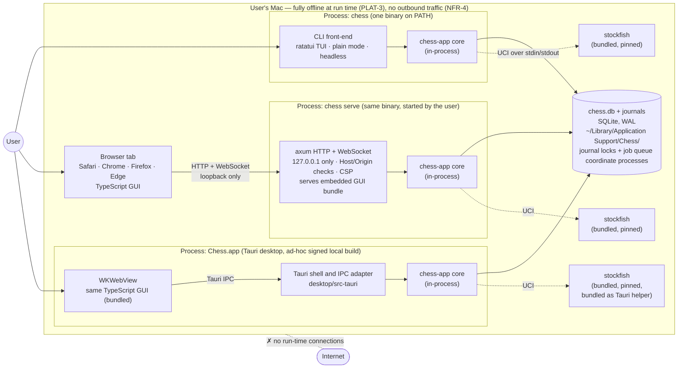

Key points:
- **Three processes, one library.** Each entry point is its own OS process that links the same `chess-app` crate. There is no shared daemon. They coordinate only through the data directory: the SQLite file and the per-game journal locks (§7.3, §7.6).
- **One `chess` binary** provides both the CLI (`chess`) and the web server (`chess serve`, which prints the URL and opens it in the default browser). It ships inside `Chess.app` and is put on `PATH` by `chess install-cli`, which makes a symlink (PLAT-6, §8.2), so there is one thing to install and one version (PLAT-1, NFR-5, D-16).
- **Three engine boxes, one block.** The diagram draws `stockfish` once per process because each process starts its own child. It is the same bundled binary. Requirements and functions allocate to the one block named `stockfish`. In the desktop process the binary is packaged as a Tauri "sidecar", which here means only a helper binary bundled with the app. It is still spawned by `chess-engine` from `<exe dir>/stockfish`, not by the Tauri shell, so there is one spawn path in all three processes (AMD-9, FG-2). A shell-spawn path would be a G2 design change and is not planned.
- **The desktop adapter is a block.** `Tauri shell and IPC adapter` (`desktop/src-tauri`) sits between the webview and the core. It maps one `invoke("core", envelope)` call onto the protocol dispatcher and forwards events. It holds no rules (principle 1). Functions that carry the protocol over Tauri IPC are allocated to it, not to the process boundary (FG-2, D-32).
- **Stockfish runs as a native child process.** It is pinned to a specific release (Stockfish 19, `sf_19`, D-9), shipped for both arm64 and x86_64 (a universal build, Q46), and bundled once inside `Chess.app`, next to the `chess` CLI binary that also lives in the bundle (§8.2, D-16). The WASM build is not needed, because the engine always runs in Rust, never in the browser. Install locations and how each process finds its engine are covered in §8.2 (D-18).
- **Trust boundary.** The only boundary inside the Mac is loopback. Any local process can reach the `chess serve` port, and the browser is treated as untrusted input to the core (§5.2, R-5, D-22). Everything else stays inside one OS user account, used by one person (ASM-1, CONFIRMED).

### 2.1 Build and release view (enabling system, D-31)

**Question this diagram answers:** which blocks and which external parties produce a release of Chess, and where do the release-time functions (build, engine acquisition, licence audit, platform matrix, install documentation) live? The run-time view in §2 has no block for any of them, and UC-29 is the use case for this scope (FG-1, FG-10, H-18).

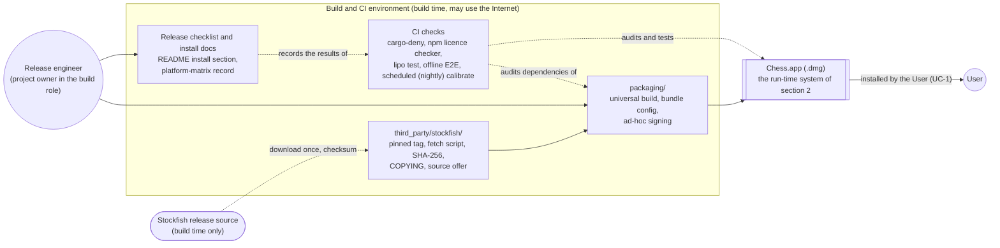

| Element | Kind | Role | Functions allocated (functional_decomp) |
|---|---|---|---|
| `Release engineer` | External actor | The project owner in the build role. The same person as the User under ASM-1, acting in a different role. Starts the release procedure, records the platform matrix, signs off the checklist (the sign-off is the owner's, never claimed here) | none: outside the boundary |
| `Stockfish release source` | Supporting external entity | The published `sf_19` release and its checksum. Reached at build time only. Running the app never uses it (PLAT-3, NFR-4) | none |
| `Build and CI environment` | Supporting external entity (boundary) | Runs builds, audits and tests. May use the Internet (§8.1, "Build vs. run") | none: it hosts the blocks below |
| `packaging/` | Block | `Chess.app` build (universal, Tauri target), `Info.plist` minimum system version, ad-hoc signing of the app and its executables, `.dmg`, licence notices | F-8.6 |
| `third_party/stockfish/` | Block | Pinned engine source or asset, `fetch.sh` with the SHA-256, the `lipo -info` and `uci` checks, `COPYING`, source offer | F-8.7 |
| `CI checks` | Block | `cargo-deny`, npm licence checker, the `lipo -info` packaging test, bundle scan, offline E2E, and the scheduled (nightly) `chess calibrate` job | F-8.9, F-3.9 |
| `Release checklist and install docs` | Block | `release/CHECKLIST.md` (platform matrix, FIDE Laws edition check, engine facts, licence result) and the README install, update and uninstall text (PLAT-6, NFR-5) | F-8.8, F-8.10 |

Notes:
- **Calibration (F-3.9; Addendum A, D-57).** The function is the nightly job, so F-3.9 stays allocated to `CI checks` (the functional decomposition is unchanged; the systems engineer may add the owner there). **The run itself, meaning the matches, the SPRT and the report, is owned by `chess-app core :: Calibration run`.** The `chess calibrate` subcommand inside `CLI front-end` only parses its arguments, opens a `Core` with `Core::open_for_calibration` and calls the run. It is dev tooling, is not reachable through the protocol (§4.5), and refuses to run on the default data directory (R-17).
- **Ownership.** One person plays every role in v1 (ASM-1). The roles are still separate so that a release does not depend on the person remembering what to check: the checklist is the control, not memory (UC-29, RISK-1, NFR-6).
- **Out of scope here:** hosting or distribution, an installer package, notarization, and automatic updates (requirements Out of Scope, PLAT-6).

### 2.2 Allocation blocks (normative names, D-32)

**Why this section exists.** The §2 diagram shows `chess-app core` as one box, so an allocation to it cannot tell the services apart (FG-3). The §4.1 diagram already shows the services. This table gives every block that functions and requirements may be allocated to one exact name. An allocation cell in functional_decomp uses these names verbatim. A name of the form `chess-app core :: X` means block X inside the core, in whichever process runs the core.

| Allocation name | Kind | Crate or path | Runs in | Owner role |
|---|---|---|---|---|
| `User`, `Internet` | External | — | outside the Mac | — |
| `CLI front-end` | Front-end block | `chess-cli` (TUI, plain, headless, `serve`, `install-cli`, `calibrate`, `export`, `import`) | Process: chess; Process: chess serve | CLI developer |
| `axum HTTP + WebSocket` | Transport block | `chess-server` | Process: chess serve | Core developer |
| `Browser tab` | Front-end block | `ui/` | the browser | GUI developer |
| `WKWebView` | Front-end block | `ui/` | Process: Chess.app | GUI developer |
| `Tauri shell and IPC adapter` | Transport block | `desktop/src-tauri` | Process: Chess.app | GUI developer |
| `chess-app core` | Block (whole) | `chess-app` and the crates it links | every process | Core developer |
| `chess-app core :: Protocol dispatcher` | Core part | `chess-app::protocol`, event stream | every process | Core developer |
| `chess-app core :: PlayerService` | Core part | `chess-app` | every process | Core developer |
| `chess-app core :: GameSetupService` | Core part | `chess-app` | every process | Core developer |
| `chess-app core :: SessionRegistry` | Core part | `chess-app` | every process | Core developer |
| `chess-app core :: GameSession` | Core part | `chess-app` (one actor per live game) | every process | Core developer |
| `chess-app core :: Policy` | Core part (pure) | `chess-domain` | every process | Core developer |
| `chess-app core :: Game domain` | Core part (pure) | `chess-domain` (`Game`, `Clock`, `EloCalc`, `RosterGen`, `VariationTree`, `EcoTable`, `BoardGrid`) | every process | Core developer |
| `chess-app core :: chess-rules` | Core part (pure) | `chess-rules` (moves, SAN, FEN, PGN) | every process | Core developer |
| `chess-app core :: EngineGateway` | Core part | `chess-app` | every process | Core developer |
| `chess-app core :: chess-engine` | Core part | `chess-engine` (UCI driver, pool, personalities) | every process | Core developer |
| `chess-app core :: AnalysisService` | Core part | `chess-app` | every process | Core developer |
| `chess-app core :: AnalysisWorker` | Core part | `chess-app` | every process | Core developer |
| `chess-app core :: StatsService` | Core part | `chess-app` | every process | Core developer |
| `chess-app core :: ImportExportService` | Core part | `chess-app` | every process | Core developer |
| `chess-app core :: chess-store` | Core part | `chess-store` (store thread, `MoveJournal`, migrations, backups) | every process | Core developer |
| `chess-app core :: Diagnostic log` | Core part | `chess-app` (tracing setup, rotation) | every process | Core developer |
| `chess-app core :: Calibration run` | Core part | `chess-app` (`calibration`: matches between classes and reference settings, SPRT, report; *Addendum A*, D-57; F-3.9 stays allocated to `CI checks`, which starts it through `chess calibrate`) | the `chess calibrate` process only | Core developer |
| `chess-app core :: JournalCodec` | Core part (pure) | `chess-app` (conversion between a domain `Fact` and a journal record, §7.6; added by amendment 7, D-41; no function is allocated to it yet) | every process | Core developer |
| `chess.db + journals` | Data store | `~/Library/Application Support/Chess/` | the data directory | Core developer |
| `stockfish` | Supporting block | `third_party/stockfish/` build output | child of each process | Core developer |
| `Process: chess (one binary on PATH)`, `Process: chess serve (same binary, started by the user)`, `Process: Chess.app (Tauri desktop, ad-hoc signed local build)` | Process boundaries | — | used for process-level functions only | — |
| `packaging/`, `third_party/stockfish/`, `CI checks`, `Release checklist and install docs` | Enabling-system blocks | §2.1 | build time | Release engineer |

The `User's Mac` boundary is used only for the top function F-0. A cell that names two or three front-end blocks (for example `Browser tab; WKWebView`) means one behaviour realised once per front-end codebase (FG-4); no split of responsibility is implied.

---

## 3. Code organisation

### 3.1 Repository layout (baseline; a two-way door that may change during implementation)

```
chess/
├── Cargo.toml                 # Rust workspace
├── crates/
│   ├── chess-rules/           # board, move gen, SAN/UCI parse+format, FEN, PGN,      (pure)
│   │                          #   ECO table + position lookup, built from third_party/eco (D-20, D-75)
│   ├── chess-domain/          # game state machine, policy, clock, Elo, roster,       (pure)
│   │                          #   variation tree, stats aggregation, ASCII renderer,
│   │                          #   ECO classification (deepest named position) over rules' eco::lookup (D-20, D-75)
│   ├── chess-engine/          # Engine trait, UCI driver, Stockfish process pool,
│   │                          #   computer personalities, FakeEngine
│   ├── chess-store/           # SQLite schema, migrations, repositories, export/import
│   ├── chess-app/             # THE shared core: services, game session actors,
│   │                          #   engine gateway, protocol types (→ TS via ts-rs)
│   ├── chess-server/          # axum: static GUI assets + WebSocket protocol endpoint
│   └── chess-cli/             # bin "chess": ratatui TUI, plain mode, flags, `serve`
├── desktop/
│   └── src-tauri/             # Tauri shell: links chess-app, exposes commands/events
├── ui/                        # TypeScript GUI (Vite + React), shared by web & desktop
│   └── src/
│       ├── protocol/          # generated TS types (do not edit)
│       ├── transport/         # CoreClient interface + ws.ts + tauri.ts
│       ├── board/             # Board contract, BoardModel reducer, AccessibleOverlay,
│       │                      #   chessground adapter + Reconciler, PromotionPicker
│       ├── screens/           # register, home, setup, play, watch, analysis, history,
│       │                      #   stats, computer players, players, import/export, settings, help
│       └── themes/            # ≥10 board themes, ≥5 piece sets
├── e2e/
│   ├── scenarios/             # front-end-neutral scenario files (setup + moves + expected)
│   ├── cli/                   # PTY runner (vt100 screen parsing for the TUI)
│   └── gui/                   # Playwright runner (web + desktop)
├── third_party/stockfish/     # pinned version, build script, LICENSE, source offer
├── packaging/                 # Chess.app/.dmg build, Info.plist, ad-hoc signing (§8.2). `install-cli` is a subcommand of `chess`, not a script
├── ci/                        # cargo-deny config, npm licence check, lipo/bundle tests, scheduled (nightly) calibrate job (§2.1)
├── release/                   # CHECKLIST.md: platform matrix, FIDE Laws edition, engine facts, licence result (§2.1)
└── docs/
```

### 3.2 Crate dependency graph

*Amended 2026-10-31 (AMD-1, D-38). The known open issue of the SDD triage is resolved here: 5.7 already named three `chess-app` services as consumers of `chess-rules`, and the graph had no `chess-app -> chess-rules` edge. The edge is added, and one rule keeps the front-ends from reaching below `chess-app`.*

Question this view answers: which crate may call which. Arrows point from a crate to the crates it depends on. Pure crates have no I/O dependencies. Dotted arrows are third-party or generated-code relations.

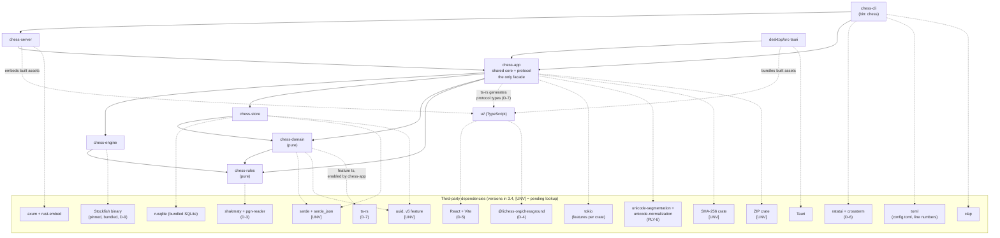

**Edge rule (D-38).**
1. **`chess-app` is the only facade.** `chess-cli`, `chess-server` and `src-tauri` depend on `chess-app` (and `chess-cli` on `chess-server`, for `serve`). They have **no** edge to `chess-rules`, `chess-domain`, `chess-store` or `chess-engine`. `chess-engine` has no edge to `chess-domain`, and `chess-store` has no edge to `chess-rules`.
2. **`chess-app -> chess-rules` is an architecture correction, not a new need.** A direct edge is clearer than a re-export through `chess-domain`, which would make the pure domain crate carry the API of another crate. `chess-domain` and `chess-store` re-export no `chess-rules` type. The store keeps its own small stored-side enums in its journal records.
3. **What a front-end may use from below `chess-app`** is exactly the curated list of named `pub use` items in the `chess-app` `lib.rs`: no glob re-exports, and every item names its consumer in the app design. At the start that list holds the board-rendering types from `chess-domain` (`BoardGrid`, `BoardStyle`, `BoardView`, `Cell`, `Shade`, `Highlight`, `Orientation`; *Addendum A, FIND-JR-005:* `Orientation` was missing, and "the cell types" is replaced by names so FF-1 can compare the list), the calibration items for `chess-cli` (the run function, `CalibrationPlan` and `CalibrationReport`; names proposed, D-57), and, behind the Cargo feature `test-support`, `Seams`, `Core::open`, `Core::open_for_calibration` and the `FakeEngine` factory (item 4). `DataDir` is not re-exported. A fitness function checks the list (FF-1, §9).
4. **Production wiring is inside `chess-app`.** `Core::open_default(CoreConfig)` builds the production engine factory, system clock and OS random source. `Core::open(cfg, Seams)` stays as the test and calibration entry, with `Seams = { engine: Arc<dyn EngineFactory>, time: Arc<dyn TimeSource>, rng: Arc<dyn Rng>, data_dir: DataDir }` (D-39). *Addendum A (FIND-JR-006; D-61):* **`chess-app` defines the `EngineFactory` trait and also writes the production factory**, over the concrete public spawn API of `chess-engine` (the pool and handle constructors). `chess-engine` supplies no factory, needs no change and gains no edge. `FakeEngine` implements the same `Engine` trait as the production engine, and the test factory in `chess-app` implements `EngineFactory` over it. The feature `test-support` of `chess-app` exposes that test factory (an `EngineFactory` that returns scripted `FakeEngine`s) and a helper that opens a `Core` over a temp-directory store, so the tests of `chess-cli`, `chess-server` and `src-tauri` can build a `Core` without an edge to `chess-engine` or `chess-store`. The feature turns on `chess-engine`'s own `test-support` feature; `chess-app -> chess-engine` already exists, so this adds no edge. Names and shapes are fixed in the app design (G1). `chess_app::resolve_data_dir(flag, env)` is a thin wrapper over the store's resolver, so the data-directory logic has one owner (the store). `Core::build_info()` returns `{build_version, protocol_version}`, and `chess_app::new_game_uuid()` serves the CLI. The GUI keeps Web Crypto for `game_uuid` (§5.6).
5. **Typed moves** are parsed by `chess-rules` alone, reached from front-ends through `Query::ParseMove` (§5.1, D-45). The CLI therefore needs no `Position`.
6. **Wire types.** The few domain value types that appear in commands (`GameSetup`, `Mode`, `Matchup`, `ClockSpec`, `Category`, `Preferences`) derive `ts-rs` behind the Cargo feature `ts`, which `chess-app` enables. The domain stays free of I/O. The domain `Command` for `Game::decide` is renamed `GameCommand` so it cannot be confused with `protocol::Command`. No exposed `i64` or `u64` field can exceed 2^53 (millisecond timestamps are fine). `serde` is a dependency of `chess-domain` and `chess-store` only; `chess-rules` and `chess-engine` stay free of it.

Gate: G2 (a dependency edge and the public surface of `chess-app`). Door: two-way before code, harder after (D-38, §11.3).

### 3.3 Crate responsibilities

| Crate | Responsibility | Key types | Requirements |
|---|---|---|---|
| `chess-rules` | Positions, legal-move generation, check/mate/stalemate, draw detection, SAN and coordinate parsing (lenient: either case, optional `+ # x`, `0-0`), SAN formatting, FEN, PGN with variations. Wraps `shakmaty` + `pgn-reader` (GPL-3.0, already perft-verified) rather than writing move generation from scratch (D-3, AGREED). *Amd 7 (AMD-1, AMD-3, D-45):* `Position::parse_move(text, Typed)` is the **only** typed-move parser; there is no CLI or TypeScript matcher. `Fen` gains `as_str`/`Display`. `canonical_form` (tags and SAN movetext) is the input of the content hash (D-42); the hash itself is computed in `chess-app`. Termination detection (mate, stalemate, dead position, repetition, fifty-move) is a query of this crate that the domain invokes (AMD-10). *Amd 8 Addendum A (D-75, readiness C-1):* the **ECO table and the position lookup `eco::lookup(&PositionKey) -> Option<EcoEntry{code, name}>`** live here: the table is generated at build time by a `build.rs` from the pinned snapshot in `third_party/eco/` (D-20). The lookup knows positions only; the game-level rule is in `chess-domain`. | `Position`, `Move`, `San`, `Fen`, `PgnGame`, `MatchedMove` (renamed from `ParsedMove`, D-52), `PositionKey`, `EcoEntry` (D-75) | RULE-1, CLI-3, RULE-6/7/8, IF-1..3, DAT-3 (position lookup) |
| `chess-domain` | Game state machine; `Policy` (mode × matchup × state → allowed actions); `Clock` with an injected `TimeSource`; Elo calculator (K 40→32, no clamp, exclusions); class bands; seeded roster and personality generator; variation tree; stats aggregation; ECO classification of a game: the deepest-named-position rule over the `eco::lookup` of `chess-rules` (D-20, D-75); terminal-independent board renderer that produces a grid of styled cells (glyph, square shade, highlight) for each style (plain, Unicode, ANSI, no-color), used by both the TUI and plain mode. *Amd 7 (AMD-1, AMD-10, D-38 to D-44):* `GameId(Uuid)` and `PlayerId(Uuid)` newtypes (D-40); `Personality` is the stored and identity type with `error_permille: u16` (D-43); the `TimeSource` and `Rng` traits live here and their implementations in `chess-app`; `SplitMix64` is duplicated in `chess-engine` with a shared test-vector file, and `error_pick_seed(GameId, ply) -> u64` is the one seed function; `BoardGrid::from_fen(fen, &BoardView, style, orientation)` with `BoardView.last_move` as UCI text, so no front-end needs a `Position`; `aggregate`, `rating_series`, `check_history` and `counts_in_aggregates` own the statistics predicate and the empty-state rule (D-44); the domain `Command` is `GameCommand`; `ts-rs` derive behind the feature `ts` on six value types; `Fact` is the vocabulary of state changes (§7.6). The domain owns the precedence of end reasons: checkmate, stalemate, dead position, threefold repetition, fifty-move rule, with checkmate on the move that completes the fifty-move count standing (RULE-1); only that rule changes a result, the others change the label (SE interpretation Q-SE-4, confirmed). The TUI Elo chart renderer belongs to `chess-cli` (D-37); the domain exports series data only. | `Game`, `GameSetup`, `Policy`, `Action`, `Clock`, `EloCalc`, `RosterGen`, `VariationTree`, `EcoTable`, `BoardGrid`, `BoardStyle` | PLY-1/5, GAME-1/3, RULE-2/3/4, ELO-1/2, PLY-4, ENG-2, ANA-2, DAT-3 (ECO), UI-2/5, CLI-1/2, UI-3 |
| `chess-engine` | `Engine` trait; UCI driver over async stdin/stdout; process pool; timeouts, crash detection, restart; engine binary discovery (D-18); `EnginePersonality` → UCI options and search limits, plus seeded "random error" move selection; `FakeEngine` for tests. *Amd 7 (AMD-3, AMD-7, D-43, D-46):* the engine takes `search(SearchRequest)` and hands out `EngineHandle`s from an `EnginePool`; `EnginePersonality` carries `error_rate: f64` (= permille / 1000), converted by one function in `chess-app`; there is **no** edge to `chess-domain`; the `UCI_Elo` range is the constant `PINNED_UCI_ELO_RANGE` of the bundled binary (value unknown until ASM-3 is closed). | `Engine`, `UciEngine`, `EnginePool`, `EngineHandle`, `SearchRequest`, `SearchLimits`, `EnginePersonality`, `FakeEngine` | ENG-1/2/3, NFR-3 |
| `chess-store` | SQLite access (`rusqlite`, bundled SQLite), WAL, busy timeout, versioned migrations with a pre-migration backup, schema-version guard (D-16), repositories, game leases, analysis job queue, bulk row read/write for export and import (formats are owned by `ImportExportService`), `MoveJournal` (append + `F_FULLFSYNC`, `flock`, replay; §7.6). Runs on its own blocking thread (D-13). *Amd 7 (AMD-2, AMD-5, D-39, D-40, D-44):* `Store` is one cheap clonable **concrete handle** to the store thread, not a trait, and `chess-app` holds it directly (no `Arc<dyn Store>`, no generic `Core<S>`). The store API takes and returns `GameId`/`PlayerId` (UUID); integer row ids never cross the store boundary. The store returns **rows** for statistics, filtered only by structural keys (Player, reset window, side, limit); the SQL views `player_stats` and `head_to_head` are dropped. `roster_indexes() -> Vec<u32>` (every stored `roster_index`) serves the roster (§4.6); the store holds a flat `roster_index` and knows nothing of the interleaved scheme (Addendum A, ruling 3, OQ-21). | `Store`, `PlayerRepo`, `GameRepo`, `RatingRepo`, `JobQueue`, `Lease`, `MoveJournal` | DAT-1/2/3, RULE-5, NFR-2 |
| `chess-app` | **The shared core.** Name validation (PLY-6: trim, NFC, grapheme-cluster count, control-character check, using `unicode-segmentation` and `unicode-normalization`). The one `ConfirmationRequired` mechanism (UI-12). The diagnostic log writer (NFR-10). Application services that combine domain, store, and engine. One actor per live game. `EngineGateway` (the only path to the engine, policy-checked). Background analysis worker. The protocol: `Command`, `Query`, `Event`, `Snapshot` DTOs and the error catalogue (§5.5). *Amd 7 (AMD-1, AMD-3, AMD-6, D-38 to D-46):* the **only facade** for the front-ends (§3.2): `Core::open_default`, `Core::open(cfg, Seams)`, `resolve_data_dir`, `build_info`, `new_game_uuid`, the curated `pub use` list, `FrontEndSession`. Owns the calibration run (matches, SPRT, report; *Addendum A*, D-57), `JournalCodec` (pure conversion between a domain `Fact` and a journal record, §7.6), `personality_to_engine` (the one conversion from the stored `Personality` to `EnginePersonality`), the content hash function (SHA-256, §5.7), and the production seams. | `Core`, `FrontEndSession`, `GameSession`, `EngineGateway`, `AnalysisWorker`, `JournalCodec`, `Command`, `Event`, `GameSnapshot` | PLY-1..5, GAME-1..4, RULE-2..8, ENG-3/5, DAT-2/3, ELO-1/2, UI-1/2/5, ANA-1..3 (allocation in §10) |
| `chess-server` | axum app bound to `127.0.0.1`: serves the embedded GUI build, one WebSocket endpoint carrying the protocol, Host/Origin checks, CSP header, port selection. | `serve(core, port)` | PLAT-1, PLAT-3, PLAT-4, DAT-1, NFR-4, NFR-7 |
| `chess-cli` | `chess` binary: argument parsing (`clap`); `install-cli` and `serve` lifecycle (config errors, signals); `export` and `import` subcommands; full-screen TUI (`ratatui` + `crossterm`) with screens, widgets, and an async event loop over the core; plain line-oriented mode; command/move/key disambiguation; scripted headless mode; `serve` subcommand. *Amd 7 (AMD-1, D-38, D-45):* depends on `chess-app` (and `chess-server`) only. It owns the TUI Elo chart renderer and parses typed moves through `Query::ParseMove`. | `TuiApp`, `Screen`, `BoardWidget`, `InputLine`, `KeyMap`, `PlainRunner`, `InputParser` | CLI-1..4, UI-2/4, PLAT-1 |
| `desktop/src-tauri` | The block `Tauri shell and IPC adapter` (§2.2): creates the `Core`, maps protocol commands onto Tauri commands, forwards events with `emit`, bundles the Stockfish binary as a helper (AMD-9: Tauri calls it a sidecar; the Rust core, not the shell, spawns it), sets the Tauri CSP. The main binary is renamed so it cannot collide with the CLI binary `chess` on a case-insensitive volume (§6.3). | — | PLAT-1, PLAT-3, GUI-1 |
| `ui/` (TypeScript) | One GUI bundle for web and desktop: screens, `Board` component (D-4), typed SAN input (parsed by `Query::ParseMove`, no TypeScript matcher, D-45), client state (snapshot, view cursor, local clock countdown), themes, `CoreClient` transports. Holds no rules. Controls come from `allowed_actions`. | `CoreClient`, `BoardProps`, `BoardModel`, `AccessibleOverlay`, `Screen`s | GUI-1..4, UI-1..5, GAME-3 (view cursor), PLAT-2 |
| `packaging/` | `.app`/`.dmg` build, bundle metadata (`LSMinimumSystemVersion`), ad-hoc signing of the app and its executables, licence notices (§8.2). Part of the enabling system (§2.1). | — | PLAT-1/2/6, NFR-5 |
| `ci/`, `release/`, `third_party/` | CI checks, release checklist and install docs, pinned engine (§2.1). Enabling system, not shipped | — | NFR-5, NFR-6, IF-4, RISK-1 |


### 3.4 Baseline versions (CR-7.3, FIND-006)

The user's rule: use the latest version of every open-source component and language as of the baselined requirements. "Baselined" is taken as the date of the last baseline amendment, **2026-10-28**. Each version below is the highest stable (not pre-release, not yanked) release published on or before that date, read on 2026-10-30 from crates.io, the npm registry, the Rust release channel (`channel-rust-stable.toml`), nodejs.org and the Stockfish GitHub releases `[RAN]`. `Cargo.lock` and `package-lock.json` record the exact resolved set at implementation; a dependency is raised later only through a normal change, with a CVE scan (§8). A version that needs a newer toolchain than the one installed is a reason to update the toolchain, not to pick an older version.

| Component | Baseline version | Published | Notes |
|---|---|---|---|
| Rust | **1.99.1**, edition **2024** | 2026-10-13 | Workspace `rust-version = "1.99"`. `shakmaty` and `pgn-reader` require 1.97, Tauri 1.90, `rusqlite` 1.89. **The development Mac has 1.89.0 and must be updated first** (`rustup update stable`). **Stable only: no nightly toolchain, ever (D-76)** |
| Node.js | **26.13.0** (LTS "Lithium") | 2026-10-28 | The development Mac has 26.12.1 (a Current release); update to 26.13.0 |
| TypeScript | **7.0.2** | 2026-07-08 | Strict mode (SWE-001 ASM-S1) |
| `shakmaty` / `pgn-reader` | **0.30.2** / **0.29.1** | 2026-10-07 | D-3. Step-1 dependencies; pre-1.0 versions, so the minor version is pinned and API drift is absorbed inside `chess-rules` |
| `tokio` | **1.54.1** | 2026-10-21 | D-13 |
| `ratatui` / `crossterm` | **0.30.2** / **0.29.0** | 2026-06-19 / 2025-04-05 | D-6 |
| `rusqlite` (bundled SQLite) | **0.41.1** (`libsqlite3-sys` 0.39.1) | 2026-10-28 | D-12. The SQLite release inside `libsqlite3-sys` 0.39.1 was not read `[UNV]`; the CVE scan covers it |
| `axum` | **0.8.9** | 2026-04-14 | Web server; `rust-embed` **8.13.0** |
| Tauri (crate) / `@tauri-apps/api` / `@tauri-apps/cli` | **2.12.5** / **2.12.4** / **2.12.4** | 2026-10-21 / 10-14 / 10-21 | Tauri 2 (the 3.x line is alpha). Fixes the sidecar, IPC and CSP mechanics of §6.3 |
| `ts-rs` | **12.0.1** | 2026-01-31 | D-7 |
| `unicode-segmentation` / `unicode-normalization` | **1.13.3** / **0.1.26** | 2026-06-01 / 2026-10-16 | PLY-6 |
| `toml` / `tracing` / `tracing-appender` / `thiserror` / `serde` | **1.1.8** / **0.1.44** / **0.2.5** / **2.0.21** / **1.0.229** | 2026-10-09 … | Config, logging, errors |
| React / `react-dom` | **19.3.1** | 2026-10-14 | D-5 |
| Vite / `@vitejs/plugin-react` | **8.3.5** / **6.1.2** | 2026-10-21 / 10-05 | D-5. Needs Node 20.19+ or 22.12+ |
| `@lichess-org/chessground` | **10.5.0** | 2026-10-20 | D-4 candidate, subject to the board spike (OQ-9). The unscoped `chessground` package on npm is old (9.2.1, 2025-05-15) and is not used |
| Test and lint tools | `proptest` **1.12.0**, `insta` **1.49.0**, `cargo-mutants` **27.1.0**, `cargo-llvm-cov` **0.9.1** (coverage, D-76), `cargo-deny` **0.20.2**, `cargo-audit` **0.22.2**, `expectrl` **0.9.0**, `vt100` **0.18.1**; Vitest **5.0.5**, Playwright **1.64.1**, `@axe-core/playwright` **4.14.0**, ESLint **10.13.0** with `typescript-eslint` **8.72.1**, Prettier **3.9.10** | 2026-05 to 2026-10 | §9. Presence on the development Mac, checked 2026-11-04 `[RAN dependency-lookup-step1.md E3]`: `cargo-deny` 0.20.2, `cargo-audit` 0.22.2 and `cargo-llvm-cov` 0.9.1 (with the `llvm-tools` component) are installed at the baseline versions; `cargo-mutants` and `cargo-insta` are not installed. The other tools were not checked |
| Stockfish | **19** (`sf_19`) | 2026-09-05 | D-9, IF-4 (CR-3) |

Not in the table because they do not affect the design: other transitive crates and packages, which are whatever the two lock files resolve.

**Toolchain and test-tool policy (D-76, Amendment 8 Addendum B; Brian Prascher, G2, approved 2026-11-04).** The project deploys on many machines and has no nightly capability, so **no nightly Rust toolchain is used, ever**, and no document, CI job or script may require one. ("Nightly" in this document's CI jobs, for example the nightly calibration run, means a scheduled overnight run on the stable toolchain.) **Admitted:** `cargo-llvm-cov` **0.9.1** as the coverage tool of the 90 % line-coverage gate in test-strategy: published 2026-09-06, Apache-2.0 OR MIT, MSRV 1.87, no advisory on the tool itself, installed on the development Mac with the stable `llvm-tools` component `[RAN 2026-11-04, dependency-lookup-step1.md E3, E4, E9]`; a developer and CI binary, not linked into the product. **Not admitted:** `cargo-fuzz` 0.13.2 (it needs a nightly compiler `[OBS dependency-lookup-step1.md F4]`); `libfuzzer-sys` 0.4.13 (its only consumer is a `cargo-fuzz` target crate; licence `(MIT OR Apache-2.0) AND NCSA`); `arbitrary` 1.5.0 (it only structures fuzz-target input; the `arbitrary` feature of `shakmaty` is not enabled). **`cargo-nextest` is not adopted for now (D-81, Addendum D, 2026-11-04).** The copy on the development Mac, 0.9.128, is in the affected range of RUSTSEC-2026-0412 `[RAN dependency-lookup-step1.md E3, E9; F3]`, so no document, CI job or script may require it, and the test suite runs with plain `cargo test` on the stable toolchain (`cargo llvm-cov` wraps `cargo test`). Adopting it later needs a fresh lookup of a patched version and a G2 decision. The lookup report of 2026-11-04 recorded the advisory as patched from 0.9.150 `[OBS lookup F3]`; this document does not re-verify that `[UNV]` and pins no nextest version. **Not decided, and therefore not admitted:** `cargo-insta` (not looked up). NFR-3 is verified by stable-only means (§9).

**Dependency admission (AMD-8, D-47; evidence `[UNV]`).** Principles: prefer the standard library; prefer the crate that the ecosystem leader already pulls in; name the features; one crate per job. **Every dependency below needs a registry lookup, a licence check and a CVE scan (SWE-001 section 5) before a version enters the table above. No version is stated here.** Admitted in principle (user decision 11, with the changes after the table). The "Review row" column is the numbering of the SDD consistency review section 6, not an architecture decision ID.

| Dependency | Used by | Review row | Note |
|---|---|---|---|
| `serde` (derive) | `chess-domain`, `chess-store`, `chess-app` | D-3 | A 3.2 omission corrected. `chess-rules` and `chess-engine` stay free of it. A version is already in the table above from an earlier lookup; the feature set is `[UNV]` |
| `serde_json` | store (journal payloads), app (protocol, archive) | D-4 | `[UNV]` |
| `uuid` (v5 feature) | `chess-domain`, `chess-store`, `chess-app` | D-5 | The CLI uses `new_game_uuid()` and has no edge. `[UNV]` |
| `crc32fast` | `chess-store` | D-6 | Journal record checksum; a hand-written CRC is not worth the review cost. `[UNV]` |
| `tokio` features | per crate | D-8 | Feature sets listed per crate in the SDDs |
| `tracing-subscriber` | `chess-app` | D-11 | `[UNV]` |
| ZIP library | `chess-app` | D-15 | Chosen after lookup; deflate only, no unneeded features. `[UNV]` |
| SHA-256 implementation | `chess-app` only | D-16 | The pure crates stay free of it. A non-cryptographic hash is not used, because a false duplicate silently drops a game (D-42). `[UNV]` |
| `futures-util` (and `tokio-stream` only if needed) | `chess-app`, `chess-cli` | D-17 | Not the umbrella `futures` crate; crossterm `event-stream` feature for the CLI. `[UNV]` |
| `tokio-util` (cancellation token) | `chess-app` | D-18 | Same project family as `tokio`. `[UNV]` |
| `clap` | `chess-cli` | D-21 | §3.3 already named it; its omission here was an architecture defect |
| Testing Library and a DOM environment | `ui/` (test only) | D-27 | Dev dependency. `[UNV]` |
| Lichess `chess-openings` snapshot | `third_party/eco/` | D-32 | A data dependency, in the NFR-6 licence audit. The CC0 claim stays `[UNV]` until the file is read (D-20) |

**Deferred (spike first).** File locking and `F_FULLFSYNC` (review row D-7): the standard library may already provide `flock` (`File::lock`) and a full sync on macOS; this is `[UNV]`. A 30-minute spike on the target toolchain decides. A safe wrapper crate is added only if the standard library is not enough, and `libc` last, with one documented `unsafe` module (OQ-14).

**Rejected.**
- `signal-hook` (review row D-22): `tokio::signal` handles signals.
- A single-instance mechanism (review row D-24): **dropped by the user**. It is not a requirement (SE desk answer Q-SE-21), and the store lock covers concurrent launches (DAT-1, DAT-4). No plugin dependency.
- A native save-dialog plugin (review row D-25): file transfer needs none (§5.2, D-45 and decision 9).
- A schema validator for core messages (review row D-28): the envelope is checked, and the types are generated.
- An `arc-swap`-like cell (review row D-30): `RwLock` or `tokio::sync::watch` is enough.
- `rand` and `rand_chacha` (review row D-31): the project owns `SplitMix64` (§4.6).

Unchanged and already in the table: review rows D-1, D-2, D-9, D-10, D-12 to D-14, D-19, D-20, D-23, D-26, D-29, D-33.

---

## 4. The shared core (`chess-app`)

### 4.1 Internal structure

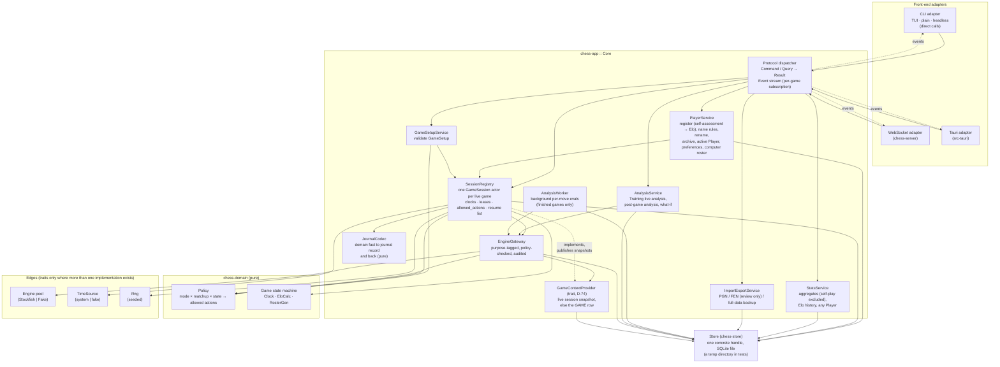

**Amendment 7 (AMD-2, AMD-10, D-39).** The store is drawn outside the "edges" box because it is **not** a trait: `chess-app` holds the concrete `chess_store::Store` handle, and tests use a real store in a temp directory with fault injection (`FaultPlan`) instead of a fake. A SQLite `:memory:` database cannot use WAL, so the earlier "in-memory store" wording could not be met anyway `[INF]`. If the core integration suite becomes too slow (FF-2, §9), a trait and a fake are introduced then; the change is mechanical. Four intra-core edges the design needs were missing from this diagram and are added: `PlayerService -> SessionRegistry` (void of a live game on reset, §7.2), `GameSetupService -> SessionRegistry` (slot and live-game checks), `AnalysisService -> Store` (`VARIATION`), and `EngineGateway -> Store` (`analysis_used`). `APP_SETTING` has its writer named: `PlayerService` (§7.4). `JournalCodec` (§7.6) is the one place where a domain `Fact` becomes a journal record. *Amd 8 Addendum A (D-74, CONFIRMED by Brian as a G2 decision on 2026-11-04, Addendum D):* **OQ-13 is answered.** The gateway gets the game state it checks through `GameContextProvider`, a trait private to `chess-app`. `SessionRegistry` implements it (the live session's last published snapshot, else the `GAME` row read through the store), and the gateway never names the registry or a session, so there is no cycle with `SessionRegistry -> EngineGateway`. The diagram gains one node and three edges (`EngineGateway -> GameContextProvider`, `SessionRegistry -. implements .-> GameContextProvider`, `GameContextProvider -> Store`). They are intra-crate, so §3.2 is unchanged (no crate edge); they carry the tier G2 as a precaution, and Brian confirmed D-74 as a G2 decision (Addendum D).

**Allocation names.** The boxes in this diagram are the normative sub-blocks of `chess-app core` (§2.2). A function or requirement allocated to `chess-app core :: PlayerService` is the service's job, whichever process runs it. The three front-end adapters are `CLI front-end`, `axum HTTP + WebSocket` and `Tauri shell and IPC adapter` (D-32).

**Cross-cutting duties of the core** (they have no box of their own because every service uses them):
- **Confirmation.** A command that needs a user decision returns `ConfirmationRequired` until it carries `confirmed: true` (§5.5). The services that own the actions listed in UI-12 are the only callers (D-33). The check is one shared helper in `chess-app`, not a box of its own, so the functional decomposition allocates F-2.5.7 to `chess-app core`, not to the Protocol dispatcher; the dispatcher only routes the command.
- **All-or-nothing.** Each store-changing command is one store-thread transaction or, for restore and migration, a copy-then-rename. A failure leaves the store as it was and returns a catalogue error whose message states the next step (DAT-7, NFR-9, D-35).
- **Diagnostic log.** `chess-app core :: Diagnostic log` writes identifiers and error detail, never names or move lists (NFR-10, §10.2).

### 4.2 Game sessions as actors

Each live game is one `GameSession`: a tokio task that owns that game's `chess_domain::Game` value. Commands reach it over an `mpsc` channel, and it publishes `Event`s on a `broadcast` channel. Every front-end — including two hot-seat humans on one screen — subscribes to the same stream.

- Commands are handled one at a time, so a game cannot race with itself: a human move, a flag falling, and an engine reply can never interleave.
- **Optimistic concurrency guards rewind (GAME-3).** Every move command carries the `ply` the client believes is current. If a client is rewound, or a computer move landed meanwhile, the `ply` does not match and the command is rejected with `StalePosition`. Rewind itself is purely client-side view state: the snapshot includes the FEN and SAN of every ply, so stepping back needs no engine and no server round trip, and it cannot touch the record.
- **Computer turns** are spawned as cancellable engine tasks whose results return to the actor as messages. The actor stays responsive while the engine thinks: a human can resign, a watcher can pause or abort, and a flag can fall (ENG-5, NFR-8, GAME-2).
- **Clocks** are domain values driven by an injected `TimeSource`. The actor arms a single timer for the active side's flag deadline. **Every state that waits for a decision stops both clocks**: `Paused` and `DrawOffered` (RULE-2, GAME-2). The `Clock` value then has `running_side = None`, the flag timer is disarmed, and the next `Clock` journal record carries the stopped values. Clients receive `{white_ms, black_ms, running_side, as_of}` and count down locally, so there is no stream of tick events. The core alone decides when a flag falls.

### 4.3 Game state machine

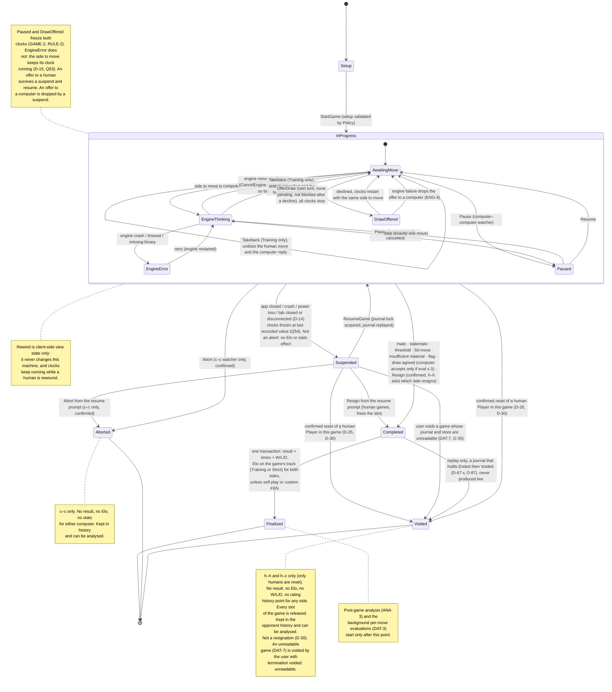

### 4.4 Mode policy as a single table

`Policy::check(action, &GameContext) -> Result<(), Denied>` is a pure function and the single source of truth. `GameContext` holds the mode, matchup, game state, whose turn it is, whether that side is human or computer, and whether the game is still in progress.

| Action | Training (h–c) | Strict (h–c, h–h, c–c) |
|---|---|---|
| Takeback | ✅ to the human's turn. Stops at the human's first turn. During a search, undoes one move; after the computer's reply, undoes both (D-33). Moves taken back leave the record. Nothing to undo: `NothingToTakeBack` | ❌ |
| Live analysis / what-if on the current game | ✅ human only | ❌ until the game ends |
| Rewind (client view) | ✅ human | ✅ human (either hot-seat human); ❌ c–c has no human player, but watchers may scroll the move list |
| Clock selection | ❌ always untimed | ✅ presets + custom |
| Offer draw (humans only; a computer never offers, Q42). Only on the offerer's own turn, never during a search, never while an offer is pending, and not again after a decline until the offerer has moved (D-33). All clocks stop while pending | ✅ to the computer, which accepts only if its eval ≤ 0. The decision runs within the ENG-3 maximum think time and cannot be withdrawn | ✅ h–h: to the other human, no time-out, moves blocked until answered. h–c: to the computer (eval ≤ 0 rule). ❌ c–c |
| Pause / step / delay | ❌ | c–c only |
| Resign (always confirmed) — the only way a human ends a game early. Also from the setup or resume offer (`Suspended` games) | ✅ human: counts as a loss for Training Elo and W/L/D | ✅ h–c, h–h: loss for Strict Elo and W/L/D. In h–h the front-end asks which side resigns, then confirms, from the game and from the resume offer. A self-play resignation has no Elo or W/L/D effect (self-play is unrated). Resigning a custom-start game is recorded in the game record only (H-17). ❌ c–c |
| Abort (always confirmed) | ❌ | c–c watcher only. Neither computer's Elo or stats change |
| Start a new game while a slot-holding Player has an unfinished game in this mode (D-27) | ❌ `UnfinishedGameExists`: resume it, or resign it. Only the human holds a Training slot. The computer is never blocked | ❌ same. h–h: each human holds a slot (one for self-play). h–c: only the human; the computer's slot is neither used nor checked, so any Player can always play any computer. c–c: each computer holds its Strict slot, and the setup offers resume or abort |
| CancelEngine ("move now", ENG-5). Front-end forms: command `movenow`, key F2, GUI "Move now" button (D-33) | ✅ only in `EngineThinking` in an h–c game | ✅ only in `EngineThinking` in an h–c game; ❌ c–c (use Pause); shown unavailable in every other state |
| Elo track | **Training Elo** for both sides, human and computer (computers have a Training Elo too) | **Strict Elo** for both sides, including c–c between different computers. Never for self-play or a custom FEN start |
| Counts in W/L/D | ✅ (filterable by mode) | ✅. Self-play is excluded in both modes |
| Post-game analysis | ✅ | ✅ |

**Player-management and setup rows (AMD-14, D-38).** The domain function `check_player_action` and the slot function `slot_holders` own these rules, and `chess-app` calls them and maps the result to `Denied` (SE desk answer Q-SE-3, interpretation confirmed). The `WhatIf` precondition is the domain's too and adds "a human is to move".

| Action | Rule | Refusal |
|---|---|---|
| Rename, archive or reset a computer Player | Refused (PLY-4) | `Denied{computer_player}` |
| Archive the Player this front-end session has selected | Refused (PLY-4) | `Denied{active_player}` |
| Archive a Player with an unfinished game | Refused; the message names the games | `PlayerHasUnfinishedGames{game_ids}` (its own code, §5.5). The triage proposal of a `game_open` reason is **not** added, because this situation already has this code |
| Choose an archived Player as a side in a new game | Not offered in any list (PLY-2: archived Players are hidden). The core still validates it, because another front-end can archive between listing and starting | `Denied{archived_player}` (additive, §5.6) |
| Switch the active Player (`SelectProfile`) while a game is open in this front-end session (PLY-2: "only while no game is open"; *Addendum A*, D-56) | Refused by `PlayerService`, not by the domain, because the check needs the `FrontEndSession`. A game is **open** in a session when the session holds a subscription to it or the handle of its `GameSession` (a live game on its screen). A suspended game that no session has attached does not count, and neither does a game open in another front-end. The first selection at launch passes (nothing is open) | `Denied{reason: state_not_allowed}` with `details.game_ids`. **No `game_open` reason is needed** (D-56) |

**In-play action rules (D-33).** The rules below are the architecture's reading of requirements RULE-2, RULE-3, ENG-5, GAME-1 and GAME-4 (CR-4.4, CR-4.6, CR-4.7, CR-4.8).
- **Takeback.** The earliest position reachable is the human's first turn: the start position when the human has White; the position after the computer's first move when the human has Black; from a custom FEN, the first position at which it was the human's turn. In `EngineThinking` the search is cancelled and exactly one move, the human's, is undone, so it is the human's turn again. After the computer's reply, both moves are undone. When there is nothing to undo (the earliest position, or the computer is making its opening move), the command returns `NothingToTakeBack` ("Nothing to take back"). **Taken-back moves are removed** from the `MOVE` rows, so from the stored move list, the exported PGN, the per-move times and any evaluation; the append-only journal keeps the `Takeback{to_ply}` record, so replay reaches the same state. A takeback does not change the game's rating track: it stays rated on the Training scale. `analysis_used` is unaffected.
- **Draw offer.** Allowed only on the offerer's own turn, not during a search, and not while an offer is pending. After a decline the same side may offer again only after it has completed another move (`Game` holds `offer_blocked_for: Option<Side>`, cleared when that side moves). While an offer is pending all clocks are stopped, and on a decline they restart with the same side to move. An offer to a human has no time-out and blocks moves until it is answered. An offer to a computer starts `ComputerDrawDecision`, which must finish within the ENG-3 maximum think time, shows the thinking indicator, and cannot be withdrawn. An engine failure drops the offer (ENG-4). Acceptance ends the game 1/2-1/2 with termination "draw agreed". Rejected attempts return `Denied` with the reasons `draw_not_own_turn`, `draw_engine_busy`, `draw_offer_pending`, `draw_repeat_blocked`, `draw_not_available` (c–c, or a Strict-only or human-only rule).
- **Move now.** `CancelEngine` is accepted only in `EngineThinking` of an h–c game. The command word is `movenow`, the key is F2 (TUI and GUI), and the GUI thinking indicator carries a "Move now" button that is keyboard reachable, has an ARIA label, and activates on Enter or Space. The core sends UCI `stop`, plays the best move found so far, and the move must land within 200 ms (TBD-12, §4.8). Elsewhere the control is shown unavailable.
- **Resume list.** `ListUnfinishedGames{player_id}` returns every unfinished game in which the active Player plays either side (the second side of a hot-seat game included; self-play appears once) **plus every unfinished c–c game**. It reads `GAME` for `status = 'in_progress'`, not the slot table, so a game held by a live session in another process is listed and marked "open in the CLI" (`GameLeased`). Resigning from the offer in a hot-seat game asks which side resigns, then confirms.

Every `GameSnapshot` includes `allowed_actions`, computed from this table. Front-ends render controls from that list and never re-derive the rules themselves. The table drives (a) table-driven unit tests over the full mode × matchup × state product, and (b) per-front-end E2E checks that the visible controls match `allowed_actions` exactly.

### 4.5 Engine gateway and Strict-mode integrity

Every engine call passes through `EngineGateway::request(purpose, …)`, where:

```rust
enum EnginePurpose {
    ComputerMove { game_id, player_id },          // a computer side choosing its move
    ComputerDrawDecision { game_id, player_id },  // the "eval ≤ 0" check (RULE-2); result never shown
    LiveAnalysis { game_id },                     // Training only
    WhatIf { game_id },                           // Training live, or any finished game
    PostGameAnalysis { game_id },                 // finished games only
    Calibration,                                  // dev/nightly tooling
}
```

The gateway looks up the game's state and mode and calls `Policy::check` before it touches the engine. *Amd 8 Addendum A (D-74, confirmed by Brian, G2):* it gets the state from `GameContextProvider` (§4.1) and never from its caller, and when no context can be produced (unknown game, store error) it fails closed: `Denied` or `Internal`, and the engine is not touched. Only `FreeAnalysis` and `Calibration`, which name no stored game, skip the lookup. `LiveAnalysis` or `WhatIf` on an in-progress Strict game returns `Denied`, even if a modified client sends it directly over the WebSocket. Every call is recorded in an in-memory audit log, which is the "spy on engine calls" required by ANA-1's verification. `Calibration` cannot be sent through the protocol. Only the calibration run of `chess-app` (D-57), which the `chess calibrate` dev subcommand calls, builds it, and it never names a user game.

The gateway also validates engine output. Every `bestmove`, including a seeded "error" pick, is checked for legality with `chess-rules` before the session applies it. An illegal or unparsable move counts as an engine failure (§4.7), so the game can never enter an illegal state (NFR-3).

### 4.6 Computer Players

- **Roster generation** (pure, `chess-domain`): `RosterGen::new(seed, uci_elo_range)` takes the pinned range as a plain value (below). The default roster is 5 Players per class. Each gets a human-readable name and a `Personality { skill_level, depth_limit, movetime_ms, uci_elo: Option<u32>, error_permille: u16, error_multipv }` (an integer permille, so the unique-parameter check of ENG-2 compares integers and never floats; the engine receives `error_rate = permille / 1000.0` from one conversion in `chess-app`, D-43) drawn within the class bounds, plus **two starting ratings, Strict Elo and Training Elo, both equal to its class baseline** (Beginner 400, Novice 600, Intermediate 1200, Master 2200, Grand Master 2500). That is the same rule as a human's self-assessment (Q41). From then on both ratings are **dynamic**: every rated game updates both sides on that game's track by the Elo formula, with the same K-factor rule as humans: 40 for the first 30 rated games **on that track**, then 32. The two tracks count separately (`strict_rated_games`, `training_rated_games`; Q78). The change is written to `RATING_HISTORY`. Its **engine parameters stay fixed** forever, so its rating converges toward its real strength. The **category label follows the current Strict Elo** (Q79) through the ELO-1 bands, never the Training Elo, while the engine settings stay those of the class it was created in. Generation rejects duplicate parameter sets across all computers (ENG-2). The result is persisted once and never regenerated (PLY-4, ENG-2). **One request creates N Players, 1 to 25, default 5 (TBD-31), in the chosen category** (`GenerateComputerPlayers{category, count}`). Each Player is a position in the seed's stream, numbered by the interleaved index `5*k + class` (`k` is the next free position within the class): `roster_index` fixes its personality and its UUID, which is derived deterministically as a UUIDv5 over the name string `chess-roster/v1/{seed}/{index}` (D-34, D-46), so an archive from another install matches by identity and DAT-2 prompts only for real conflicts. The **name** is the first unused candidate from that position's candidate names: the generator skips any name already used by any Player, human or computer, active or archived, so no collision prompt exists and no request can fail on a name. All N are inserted in one transaction or none (DAT-7). **Next index per class (AMD-7, amended by Addendum A, ruling 3, D-46):** the store holds a flat `roster_index` and **knows nothing of the interleaved `5*k + class` scheme** (Brian's option C, OQ-21). `StoreApi::roster_indexes() -> Vec<u32>` returns every stored `roster_index` (at most a few hundred integers, so it is cheap). (The name `next_roster_index` is dropped: the store no longer computes a "next".) `PlayerService` passes the list to the domain function `first_k_after(class, &stored) -> k`, which returns 0 when no stored index belongs to the class and otherwise one more than the largest *k* among the stored indices of the class (an index `5*k + c` belongs to class ordinal `c`); this widens the domain design's `highest_stored_index: Option<u32>` argument to a slice (G1 for the domain design). `PlayerService` then calls `RosterGen::generate(class, first_k, count, uci_range)`, and inserts the batch with one `insert_computers` transaction. The read and the insert are two store calls, not one transaction: `UNIQUE(roster_seed, roster_index)` is the arbiter. On `RosterIndexTaken` `PlayerService` repeats the whole sequence once (a fresh read) and then returns `StoreBusy`. A change to the interleaving therefore touches `chess-domain` only. Pools, bounds and the default seed stay editable until the first release and are permanent afterwards (D-34).
- **Playing a move:** limits = min(personality movetime, the active profile's max-think-time preference (UI-1), a clock-derived budget). Classes whose target strength lies inside the engine's `UCI_Elo` range use `UCI_LimitStrength`. *Amended 2026-10-31 (AMD-7, D-46).* The `UCI_Elo` range is a **pinned constant of the bundled engine**, `chess_engine::PINNED_UCI_ELO_RANGE`, set from the engine build step (ASM-3). It is not read from the handshake to generate Players, because that would make a permanent Player depend on the binary found at run time, and two machines (or an engine bump) would generate different Players from the same seed and index, which breaks D-34. The engine integration test EI-EN-002 compares the constant with the `min` and `max` of `option name UCI_Elo type spin …` in the real binary's `uci` handshake, fails CI when the engine pin changes without the constant (FF-7), and asserts that every stored `COMPUTER_PROFILE.uci_elo` lies inside the range. `chess-app` passes the constant to `RosterGen` and to the calibration run. At run time `EngineGateway` also clamps `UCI_Elo` into the handshake range for the **search only**, never for the stored value, and logs a mismatch with the constant as an installation defect. The first-launch roster no longer waits for the engine, so the lazy engine start and NFR-1 stay intact. **The value of the range is not written in any document**: it is unknown until the Stockfish 19 build is run (ASM-3) `[UNV]`. If a later engine changes the range, calibration is re-run before release. Beginner and Novice use a low `Skill Level`, shallow depth, and a random error: with probability `error_rate`, the core picks a non-best line from a MultiPV search. The seed is `error_pick_seed(game_id, ply)`, one function in `chess-domain` (it owns the `SplitMix64` generator and `GameId`), passed to the engine in `SearchRequest.seed`; the engine keeps its own copy of `SplitMix64` (about ten lines, shared test vectors, no `engine -> domain` edge, FF-8). Replays are therefore reproducible.
- **Calibration** is owned by `chess-app` (Addendum A, ruling 4, D-57). `chess_app::calibration` plays the matches between classes and reference settings, runs the SPRT and builds the report, on a `Core` from `Core::open_for_calibration(cfg)`, which refuses the default data directory (R-17). It plays through `EngineGateway` with `EnginePurpose::Calibration` (§4.5). The `chess calibrate` dev subcommand of `chess-cli` only parses its arguments, opens that `Core`, calls the run and prints the report; it holds no match, SPRT or report logic. The nightly CI job (F-3.9) starts the subcommand. The run is not a protocol command. It reports measured Elo and SPRT results against the class baselines, on the baseline machine: M4, 16 GB, macOS Tahoe (Q47). Because ratings are now dynamic (Q41), calibration is used to set the generator bounds before release and as a regression check. It never rewrites a released Player's parameters (R-2). Strength depends on `Threads`, `Hash`, and hardware, so computer-Player instances use fixed `Threads`/`Hash` values (placeholders in §4.7, set before the first calibration run). Those values are recorded with each calibration run. Changing them means recalibrating.
- **Whose max-think time applies (UI-1, user 2026-10-26).** It is always the **active profile's** setting, meaning the Player chosen in the profile chooser for that front-end session. In h–c it caps the computer's moves. In c–c it caps both computers' moves for the watching profile. In h–h there are no engine moves, so it caps only the engine analysis that profile requests: post-game analysis, deeper lines, and what-if. It can only shorten a limit, never lengthen it. The session passes the active profile to `EngineGateway` with each request.

### 4.7 Engine process management

| Use | Engine instances | Priority |
|---|---|---|
| Computer side(s) of a live game | One per computer side. Self-play c–c (same Player on both sides) gets two instances with identical options, so neither side shares the other's hash table. Placeholder `Threads` 1, `Hash` 16 MB (`ESTIMATE`) | Interactive lane |
| Training live analysis / what-if | One shared analysis instance per process, `MultiPV 3`. Placeholder `Threads` 2, `Hash` 64 MB (`ESTIMATE`) | Interactive lane |
| Post-game analysis + background per-move evals | The same analysis instance; the background worker yields to interactive requests | Background lane |

*Amended 2026-10-31 (AMD-12).* **Priority is by preemption lanes, not by `nice`.** Interactive requests (computer moves, the draw decision, live analysis, what-if) run in the interactive lane. The background worker runs one ply per request in the background lane: when an interactive request arrives for the shared analysis instance, the worker's current search is stopped (UCI `stop`), the interactive request runs, and the ply is repeated afterwards (the job resumes from its last stored ply, §7.4). The `Threads` and `Hash` values in the table are placeholders to be fixed before the first calibration run, then recorded with each run (§4.6).

Instances start lazily, which keeps CLI startup under 1 s (NFR-1). They are health-checked with `isready` and killed on timeout. **Restart rule (SE interpretation Q-SE-12, confirmed; the "restart once" of F-3.7 is read this way):** an instance found dead while idle is restarted transparently before the next request. A failure **in flight** is reported and not retried by the engine layer: the core emits `EngineUnavailable`, leaves the game in a resumable state (ENG-1), and lets the user retry (`RetryEngine`, the next request, which restarts the engine and asks again) or leave (the game is suspended). Engine failures are: process exit, no `uciok`/`readyok` within the handshake timeout, no `bestmove` within the search deadline (§4.8), or an illegal or unparsable move (§4.5). While the engine is unavailable, the side to move's clock keeps running (D-15, decided by Q53). A computer that can't recover in time can lose on time.

### 4.8 Concurrency and threading model (D-13)

Nothing slow ever runs on a UI thread: the browser main thread, the WKWebView main thread, or the TUI's `select!` loop. Engine searches run in a separate OS process. SQLite calls run on a dedicated store thread. The UI only sends commands and receives events.

| Execution context | Runs | Must not |
|---|---|---|
| tokio multi-thread runtime, one per process | Protocol dispatcher, `GameSession` actors, engine I/O tasks (async stdin/stdout), `AnalysisWorker`, axum (web), Tauri command handlers (desktop), TUI event loop (CLI) | Block. `rusqlite` is synchronous, so no SQLite call runs on a runtime worker |
| Store thread, one per process | Owns the single write connection. Requests arrive over a channel, and every transaction in §7.4 runs here. Read queries (stats, history) use a small pool of read connections through `spawn_blocking`. WAL lets readers run during a write | Hold a transaction across an `await` or an engine call |
| Stockfish child processes | Searches (§4.7) | Be reached by anything but `chess-engine` |
| `GameSession` actor, one tokio task per live game | All state changes of its game, one message at a time (§4.2) | Wait on the engine inline. Results come back as messages |
| GUI main thread (JS) | Rendering, `BoardModel` reducer, local clock countdown | Compute rules. Legal moves arrive in the snapshot, and what-if moves use `LegalMoves` (D-11) |
| TUI loop (`tokio::select!`) | Key, tick, signal, and core-event handling, plus `render` | Wait on a core future inline. Effects are spawned, and results come back as `Msg`s |

**Ordering and durability.** The actor applies a command to a copy of its `Game`, then appends the resulting record to the game's move journal and flushes it with `F_FULLFSYNC` (§7.6). Only after that does it swap in the new state and broadcast the event (principle 5). Writing to SQLite happens afterwards, on the store thread, so a busy or locked database never delays a move. If the journal write fails (disk full or read-only), the old state stays and the command returns `JournalWriteFailed` (§5.5).

**Backpressure.** Event channels are bounded `broadcast` channels. A subscriber that lags (`RecvError::Lagged`) is sent a fresh `GameSnapshot` instead of the missed events, so a slow WebSocket client can never stall a game.

**Timeouts and periods.** Values are `ESTIMATE`s for the baseline machine (M4, 16 GB, macOS Tahoe; Q47, Q53), to be confirmed by the engine integration benchmarks. Tests set them through config. Intel Macs use the same wall-clock values, so they get less search in the same time (R-14).

**Budget allocation is a Should (CR-7.4, FIND-007).** Splitting the NFR-8 100 ms budget across flush, core, transport and render, and setting a memory ceiling for the engine pool, are Should items of the `chess-store` and `GameSession` design. The design proceeds without them; the NFR-8 latency test (Must) still measures the whole path. They are done if the ASM-2 measurement shows the flush is a large share of the budget.

| Item | Value | On expiry |
|---|---|---|
| UCI handshake (`uci`→`uciok`, `isready`→`readyok`) (ENG-4, TBD-13) | 5 s (the accepted EST in ENG-4). Startup is expected to be well under 1 s on the baseline | Kill and restart once, then `EngineUnavailable` |
| Search deadline (ENG-4, TBD-13) | at the search's own limit + 500 ms, send `stop` | No `bestmove` by the limit + 2 s (the accepted EST in ENG-4) → kill, engine failure |
| `CancelEngine` → move played (ENG-5, TBD-12) | ≤ 200 ms (the accepted EST). Design target 100 ms (`stop` → `bestmove`) | Treated as a search-deadline failure |
| Computer move, top class (ENG-3) | ≤ 3 s by default, capped by the clock budget and the max-think preference | — |
| Computer draw decision (`ComputerDrawDecision`, RULE-2) | within the same ENG-3 maximum think time as a move. All clocks are stopped while it runs | Engine failure drops the offer (ENG-4). A suspend drops it |
| Web server stop (SIGINT or SIGTERM, PLAT-4) | ≤ 5 s `ESTIMATE` to stop accepting, notify pages, suspend open games (journal flush each), then exit 0 | Exit anyway: every acknowledged move is already durable, so nothing is lost |
| Training live analysis (ANA-1) | MultiPV 3, streamed, refined until the user leaves, capped at 10 s per position | Shows the deepest result so far |
| Background per-move evaluation (DAT-3) | 200 ms per ply at low priority (about 30 s for an 80-move game) | Job resumes from the last ply (§7.4) |
| On-demand deeper line / what-if (ANA-2/3) | 2 s per request | Shows the best line so far |
| Journal flush (`F_FULLFSYNC`) per record | a few ms per move. Measured in the NFR-8 latency test | `JournalWriteFailed` |
| Journal clock checkpoint (RULE-5, Q54, TBD-7) | every 1 s while a clock runs, plus on every move, pause, and suspend | After a crash, the clock is restored to the last checkpoint: at most 1 s is lost |
| Journal → SQLite apply | after every journal record, retried with backoff (0.1 s → 5 s) while the DB is busy or locked | Play continues. The backlog is shown in the status line if it exceeds 30 s |
| SQLite `busy_timeout` | 5 s (§7.1) | `StoreBusy` for non-game writes. Game writes are retried from the journal |
| Game lock (journal `flock`) and lease row heartbeat (DAT-4, TBD-28) | the lock is released by the OS when the owner exits or crashes. Heartbeat every 2 s, used only for display | Another process can take over immediately after a crash (§7.3) |
| `PROCESS_HEARTBEAT` refresh (AMD-13, XC-16) | every 10 s (`ESTIMATE`). Unit tests inject the clock. The staleness threshold is a store-design value, not set here | A row not refreshed past the threshold is treated as a dead process |
| Analysis-job claim (`ANALYSIS_JOB.heartbeat_at`) | claimed with a 10 s lease (`ESTIMATE`, the same value as the process heartbeat) | Another process can claim the job and resume it from the last ply |
| Lease heartbeat, display only | 2 s (the game lock row above) | `LeaseLost` is raised only when the journal lock is held by another pid or the journal file was replaced; the registry acquires the lock and the session holds it |
| Web server limits (UR-44, AMD-13; values from the server design, all `ESTIMATE`) | at most 8 connections (a ninth gets `503`); the first frame must be `hello` within 10 s; one message at most 32 MiB, because file contents travel in frames (§5.2); an outbound queue of 64 frames per connection. Ping, pong and write time-outs are set in the server design | Close the socket with a protocol code; a slow reader gets a fresh `GameSnapshot` (backpressure above) |
| Import size limits (AMD-6, decision 9) | PGN file: 10 MB (TBD-25). Archive file through a frame: about 24 MiB (`ESTIMATE`, from the 32 MiB message cap and the 4/3 base64 growth `[INF]`; proposed TBD-35). A CLI import by path has no frame limit | `ValidationFailed{field: file, reason: too_large}` naming the limit, the file size and, for an archive, the CLI alternative. The store is unchanged (DAT-2) |
| Client command timeout (GUI) | 10 s | Show "core not responding", resubscribe (§5.6) |
| Last front-end detaches (tab closed, WebSocket dropped; D-14) | immediately, no grace | `Suspend` is journalled and the clocks freeze at the recorded value. When a client resubscribes, the game resumes |

---

## 5. Protocol (front-end ↔ core)

One set of Rust types in `chess-app::protocol`, `serde`-serialized, with TypeScript types exported by `ts-rs` into `ui/src/protocol/`. A CI check fails if the generated files are stale. *Addendum F (OQ-26, decided by Brian, G2):* no generated type changes. `NewGame`, the input of the store's `start_game`, now carries `started_at: i64`; it is a `chess-store` Rust type, is not part of `chess-app::protocol`, has no `ts-rs` derive and never reaches a front-end. No front-end supplies the start stamp.

### 5.1 Shape

| Kind | Examples |
|---|---|
| **Command** (changes state, returns `Result`) | `RegisterPlayer`, `RenamePlayer`, `ArchivePlayer`, `UpdatePreferences`, `GenerateComputerPlayers{category, count}`, `StartGame{game_uuid, GameSetup}`, `ResumeGame`, `DetachGame`, `MakeMove{game_id, ply, mv}`, `Takeback{game_id, ply}` (`ply` is a stale-command guard, §5.6), `OfferDraw`, `RespondDraw{accept}`, `Resign{side, confirmed}` (h–h: the side chosen in the prompt), `Pause`, `Resume`, `Step`, `SetMoveDelay`, `Abort{confirmed}` (c–c watcher only), `CancelEngine` ("move now", ENG-5), `RetryEngine`, `VoidUnreadableGame{game_id}` (offered when a journal and the store are both unreadable, DAT-7; the offer dialog is the confirmation, so no extra step is added to UI-12), `ImportPgn{file, on_duplicate}`, `ImportFen`, `PreviewDataImport{file}` → conflicts, `ApplyDataImport{plan, confirmed}`, `CreateFreshStore`, `RestoreBackup{confirmed}`, `SaveVariation`, `DeleteVariation` (both carry `game_id`; payloads are defined in the app design), `StopAnalysis{game_id}`, `SelectProfile{player_id}`, `ArchivePlayer{confirmed}`, `ResetPlayerData{player_id, confirmed, void_game_ids}` (humans only. Unconfirmed, it returns `ConfirmationRequired` listing the unfinished games that will be voided, and the confirmed command echoes that list back as `void_game_ids`, §7.2) |
| **Query** (no change to the record) | `ListUnfinishedGames{player_id}` (the resume list, §4.4), `ListPlayers{kind, include_archived}`, `GetPreferences{player_id}`, `GetPlayerStats{player_id}`, `GetRatingHistory`, `ListGames{filter}`, `GetGame`, `GetGameAnalysis{game_id}` (stored `MOVE_EVAL` rows, job state, and `evaluated` and `total` ply counts so a client can show "n of N plies evaluated"), `ExportPgn`, `ExportData`, `LegalMoves{fen}`, `ParseMove{game_id, ply, text}` (typed move text, read-only; reply shapes in the bullet "Typed-move reply shapes" below), `Analyze{purpose, fen, multipv}` (policy-checked; may set `analysis_used`) |
| **Event** (pushed, per game subscription) | `GameSnapshot` (full state on subscribe), `MoveApplied{ply, san, uci, fen, clocks, allowed_actions}`, `EngineThinking{side}`, `ClockSync`, `TakebackApplied{to_ply}`, `DrawOffered`, `DrawDeclined`, `PauseChanged{paused}`, `GameEnded{result, reason, elo_changes}`, `GameVoided{game_id, reason, reset_player_id?}` (the game was voided by a reset of one of its human Players, D-30, or by the user after an unreadable journal, `reason = unreadable`, DAT-7; the client leaves the game screen, shows why, and sends no more commands for it), `RatingsUpdated`, `GameSuspended`, `StoreBacklog{records}`, `AnalysisProgress`, `EngineUnavailable`, `EngineRecovered`, `LeaseLost`, `ServerStopping` (the web server is stopping; the page shows "server stopped" and does not retry, D-36) |

`GameSnapshot` carries everything a client needs to render and rewind without asking the server again: setup, players, every ply (SAN, UCI, FEN, timestamp, clock after the move), the current ply's legal moves (for highlighting and keyboard input), clocks, state, and `allowed_actions`.

**Amendment 7 additions (AMD-6, decision 10 accepted as a package; the app design governs the exact shapes).** Evidence `[INF]` unless tagged.
- **Game-scoped addressing.** Every game command and query carries `game_id`. Events carry `game_id` and a per-game `seq`.
- **Typed moves: `Query::ParseMove{game_id, ply, text} -> ParsedMove{uci, san} | IllegalMove{reason} | ParseError{kind: move, ...} | StalePosition{live_ply}` (D-45; shapes in the next bullet, D-51, D-52).** `chess-rules` is the only parser. The query parses against the position at `ply` of the live or viewed game, and returns `StalePosition{live_ply}` when the game is live and `ply` is not the live ply. The CLI calls it in process, and the GUI over the WebSocket or Tauri IPC. Typed text is **not** accepted in `MakeMove.mv`: that would mix parse and execute and weaken the UCI-only idempotency of `MakeMove` (§5.6). No separate latency requirement exists for typed input; NFR-8 (100 ms feedback to a key press, `ESTIMATE`) is the budget, and the local echo of a typed character never waits for the query. The query is sent on Enter or after a debounce, not per keystroke. FF-6 (§9) measures the loopback round trip.
- **Typed-move reply shapes (Addendum A, D-51, D-52).** Success: `ParsedMove{uci, san}` on the wire, where `uci` is the lowercase long-algebraic text of the move (a promotion letter in lower case) and `san` is the canonical SAN for that position. The Rust type of `chess-rules` that carries the matched `Move` is renamed `MatchedMove{mv, uci, san}`, so the crate no longer has two types called `ParsedMove`. `mv` stays inside `chess-rules` and `chess-app`; it never crosses the protocol, because `chess-rules` has no `serde` and a `Move` has no wire form. A client that wants to play the move sends `MakeMove{mv: uci}`. Failure: the text was understood but names no legal move (rules `NoMatch`, or an illegal move) gives `IllegalMove{reason}`. Text that could not be read as a move gives `ParseError{kind: move, reason, ...}`. **`ParseError` is one code with a `kind` tag:** `Pgn` and `Fen` keep `{game_index, line, col, reason}` (§5.5), and `move` carries `reason` and the extra fields of that reason only, in `details`:

  | `reason` | Rules variant | Extra fields |
  |---|---|---|
  | `empty` | `Empty` | none |
  | `too_long` | `TooLong` (over 16 bytes) | none |
  | `syntax` | `Syntax` (including a non-ASCII byte) | none |
  | `lowercase_piece` | `LowercasePiece` | `suggestion`: the text from `chess-rules`, passed through unchanged |
  | `promotion_required` | `PromotionRequired` | `choices`: the list of strings from `chess-rules`, passed through unchanged |
  | `ambiguous` | `Ambiguous` | `candidates`: the canonical SAN of every matching legal move, in the order `chess-rules` returns them |

  The `message` is an English sentence built from `reason` (NFR-9). The mapping is made once, in `chess-app`, so the CLI and the GUI show the same text for the same input. The TypeScript client narrows on `code` and `kind`.
- **Sessions and subscriptions.** A `FrontEndSession` is one attached front-end (a CLI run, one WebSocket connection, the Tauri window). It carries the active Player and a trust level (in-process or remote). `subscribe(game)` gives the per-game stream. **`subscribe_global()`** gives the process-wide stream: `ServerStopping`, `StoreBacklog`, `AnalysisProgress` of stored games, `RatingsUpdated`. These four events are therefore not part of a game subscription.
- **Envelope kinds.** `hello` (first frame, carries `protocol_version`), `command`, `query`, `subscribe`, `unsubscribe`, `subscribe_global`, `result`, `error`, `event`. A frame that does not decode (bad JSON, unknown kind or field, or any frame before `hello`) gets the error `MalformedFrame{reason}` and the transport closes (D-54, §5.5). **Which frames carry an `id`, and what an event frame holds, is fixed in §5.6 (D-53).**
- **Export reply and write failure (Addendum A, D-55).** The reply to `ExportPgn` and `ExportData` is `ExportedFile{name, media_type, content}` where `content` is either `Bytes{base64}` or `Saved{path}`. The core returns `Bytes` to a remote or Tauri session, and a browser saves it as a Blob. The Tauri shell writes the bytes to the Downloads folder and **rewrites `content` to `Saved{path}` before the reply reaches the UI**, so the UI has one reply type for both transports and shows the path. An in-process CLI export that names an output file gets `Saved{path}` from the core. A write that fails gives `ExportWriteFailed{cause}` (§5.5).
- **Analysis.** `Analyze` stays a query. `StopAnalysis{game_id}` ends a live analysis stream (ANA-1 "unless the user stops it"); the analysis also stops on a new request for that game, a move or takeback, the game leaving `InProgress`, and the last subscriber detaching. An analysis board for an imported FEN has no game; its purpose name (`FreeAnalysis`) is fixed in the app design.
- **Recovery mode.** If the store cannot open because it is missing or corrupt (`StoreMissing`, `StoreCorrupt`), `Core::open` returns a `Core` in recovery mode that accepts only the recovery commands (`CreateFreshStore`, `RestoreBackup`, `ApplyDataImport`), so that these commands have a core to run in. `SchemaTooNew`, `BackupFailed`, `DurabilityUnsupported` (Amd 8, D-71, approved 2026-11-04) and a version refusal return no `Core`: the front-end shows the message and exits, or "retry" means calling `open` again.
- **Variations.** `SaveVariation` is refused from the **final position** of a game, because a variation needs a move to branch from and PGN has no place for a branch after the last move (user decision 13, which limits the "optionally saves the branch" of ANA-2 to branches that start before the last ply; the requirement wording is the systems engineer's to adjust). The reply is `ValidationFailed{field: from_ply, reason: no_move_after_position}` (§5.5). A what-if branch can still be explored and discarded.


### 5.2 Transports

| Front-end | Transport | Notes |
|---|---|---|
| CLI | In-process: `core.execute(cmd).await`, `core.subscribe(game_id)` | No serialization. |
| Web | One WebSocket at `ws://127.0.0.1:<port>/api`, JSON frames `{id?, kind, body}`; `id` is on requests and their replies only (§5.6) | Bound to loopback only. Rejects any `Host`/`Origin` other than `127.0.0.1:<port>` / `localhost:<port>` (blocks DNS rebinding and drive-by pages). `Host` must match on every request. `Origin`, when present, must match. A request without `Origin` is allowed (browsers send none on a same-origin page load), but a WebSocket upgrade without `Origin` is rejected; a test client must set `Origin`. Both loopback spellings count as the server's own origin (SE interpretation Q-SE-13, confirmed). |
| Desktop | Tauri `invoke("core", envelope)` + `listen("core-event")` | Same JSON envelope as the web, so the TS client differs only in its send/receive functions. No TCP port opened. |

In the UI, one `CoreClient` interface hides the difference:

```ts
interface CoreClient {
  execute<C extends Command>(cmd: C): Promise<ResultOf<C>>;
  query<Q extends Query>(q: Q): Promise<ResultOf<Q>>;
  subscribe(gameId: GameId, onEvent: (e: Event) => void): Unsubscribe;
  subscribeGlobal(onEvent: (e: Event) => void): Unsubscribe;   // process-wide events, §5.1
}
// ui/src/transport/ws.ts    → WebSocketCoreClient
// ui/src/transport/tauri.ts → TauriCoreClient   (chosen at startup: window.__TAURI__ ?)
```

**File transfer (decision 9, XC-20, UR-35; AMD-6).** The protocol carries file contents inside frames as base64 bytes (the message cap is 32 MiB, §4.8). No HTTP upload or download route is added, so the server keeps one kind of endpoint and one set of Host/Origin checks, and no native dialog plugin is added.
- **Browser.** An import is read with a file input and sent in the frame. An export is received in the frame and saved as a Blob download.
- **Desktop.** An import uses the same file input in the webview. The shell writes an export to a fixed folder, the user's Downloads folder, and shows the path. It reports the path by rewriting the core's `ExportedFile` reply to `Saved{path}` (D-55); it does not open a dialog. A write failure returns `ExportWriteFailed{cause}`.
- **CLI.** A path (`FileRef::Path`), honoured only for in-process sessions. A remote (WebSocket) session may send bytes only, because a path chosen by a browser client would be arbitrary file access. Files are written to a temporary file and renamed.
- **Limits.** The PGN file limit stays 10 MB (TBD-25, `ESTIMATE`). The archive file limit is an `ESTIMATE` of about 24 MiB through a frame, derived from the 32 MiB cap and the 4/3 growth of base64 `[INF]` (proposed TBD-35, to be registered by the systems engineer; this restricts DAT-2 and IF-5 for the GUI path only). A file over its limit is rejected with `ValidationFailed{field: file, reason: too_large}` whose message names the limit, the file size and, for an archive, the CLI alternative. The store is unchanged. An import by path from the CLI has no frame limit.

### 5.3 Example: human move then computer reply (Strict, timed)

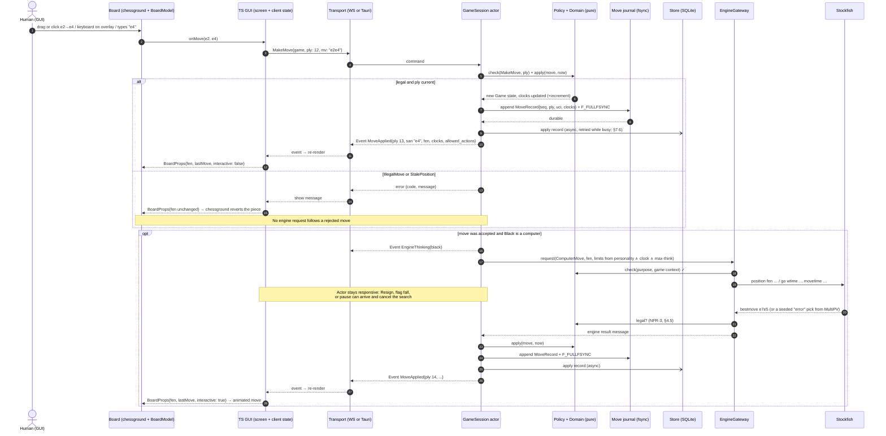

### 5.4 Example: game end, rating, and background analysis

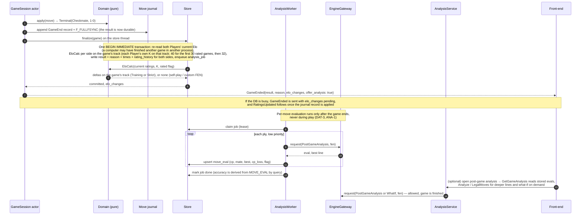

### 5.5 Error catalogue

Every `Result` error crosses the protocol as `{code, message, details}`. `code` is a stable string from this table. Front-ends branch on `code` and show `message`, and new codes may be added without breaking clients (§5.6). Rust crates use `thiserror` and are mapped to these codes in `chess-app`. No internal error text (paths, SQL) reaches `message`. Internal detail goes to the log.

| Code | Raised by | Meaning | Client behaviour | Retry? |
|---|---|---|---|---|
| `ConfirmationRequired{action, voids}` | services | A destructive command (resign, c–c abort, archive, reset player data, apply an import after its preview, restore a backup) was sent without `confirmed: true` (Q48, Q52, UI-12). The core enforces this, so no front-end can skip the prompt. The seventh UI-12 action, quitting the TUI with Ctrl-C, changes no data and is confirmed by the TUI's own dialog, which is the same dialog widget as the others. For a reset, `voids` lists the Player's unfinished games (opponent, mode, moves played) that the reset will void (D-30). It is also returned when, at commit time, the Player has an unfinished game that is not in the confirmed reset's `void_game_ids`, so a game the user never saw listed is never voided. A listed game that ended normally in the meantime is simply not voided | Show the confirmation dialog. For a reset, the dialog says that each listed game will be voided: no result, and it counts for neither player | After confirming |
| `UnfinishedGameExists{game_id, mode, player_id}` | `GameSetupService` | A slot-holding Player in the new game (a human, or a computer in a c–c game) already has an unfinished game in that mode (GAME-4, D-27). Since 2026-10-27 it is **not** a reset outcome: a reset voids unfinished games instead (D-30) | Offer Resume, or Resign (human games) or Abort (c–c), each confirmed | After resume, resign, or abort |
| `JournalWriteFailed{cause}` | `GameSession` | The move journal can't be written (disk full, read-only) | The move isn't made. Show the cause. After a single failed append whose cleanup succeeded (D-82) the clock keeps running and the player may try again. *Addendum E, JR5-003 (text only):* if the same code comes back for the next command, or the code follows a step in which an earlier record was written (D-65 part 2), the session is in the degraded state of D-80 (clocks hold, only queries, `Detach` and `Shutdown` are accepted): the front-end says that this game cannot be saved from this session and how to leave it (`Detach`, then resume), and does not say that the clock is running. No new field or code is used to tell the two apart (a field would be G2 and is not proposed) | User-initiated |
| `StoreMissing` | `chess-store` on open | The data dir shows an earlier store existed (marker or backups), but `chess.db` is gone (Q51) | Choose: start fresh, or import from a file | — |
| `ImportConflicts{list}` | `ImportExportService` | Preview found Players or games that already exist (Q51) | Full-data import: for each one, choose Replace, or Keep both as distinct identities. **PGN import:** a duplicate game (identical tags and moves to a stored game or an earlier game in the same file) offers only **Skip this game (default)** and **Keep both**, plus "apply to all remaining collisions". Replace is not offered (D-34) | After choosing |
| `IllegalMove{reason}` | `GameSession` / `chess-rules` | Move not legal in the current position. *Addendum A, D-51:* also the reply of `Query::ParseMove` to text that is understood but names no legal move (rules `NoMatch`) | Show reason, keep input editable (CLI-3), revert the piece (GUI) | No |
| `StalePosition{live_ply}` | `GameSession` | `ply` ≠ live ply (rewound, or a move landed meanwhile) | Show the live-position badge, refresh from the snapshot | After refresh |
| `Denied{reason}` | `Policy` (via services and gateway) | Action not allowed in this mode, matchup, or state. Reasons include the draw-offer set (§4.4), `state_not_allowed` (a domain reason for an action the current state does not allow; *Addendum A, D-56:* also `SelectProfile` while a game is open in the session, with `details.game_ids`), `computer_player` (rename, archive or reset of a computer Player), `active_player` (archiving the Player that this front-end session has selected), `archived_player` (an archived Player chosen as a side in a new game, §4.4; additive, Amd 7), and `voided` | Should not happen for a correct client (controls come from `allowed_actions`). Show reason | No |
| `ValidationFailed{field, reason}` | `PlayerService`, `GameSetupService`, preferences | Bad name, bad setup or setting. A name is trimmed of leading and trailing whitespace, then NFC-normalised (no other folding). The rule that failed is named in `reason` and in the message: `empty`, `too_long` (over 128 user-perceived characters, i.e. extended grapheme clusters, UAX #29), `character_not_allowed` (control characters, Unicode category Cc, and line or paragraph separators, Zl and Zp), or `already_used`. `already_used` is **case-sensitive against every Player**, human or computer, active or archived, and the message says "by an archived Player" when so (PLY-6, CR-4.1). *Amd 7 (additive):* an import file over its size limit gives `field: file`, `reason: too_large`, and the message names the limit, the file size and, for an archive, the CLI alternative (§4.8). A `SaveVariation` from the final position of the game gives `field: from_ply`, `reason: no_move_after_position`, because a variation needs a move to branch from (decision 13) | Highlight the field and show the rule | After fixing input |
| `ParseError{kind: Pgn\|Fen, game_index, line, col, reason}` | `ImportExportService` | Malformed PGN/FEN (RULE-7, RULE-8, IF-2, IF-3) | List errors per game. The other games in the file still import | No |
| `ParseError{kind: move, reason, ...}` | `AnalysisService` (`Query::ParseMove`) | *Addendum A, D-51.* Typed move text that cannot be read as a move. `reason` is `empty`, `too_long`, `syntax`, `lowercase_piece` (with `suggestion`), `promotion_required` (with `choices`) or `ambiguous` (with `candidates`, the canonical SAN of each matching move) (§5.1) | Keep the input editable and show the message (CLI-3). For `ambiguous`, list the candidates | No |
| `MalformedFrame{reason}` | transport adapters (WebSocket, Tauri), using the shared envelope helpers | *Addendum A, D-54.* A frame did not decode. `reason` is `bad_json`, `unknown_kind`, `unknown_field` or `before_hello`. A correct client never sends one. The transport then closes. The WebSocket close code is the server's choice (server design ASM-SRV-1), not fixed here | Show "protocol error" and offer a reload | After reload |
| `ExportWriteFailed{cause}` | Tauri shell (Downloads folder), `ImportExportService` (a CLI `--output` or `FileRef::Path`) | *Addendum A, D-55.* An export file could not be written. `cause` is `folder_missing`, `permission_denied`, `disk_full` or `io_error`. No partial file is left at the final name, and the game and the store are unchanged. The message names the cause and the next step (free space, check the folder permission, try again) (NFR-9) | Show the message | User-initiated |
| `NotFound{entity, id}` | services | Unknown Player, game, or variation | Refresh the list | No |
| `GameLeased{owner_kind}` | `SessionRegistry` | The game is live in another process ("open in the CLI") | Show the owner, offer read-only view | When the owner releases it or its lease goes stale |
| `LeaseLost` (event) | `GameSession` | This process lost the lease (another process took it over after a stall) | Drop to read-only, explain | No |
| `EngineUnavailable{cause}` | `chess-engine` / gateway | Binary missing, crash, timeout, illegal output | Offer Retry / Leave (ENG-1). *Amd 7 (additive):* `cause` is one of `spawn_failed` (binary missing), `crashed`, `handshake_timeout`, `search_deadline`, `illegal_move`; the final names are fixed in the app design. A failure in flight is reported, not retried (§4.7) | `RetryEngine` |
| `StoreBusy` | `chess-store` | `busy_timeout` exceeded | Transparent retry once in the core, then show | Yes, once |
| `StoreUnavailable{cause}` | `chess-store` | I/O error, disk full, read-only file. **Every store-changing command** (register, rename, archive, preferences, generate, reset, import, restore) is all-or-nothing and, on any failure, returns this or `StoreBusy` with a message naming the failure and the next step (DAT-7, NFR-9) | For non-game writes: show. A live game keeps playing from the journal, and the backlog is applied later (§7.6) | User-initiated |
| `StoreCorrupt` | `chess-store` on open | `quick_check` failed (§7.1) | Restore-from-backup flow | — |
| `SchemaTooNew{db_version, app_version}` | `chess-store` on open | The database was migrated by a newer build (D-16) | Tell the user to update this entry point. Nothing is written | — |
| `DurabilityUnsupported{path, errno}` | `chess-store` on open | *Amd 8 (D-71, additive; APPROVED by Brian, 2026-11-04).* The data directory is on a volume where `fcntl(F_FULLFSYNC)` fails with `ENOTSUP` or `ENOTTY`, so "no completed move is lost" (NFR-2) cannot be promised there. The store refuses to open it and writes nothing | Show the path and the reason, tell the user to choose another folder (`--data-dir`, `CHESS_DATA_DIR`) and exit (CLI: exit class 3 in the TUI, in plain mode and in subcommands, TBD-36 not narrowed; desktop: an in-window screen, not a native dialog, with its Quit button as OQ-TAU-005 decides). No "continue anyway" (§7.1) | After the user picks another folder |
| `Busy{reason}` | `ImportExportService` | Import or restore needs exclusive access, but another process is live (§7.4) | Ask the user to close the other entry points | Yes |
| `ProtocolMismatch{server, client}` | WebSocket adapter | A browser tab from an older build (D-16). *Amd 7 (superseded by Addendum A, D-54):* a frame before `hello` or one that does not decode used to get this code with `details.reason`. It now gets `MalformedFrame` | Hard reload | After reload |
| `NothingToTakeBack` | `GameSession` | Takeback at the earliest reachable position (§4.4). Message: "Nothing to take back" | Show the message, change nothing | No |
| `PlayerHasUnfinishedGames{game_ids}` | `PlayerService` | `ArchivePlayer` on a Player with an unfinished game (PLY-4, GAME-4). The message names the games | Offer Resume or Resign for each. Reset is the only action that voids games (D-30) | After resume or resign |
| `BackupFailed{cause}` | `chess-store` on upgrade | The pre-upgrade backup could not be written (DAT-6, D-35). Nothing was migrated | Show the cause. Offer Retry or Exit. A newer front-end never opens an old-version store without the upgrade | User-initiated |
| `JournalUnreadable{game_id, recovered_moves}` | `SessionRegistry` at resume | The journal could not be read in full (DAT-7). `recovered_moves` is the length of the longest intact run held by the journal or the store. *Amended 2026-10-31 (AMD-14, UR-36):* this is an **error** only when nothing is readable, and the client then offers `VoidUnreadableGame`. With partial damage the `ResumeGame` reply succeeds and carries `recovered_moves` as a field; the client tells the user the count and play continues from it | Show the count, or offer the void | No |
| `OtherVersionRunning{version, kind}` | `chess-store` / `Core::open` | *Amd 7 (additive, UR-36).* Startup is refused because a live process of another build version is registered in `PROCESS_HEARTBEAT` (PLAT-5, §7.5). The message names the version and the front-end kind and says to quit it first | Show the message and exit, or call `open` again after quitting | After the other process exits |
| `ImportInvariantFailed{check}` | `ImportExportService` | *Amd 7 (additive, UR-36; the name is fixed in the app design).* After an import plan was built, a post-check failed (for example the Elo invariant per Player, §7.4 step 3). Nothing was written and the backup is untouched | Show which check failed | No |
| `ConfigInvalid{file, line, reason}` | `chess-cli` (`serve`) | `config.toml` is unreadable, unparsable, or `server.port` is outside 1 to 65535 (PLAT-4). Never a silent fallback | Print the message, exit 1 | After fixing the file |
| `Internal{id}` | any | Bug. Logged with a correlation id | Generic message with the id | No |

### 5.6 Protocol reliability, idempotency, and versioning

- **Envelope (Addendum A, D-53; replaces "every frame has an `id`").** `{id?, kind, body}`. `id` is a client-chosen request id. It is present on `command`, `query`, `subscribe`, `unsubscribe` and `subscribe_global` frames and is echoed on the `result` or `error` that answers them. `hello` and `event` frames carry **no `id`**, because a pushed frame answers no request. An `error` for a frame that could not be decoded has no `id` unless one could be read from it. The body of an `event` frame is `EventEnvelope{game_id, seq, event}`. For a game subscription, `game_id` is the game and `seq` is that game's gap-free counter (the first item is the `GameSnapshot`). For the global stream (`subscribe_global`), `game_id` is null and `seq` is a per-subscription counter that increases strictly but **may show a gap** after the receiver lagged: global events are notifications (`ServerStopping`, `StoreBacklog`, `AnalysisProgress` of stored games, `RatingsUpdated`), the client re-queries on them, and no snapshot is needed to repair a gap. An event about one stored game, such as `AnalysisProgress`, names the game inside `event`, not in the envelope. The web and desktop transports have a per-request client timeout (§4.8).
- **Idempotency.**
  - `MakeMove`, `Takeback{ply}` (`ply` is only a stale-command guard: the command is rejected with `StalePosition` when it differs from the live ply, and the core derives the target from RULE-3, §4.4; there is no multi-step takeback in one command), `Step`, `OfferDraw`, `RespondDraw`, `CancelEngine`, `VoidUnreadableGame`, and `Resign` are guarded by the game state. A duplicate after a reconnect gets `StalePosition` or `Denied` and changes nothing. A command for a voided game gets `Denied{reason: voided}`.
  - A duplicate confirmed `ResetPlayerData` is harmless: the games it listed are already voided, so it voids nothing, adds a second reset point at the same rating, and moves `reset_at` past no game, which changes no view. Pending requests are never replayed blindly anyway (see Reconnect).
  - `StartGame` carries a client-generated `game_uuid`. A repeat with the same uuid returns the existing game instead of creating a second one. *Addendum F (OQ-26):* the command is unchanged. The start stamp is not in it and no front-end supplies one: the app takes it and passes it to the store in `NewGame.started_at` (D-84, §5.7).
  - Imports are all-or-nothing per game and dedupe on a content hash, so re-importing the same PGN reports "already imported".
  - `RegisterPlayer` relies on unique names.
- **Reconnect (web).** If the WebSocket drops, the client reconnects with backoff (0.5, 1, 2, 4 s, capped), sends `ResumeGame` and then `subscribe` for the game it held, and treats the new `GameSnapshot` as authoritative. A new or resumed game session with no subscriber suspends after a **5 s attach window** (`ESTIMATE`); a detach after attach suspends at once (D-14). Pending requests fail with a "connection lost" message and are never replayed blindly. While disconnected, inputs are disabled and a banner is shown. If the session gets no subscriber back, D-14 decides what the game does.
- **Versioning.** The bundle and the core always come from the same build: the bundle is embedded in `chess` or bundled in `Chess.app`. The handshake sends `protocol_version` (the build version) both ways. A mismatch, such as a stale tab after an upgrade, returns `ProtocolMismatch` and asks for a reload. Within one version, unknown event kinds are ignored by clients, which keeps tests tolerant of additive changes. There is no external API, so no deprecation policy is needed beyond this.

### 5.7 Internal interface contracts

| Interface | Provider → consumer | Style | Contract essentials | Failure behaviour |
|---|---|---|---|---|
| Protocol (`Command`/`Query`/`Event`) | `chess-app` → CLI, `chess-server`, `src-tauri`, `ui/` | Async request/response plus a per-game event stream | §5.1–§5.6. TS types generated (D-7). `allowed_actions` in every snapshot | §5.5 codes, §5.6 reconnect |
| `Engine` trait, `EnginePool` | `chess-engine` → `EngineGateway` | Async, cancellable | *Amended 2026-10-31 (AMD-3; shapes from the engine design, `[OBS]` draft SDD).* `search(SearchRequest) -> SearchResult{best, pv, lines, score, depth}`, `stop()`, `health()`. `SearchRequest{position, limits, multipv, new_game, seed, updates}`; `SearchPosition` is `Fen` or `Moves{start, moves}` (so repetition and the fifty-move count are visible to the engine); `updates` is an optional throttled stream of `SearchInfo` (depth, multipv, score, pv) that feeds `AnalysisProgress` and live analysis; `seed` is the error-pick seed (§4.6). `EnginePool` hands out `EngineHandle`s (`computer_side(key, personality)`, `analysis(priority)`). `EnginePersonality` is the engine's own type: the stored `Personality` is converted by `personality_to_engine` in `chess-app` (D-43). Scores come back from the side to move's point of view and `chess-app` normalises them to White's point of view (§7.2). Only the gateway holds a handle | Typed `EngineError` → §4.7 |
| `Store` handle and repositories | `chess-store` → `chess-app` services | Calls to the store thread over a channel (D-13). *Amended 2026-10-31 (AMD-2, D-39):* `Store` is one cheap clonable **concrete handle**; there is no `dyn Store` and no fake store. `StoreApi` in the store design is a documentation contract, not a seam | One method per transaction in §7.4. The API takes and returns `GameId`/`PlayerId` (UUID); integer row ids never cross it (D-40). No SQL outside `chess-store`. Statistics queries return rows filtered by structural keys only (D-44). *Addendum A:* `roster_indexes() -> Vec<u32>` replaces `next_roster_index` (ruling 3, D-46); `insert_computers` carries each Player's `roster_index`; `abort_game`, `void_unreadable_game` and `reset_player(..., voids: Vec<VoidSpec{game_id, content_hash}>)` take the `content_hash` computed by the caller, because the store has no `chess-rules` (ruling 1, D-42). *Addendum F (OQ-26, D-84; decided by Brian, G2, 2026-11-04):* `start_game(NewGame)`, where `NewGame` carries `started_at: i64`, the app's one start stamp, written unchanged to `GAME.started_at`; `NewGame` is a store input type, not a protocol type | `StoreBusy` / `StoreUnavailable` / `SchemaTooNew` |
| `MoveJournal`, `JournalWriter` (Amd 7, AMD-3) | `chess-store` → `GameSession`, `SessionRegistry`, `PlayerService` (void of a suspended game) | Concrete types, not a trait. Shapes from the store design (`[OBS]` draft SDD 3.7.3) | `MoveJournal::create(game_uuid)` creates `journal/<uuid>.jnl`, takes the exclusive `flock`, writes the header and syncs file and directory (`Locked{owner}` if held). `open_for_resume(store, game_uuid)` takes the lock, scans, reconciles with the store (§7.6) and returns the writer and a `Recovered{records, moves, clocks, report}`. `probe(game_uuid)` reports whether the lock is held, without keeping it. `JournalWriter::append(record)` returns only after `F_FULLFSYNC`, runs its blocking I/O on the blocking pool as one task that completes even if the future is dropped, and cleans up after a failure by truncating to the last acknowledged length or poisoning the writer (*Addendum E, D-82; replaces "is cancel-safe"; the `JournalError` list is unchanged, `Poisoned` is a cause of `WriteFailed`*). `close_final()` moves the file to `journal/done/` and releases the lock | `JournalError`: `Locked`, `WriteFailed`, `Unreadable`, `VersionMismatch`, `ForeignStore` → `GameLeased`, `JournalWriteFailed`, `JournalUnreadable` (§5.5) |
| `JournalCodec` (Amd 7, D-41) | `chess-app` (pure), between `chess-domain` `Fact` and `chess-store` `JournalRecord` | Pure functions | `fact_to_record(&Fact, &RecordCtx) -> JournalRecord`, `record_to_fact(&JournalRecord) -> Fact`, *(Amd 8 Addendum D, D-79:)* `record_to_replay_item(&JournalRecord) -> ReplayItem`, which is `{fact: record_to_fact(r), check}` with `check = Some(MoveCheck{san, fen_after})` from the record's payload for a `Move` and `None` for every other kind (`ReplayItem` and `MoveCheck` are `chess-domain` types and the input of `Game::replay`), the `Start` assembler (adds `rated` and `self_play`), and the `GameEnd`, `Abort` and `Voided` assemblers that add the finalize inputs, `content_hash` included (Addendum A, rulings 1 and 2). One `Fact` maps to exactly one record kind, and the exact payload fields of each are the table in §7.6. `fen_after` and `wall_ms` come from the post-state and stamp that `Game::decide` returns, so the domain `Fact::Move` does not change | Not applicable. Conformance: a property test over every `Fact` variant, `record_to_fact(fact_to_record(f)) == f`, for a `Move` the `check` of `record_to_replay_item` equals the `san` and `fen_after` that were put in the `RecordCtx` (D-79), and, for the three finalize records, `decode_finalize(assemble_*(f, inputs)) == inputs` (FF-3) |
| Calibration run (Addendum A, D-57) | `chess-app` (`calibration`) → `chess-cli` (`chess calibrate`) | In-process async call | `Core::open_for_calibration(cfg)` gives the `Core` (it refuses the default data directory). The run function takes the `Core` and a `CalibrationPlan` and returns a `CalibrationReport`. It plays the matches through `EngineGateway` with `EnginePurpose::Calibration`, runs the SPRT, and builds the report. The CLI parses arguments, calls it and prints. Not a protocol command. The plan and report shapes belong to the app design | A typed error from the run; the user's store is never touched |
| Test support (Addendum A, FIND-JR-006) | `chess-app`, Cargo feature `test-support` → the tests of `chess-app`, `chess-cli`, `chess-server`, `src-tauri` | Rust items | `Core::open(cfg, Seams)`, the test `EngineFactory` over `FakeEngine` (the production factory is written in `chess-app`, D-61) and a temp-directory-store helper, so a front-end crate builds a `Core` without an edge to `chess-engine` or `chess-store`. Not compiled into a release build | Not applicable |
| `TimeSource`, `Rng` | traits in `chess-domain`; implementations in `chess-app` → `chess-domain`, `GameSession` | Sync, injected | Monotonic time for clocks, wall time only for timestamps. `Rng` seeded by the roster seed or by `error_pick_seed(game_id, ply)`, which `chess-app` passes to the engine as `SearchRequest.seed` (§4.6) | Not applicable |
| PGN/FEN I/O | `chess-rules` (wrapping `pgn-reader`/`shakmaty`) → `ImportExportService`, `GameSetupService`, `AnalysisService` | Pure functions. *Amd 7 (AMD-3, D-45):* `Fen::as_str`/`Display`; `Position::parse_move(text, Typed) -> MatchedMove{mv, uci, san}` is the only typed-move parser (the wire type is `ParsedMove{uci, san}`, D-52); a `UciMove` becomes a `Move` with `Move::from_uci`. *Amd 8 Addendum A (D-75):* `eco::lookup(&PositionKey) -> Option<EcoEntry{code, name}>` is a provided interface of this crate, used by `EcoTable` in `chess-domain` (the table is generated at build time from `third_party/eco/`) | **Parse:** FEN must be a legal position, or it's rejected with a reason. PGN is streamed game by game, and every SAN is validated by replay. **Export (IF-1), checked against the PGN Standard on 2026-10-30 (TBC-6 and TBD-24 closed):** the Seven Tag Roster first, in the standard order (`Event`, `Site`, `Date`, `Round`, `White`, `Black`, `Result`; unknown values `?`, `Round "-"`, `Date` as `YYYY.MM.DD`), then every other tag in **ASCII order of the tag name** (`BlackClass`, `BlackUUID`, `EndStatus`, `FEN`, `GameUUID`, `Mode`, `Rated`, `SetUp`, `Termination`, `TimeControl`, `WhiteClass`, `WhiteUUID`; the UUID tags only in the archive). `SetUp "1"` and `FEN` for a custom start, `TimeControl` (`seconds` or `seconds+increment`) when timed. One tag pair per line, one space between name and value, a blank line after the tags, `\"` and `\\` escaped in values. Movetext in canonical SAN with `1.` and `1...` numbers, a single space between tokens, lines under 80 characters, and a final token equal to `Result`. `Termination` uses the standard's values: `normal` for checkmate, stalemate, resignation and draws; `time forfeit` for a loss on the clock; `abandoned` for voided and aborted games; none for an unfinished game. The writer is one function in `chess-rules` so every front-end gets the same bytes. The custom tags are `Mode`, `Rated`, `WhiteClass`, `BlackClass`, `EndStatus`. `Mode` also names the rating scale. **Games that ended without a result** (watcher-aborted c–c, and voided by a reset, D-30) are exported the same way: `[Result "*"]` with the movetext ending in `*`, `[Termination "abandoned"]` (a standard PGN termination value, so other tools read it as a game that stopped without a result rather than one still in progress), and the custom tag `[EndStatus "aborted"]` or `[EndStatus "voided"]`, which tells the two apart and lets the full-data import restore `GAME.status`. `EndStatus` is written only for those two statuses. **An unfinished game** (`in_progress`, suspended or not) is exported with `[Result "*"]`, the movetext ending in `*`, **no `Termination` tag and no `EndStatus` tag**, and the moves completed so far (RULE-6, IF-1). Exporting changes nothing in the game. Importing that file gives a review-only game (`status = 'imported'`, no result) that can never be resumed. Only the full-data import restores an unfinished game as unfinished (below). Also imported `GAME_TAG`s, saved variations from `VARIATION`, UTF-8, and deterministic output (byte-identical from every front-end). **Import (IF-2):** multi-game files; UTF-8, falling back to Latin-1 per game; comments, NAGs, and variations kept; files over 10 MB rejected (TBD-25, `ESTIMATE`; the archive has its own, separate limit, §5.2). **Duplicates (CR-4.2):** a game is a duplicate when its tags and moves are identical to a stored game or to an earlier game in the same file, found by a `content_hash`. *Amended 2026-10-31 (AMD-5, D-42; SE interpretation Q-SE-1, confirmed):* "identical tags" means the **Seven Tag Roster values plus `SetUp`, `FEN` and `TimeControl` where present, plus the SAN movetext with the result**. Custom tags (`GameUUID`, `WhiteUUID`, `BlackUUID`, `Mode`, `Rated`, `WhiteClass`, `BlackClass`, `EndStatus`), `Termination`, `ECO` and any unknown tag are ignored, so an export re-imports as a duplicate whichever custom tags a build writes, and a PGN from another tool matches. The value is `"sha256:" + hex(SHA-256(canonical_form))`, where `canonical_form` comes from `chess-rules` (IFP-RUL-5) and the one hash function lives in `ImportExportService`; finalize and import dedupe call the same function. The algorithm prefix keeps the value versionable. A stored game has a hash only once it is terminal (completed, aborted or voided); an unfinished game has none, so it never matches an imported copy (FF-4 compares the hash of a live game with the hash of its re-imported export). The collision prompt offers **Skip this game (default)** and **Keep both**, plus "apply to all remaining collisions". "Replace" is not offered, because the contents are identical and a replacement could overwrite a rated, played game. A skipped duplicate is not a `ParseError`; the report counts imported, skipped and failed. The importer can tell a played game from an imported one by `GAME.status` and `matchup`, but it never needs to, since nothing is replaced. **FEN (IF-3):** six fields, legality checked. **Full-data export (IF-5, DAT-2):** one zip archive (D-29) holding `manifest.json` (`format_version`, build version, export time), `games.pgn` (every game, with custom tags `GameUUID`, `WhiteUUID`, `BlackUUID` and `[%clk]`/`[%emt]` comments so clocks and think times round-trip), `players.json` (including `reset_at`), `ratings.json` (both tracks, full history, both rated-game counters), `settings.json` (preferences, `APP_SETTING`), and **`games.json`**. `games.json` is keyed by `GameUUID` and holds, per game, the stored fields that neither PGN tags nor PGN comments carry: `status`, `mode`, `rated`, `self_play`, `matchup`, `clock_spec`, the clock checkpoints of an unfinished game, `*_elo_before` and `*_elo_after` on the game's scale, `analysis_used`, the engine parameters each computer side used (a copy of its `COMPUTER_PROFILE` values), `termination` text, `voided_by` as a Player UUID, and `content_hash`; and **the analysis results**: per ply `cp`, `mate`, `best_uci`, `cp_loss`, `flag`, `depth` and `engine_version` (a new `MOVE_EVAL` column, e.g. "Stockfish 19"). Clocks and think times stay in PGN `[%clk]` and `[%emt]` comments, and saved variations stay PGN variations. The archive also carries archived Players and unfinished games. **Import accepts an archive without `games.json`** (older or hand-made): the stored fields then come from the PGN custom tags and defaults, there are no analysis results, an unfinished game takes its clocks from its last `[%clk]` comments, and the background evaluation queues every finished game (F-5.5). **`format_version` stays 1**, because nothing has been released; this is an amendment of D-29, not a new format. Import accepts older format versions and rejects newer ones. **Unfinished games on import (CR-4.3):** an unfinished game in the archive is restored as unfinished, with its slot, unless that would give a Player a second unfinished game in a mode (or a computer a second c–c game). Then it is imported review-only with no result, and the preview says so. A game that is live in a front-end of the importing process is never replaced: the import reports it and keeps the stored game. (Another live process refuses the whole import with `Busy`, §7.4.) FEN export is not in v1 (IF-3). Round-trip: `parse(export(g))` gives the same move list (RULE-6, RULE-7) | `ParseError` with game index, line, and column. One bad game never aborts the rest of a file |
| CLI data commands (D-36) | `chess-cli` → user, scripts | Command line | **Single game (UC-22, RULE-6):** `chess export game <game> [--output <file>]`, where `<game>` is a game UUID or the number shown in `chess games`; the PGN goes to the file, or to standard output without `--output`. **Full data (UC-24, DAT-2):** `chess export data --output <file.zip>`. **PGN import (UC-23, RULE-7):** `chess import pgn <file> [--on-duplicate skip\|keep]`. **Full-data import (UC-25, DAT-2):** `chess import data <file.zip> [--yes]` (preview first, then the confirmation; `--yes` answers it for scripts). The bare `chess export` and `chess import` print the four forms and exit 1. The TUI and plain-mode Import/export screens offer the same four actions | Exit 1 usage, 3 store error; messages on standard error |
| FEN uses | — | — | **Start position** in `GameSetup` (GAME-1, unrated) vs. **Import FEN** on the Import screen, which opens an analysis board and creates no game ("review only") | — |
| `BoardGrid` renderer | `chess-domain` → TUI `BoardWidget`, `PlainRunner`, reached through the curated `chess-app` re-exports (§3.2) | Pure | Grid of `{glyph, shade, highlight}` per `BoardStyle` and orientation (CLI-2, UI-3). *Amd 7 (D-38):* built by `BoardGrid::from_fen(fen, &BoardView, style, orientation)`; `BoardView.last_move` is UCI text; `BoardStyle` is `Plain`, `Unicode`, `Ansi`, `NoColor`. No front-end needs a `Position` | Not applicable |
| `Board` contract (`BoardProps`/`onMove`) | `ui/board` → GUI screens | React props | §11.1. Screens never touch chessground | Rejected move → `fen` re-set, piece reverts |
| `CoreClient` | `ui/transport` → GUI client state | Promise plus subscription | §5.2. Two implementations with identical behaviour (GUI-1) | §5.6 |

### 5.8 Two-step PGN import with an ECO mismatch question (D-59, D-60, AGREED)

**Status: AGREED 2026-10-31 (D-59) and refined 2026-11-01 (D-60); user, Brian Prascher, G2/G3.** Requirement CR-9.12 (DAT-3, IF-2) says that when an imported game's `ECO` tag differs from the table's classification of its position, the app flags it and asks the player to choose: (1) **keep the PGN's ECO** and ignore the position classification, or (2) **keep the position classification** and override the PGN's ECO. This section gives the protocol and service changes. Evidence `[INF]`: nothing was built or run.

Question this section answers: how can an import pause for an answer, per game, without a half-written store, in the core, for the CLI, the GUI and a script?

**When a question exists.** `chess-domain` classifies each imported game (the deepest named position, CR-9.11 rules for custom starts and FENs equal to the standard start). **Positions looked up: the start position (ply 0) as well as every position reached by a move**; this matters for a custom start that is itself a named position. The result is one of: *agree*, *mismatch* (both exist and differ), *tag only* (the table finds nothing: the file's code is kept, CR-9.12), *table only* (no tag, or a malformed tag: the table supplies code and name), *neither*. Only *mismatch* asks. The ECO tag is ignored by the duplicate hash (D-42), so the answer never changes whether a game is a duplicate.

**Normalising the tag (D-60).** The tag text is trimmed and upper-cased. It is **well-formed** when it is one letter from A to E followed by two digits (A00 to E99). A malformed tag is treated as **no tag**. The comparison with the table uses the normalised code, and the **stored `GAME.eco` is the normalised code**, never the raw text.

**Shapes (additive).**
- `ImportPgn{file, on_duplicate, eco?}` keeps its name. `eco` is an optional `EcoResolutions{default: keep_pgn | keep_table | none, per_game: {game_index: keep_pgn | keep_table}}`. The protocol values are the underscore forms. A file with no mismatch behaves exactly as today.
- If a mismatch is not covered by `eco`, nothing is written, and the reply is the existing code `ImportConflicts{import_id, list}` with one entry per mismatching game of kind `eco_mismatch`: `{game_index, white, black, tag_eco, table_eco, table_name, ply, moves_san}`.
  - `tag_eco` is the normalised code. `ply` is where the table matched (0 for a named start position). **`moves_san`** is the SAN of the moves that lead from the start to that position, as one text with move numbers (for example `1. e4 e5 2. Nf3 Nc6`; empty when `ply` is 0). The TUI and the dialog show it.
  - **The entry has no `tag_name`**, which an earlier draft had. When the PGN's ECO is kept the stored name is empty (below), the rules crate exposes only the raw tag, and no other tag is read, so there is no source for a tag name and none is needed.
  - The core keeps the parsed games in memory under `import_id`, bound to the calling `FrontEndSession`. **Duplicates stay a separate step (D-62).** With `on_duplicate = Ask`, a duplicate game is answered first by the existing `ImportConflicts{list}` with `duplicate_game` entries and **no `import_id`**; the client sends `ImportPgn` again with its per-game choices (D-34), and only then can the ECO question come, with an `import_id`. A PGN `ImportConflicts` reply therefore holds one kind of entry. (The archive preview is different: it has no second pass and lists Player and game conflicts and `eco_mismatch` entries together in one `ImportConflicts{list}`.) The held state keeps the `on_duplicate` policy of the `ImportPgn` call that created it.
- `ResolveImport{import_id, eco}` completes the import and returns the usual report, which gains the counts `eco_kept_pgn` and `eco_kept_table`. `CancelImport{import_id}` drops the state and writes nothing. Both are idempotent. **`CancelImport` and `ResolveImport` exist for PGN imports only.**
- **Multi-game files.** One reply lists every mismatching game. Answers are per game, with "apply to all remaining" setting `default` (the pattern of the duplicate prompt, D-34). Writing stays all-or-nothing per game (IF-2); a game with a parse error is reported and does not block the others.
- **Archives are stateless (D-60).** `PreviewDataImport{file}` returns `ImportConflicts{list}` with `eco_mismatch` entries and **no `import_id`**; the core holds nothing. The choices travel in `ApplyDataImport`, which gains an optional `eco: EcoResolutions` (additive). As the app design already has it, the core re-reads the archive from the file reference when applying, so a remote client sends the archive twice. An unanswered mismatch in `ApplyDataImport` returns `ImportConflicts{list}` again and writes nothing. Cancelling an archive import means not sending the apply. The question applies only to a game whose stored fields come from PGN tags (an archive without `games.json`, or a game missing from it); a game with stored `eco` and `opening_name` in `games.json` keeps them and asks nothing.
- **Cancel.** The player closes the dialog or sends `CancelImport`: nothing was written.
- **Stale or lost state (PGN imports).** The held state is dropped on `CancelImport`, on session end, when the same session starts another import, and after an **idle time-out of 10 minutes (`ESTIMATE`, a design value and not a requirement; measure or revise with use)**. `ResolveImport` with an unknown, expired or foreign `import_id` returns the existing `NotFound{entity: import, id}`, and the client starts again from `ImportPgn`. The file is not stored on disk. Duplicates and Player conflicts are checked again when games are written, and a game that has become a duplicate follows the `on_duplicate` policy held with the state. A `ResolveImport` that leaves a mismatch unanswered is refused with `ImportConflicts` again.
- The file-size limits (10 MB for PGN, about 24 MiB for an archive) are checked on the first call, before parsing.

**`ImportExportService` responsibilities (added).** Parse with `chess-rules` (which exposes the raw `ECO` tag); normalise and classify through the domain; hold one pending PGN import per `FrontEndSession`; build the mismatch list with `moves_san`; apply the resolutions; write each game in its own transaction; count the outcomes. It never asks anything itself; the question is the reply. `GameSession`, the journal and the engine are not involved.

**Journal and store impact.** None. An imported game has `status = 'imported'`, no journal, and writes the same `GAME.eco` and `GAME.opening_name` columns; only the values depend on the answer, and the answer is not stored (no `PREFERENCES` key, OQ-ECO-3).

**Presentation constraints.**
- *TUI (80x24, keyboard only, no mouse):* one mismatch per screen: game number and players, the file's code, the table's code and name, and `moves_san`. Keys: `1` keep the PGN's code, `2` keep the table's, `a` apply this choice to all remaining, `Esc` cancel the import, `n`/`p` for next and previous game.
- *Plain mode:* **when standard input is a terminal, plain mode asks** the same question (prompt on standard error, answer from standard input; end of input cancels, nothing written). Only a run whose **standard input is not a terminal, and a headless run, are non-interactive** (D-60).
- *Non-interactive runs:* the import command takes the explicit option **`--eco keep-pgn`** or **`--eco keep-table`**. The CLI maps these hyphenated values to the protocol values `keep_pgn` and `keep_table` (the `default` of `EcoResolutions`); the protocol, the app and the TypeScript client keep the underscore forms. With a mismatch and no option, the command writes nothing, prints the mismatching games on standard error and exits with code 1. There is no silent default. The same applies to `chess import data`. The numeric exit value follows TBD-36.
- *GUI:* a dialog with two radio choices per game and "apply to all remaining", fully keyboard reachable, with an ARIA description that states both values (UI-4, GUI-2). It is not a `ConfirmationRequired` action.

**Rules decided by the user (OQ-ECO-1 to OQ-ECO-3 on 2026-10-31; the items above marked D-60 on 2026-11-01).**
- **Bulk and non-interactive answers (OQ-ECO-1).** Interactive screens ask per game and offer "apply to all remaining". A non-interactive run requires the explicit option; without it, exit 1 with the list.
- **Stored name (OQ-ECO-2).** When the player keeps the PGN's ECO, the stored `opening_name` is empty and `eco` is the normalised file code. Choosing the table stores the table's code and name.
- **Remembered (OQ-ECO-3).** Not in v1. Every import asks again; "apply to all remaining" holds within one import.

---

## 6. Front-ends

### 6.1 CLI (`chess`): ratatui terminal UI

The CLI is a full-screen terminal UI built with **`ratatui`** (rendering) and **`crossterm`** (terminal I/O, keys, resize). It is **keyboard only** (CLI-1/3, AGREED): moves are typed in algebraic notation, there is no board cursor, and mouse capture is never enabled — which also leaves the terminal's normal text selection and copy working. It links the core in-process like the other front-ends and follows the same rules as the GUI: it renders `GameSnapshot`s, shows only the controls in `allowed_actions`, keeps rewind as local view state, and counts clocks down locally from `ClockSync`.

#### Run modes

| Mode | Selected when | Behaviour |
|---|---|---|
| **TUI** (default) | stdin and stdout are terminals and no scripting flags are given | Alternate screen, raw mode, full-screen layout, live clocks and spinner |
| **Plain** | `--plain`, or stdin/stdout is not a terminal | Line-oriented transcript: board, last move, clocks, and prompt printed after each change. For screen readers (UI-4) and pipes. |
| **Headless** | scripting flags (`--matchup cvc --white … --black … --clock 5+0`) | **Computer–computer, Strict only** (CR-4.12). No UI. Runs to completion, prints the PGN, and exits with a status code. The game is stored and rated like any c–c game (D-36). Drives the c–c scenario tests |

**Selection rule (D-19).** Rules are checked in order:
1. `--headless`, or top-level setup flags with no subcommand (`chess --matchup cvc --white … --black …`, as in CLI-4), selects headless. Headless needs a fully specified setup of two computer Players. **Naming a human Player, or a matchup other than `cvc`, is a usage error: exit 1, nothing on stdout, a message on stderr.** A computer that already has an unfinished c–c game is a setup error (exit 1): a headless run never offers resume (D-27). *(Earlier text let a human side read moves from stdin in headless mode. That is withdrawn: scripted human play uses plain mode, below.)*
2. `--plain`, or stdin/stdout not a TTY, selects plain.
3. Otherwise TUI. `chess play [setup flags]` opens the TUI pre-filled with the setup.

**Scripted human play** (the h–c and h–h scenario tests, PLAT-1) runs in plain mode with moves piped to standard input: `chess play --plain --player <name> [setup flags] < moves.txt`. It uses the same `InputParser` and the same stored games as the interactive modes.

**Data directory (CLI-4, D-36).** The global option `--data-dir <path>` selects another data directory. It **overrides `CHESS_DATA_DIR`**, which overrides the default `~/Library/Application Support/Chess/` (precedence stated again in §7.1). A directory that does not exist is created (mode `0700`) and given the seeded roster, as on a first launch. Scripted tests and calibration use it, so they never touch the user's ratings (RISK-2, R-17).

Exit codes (CLI-5, TBD-21): 0 game reached a result, 1 usage or setup error, 2 engine unavailable, 3 store error (*Addendum E: this class includes `DurabilityUnsupported`, D-71; Brian accepted exit class 3 on 2026-11-04, G3, beads chess-a0r.1.30; no new code number*), **4 stopped by a signal** (architect-chosen, D-36; accepted by CR-5). A headless run stopped by SIGINT or SIGTERM leaves an **unfinished** game, which the journal already holds (D-14, §7.6), prints no PGN, and exits 4. PGN goes to stdout, and messages go to stderr. **`save` (CLI-4)** is a confirmation: it makes a round trip through the game's session actor (so it sees every earlier command), checks that the last move is durable, and prints "Game saved" with the stored move count. It changes nothing. **`movenow`** (ENG-5) is the in-game command for "move now" (F2 does the same, §4.4).

**Plain mode and screen readers.** Plain mode never prints clock ticks. It prints the clocks with each move and as warnings at fixed thresholds (e.g., 60 s, 10 s), so a screen reader isn't flooded. Opponent moves are printed as they arrive, even while the user is typing.

All three modes share `InputParser` (command words, SAN, and coordinate moves) and the board renderer in `chess-domain`. That renderer produces a terminal-independent `BoardGrid`: per square, a glyph, a light/dark shade, and highlights (last move, check, rewound). The TUI's `BoardWidget` maps that grid to ratatui styles. Plain mode prints it as text lines. One snapshot suite therefore covers both modes (CLI-1/2, UI-3).

#### Play screen layout (80×24 minimum)

```text
┌ Chess ─ Strict · 5+0 · Rated ───────────────────────────────────── F1 help ┐
│    A  B  C  D  E  F  G  H        Black  Viktor Rook (Master 2310)   04:51  │
│ 8  ♜  ♞  ♝  ♛  ♚  ♝  ·  ♜  8     ⠿ thinking…  (F2 move now)                │
│ 7  ♟  ♟  ♟  ♟  ·  ♟  ♟  ♟  7     ──────────────────────────────────────    │
│ 6  ·  ·  ·  ·  ·  ♞  ·  ·  6      1. e4      e5                            │
│ 5  ·  ·  ·  ·  ♘  ·  ·  ·  5      2. Nf3     Nf6                           │
│ 4  ·  ·  ·  ·  ♙  ·  ·  ·  4      3. Nxe5    …                             │
│ 3  ·  ·  ·  ·  ·  ·  ·  ·  3                                               │
│ 2  ♙  ♙  ♙  ♙  ·  ♙  ♙  ♙  2     ──────────────────────────────────────    │
│ 1  ♖  ♘  ♗  ♕  ♔  ♗  ·  ♖  1     White  Brian (1243)                04:38  │
│    A  B  C  D  E  F  G  H                                                  │
├────────────────────────────────────────────────────────────────────────────┤
│ Last: Nxe5 (White) · ←/→ rewind · End live · Tab focus · Esc clear         │
│ > _                                                                        │
└────────────────────────────────────────────────────────────────────────────┘
```

- The board panel sits on the left; the right panel holds the opponent, clocks, engine-thinking indicator, scrollable move list, and the bottom player. `flip` (or Black at the bottom) turns the board and its A–H/1–8 labels (CLI-2).
- The status line shows the last move, errors (e.g., "Illegal: Nf3 — no knight can reach f3"), the "live position has changed" badge while rewound (GAME-3), and context-sensitive key hints built from `allowed_actions`.
- The input line has editing, Up/Down history, and paste.
- **Minimum size (CLI-1, Q55): fixed at 80×24.** Every screen is designed to fit 80×24. If the terminal is smaller:
  1. At startup or on resize, the TUI asks the terminal to resize itself to 80×24 with the xterm window-manipulation sequence `CSI 8 ; 24 ; 80 t`. Terminal.app and iTerm2 are expected to honour it; this is checked in both (R-16, and iTerm2 has a setting that can block it). It records the original size first (`CSI 18 t`) and restores it on exit as part of terminal hygiene.
  2. If no resize event of at least 80×24 arrives within 300 ms (`ESTIMATE`), the screen is replaced by a "please enlarge the terminal to 80×24" message. Inside tmux or screen the sequence is ignored, so the message appears.
  3. The TUI never asks again until the user resizes, so it doesn't fight a user who shrinks the window on purpose.

#### Screens

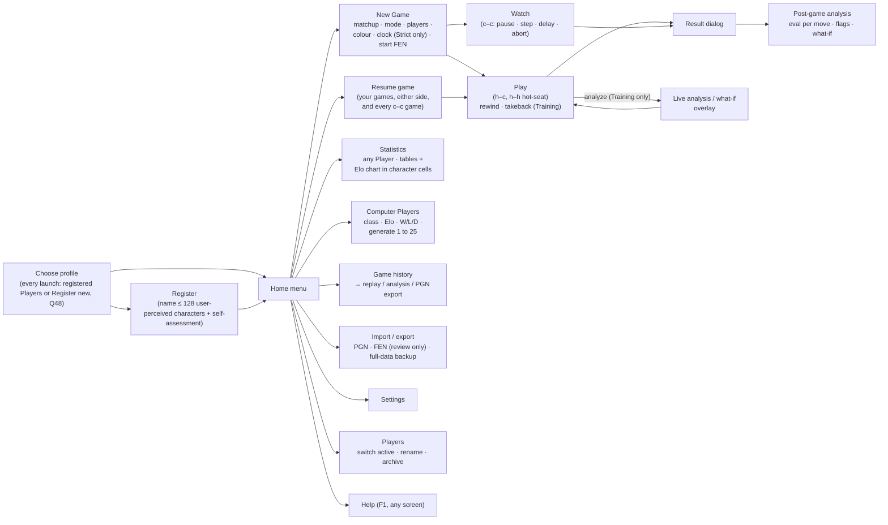

Each screen is a `Screen` implementation with its own state, key handling, and `render`. Forms (setup, settings, registration) use focusable fields where Tab/Shift-Tab moves and Enter confirms. Fields the policy disallows (e.g., Training for h–h, a clock in Training) are not offered (GAME-1). Statistics use ratatui's `Table`, `Chart`, and `Sparkline` widgets (UI-2, UI-5).

**Active Player (PLY-2, CR-4.9).** Picking a profile, or registering a Player at launch, makes that Player the active Player of this front-end session (`SelectProfile`). Registering a Player later (from the Players screen) does not change the active Player. The active Player can be switched at any time when no game is open in this front-end, by returning to the profile chooser. A front-end session has exactly one active Player; two front-ends may differ.

**Players screen (PLY-4, CR-4.10).** Rename and archive are offered for human Players only, and are not offered for computer Players. A human with any unfinished game cannot be archived (`PlayerHasUnfinishedGames` names the games); the active Player cannot archive itself. There is **no un-archive in v1**, and nothing is deleted. An archived Player's name stays taken (PLY-6).

**Empty and partial states (UI-2, ANA-3, CR-4.15).**
- With no games, statistics show zero counts, "—" for every average, the text "no games yet", and each Elo chart shows its baseline point.
- Analysis of a game whose background evaluation has not finished shows "evaluating…" in place of each missing value, raises no blunder flag for it, shows "n of N plies evaluated" from the `evaluated` and `total` counts, and fills in values as `AnalysisProgress` events arrive.
- Games started from a custom position are excluded from W/L/D and from every aggregate, as self-play is, and are listed in the game history marked "custom start" (H-17).

**CLI Elo chart (D-37).** The TUI draws each Elo series with ratatui's `Chart` using a Braille marker, with a table of the latest points beside it. The ASCII style (and any terminal without Unicode) draws the same series on a character grid of `*` and `.` from a small pure renderer, so the snapshot tests cover both. Plain mode prints the table and a one-line sparkline (block glyphs, or the ASCII ramp `_.-^` in the ASCII style) per series. The GUI chart library stays deferred (D-21).

#### Event loop (Elm-style)

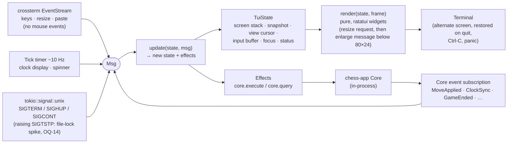

- **One `tokio::select!` loop** over terminal events, core events, and a tick. There are no blocking input threads, so engine moves, flag falls, and clock updates appear while the user is typing.
- **`update` is separate from `render`.** `update` can be unit-tested with synthetic `Msg`s and no terminal. `render` draws into a ratatui `TestBackend` for snapshot tests at fixed sizes.
- **Key routing (`KeyMap`, CLI-4).** Keys that can never start a move are bindings: ←/→ back/forward, End live, PgUp/PgDn move list, F1 help, **F2 move now** (only while a computer thinks in an h–c game, otherwise shown unavailable), Tab focus, Esc clear/cancel. F1 and F2 are in the help screen generated from `KeyMap` (UI-9), and the `KeyMap` test checks that both are bound. On a Mac laptop F-keys may need Fn, so the command `movenow` always works as well. Every printable character (letters, digits, `-`, `=`) goes to the input line. On Enter, `InputParser` resolves the text to a command word or a move. A unit test checks that no binding consumes a character that can begin SAN or coordinate notation. Because there is no board cursor, the arrow keys are reserved for rewind. The Watch screen has no move input, so it uses plain keys (Space, `s`, `+`/`-`, `a`).
- **Terminal hygiene.** A guard object enters raw mode and the alternate screen and restores both on `Drop`. A panic hook restores the terminal before printing the panic. Ctrl-C arrives as a key in raw mode and always asks for confirmation before quitting (Q52). Every move is already journalled (§7.6), so quitting is always safe. Resign (in hot-seat h–h, after asking which side resigns), c–c abort, archive, "reset player data", applying an import (after its preview) and restoring a backup also always ask, and the core refuses them without `confirmed: true` (§5.5). The Ctrl-C quit dialog is the TUI's own and uses the same dialog widget (UI-12). Cancel and Esc change nothing. Ctrl-Z restores the terminal, suspends via `SIGTSTP`, and redraws on `SIGCONT` (signals through `tokio::signal`; raising `SIGTSTP` follows the file-lock spike, OQ-14; `signal-hook` is rejected, D-47).
- **Styles.** `BoardStyle` = plain ASCII, Unicode glyphs, ANSI colour, light/dark squares. With `NO_COLOR` or `--no-color`, no colour is emitted. The plain ASCII style also switches panel borders to an ASCII border set.
- **Startup (NFR-1).** The first frame is drawn before the engine starts; engines start lazily.

#### Subcommands

`chess` (profile chooser, then TUI home), `chess play [--player <name>] [setup flags]` (straight into a game), `chess serve [--port <n>] [--no-open] [--config <path>]` (port precedence in §8.2), `chess install-cli [--remove]` (§8.2), `chess stats [player]` / `chess players` (open the TUI screen, or print tables in plain mode), `chess games` (lists stored games with the numbers `export game` accepts), `chess export game <game>` and `chess export data` (UC-22 and UC-24), `chess import pgn <file>` and `chess import data <file.zip>` (UC-23 and UC-25) with the exact forms in §5.7, `chess calibrate` (dev). The global option `--data-dir <path>` applies to every subcommand. `install-cli` and `--help` run before the core is created, so they never open the store or start the engine.

#### `chess serve` lifecycle (PLAT-4, D-36)

- **Configuration.** A missing `config.toml` means defaults. A file that is unreadable, not valid TOML, or whose `server.port` is outside 1 to 65535 stops the command with exit 1 and a message naming the file, the line and the reason (`ConfigInvalid`). There is no silent fallback to a default. Unknown keys are warned about (the file is read-only, see §8.2). `--config <path>` and `CHESS_CONFIG` are **architect-added** (tests use them; the requirements do not ask for them) and are kept.
- **Port in use.** Exit 1 with a message naming the port, and the URL of the other `chess serve` when `PROCESS_HEARTBEAT` shows one (§8.2).
- **Browser will not open.** The server keeps running, the URL is printed with a notice that the browser could not be opened, and the exit status is not affected.
- **Stop.** Ctrl-C (SIGINT) or SIGTERM, with no confirmation (the server has no user at the keyboard to ask). The server stops accepting connections, sends `ServerStopping` to every connected page (the page shows "server stopped" and does not retry), suspends each open game as an interruption (D-14: `Suspend` journalled, clocks frozen), and exits 0. Stopping takes at most 5 s (`ESTIMATE`, §4.8); every acknowledged move is already durable, so the limit loses nothing.

### 6.2 GUI (web and desktop, one codebase)

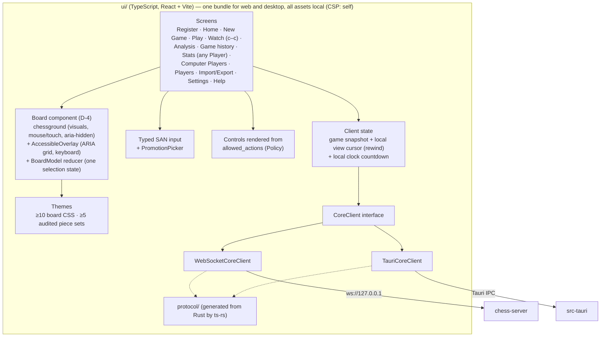

- **Framework:** React + TypeScript + Vite (AGREED, D-5): the largest ecosystem, mature testing tools (Testing Library, Playwright, axe), and good accessibility support.
- **Board (AGREED, D-4):** `@lichess-org/chessground` (pinned 10.x, GPL-3.0-or-later) renders the board and handles mouse, touch, and animation, wrapped by our own React component. Our shared layer adds the keyboard model (GUI-2) and screen-reader support (UI-4): a transparent ARIA-grid overlay and a `BoardModel` reducer that owns the one selection state. Full design in §11.1. Themes are chessground CSS classes for boards plus license-audited SVG piece sets; contrast ratios are checked by a unit test.
- **Rewind** is a local view cursor over the snapshot's ply list. While rewound, move input is disabled. The "live position has changed" badge appears when a `MoveApplied` arrives with the cursor behind live (GAME-3).
- **Elo chart:** a small charting dependency or hand-built SVG (D-21, DEFERRED). Either way it has a text or table alternative for screen readers (UI-4).
- **Settings take effect in the client (UI-1, GUI-3).** `PREFERENCES` drive:
  - `BoardProps`: theme, piece set, orientation, coordinates on/off (GUI-3, default on), legal-move hints;
  - app colour theme (UI-10): System (default, follows `prefers-color-scheme` and switches live when macOS appearance changes), Light, Dark, or another bundled theme. It is applied as CSS custom properties on the root element. Every theme, the high-contrast one included, meets WCAG AA (UI-7), and nothing more is required of the high-contrast theme;
  - the default opponent class and colour in New Game.
  Changes are saved with `UpdatePreferences` and apply immediately. The other entry points pick them up the next time they read preferences.
- **Move commit rules (GUI-2, Q52).** All input methods are active during play, and there is no confirm-move setting and no "default input method" setting. A move commits:
  - mouse or touch: when the piece is dropped on a legal square (click-click: on the second click);
  - keyboard overlay: when the destination square is selected with Enter/Space;
  - typed SAN: on Enter.
  A promotion opens the `PromotionPicker` first, and the move commits when a piece is chosen.
- **No sound in v1** (Q52). There are no sound assets, no sound setting, and no terminal bell.
- **Language.** English only in v1 (Q52). UI strings still live in one module per front-end, which keeps the help content (UI-9) and messages (NFR-9) in one place.
- **Layout (Q55).** There is no minimum window size. The layout is fluid (CSS grid with `clamp()` sizing), and the board is a square sized from its container. A `ResizeObserver` triggers chessground's `redrawAll()`, which keeps the `AccessibleOverlay` aligned at every size. Below a narrow breakpoint, panels stack under the board instead of beside it.
- **Profiles (Q48).** Each GUI session starts at the profile chooser: registered Players, or Register new. The chosen Player is session state (`SelectProfile`) and becomes the **active Player**: picking or registering at launch sets it, registering later does not change it, and it can be switched whenever no game is open in this front-end (§6.1). Two tabs or apps can use different profiles. `APP_SETTING.last_active_player` only pre-selects the list.
- **Game feedback (GUI-4).** Last move, check, and legal destinations come from `BoardProps`. The move list comes from the snapshot's plies. Captured pieces are derived in the client from the snapshot (material difference at the viewed ply). The result dialog is shown on `GameEnded`, and the thinking indicator on `EngineThinking`. While a computer thinks in an h–c game the indicator carries a **"Move now" button** (keyboard reachable, ARIA label "Move now", activated by Enter or Space, and bound to F2); it sends `CancelEngine` and is not rendered as available in any other state or matchup (ENG-5, GUI-4).
- **Connection loss (web).** §5.6: banner, inputs disabled, then reconnect and resnapshot.

### 6.3 Desktop (Tauri)

- `src-tauri` creates the `Core` at startup, using the same data-directory resolution as the CLI. It registers one `core` command and forwards events.
- It bundles the Stockfish binary as a Tauri helper binary (Tauri's word is "sidecar", which here means only a bundled helper; the Rust core spawns it from `<exe dir>/stockfish`, never the shell, AMD-9, UR-37), the `chess` CLI binary beside it (symlinked onto `PATH`, §8.2), and the license notices. There is one bundle, so CLI and desktop are always the same version (D-16).
- Packaging: a universal (arm64 + x86_64) `.app`/`.dmg` (PLAT-1, Q46), **ad-hoc signed** (no Developer ID, no notarization; Apple silicon will not run unsigned code), built with `cargo tauri build --target universal-apple-darwin`. See §8.2.
- **No single-instance mechanism** (user decision 11, 2026-10-31; *amended*: the earlier sentence "a second launch focuses the existing window" is struck). It is not a requirement (SE desk answer Q-SE-21), and a second desktop instance is valid under DAT-1 and DAT-4. Concurrent launches, including the first-launch roster race against the CLI or `chess serve`, are settled by the store's own locking, not by a UI rule, and no plugin dependency is added.
- **Main binary name (AMD-9, UR-38).** The Tauri main executable is renamed in the bundle configuration so that `Contents/MacOS/` never holds two names that differ only in case (the Tauri main binary and the CLI binary `chess` would collide on a case-insensitive volume). The new name is chosen when packaging is set up (OQ-11).
- Closing the window quits the app, which suspends any live game (RULE-5). All of this is the block `Tauri shell and IPC adapter` (§2.2).

---

## 7. Persistence

### 7.1 Technology

- **SQLite** through `rusqlite` with the `bundled` feature (no system dependency). Pragmas: `journal_mode=WAL`, `synchronous=FULL`, `fullfsync=ON` and `checkpoint_fullfsync=ON` (on macOS a plain `fsync` does not flush the drive's cache, so this makes SQLite use `F_FULLFSYNC`), `foreign_keys=ON`, `busy_timeout=5000`.
- **Durability (NFR-2, RULE-5, Q54: decided).** No completed move is ever lost, whatever happens: app crash, kill, disconnect, OS crash, or power loss. Every move is written to the game's move journal and flushed with `F_FULLFSYNC` before it is acknowledged. The journal is then applied to SQLite, whose own commits are also fully synced (§7.6). After any interruption, the clock comes back at the last recorded value: the last move or 1 s checkpoint, so at most 1 s of clock is lost (TBD-7 proposed: 1 s). TBD-23 (moves lost on power loss) is 0. The flush costs a few ms per move (`ESTIMATE`, measured by the NFR-8 latency test), which is negligible at chess move rates.
- **Volume check: refuse, do not downgrade (Amd 8, D-71; APPROVED by Brian, 2026-11-04; his decision at G-1, BP-014).** On open, before the store accepts any write, it probes the data directory with `fcntl(F_FULLFSYNC)` on a file it owns there (`store.id` or a scratch file in the directory). If the call fails with `ENOTSUP` or `ENOTTY`, the store **refuses to open** the directory and returns `DurabilityUnsupported{path, errno}` (§5.5). It does not fall back to `sync_all`: that would weaken NFR-2 silently, and TBD-23 stays closed at 0 moves lost. This replaces the fallback in the store design's ASM-ST-4. A `F_FULLFSYNC` failure of that kind later, at a journal append, is a write failure: the move is not made and the user sees `JournalWriteFailed{cause}` (existing). Consequence: a data directory on a volume without full sync (an external or network volume reached through `--data-dir` or `CHESS_DATA_DIR`, D-36) cannot be used; the default directory on the internal APFS volume is expected to pass `[UNV]` (CT-ST-001 on the development Mac, OQ-14 spike). The front-ends show the path, the reason ("this folder is on a volume that cannot guarantee that a move survives a power loss") and the way out (choose another folder), then exit or, in the desktop shell, show an in-window screen (not a native dialog; Brian, 2026-11-04, CR-12 item 7; the Quit button is OQ-TAU-005); they do not offer "continue anyway". No new exit code is invented here: the CLI uses its existing store-open failure code, **exit class 3** (store error), which Brian accepted for `DurabilityUnsupported` on 2026-11-04 (G3, beads chess-a0r.1.30); **it applies in the TUI, in plain mode and in subcommands, and TBD-36 is not narrowed** (CR-12 item 7); the CLI, UI, Tauri and server designs must carry it (§11.4.13, list of SDD edits). The refusal is an NFR-2 verification case (CR-12 item b, TBR-4): CT-ST-085, CT-APP-33 and CT-ST-001.
- **Location and precedence (D-36):** `~/Library/Application Support/Chess/chess.db`. Precedence: (1) the `--data-dir <path>` option, (2) `CHESS_DATA_DIR`, (3) the default. A directory that does not exist is created with the roster, as on a first launch. Every test and `chess calibrate` isolate state this way.
- **Migrations:** numbered SQL files tracked with `PRAGMA user_version`. Before any migration, the file is copied with `VACUUM INTO chess.db.bak-v<N>`. **If that backup cannot be written the upgrade does not start** (DAT-6, D-35): the store is left unchanged, `BackupFailed{cause}` shows the cause, and the user may retry or exit. A newer front-end never opens an old-version store without the upgrade. Fixture databases for each released schema version are kept in the repo for migration tests (DAT-1).
- **Corruption:** on open, `PRAGMA quick_check`. If it fails, the app explains the problem, offers to restore the latest backup, and never overwrites the file silently (DAT-5). A restore is all-or-nothing and replays **every retained journal**, including those in `journal/done/` for games that finished after the backup was taken; the journal wins on any disagreement, and each such game is finalised again in order of its end time so its Elo change and statistics apply once. Details in §7.6 and D-35.
- **Automatic backups (D-35; stated in DAT-5 by CR-5.1).** Requirements DAT-5 and DAT-6 assume a "most recent backup" exists, but only the pre-upgrade and pre-import copies were defined. The store therefore also writes `backups/chess-<UTC date>.db` with `VACUUM INTO`, followed by `quick_check` of the copy, at start-up when the newest backup is older than 24 h (TBD-33, `ESTIMATE`) and no other process is live. The newest 3 automatic copies are kept, and the pre-upgrade and pre-import copies are never pruned by this rule. Requirements DAT-5 (Amendment 3, CR-5.1) now states the cadence and the retention; a failed automatic backup is logged and never stops start-up (function F-6.15). *Amd 7 (SE interpretation Q-SE-19, confirmed):* any complete backup copy that was verified to open counts as "the newest backup" for the 24 h rule, whichever event wrote it (automatic, pre-upgrade or pre-import); a full-data export is not a store backup and does not count. At an upgrade the order is backup, migrate, replay journals.
- **Missing store (Q51).** When a store is created, a `store.id` file (store uuid, creation time) is written next to it. On open, if `chess.db` is absent:
  - nothing else in the data dir (no `store.id`, backups, or journals) means a genuine first launch. The store is created silently (PLAT-3) and the profile chooser opens on Register.
  - any trace of an earlier store returns `StoreMissing`. The user chooses **start fresh** (`CreateFreshStore`, keeping the traces aside in `missing-<date>/`) or **import from a file** (a full-data export or a backup).

### 7.2 Data model (baseline v1.0)

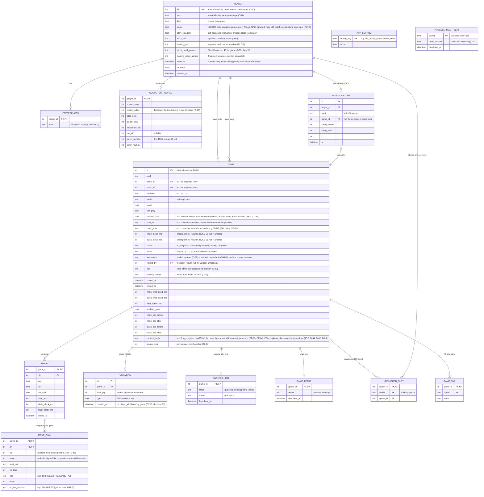

Notes:
- **Stored-format batch (Amd 7, AMD-5, D-41; G3, decided before any store code exists, nothing is released).** (1) `GAME.content_hash` is `TEXT NULL`, set in the finalize, abort and void transactions. *Addendum A, ruling 1:* `chess-app` computes the value before the transaction and passes it in (finalize and abort inputs, `VoidSpec` for a reset, the unreadable-game void), because the store has no `chess-rules`; the same value is written into the `GameEnd`, `Abort` or `Voided` journal payload, so a restore re-runs the transaction with it (§7.6). (2) `COMPUTER_PROFILE.error_permille INTEGER` replaces `error_rate REAL`, so the unique index of ENG-2 uses integer equality. (3) `PROCESS_HEARTBEAT.build_version` is `TEXT`. (4) `MOVE_EVAL.cp` and `mate` are stored from **White's point of view**; `chess-app` normalises the engine's side-to-move score. `cp_loss` stays the mover's point of view (ANA-3). The start-position evaluation needed for the first move's loss is transient: computed when needed and not stored, so the analysis view shows "evaluating..." for it until computed, and after an archive import (ASM-APP-07; SE interpretation Q-SE-2, confirmed). (5) `VARIATION` gains `created_at` and keeps its anchor ply `from_ply`; it has **no `player_id`**, because PLY-7 hides saved variations through the game they belong to (decision 13). A row is one saved line from its anchor ply; how imported nested variations are stored so that the DAT-2 round trip keeps their nesting is open and deferred by the user (OQ-15). (6) Clock columns of an untimed game are null, and the journal clocks are nullable too (§7.6). `journal_version` and `format_version` stay 1.
- **Stored-format batch, second part (Amd 8, APPROVED by Brian, 2026-11-04; Board-pass-store-journal.md; G3).** The full list is SF-01 to SF-22 in §11.4. The parts that change this table: (1) **`custom_start`** is a new column, defined once (D-64, SF-02): it is 1 exactly when the start position differs from the standard start, and a FEN that equals the standard start is a standard start (RULE-8, CR-9.11); "equals" compares **all six FEN fields** (SF-02, Brian's choice, 2026-11-04). `start_fen` is NULL exactly when `custom_start = 0`, and is never the standard FEN. DDL backstops (approved with the batch): `CHECK (custom_start = (start_fen IS NOT NULL))` and `CHECK (custom_start = 0 OR rated = 0)`. The earlier flag-4 sentence that a custom FEN equal to the standard start still made an unrated game is withdrawn. (2) **`content_hash`** has the form `sha256:v1:<64 lowercase hex>` (SF-03; spelling chosen by Brian, 2026-11-04), is NULL exactly while the game is `in_progress` (`CHECK ((status = 'in_progress') = (content_hash IS NULL))`, SF-17; its premise ASM-9 is still open), and is the hash **as of game end** (D-68, SF-04). (3) `white_time_used_ms`, `black_time_used_ms` and `total_active_ms` are written by finalize from the `GameEnd` record, never recomputed from `MOVE.think_ms` by a finalize (D-63, SF-01); the seed of a resumed game is derived from `Move.think_ms` (D-78). (4) `MOVE` and `GAME` clock columns are both NULL or both non-NULL (SF-14, SF-18). (5) `COMPUTER_PROFILE` gets `CHECK (error_permille BETWEEN 0 AND 1000)` and `CHECK (error_permille = 0 OR error_multipv >= 2)` (SF-19). (6) A non-imported game has both `white_id` and `black_id` (SF-20). (7) The hash of a **voided** game is advisory (D-67). `journal_seq` of a voided game is advanced by applying its `Voided` record (D-69, SF-06). `journal_version` and `format_version` still stay 1 because nothing is released (ASM-6).
- **Identity (Amd 7, D-40).** `PLAYER.id` and `GAME.id` are integer row keys **internal to `chess-store`**. Integer ids never cross the store API, the journal, the protocol or an export. Outside the store a Player is a `PlayerId(Uuid)` and a game a `GameId(Uuid)`. The reason is that a journal must survive a restore, which can reuse integer ids.
- **The `MOVE` rows are the source of truth.** The game state is rebuilt by replaying them from `start_fen`. PGN is produced on export, not stored redundantly. Imported PGN headers go in `GAME_TAG`; imported games may have no registered Players, so `white_id`/`black_id` are nullable for them.
- **Imported games** (`status = 'imported'`) have null `matchup`/`mode`, `rated = 0`, null `think_ms`, and no analysis job. Post-game analysis runs on demand. They are never counted in stats or Elo (RULE-7).
- **`APP_SETTING`** holds machine-wide values: the last active Player (PLY-3) and the roster seed (PLY-4). Per-Player settings stay in `PREFERENCES` (UI-1). **`PROCESS_HEARTBEAT`** lists live entry points and their build versions. It is used by D-16 and the exclusive operations in §7.4.
- **`analysis_used`** is set by the gateway the first time it grants `LiveAnalysis` or `WhatIf` for a Training game (DAT-3).
- **Statistics are computed by `chess-domain` over rows (Amd 7, AMD-1, D-44).** The store returns rows filtered only by structural keys (the Player, the reset window `started_at >= reset_at`, the side, a limit). The domain function applies the predicate `self_play = 0`, completed, not a custom start (custom-start games are excluded as self-play is, UI-2) and the empty-state rule (CR-4.15); `StatsService` calls the store, then the domain, and maps to DTOs without a filter or arithmetic of its own. The SQL views `player_stats` and `head_to_head` are not built. History lists include everything, with custom-start games marked "custom start" (UI-2, UI-5). A resignation in a custom-start game is recorded in the game record only. Computer Players' W/L/D use the same functions. FF-5 (§9) measures the statistics path (the store's rows plus `chess-domain::aggregate`) on a 10 000-game fixture against the NFR budget; if it fails, a SQL fast path may be added behind a differential test against the domain function.
- **Two Elo tracks for every Player (Q41, ELO-1/2).** Each Player, human or computer, has a **Strict Elo** and a **Training Elo**, both starting at the same category baseline. A finished game updates the track of its mode (`GAME.mode`) for both sides, unless it is self-play or started from a custom FEN (`rated = 0`). That includes c–c games between different computers. `GAME.*_elo_before/after` hold the values on that game's track. **Ratings, `k` and the history values are whole integers (CR-7.1):** `EloCalc` computes `Δ = round(K × (S − E))` in `f64`, rounding half away from zero, and stores `R + Δ`, so the history sums exactly. Each track has its own rated-game counter (`strict_rated_games`, `training_rated_games`), which sets that track's K: 40 for its first 30 rated games, then 32 (Q78). Because two processes may finish games against the same computer Player at the same time, finalize re-reads both current ratings inside its `BEGIN IMMEDIATE` transaction (§5.4).
- **Rating history is append-only, one series per track.** The initial row for each track is written when the Player is created. An integration test asserts `elo == initial + Σ deltas` per Player and per track (ELO-1). The displayed category of a computer follows its current Strict Elo (§4.6, Q79).
- **One unfinished game per mode, per Player (GAME-4, D-27; user 2026-10-26).** `StartGame` inserts one `UNFINISHED_SLOT` row, keyed by `(player_id, mode)`, for each slot-holding Player in the game:
  - h–h (Strict): each human, or one row for self-play;
  - h–c (Training or Strict): the human only. A human–computer game never uses or checks the computer's slot, so any Player can always play any computer, even one that has an unfinished game;
  - c–c (Strict): each computer, or one row for self-play.
  The slot limit therefore applies to every human Player, and to a computer only in c–c games. A computer with an unfinished c–c game can't start another c–c game until that one ends or is aborted, but humans can still play it. The primary key makes a second unfinished game impossible across all processes, and the error is `UnfinishedGameExists`. Rows are deleted in the finalize, abort, or reset (void) transaction. `StartGame` is therefore a synchronous DB transaction: it fails with `StoreBusy` if the DB is locked, which is acceptable because no clock is running yet.
- **Ending a game early (GAME-4, RULE-2).** An interruption the player didn't choose (crash, engine or power failure, closed tab) is never an abort. The game stays `in_progress` in the journal and DB, and resumes with no Elo or stats effect. A human ends a game early only by **Resign** (confirmed; h–h asks which side). That is a normal result and counts as a loss for Elo on the game's track and for W/L/D. **Abort** exists only for a watcher ending a c–c game: `status = 'aborted'`, no result, no Elo and no stats for either computer. It stays in history and can be analysed (ANA-4). The only other way a game ends without a result is a **void** by a reset (`status = 'voided'`, D-30, below).
- **Player reset (PLY-7, D-26; user 2026-10-26, amended 2026-10-27).** Humans only; computers can't be reset. `ResetPlayerData{confirmed, void_game_ids}` runs one transaction: it sets `reset_at`, restores default `PREFERENCES`, appends a reset point to `RATING_HISTORY` on each track (`game_id` null, `rating_before` = `rating_after` = the current value), and voids every unfinished game of the Player (below). Both current ratings and both rated-game counters are kept, so the next rated game uses the kept K. Nothing is deleted.
  - **Views of the reset Player** show only what came after `reset_at`: statistics, W/L/D, game history, saved variations, and the rating history and chart. That applies in every front-end and in the "stats for any Player" views (UI-5). The ELO-1 check restarts at the reset point: current = reset point + Σ later deltas.
  - **Opponents' views are unchanged** (Q76): the Player's earlier games stay in every opponent's game history, statistics, W/L/D, and head-to-head, computers included, under the Player's current name.
  - The full-data export still contains every game and `reset_at` (DAT-2), so an import shows the same views.
  - **Unfinished games are voided by the reset (D-30; user 2026-10-27, closes OQ-8).** *Superseded rule (baseline v1.0): a reset was refused with `UnfinishedGameExists` while the Player had an unfinished game.* Now the reset is allowed, and the unfinished game does not count against either player:
    - **Confirmation.** The unconfirmed command returns `ConfirmationRequired{action: reset, voids}`, listing each unfinished game (opponent, mode, moves played). Every front-end's dialog says that these games will be voided: no result, no rating change, not counted for either player. The confirmed command echoes the list as `void_game_ids`. If at commit time the Player has an unfinished game that is not in that list, nothing is written and the confirmation is asked again (§5.5).
    - **Inside the reset transaction**, for each unfinished game of the Player: `GAME.status = 'voided'`, `result` null, `termination = 'voided by reset'`, `voided_by` = the reset Player, `ended_at` = the reset time. No Elo change, no `*_rated_games` change, no W/L/D, and no `RATING_HISTORY` row for any side: the reset Player, a human opponent, or a computer. Every `UNFINISHED_SLOT` row that points to the game is deleted, whichever Player holds it (the opponent human in h–h, both rows of a self-play game), and its `GAME_LEASE` row is deleted. An `ANALYSIS_JOB` is enqueued as for an aborted game, so the opponent can analyse it.
    - **Journal and lock.** Before the transaction, `PlayerService` tries the game's journal `flock`. If it gets the lock (the game is suspended), it first replays unapplied journal records, so every completed move is in `MOVE` (NFR-2). After the commit it appends a `Voided` record (carrying the committed `content_hash`, §7.6) with `F_FULLFSYNC`, closes the journal, and moves it to `journal/done/` (the normal lifecycle of a final game, §7.6). The journal is not deleted by the reset. If the game is live in this process, `PlayerService` sends `Void` to its `GameSession` through the `SessionRegistry` after the commit. If it is live in another process, that process's `GameSession` finds out at its next lease heartbeat (its `GAME_LEASE` row is gone, at most 2 s, `ESTIMATE`) or at its next journal apply, whichever comes first. Either way the session cancels any engine search, appends `Voided`, closes its journal, releases its `flock`, emits `GameVoided`, and stops. A move made in that short window is still journalled and applied to `MOVE` (no completed move is lost), but the status stays `voided`. A `GameEnd` in that window is skipped by finalize, because the status is already final (§7.4). *Amd 8 (D-67, OQ-20 option A, Brian's decision at G-1; text approved, 2026-11-04):* the five conditions are in D-67. In short, the hash of a voided game is advisory; for a game live here, `prepare_void` takes the move list from the session's in-memory `Game` or first calls `sync_backlog`; the session live elsewhere builds its `Voided` record from the `content_hash`, `voided_by` and `ended_at` of the `GAME` row; `void_unreadable_game` hashes whatever moves are readable (zero allowed); a `GameEnd` appended before the session sees `RowGone` is superseded by the committed void, and restore skips that pair.
    - **Which record wins.** The journal wins on moves and clocks (§7.6). The void is a store decision made in the reset transaction, so `status = 'voided'` is final and no journal replay changes it.
    - **Visibility (architect's interpretation, D-30, for the user to correct).** The voided game stays in the opponent's game history, marked "voided by reset", with no result, and can be analysed (ANA-4). It is hidden from the reset Player's own views by the `reset_at` rule (Q76), because it started before `reset_at`. It is not a resignation, so the Q60 loss rule does not apply. It is never counted in W/L/D or Elo for anyone: stats aggregates already filter on `status = 'completed'`.

Reset with unfinished games (D-30). Question this diagram answers: how does a reset void a suspended game and a game that is live in another process, without losing a move or touching any rating?

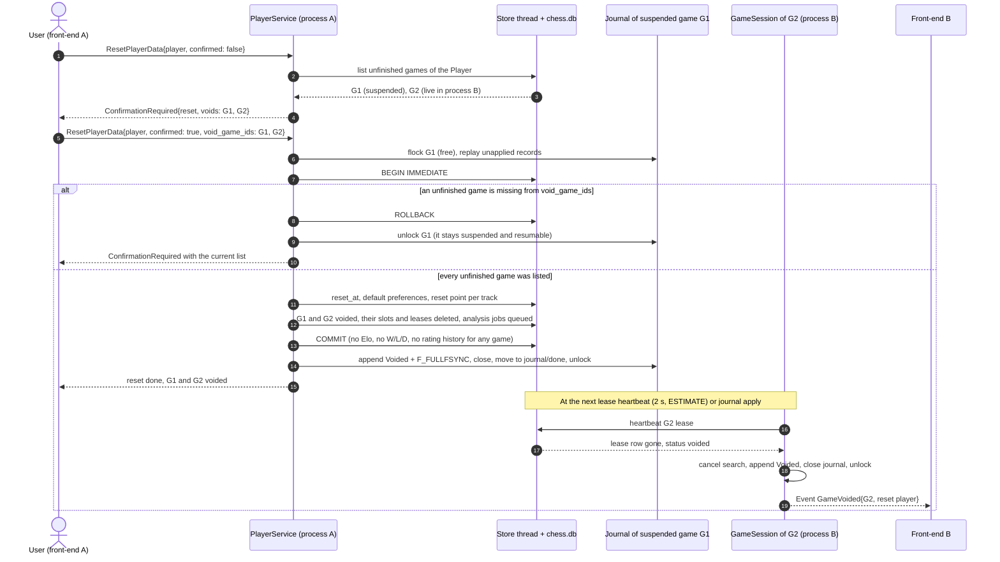
- **Names (PLY-6, CR-4.1).** A name is trimmed of leading and trailing whitespace and then NFC-normalised, and nothing else is folded. It is at most 128 user-perceived characters (extended grapheme clusters, UAX #29), contains no control character (category Cc) and no line or paragraph separator (Zl, Zp), and is non-empty. It is unique **case-sensitively** against **every** Player, human or computer, active or archived ("Anna" and "anna" are different names), and an archived Player's name stays taken. The `UNIQUE` index is on the stored (trimmed, NFC) value. Case is kept. The failed rule is named in the message (`empty`, `too_long`, `character_not_allowed`, `already_used`, and "by an archived Player" when so). Players are identified by `uuid`, never by name.
- **Void as unreadable (DAT-7, D-35).** `VoidUnreadableGame` is the second way a game becomes `voided`: `status = 'voided'`, `result` null, `termination = 'voided: unreadable'`, `voided_by` null, `ended_at` = the void time. No Elo, counter, W/L/D or rating-history change for anyone, and every `UNFINISHED_SLOT` row of the game is deleted in the same transaction, so the slot is freed. The game stays in history marked "voided: unreadable".
- **Average game length (UI-2).** Reported both in moves (full moves = ⌈plies / 2⌉) and in time (`total_active_ms`), from the same filtered queries.
- **Time accounting (DAT-3):** *(Amd 8, D-63, approved 2026-11-04: the three totals are carried in the `GameEnd` record and finalize writes those values; a finalize does not recompute them from `think_ms` (only the seed of a resumed game uses `think_ms`, D-78), because a resignation or a flag after a long think has no `Move` record and a Training takeback drops plies whose time was already spent.)* `think_ms` per move and the per-side totals come from the session's `TimeSource` while the game is live. Time while the app is closed is never counted, because a suspended game has no running clock. The session checkpoints both clocks into the journal every 1 s while a clock runs, and on every move, pause, and suspend (§7.6). The checkpoints are applied to `GAME.white_clock_ms`/`black_clock_ms`, so a resumed game restarts from the last recorded remaining time, including the side to move's partial thinking time (RULE-5, Q54). After any crash, disconnect, or reset, at most one checkpoint interval (1 s) is lost. *(Amd 8 Addendum D, D-78, ruled under Brian's delegation and ratified by Brian on 2026-11-04, option A, Addendum F:)* that bound is for the clock. The three totals of a game that is suspended and resumed are seeded from the journal's `Move.think_ms` (every `Move` fact, taken-back plies included) and **may lose up to one turn of time at each stop (the unfinished turn of the side to move); they are not required to**; no journal field carries them before `GameEnd`.

### 7.3 Multi-process coordination

The CLI, web server, and desktop app can all be open at once against the same file.

- **Writes** are short transactions, and WAL plus `busy_timeout` serialise them safely across processes (concurrent-access integration test for DAT-1).
- **Live games** are owned by exactly one process: the one holding an exclusive `flock` on the game's journal file (§7.6). The OS releases the lock the instant the owner exits or crashes, so another process can resume immediately (DAT-4; TBD-28 = 0 s: no wait after a crash). The `GAME_LEASE` row (owner kind, pid, heartbeat every 2 s) is only for display: opening the same game elsewhere shows "this game is open in the CLI". A hung but still-running owner keeps the lock, and the message tells the user which process to quit.
- **The background analysis queue** uses the same lease idea, so whichever process is running picks up pending jobs, and jobs survive restarts.
- Other screens (stats, player lists) re-query when they are opened. No cross-process push is needed in v1.

### 7.4 Data ownership and transaction boundaries

One writer per entity, and every invariant is enforced inside one SQLite transaction on the store thread (D-13).

| Entity | System of record (writer) | Readers | Transaction boundary and invariant |
|---|---|---|---|
| `PLAYER`, `PREFERENCES` | `PlayerService` | all services, front-ends via queries | **Register:** `PLAYER` + default `PREFERENCES` + an initial `RATING_HISTORY` row per track (Strict and Training), all-or-nothing (PLY-2, ELO-1). `name` UNIQUE, case-sensitive (PLY-6). **Reset (confirmed, humans only):** `reset_at` + default `PREFERENCES` + one reset point per track in `RATING_HISTORY` + the void of each unfinished game of the Player (`GAME.status = 'voided'`, every `UNFINISHED_SLOT` and `GAME_LEASE` row of the game deleted, analysis job queued, no rating or W/L/D effect for any side), one `BEGIN IMMEDIATE` transaction. Ratings and K counters untouched (PLY-7, D-26, D-30). For the void, `chess-app` computes each voided game's `content_hash` from the moves held after the journal replay and passes it as `VoidSpec{game_id, content_hash}`, so the transaction sets it (the store has no `chess-rules`; Addendum A, ruling 1). *Amd 8 (D-67, approved 2026-11-04):* that hash is advisory for a voided game (it may be taken from a shorter move list, or from zero moves for an unreadable game), and `prepare_void` must `sync_backlog` or take the move list from the in-memory `Game` of a game live in this process. `PlayerService` is also a second writer of `GAME.status` and `UNFINISHED_SLOT` beside `GameSession`. The `BEGIN IMMEDIATE` serialisation and the "skip if already final" rule keep the two from conflicting (§7.2). `PlayerService` writes only initial and reset points to `RATING_HISTORY`; every game delta is written by finalize. **Rename and archive** apply to human Players only (`Denied{computer_player}`). Archive is refused while the Player has any unfinished game (`PlayerHasUnfinishedGames`) and is refused for the session's own active Player (`Denied{active_player}`). There is no un-archive in v1. **Register, rename, archive, preferences:** one transaction each, all-or-nothing (DAT-7) |
| `APP_SETTING` | `PlayerService` (Amd 7, UF-APP-16: the writer was unnamed) | all services | One transaction per key (`last_active_player`, `roster_seed`) |
| `COMPUTER_PROFILE` | `PlayerService` (via `RosterGen`) | `EngineGateway`, stats | Roster batch of N Players (1 to 25), with `roster_indexes()` read first and the batch inserted in one transaction, `UNIQUE(roster_seed, roster_index)` arbitrating a race (§4.6, Addendum A), together with each computer Player's two baseline rating rows. Computer Players are never renamed, archived, deleted or reset. Profile rows are never updated after insert: engine parameters are fixed (PLY-4, Q41) |
| `GAME` (header), `MOVE`, `UNFINISHED_SLOT` | `GameSession` (live), `GameSetupService` (start), `ImportExportService` (imported) | stats, analysis, export | **Start (Amd 7, AMD-4, UR-04):** in one synchronous store transaction, claim one `UNFINISHED_SLOT` per slot-holding Player (every human; computers only in c–c, D-27; the primary key is the arbiter) and insert the `GAME` row (GAME-4). Then create the journal with its `Start` record, then acknowledge. A crash between the two leaves an `in_progress` row with no journal; resume treats that as a game with zero moves replayed from `start_fen`, and no new state exists for it. **Move:** journal record + `F_FULLFSYNC` first (the durability point). Then `MOVE` row + `GAME` clock + `journal_seq`, one transaction per applied batch (NFR-2, §7.6). **Takeback:** a journal record, then delete the trailing `MOVE` rows in one transaction |
| `GAME` result, `RATING_HISTORY`, `PLAYER.*_elo` / `*_rated_games`, `ANALYSIS_JOB` | `GameSession` finalize | stats | **Finalize** (completed, including resignation): `GameEnd` journal record first. Then one `BEGIN IMMEDIATE` transaction: re-read both Players' ratings on the game's track (Training or Strict), compute result + Elo deltas for both sides on that track + history rows, write the three time totals taken from the `GameEnd` record (Amd 8, D-63: never recomputed), delete the `UNFINISHED_SLOT` rows, enqueue the analysis job and set `content_hash` (ELO-1/2, §5.4, D-42). *Amd 8 (D-72, confirmed by Brian, 2026-11-04):* when several pending `GameEnd` journals are finalised after a crash, they run ascending by `ended_at`, ties by `game_uuid`, as in a restore. **c–c abort:** status, slot deletion, job and `content_hash`, with no ratings. Both are idempotent on replay: skipped if the status is already final (`completed`, `aborted`, or `voided`) |
| `MOVE_EVAL`, `ANALYSIS_JOB` state | `AnalysisWorker` | `AnalysisService`, stats | One upsert per ply. A partial run resumes from the last ply |
| `VARIATION` | `AnalysisService` | export | Per save or delete. A save from the final position of the game is refused (§5.1). `created_at` is set at save |
| `GAME_TAG`, imported `GAME`/`MOVE` | `ImportExportService` | export, history | One transaction per imported game |
| Journal files (`journal/<game_uuid>.jnl`) | the `GameSession` holding the file's `flock` | recovery in any process | Append-only, one writer. Truncated only after its records are applied and the game is final (§7.6) |
| `GAME_LEASE`, `PROCESS_HEARTBEAT` | `SessionRegistry`, `Core` startup | all processes | Display and liveness only. Compare-and-set on `heartbeat_at` |
| Whole database (`ImportData`, `RestoreBackup`, migrations) | `ImportExportService` / `chess-store` | — | **Exclusive:** refused with `Busy` if `PROCESS_HEARTBEAT` shows another live process. Pending journals are replayed first. Runs under `BEGIN EXCLUSIVE` after a `VACUUM INTO` backup. Data import merges (D-17, see below) |

**Data import merges (D-17, decided by Q51).**
1. `PreviewDataImport` matches Players by `uuid` (computers by `(roster_seed, roster_index)`) and games by `uuid`. A different Player with an identical name is also a conflict, because names are unique. It returns `ImportConflicts`.
2. For each conflict the user picks **Replace**: the imported record, with its rating history, replaces the local one. Or **Keep both**: the imported record gets a new `uuid` and a suffixed name such as "Brian (imported 2)", so it stays a distinct identity. Non-conflicting records are added.
3. `ApplyDataImport{plan, confirmed}` is confirmed after the preview (UI-12) and writes everything in one transaction, then re-checks the Elo invariant per Player.
4. If any step fails, nothing is written and the backup is untouched.
5. **Unfinished games** in the archive are restored as unfinished (with their `UNFINISHED_SLOT` rows and the clocks from `games.json`, or the last `[%clk]`) unless that would give a Player a second unfinished game in a mode, or a computer a second c–c game. In that case the game is imported **review-only with no result**, and the preview lists it. A game that is live in a front-end of the importing process is never replaced: it is reported and the stored game is kept.
6. **PGN import** (`ImportPgn`) is not a merge: duplicates raise the Skip (default) or Keep both prompt of D-34, and nothing is ever replaced.

Multi-game PGN files are supported by `ImportPgn` (IF-2).

A suspended game is `in_progress` with no journal lock held, so the stored status needs no separate `suspended` value.

Cross-process consistency is eventual only for screens that are open in another process: they re-query when opened (§7.3). Live game state is never shared, because the lease gives each live game one owner.

### 7.5 One version everywhere (D-16; one-way for data, accepted by the user)

The CLI and the desktop app must never be different versions. They ship and update together as one bundle (§8.2), so v1 has **no** machinery for mixed versions working together. It only detects a mismatch and refuses, with a message.
- **One build version** is compiled into the bundle and covers `chess`, `Chess.app`, the GUI bundle, the journal format, and the schema version.
- **Against the database.** On open, a `user_version` newer than the build's schema returns `SchemaTooNew`, writes nothing, and says "this data was written by a newer Chess. Update the app." An older `user_version` is a normal upgrade: the build migrates after a `VACUUM INTO` backup (DAT-6), but only when no other process is live. Before migrating, it replays all pending journals.
- **Against running processes.** Every process records its build version in `PROCESS_HEARTBEAT`. If a live process of a different version is found, which can only happen in the middle of an upgrade, startup is refused with "Chess version X is still running (CLI / web server / desktop). Quit it first."
- **Against a running server or a stale tab.** A second `chess serve` of another version is refused the same way. A browser tab from another build gets `ProtocolMismatch` and reloads (§5.6).
- **Journals.** The header's `journal_version` must equal the build's. A different value is refused with the same message.
- **One-way for data (accepted by the user, 2026-10-26).** Once a newer build has migrated `chess.db`, no older build can open it. The only way back is the pre-migration backup `chess.db.bak-v<N>`, with pending journals replayed on top, or a full-data export and import (§11.3).
- Tests: an older build opens a newer DB (`SchemaTooNew`); a heartbeat from another version is refused; migration replays journals first (DAT-1).

### 7.6 Move journal: the local cache that always wins (Q54, D-23)

The user's rule (Q54) has three parts:
- every move is cached locally and written to the database when the database is available;
- after any disconnect, hard reset, close, or crash, the clock is restored to the last recorded clock time;
- if the cache and the database disagree, the local cache wins.

**Files.** One append-only file per live game, `<data dir>/journal/<game_uuid>.jnl`. It starts with a header (`journal_version`, `game_uuid`, `store.id`). Each record is `{seq, kind, payload, crc32}`, length-prefixed. The kinds and payloads are:
- *Amended 2026-10-31 (AMD-4, D-41; G3, decided before any store code; `journal_version` stays 1 because nothing is released). Amended again the same day by Addendum A (rulings 1 and 2).* The record body is `seq`, `kind`, `wall_ms` (the wall time of the change, taken from the `Stamp`) and the JSON payload. The kinds are `Start`, `Move`, `Takeback`, `Clock`, `DrawOffer`, `DrawDeclined`, **`DrawDropped`** (new: the offer was dropped, by an engine failure or a suspend), `Pause`, `Resume`, `Suspend`, **`SuspendResume`** (new: a suspended game was resumed, so replay needs no implicit rule), `GameEnd`, `Abort` (c-c only) and `Voided` (written after the reset transaction commits, D-30, §7.2, or after `VoidUnreadableGame`, DAT-7). `DrawOffer` is followed by a `Clock` record with both clocks stopped (RULE-2). Clocks (`white_ms`, `black_ms`) are **nullable** in `Move` and `Clock`, for an untimed game. Every identifier is a UUID (D-40), and a side is the store's `StoredSide` (`white` or `black`), converted by the codec.

**One fact, one record kind (AMD-4, D-41; table rewritten by Addendum A).** `JournalCodec` in `chess-app` (§5.7) converts between the domain's `Fact` (the vocabulary of state changes, owned by `chess-domain`) and the journal record (the format, owned by `chess-store`). The mapping is one to one. **This table is authoritative** over the store design 3.11.1, the domain design 3.11.1 and DD-APP-18, and it uses the domain's variant names (`Ended`, `Aborted`; FIND-JR-004). Column 3 lists the `Fact` fields, each of which is written into the record. Column 4 lists the payload fields that the codec adds from the `RecordCtx` or an assembler and that `record_to_fact` ignores. **That is why the FF-3 round trip holds by construction: no `Fact` field is missing from a record, and no record field that is not in the `Fact` is needed to rebuild it.** A unit test asserts, per kind, that the payload field names equal columns 3 and 4.

| Domain `Fact` | Journal record | Payload fields taken from the `Fact` | Payload fields added by the codec (not in the `Fact`) |
|---|---|---|---|
| `Start{setup, started_at}` | `Start` | `game` (= `setup.game_id`), `white`, `black` (the two `Seat` players), `white_kind`, `black_kind` (`human` or `computer`), `matchup`, `mode`, `custom_start` (bool; defined once, D-64), `start_fen` (null exactly for the standard start, SF-02), `clock_spec` (null when untimed; text `base+inc` in seconds, SF-11). There is no `started_at` field: `started_at` is the record's `wall_ms` (SF-16, decided by Brian, 2026-11-04; the same rule as `Move.played_at`) | `rated`, `self_play` (from the `Start` assembler; frozen, authoritative for the restored `GAME` row, never recomputed) |
| `Move{ply, mv, think_ms, clocks_after, played_at}` | `Move` | `ply`, `uci` (= `mv.to_uci()`), `think_ms`, `white_ms`, `black_ms` (both null when untimed). `played_at` is the record's `wall_ms` | `san`, `fen_after` (from the `RecordCtx`; replay recomputes the SAN and compares; *Amd 8, D-72:* a SAN mismatch with a legal `uci` is not an error: the `uci` is trusted, `san` and `fen_after` are recomputed and the event is logged; *Addendum D, D-79:* the codec hands the two values to `Game::replay` as a `MoveCheck` beside the unchanged `Fact`, and a `fen_after` difference is always an error) |
| `Takeback{to_ply}` | `Takeback` | `to_ply` | none |
| `Clock{clocks, running}` | `Clock` | `white_ms`, `black_ms` (both null when untimed), `running_side` (null when stopped) | none |
| `DrawOffer{by}`, `DrawDeclined{by}` | `DrawOffer`, `DrawDeclined` | `by` (side) | none |
| `DrawDropped{by, cause}` | `DrawDropped` | `by` (the side whose offer was dropped), `cause`: `engine_failure` or `suspend` | none |
| `Pause`, `PlayResume`, `SuspendResume` | `Pause`, `Resume`, `SuspendResume` | none: the payload is `{}` | none |
| `Suspend{cause}` | `Suspend` | `cause`: `detach`, `shutdown` or `recovered` (a D-14 detach, a server stop, a D-58 crash recovery). *Amd 8, SF-21, decided by Brian, 2026-11-04 (option A); `Fact::Suspend` and `decide(Suspend)` carry it, so the domain and the app change (G2, approved)* | none |
| `Ended{outcome}` (`Outcome{result, reason}`) | `GameEnd` | `result`, `reason` (stable snake_case codes, SF-15, decided by Brian, 2026-11-04; the codec maps them 1:1 to the unchanged `GAME.termination` strings) | `ended_at`, `eco`, `opening_name`, `analysis_used`, **`content_hash`**, and, *Amd 8 (D-63, SF-01)*, **`white_time_used_ms`, `black_time_used_ms`, `total_active_ms`** (`FinalizeInputs`, from `assemble_game_end`) |
| `Aborted` | `Abort` | none | `ended_at`, **`content_hash`** |
| `Voided{reason, reset_player}` | `Voided` | `reason` (`VoidReason`: `reset` or `unreadable`, SF-10), `reset_player` (UUID or null) | **`content_hash`** (advisory, D-67) and, *Amd 8 (D-69, SF-05)*, **`ended_at`** |

**`content_hash` (ruling 1, D-42).** It is `"sha256:" + hex(...)`, never null in `GameEnd`, `Abort` and `Voided`, because the game is terminal. The store cannot compute it (it has no `chess-rules`), and a restore re-runs the finalize, abort or void from the journal, so the value must be in the record. `chess-app` computes it before the store transaction and passes it in. For a reset, the same value is in the `VoidSpec` of each voided game (§7.4), and the `Voided` journal record carries the hash that was committed to the `GAME` row. The earlier journal payload note "the finalize inputs `ended_at`, `eco`, `opening_name` and `analysis_used`" is now the five-field list above. *Amd 8 (APPROVED by Brian, 2026-11-04; D-63, D-68, D-69):* the value has the form `sha256:v1:<hex>` (SF-03). It is the hash of the game **as of game end**: it uses the names and the rule-owned tags as they were then, so FF-4 holds only when no Player is renamed between export and re-import (SF-04). For a **voided** game it is advisory and FF-4 and the second property of DD-APP-18 exclude `Voided` (D-67). *Addendum F (OQ-27, decided by Brian, G3, 2026-11-04, option A):* `canonical_form` leaves out `SetUp` and `FEN` when the `FEN` equals the standard start in all six fields (the SF-02 comparison; consistent with CR-9.11 (2)), so the hash of a game imported with the standard `FEN` tag equals the hash of its own export; any other `FEN` stays in the canonical form. `v1` is defined with this rule. The `GameEnd` payload also carries the three finalize time totals (SF-01) and the `Voided` payload carries `ended_at` (SF-05). Numeric kind codes, the checksum, the record size limit and the text forms are fixed in SF-07 to SF-16 (§11.4).

**Flags for the Review Board (OQ-16, OQ-22).** These are fields or choices that the architecture settles but that no requirement or earlier text justifies on its own.
1. *Not carried.* The store design lists `resigning_side?` and "times" in `GameEnd`. The resigning side is the loser of `result` when `reason` is resignation, in every matchup, so the field is redundant. "Times" names no consumer: per-move times are in `Move`. Both are dropped. `setup JSON as sent` in `Start` is dropped too, because it would give two truths beside the flat fields. *Amd 8 (D-63, approved, 2026-11-04; Board BP-001; Brian accepted at G-1):* the drop of "times" is **rejected**: the three time totals return to `GameEnd` (SF-01), because they cannot be derived from `Move.think_ms`. The drop of `resigning_side?` and of `setup JSON` stands.
2. *`Pause`, `Resume`, `Suspend`, `SuspendResume` had an empty payload (Amd 8: `Suspend` now carries `cause`, see the table).* The store design says "small" and names no field, and replay and finalize need none. The clocks at the instant are in the `Clock` fact that follows each of them (state machine T11, T14). The change time is the record's `wall_ms`. If a cause for `Suspend` (detach, shutdown, lease loss) is wanted for diagnostics, it is a new field and a decision. *Amd 8: accepted by the Board; Brian decided on 2026-11-04 that `Suspend` gets a `cause` now (SF-21, option A). The other three kinds stay empty.*
3. *`DrawDropped.cause` has no replay consumer.* It exists for the audit trail and the ENG-4 message. `by` is also derivable (it is the pending offerer), so replay checks it against the pending offer instead of trusting it. *Amd 8: accepted; a mismatch is logged and replay continues (SF-22).*
4. *`Start` additions.* `white_kind`, `black_kind` and `custom_start` are not in the store design's list. Without them `record_to_fact` cannot rebuild `Seat.kind` or `StartPosition`, because `matchup` does not say which side of an h-c game is the computer, and a custom FEN equal to the standard start still makes an unrated game. They are added here, not requested by a ruling. *Amd 8 (D-64): `white_kind` and `black_kind` accepted. `custom_start` is changed: it is defined once, a start equal to the standard start is standard, and `GAME` gets the column (SF-02).*
5. *`Start.rated` and `Start.self_play` are redundant with the setup.* They are kept as history frozen at the start, so that a restore creates the `GAME` row without re-running a rule that a later build may have changed. `record_to_fact` ignores them. *Amd 8 (accepted, folded into D-64): the frozen value is authoritative for the restored `GAME` row and replay never recomputes it.*
6. *`ended_at` equals the record's `wall_ms` on the normal path.* It is kept because restore orders games by it (Restore, step 4), and a `Voided` appended by crash recovery carries a later `wall_ms`. `Voided` has no `ended_at`, so the three terminal records are not symmetric. The Board should decide whether `Voided` gets one. *Amd 8 (D-69): changed. `Voided` gets `ended_at` (SF-05).*
7. *Hash of a game voided while live elsewhere.* The reset computes the hash from the moves the store holds at commit. A move that the other process journalled but had not yet applied is added afterwards (the journal wins on moves), so the stored hash can belong to a shorter move list (OQ-20). *Amd 8 (D-67): accepted with five conditions; the hash of a voided game is advisory.*

- **No implicit-resume fallback.** The domain's earlier rule that any non-terminal fact after `Suspend` resumes the game is removed, so replay has one interpretation. A `Move` in `Paused` is a stepped move, stated once in the domain replay rules; there is no `Step` kind.
- **Fields closed by construction.** `fen_after` and `wall_ms` come from the post-state and stamp that `Game::decide` already returns, so the domain `Fact::Move` does not change.
- **Start order.** The slot claim and the `GAME` row come first, in one store transaction; then the journal is created with `Start`; then the start is acknowledged (§7.4). *Addendum E, D-84 (desk review F-02):* **one stamp.** The `Stamp` that the session takes once at the start is the `started_at` of `Fact::Start` and therefore the `wall_ms` of the `Start` record (SF-16, approved), **and it is the value of `GAME.started_at`**: the row and the record carry the same value, not two readings of the clock a few milliseconds apart. A restore of a journal with no later change thus gives the same `started_at`, and the same UTC `Date` of the hash (SF-04), as the live row; a game started just before UTC midnight does not change its `Date`. *Mechanism (decided by Brian Prascher, 2026-11-04, G2, OQ-26 option A; Addendum F):* the row receives the stamp through a `started_at: i64` field of the store's `NewGame`. The app takes the `Stamp` once, before `start_game`, and passes its `WallMs` in `NewGame.started_at`; the store writes it unchanged to `GAME.started_at`, reads no clock for it, and the session builds `Fact::Start` from the same `Stamp`. The field crosses the `chess-store`/`chess-app` contract (§5.7); it is not a protocol type. **A row with no journal** (a crash between the two steps): the first resume creates the journal and writes, as record 1, a `Start` whose `wall_ms` is `GAME.started_at` read from the row and whose fields come from the row (the frozen `rated`, `self_play` and `custom_start`, the players, matchup, mode, `start_fen`, clock), and then continues as for a game with zero moves; the row and the journal agree from the first record. *Unacknowledged start (D-88, desk review F-13):* that row holds a slot for a start that was never acknowledged. It is **not voided automatically**: `StartGame` is idempotent by `game_uuid` (a retry returns it), a different `game_uuid` meets the slot rule, and the Player sees the game in the resume list with zero moves and may play or leave it. Voiding it would use the unreadable-game path and report damage that does not exist. The cost is one visible zero-move game after a crash inside a window of a few milliseconds `ESTIMATE`; no move exists, so NFR-2 is untouched.
- **Conformance.** A property test over every `Fact` variant checks `record_to_fact(fact_to_record(f, ctx)) == f` (FF-3), and a second property checks, for `GameEnd`, `Abort` and `Voided`, that the finalize inputs (for `GameEnd` including the three time totals), the `content_hash` and, for `Voided`, the `ended_at` that an assembler writes are the ones the decoder reads back. *Addendum E, JR5-002 and F-10 (one reading, no decision changes):* (i) **the round trip has a precondition**: for `Start` and `Move` the record carries no copy of the stamp (SF-16), so the property holds when the context's `wall_ms` equals the fact's `started_at` or `played_at`; the generator derives the context from the fact. (ii) **For `Voided` the second property does not compare the hash with a recomputation of the moves** (D-67 (i): the hash is advisory); it still checks that the decoder reads back the value that was written, and `ended_at`. (iii) A third test finalizes a game live and from its `GameEnd` record alone and compares all `GAME` columns (UT-APP-26); a fourth: a restore of a journal with no later change gives the same `started_at` as the live row (D-84).


**Write path.**
1. The `GameSession` holds an exclusive `flock` on its journal for as long as it owns the game. That lock *is* the lease (§7.3).
2. For each state change it appends the record and calls `fcntl(F_FULLFSYNC)`. Only then is the event broadcast, the move acknowledged, and the clock switched.
3. The record is passed to the store thread. In one transaction, the store thread writes the corresponding rows and `GAME.journal_seq = seq`.
4. If the DB is busy or locked (another process's write, an import, a migration) or unavailable, the store thread retries with backoff while play continues. The backlog is reported with `StoreBacklog`.

**After a failed or ambiguous append (Addendum E, D-82; desk review F-01; G1, inside `chess-store`, no format change).** The writer keeps `acked_len` (the file length after the last record whose `F_FULLFSYNC` returned) and the next `seq`. An append is one blocking task that runs to completion even if its future is dropped: write the record at `acked_len`, `F_FULLFSYNC`, and on success advance `acked_len` and `seq`. If the write or the sync fails, **the same task cleans up before it returns**: `ftruncate` to `acked_len`, then `F_FULLFSYNC`. If the cleanup succeeds, the file is exactly as it was before the append, `seq` is **not** consumed (it is reused by the next record, which is safe because the failed record is gone), the writer stays usable and the append returns `WriteFailed{cause}`. If the cleanup also fails, **or** the future was dropped before the task reported its outcome (the caller cannot know whether the record is durable), the writer is **poisoned**: every later append returns `WriteFailed` with the cause `Poisoned` without touching the file, and the only exit is to release the lock (`Detach`, `Shutdown`, process exit) and resume, where the new owner's scan applies the torn-tail rule and truncates to the last intact record. A poisoned writer never writes again, so a `seq` is never used twice in one file and a failed record is never followed by another record: the scan cannot meet a damaged record followed by intact records from this cause. Consequences: (i) a record whose append returned an error and whose cleanup failed may still be intact on disk; the resume applies it (journal wins), so a move that the player was told had failed can appear after the resume. This is accepted: the only alternative is to discard intact records, which could discard an acknowledged one; the resume reports the recovered moves as usual. (ii) D-65 part 2 "discards the rest" means the session discards those facts from its state; the file holds them only in case (i). (iii) The terminal re-check of D-65 part 1 and D-80 ("run at once with the same write path") appends only through a writer that is not poisoned. If the failed step poisoned the writer, the re-check cannot append, the session stays degraded (D-80) and the re-check runs at the resume. (iv) **A poisoned writer puts the session into the degraded state of D-80 even when the failed step had a single record**, because every later command would be refused anyway; D-80's command set is unchanged, and this is one more way to enter the state. (v) Limit, not a defect (desk review I-1): bit rot of the last acknowledged record while the store is backlogged cannot be told from a torn write and is lost silently; the design covers torn writes, not media faults. Failpoints `journal.partial_write` and `journal.fsync_error` and the tests UT-ST-087, CT-ST-087 and UT-APP-35 verify the rule.

**Recovery (resume, takeover, startup).** Any process that acquires a game's `flock` first replays the journal:
- records with `seq > GAME.journal_seq` are applied in order;
- if a DB row differs from the journal for the same ply, for example after `RestoreBackup` brought back an older DB, the DB rows from that ply on are replaced by the journal's (**the cache wins**);
- the clock is restored from the latest `Move` or `Clock` record;
- a torn final record (bad CRC or short length) is dropped **silently**. It was never acknowledged, so no completed move is lost, and the user is told nothing. *Amd 8 (D-66, approved 2026-11-04, Board BP-004):* this holds only while the store does not hold a later record. If `GAME.journal_seq` is greater than the last intact `seq` of the journal, the store applied a record that the journal no longer proves (an acknowledged tail damaged or lost after the fact), so the case is **damage, not a torn tail**: reconcile applies the longer-run rule below, never deletes a stored `MOVE` row beyond the journal's end, and reports `JournalUnreadable{game_id, recovered_moves}` to the user;
- **a damaged record in the middle** (bad CRC with intact records after it, or an unreadable header) is not a torn tail. The journal is read up to the first damaged record, and the number of moves in that **intact run** is compared with the moves held by the store (`MOVE` rows, which are valid by replay). The game resumes from the **longer** of the two runs when they agree on their common plies. If they disagree at some ply and the journal is intact up to there, the journal wins (the cache wins, Q54). The core returns `JournalUnreadable{game_id, recovered_moves}` and the client tells the user how many moves were recovered. The damaged journal file is kept aside as `journal/damaged/` and never deleted. Clocks come from the last intact `Move` or `Clock` record, or from the `GAME` checkpoint when that is later. *Addendum E, D-83 (desk review F-03; G1):* **the game continues on a rebased journal**, defined here so that the architecture and the store design say the same thing. (1) The new file `<game_uuid>.jnl.rebase` (mode `0600`) holds the header (same `journal_version`, `game_uuid`, `store.id`), then the records of the intact run **copied byte for byte** (same `seq`, `wall_ms` and payload: nothing is renumbered or re-timed, so the `Start` keeps its stamp and every `Takeback`, `DrawOffer`, `Pause` and taken-back `Move` that the intact run holds stays), then, only when the store holds plies beyond the intact run that agree with it on the common plies, **synthesized `Move` records** from the `MOVE` rows (`seq` continuing from the last intact `seq`; `wall_ms` = the row's `played_at`, or the previous record's `wall_ms` when it is NULL; `san`, `fen_after`, `think_ms` and clocks from the row, which holds them `[OBS store DDL]`), and one closing `Clock` (the reconciled clocks, `running_side` null, `wall_ms` of the previous record, never `now`). The file and the directory are synced. **If the intact run holds no `Start` record** (the header or record 1 is the damaged part, so the run is empty), the rebase writes a `Start` as record 1, synthesized from the `GAME` row exactly as for a row with no journal (`wall_ms = GAME.started_at`, fields from the row, D-84), and numbers the synthesized `Move` records from `seq` 2 on, one per stored ply in force (the `MOVE` rows are valid by replay, so the agreement test is vacuous); a replay of the rebased file can then build the game, and the Player is not offered `VoidUnreadableGame` for a recoverable game (RR-A-1 (a), Addendum F). **A game whose `GAME.status` is final or voided is not rebased** (the case where the lost tail held the `GameEnd`, `Abort` or `Voided` and the store applied it): nothing will be appended to it. Its damaged file is moved to `journal/damaged/<game_uuid>.<k>.jnl` by the crash-safe rename of (3), no new file takes its place, the `GAME` row and its `MOVE` rows are not changed, and `JournalUnreadable` is reported as in the other damage cases (RR-A-1 (b)). (2) One store transaction applies the reconcile plan and sets `GAME.journal_seq` to the new file's last `seq` (which can be lower than the old value when the intact run was short: the old file is no longer the journal, so D-66 does not compare against it). (3) The damaged file is renamed to `journal/damaged/<game_uuid>.<k>.jnl` (`k` the first unused integer), then the new file is renamed to `<game_uuid>.jnl`; **both renames have no-replace semantics** (they fail when the target exists, so neither can overwrite a file; the exact call is the store design's choice, for example `renamex_np` with `RENAME_EXCL` `[UNV]`); **after the first rename both directories are synced, `journal/` and `journal/damaged/`**, because the first rename crosses them and a power loss must not leave the move recorded in one directory only, where the second rename could then replace the damaged file (RR-A-5); after the second rename `journal/` is synced. The process takes the `flock` on the new file before step (3). **Crash windows:** before (2), the old file is still in place and damage is found again; the rebase is a pure function of the intact run and the stored rows, so the same file results and a stale `.rebase` file is deleted and rebuilt; between (2) and (3), the old file is still damaged, so the scan finds damage again and the same rebase runs, and the stored `journal_seq` already equals the new file's last `seq`; between the two renames of (3), `<game_uuid>.jnl` is absent and `.rebase` is present and complete, so startup renames it into place, and **the "row with no journal" path of D-84 checks for `<game_uuid>.jnl.rebase` first**: if a complete `.rebase` exists it is renamed into place, and only when neither file exists does that path create a journal (also with no-replace semantics), so it can never create a new `Start` journal that the second rename then replaces (RR-A-1 (c)); the lease and the `flock` held during the rebase probably exclude a second writer already `[INF, not checked]`; after (3) the journal is intact and `journal_seq` equals its last `seq`. **`seq` is continuous**, so D-66 (`db_seq > last_intact_seq` is damage) is not triggered by a finished rebase and no second `damaged/` file is made. **What a rebase cannot restore:** records in the lost part of the old file (`Takeback`, `Pause`, `DrawOffer`, `Clock` ticks and taken-back `Move` records). Their effects on stored rows are already in the rows. D-78's seed after a rebase counts `think_ms` of the plies in force in the lost part only; the time of taken-back plies lost with that part is not counted. That is part of the damaged-journal case and not a change to D-78.
- **if neither the journal nor the store holds a readable game** (no intact run of even the start record, and no `MOVE` rows to replay from `start_fen`), the core offers `VoidUnreadableGame`. Accepting it voids the game with termination "voided: unreadable" and frees the slot (§7.2, D-35);
- **an interrupted game (D-58, closes OQ-DOM-007 and FIND-JR-002).** When `replay` reports `interrupted = true` (the journal ends in a non-terminal state that is not `Suspended`: a crash, kill or power loss), `SessionRegistry` resume has the new `GameSession` call `Game::decide(Suspend)` and journal the facts it returns (`DrawDropped` first when an offer to a computer was pending, then `Suspend` and `Clock`), and then `Game::decide(SuspendResume)` and journal that, before the session accepts any command. A game that was cleanly suspended gets only `SuspendResume`. Clocks stay at the last recorded `Move` or `Clock` values, because time while the process was down is never counted. **`Game::decide` is the only emitter of `DrawDropped`**; the app journals the facts it is given and never creates one. The startup scan below applies records to the store only. It does not append, because no `Game` exists there to call `decide`, and only a `GameSession` or `SessionRegistry` that holds a journal's lock and a `Game` appends. *(Amd 8, D-72, Board BP-011: the earlier reason, "only the holder of the lock appends", did not distinguish the scan, which also takes each journal's `flock`.)*
- **Terminal re-check on resume (Amd 8, D-65, approved by Brian, 2026-11-04, Board BP-002; G2).** A `Move` record and the `Ended` record of the same mating, stalemating or drawing move are two records with two syncs, so a crash can leave the first without the second. After `replay` and **before** `decide(Suspend)` or `decide(SuspendResume)`, the session evaluates the termination rules (checkmate, stalemate, insufficient material, fifty-move rule, repetition) on the replayed position. If the position is terminal, the session journals the resulting `Ended` fact (and the `GameEnd` record with its finalize inputs), finalizes, and the game is **ended, not resumed**: no `Suspend`, `SuspendResume` or clock restart is written. The rule applies to every resume, whatever the cause of the missing `Ended`. `chess-domain` offers the check as a pure function and `replay` reports it (names are for the domain design). Verified by a `FaultPlan` kill between the `Move` and `Ended` appends for each terminal reason (extension of CT-ST-003) `[UNV: nothing is built]`. *Addendum E, D-85 (desk review F-08):* **`ended_at` of a game ended by the re-check is the `wall_ms` of the final `Move` record** (the instant of the mating, stalemating or drawing move), exactly as on the normal path where `ended_at` equals the `wall_ms` of the ending record; the `GameEnd` record's own `wall_ms` is the resume time. Restore and startup finalize order games by `ended_at` (D-72), so the order of Elo changes follows the order in which games ended and not the order in which they were recovered.
- **Partial-step failure: adopt the durable prefix (Amd 8, D-65, approved 2026-11-04, Board BP-003; G1).** A step can produce several facts (`Move` and `Ended`; `DrawOffer` and `Clock`; `DrawDropped`, `Suspend` and `Clock`), each appended with its own sync. If an append fails after an earlier record of the same step is durable, the session **never reverts to its pre-step state**. It adopts the durable prefix: it applies, in order, the facts whose records were synced, **hands those records to the store applier as in step 3 of the write path, in order**, so the live database catches up at once (if the process stops first, the resume applies them from `seq > GAME.journal_seq`; no move is lost either way), discards the rest, answers `JournalWriteFailed{cause}`, and then accepts no move-making command until the missing facts are re-derived by the terminal re-check above (run at once by the session, with the same write path) or by a resume; *(Addendum D, D-80, ruled under Brian's delegation 2026-11-04:)* the command set in that degraded state is read-only queries, `Detach` and `Shutdown`, which release the lock and append nothing; every other command is answered `JournalWriteFailed{cause}` again, and a game is resigned or aborted after a resume, not in the degraded session. A retry of the failed command is rejected as stale (`StalePosition`, existing code). The journal and the session thus never disagree about a move *(Addendum E, D-82: the failing record is removed by the writer's cleanup, or the writer is poisoned and the session stays degraded; see Write path)*;
- **The held session (`open_held`), Addendum E, D-86 (desk review F-12, XC-APP-A8-2).** A held session journals no `SuspendResume`; its `Game` stays in the domain state `Suspended`, where T16 and T17 allow `Resign` and `Abort` and the clocks keep their last recorded values. This is accepted as the app design stated it. D-80's route to resign or abort (`Detach`, the resume prompt, `open_held`, `Resign` or `Abort`) was re-checked against it and holds; a replayed `Ended` after a `Suspend` with no `SuspendResume` is allowed by the same T16 and T17 rows. `Abort` exists only for computer-against-computer games, so in other games the way out is `Resign`;
- if `GAME.status` is already `voided` but the journal has no `Voided` record (a crash between the reset commit and the journal write), the moves are applied, `Voided` is appended, and the journal is closed. The game is never resumed (D-30). *Amd 8 (D-72, BP-011):* this append is made by the process that acquires the journal's lock for the repair through `SessionRegistry` (a session or a repair routine that holds the lock and the `GAME` row), not by the startup scan, so "the scan never appends" stays true. The record's `ended_at`, `content_hash` and `reset_player` are read from the `GAME` row (D-67, condition iii). *Addendum E, D-87 (desk review F-12, XC-APP-A8-4):* **a journal may hold `GameEnd` followed by `Voided`** (a `GameEnd` appended in the window before the session saw `RowGone`, D-67 (v), or a repair after a crash). The journal is then **voided**: the moves are applied and `Voided` is applied, and the `GameEnd` is never finalized by the startup scan, a resume or a restore, so no rating is settled for a voided game. *Addendum F (RR-A-2):* `Abort` followed by `Voided` is not produced by this design and is not in this rule; §4.3 and domain T18 allow `Voided` only from `Completed`, so it would be reported as damage. A session appends no `Voided` after its own `GameEnd`; only the repair routine can produce the pair. The domain accepts the pair in replay (domain T18; §4.3 now shows the replay-only transition).
- **Order of startup finalization (Amd 8, D-72, Board BP-012; Board-recommended, confirmed by Brian, 2026-11-04).** When the startup scan finds several `GameEnd` journals whose finalize did not commit, it finalizes them ascending by `ended_at`, ties by `game_uuid`, the same rule as `RestoreBackup`, because two games against the same computer Player change its rating in order.

**Lifecycle.** After `GameEnd`/`Abort` and a successful finalize, or after `Voided` (whose store transaction is the reset itself, or the unreadable-game void), the journal is renamed to `journal/done/`. *Amd 8 (D-69, approved 2026-11-04):* a voided game satisfies this rule because the store advances `GAME.journal_seq` to the sequence number of its `Voided` record (SF-06): the holder appends `Voided`, then passes that record to `apply_records`, whose effect for `Voided` is to set `journal_seq` and, only when the row is not yet `voided` (a restore), to re-run the void from the record. The startup scan applies an unapplied `Voided` record the same way. A `done/` journal is deleted only after **an automatic or manual backup written after the game's end time has passed `quick_check`** (§7.1, D-35). Because of the automatic backup cadence that happens within a day or so of the next start-up; without it `done/` would grow until the next migration or import.

**Restore (DAT-5, CR-4.16, D-35).** `RestoreBackup{confirmed}` is all-or-nothing and works on a copy:
1. Acquire exclusivity (`Busy` if another process is live, §7.4).
2. Copy the chosen backup to `chess.db.restoring`, and open it.
3. Replay **every retained journal** over the copy: those for unfinished games, and those in `journal/done/` for games that finished after the backup. A journal is matched to its game by `game_uuid`. The journal wins on any disagreement (rule above). A game whose Players both exist in the copy is applied; a game that is already final in the copy with the same `journal_seq` is skipped, so the replay is idempotent.
4. **Finalise again, in order of end time.** The games that finished after the backup are finalised one by one in ascending `ended_at`, with the rated flag, track and K counters recomputed from the copy's current ratings. Each game's Elo change and statistics are thus applied once, in the order they originally happened.
5. `fsync`, then rename the damaged `chess.db` aside (never deleted) and rename the copy into place. A failure at any step leaves the original untouched.
6. The result message states the games and moves recovered from journals.

*Limit (R-19, OQ-12).* A journal records only what happens inside a game. A game that involves a Player created after the backup, or an action that is not in a journal (register, rename, reset, import), cannot be reconstructed. Such a game's journal is kept in `journal/unrestored/` and the message names it. v1 offers no automatic recovery of it (a re-created Player has a new UUID, so the journal cannot be matched to it). The limit is stated in requirements DAT-5 (CR-5.1), which accepts it and does not require registration to be journalled. Startup scans for journals with no live lock and replays them, which recovers games interrupted by an OS crash or power loss.

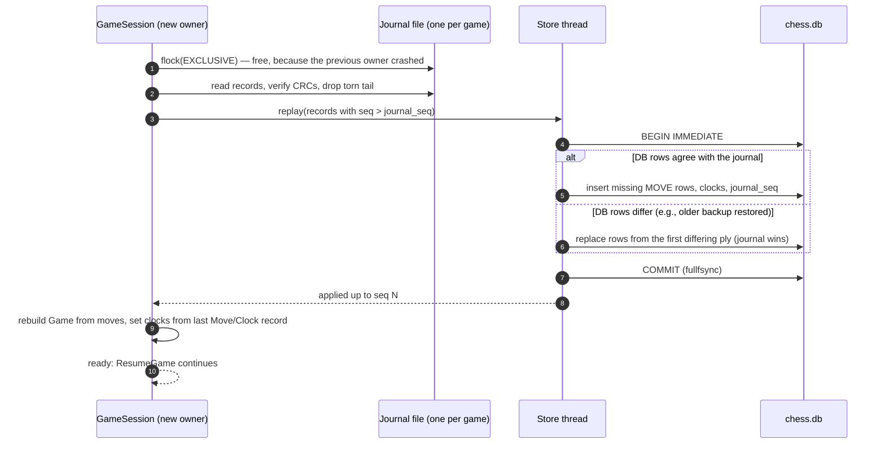

**Why a journal instead of only SQLite with `synchronous=FULL`?** FULL alone would also make each commit durable. But a move would then wait on the shared database, which another process may lock (busy timeout, import, migration), and Q54 explicitly asks for a local cache that survives the database being unavailable and that wins on disagreement. The journal costs one extra `F_FULLFSYNC` per move. Alternative: keep only SQLite with FULL, and make moves fail with `StoreBusy` when the DB is locked. That is simpler, but it doesn't meet Q54's "written when available".

**Browser and desktop.** The cache lives in the core process, on the Mac's disk. The browser holds no authoritative state. After a WebSocket drop, the page reloads the snapshot (§5.6). A dropped tab suspends the game at once and freezes its clocks (D-14).

---

## 8. Cross-cutting concerns

| Concern | Approach | Requirements |
|---|---|---|
| Error handling | Rust: `thiserror` per crate, mapped at the protocol boundary to `{code, message, details}` (catalogue in §5.5). Front-ends show `message` and branch on `code`. State changes only after the journal flush (§4.8, §7.6), so every error leaves the game as it was and resumable. | CLI-3, ENG-1, RULE-5, NFR-2 |
| Logging | `tracing` to `<data dir>/logs/chess.log`, rotating at **10 MB with 3 files kept** (TBD-32, `ESTIMATE`; a size-triggered writer is needed because a time-based appender alone does not meet NFR-10). *Amd 7 (AMD-10, UR-48):* **one log file per process kind** (the file name carries the entry point: CLI, server or desktop), which removes the rename race between processes without a lock; each file rotates at 10 MB and keeps 3 files. A correlation id per request (`Internal{id}`). It holds identifiers (game and Player ids, error codes, durations) and **no Player names and no move lists**. Never uploaded; off-device telemetry: none. | NFR-10, NFR-4, NFR-9 |
| Security | Data dir created `0700` and `chess.db` `0600`. Web: loopback bind, Host/Origin allow-list, CSP, no CORS (R-5, D-22). The core validates every protocol message and never trusts client-computed state (principle 1). One person per Mac account is confirmed (ASM-1, CONFIRMED), so the loopback server has no access token (D-22). **v1 runs only locally on the user's Mac and has no security-criticality requirement beyond security best practice and avoiding known CVEs (CR-7.7):** `cargo-deny advisories` (or `cargo-audit`) and `npm audit` run in CI and on each release, and a known vulnerability in a used dependency blocks the release unless the Decision Log records why it is not reachable. | NFR-4, NFR-7, PLAT-3 |
| Offline | No run-time Internet access anywhere; everything bundled; CSP enforces it. Details in §8.1. | PLAT-3 |
| Privacy / network | The web server binds to loopback only. A test runs a full session under a network-capture harness and asserts zero outbound connections. | NFR-4 |
| Determinism | `TimeSource` and `Rng` are injected everywhere. Engine tests use `Threads=1`, a fixed hash size, and fixed depth. | test-strategy |
| Licensing | Project licensed **GPL-3.0-or-later** (needed for distributed builds that bundle Stockfish; compatible with `shakmaty`). `cargo-deny` and an npm license checker in CI. Stockfish `COPYING` + source offer shipped in every artifact. | ENG-1, NFR-6 |
| Performance | Engines start lazily. SQLite opens in a few ms. The GUI is a static bundle, embedded in the server binary with `rust-embed`. Benchmarks are run in CI for startup and engine latency. | NFR-1, ENG-3 |
| Accessibility | GUI: ARIA grid board, live region announcing moves, focus ring, axe in E2E. CLI: the full-screen TUI is not reliably screen-reader friendly, so plain mode (`--plain`, automatic off-TTY) is the accessible path; `NO_COLOR` honoured in both. Details in §8.3. | UI-4, GUI-2 |
| Packaging and install | One build version for every artifact, `chess install-cli` for the command, and an ad-hoc signed `.app`. Details in §8.2. | PLAT-1/2/6, NFR-5 |
| Coding standard and static checks | Ordinary criticality: not safety-related and not regulated (user, 2026-10-28). SEI CERT is the coding standard, with the standard compiler and linter checks of Rust and TypeScript and every warning treated as an error. CERT has no Rust or TypeScript rule set, so CERT *informs* best practice there: reviews apply the intent of the matching CERT rules and report findings, with no conformance claim (CR-7.5). The tools, the mapping, the scope and the approvers are in [engineering/SWE-001-engagement-profile.md](engineering/SWE-001-engagement-profile.md) | none: a project constraint (§10.2) |

---

### 8.1 Offline operation (PLAT-3)

All three entry points must be fully usable with no Internet connection, from first launch. The architecture has no component that needs the network at run time. The table below lists every run-time dependency and how it is satisfied locally.

| Run-time dependency | How it is satisfied offline |
|---|---|
| Chess rules, game logic, Elo, clocks | Compiled into the Rust binaries (`chess`, `Chess.app`). |
| Engine (Stockfish) | Native universal binary bundled inside `Chess.app`, next to the bundled `chess` CLI (D-9, §8.2). Official Stockfish builds embed their NNUE network file, so no network file is downloaded. The pinned build is verified to start with networking disabled. |
| Data store | Local SQLite file in `~/Library/Application Support/Chess/`. Created on first launch; roster generated from a fixed seed. No account or server. |
| GUI code, styles, fonts | Vite builds a self-contained bundle: all JS/CSS, fonts (self-hosted, no Google Fonts), board themes, and SVG piece sets. Embedded into the `chess` binary (`rust-embed`) for the web, and bundled into `Chess.app` for desktop. No CDN references. |
| Web page transport | `chess serve` serves the bundle and the WebSocket on `127.0.0.1`. Works with Wi-Fi off, because loopback never leaves the machine. |
| Desktop transport | Tauri IPC in-process (D-1); no socket at all. |
| ECO opening table (DAT-3) | Bundled data file compiled into `chess-rules` as a generated static table (D-20, D-75): the five Lichess `chess-openings` files (`a.tsv` to `e.tsv`, CC0-1.0) copied to `third_party/eco/`. Never downloaded at run time or at build time. Its license is checked under NFR-6 |
| Help / documentation | Rendered from files shipped with the app (TUI help screen, GUI help page). External links (e.g., Stockfish source offer) are shown as text and never fetched automatically. |
| Updates, telemetry, crash reporting, license checks | None. The Tauri updater plugin is not included. |
| macOS launch checks | The desktop app is a locally built, **ad-hoc signed** build (PLAT-1; "unsigned" in the requirements means no Developer ID and no notarization). Built on the same Mac, it carries no quarantine attribute (TBC-10, unverified), so Gatekeeper's online check doesn't apply. A copy that was downloaded or copied from another Mac can be blocked; the documented first-open steps handle that, and the Game adds no workaround (PLAT-6). |

**Enforcement, so offline can't silently regress:**
- **Content-Security-Policy** `default-src 'self'; connect-src 'self' ws://127.0.0.1:*` (web) and the equivalent Tauri `csp` config (desktop). Any accidental remote script, font, or image fails to load, and the E2E suite catches it. PLAT-3's `default-src 'self'` is the **floor** of the policy: further directives (such as `connect-src` for the WebSocket) are allowed, no non-loopback origin may be allowed, and the test asserts the floor plus "no remote scheme or host" (SE interpretation Q-SE-13, confirmed). Whether `connect-src 'self'` alone covers a same-origin `ws://` in all supported browsers is `[UNV]`, which is why the explicit `ws://127.0.0.1:*` is kept.
- **Bundle scan in CI:** fails if the built GUI contains `http(s)://` resource references outside an allow-list (license texts, documentation links shown as text).
- **Offline E2E:** the PLAT-3 scenario (clean profile → register → timed game vs. a computer → post-game analysis → stats → export) runs for desktop, web (three browsers), and CLI with non-loopback networking blocked, under the NFR-4 network-capture harness.

**Build vs. run:** building from source needs the Internet once (crates, npm packages, the pinned Stockfish download in D-9). Running never does. If fully offline builds are wanted later, `cargo vendor`, an npm offline mirror, and a cached Stockfish archive cover that without architectural change.

### 8.2 Deployment and packaging (D-18; one bundle per D-16)

| Artifact | Contents | Installed to | Engine lookup |
|---|---|---|---|
| `Chess.app`, the only artifact | Tauri app, GUI bundle, the `chess` CLI binary (web server included) in `Contents/MacOS/`, one universal pinned `stockfish` next to it, `LICENSES/`, Stockfish source offer | `.dmg` → `/Applications`, or any folder the user chooses (ad-hoc signed, universal) | `<exe dir>/stockfish`, in the same bundle for both entry points. `CHESS_STOCKFISH` overrides it for dev and tests only. **Never `PATH`**, so the pinned version (D-9) is always the one used |
| `chess` on `PATH` | A symlink, not a copy, named `chess`, pointing at the bundle's `Contents/MacOS/chess` | Created by `chess install-cli` (PLAT-6, below) in `/usr/local/bin` if it exists and is writable, otherwise `~/.local/bin` | — |
| Data | `chess.db`, journals, backups, logs, `config.toml` | `~/Library/Application Support/Chess/` (or `CHESS_DATA_DIR`), shared by all entry points | — |

- **`chess install-cli` and `--remove` (PLAT-6, D-18 amended, CR-4.5).** A subcommand of the bundled `chess` binary, so no separate script exists (the earlier `packaging/install-cli.sh` and the app menu item are dropped: one way, one test). It runs before the core is created and never touches the data directory.
  - It resolves its own executable path (following symlinks), and creates a symlink `chess` to it in `/usr/local/bin` when that folder exists and is writable; otherwise in `~/.local/bin`, created if absent. It prints the link's path and, if that folder is not on `PATH`, the exact line to add to the shell profile.
  - Run again, it replaces a link that it created earlier (it recognises its own link by a target inside a `Chess.app/Contents/MacOS/chess` path). It **refuses to replace any other file or link** with that name.
  - On any failure it says why, changes nothing, and tells the user the CLI still runs by its full path (NFR-9).
  - `--remove` removes only a link it created, in either folder. It never deletes the bundle or the data.
  - **Update** = quit every front-end and `chess serve`, replace `Chess.app`; if the bundle path is unchanged the link keeps working, otherwise run `chess install-cli` again. The first launch of the new version upgrades the store after a backup (DAT-6, D-16). **Uninstall** = `chess install-cli --remove`, then delete `Chess.app`; the data directory stays (the README says where it is, that deleting it removes every Player, game and rating, and to export first).
  - The facts behind this (that `/usr/local/bin` exists and is writable on a stock macOS 26 Mac, how a blocked app is opened) are from general knowledge and **not verified**: ASM-5 (requirements TBC-10), closed by the M walkthrough at step 3. The design does not depend on them, because the fallback folder and the failure message cover the unwanted cases.
- **Signing and minimum system.** The bundle's `Info.plist` declares `LSMinimumSystemVersion` 26.0 (Tauri `bundle.macOS.minimumSystemVersion`), so macOS itself refuses earlier releases and the Game adds no check (PLAT-6 (e)). The build **ad-hoc signs** `Chess.app` and each executable inside it (`chess`, `stockfish`) with identity `-`, inside-out, **after** `lipo` has joined the slices (joining invalidates earlier signatures). A CI test runs `codesign --verify --deep --strict` on the bundle.
- **One bundle, one version (D-16).** Replacing `Chess.app` updates the CLI, web server, desktop app, and engine together, because the symlink always points into the current bundle. A separately copied `chess` binary is not a supported install.
- **Platform (PLAT-2, Q46, Q47, user answer 2026-10-26).**
  - **Target:** macOS Tahoe **and every later release**, on any Apple silicon Mac (M1 and newer), and on Intel Macs for as long as Apple's macOS supports them (R-13). The minimum deployment target stays macOS 26.0 (Tahoe): `MACOSX_DEPLOYMENT_TARGET=26.0` for `chess`, and Tauri `bundle.macOS.minimumSystemVersion = "26.0"` (which writes `LSMinimumSystemVersion`) for `Chess.app`. There is no upper bound.
  - **What "and later" implies:**
    - builds use the current Xcode SDK;
    - each new macOS release is tested before support is claimed: smoke test, engine integration, offline E2E, and the desktop E2E against the new WKWebView, starting on the developer betas;
    - pinned dependencies with OS contact (Tauri, WKWebView behaviour, crossterm/terminal behaviour, Stockfish builds) are re-checked and bumped when a release breaks them;
    - deprecated APIs are tracked in CI warnings;
    - the platform matrix (§9) gains a column per supported macOS release.
  - **Build:** `chess` is built for `aarch64-apple-darwin` and `x86_64-apple-darwin` and joined with `lipo`. The arm64 slice covers M1 and newer. `Chess.app` uses the universal Tauri target.
  - **Stockfish (revised 2026-10-27): Stockfish 19, tag `sf_19`** (D-9). Stockfish 19 ships "universal binaries" that detect the CPU's features at run time, so there is no longer a choice between AVX2, AVX-512, and other variants (release notes, checked 2026-10-27). The build script `third_party/stockfish/fetch.sh` follows this plan:
    1. **Preferred path: the official `stockfish-macos-universal.tar.gz` asset** of the `sf_19` release. The script downloads it once, checks it against the SHA-256 recorded in the script (written when the pin was made), extracts it, and runs `lipo -info` on the binary. It accepts the asset **only if both `arm64` and `x86_64` are listed**. Then it runs the binary once with `uci` and records the `UCI_Elo` range it reports (§4.6). That first run closes ASM-3. With run-time CPU dispatch, the single x86_64 slice covers every Intel Mac that Tahoe supports, with no AVX2 build and no run-time file choice. This is confirmed by the engine integration tests on the Intel Mac of the platform matrix (§9).
    2. **Fallback, used only if `lipo -info` does not show both architectures:** the previous plan. Build Stockfish 19 from the checksummed `sf_19` source archive for `arm64` and for `x86_64`, and join the two with `lipo` into one universal `stockfish`. If the source build offers the same run-time CPU dispatch as the release binaries (checked in its build documentation when the fallback is needed), one x86_64 build is enough. If not, the old conditional plan applies: an AVX2 build checked against Apple's Tahoe-compatible Intel models, and, if one variant can't cover them all, two x86 files chosen at run time from `sysctl hw.optional.avx2_0`.
    - **CI test:** a packaging test runs `lipo -info` on the bundled `Chess.app/Contents/MacOS/stockfish` and fails unless it lists both `arm64` and `x86_64`. It also checks the engine's `id name` line names Stockfish 19, so a different binary can't slip in.
    - **License:** the Stockfish 19 release notes say it is "licensed under the GPL license". The build script reads the exact GPL version from the shipped `COPYING` file (requirements TBC-9) and the license audit records it. `COPYING` and the source offer ship in every artifact (§8, NFR-6).
    - **Network:** Stockfish 19 uses the new SFNNv16 network architecture. The existing offline test (§8.1) checks that the bundled binary starts and searches with networking disabled, which proves its network file is embedded.
    - For the sidecar, follow Tauri's naming rule for universal targets (OQ-11, to verify against the pinned Tauri version).
  - **Performance baseline:** M4, 16 GB, Tahoe (NFR-1, ENG-3, NFR-8, calibration, the §4.8 timeouts). M1–M3 and Intel Macs are supported but slower (R-14).
  - **Browsers:** Safari, Chrome, Firefox, and Edge releases from the last 3 years. Vite's JS and CSS build target is derived from a browserslist query for releases of those four browsers from the last 3 years. The exact query is checked with `npx browserslist` when the build is set up. Playwright tests the current engines; the oldest supported version of each is smoke-tested manually per release.
  - **Terminals:** Terminal.app and iTerm2.
- **Install docs (NFR-5)** live in the README: build prerequisites (needs the Internet once, §8.1), `make release`, opening the `.dmg` or copying the app, `chess install-cli`, `chess serve`, update (replace the app), uninstall (`chess install-cli --remove`, then delete the app), the first-open steps for a blocked copy, and the data directory with its deletion warning (PLAT-6, NFR-5). The text lives in `Release checklist and install docs` (§2.1).
- **Port and config file (PLAT-4, Q55, TBD-3).** The port setting applies only to `chess serve` and the browser URL. The CLI play modes run the core in-process and the desktop app uses IPC (D-1), so neither uses a port.
  - Precedence: (1) the `--port <n>` flag, then (2) `server.port` in `config.toml`, then (3) the default, 8765 (TBD-3).
  - The config file is `~/Library/Application Support/Chess/config.toml`. `--config <path>` or `CHESS_CONFIG` points elsewhere, which tests use. These two overrides are **architect-added**: the requirements do not ask for them. *Amended 2026-10-31 (AMD-9, SE desk answer Q-SE-15, confirmed):* it is **hand-edited and read-only** in v1. Nothing in the product writes it (settings live per Player in the data store, UI-1), and its keys and errors are documented under NFR-5. Unknown keys are warned about. A missing file means defaults; an unreadable or invalid file, or a port outside 1 to 65535, stops `chess serve` with exit 1 and a message naming file, line and reason (PLAT-4, §6.1).
  - The page connects back to the origin it was served from. A fixed port keeps that origin stable for the Host/Origin allow-list (NFR-7).
  - If the port is taken, `chess serve` exits non-zero with a message naming the port. If the holder is another `chess serve` (found in `PROCESS_HEARTBEAT`), the message prints that server's URL. This matches PLAT-4.
- **No auto-update** (§8.1). Upgrading means replacing `Chess.app`.

### 8.3 Accessibility details (UI-4, GUI-2)

| Area | Mechanism | Verification hook |
|---|---|---|
| Keyboard | Every screen is reachable and operable by keyboard (Tab order, Enter/Space, Esc closes dialogs). The board uses `AccessibleOverlay` (§11.1), and the SAN field is always available | Playwright keyboard-only scenario per screen |
| Screen reader (GUI) | Squares labelled "e4, white knight". The live region announces own move confirmed, opponent move, check, draw offer, game end, and clock warnings at fixed thresholds (no per-second announcements). The Elo chart has a table alternative. Dialogs move focus in and return it on close | axe, scripted VoiceOver walk-through (M) |
| Screen reader (CLI) | Plain mode, as in §6.1 (no tick output) | PTY transcript tests |
| Contrast | High-contrast board theme and piece set. Unit test checks theme contrast ratios against WCAG 2.2 AA (4.5:1 text, 3:1 non-text; UI-7) | U: contrast test per theme |
| Motion | `prefers-reduced-motion` turns off chessground animation (`animation.enabled = false`) | E: emulated media query |
| App themes | Light, Dark, and System (follows `prefers-color-scheme`) plus other bundled themes (Q52). All are checked against UI-7 | Contrast unit test per theme; screenshots in both schemes |
| Confirmations | Resign (h–h: which side), c–c abort, archive, reset player data, applying an import (after its preview), restoring a backup, and TUI quit (Ctrl-C) always ask (Q52, UI-12). Cancel and Esc change nothing. The reset dialog lists each unfinished game it will void and says it counts for neither player (D-30). Dialogs are focus-trapped and announced, and Esc cancels | E: keyboard-only confirm and cancel |
| Colour independence | Last move, check, and selection use outline or pattern as well as colour. TUI highlights use reverse video or markers when `NO_COLOR` is set | Screenshot and snapshot tests |

### 8.4 Room for network play later (Q43, not built in v1)

v1 stays fully offline (PLAT-3, NFR-4): there is no listener beyond loopback and no outbound connection. Network play is a planned future enhancement, and these existing choices keep it cheap to add without building any of it now:
- **The core is already authoritative and remote-ready.** All rules, clocks, and the Policy run in the core (principle 1), and front-ends speak one serializable protocol (§5). A remote opponent would be one more front-end adapter that sends commands (`MakeMove{ply}` with the optimistic check) and receives events.
- **Identity.** Players and games carry `uuid`s (§7.2, Q51), so records can later be matched across machines.
- **A new seat type.** A "remote human" side can be added to `GameSetup` and the Policy table as a new matchup, without changing the existing rows.
- **The transport seam** is the `chess-server` WebSocket adapter (§5.2). The future work is TLS, authentication, NAT traversal or a relay, and a server-side clock authority between two cores.
- **What would have to change, and is deliberately absent now:** binding beyond loopback, CSP `connect-src` beyond self, and any outbound traffic. These need a requirements change (PLAT-3, NFR-4) and a new decision record. The offline enforcement in §8.1 would then become per-feature, not global.

## 9. Testing architecture (mapping test-strategy onto this design)

| Test level | Where | Tools |
|---|---|---|
| Unit | `chess-rules`, `chess-domain` (perft, SAN tables, Policy table, Elo vectors, clock with fake time, roster determinism, variation tree, `BoardGrid` snapshots); `chess-cli` (TUI `update` with synthetic messages, `render` into ratatui `TestBackend` at 80×24 and larger, key-map vs. SAN collision test) | `cargo test`, `proptest`, `insta` (snapshots), `cargo-mutants` (Elo, Policy), `cargo-llvm-cov` (90 % line-coverage gate, D-76), `cargo-deny`/`cargo-audit` and `npm audit` for known CVEs (CI) |
| Property / fuzz (stable only, D-76) | random legal playouts; `parse(format(m)) == m`; arbitrary CLI input; random and malformed frames and arbitrary bytes into the move, FEN, PGN and protocol decoders (WebSocket) | `proptest`: random-input property tests run by `cargo test` on the stable toolchain (no `cargo-fuzz`, no nightly) |
| Core integration | `chess-app` with `FakeEngine` + a **temp-directory store** (real SQLite and journal files with `FaultPlan` failure injection; no fake store, D-39; the suite's time budget is FF-2): full game flows, Strict gateway spy, rewind/stale-ply rejection, lease takeover, crash-recovery (kill child process mid-write); failure injection for each §5.5 code (fake engine returning an illegal move, hanging, or crashing; store busy, full, or read-only; `SchemaTooNew` from a newer fixture DB); lagged event subscriber gets a snapshot; duplicate `StartGame{game_uuid}` and resent `MakeMove` are idempotent; a slow store write (injected with `FaultPlan` latency, D-39) does not stall the clock timer (R-11); reset with unfinished games (D-30): a suspended game, a game live in the same process, and a game live in a second process are each voided, every slot is released, no rating, counter, W/L/D, or rating-history row changes for any side, a game started after the confirmation prompt causes a new `ConfirmationRequired`, and a kill between the reset commit and the `Voided` journal record recovers to `voided` | `tokio::test`, temp dirs |
| Engine integration | real Stockfish (the pinned Stockfish 19): UCI handshake, `id name` names the pinned version, the reported `UCI_Elo` range equals the constant `PINNED_UCI_ELO_RANGE` (EI-EN-002, FF-7) and contains every stored `COMPUTER_PROFILE.uci_elo` (§4.6), legal `bestmove`, tactics fixtures, crash/timeout recovery, latency | gated by `--features stockfish-tests` |
| CLI E2E | scenario files replayed through a PTY: TUI screens asserted by parsing the terminal output into a virtual screen; resize; terminal restored after quit/Ctrl-C/panic; plain mode as a transcript and via pipe (scripted human play); headless c–c mode: usage errors for a human Player or a busy computer, `--data-dir` isolation, stored and rated result, exit 4 on a signal; `chess serve` config errors, browser-open failure and clean stop; `chess install-cli` twice, over a regular file, with `/usr/local/bin` absent or read-only, and `--remove` | `expectrl` + `vt100` (Rust) |
| GUI E2E (web) | same scenario files through the browser | Playwright: WebKit (for Safari), the `chrome` and `msedge` channels, Firefox; axe; screenshot diffs per theme, including light and dark app themes and emulated `prefers-color-scheme`; fluid-resize checks |
| Packaging | `lipo -info` on the bundled `stockfish` lists both `arm64` and `x86_64` (§8.2); also a step of the engine build script. `codesign --verify --deep --strict` passes. `Info.plist` declares `LSMinimumSystemVersion` 26.0 | CI script |
| Amendment 2 behaviours | Core integration and PTY/Playwright: name rules (case, grapheme clusters, NFC, control characters, archived collision); takeback bounds and record removal; draw offer (clocks stop, repeat-offer block, engine failure drops it); `movenow`/F2/button only in `EngineThinking` h–c; resume list scope; import duplicates (skip, keep both, no replace); `games.json` round trip and an archive without it; unfinished-game import with and without a slot clash; custom-start exclusion; empty statistics; damaged-journal resume and "voided: unreadable"; failed pre-upgrade backup; fault injection in each store-changing command (store identical afterwards); restore with a finished-after-backup game (each rating moves once, in end-time order); confirmation and Esc for each UI-12 action | `tokio::test`, `expectrl`, Playwright |
| Platform matrix | arm64 (the M4 baseline, plus one older M-series Mac if available) and x86_64, on Tahoe and on each later macOS release, starting at its developer beta: smoke test, engine integration, offline E2E, desktop E2E. **Best effort (CR-7.6):** a platform without available hardware is not run and is reported as "not run: hardware unavailable"; today that is every Intel Mac and every Mac model other than the development Mac. Running Intel would need a physical Intel Mac for as long as Intel is supported (R-13), and is done if one becomes available | manual + scripted |
| GUI E2E (desktop) | same GUI suite against the Tauri app — **see risk R-1** | Playwright WebKit against a Tauri dev build plus a scripted smoke test of the real `.app` |
| Calibration / soak | `chess calibrate`; 1000-game c–c soak | nightly CI |

The same scenario format (`e2e/scenarios/*.yaml`: setup, inputs, expected PGN/result/visible controls) feeds the CLI and GUI runners, which gives "one scenario, three front-ends" (test-strategy principle 3, PLAT-1). Test names carry requirement IDs for the traceability matrix.

**Fitness functions added by amendment 7 (source: the triage rulings; each protects one decision).** Budgets marked `ESTIMATE` are set at the first run.

| ID | Check | Decision |
|---|---|---|
| FF-1 | A `cargo tree` or `cargo-deny` rule: the front-end crates list only `chess-app` (and `chess-server` for the CLI) among workspace dependencies; the `chess-app` public `pub use` list equals the list in the app design | D-38 |
| FF-2 | The time of the core integration suite with a temp-directory store stays inside a budget set at the first run (`ESTIMATE`). If it is too slow, a trait and a fake are introduced then | D-39 |
| FF-3 | Property test: `record_to_fact(fact_to_record(f, ctx)) == f` for every `Fact` variant, **with `ctx.wall_ms` equal to the fact's `started_at` or `played_at`** for `Start` and `Move` (the record carries no copy, SF-16; *Addendum E, F-10*) (*Addendum D, D-79:* and for a `Move` the `MoveCheck` returned by `record_to_replay_item` equals the `san` and `fen_after` given to the codec); a second property: the finalize inputs of `GameEnd` (**including the three time totals**), the `content_hash` of `GameEnd`, `Abort` and `Voided` and the `ended_at` of `Voided` that an assembler writes are the ones the decoder reads back; for `Voided` it does **not** compare the hash with a recomputation of the moves (D-67 (i); *Addendum E, JR5-002*); a third test: a game finalized live and from its `GameEnd` record alone gives the same `GAME` row in all columns, and a restore of a journal with no later change gives the same `started_at` as the live row, which holds because `NewGame.started_at` and the `Start` record carry one stamp (D-84; OQ-26 decided by Brian, Addendum F); a unit test that the payload field names of each kind equal the §7.6 table | D-41, D-42, D-63, D-67, D-79, D-84 |
| FF-4 | The hash stored for a **completed or aborted** game equals the hash of its own exported PGN after re-import, **when no Player was renamed in between** (SF-04); **voided games are excluded** (D-67 (i), the hash is advisory) (*Addendum E, JR5-002*). *Addendum F (OQ-27, decided by Brian, G3, 2026-11-04, option A):* `canonical_form` omits `SetUp` and `FEN` when the `FEN` equals the standard start (all six fields), so a game imported with the standard `FEN` tag has the same stored hash as its export and **FF-4 has no known gap**; the test set includes that game (UT-RUL-031, CT-RUL-004, CT-APP-18) | D-42, D-67, D-68 |
| FF-5 | The statistics path (the store's rows plus `chess-domain::aggregate`; the SQL view named `player_stats` no longer exists) on a 10 000-game fixture stays inside the NFR budget (unmeasured) | D-44 |
| FF-6 | The `ParseMove` round trip over loopback stays inside the input budget (NFR-8, 100 ms `ESTIMATE`) | D-45 |
| FF-7 | EI-EN-002 asserts that `PINNED_UCI_ELO_RANGE` equals the real binary's handshake range; CI fails on a mismatch | D-46 |
| FF-8 | The `SplitMix64` test-vector files in `chess-domain` and `chess-engine` are identical (CI diff) | D-46, TR-12 |

---

## 10. Requirements traceability (component view)

### 10.1 Allocation: every requirement to one primary component

The **primary** component is accountable for the requirement. Supporting components take part. Verification hooks point to §9 and to the requirement's own verification list.

*Amendment 7 (AMD-11, XC-29).* Where two SDDs claim the same requirement as primary, the primary component stays as in this table and the other claim is read as "supporting". The enabling-system blocks of §2.1 (`packaging/`, `third_party/stockfish/`, `CI checks`, `Release checklist and install docs`) have **no SDD in the set** by design (CR-4.17); they are covered by UC-29 and their own scripts. The one-line statements for F-8.1 (three launch processes, each SDD claiming its own launch) and for the CLI and server halves of F-8.2 belong to `functional_decomp.md`, which the systems engineer owns (SE desk answer Q-SE-16).

| Req | Primary component | Supporting | Design refs |
|---|---|---|---|
| PLAT-1 | `packaging/` (three entry points, one build) | `chess-cli` (+ `serve`), `chess-server`, `desktop/src-tauri` **Amd 2:** `packaging/` ad-hoc signs the app and its executables (ASM-5); the build is local (D-31). | §2, §6.3, §8.2 |
| PLAT-2 | `packaging/` (universal build, Tahoe minimum) | `ui/` (Safari, Chrome, Firefox, Edge), TUI on Terminal.app and iTerm2 **Amd 2:** `Release checklist and install docs` holds the platform matrix (§2.1). | §8.2, §9 |
| PLAT-3 | Offline enforcement (CSP, bundle scan, offline E2E) | every artifact. Bundled engine, fonts, themes, ECO table | §8.1 |
| PLY-1 | `chess-domain::GameSetup` | `GameSetupService`, setup screens, CLI flags | §4.4 |
| PLY-2 | `PlayerService` (register; profile chooser at launch) | `EloCalc` start values on both tracks, `PREFERENCES`, Register screens **Amd 2:** Active-Player rules (§6.1). **Addendum A:** a profile switch while a game is open in the session is refused in the core (§4.4, D-56). | §6.1, §6.2, §7.4 |
| PLY-3 | Profile chooser at launch in every front-end (`SelectProfile`, Q48) | `GameSetupService` (side assignment), `APP_SETTING.last_active_player` (pre-selection only) | §6.1, §6.2, §7.2 |
| PLY-4 | `chess-domain::RosterGen` | `PlayerService`, `COMPUTER_PROFILE`, Computer Players screens **Amd 2:** Computer Players cannot be renamed, archived, deleted or reset. N Players per request, used names skipped, roster UUIDs from the seed (§4.6, D-34). Archive refused with unfinished games, no un-archive (§7.4). | §4.6 |
| PLY-5 | `chess-domain::Policy` | `allowed_actions` in every front-end, `EngineGateway` | §4.4, §4.5 |
| GAME-1 | `GameSetupService` | `Policy`, New Game screens (TUI, GUI), CLI flags **Amd 2:** Resume list (§4.4). Resign from the offer asks which side in h–h. | §4.4, §6.1 |
| GAME-2 | `GameSession` (pause, step, delay, watcher-only abort) | Watch screens | §4.3, §4.4 |
| GAME-3 | Front-end view cursor (TUI `TuiState`, GUI client state) | `GameSession` `ply` check (`StalePosition`) | §4.2, §6.2 |
| GAME-4 | `GameSetupService` + `UNFINISHED_SLOT` (one unfinished game per mode for each human, and for each computer in c–c only; D-27) | Resign as the only early end for humans, c–c watcher abort, `UnfinishedGameExists` (setup only), resume prompt, slots released by a reset void (D-30) **Amd 2:** `PlayerHasUnfinishedGames` for archive. `VoidUnreadableGame` frees the slot (§7.2). | §4.3, §4.4, §7.2 |
| RULE-1 | `chess-rules` | — | D-3 |
| RULE-2 | `chess-domain::Game` (termination) | `GameSession`, `EngineGateway(ComputerDrawDecision)` **Amd 2:** Draw-offer rules, clocks stop in `DrawOffered`, `ComputerDrawDecision` within the ENG-3 maximum (§4.4, D-33). | §4.3, §4.5 |
| RULE-3 | `chess-domain::Game` (takeback) | `Policy`, `GameSession` **Amd 2:** Takeback bounds, record removal, `NothingToTakeBack` (§4.4, D-33). | §4.3, §7.4 |
| RULE-4 | `chess-domain::Clock` | `GameSession` flag timer, client countdown, `SearchLimits` budget | §4.2 |
| RULE-5 | Move journal (§7.6) + `GameSession` (auto-save and resume) | `chess-store` (applies the journal), `SessionRegistry` (journal lock) | §7.2, §7.3, §7.6, D-23 |
| RULE-6 | `ImportExportService` (PGN export of any stored game) | `chess-rules` PGN writer (IF-1), history screens **Amd 2:** Unfinished-game export: `Result "*"`, no `Termination`, no `EndStatus` (§5.7). | §5.7 |
| RULE-7 | `ImportExportService` (PGN import, review only) | `chess-rules` PGN reader (IF-2); imported games are unrated (`status = 'imported'`) | §5.7, §7.2 |
| RULE-8 | `GameSetupService` (FEN start position, always unrated) | `chess-rules` FEN parser (IF-3), Import screen's analysis board | §5.7, §7.2 |
| ENG-1 | `chess-engine` | `packaging/` (bundled engine), `EngineGateway` failure handling | §4.7, §8.2 |
| ENG-2 | `chess-domain::RosterGen` + `Personality` | `chess-engine` (UCI options), the `chess-app` calibration run (D-57) that `chess calibrate` calls | §4.6 |
| ENG-3 | `chess-engine::SearchLimits` (min of personality, the active profile's max think, and the clock budget) | `GameSession`, `EngineGateway` | §4.6, §4.8 |
| ENG-5 | `GameSession` (`CancelEngine` → UCI `stop` → best move so far, ≤ 200 ms) | `chess-engine`, every front-end's cancel control or key **Amd 2:** `movenow`, F2 and the GUI "Move now" button; only in `EngineThinking` of an h–c game (§4.4, D-33). | §4.4, §4.8 |
| DAT-1 | `chess-store` | leases, migrations, D-16 | §7 |
| DAT-2 | `ImportExportService` (merge import, zip export) | `chess-store` exclusive ops **D-59:** ECO mismatch question for games whose ECO comes from PGN tags (§5.8). **Amd 2:** `games.json` with analysis results, unfinished-game restore rule, PGN duplicate prompt without replace (§5.7, §7.4, D-34). | §5.7, §7.4, D-17 |
| DAT-3 | `chess-store` schema | `GameSession` time accounting, `AnalysisWorker`, ECO classifier (D-20) **CR-9.12:** mismatch question on import, `ImportExportService` (§5.8, D-59) | §7.2, §5.4 |
| ELO-1 | `chess-domain::EloCalc` (both sides, human and computer, Q41; K per track from that track's rated-game counter, Q78) | finalize transaction re-reads current ratings, `RATING_HISTORY` | §5.4, §7.2, §7.4 |
| ELO-2 | `chess-domain::Policy` + `EloCalc` (Elo track = game mode: Training Elo or Strict Elo) | `PLAYER.*_elo`, `RATING_HISTORY.track` | §4.4, §7.2 |
| UI-1 | `PlayerService` (`PREFERENCES`) | GUI/TUI settings screens, gateway (active profile's max think, §4.6). No sound or confirm-move settings | §6.2, §4.6 |
| UI-2 | `StatsService` (W/L/D including Training; average length in moves and time) | Stats screens (TUI `Chart`, GUI chart D-21) **Amd 2:** Empty states, custom-start exclusion, CLI Elo chart (§6.1, D-37). | §7.2 |
| UI-3 | `ui/themes` (GUI), `chess-domain::BoardStyle` (CLI) | contrast test | §6.2 |
| UI-4 | `ui/board` `AccessibleOverlay` + `LiveRegion` (GUI), `PlainRunner` (CLI) | §8.3 | §11.1 |
| UI-5 | `StatsService` | Computer Players screen, with an Elo chart for computers too (Q41). Category label from the Strict Elo (Q79) | §4.6, §7.2 |
| ANA-1 | `EngineGateway` (+ `Policy`) | `AnalysisService`, audit log spy | §4.5 |
| ANA-2 | `AnalysisService` + `VariationTree` | `LegalMoves` (D-11), `VARIATION` | §5.1 |
| ANA-3 | `AnalysisService` | `AnalysisWorker`, `MOVE_EVAL` **Amd 2:** "evaluating…" placeholder and the n-of-N count (§6.1, `GetGameAnalysis`). | §5.4 |
| CLI-1 | `chess-cli` (`TuiApp`, screens; 80×24 with resize attempt) | `PlainRunner`, terminal guard | §6.1 |
| CLI-2 | `chess-domain::BoardGrid` | `BoardWidget` | §6.1 |
| CLI-3 | `chess-cli::InputParser` | `chess-rules` SAN parsing | §6.1 |
| CLI-4 | `chess-cli::KeyMap` + `clap` flags | headless runner, D-19 **Amd 2:** `movenow`, `save` (prints the stored move count), headless c–c only, `--data-dir`, F2 in `KeyMap` (§6.1, D-36). | §6.1 |
| GUI-1 | `ui/` (one bundle) | `CoreClient` with two transports, R-1 | §5.2, §6.2 |
| GUI-2 | `ui/board` (`BoardModel`, overlay, chessground adapter; commit on drop, Enter, or destination select) | SAN input, `PromotionPicker` | §6.2, §11.1 |
| GUI-3 | `ui/board` (coordinates option) | `PREFERENCES` | §6.2 |
| GUI-4 | `ui/` Play screen | `EngineThinking` / `GameEnded` events **Amd 2:** "Move now" button in the thinking indicator (§6.2). | §6.2 |
| NFR-1 | Lazy engine start + first frame before engine | embedded bundle, startup benchmark | §4.7, §6.1 |
| NFR-2 | `chess-store` (WAL, transactions in §7.4) | durable-before-ack (§4.8) | §7 |
| NFR-3 | `EngineGateway` legality check + `chess-rules` | stable-only random-input property tests (D-76), 1000-game soak | §4.5 |
| NFR-4 | `chess-server` loopback + no telemetry | network-capture harness | §8, §8.1 |
| NFR-5 | `packaging/` + README install docs | — **Amd 2:** Install, update, uninstall text, first-open steps and the data-directory warning live in `Release checklist and install docs` (§2.1, §8.2). | §8.2 |
| NFR-6 | CI license audit (`cargo-deny`, npm checker) | `third_party/`, notices in every artifact **Amd 2:** Allocated to the `CI checks` block (§2.1). | §8 |

Every requirement in requirements.md at its 2026-10-26 baseline has a primary component (checked by script against the requirement headings and tables; re-checked by script on 2026-10-27 against requirements.md v1.0 Amendment 1: all 78 requirement and RISK IDs have an allocation row, and Amendment 1 added no new requirement ID; re-checked by script on 2026-10-28 against Amendment 2: all **82** requirement and RISK IDs have a row, the 78 plus PLAT-6, DAT-7, UI-12 and NFR-10, and the 26 amended requirements carry an "Amd 2" note): the original requirements, and the baseline splits RULE-6–RULE-8 (from RULE-5) and ENG-5 (from ENG-3), in the table above, plus every other ID added on 2026-10-26 in the table below. Every AGREED requirement is a mandatory "shall" (user, 2026-10-26), so none of them may be left without an architectural home or deferred.

**Requirements added by the systems engineer on 2026-10-26.** All of them are AGREED at baseline (Q75 accepted every PROPOSED requirement and TBR item), so these allocations are final:

| Req | Primary component | Supporting | Design refs |
|---|---|---|---|
| PLAT-4 | `chess-cli serve` → `chess-server` | `packaging/` **Amd 2:** `chess-cli` serve lifecycle: `ConfigInvalid`, browser-open failure, SIGINT/SIGTERM stop with `ServerStopping` (§6.1, D-36). | §8.2, D-8 |
| PLAT-5 | `packaging/` (one `Chess.app` bundle with `chess` and Stockfish) | `chess-store` (version stamp), `chess-server` / gateway (version handshake) | §7.5, §8.2, D-16, D-18 |
| PLY-6 | `PlayerService` (`ValidationFailed`; trim, NFC, ≤ 128 grapheme clusters, no control characters, unique case-sensitively against every Player, active or archived) | Register/rename screens | §5.5, §7.2, §7.4 |
| PLY-7 | `PlayerService::reset` (`reset_at`, reset points, confirmed, humans only, voids the Player's unfinished games; D-26, D-30) | `ConfirmationRequired{voids}` (lists the games to be voided); `GameSession` (`Void`, `GameVoided`); stats and history queries for the reset Player filter by `reset_at`, opponents' queries don't (Q76) | §4.3, §5.1, §5.5, §7.2, §7.4, §7.6 |
| ENG-4 | `chess-engine` + `EngineGateway` failure path | `GameSession` (`EngineError`), D-15 | §4.7, §4.8 |
| DAT-4 | `SessionRegistry` (journal `flock`, `GAME_LEASE` for display) | `GameLeased` error | §7.3, §7.6 |
| DAT-5 | `chess-store` (`quick_check`, restore flow) | `RestoreBackup` **Amd 2:** Restore replays every retained journal and re-finalises in end-time order. Automatic backups at start-up when the newest is older than 24 h, newest 3 kept (§7.1, D-35, TBD-33; DAT-5 Amendment 3). Restore limit: R-19. | §7.1 |
| DAT-6 | `chess-store` migrations (`VACUUM INTO` backup) | D-16 **Amd 2:** A failed pre-upgrade backup stops the upgrade: `BackupFailed` (§7.1). | §7.1, §7.5 |
| UI-6 | `ui/board` `LiveRegion` | §8.3 announcement list | §8.3 |
| UI-7 | `ui/themes` + contrast unit test (WCAG AA for every theme, high contrast included) | axe | §6.2, §8.3 |
| UI-8 | `AccessibleOverlay` focus ring + global focus styles | — | §11.1, §8.3 |
| UI-9 | Help screens (TUI, GUI), content bundled. CLI help is generated from `KeyMap`, so it can't drift | plain-mode `help` | §6.1, §8.1 |
| UI-10 | `ui/themes` app colour themes (System / Light / Dark / others; live switch on appearance change) | `PREFERENCES` | §6.2, §8.3 |
| UI-11 | English-only string modules per front-end | help content (UI-9) | §6.2 |
| ANA-4 | `AnalysisService` (from game history) | `GetGameAnalysis`, history screens | §5.1 |
| CLI-5 | `chess-cli` headless runner | exit codes (§6.1, TBD-21 closed, codes 0 to 4) **Amd 2:** Usage errors for a human Player or a busy computer. Exit 4 on a signal (accepted by CR-5). `--data-dir` (§6.1). | §6.1 |
| GUI-5 | `ui/` fluid layout. No minimum size (Q55) | `ResizeObserver` → chessground `redrawAll` | §6.2, §11.1 |
| NFR-7 | `chess-server` Host/Origin allow-list | D-22 | §5.2 |
| NFR-8 | Concurrency model (D-13): no blocking on UI threads | `CancelEngine`, latency test | §4.8 |
| NFR-9 | Error catalogue (`code` → message) | every front-end | §5.5 |
| IF-1, IF-2, IF-3 | `chess-rules` PGN/FEN + `ImportExportService` | **Amd 2:** IF-1 unfinished-game export. IF-2 duplicate prompt with skip and keep both, never replace | §5.7 |
| IF-4 | `chess-engine` + `third_party/stockfish` (D-9: Stockfish 19, `sf_19`) | `packaging/` (`lipo -info` check) | §4.6, §8.2 |
| IF-5 | `ImportExportService` (format version) | D-17 **Amd 2:** Archive gains `games.json` (§5.7, D-29 amended). | §5.7, §7.4 |
| RISK-1 (requirements risk) | Mirrored by architecture risk R-13 (Tahoe is the last Intel macOS) | D-25 | §12 |
| RISK-2 (requirements risk) | Mirrored by architecture risk R-17 (computer rating drift). Test and calibration stores are isolated | `--data-dir` and `CHESS_DATA_DIR`, `chess calibrate`. **Amd 2:** scripted runs are stored and rated, so isolation is by `--data-dir` (§6.1) | §4.6, §12 |
| PLAT-6 (added 2026-10-28, CR-4) | `CLI front-end` (`chess install-cli`, `--remove`) | `packaging/` (`LSMinimumSystemVersion`, ad-hoc signing), `Release checklist and install docs` (update, uninstall, first-open steps, data warning). ASM-5 | §8.2, D-18, D-31 |
| DAT-7 (added 2026-10-28, CR-4) | `chess-app core :: chess-store` (all-or-nothing transactions, journal recovery) | `PlayerService`, `ImportExportService`, `SessionRegistry` (`JournalUnreadable`, `VoidUnreadableGame`), every front-end (message and next step, NFR-9) | §5.5, §7.2, §7.6, D-35 |
| UI-12 (added 2026-10-28, CR-4) | `chess-app core` (`ConfirmationRequired`, one mechanism) | every front-end's dialog, including the TUI Ctrl-C quit dialog | §5.5, §6.1, §8.3 |
| NFR-10 (added 2026-10-28, CR-4) | `chess-app core :: Diagnostic log` | `tracing`, size-triggered rotation (TBD-32) | §8, §10.2 |

**Values for the TBDs that requirements.md assigns to the architect (set at baseline v1.0):**
- TBD-3: default port 8765 (§8.2).
- TBD-13: follows the accepted EST in ENG-4: 5 s for a readiness reply, and 2 s past the move's time limit (§4.8).
- TBD-21: exit codes 0 result reached, 1 usage or setup error, 2 engine unavailable, 3 store error, 4 stopped by a signal (§6.1, D-36). Closed by requirements Amendment 3 (CR-5).
- TBD-24: custom tags `Mode`, `Rated`, `WhiteClass`, `BlackClass`, plus `EndStatus` (`aborted` | `voided`, only for games that ended without a result; added 2026-10-27, D-30) (§5.7).
- TBD-25: 10 MB (§5.7, `ESTIMATE`).
- TBD-28: 0 s. The journal `flock` is released by the OS when the owner exits or crashes, so another process can take over at once (§4.8, §7.3).
- TBD-29: `config.toml` (TOML) in the data dir, overridable with `--config` or `CHESS_CONFIG` (§8.2, D-24).
- TBD-26: **Stockfish 19, tag `sf_19`** (published 2026-09-05, not a pre-release; https://github.com/official-stockfish/Stockfish/releases/tag/sf_19, checked 2026-10-27). Closed as a version choice (user 2026-10-27: "use the latest Stockfish"). Two facts about it are still checked at the first engine build-script run (ASM-3, step 2). A later version needs a decision-log entry and a calibration re-run (D-9, §11.3).
- TBD-18: **still open.** The events to announce are fixed in §8.3; the exact wording is written with the GUI string module in step 3 and checked in the scripted VoiceOver walk-through (owner: GUI developer).
- TBD-31 (added 2026-10-28): computer Players per generation request: 1 to 25, default 5 (§4.6).
- TBD-32 (added 2026-10-28): diagnostic log rotation: 10 MB per file, 3 files (§8).
- TBD-33 (added by requirements Amendment 3, CR-5.1; from D-35, `ESTIMATE`): automatic backup when the newest is older than 24 h, newest 3 kept (§7.1).
- TBC-10: carried as ASM-5 (§14).
- Closed by the user and met by the design: TBD-1 (Tahoe minimum, §8.2), TBD-7 and TBD-23 (last recorded clock value, no completed move lost: §7.1, §7.6), TBD-12 (≤ 200 ms EST, §4.8).

### 10.2 Reverse check: elements without a driving requirement

| Element | Driver | Verdict |
|---|---|---|
| `chess calibrate`, `EnginePurpose::Calibration` | ENG-2 calibration verification (dev tooling, not shipped behaviour) | Keep. Not reachable through the protocol (§4.5) |
| `tracing` log file | NFR-10 (CR-4.18), correlation ids (§5.5) | Keep. Local only (NFR-4); identifiers only |
| Automatic backups (D-35) | DAT-5 (Amendment 3, CR-5.1: cadence and retention stated); also serves DAT-6 | Keep. Driven by a requirement since CR-5 |
| `--config`, `CHESS_CONFIG` (D-24) | none. Architect-added for tests; accepted as test-only in PLAT-4 (CR-5) | Keep, recorded (H-13) |
| Exit code 4 (D-36) | CLI-5 and TBD-21 (closed with codes 0 to 4 by CR-5) | Keep |
| `chess games`, `--on-duplicate`, `--yes`, the `export`/`import` command forms (D-36) | CLI-4 note (CR-5): design choices realising IF-1, IF-2, DAT-2 and UC-22 to UC-25 | Keep. Names become public after release |
| `MOVE_EVAL.engine_version` | IF-5 (`games.json` carries the engine version of each evaluation), DAT-3, ANA-3, D-9 (a later engine needs a decision) | Keep |
| `GAME.uuid`, `content_hash` | `GAME.uuid`: DAT-2 (export/import identity) and §5.6 idempotency. `content_hash`: IF-2 (a duplicate has identical tags and moves) and DAT-2 | Keep |
| `PROCESS_HEARTBEAT`, `SchemaTooNew` | derived from DAT-1 (concurrent access, migrations) and D-16 | Keep. Requirements gap G-9 asks for an explicit requirement |
| `APP_SETTING` | PLY-3 (switching), PLY-4 (seed) | Keep |
| `Internal{id}` correlation ids | derived | Keep |
| Coding standard and static checks (§8) | User decisions of 2026-10-28 and 2026-10-30 (requirements Decision Log, CR-6.1, CR-7.5); not a product requirement | Keep. It governs how the code is written and reviewed, not what the product does |

There are no orphan components. The enabling-system blocks of §2.1 (`packaging/`, `third_party/stockfish/`, `CI checks`, `Release checklist and install docs`) are driven by PLAT-1, PLAT-2, PLAT-6, IF-4, NFR-5, NFR-6, RISK-1 and ENG-2 (UC-29).

### 10.3 Requirement gaps found by this review (for the systems engineer)

The last column links each gap to the item the systems engineer opened in requirements.md on 2026-10-26, where one exists. "new" means the gap is not covered there yet. All three rounds of the user's answers (2026-10-26) are reflected below.

| ID | Gap | Affects | Status at baseline v1.0 (2026-10-26) | Systems-engineer item |
|---|---|---|---|---|
| G-1 | Web "app closed" undefined | RULE-5, RULE-4 | **Resolved:** a closed or disconnected tab suspends the game at once (D-14) | Q66 |
| G-2 | Clock during engine failure | ENG-1, RULE-4 | **Resolved:** keeps running (D-15) | ENG-4 |
| G-3 | Full-data import semantics | DAT-2 | **Resolved:** merge (D-17). Export is one archive (§5.7) | IF-5 |
| G-4 | Whose max-think-time setting applies in c–c and h–h | UI-1, ENG-3 | **Resolved:** the active profile's setting. c–c: caps both computers. h–h: caps engine analysis only (§4.6) | Q69 |
| G-5 | CLI scope of UI-1 settings | UI-1, CLI-1 | **Resolved:** no sound and no confirm-move in v1. All inputs are always active | Q65 |
| G-6 | Training games in W/L/D | UI-2 | **Resolved:** counted, with a separate Training Elo | ELO-2 |
| G-7 | Meaning of "user can cancel" | ENG-3 | **Resolved:** the ENG-3 amendment was accepted (Q75). `CancelEngine` = move now, within 200 ms (TBD-12) | ENG-3 amendment (c) |
| G-8 | Accessibility not quantified | UI-4 | **Resolved:** WCAG AA for every theme, high contrast included (UI-7) | Q68 |
| G-9 | Mixed builds sharing one DB | DAT-1 | **Resolved:** never allowed. Detected and refused (D-16) | — |
| G-10 | Recalibration after release | ENG-2 | Resolved (Q41) | — |
| G-11 | Baseline machine | NFR-1, ENG-3 | Resolved: M4, 16 GB, Tahoe (performance baseline only) | — |
| G-12 | Name rules | PLY-6 | **Resolved:** ≤ 128 user-perceived characters (grapheme clusters, CR-4.1), unique case-sensitively, case kept. Identity is the UUID | Q63 |
| G-13 | Stale clock log row | RULE-4 | Done | — |
| G-14 | No way to leave a game | GAME-4 | **Resolved:** Resign (counts as a loss). Abort is c–c watcher only | Q60 |
| G-19 | Does an h–c game use the computer's unfinished-game slot? | GAME-4 | **Resolved:** no. Slots are held by humans, and by computers only in c–c (D-27) | Q77 |
| G-20 | Reset while the Player has an unfinished game | PLY-7, GAME-4 | **Resolved 2026-10-27 (user):** allowed. Each unfinished game is voided and counts against neither player (D-30, §7.2). The systems engineer adds the rule to PLY-7 | user decision 2026-10-27 |
| G-15 | ECO data source and license | DAT-3, PLAT-3, NFR-6 | **Resolved 2026-10-30 (user, CR-8):** the Lichess `chess-openings` dataset, CC0-1.0, copied into `third_party/eco/` with its source commit and SHA-256 and a notice file | DAT-3 amendment (a), D-20 |
| G-16 | Computer Elo vs. the old ELO-1 text | ELO-1, PLY-4, UI-5 | **Resolved:** dynamic on two tracks (Training too, for computers), c–c rated, K counted per track, label follows the Strict Elo | Q57–Q59, Q78, Q79 |
| G-17 | Abort-as-loss rules | GAME-4 | **Resolved:** replaced by Resign; the c–c watcher abort has no effect | Q60 |
| G-18 | Reset scope | PLY-7 | **Resolved:** everything except Elo, humans only. Old games are hidden only from the reset Player's views and stay in opponents' history and stats (D-26) | Q62, Q76 |

### 10.4 Disposition of the systems engineer's handoff (docs/handoff_se_to_architect.md)

Pushback is recorded with its reason. "Done" means the architecture text, tables and diagrams now carry the item.

| Item | Disposition | Where / reason |
|---|---|---|
| H-01 | Done | §5.5, §7.2 names bullet, §3.2 libraries |
| H-02 | Done. **Pushback (partial):** accepted as written, but `games.json` needs a `MOVE_EVAL.engine_version` column (IF-5 already lists the engine version, so the column is required, not extra), and recompute-after-import stays the fallback for an archive without it | §5.7, §7.2 |
| H-03 | Done. **Accepted with a note:** the importer can tell a played game from an imported one, but with no "replace" it never needs to. Duplicate detection uses `content_hash` on every game, not `import_hash` on imports only | §5.7, §7.4, D-34 |
| H-04 | Done | §5.7 |
| H-05 | Done | §4.4, §5.1, §6.1, §6.2 |
| H-06 | Done | §4.3, §4.4, §5.5 |
| H-07 | Done (R-20 accepted by CR-5.3). **Accepted with a note:** all clocks stop fits the §4.2 clock model (`running_side = None`). A suspend drops an offer to a computer and keeps an offer to a human. Risk R-20: in hot-seat, an unanswered offer stops both clocks indefinitely | §4.2, §4.3, §4.4, R-20 |
| H-08 | Done | §4.4, §5.1 |
| H-09 | Done | §6.1, §6.2 |
| H-10 | Done | §5.5, §7.4, §6.1 |
| H-11 | Done. Roster UUIDs are derived (UUIDv5 of seed and index); the name is the first unused candidate at that index | §4.6, D-34 |
| H-12 | Done. **Pushback (consequence):** headless being c–c only withdraws the earlier "human side reads stdin" mode, so scripted h–c and h–h scenarios run through plain mode with piped input. Exit code 4 added for a signal. Distinct export and import forms in §5.7. **Systems engineer, CR-5.2: pushback 3 accepted;** CLI-4 now says scripted human games use plain mode with piped input, and CLI-5 and TBD-21 list exit code 4 | §6.1, §5.7, §7.1, D-36 |
| H-13 | Done. `--config` and `CHESS_CONFIG` kept as architect-added (accepted as test-only, CR-5.2) | §6.1, §8.2, D-36 |
| H-14 | Done. CLI chart decided (D-37). D-21 stays deferred for the GUI | §6.1, D-37 |
| H-15 | Done. **Pushback (addition):** "all-or-nothing" for restore needs copy-then-rename, so restore works on a copy | §5.5, §7.1, §7.5, §7.6, D-35 |
| H-16 | Done. **Pushback (two points).** (1) The requirement says journals are kept "until the next backup has run", but only pre-upgrade and pre-import backups existed, so `done/` would grow until a migration. The architecture adds an automatic backup cadence (D-35, TBD-33). (2) A journal cannot recreate a Player created, renamed or reset after the backup, so such games are kept in `journal/unrestored/` and named in the message (OQ-12, R-19). Re-finalising is idempotent and ordered by end time; it is order-dependent on the ratings in the restored copy. **Systems engineer, CR-5.1: both points accepted.** DAT-5 now states the automatic backup and the limit; OQ-12 is closed | §7.6, D-35, R-19, OQ-12 |
| H-17 | Done | §6.1, §7.2 |
| H-18 | Done | §2, §2.1, §2.2, D-31 |
| H-19 | Done. The `install-cli.sh` script and the app menu item are dropped in favour of one subcommand. Facts unverified (ASM-5) | §8.2, D-18 |
| H-20 | Done. The Ctrl-C quit dialog is local to the TUI (no data changes), the other six go through `ConfirmationRequired`. `VoidUnreadableGame` is a core-offered action whose dialog is its confirmation; UI-12's list does not include it. **Systems engineer, CR-5.4: accepted;** UI-12 says the offer is itself the explicit choice | §5.5, §8, §8.3 |
| H-21 | Done | §10.1, §14 |
| H-22 | Done: no per-function budget is allocated (CR-4.19); §4.8 values stay design values | §4.8 |
| H-23 | See functional_decomp.md v0.2 | functional_decomp.md |
| SE FG-2, FG-3 | Closed by §2.2 (named blocks, `Tauri shell and IPC adapter`, one `stockfish` block) | §2, §2.2, D-32 |
| SE FG-14, OQ-12 | Closed by requirements Amendment 3 (CR-5.1): F-6.15 is the automatic backup function | §7.1, D-35 |
| SE F-2.5.7 allocation | The shared confirmation check is a cross-cutting duty of `chess-app core` (§4.1), so F-2.5.7 is allocated to `chess-app core`, not to the Protocol dispatcher | §4.1 |

---

## 11. Decisions

| ID | Decision | Recommendation | Alternatives / trade-off | Status |
|---|---|---|---|---|
| D-1 | How the desktop app reaches the core | Link `chess-app` in-process; Tauri IPC with the same envelope as the WebSocket | Desktop starts the embedded axum server and loads `http://127.0.0.1:<port>`: one transport everywhere and identical E2E paths, but it opens a port and is less idiomatic Tauri | AGREED 2026-10-25 |
| D-2 | Process topology | Each entry point embeds the core; coordination through SQLite leases | A single background daemon (launchd) that all front-ends talk to: one engine pool and live cross-process updates, but more moving parts and a daemon lifecycle to manage | AGREED 2026-10-25 |
| D-3 | Move generation | Wrap `shakmaty` + `pgn-reader` (GPL-3.0, mature, fast, perft-verified) | Write our own in `chess-rules`: full control and a learning exercise, but weeks of work and the risk of subtle rule bugs; perft tests still apply either way | AGREED 2026-10-25 |
| D-4 | GUI board | `@lichess-org/chessground` + our shared keyboard/accessibility layer (overlay ARIA grid + `BoardModel` reducer); own board ruled out for v1 | Fallback: react-chessboard + same layer, patched (study option D1, not decision D-1). Studies: [first pass](trade-study-gui-board.md), [refined](trade-study-gui-board-refined.md) | AGREED 2026-10-25 |
| D-5 | UI framework | React + TypeScript + Vite | Svelte or SolidJS: smaller and faster, with a smaller testing/a11y ecosystem | AGREED 2026-10-25 |
| D-6 | CLI style | Full-screen TUI with `ratatui` + `crossterm`, Elm-style update/render; plain mode for screen readers and pipes; headless for scripts | — (decided by the user; requirements CLI-1 amended) | AGREED 2026-10-24 |
| D-7 | Rust ↔ TS type sharing | `ts-rs` | `specta` / `tauri-specta`: tighter Tauri integration, but less useful on the WebSocket path | AGREED 2026-10-25 |
| D-8 | Web server lifecycle | `chess serve` started by the user (prints and opens URL) | A launchd agent that is always running, so the URL "just works" | AGREED 2026-10-25 |
| D-9 | Stockfish acquisition | Pin one release; a build script downloads and checksums it at build time and bundles it (run time stays offline, §8.1). **Pinned release (2026-10-27): Stockfish 19, tag `sf_19`.** Preferred: the official `stockfish-macos-universal.tar.gz` asset, accepted only if `lipo -info` shows arm64 and x86_64. Fallback: build arm64 and x86_64 from the `sf_19` source and join them with `lipo` (§8.2) | Require `brew install stockfish` and find it on `PATH`: simpler builds, worse install story. Stay on an earlier release: no reason, as the user asked for the latest | AGREED 2026-10-25. Version AGREED 2026-10-27 (user: "use the latest Stockfish") |
| D-10 | Project license | GPL-3.0-or-later | Required only if builds are distributed; local-only use doesn't trigger GPL obligations, but choosing now avoids relicensing | AGREED 2026-10-25 |
| D-11 | Legal-move lookups for what-if branches | Ask the core (`LegalMoves{fen}` query; localhost round trip ≪ 1 ms, `ESTIMATE`) | Compile `chess-rules` to WASM for the UI: no server round trip, but a second build target and logic in two places | AGREED 2026-10-25 |
| D-12 | Data store technology | SQLite via `rusqlite` (bundled), WAL, one file shared by all entry points (§7.1) | A store per process synced through files: no shared-file locking, but conflicts. An embedded KV store (e.g., sled/redb): no SQL for stats, weaker multi-process support | AGREED 2026-10-26 (user, final round). One-way for data; the user accepted the consequences (§11.3) |
| D-13 | Concurrency model | tokio runtime, one actor per live game, SQLite on a dedicated store thread, engines as child processes (§4.8) | Async SQLite crate (`sqlx`): fewer threads, but a second SQLite binding and less control over transactions. Global mutex around the store: simpler, but blocks the runtime | AGREED 2026-10-26 (user, final round) |
| D-14 | Live game with no front-end attached (tab closed, WebSocket dropped, c–c with no watcher) | **Decided:** suspend immediately. `Suspend` is journalled, clocks freeze at the recorded value, and the game resumes when a client resubscribes | Grace period; keep running | AGREED 2026-10-26 (user) |
| D-15 | Clocks while the engine has failed (`EngineError`) | **B (decided):** the side to move's clock keeps running. A computer that can't recover in time can lose on time | A: freeze both clocks. C: adjudicate | AGREED 2026-10-26 (user, Q53) |
| D-16 | Version consistency | CLI and desktop ship and update together as one bundle (§8.2). Any mismatch with the DB, a running process, a server, or a tab is detected and refused with a message. No mixed-version support (§7.5) | Backward-compatible mixed versions (rejected by the user) | AGREED 2026-10-26 (user, final round). One-way for data; the user accepted the consequences (§7.5, §11.3) |
| D-17 | Full-data import (DAT-2) | **Merge (decided):** preview the conflicts, then the user picks Replace or Keep both (distinct identity) for each one. One exclusive transaction after a backup (§7.4) | Replace all; import only into an empty store | AGREED 2026-10-26 (user, Q51; merge mechanics accepted in the final round) *Amended 2026-10-28 (D-34, CR-4.2, CR-4.3): the PGN-import duplicate prompt offers Skip (default) and Keep both, never Replace. An unfinished game in an archive is restored as unfinished when no slot would be doubled.* |
| D-18 | Install layout and engine discovery | `Chess.app` is the only artifact. It contains `chess` and `stockfish`, and `chess` is symlinked onto `PATH`. The engine is found next to the executable, never on `PATH` (§8.2) | Separate CLI install in `~/.local` (dropped: it allowed version skew); Homebrew formula | AGREED 2026-10-26 (user, final round) *Amended 2026-10-28 (CR-4.5, PLAT-6): `chess install-cli` and `--remove` replace the install script. The link goes in `/usr/local/bin` if it exists and is writable, else `~/.local/bin`. The bundle declares macOS 26 as `LSMinimumSystemVersion`. The build ad-hoc signs the app and its executables. Update replaces the bundle. Uninstall keeps the data (§8.2). Facts unverified: ASM-5 (TBC-10).* |
| D-19 | CLI run-mode selection | Ordered rule: headless if `--headless` or top-level setup flags; plain if `--plain` or no TTY; otherwise TUI (§6.1) | Explicit subcommands only (`chess headless …`): unambiguous, but changes the CLI-4 example syntax | AGREED 2026-10-26 (user, final round) *Amended 2026-10-28 (D-36): headless is computer–computer only and Strict. Scripted human play uses plain mode with piped input.* |
| D-20 | ECO classification | Bundled opening table, generated in `chess-rules` (*Amd 8 Addendum A, D-75: the earlier wording "in `chess-domain`" is corrected; the table and the position lookup are in `chess-rules`, and the game-level rule below is in `chess-domain`*). **Source (G-15, 2026-10-30):** the Lichess `chess-openings` dataset (CC0-1.0), five TSV files with columns `eco`, `name`, `pgn`. A pinned snapshot lives in `third_party/eco/`; its commit and SHA-256 are recorded there when it is taken at the start of step 1. A `chess-rules` build step replays each `pgn` line with shakmaty and keys the table by position (EPD, without move numbers), so a transposition matches. **Rule:** after each move, look the position up; the **deepest named position reached** gives the game's code and name; no named position gives none. A game stores both (`GAME.eco`, `GAME.opening_name`). For an imported PGN, an `ECO` tag in the file is kept and the name comes from the table. Never fetched at run time or at build time | Leave ECO empty except for imported PGN `ECO` tags: no data dependency, but DAT-3 isn't met. A hand-written table, or another dataset with a less clear license | AGREED 2026-10-26 (user, final round); source AGREED 2026-10-30 (user, CR-8) |
| D-21 | GUI Elo chart | A small charting dependency or hand-built SVG | — | DEFERRED (two-way, at implementation) *2026-10-28: this entry is the GUI chart only. The CLI chart is decided in D-37.* |
| D-22 | Web endpoint authentication | No per-launch token in v1. Host/Origin checks stop browser-borne attacks, and a local process could read `chess.db` directly anyway | Per-launch token in the URL: stops other local processes from driving the core, at the cost of bookmarkable URLs | AGREED 2026-10-26 (user, final round). ASM-1 CONFIRMED |
| D-23 | How "no completed move is ever lost" is met (Q54) | A per-game append-only move journal, flushed with `F_FULLFSYNC` before each acknowledgement. It is applied to SQLite when available, and the journal wins on disagreement. Its `flock` is the live-game lease (§7.6) | SQLite only with `synchronous=FULL`: simpler, but moves block or fail when another process holds the DB, and there is no local cache to prefer (Q54 asks for one) | AGREED 2026-10-26 (user, final round) (the rule itself via Q54) |
| D-24 | Config file and port resolution (Q55) | `config.toml` in the data dir. Precedence: CLI flag, then config file, then default 8765 | Environment variable only; a `~/.config/chess/` (XDG) location | AGREED 2026-10-26 (user: precedence Q55; location and default port in the final round) *Amended 2026-10-28 (D-36, CR-4.14): an invalid config stops `chess serve` with exit 1. `--config` and `CHESS_CONFIG` are architect-added. `--data-dir` overrides `CHESS_DATA_DIR` (§7.1).* |
| D-25 | Target platform and build | macOS Tahoe and later, on Apple silicon (M1+) and on Intel while Apple supports it. Universal arm64 + x86_64 `Chess.app` (with `chess` and Stockfish). M4/16 GB is the performance baseline. Browsers: the last 3 years of Safari, Chrome, Firefox, Edge | arm64 only | AGREED 2026-10-26 (user). x86 Stockfish variant accepted. 2026-10-27: with Stockfish 19's run-time CPU dispatch, one x86_64 slice is expected to cover every Intel Mac; whether the official macOS asset holds both slices is checked under ASM-3 |
| D-26 | Player reset (PLY-7) | Humans only. *Revised 2026-10-27: allowed with unfinished games, which the reset voids (D-30); the baseline rule "only with no unfinished game" is superseded.* Clears everything except both Elo ratings and both rated-game counters. It sets a `reset_at` epoch, restores default preferences, and writes a reset point on each rating track. Views of the reset Player show only games and rating points after `reset_at`. Opponents' history and stats keep the old games (§7.2) | Delete the Player's games (also removes them from opponents' history and stats) | AGREED 2026-10-26 (user, final round) (Q76: old games stay in opponents' views). Revised 2026-10-27 (user: "allow it; the unfinished game does not count against either player") |
| D-27 | Where and for whom "one unfinished game per mode per Player" is enforced (GAME-4) | `UNFINISHED_SLOT(player_id, mode)` primary key, written in the `StartGame` transaction. Every human Player holds a slot in each game it plays. A computer holds a Strict slot only in c–c games. A human–computer game never uses or checks the computer's slot, so any Player can always play any computer | A service-level check (racy across processes). Computers also blocked by h–c games (rejected by the user: nobody could play a computer that has an unfinished game) | AGREED 2026-10-26 (user, final round) (Q77: h–c never uses the computer's slot) |
| D-28 | Two Elo tracks (ELO-2, user 2026-10-26) | `strict_elo` / `training_elo` and one rated-game counter per track (`strict_rated_games`, `training_rated_games`) for every Player, human and computer. `RATING_HISTORY.track`. The game's mode selects the track, and each track's counter sets its K (Q78). A computer's label follows the Strict Elo (Q79) | One shared Elo, with Training excluded (the earlier rule) | AGREED 2026-10-26 (user, final round) |
| D-29 | Full-data export format (DAT-2, IF-5) | One zip: `manifest.json`, `games.pgn` with UUID and clock tags, `players.json`, `ratings.json`, `settings.json` (§5.7) | A folder; a single JSON | AGREED 2026-10-26 (user, final round) *Amended 2026-10-28 (D-34, CR-4.3): the archive gains `games.json` (stored per-game fields and analysis results). `format_version` stays 1 because nothing has been released.* *Amended 2026-10-31 (D-49): importing an archive through a frame has a documented size limit; the CLI imports by path.* |
| D-30 | What a reset does to the Player's unfinished games (PLY-7, GAME-4; closes OQ-8) | **Void them in the reset transaction.** The confirmation lists them. Each gets `status = 'voided'` (terminal state `Voided`, §4.3), no result, no Elo, counter, W/L/D, or rating-history change for any side, and every `UNFINISHED_SLOT` row of the game is released. The journal is closed, not deleted. A live session gets `GameVoided` and stops. **Interpretation (architect, for the user to correct, Q-A18):** the voided game stays in the opponent's history marked "voided by reset", with no result, and can be analysed. It is hidden from the reset Player's views by `reset_at` (Q76). It is not a resignation, so the Q60 loss rule doesn't apply. Exported as `Result "*"`, `Termination "abandoned"`, `EndStatus "voided"` (§5.7) | (a) Refuse the reset while a game is unfinished (the baseline rule; rejected by the user). (b) Treat each unfinished game as resigned by the reset Player (rejected: the user said it counts against neither player). (c) Delete the unfinished game (rejected: it would remove it from the opponent's history, against Q76) | AGREED 2026-10-27 (user decision). Visibility details are an interpretation (Q-A18) |
| D-31 | How the enabling system (build, release, install docs) appears in the architecture (H-18, FG-1, FG-10) | **§2 stays a run-time view. §2.1 is a second context view** with the external entity `Release engineer` (the project owner in the build role), the supporting entities `Stockfish release source` (build time only) and `Build and CI environment`, and four blocks: `packaging/`, `third_party/stockfish/`, `CI checks`, `Release checklist and install docs`. F-8.6 to F-8.10 and F-3.9 are allocated to them. The functions stay in the functional model as life-cycle functions (CR-4.17) | (a) Add the build blocks to the §2 diagram: one picture, but it mixes two life-cycle phases and breaks one question per diagram. (b) Leave the functions unallocated (FG-1 stays open). (c) Drop the functions from the model: loses the verification path for NFR-6, RISK-1 and PLAT-2 | DECIDED (delegated) 2026-10-28 |
| D-32 | Allocation granularity and the desktop adapter (FG-2, FG-3, FG-4) | **§2.2 is a list of normative allocation names**: the §4.1 sub-blocks as `chess-app core :: X`, the three transport blocks (`CLI front-end`, `axum HTTP + WebSocket`, `Tauri shell and IPC adapter`), the data store, one `stockfish`, and the enabling-system blocks. The Tauri shell becomes a block in §2. The three engine boxes in §2 are one block, `stockfish` | (a) Keep `chess-app core` as one block: the allocation cannot tell the services apart. (b) Allocate to crate names: couples the model to the repository layout. (c) A full container diagram per process: more pictures than a question needs | DECIDED (delegated) 2026-10-28 |
| D-33 | In-play action rules: takeback, draw offer, move now, resume list (CR-4.4, CR-4.6, CR-4.7, CR-4.8) | As written in §4.4. Takeback stops at the human's first turn and removes the taken-back moves from the record. All clocks stop in `DrawOffered`. `CancelEngine` is the one command behind `movenow`, F2 and the GUI button, valid only in `EngineThinking` of an h–c game. The resume list is built from `GAME`, not from slots | (a) Keep taken-back moves in the record (rejected by CR-4.6). (b) Let clocks run while an offer is pending (rejected by CR-4.7; it would make a slow answer lose on time). (c) Several commands for move now: more to test, no gain | DECIDED (delegated) 2026-10-28 |
| D-34 | Import and identity rules: PGN duplicates, archive contents, deterministic roster UUIDs (CR-4.1, CR-4.2, CR-4.3, CR-4.11) | PGN duplicates: Skip (default) or Keep both, found by a `content_hash` kept on every game. The archive gains `games.json`; an archive without it still imports. Unfinished games are restored as unfinished when no slot is doubled; a game live in the importing process is never replaced. Roster UUIDs are UUIDv5 of `(roster_seed, roster_index)`, and the name is the first unused candidate at that index | (a) Offer Replace for PGN duplicates (rejected by CR-4.2). (b) Recompute analysis after import and keep `games.json` out (the earlier rule; reversed by DAT-2). (c) Random roster UUIDs: DAT-2 would prompt for every computer when archives cross installs | DECIDED (delegated) 2026-10-28. Changing the UUID derivation after release breaks cross-install matching. *Amended 2026-10-31 (D-42, D-46): `content_hash` is nullable until terminal, prefixed with its algorithm, over the tag set of §5.7; the roster UUID name string is `chess-roster/v1/{seed}/{index}`.* |
| D-35 | Handling damaged data and backups (CR-4.16, DAT-5, DAT-6, DAT-7) | A failed pre-upgrade backup stops the upgrade. Every store-changing command is all-or-nothing. A damaged journal resumes from the longest intact run held by the journal or the store, or the user voids it with termination "voided: unreadable". `RestoreBackup` works on a copy, replays every retained journal including `journal/done/`, re-finalises games in end-time order, then renames into place. **Architect-added: an automatic backup** at start-up when the newest is older than 24 h (TBD-33), newest 3 kept, so "journals are kept until the next backup" has a meaning (stated in DAT-5 by CR-5.1) | (a) No automatic backups: `done/` journals accumulate until a migration or import, and a restore goes back to the last such event. (b) Restore in place: a failure half-way leaves a mixed store. (c) Refuse to resume a damaged game: loses moves the store still holds | DECIDED (delegated) 2026-10-28. Cadence and restore limit accepted into DAT-5 by requirements Amendment 3 (CR-5.1) |
| D-36 | CLI grammar and server lifecycle (CR-4.12, CR-4.13, CR-4.14) | Headless is c–c and Strict only, stored and rated like any c–c game. `--data-dir` > `CHESS_DATA_DIR` > default. Exit code 4 for a signal. `chess export game <game>` and `chess export data` are distinct (UC-22, UC-24), as are `chess import pgn <file>` and `chess import data <file.zip>` (UC-23, UC-25). `save` prints the stored move count. `chess serve` fails fast on a bad config, survives a browser-open failure, and stops on SIGINT or SIGTERM with exit 0 after suspending open games | (a) Keep one `export` and one `import` and tell the kind by the argument: ambiguous for a file name that is both. (b) Scripted runs unrated (needs an ELO-2 exception; the user may still prefer it) | DECIDED (delegated) 2026-10-28. After release, command names are a scripting contract |
| D-37 | Elo chart in the CLI (H-14, UI-2) | ratatui `Chart` with a Braille marker plus a table of the latest points; an ASCII-grid renderer in the ASCII style; plain mode prints the table and a sparkline | (a) Table only: fails UI-2's chart. (b) Render an image: no terminal support to rely on | DECIDED (delegated) 2026-10-28. D-21 stays deferred for the GUI |
| D-38 | Front-end edge rule and the `chess-app` facade (XC-9 to XC-12) | `chess-app` is the only facade. Add `chess-app -> chess-rules`. Front-ends depend on `chess-app` only (the CLI also on `chess-server`). `chess-domain` and `chess-store` re-export nothing from `chess-rules`. The front-ends see exactly the curated named `pub use` list. `Core::open_default`, `Core::open(cfg, Seams)`, `resolve_data_dir`, `build_info`, `new_game_uuid` (§3.2). `BoardGrid::from_fen` and a UCI-text `BoardView` in the domain | (A) add edges from the CLI to rules, domain, store and engine: more edges and no facade. (B) re-export through `chess-domain`: the pure crate would carry another crate's API. (C) facade in `chess-app` (chosen) | AGREED 2026-10-31 (user, Brian Prascher; triage decision 1, G2/G3) |
| D-39 | The store is a concrete handle; no fake store (XC-4, XC-5) | `chess_store::Store` is a cheap clonable handle; `chess-app` holds it directly. The journal is also the concrete `chess-store` type. Tests use a temp-directory store with `FaultPlan`. `dyn` is kept only for the engine, time and randomness (`Seams`). "In-memory store" wording is struck | (A) `Arc<dyn Store>` with boxed futures: duplicates a roughly 40-method surface. (B) a generic `Core<S>`: spreads through three front-end crates for the benefit of tests. (C) concrete handle (chosen). SQLite `:memory:` cannot use WAL `[INF]` | AGREED 2026-10-31 (user, Brian Prascher; triage decision 2, G2/G3) |
| D-40 | Identity: UUID newtypes outside the store (XC-2, XC-7) | `GameId(Uuid)` and `PlayerId(Uuid)` in `chess-domain`. The store keeps integer ids as internal row keys only; they never cross the store API, the journal, the protocol or an export | Keep the integer `PlayerId` and convert at the boundary: needs a mapping entity, and a restore can reuse integer ids | AGREED 2026-10-31 (user, Brian Prascher; triage decision 3, G2/G3) |
| D-41 | Journal contract and the stored-format batch (XC-1, XC-2, XC-8, XC-27; UR-03, UR-15, UR-18, UR-19) | Add journal kinds `DrawDropped` and `SuspendResume`; one `Fact` maps to one record kind through `JournalCodec` in `chess-app`; no implicit-resume fallback; nullable clocks; UUIDs in `Start`; start order (slot and game row, then journal, then acknowledge). Batch before any store code: `content_hash` nullable until terminal (D-42), `error_permille INTEGER` (D-43), `build_version TEXT`, `MOVE_EVAL` from **White's point of view** (decision 12), `VARIATION` with `created_at` and its anchor ply and **no `player_id`** (decision 13). `journal_version` and `format_version` stay 1 (§7.2, §7.6). *Amended 2026-10-31 (Addendum A, ruling 2):* the `Fact` carries every payload field its record has, per kind, in the §7.6 table. `DrawDropped` carries `by` and `cause`. `Pause`, `Resume`, `Suspend` and `SuspendResume` carry no payload. `Start` gains `white_kind`, `black_kind`, `custom_start`. The finalize inputs are added by the codec assemblers. Seven flags are listed in §7.6 for the Board | Keep the architecture's earlier kinds and rely on implicit replay rules (ambiguous). Store side-to-move scores: every reader must flip. Add `player_id` to `VARIATION`: not needed, PLY-7 filters by game (SE Q-SE-9) | AGREED 2026-10-31 (user, Brian Prascher; triage decision 4, 12 and 13, G2/G3) |
| D-42 | `content_hash` (XC-6; UR-07) | `"sha256:" + hex(SHA-256(canonical_form))`, `canonical_form` from `chess-rules`, one function in `ImportExportService`, nullable until the game is terminal. *Amended 2026-10-31 (Addendum A, ruling 1, G3):* the hash is carried in the `GameEnd`, `Abort` and `Voided` journal payloads and in the reset's `VoidSpec{game_id, content_hash}`; `chess-app` computes it before the store transaction; a restore re-runs the finalize from the record. The duplicate tag set is the Seven Tag Roster values plus `SetUp`, `FEN`, `TimeControl` where present, plus the movetext (SE Q-SE-1, confirmed) | Hash in `chess-rules`: adds a crate to a pure crate. A non-cryptographic hash: a false duplicate silently drops a game | AGREED 2026-10-31 (user, Brian Prascher; triage decision 4, G2/G3) |
| D-43 | `Personality` representation (XC-8; UR-11) | The domain `Personality` is the stored and identity type with `error_permille: u16`. `EnginePersonality` (`error_rate: f64`) is the engine's own type. One conversion function, `personality_to_engine`, in `chess-app`. No `engine -> domain` edge | An `engine -> domain` edge sharing one type. Floats in the unique index | AGREED 2026-10-31 (user, Brian Prascher; triage decision 4, G2/G3) |
| D-44 | Statistics: the domain computes, the store returns rows (XC-13; UR-09) | `chess-domain::aggregate`, `rating_series`, `check_history` and `counts_in_aggregates` own the predicate and the empty-state rule. The store returns rows filtered by structural keys. SQL views dropped. `StatsService` is thin | SQL views; SQL plus a duplicate domain function | AGREED 2026-10-31 (user, Brian Prascher; triage decision 6, G2/G3) |
| D-45 | Typed-move parsing by `Query::ParseMove` (XC-11; UR-10) | `chess-rules` is the only parser. `Query::ParseMove{game_id, ply, text}` returns `ParsedMove`, `IllegalMove` or `ParseError`. No CLI or TypeScript matcher. *Shapes: D-51, D-52 (Addendum A)* | Typed text in `MakeMove.mv` (mixes parse and execute, weakens idempotency). Client matchers with shared test vectors | AGREED 2026-10-31 (user, Brian Prascher; triage decision 5, G2/G3) |
| D-46 | Roster independent of the live engine (XC-25; UR-12) | `UCI_Elo` range is the pinned constant `PINNED_UCI_ELO_RANGE` of the bundled engine, tested against the real binary (EI-EN-002). Interleaved index `5*k + class`; UUIDv5 over `chess-roster/v1/{seed}/{index}`; `StoreApi::roster_indexes() -> Vec<u32>` in the store (every stored index; the store knows nothing of the interleaving) and `first_k_after` in the domain, called by the app (*Amended 2026-10-31, Addendum A, ruling 3 and Brian's option C, G2*); names, seed and bounds freeze at the first-release gate. **No value is written until the Stockfish 19 build is run (ASM-3)** | Generate after the handshake (breaks the lazy engine and determinism). Generate with `None` and patch later (mutates a permanent Player) | AGREED 2026-10-31 (user, Brian Prascher; triage decision 7, G2/G3) |
| D-47 | Dependency admission (UR-08, UR-45) | Prefer the standard library; one crate per job; every row gets a version lookup, licence check and CVE scan before it enters §3.4; no version is stated before the lookup. Admitted in principle: the list in §3.4. Rejected: `signal-hook`, a native dialog plugin, a schema validator, an `arc-swap`-like cell, `rand`/`rand_chacha`. **The single-instance mechanism is dropped (user)**: it is not a requirement and the store lock covers concurrent launches. `libc`/`rustix` wait for a spike | Name alternatives per row | AGREED 2026-10-31 (user, Brian Prascher; triage decision 11, G2/G3) |
| D-48 | Protocol additions as one package (UR-29 to UR-32, UR-36) | The app design governs the shapes: envelope kinds including `subscribe`, `unsubscribe`, `subscribe_global`; `FrontEndSession`; the global event stream; the 5 s attach window; reconnect as `ResumeGame` then `subscribe`; recovery mode; game-scoped addressing; `StopAnalysis`; additive error codes (§5.1, §5.5, §5.6) | Each item back to the app owner individually | AGREED 2026-10-31 (user, Brian Prascher; triage decision 10, G2/G3) |
| D-49 | File transfer (XC-20, UR-35, UR-28) | Base64 inside frames (32 MiB message cap); a browser saves an export as a Blob; the desktop shell writes an export to the user's Downloads folder and shows the path; imports use a file input; no dialog plugin; the CLI passes a path. PGN limit stays 10 MB. **Amendment by the user: the archive import has a documented size limit, an `ESTIMATE` (about 24 MiB through a frame, proposed TBD-35), with a clear `ValidationFailed` message** (§5.2, §4.8) | HTTP upload and download routes (a second kind of endpoint under Host/Origin checks); the dialog plugin (widens the webview's reach); no archive limit (a frame can exceed the cap) | AGREED 2026-10-31 (user, Brian Prascher; triage decision 9, G2/G3) |
| D-50 | Wire types of domain values (XC-22; UR-50) | A feature-gated `ts-rs` derive (feature `ts`, enabled by `chess-app`) on `GameSetup`, `Mode`, `Matchup`, `ClockSpec`, `Category`, `Preferences`. The domain `Command` becomes `GameCommand`. No exposed 64-bit field can exceed 2^53 | Mirror the six types in the app: doubles the types and adds conversions | AGREED 2026-10-31 (user, Brian Prascher; triage decision 8, G2/G3) |
| D-51 | `Query::ParseMove` failure shape (FIND-JR-007; UF-CLI-014; Addendum A) | `ParseError` becomes one code with a `kind` tag. `Pgn` and `Fen` are unchanged. **`move`** carries `reason` and only the extra fields of that reason: `empty`, `too_long`, `syntax` (none), `lowercase_piece` (`suggestion`), `promotion_required` (`choices`), `ambiguous` (`candidates`, canonical SAN of each match). Text that is understood but names no legal move (rules `NoMatch`) is `IllegalMove{reason}`. The mapping is made once in `chess-app` (§5.1, §5.5) | A new code `MoveNotUnderstood` (breaks the CLI, UI and app texts, which already write `ParseError{kind: move}`). Fold `ambiguous` into `IllegalMove` (loses the candidate list the CLI needs, CLI-3) | AGREED 2026-10-31 (Brian Prascher, "delegate and apply"; the shape is the architect's, for his review; G2) |
| D-52 | `ParsedMove` wire shape and the rules type (FIND-JR-007; ASM-RUL-006; Addendum A) | The wire type is `ParsedMove{uci, san}`. The `chess-rules` type that also holds the `Move` is renamed **`MatchedMove{mv, uci, san}`** and `mv` stays internal to `chess-rules` and `chess-app`: it has no wire form (`chess-rules` has no `serde`), and the client plays by sending `MakeMove{mv: uci}`. `uci` is lowercase long-algebraic, `san` is canonical | Keep the name `ParsedMove` for both (two types, one name, in `chess-app`). Put `mv` on the wire (a second encoding of a move beside UCI) | AGREED 2026-10-31 (Brian Prascher, "delegate and apply"; the shape is the architect's, for his review; G2) |
| D-53 | Event envelope and which frames carry an `id` (FIND-JR-013; UF-SRV-014; IA-UI-7; Addendum A) | `id` is on requests and their replies only. `hello` and `event` frames have none. An `event` body is `EventEnvelope{game_id, seq, event}`. Game stream: `game_id` set, `seq` gap-free per game. Global stream: `game_id` null, `seq` a per-subscription counter, strictly increasing, **gaps allowed** after a lag (global events are notifications and the client re-queries). An event about one stored game names it inside `event` (§5.6) | An `id` on every event frame (the subscribe request's id: a second correlation key beside `game_id`). A snapshot for the global stream (no state to snapshot) | AGREED 2026-10-31 (Brian Prascher, "delegate and apply"; the shape is the architect's, for his review; G2) |
| D-54 | `MalformedFrame{reason}` (FIND-JR-015; UR-29; Addendum A) | A dedicated catalogue code in §5.5, additive. `reason`: `bad_json`, `unknown_kind`, `unknown_field`, `before_hello`. The transport closes after the error frame. The WebSocket close code is the server's choice (ASM-SRV-1) and not fixed here. `ProtocolMismatch` keeps only the version mismatch | Keep `ProtocolMismatch` with `details.reason` (one code with two meanings, and the UI cannot offer a reload for one and an update message for the other) | AGREED 2026-10-31 (Brian Prascher, "delegate and apply"; the shape is the architect's, for his review; G2) |
| D-55 | Export write failure and the export reply (UF-TAU-012, UF-TAU-014; Addendum A) | New code **`ExportWriteFailed{cause}`** (`folder_missing`, `permission_denied`, `disk_full`, `io_error`), raised by the Tauri shell and by `ImportExportService` for a CLI file. The reply to `ExportPgn` and `ExportData` is `ExportedFile{name, media_type, content}` with `content` either `Bytes{base64}` or `Saved{path}`. The core returns `Bytes` to a remote or Tauri session. The Tauri shell writes the file and rewrites `content` to `Saved{path}`; the CLI path export gets `Saved{path}` from the core (§5.1, §5.2) | Reuse `Internal{id}` (no user-facing next step, NFR-9). A second reply type for the desktop (two types for one query) | AGREED 2026-10-31 (Brian Prascher, "delegate and apply"; the shape is the architect's, for his review; G2) |
| D-56 | Where "switch the active Player only while no game is open" is enforced (OQ-APP-001; PLY-2; Addendum A) | In the core: `PlayerService.select_profile` refuses while the calling `FrontEndSession` has a game open (it holds a subscription to it or its `GameSession` handle). The domain does not own it because it needs the session. Reply `Denied{reason: state_not_allowed}` with `details.game_ids`, an existing domain reason, so **no `game_open` reason is added** and the catalogue gains no entry (§4.4, §5.5). A suspended game nobody has attached does not count, and neither does another front-end's open game | Leave it to the front-end (a modified client, or a second tab, could switch mid-game, and PLY-2 would rest on UI behaviour). Add `Denied{game_open}` (a clearer test name for one extra string; the triage declined it for the archive case, where `PlayerHasUnfinishedGames` already exists, so this is the one place it would be new) | AGREED 2026-10-31 and **reviewed and confirmed by Brian Prascher the same day**: the existing `state_not_allowed` reason, no `game_open` (G2) |
| D-57 | Who owns the calibration run (FIND-JR-017; F-3.9; Addendum A) | `chess-app` owns the matches, the SPRT and the report (`chess_app::calibration`, run on a `Core` from `Core::open_for_calibration`, which stays). `chess-cli`'s `chess calibrate` only calls it. F-3.9 stays allocated to `CI checks` (the nightly job), with `chess-app core :: Calibration run` as the implementing block (§2.2) | `chess-engine` owns it (needs a store, a roster and a gateway, none of which the engine crate has; it would gain edges). `chess-cli` owns it (a front-end holding match logic, against D-38) | AGREED 2026-10-31 (Brian Prascher, ruling 4; G1, G2 for the new public items) |
| D-58 | Crash recovery of an interrupted game (OQ-DOM-007; FIND-JR-002; Addendum A) | `replay` reports `interrupted`. On resume the session issues `decide(Suspend)` and then `decide(SuspendResume)`, journalling the facts each returns. `Game::decide` is the only emitter of `DrawDropped`. The startup scan applies records and never appends (§7.6) | An implicit resume rule in replay (removed by D-41). A `Suspend` written by the startup scan without a session (appends without the lock holder) | AGREED 2026-10-31 (Brian Prascher, ruling 6; G1) |
| D-59 | Two-step import when an imported game's `ECO` tag disagrees with the table (CR-9.12; DAT-3, IF-2; §5.8) | `ImportPgn` gains an optional `eco: EcoResolutions`. An unanswered mismatch writes nothing and returns `ImportConflicts{import_id, list}` with `eco_mismatch` entries. `ResolveImport{import_id, eco}` completes it and `CancelImport{import_id}` drops it. The core holds the parsed games per `FrontEndSession`. Archives ask only for games whose ECO comes from PGN tags. No journal or store change. **User rules:** interactive per game with "apply to all remaining"; non-interactive needs `keep_pgn` or `keep_table`, else exit 1 listing the mismatches; the stored name is empty when the PGN's ECO is kept; the choice is not remembered in v1 | A separate `PreviewPgnImport` and `ApplyPgnImport` pair (more new commands, same state). Re-send the file with the answers (no held state, but up to 10 MB twice) | AGREED 2026-10-31 (user, Brian Prascher; G2) |
| D-60 | ECO mismatch import: refinements (JR3-001 to JR3-006, -014; §5.8) | (1) Plain mode **asks** when standard input is a terminal; only a run with standard input not a terminal, and headless runs, need the option, else exit 1 with the list and nothing written. (2) CLI values are hyphenated, `--eco keep-pgn` and `keep-table`; protocol values stay `keep_pgn` and `keep_table`; the CLI maps. (3) The tag is trimmed and upper-cased; well-formed means A00 to E99; a malformed tag counts as no tag; comparison and stored `eco` use the normalised code; name empty when the PGN's code is kept. (4) Ply 0 of a custom start is looked up too. (5) The `eco_mismatch` entry gains `moves_san` and loses `tag_name?` (OQ-ECO-2 makes the kept name empty, so the entry needs no tag name). (6) Archive imports are stateless: no `import_id`; `ApplyDataImport` gains an optional `eco`; `CancelImport` and `ResolveImport` are for PGN imports only. (7) The pending PGN import times out after 10 minutes of idle (`ESTIMATE`, a design value) | Underscore spelling on the command line (the requirements write hyphens). Plain mode always non-interactive (a person at a terminal could not answer). A held archive state (a second `import_id` kind, G2) | AGREED 2026-11-01 (user, Brian Prascher; G2/G3) |
| D-61 | Who owns `EngineFactory` (JR3-003; §3.2, §5.7) | `chess-app` defines the trait and writes the production factory over the concrete public spawn API of `chess-engine`; `chess-engine` supplies no factory and needs no change; `FakeEngine` implements the same `Engine` trait and the test factory in `chess-app` implements `EngineFactory` over it. No new edge | Move the trait into `chess-engine` (a new public item there; the trait is a seam of the core, not of the engine) | AGREED 2026-11-01 (user, Brian Prascher; G1) |
| D-62 | PGN import: duplicates and the ECO question stay two steps (OQ-23; §5.8) | A PGN `ImportConflicts` reply holds one kind of entry (the archive preview lists conflicts and `eco_mismatch` entries together, as before). Duplicates are answered by `ImportConflicts{list}` with no `import_id` and a second `ImportPgn` carrying the per-game choices (D-34); the ECO question follows with an `import_id`. `ResolveImport{import_id, eco}` has no `on_duplicate`; the held state keeps the policy of the creating `ImportPgn`. The wording of D-60 and §5.8 that allowed both kinds in one reply is withdrawn | One reply with both kinds and `ResolveImport{import_id, on_duplicate?, eco}` (changes a command shape, G2) | AGREED 2026-11-01 (user, Brian Prascher; G1 for the text, no shape changes) |
| D-63 | `GameEnd` carries the finalize time totals (BP-001; flag F1; Amendment 8) | `GameEnd` gains `white_time_used_ms`, `black_time_used_ms`, `total_active_ms` (SF-01), added by the `GameEnd` assembler as part of `FinalizeInputs`, ignored by `record_to_fact`. Finalize and restore write these values to `GAME`; a live finalize and a finalize from the `GameEnd` record never recompute them (*Addendum F, with Brian's D-78 decision: the seed of a resumed game is derived from `Move.think_ms`, D-78; that is the only place*). The "times" drop of flag 1 is rejected. Consequence: a live finalize and a finalize from the journal alone give the same `GAME` row (test: compare all columns, UT-ST-070, UT-APP-24). Reason, [INF] from the Board: a resignation or flag after a long think has no `Move` record, a Training takeback drops plies whose time was spent, and the pause and draw-offer exclusions are not derivable from `think_ms` | (b) Define the totals as pure functions of the `Move`, `Clock`, `Pause` and `Suspend` records and accept that a last unfinished think is not counted: no payload change, but it needs a DAT-3 ruling and gives numbers that differ from live play. (c) Leave the times NULL after a crash replay: breaks DAT-3 and UI-2 | **APPROVED 2026-11-04** (Brian Prascher; he accepted the Board disposition at G-1). Tier **G3**. FOR BRIAN (G3): approved 2026-11-04. No review other than Brian's approval has been held |
| D-64 | "Custom start" defined once, and a `custom_start` column (BP-005; flags F4, F5; Amendment 8) | A start position equal to the standard start **is** the standard start (RULE-8 and CR-9.11): `StartPosition::Standard`, `custom_start = 0`, `start_fen = NULL`. Anything else is `Custom(fen)`, `custom_start = 1`, `rated = 0`. `GAME` gains `custom_start INTEGER NOT NULL DEFAULT 0` with the two backstop CHECKs of §7.2. `Start.start_fen` is null exactly for the standard start. `Start.rated` and `Start.self_play` are frozen and authoritative for a restored row. The domain design defines `StartPosition` once. The flag-4 sentence "a custom FEN equal to the standard start still makes an unrated game" is withdrawn, which removes the contradiction with RULE-8. The comparison rule is all six FEN fields (SF-02, chosen by Brian, 2026-11-04) | (2) Keep flag 4 as written: contradicts RULE-8 and CR-9.11 as written, needs a requirements change by the systems engineer and Brian. Derive "custom" as `start_fen IS NOT NULL` with no column: the statistics, history and Elo predicates could then disagree if a writer stores the standard FEN | **APPROVED 2026-11-04** (Brian Prascher; SF-02 option A, all six fields). Tier **G3**; the SE still confirms that the RULE-8 reading needs no requirement text change. FOR BRIAN (G3): approved 2026-11-04 |
| D-65 | Crash recovery: terminal re-check on resume and the partial-step policy (BP-002, BP-003; amends D-58; Amendment 8) | (1) After `replay` and before `decide(Suspend)` / `decide(SuspendResume)`, the session evaluates the termination rules on the replayed position; a terminal position is **ended** (the `Ended` fact and its `GameEnd` record are journalled, the game is finalized), never resumed live. (2) If an append fails after an earlier record of the same step is durable, the session adopts the durable prefix and never reverts to the pre-step state (§7.6 has the text). No format change | (b) A batch append: one write, one sync, a commit marker, so a step is atomic. New framing, a store API change (G2), and it can be added later only with a version bump; the Board recommends (1) and (2) because they need no format change. Do nothing: a crash in a window a few milliseconds wide per terminal move gives a wrong result and Elo (BP-002 scenario 1) | **APPROVED 2026-11-04** (Brian Prascher, as part of D-63 to D-73). Tier **G2** for (1) (`chess-domain` and `chess-app`), **G1** for (2) (inside `chess-app`; its desk review is part of the OQ-16 desk review: held for the system-architect part on 2026-11-04, see Addendum E; the re-review is not yet held). FOR BRIAN (G2): approved 2026-11-04 |
| D-66 | Reconcile treats `db_seq > last_intact_seq` as damage (BP-004; Amendment 8) | When `GAME.journal_seq` is greater than the last intact `seq` of the journal, the dropped tail is not a torn tail. Reconcile applies the longer-run rule (reconcile case 2 of the store design), keeps every stored `MOVE` row, and the user is told through `JournalUnreadable`. §7.6 states the clause. Test: extend UT-ST-012 with "journal truncated by one acknowledged record, store holds it" | Keep "journal wins, rows beyond the journal's end are deleted": deletes a move the store provably holds, against NFR-2 | **APPROVED 2026-11-04** (Brian Prascher, as part of D-63 to D-73). Tier **G1** (store-internal; this one clause in §7.6 is the architecture change). *Addendum E, F-04: the store's `RecoveryReport.damaged = Some(DamagedInfo{kind: StoreAhead})` is consumed by the app (CT-APP-30), so read the tier of this decision as **G2** for precedent; Brian approved it on 2026-11-04 either way.* The G1 desk review by the system-architect was held on 2026-11-04 (PASS WITH CONDITIONS; its Major findings F-01 and F-03 touch this recovery path and are answered by D-82 and D-83); the re-review has not been held |
| D-67 | OQ-20: the hash of a voided game (BP-008; flag F7; Amendment 8) | **Option A with five conditions**, as Brian decided at G-1. (i) A voided game's `content_hash` is **advisory**: FF-4 and the "second property" of DD-APP-18 exclude `Voided`. (ii) For a game live in this process, `prepare_void` calls `sync_backlog` or takes the move list from the session's in-memory `Game`, so the hash covers every move. (iii) The session live in another process reads `content_hash` and `voided_by` from the `GAME` row (added to `get_game` or to `LeaseBeat`) to build its `Voided` record. (iv) `void_unreadable_game` takes the hash of whatever moves are readable, **zero moves allowed**, and the app SDD call (which passes no hash) is corrected. (v) `GameEnd` before `Voided`: a `GameEnd` appended in the window before the session sees `RowGone` is superseded by the already-committed void; the session appends nothing further and a restore skips the pair. Consequence: no new store write, no change to the append-only journal; FF-4 cannot assert equality for voided games | B: recompute the hash when late moves are applied (a new store write and a store-to-app callback; the append-only `Voided` record keeps the stale value, so a restore re-introduces it; G2). C: voided games carry no hash (NULL allowed, field dropped from `VoidSpec` and `Voided`): removes OQ-20 and its siblings, reverses part of ruling 1, G3. D: the live-elsewhere session recomputes and appends a corrected hash: journal and DB disagree. Brian chose A; C stays the clean alternative if he wants fewer invariants | **APPROVED 2026-11-04** (option A decided by Brian at G-1; text approved by Brian on 2026-11-04). OQ-20 closed. Tier: the Board proposed G1; the architect classified it **G2**, because (iii) and (iv) change what the store returns and what the app passes across the `chess-store` / `chess-app` contract (§5.7); **Brian approved the G2 tier on 2026-11-04**. FOR BRIAN (G2): approved 2026-11-04 |
| D-68 | Hash scope, the `Date` rule and a canonical-form version in the value (BP-006, BP-007; amends D-42; Amendment 8) | (a) The stored hash is the hash of the game **as of game end**; FF-4 holds when no Player is renamed between export and re-import, and the test says so. (b) The `Date` tag of the canonical form is fixed (SF-04; decided by Brian, 2026-11-04: the UTC calendar date of `started_at`). (c) The value is `sha256:v1:<hex>`; `v1` is the version of `canonical_form`; the importer compares only values with the same version, and a different version never matches and is not an error (SF-03; spelling chosen by Brian, 2026-11-04). A change of `canonical_form` after release bumps the version. *(d), Addendum F (OQ-27; Brian Prascher, G3, 2026-11-04, option A):* `canonical_form` omits `SetUp` and `FEN` when the `FEN` equals the standard start in all six fields (the SF-02 comparison; consistent with CR-9.11 (2)); `v1` is defined with this rule (nothing is released, ASM-6) | For (a): (b) exclude `White` and `Black` from the canonical form (weaker identity, the tag set of Q-SE-1 changes); (c) recompute stored hashes on rename (a new store write, the journal keeps the old value). For (c): leave the prefix `sha256:` alone, so a bug fix to `canonical_form` yields different bytes under one prefix and old values cannot be told apart | **APPROVED 2026-11-04** (Brian Prascher; SF-03 option A and SF-04 option A). Tier **G3** (stored value format and canonical input). FOR BRIAN (G3): approved 2026-11-04 |
| D-69 | `Voided.ended_at`, and `journal_seq` of a voided game (BP-009; flag F6; Amendment 8) | `Voided` gains `ended_at` (SF-05), assembler-added; a repair appended later copies it from the `GAME` row. The store's DB effect for `Voided` is "advance `journal_seq` to the record's `seq`; re-run the void from the record only if the row is not yet `voided`" (SF-06); the holder passes the appended `Voided` record to `apply_records`. The done-journal rule is then satisfiable. The word "none" in the store design's DB-effect cell is replaced | Add no field and let a restore take `ended_at` from the record's `wall_ms`: a restore then writes a time that differs from the reset's commit time. For the done rule: exempt `voided` games from the `journal_seq` test (a special case in the deletion rule, and the row and journal can drift) | **APPROVED 2026-11-04** (Brian Prascher). Tier **G3** for the field, **G1** for the `journal_seq` rule. FOR BRIAN (G3): approved 2026-11-04 |
| D-70 | The remaining stored-format details, frozen as one batch (BP-010 (1) to (10), BP-016 (1) to (4), BP-017; Amendment 8) | One G3 batch with D-63 and D-64: SF-07 to SF-22 in §11.4 give each item a concrete proposed value and its rationale. Six items were a choice for Brian; he made them on 2026-11-04, each as the architect recommended (SF-02 all six FEN fields, SF-03 `sha256:v1:<hex>`, SF-04 the UTC date of `started_at`, SF-15 snake_case codes in the journal only, SF-16 the record's `wall_ms`, SF-21 `cause` added to `Suspend`). Consequence: these are frozen at the first release (D-41); until then they are cheap to change | Leave each to the implementer: becomes de facto format without review (the Board's finding). Freeze piecemeal: more gate rounds for one-line items | **APPROVED 2026-11-04** (Brian Prascher). Tier **G3** for the batch; SF-06 and SF-22 are G1 inside it. FOR BRIAN (G3): approved 2026-11-04 |
| D-71 | Refuse a data directory that cannot do `F_FULLFSYNC` (BP-014; replaces the fallback of ASM-ST-4; Amendment 8) | The store probes the directory on open and **refuses** to open it on `ENOTSUP` / `ENOTTY`, returning the new additive code `DurabilityUnsupported{path, errno}` (§5.5). No `sync_all` fallback, no "continue anyway". NFR-2 stays unweakened and TBD-23 stays at 0. The front-ends show the path, the reason and the way out (§7.1). Consequence: a user who points `--data-dir` at such a volume cannot use it | Warn visibly in the front-end and record the weakened mode in `OpenReport` (keeps the volume usable, but trades a Must requirement for convenience). Keep the silent fallback (the Board's finding: it weakens NFR-2 without telling the user) | **APPROVED 2026-11-04** (Brian chose "refuse" at G-1; text approved on 2026-11-04). Tier **G1** for the store behaviour and §7.1 text; **G2** for the additive catalogue code (the same class as D-54 and D-55). FOR BRIAN (G2): approved 2026-11-04. *Addendum E:* **Brian accepted exit class 3 (store error) for `DurabilityUnsupported` on 2026-11-04 (G3, public exit classes; beads chess-a0r.1.30)**; §6.1 states it |
| D-72 | Recovery refinements: D-58 text and door class, startup finalize order, SAN mismatch on replay (BP-011, BP-012, BP-013; Amendment 8) | **Board-recommended; confirmed by Brian, 2026-11-04 as minor items** (he did not rule on them individually at G-1). (BP-011) Fix the text of D-58: the scan does not append because no `Game` exists there to call `decide`, not because only the lock holder appends; the `Voided` repair append is made by the lock holder through `SessionRegistry`; reclassify D-58 as one-way after release (§11.3 explains why and what its score says); the meaning of the `SuspendResume` clock fact for `open_held` is left to the app design. (BP-012) Pending `GameEnd` journals are finalized ascending by `ended_at`, ties by `game_uuid`. (BP-013) On a SAN mismatch with a legal `uci`, trust `uci`, recompute `san` and `fen_after`, log; error only on an illegal move or a `fen_after` mismatch that SAN does not explain | BP-011: leave D-58 two-way. BP-012: scan order (the rating of a computer Player depends on order). BP-013: stay fatal on any mismatch (a dependency bump could make an old journal "unreadable" although its `uci` is intact; whether a given bump changes SAN is `[UNV]`) | **APPROVED 2026-11-04** (Board-recommended; confirmed by Brian on 2026-11-04 as minor items, together with D-58 as one-way after release). Tier: BP-011 **G1**, BP-012 **G1**, BP-013 **G2** (the Board said G1; the SAN comparison is in the domain replay and the codec in the app, two crates, so the architect classified it G2). FOR BRIAN (G2, BP-013 only): approved 2026-11-04 |
| D-73 | `open_for_calibration` guard (BP-015; amends D-57; Amendment 8) | **Board-recommended; confirmed by Brian, 2026-11-04 as a minor item.** `Core::open_for_calibration` requires an empty or absent directory, or one carrying a calibration marker that it wrote itself, and refuses any directory that already holds `chess.db`, `store.id` or `journal/`, not only the default directory. D-57's ownership is unchanged. Whether the SPRT code should sit behind an optional `calibration` Cargo feature was OQ-24; **Brian ruled on 2026-11-04: no feature in v1, the calibration code stays as designed** (D-77) | Keep "refuses the default data directory" only: a user whose store is elsewhere (`CHESS_DATA_DIR`, `--data-dir`) is unprotected and first launch creates 25 computer Players in whatever store it opens | **APPROVED 2026-11-04** (Board-recommended; confirmed by Brian on 2026-11-04 as a minor item). Tier **G1** (inside `chess-app`); the new public items were already recorded G2 under D-57 |
| D-74 | Where `EngineGateway` gets the game state it policy-checks (OQ-13; UF-APP-16; app SDD OQ-APP-007; Amd 8 Addendum A) | `GameContextProvider`, a trait private to `chess-app` (`seams.rs`, `pub(crate)`, not in the curated `pub use` list): `context(game_id) -> Result<GameContext, ContextError>`. Direction: gateway depends on the trait, `SessionRegistry` implements it (dependency inversion), so the gateway never names the registry or a session and §4.1 has no cycle (`SessionRegistry -> GameSession -> EngineGateway` exists). **Live here:** the registry returns the `GameContext` that the `GameSession` last published after a completed handler (a read-only snapshot behind a `tokio::sync::watch` or a short `RwLock`; no message to the actor, so a request raised by the session itself, such as `ComputerMove`, cannot wait on its own mailbox). **Not live here:** the context is built from the `GAME` row through the store (`get_game`: mode, matchup, status, the two kinds); a game that is `in_progress` in the store and not live in this process (suspended, or live in another process) is the domain's existing suspended state, and a final status maps to the matching terminal state. **Fail closed:** the gateway never takes game state from its caller; if no context can be produced (unknown game, store error) it returns `Denied` or `Internal` and the engine is not touched. Only `FreeAnalysis` and `Calibration`, which name no stored game, skip the provider. A snapshot read by another task (`AnalysisService`) can be one handler behind; that is safe because the mode and the in-progress status do not change while a game is live, and the Strict rule denies live analysis on that pair alone. This ruling needs no change to `GameContext` in `chess-domain`; if the app design finds that a store-built context needs a new state value, that is a separate G2 change and is **not decided here** | (b) The caller passes the `GameContext` in the request: no lookup, but ANA-1 then depends on every caller (`AnalysisService`, `GameSession`, `AnalysisWorker`) building it correctly, two places to forget, and it contradicts §4.5. (c) The gateway reads the store only: `GAME.status` and `mode` suffice for the Strict rule, but the row lags the live session (store backlog up to 30 s, §4.8) and holds no turn, pending-offer or engine state, which `ComputerMove`, `ComputerDrawDecision` and Training `LiveAnalysis` need. (d) The gateway holds `SessionRegistry`: a cycle, registry to session to gateway to registry. (e) The gateway asks the session by message: a session's own request would wait for its own mailbox. (f) Defer: leaves the gateway contract open for the app code | **CONFIRMED by Brian Prascher on 2026-11-04 as a G2 decision** (beads chess-a0r.1.19; Addendum D). It was proposed the same day (Amendment 8, Addendum A; architect). Tier **G2**, Brian's ruling: the architect's own reading of SWE-001 section 3 had been G1 (one crate, no §3.2 edge, no §5.7 contract, no protocol change), and the work order had treated a new §4.1 edge as G2. The ruling text in the previous column is unchanged. No review other than Brian's confirmation has been held |
| D-75 | Where the ECO table and `eco::lookup` live (readiness condition C-1, FIND-001; amends D-20; Amd 8 Addendum A) | The generated table and the position lookup `eco::lookup(&PositionKey) -> Option<EcoEntry{code, name}>` live in **`chess-rules`**, with the generator (a `build.rs`) reading `third_party/eco/`. The **"deepest named position" rule and everything about a game** (`EcoTable::observe` and `classify`, the tag normalisation, the import mismatch classification) stay in **`chess-domain`**, which calls `rules::eco::lookup`. This is what both SDDs already say (SDD-chess-rules IFP-RUL-6, DD-RUL-013, DR-RUL-008; SDD-chess-domain 3.11.9, DD-DOM-015) `[OBS]`. The D-20 wording "in `chess-domain`", §3.1, the §3.3 rows, §5.7 and §8.1 are corrected to match. `eco::lookup` becomes a provided interface of `chess-rules` in §3.3 and §5.7 (new key types `PositionKey` and `EcoEntry`). **The generator needs `shakmaty` as a `[build-dependencies]` entry of `chess-rules`:** a build script cannot call the crate it builds, so the SDD sentence that `build.rs` replays each line "with `parse_move`" cannot be implemented as written `[OBS dependency-lookup-step1.md F7]`. That is the same crate and version already admitted (D-3). It adds **no crate to the workspace and no edge to §3.2**. The key derivation (the EPD of a position) is written once, as a module that both the build script and `PositionKey::to_epd` include, and UT-RUL-023 and UT-RUL-030 test through the public lookup, so a mismatch between the two would fail a test `[INF]`. A separate generator crate or `xtask` is not needed and would add a workspace member (G2) | (b) Table and lookup in `chess-domain`, with a `build.rs` there that has a **build-dependency on `chess-rules`** (the existing edge in its build kind) and calls the same `parse_move` and `PositionKey`: one parse path, no provided interface added to `chess-rules`, no G2 `[INF]` (not compiled). Viable and **not chosen**: both SDDs, their tests (UT-RUL-023, UT-RUL-030, CT-RUL-003, UT-DOM-070 to 072) and the readiness assumption ASM-RR-1 already place the table in `chess-rules`; moving it rewrites those entities; and a position-only fact belongs with the crate that owns positions. The cost of the chosen option is the duplicated key derivation, handled by the shared module. The argument in the work order that a generator in `chess-domain` would need `shakmaty` directly (and so break the domain-to-rules-only edge) does not hold, because that build script could depend on `chess-rules` instead; it is not the reason for this ruling. (c) A separate generator crate or `xtask` writing a checked-in file: a new workspace member, G2. (d) Parse the TSV at start-up: run-time I/O and cost, against NFR-1 | **DECIDED by the architect 2026-11-04 under Brian Prascher's delegation ("do what you think is best", relayed by the program manager).** Tier **G2** (adds a provided interface to `chess-rules`, used across the `chess-domain -> chess-rules` edge): **G2, approved by Brian's delegation to the architect, 2026-11-04.** Brian gave no separate approval text for this record, and he may overrule it. Not reviewed by anyone but its author |
| D-76 | Toolchain and test-tool policy: stable Rust only; coverage tool admitted; fuzzing tools not admitted (dependency-lookup F1, F4; Amd 8 Addendum B) | (1) **No nightly Rust toolchain, ever.** The project builds, tests and releases on the stable toolchain pinned in §3.4 on every machine it is built on, and no document, CI job or script may require nightly (Brian: the project deploys on many machines and has no nightly capability). (2) **`cargo-llvm-cov` 0.9.1 is admitted** as the coverage tool of the 90 % line-coverage gate; it needs only the stable `llvm-tools` component and is not linked into the product. (3) **`cargo-fuzz`, `libfuzzer-sys` and `arbitrary` are not admitted** (cargo-fuzz needs a nightly compiler; the other two exist only to serve it). The `cargo-fuzz` entry of the §3.4 table is removed. (4) **NFR-3 illegal-state verification uses stable-only means:** `proptest` property tests (random legal playouts to a bounded depth, arbitrary move text, FEN and PGN into the parsers, random and malformed frames into the protocol decoder), the 1000-game computer-versus-computer soak and the perft tables. "Fuzz" in test-strategy and §9 names these random-input tests, run by `cargo test` on stable. (5) "Nightly" in CI job names (the calibration and soak runs) means scheduled overnight on the stable toolchain | (a) A pinned nightly for a `fuzz/` crate only (the lookup's proposal P7): coverage-guided fuzzing reaches deeper parser states, but every machine that runs it needs a nightly, which the project cannot assume. (b) Admit `cargo-fuzz` and run it only on a CI machine that has nightly: also a requirement for nightly, and no such CI is ruled in. (c) Leave coverage unspecified: the 90 % gate would have no tool. **Accepted loss:** no coverage-guided fuzzing. Random generation is weaker at reaching narrow, deep input structure `[INF]`, so the evidence for NFR-3 is property tests and soak, not a fuzz corpus; the SDD verification wording must say so | **APPROVED 2026-11-04** (Brian Prascher, G2; recorded in beads chess-a0r.1.14). Tier **G2**. FOR BRIAN (G2): approved 2026-11-04 |
| D-77 | OQ-24 and OQ-25: calibration feature and the store-work block (Board BP-015; the Board's verdict; Amd 8 Addendum C) | (1) **No `calibration` Cargo feature in v1**: the calibration code stays as designed in `chess-app` (D-57, D-73), guarded from the wire (UT-APP-05) and by the directory guard of D-73. (2) **No `chess-store` code of any kind starts before OQ-16 closes** (the full block, as the Board's verdict and OQ-16 were written). OQ-16 closes only when the batch is in the SDDs (chess-a0r.1.8) and the desk review has passed, so the store task behind gate chess-cdb (chess-a0r.3.6, per the program manager) stays blocked until then | (1) An optional `calibration` feature: keeps SPRT code out of the server and desktop binaries, at the cost of a feature matrix to build and test. (2) Let store work that avoids journal payloads, the `GAME` DDL and recovery (data directory, open and migrate framework, backups, heartbeat registry) start earlier: less idle time, but a second definition of "store work that is safe" to police | **APPROVED 2026-11-04** (Brian Prascher, 2026-11-04, relayed by the program manager and recorded in beads chess-a0r.1.15). Tier **G1** for (1) (inside `chess-app`), a scheduling ruling for (2). Not reviewed by anyone but its author |
| D-78 | Time totals of a game that is suspended and resumed: where the accumulated time comes from (XC-DOM-A8-1, XC-APP-A8-3; store minors XC-ST-A8-1 to XC-ST-A8-4; beads chess-a0r.1.16; states what D-63 left open; Amd 8 Addendum D) | **(1) No new journal field, no new record kind, no change to SF-01 or to the `Suspend`, `Clock` or `Move` payloads.** (2) When a session resumes a game (`resume`, `open_held`), it seeds its time accumulator with the pure domain function `TimeTotals::seed_from_facts` over the replayed facts: `white_used_ms` and `black_used_ms` are the sums of `think_ms` over **every** `Move` fact of that side in the journal, **including plies that a later `Takeback` removed** (time is never refunded, domain 3.11.13; the journal keeps the `Move` records of taken-back plies `[OBS app SDD, takeback bullet]`), and `total_active_ms` is their sum. A `Move` fact without a `think_ms` adds 0. From then on the session adds live time with `time_accrual` as before, and the `GameEnd` assembler writes the final values (SF-01 unchanged). (3) **Stated loss, as part of the definition (option A, ratified by Brian, Addendum F):** after a stop (detach, shutdown, crash) the seed **may omit** (i) the time the side to move had already spent on its unfinished turn, because no journal record carries it in a form the seed uses (for a clean stop the `wall_ms` gap between the last record and the `Suspend` record could carry it; the seed does not use it, it mixes wall time with the monotonic `think_ms`, and a crash leaves no such record `[RAN: model of the design's record stream, not the product; INF for the product]`), and (ii) the time spent in `DrawOffered`: a `Fact` carries no stamp for a draw offer or its answer, so the seed counts none of it, whether the interval was open at the stop or closed earlier (it belongs to `total_active_ms` only) `[INF]`. **"May" is the wording Brian fixed: a resumed game may lose up to one turn of time per stop and is not required to.** The loss of (i) is at most one unfinished turn per stop. The loss of (ii) is the `DrawOffered` time of the segments before the last stop; the earlier text of this row said "one open draw-offer interval", which the seed rule does not give, so (ii) is stated as the rule gives it (`ESTIMATE`: seconds in a typical game; reported to Brian and the systems engineer in §11.4.14). Both are zero for a game that is never stopped. **The loss is accepted; it is not a limit that must not be improved:** a later change to `seed_from_facts` may recover (i) at a clean stop (for example from the `wall_ms` gap) with no change to DAT-3, its verification case or any stored format. The clock is not affected: it is restored from the `Clock` records, at most 1 s lost (RULE-5, §7.2). A live finalize and a finalize from the journal's `GameEnd` record still give the same `GAME` row (FF-3, UT-APP-26), because the record holds the final values. (4) The gap can be narrowed later **without any format change**, because the inputs are already in the journal (for a timed game, the fall of the running side's clock between its last `Move` and its last `Clock` record). That is a change to `seed_from_facts` alone (two-way). It is not done now: increments and takebacks make it a rule with its own tests, and an untimed game has no running clock to read `[INF]` (ASM-10 is closed, §14: an untimed game records `think_ms`, but it has no running clock). (5) **Store SDD minors, confirmed (G1):** XC-ST-A8-1: both reads stay; the live session reads `RowGone` from `lease_beat` (called every 2 s anyway), and the repair path of §7.6 reads `get_game`. XC-ST-A8-2: the import path computes `content_hash` for every imported game before the store call (D-34, D-42), so SF-17 stands; ASM-9 closes when the app SDD's import design says so. XC-ST-A8-3: the volume probe uses a scratch file removed after the probe. XC-ST-A8-4: a restore re-runs the void with the same function as the live void (store SDD 3.11.4), including slots, leases and the analysis job | (B) Add the three accumulated totals to the `Suspend` payload (G3): exact for a clean stop, but the `Suspend` that crash recovery writes cannot know them, so the derivation of (2) is needed anyway and there are two mechanisms. (C) Add the totals, or the in-flight fragment, to every `Clock` record (G3): exact to 1 s even after a crash, at the price of a larger record written every second and a change to the `Clock` fact, the codec and the FF-3 table. (D) A new journal kind `Totals` (G3): the same crash gap as B and one more kind code. (E) Count only the time since the last resume: loses all earlier time, worse for DAT-3. (F) Allow null totals when they are not exact: contradicts SF-01 ("always present") and UI-2 | **RATIFIED by Brian Prascher on 2026-11-04: option A (G2; OQ-28 closed; CR-12 item 1; beads chess-a0r.1.41).** Ruled first by the architect under Brian's delegation (Addendum D); Brian then chose option A from the proposal. Tier **G2** for (1) to (4) (a domain function and the app session, two crates, and a reading of DAT-3; no stored format changes), **G1** for (5). **The DAT-3 statement text is not changed**: the proposal's amendment wording (its section 5) is not applied, and the DAT-3 verification case of CR-12, worded "may lose up to one turn of time; is not required to", carries the acceptance. Options B and C (G3) are history. Not reviewed by anyone but its author. *Addendum F, note on the text above:* the phrase "ASM-10 is still open" in (4) is replaced by "closed, §14" and (3) is qualified as shown. The proposal and its evidence are in [PROPOSED-D-78-DAT-3-for-Brian.md](design/PROPOSED-D-78-DAT-3-for-Brian.md), now marked decided (A). The statement "including plies that a later `Takeback` removed" holds for an intact journal; for a journal rebased after damage see D-83 (taken-back plies in the lost part are not recoverable) |
| D-79 | The SAN comparison of D-72 (BP-013) needs `san` and `fen_after`, which `Fact::Move` does not carry: the replay interface (XC-DOM-A8-2; beads chess-a0r.1.17; Amd 8 Addendum D) | **`Game::replay` takes items, not bare facts:** `replay(impl IntoIterator<Item = ReplayItem>)`, `ReplayItem { fact: Fact, check: Option<MoveCheck> }`, `MoveCheck { san: String, fen_after: String }`, all public in `chess-domain`. `check` is `Some` only for a `Move` item built from a journal record and `None` for every other fact and for items built by tests or imports. **`Fact` does not change**, nor does `fact_to_record`, the §7.6 table or any stored format. `JournalCodec` gains `record_to_replay_item` (§5.7); `record_to_fact` stays as the Fact-only conversion. **One reading of the comparison (the XC-DOM-A8-2 hedge is closed):** (1) a `uci` that is illegal in the replayed position is `ReplayError::Illegal`, replay stops. (2) For a legal `uci`, replay computes the SAN and the position after the move itself and never takes either from the record. (3) With a `check`, a `fen_after` that differs from the computed position is `ReplayError::FenMismatch{ply}`, replay stops, **whatever the SAN comparison says**: the SAN is only a rendering of the move and cannot explain a different position, so the Board's "not explained by SAN" (BP-013) is read as "not a SAN rendering difference". The two FENs are compared as parsed six-field values with the same normalisation as the standard-start test of SF-02, so a difference of text only (for example how an en passant square is written) is not an error `[UNV: depends on the `chess-rules` FEN type, XC-DOM-A8-5]`; an unparseable recorded `fen_after` counts as a mismatch. (4) With equal positions and a different SAN, replay logs `ReplayWarning::SanMismatch{ply, recorded, computed}` and continues with the computed values. (5) Without a `check`, nothing is compared. A replay error is handled as every other one (`JournalUnreadable{recovered_moves}` up to the ply before). No crate edge, dependency or protocol shape changes | (B) Add `san` and `fen_after` to `Fact::Move`: the `Fact` would carry derived data and two truths, `decide` would have to produce both, the "Fact does not change" bullet of §7.6 is reversed, and FF-3 and the domain table change (G2) for no gain. (C) Compare in the app after replay, from `Game::view().plies`: no domain API change, but plies removed by a `Takeback` are not in the view, so their records are never checked, and the domain has already trusted the `uci`; this is a weaker check in a different place. (D) The app keeps a shadow position through `chess-rules` and replays beside the domain: a second replay to keep in step, with its own takeback handling. (E) Drop the comparison and recompute silently: loses the detection of a record that disagrees with the rules, which Brian ruled against. (F) A second method `replay_checked` beside `replay`: two entry points for one rule | **RULED under Brian's delegation, 2026-11-04, and RATIFIED by Brian Prascher, 2026-11-04 (beads chess-a0r.1.30).** Tier **G2** (a public `chess-domain` interface used by `chess-app`, as BP-013 already was in D-72). No requirement text and no §3.2 edge changes `[OBS]`: `MoveCheck` holds two strings and the app already depends on the domain. The reading of D-72's wording in (3) is a clarification of an approved text; ratified by Brian with the rest of the ruling, including this reading of D-72's wording. Not reviewed by anyone but its author |
| D-80 | The command set of the `JournalDegraded` state that D-65 part 2 left to the app design (XC-APP-A8-1; beads chess-a0r.1.18; Amd 8 Addendum D) | A session that adopted a durable prefix after a failed append (D-65 part 2) accepts **only**: (a) read-only queries (the game view, `GetGame`, subscriptions), which show the adopted prefix; (b) `Detach`; (c) `Shutdown`. **`Detach` and `Shutdown` release the journal lock and append nothing** (no `Suspend`, no `Clock`; this replaces the app SDD's choice to try to journal them). The next resume finds a journal that ends in a non-terminal state that is not `Suspended`, which is the interrupted-game case of D-58, and writes `Suspend{cause: recovered}` and `SuspendResume` in a fresh session. The only append the degraded session makes is the terminal re-check of D-65 part 1, run once on entry, which journals the `Ended` fact that the failed step had already decided. **Every other command is answered `JournalWriteFailed{cause}`** with no state change and no record: `MakeMove`, `Takeback`, `OfferDraw`, `RespondDraw`, `Resign`, `Abort`, `Pause`, `PlayResume`, `Step`, a move-now request, the engine turn and a flag fall. The clocks keep the adopted values, no flag timer is armed and no engine search starts. The state ends only by the terminal re-check or by a resume. **Resign and abort, said plainly:** they append an `Ended` or `Aborted` fact, so they are **not** consistent with "appends no further facts", and they are not offered in the degraded session. The player reaches them in two steps: `Detach`, then the resume prompt, whose `open_held` session already accepts `Resign`, `Abort` and `Detach`. Reasons: after a terminal re-check whose own append failed, the position is terminal and a `Resign` could overturn the result; and a session whose write path just failed is the wrong place to attempt a new durable fact. Consequence: if the journal volume is still unwritable at the resume, the recovery append fails, `JournalWriteFailed{cause}` is returned and the game stays unfinished with its journal intact, which is the journal-first rule (NFR-2) and not new. No protocol shape, error code, §5.7 contract or stored format changes: `JournalWriteFailed`, `Detach`, `Shutdown` and `open_held` already exist | (A) The app SDD's set: queries, `Detach` that first tries to journal `Suspend` and `Clock`, and `Shutdown`: the attempt is a new multi-record step inside a state that exists because a multi-record step failed. (C) The same set plus `Resign` and `Abort` as one terminal append: shorter for the player, but it appends in a session that cannot write, and it needs a rule that stops a `Resign` after an unwritten mate. (D) Queries only: the lock stays held until the process ends, so the player cannot resume. (E) Re-run the recovery inside the same session: it hides the fault and can loop. (F) Close the session at once on a partial failure: simplest, but the player loses the view of the game and D-65's approved degraded state disappears | **RULED under Brian's delegation, 2026-11-04, and RATIFIED by Brian Prascher, 2026-11-04 (beads chess-a0r.1.30).** Tier **G1** (inside `chess-app`; the ruling fills the space D-65 left to the app design and uses only existing codes and commands). The G1 desk review is part of the OQ-16 desk review: the system-architect part checked D-80 on 2026-11-04 and found that it stands, with F-09 (front-end consequences, handed to the front-end SDDs); the re-review after Addendum E has not been held. Not reviewed by anyone but its author |
| D-81 | `cargo-nextest`: not adopted for now (dependency-lookup F3; amends the "not decided" line of D-76; Amd 8 Addendum D) | `cargo-nextest` is **not adopted**. The suite runs with plain `cargo test` on the stable toolchain, locally and in CI; `cargo llvm-cov` wraps it. No document, CI job or script may name or require nextest. The copy on the development Mac, 0.9.128, is in the affected range of RUSTSEC-2026-0412 `[RAN lookup E3, E9, F3]` and is not used for any gate result. Admitting it later needs a fresh lookup of a patched version and a G2 decision. `cargo-insta` stays not decided and not admitted (the `insta` crate of §3.4 is a test library, a different item). Consequence: tests of one crate run as threads of one process, so a test that needs process isolation (signals, environment, cross-process `flock`) must start its own child process `[INF]` | Adopt it at a patched version now (G2; the lookup named a patched range, not re-verified): a better runner, but one more tool to pin and scan before step 1 needs it. Keep it "not decided": leaves the CI definition open | **Recorded as instructed by the work order of 2026-11-04 (Brian's decision as relayed by the program manager; the architect has the relay, not Brian's words).** Tier **G0** for the text (no tool is admitted; a later admission is G2). Not reviewed by anyone but its author |
| D-82 | What the journal writer does after a failed or ambiguous append (desk review F-01; beads chess-a0r.1.21; Amd 8 Addendum E) | **One rule, in §7.6 "After a failed or ambiguous append".** An append is one blocking task that runs to completion; on a write or sync failure the same task truncates the file to the last acknowledged length and syncs; if that succeeds the file is as before, `seq` is not consumed and the writer stays usable; if it fails, or the append future was dropped before the outcome was known, the writer is **poisoned** (`WriteFailed` with the cause `Poisoned`): it never writes again and the only exit is releasing the lock and resuming, where the torn-tail rule truncates. A failed record is never followed by another record in the same file. A poisoned writer puts the session in the D-80 degraded state; the terminal re-check of D-65/D-80 appends only through a healthy writer. A record whose cleanup failed may still be intact and may be applied at the resume (accepted). No stored format, kind, protocol shape or error code changes (`Poisoned` is a member of the store-internal cause of the existing `WriteFailed` variant, so the §5.7 `JournalError` list is unchanged) | (B) **Never append again in the session after any append error** (poison always): simpler, but one transient `ENOSPC` that the user fixes by freeing space would end every session, and the 1 Hz `Clock` tick would turn a recoverable error into a degraded game. (C) **Leave the file as it is and make the scan tolerant** (accept intact records after a damaged one): changes the scan rule and the torn-tail reasoning of NFR-2, a stored-format-adjacent change (G3). (D) Do nothing: the Major finding stands (a false `JournalUnreadable`, a duplicate `seq`, a rejected move replayed) | **RULED by the architect, 2026-11-04 (Addendum E). Not reviewed by anyone but its author.** Tier **G1** (inside `chess-store`, with the session rule inside `chess-app`; no format, edge or §5.7 contract changes) |
| D-83 | The journal rebase after damage (desk review F-03; beads chess-a0r.1.23; Amd 8 Addendum E) | **Define the rebase, keep "the damaged file is kept aside" (§7.6).** New file `<game_uuid>.jnl.rebase`: header, the intact run copied **byte for byte** (same `seq`, `wall_ms`, payload), synthesized `Move` records from `MOVE` rows only for stored plies beyond the intact run that agree with it, one closing `Clock`; sync file and directory; one store transaction applies the plan and sets `GAME.journal_seq` to the new last `seq`; then the old file moves to `journal/damaged/<game_uuid>.<k>.jnl` and the new file is renamed into place; startup renames a complete `.rebase` into place when `<game_uuid>.jnl` is absent. `seq` stays continuous, so D-66 is not re-triggered. Crash windows are listed in §7.6. *Addendum F (RR-A-1, RR-A-5):* if the intact run holds no `Start` record, the rebase writes a `Start` as record 1 synthesized from the `GAME` row (as for a row with no journal, D-84) and numbers the synthesized `Move` records from 2; a game whose `GAME.status` is final or voided is **not** rebased (nothing will be appended): its damaged file is moved aside and its rows stay; the first rename syncs both directories (`journal/` and `journal/damaged/`); both renames fail rather than replace an existing target; and the "row with no journal" path of D-84 looks for a complete `.rebase` first. What it cannot restore: records in the lost part of the file (taken-back plies, `Pause`, `DrawOffer`, `Clock` ticks); D-78's seed after a rebase omits the time of taken-back plies lost with it | (B) Drop the rebase: truncate the damaged file at the end of the intact run and append: does not work when the store is longer than the journal, because `seq` could not stay continuous without synthesized records, or the scan rule would change. (C) Rebuild the new journal from `MOVE` rows only (the earlier store text): renumbers `seq`, loses the `Start` stamp, `Takeback` and `DrawOffer` records, and re-triggers D-66 after a crash between the file swap and the DB transaction. (D) Do nothing | **RULED by the architect, 2026-11-04 (Addendum E); rated G2 and approved by Brian Prascher on 2026-11-04 (Addendum F; CR-12 item 4).** Tier **G2**: inside `chess-store`, with no record kind, field or version change, but it adds two names to the data directory (`.jnl.rebase`, `damaged/<uuid>.<k>.jnl`; store design 3.5.1), which is a stored-layout element. The architect had rated it G1; Brian rated it G2. Not reviewed by anyone but its author |
| D-84 | One stamp for `GAME.started_at` and the `Start` record's `wall_ms`; the start order and the row-without-journal path (desk review F-02; beads chess-a0r.1.22; Amd 8 Addendum E) | **Invariant (applied, text only):** the session's single start `Stamp` is `Fact::Start.started_at`, the `Start` record's `wall_ms` and `GAME.started_at` (SF-16 already approved the record side). A row with no journal gets a `Start` at seq 1 with `wall_ms = GAME.started_at` and fields from the row. FF-3 states its precondition and gains a restore test. **Mechanism (DECIDED by Brian Prascher, 2026-11-04, G2, OQ-26 option A; Addendum F):** `NewGame` gains `started_at: i64` (a `WallMs`, milliseconds since the Unix epoch like `wall_ms`), supplied by the app as the session's one start `Stamp` and written by the store unchanged to `GAME.started_at`; the store reads no clock for it and `start_game` returns the existing game for a known `game_uuid` without rewriting it. `Fact::Start.started_at` and the `Start` record's `wall_ms` carry the same value. `NewGame` is a Rust DTO of `StoreApi` (§5.7), not a protocol type, with no `ts-rs` derive; the `StartGame` command and the generated TypeScript types do not change | (B) The store stamps the row from its own clock and `start_game` returns the value, which the session must then use for the `Start` fact: the domain `Stamp` is taken first, so the fact is built before the row exists. (C) The app reads the row back with `get_game` and patches the `Start` stamp: an extra read in the start path and a fact that is patched. (D) Do nothing: `started_at` differs by a few ms between row and record, FF-3 fails on `started_at`, the hash `Date` can differ across UTC midnight | **Invariant: RULED by the architect (G1 text; it implements SF-16). Mechanism: DECIDED by Brian Prascher, 2026-11-04 (G2, option A; OQ-26 closed; CR-12 item 2).** Not reviewed by anyone but its author |
| D-85 | `ended_at` of a game ended by the terminal re-check (desk review F-08; Amd 8 Addendum E) | `ended_at` is the `wall_ms` of the final `Move` record (the instant of the terminal move), as on the normal path; the `GameEnd` record's own `wall_ms` is the resume time. Restore and startup finalize therefore order games by when they ended | (B) The resume time: orders Elo changes against a computer Player by recovery order, not game order (D-72, BP-012). (C) The `Move`'s `wall_ms` plus one tick: invented | **RULED by the architect, 2026-11-04 (Addendum E).** Tier **G1** (domain and app text; no format change). Not reviewed by anyone but its author |
| D-86 | The held session and `SuspendResume` (XC-APP-A8-2; desk review F-12; Amd 8 Addendum E) | **Accepted as the app design stated it:** `open_held` journals no `SuspendResume`, the `Game` stays `Suspended` (T16 and T17 allow `Resign` and `Abort`), clocks keep their last values. D-80's route (Detach, resume prompt, `open_held`, `Resign` or `Abort`) was re-checked against it and holds | (B) `open_held` journals `SuspendResume` first: restarts a clock that must not run in a held game, and needs a `Pause`-like record to stop it. (C) A new held state in the domain: a new state for no new rule | **RULED by the architect, 2026-11-04 (Addendum E).** Tier **G1**. Not reviewed by anyone but its author |
| D-87 | A journal with `GameEnd` followed by `Voided` (XC-APP-A8-4; XC-DOM-A8-3; desk review F-12; Amd 8 Addendum E) | The journal is **voided**: moves and `Voided` are applied and the `GameEnd` is never finalized by the scan, resume or restore. A session appends no `Voided` after its own `GameEnd`; only the repair routine produces the pair. §4.3 gains the replay-only `Completed -> Voided` transition; domain T18 already has it. *Addendum F (RR-A-2):* the rule covers `GameEnd` only. `Abort` followed by `Voided` is not a pair this design produces (`Abort` exists only for computer-against-computer games, and the reset that writes `Voided` needs a human Player; the unreadable-game void is written for a journal with no readable run), and §4.3 and domain T18 allow `Voided` only from `Completed`, so such a journal is a replay error and is reported as damage (`JournalUnreadable`). The smaller change was chosen: the text drops "or `Abort`"; no edge is added to §4.3 or T18 | (B) Finalize the `GameEnd` then void: settles a rating for a game that does not count. (C) Forbid the pair and call it damage: a recoverable window becomes a false `JournalUnreadable` | **RULED by the architect, 2026-11-04 (Addendum E).** Tier **G1** (restating D-67 (v), "a restore skips the pair", as a rule). Not reviewed by anyone but its author |
| D-88 | A start that was never acknowledged leaves a zero-move row that holds a slot (desk review F-13; Amd 8 Addendum E) | Keep it as a zero-move resumable game; no automatic void. `StartGame` is idempotent by `game_uuid`; the resume list shows the game with zero moves | (B) Void rows with no journal and no moves at startup: uses the unreadable-void path (a false damage report) and may void a game whose journal file the user deleted. (C) Delete the row: loses the slot guard and the audit | **RULED by the architect, 2026-11-04 (Addendum E).** Tier **G1**. Not reviewed by anyone but its author |

### 11.1 D-4: the GUI board component (AGREED 2026-10-25)

**Decision.** chessground plus our own shared keyboard and accessibility layer (Option C in the [refined trade study](trade-study-gui-board-refined.md)). The user ruled out building our own board for v1. The [first-pass study](trade-study-gui-board.md) is kept for the record. **Fallback:** react-chessboard with the same layer and a small patch removing its built-in keyboard drag (study Option D1, not decision D-1), if the spike below fails.

**Why.** C and D1 scored nearly level (88.8 vs. 87.4). C was chosen because:
- the main reason for using a library is mature pointer interaction, and chessground's is proven on Lichess;
- C's weak spot (selection reconciliation) is our own testable code, while D1's (a carried patch, a single maintainer, a pending drag-engine migration) are external;
- chessground is inert to focus and assistive technology as shipped, so it needs no modification.

**Design.**

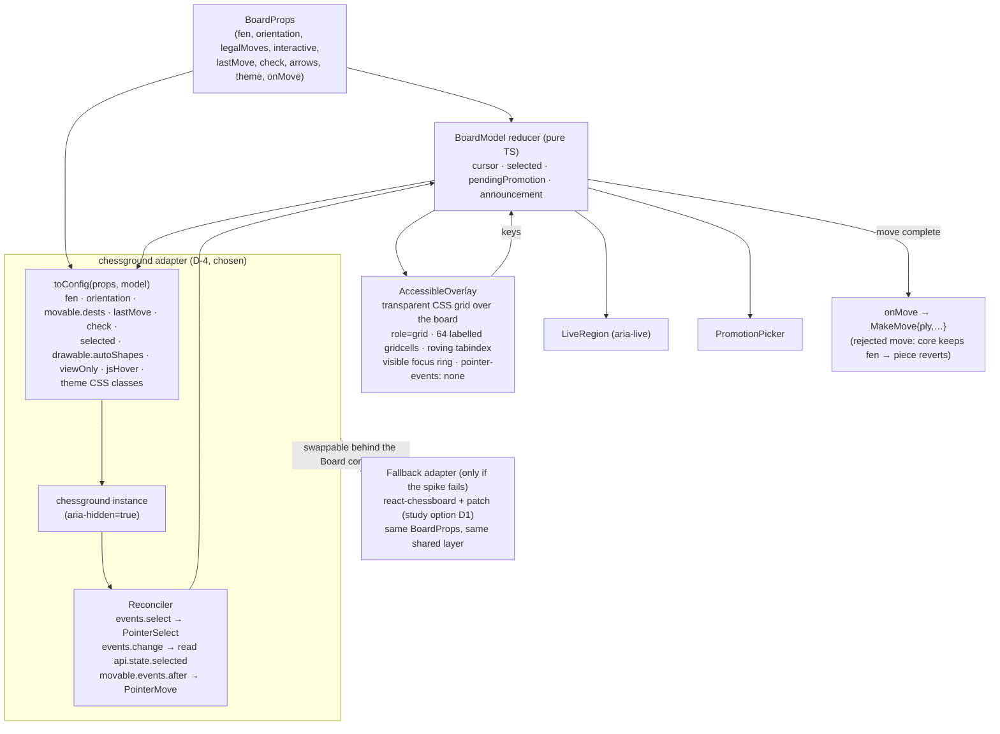

- **`Board` contract.** Screens use the board only through `BoardProps` (refined study §5, first-pass §5.0), so the fallback replaces just the adapter.
- **One selection state.** `BoardModel` is the source of truth. Its selection is pushed into chessground with the `selected` config value. chessground's own changes come back through `events.select` (including drag start). Silent unselects, which fire no event, are caught on `events.change` by reading `api.state.selected`.
- **Accessibility overlay.** A transparent ARIA grid sized from chessground's `---cg-width`/`---cg-height` CSS variables sits exactly over the squares.
  - Keyboard focus and the VoiceOver cursor land on the real squares.
  - Mouse and touch pass through to chessground.
  - The chessground board is `aria-hidden="true"`, which is axe-clean because chessground has no focusable elements.
- **Moves.** Pointer moves are applied optimistically by chessground and confirmed by the core's next snapshot. A rejected move (e.g., `StalePosition`) is reverted by re-setting `fen`. Keyboard moves go through `onMove` and are animated when the snapshot's `fen` arrives.
- **Read-only.** `viewOnly` while rewound (GAME-3), on computer turns, and in computer–computer games.
- **Spike (2 days, first GUI task).** The exit criteria are:
  1. `BoardModel.selected` equals `api.state.selected` after every step of scripted mixed mouse/keyboard sequences: click→Enter, Space→click, drag→Esc, click elsewhere, rejected-move revert, and promotion by mouse and by keyboard.
  2. axe is clean.
  3. The overlay aligns in both orientations at three sizes.
  4. Drag works in Safari, Chrome, Firefox, Edge, and the Tauri WKWebView.
  5. The overlay stays aligned during continuous window resizing down to a narrow width (no GUI minimum size, Q55).

  If criterion 1 can't be met reliably, switch the adapter to study option D1 (about 3–4 days; the shared layer carries over).
- **Upstream.** Propose a configurable sensor list to react-chessboard, to keep the fallback patch-free.

### 11.2 Decision log

| Date | Decision | IDs |
|---|---|---|
| 2026-10-24 | Rust backend, TypeScript UI, Tauri desktop, one shared core. | inputs |
| 2026-10-24 | CLI is a full-screen ratatui TUI, keyboard only, with plain and headless modes. | D-6 |
| 2026-10-25 | Accepted recommendations: in-process core with Tauri IPC (D-1); each entry point embeds the core, coordination via SQLite (D-2); `shakmaty` + `pgn-reader` (D-3); `ts-rs` (D-7); `chess serve` started by the user (D-8); pinned, bundled Stockfish downloaded at build time (D-9); GPL-3.0-or-later (D-10); legal-move lookups via the core (D-11). | D-1–D-3, D-7–D-11 |
| 2026-10-25 | React + TypeScript + Vite for the GUI. | D-5 |
| 2026-10-25 | Offline operation for desktop, web, and CLI made an explicit, tested v1 requirement; architecture confirmed to have no run-time network dependency (§8.1). | PLAT-3 |
| 2026-10-25 | v1 will not build its own board component (user decision after the first-pass trade study). | D-4 |
| 2026-10-25 | GUI board = chessground + shared keyboard/accessibility layer, gated by a 2-day spike; fallback react-chessboard + layer (patched). | D-4 |
| 2026-10-26 | Architecture review: D-12, D-13, D-16, D-18–D-20, D-22 PROPOSED; D-21 DEFERRED; D-14, D-15, D-17 OPEN (user-visible rules, need the user's choice). No AGREED decision was changed. | D-12–D-22 |
| 2026-10-26 | User answers Q41–Q55: D-15 decided (clock keeps running), D-17 decided (merge). D-23–D-27 added from Q46–Q49, Q54, Q55. D-14 is still OPEN. | D-15, D-17, D-23–D-27 |
| 2026-10-26 | Second round of user answers: D-14 decided (suspend immediately). D-16 simplified to one bundle with mismatch refusal. D-18, D-25, D-26, D-27 revised. D-28 (two Elo tracks) and D-29 (export archive) added. Human abort removed in favour of Resign. | D-14, D-16, D-18, D-25–D-29 |
| 2026-10-26 | Final answers: every PROPOSED decision accepted and AGREED (D-12, D-13, D-16, D-18–D-20, D-22–D-24, D-26–D-29, plus the mechanisms in D-17 and D-25). D-12 and D-16 recorded as one-way for data, consequences accepted by the user. D-26 revised: old games stay in opponents' views (Q76). D-27 revised: an h–c game never uses the computer's slot (Q77). D-28: computers' Training Elo, K counted per track (Q78), label from the Strict Elo (Q79). ASM-1 CONFIRMED. D-21 stays DEFERRED. Architecture baselined as v1.0. | D-12–D-29 |
| 2026-10-27 | v1.0 amendment 1 (user decisions). Reset with unfinished games allowed: they are voided and count against neither player (D-30 added, D-26 revised, OQ-8 and G-20 closed, `UnfinishedGameExists` kept for setup only). The voided game's visibility is an architect interpretation (Q-A18). Stockfish 19 (`sf_19`, 2026-09-05) pinned as the latest release (D-9 revised, TBD-26 closed); build plan prefers the official universal macOS asset, checked with `lipo -info`, with the separate-builds plan as fallback; ASM-3 narrowed. No ID renumbered. | D-9, D-25, D-26, D-30 |
| 2026-10-28 | v1.0 amendment 2 (requirements Amendment 2 / CR-4; decided by the architect under the user's delegation, the user may correct). Enabling-system view and allocation blocks (D-31, D-32). In-play rules (D-33). Import, identity and archive rules (D-34). Damaged-data handling and automatic backups (D-35). CLI grammar and server lifecycle (D-36). CLI Elo chart (D-37). D-17, D-18, D-19, D-21, D-24, D-29 amended. Name rules corrected in §5.5. No ID renumbered. | D-17, D-18, D-19, D-21, D-24, D-29, D-31–D-37 |
| 2026-10-28 | v1.0 amendment 3 (requirements Amendment 3 / CR-5; consistency pass by the systems engineer). No decision added or changed. Automatic backup and restore limit accepted into DAT-5 (D-35, R-19, OQ-12 closed); TBD-21 closed with exit code 4; TBD-33 added to the requirements register; CLI additions and `--config` accepted as design or test-only; R-20 accepted; §4.1 and §10.4 aligned with the functional decomposition (F-2.5.7 on `chess-app core`, F-6.15 automatic backup); §10.2 traces `engine_version` and `content_hash`. Text-only: no diagram changed. | D-35, D-36, R-19, R-20, OQ-12 |
| 2026-10-28 | v1.0 amendment 4 (requirements Amendment 4 / CR-6; the user's answers to the readiness check). No decision added or changed. Criticality and coding standard recorded (§8, §10.2). Q-A18 answered. Design approvers recorded. No Intel test hardware: PLAT-2, D-25 and R-13 unchanged. | Q-A18, §8 |
| 2026-10-30 | v1.0 amendment 5 (requirements Amendment 5 / CR-7; the user's answers to the open readiness findings). No decision added. Integer ratings (§7.2, ELO-1); standard-conforming PGN export (§5.7); baseline versions (§3.4); NFR-8 budget a Should (§4.8); CERT-informed coding standard, local-only security and CVE scanning (§8); best-effort platform matrix (§9). D-25 and R-13 unchanged. | ELO-1, IF-1, NFR-7, PLAT-2 |
| 2026-10-30 | v1.0 amendment 6 (requirements CR-8; FIND-008). G-15 resolved; D-20 amended: source, snapshot, code and name, position matching. | DAT-3, NFR-6 |
| 2026-10-31 | v1.0 amendment 7 (SDD architect triage, decisions 1 to 13 approved by Brian Prascher as recommended, with: decision 9 gains a documented archive size limit, PGN limit stays 10 MB; decision 11 drops the single-instance mechanism and rejects `signal-hook`, a dialog plugin, an `arc-swap`-like cell and `rand`/`rand_chacha`; decision 13 has no `player_id` on `VARIATION`, adds `created_at` and the anchor ply, and refuses saving a what-if branch from the final position). SE interpretations Q-SE-1, 2, 3, 4, 5, 12, 13, 18, 19, 22, 25 confirmed (Q-SE-2: `MOVE_EVAL` from White's point of view). Decisions D-38 to D-47 added as accepted, plus D-48 to D-50 for decisions 10, 9 and 8, which the triage had no draft record for. D-29 and D-34 amended. AMD-1 to AMD-14 applied. The known open issue (`chess-app` to `chess-rules` edge) is resolved. No ID renumbered. | D-29, D-34, D-38–D-50 |
| 2026-10-31 | v1.0 amendment 7, addendum A (Brian Prascher's rulings on the SDD v0.2 joint review, the same day; protocol shapes delegated to the architect with "delegate and apply"). Ruling 1: `content_hash` in the `GameEnd`, `Abort`, `Voided` payloads and in `VoidSpec` (D-41, D-42 text amended, G3). Ruling 2: exact payload fields per kind, with seven flags (D-41, G3). Ruling 3: `roster_indexes() -> Vec<u32>` and `first_k_after` in the app (D-46 text amended, G2). Ruling 4: calibration owner (D-57). Ruling 5: D-51 to D-56. Ruling 6: the ID exception (`EI-EN-002`), the §6.1 `signal-hook` node, `Orientation` and the `FakeEngine` factory in the curated list, the `player_stats` wording of FF-5, crash recovery (D-58). Not applied: FIND-JR-012, -016, -019. Later the same day: OQ-21 closed by Brian (option C, `roster_indexes()`, no `roster_class`); D-56 confirmed by Brian; D-59 (two-step ECO mismatch import, §5.8) drafted, then AGREED by Brian the same day with OQ-ECO-1 to OQ-ECO-3 closed (per game plus apply-to-all; explicit `keep_pgn`/`keep_table` or exit 1 when non-interactive; empty stored name when the PGN's ECO is kept; not remembered). | D-41, D-42, D-45, D-46, D-51 to D-58 |
| 2026-11-01 | v1.0 amendment 7, addendum B (Brian Prascher's rulings on the SDD v0.3 joint review). D-60: plain mode asks at a terminal; `--eco keep-pgn\|keep-table` mapped to `keep_pgn`/`keep_table`; tag normalisation (A00 to E99, malformed counts as no tag); ply 0 looked up; `eco_mismatch` gains `moves_san` and drops `tag_name?`; archive imports stateless; 10-minute idle time-out (`ESTIMATE`). D-61: `chess-app` owns `EngineFactory` and the production factory. Stale text fixed (JR3-010: stray `\1`, `signal-hook` in §6.1 prose, "slow fake store" in §9 and R-11, `player_stats` in §7.2). | D-59, D-60, D-61 |
| 2026-11-01 | v1.0 amendment 7, addendum C (Brian Prascher's ruling on OQ-23). D-62: duplicates and the ECO question stay two steps; one `ImportConflicts` reply holds one kind of entry; `ResolveImport{import_id, eco}` unchanged. §5.8 reworded; OQ-23 closed. | D-62 |
| 2026-11-04 | v1.0 amendment 8 (**APPROVED by Brian Prascher, 2026-11-04**; beads chess-a0r.1.14). Brian Prascher dispositioned the Board pass of OQ-16 ([Board-pass-store-journal.md](design/Board-pass-store-journal.md)) at G-1: accepted all proposed dispositions of its section 8, and chose "refuse" for `F_FULLFSYNC` (BP-014). Applied by the architect and approved by Brian on 2026-11-04: finalize time totals in `GameEnd` (D-63, BP-001), custom start defined once with a column (D-64, BP-005), terminal re-check on resume and the durable-prefix rule (D-65, BP-002, BP-003), `db_seq > last_intact_seq` is damage (D-66, BP-004), OQ-20 option A with five conditions (D-67, BP-008), hash scope, `Date` rule and version marker (D-68, BP-006, BP-007), `Voided.ended_at` and `journal_seq` of voided games (D-69, BP-009), the remaining format batch SF-07 to SF-22 (D-70, BP-010, BP-016, BP-017), refusal of a volume without `F_FULLFSYNC` (D-71, BP-014), Board-recommended minors, confirmed by Brian on 2026-11-04 (D-72: BP-011, BP-012, BP-013; D-73: BP-015). Brian also approved the G2 tier of D-67, D-58 as one-way after release, and the architect's recommended value for the six format choices (SF-02 six fields, SF-03 `sha256:v1:<hex>`, SF-04 UTC date of `started_at`, SF-15 snake_case journal codes, SF-16 the record's `wall_ms`, SF-21 `cause` on `Suspend`). OQ-16 stays open (Brian's closing condition: batch carried into the SDDs and a desk review passed), OQ-20 closed, OQ-22 flags have outcomes, OQ-24 and OQ-25 not decided in that approval (answered later the same day, D-77). No review of the amendment has been held. No ID renumbered. | D-63 to D-73, OQ-16, OQ-20, OQ-22 |
| 2026-11-04 | v1.0 amendment 8, addenda A and B (architect; Brian's ruling on tools). **Addendum A:** OQ-13 answered by a proposed ruling, D-74 (`GameContextProvider`; proposed here, later CONFIRMED by Brian as a G2 decision, see addendum D); readiness condition C-1 ruled by the architect under Brian's delegation, D-75 (the ECO table and `eco::lookup` stay in `chess-rules`, the "deepest named position" rule stays in `chess-domain`; D-20, §3.1, §3.3, §5.7 and §8.1 corrected; G2, approved by Brian's delegation to the architect). **Addendum B:** D-76, ruled by Brian (G2, approved): no nightly Rust toolchain ever; `cargo-llvm-cov` 0.9.1 admitted; `cargo-fuzz`, `libfuzzer-sys` and `arbitrary` not admitted; NFR-3 verified by stable-only means; §3.4 and §9 updated. GATE-009. OQ-16 unchanged (open). No ID renumbered. | D-74 to D-76, OQ-13 |
| 2026-11-04 | v1.0 amendment 8, addendum C (Brian's answers, relayed by the program manager, beads chess-a0r.1.15). D-77: OQ-24 closed (no `calibration` Cargo feature in v1; the calibration code stays as is); OQ-25 closed (no `chess-store` code of any kind before OQ-16 closes). OQ-16 stays open until the batch is in the SDDs and the desk review passes. D-73 text updated. No ID renumbered. | D-77, OQ-24, OQ-25 |
| 2026-11-04 | v1.0 amendment 8, addendum D (architect, under Brian's delegation; beads chess-a0r.1.16 to chess-a0r.1.19). **D-74 CONFIRMED by Brian as a G2 decision** (chess-a0r.1.19; status changed from PROPOSED). Three major findings raised by the software engineer in the SDD alignment (chess-a0r.1.8) are ruled by the architect and may be reversed by Brian: **D-78** (XC-DOM-A8-1, XC-APP-A8-3; chess-a0r.1.16): no journal field; a resumed game's time totals are seeded from the sum of `Move.think_ms` over every `Move` fact, the unfinished turn at each stop is not counted; store minors XC-ST-A8-1 to -4 confirmed (G2 / G1). **D-79** (XC-DOM-A8-2; chess-a0r.1.17): `Game::replay` takes `ReplayItem{fact, check: Option<MoveCheck{san, fen_after}>}`; `Fact` unchanged; a `fen_after` difference is always an error, a SAN-only difference is a warning (G2). **D-80** (XC-APP-A8-1; chess-a0r.1.18): the `JournalDegraded` state accepts queries, `Detach` and `Shutdown` that append nothing; resign and abort are reached after a resume (G1). **D-81:** `cargo-nextest` not adopted for now; plain `cargo test`. GATE-010. OQ-16 unchanged (open). No ID renumbered. No review has been held. | D-74, D-78 to D-81, OQ-13 |
| 2026-11-04 | v1.0 amendment 8, addendum E (architect, chess-a0r.1.31, baseline B3; after the two OQ-16 desk reviews and Brian's rulings of 2026-11-04, beads chess-a0r.1.30). **Recorded:** Brian ratified D-79 and D-80; D-78 is not ratified and awaits his choice (OQ-28, proposal [PROPOSED-D-78-DAT-3-for-Brian.md](design/PROPOSED-D-78-DAT-3-for-Brian.md), nothing applied); Brian accepted exit class 3 for `DurabilityUnsupported` (G3). **Decided by the architect, text only (G1, not reviewed):** D-82 (writer after a failed append), D-83 (the rebase), D-84 invariant (one start stamp; the `NewGame` field is OQ-26, PROPOSED FOR BRIAN), D-85 (`ended_at` of the terminal re-check), D-86 (held session), D-87 (`GameEnd` then `Voided`), D-88 (unacknowledged zero-move row). **Reworded:** FF-3, FF-4, §7.6 conformance, the `JournalWriteFailed` row of §5.5. **Closed:** ASM-10 (design evidence). **Open:** OQ-26, OQ-27, OQ-28. GATE-011. See §11.4.13 |
| 2026-11-04 | v1.0 amendment 8, addendum F (architect, chess-a0r.1.41, CR-3 closing pass T-D2; baseline B3 plus the working tree). **Recorded from Brian Prascher's decisions of 2026-11-04 (logged as CR-12 in requirements.md):** (1) OQ-28: option A (G2); D-78 is RATIFIED; a resumed game may lose up to one turn of time at each stop and is not required to; DAT-3 unchanged; OQ-28 closed. (2) OQ-26: option A (G2); `NewGame` gains `started_at`, the app supplies the one start stamp (D-84); OQ-26 closed. (3) OQ-27: option A (G3); `canonical_form` omits `SetUp` and `FEN` when the `FEN` equals the standard start; OQ-27 closed. (4) D-82 stays G1; D-83 is rated G2 and approved. (5) The D-71 refusal is an NFR-2 verification case. (6) "Approved at G-2" is read "approved by Brian Prascher on 2026-11-04, carried into the SDDs". (7) Exit class 3 in the TUI, plain mode and subcommands; TBD-36 not narrowed; the Tauri refusal is an in-window screen. **Text fixes by the architect (no new decision):** RR-A-1 and RR-A-5 (rebase: `Start` synthesized when the run lacks it, final or voided games, no-replace renames, both directories synced, `.rebase` checked first by the no-journal path), RR-A-2 (D-87 drops \"or `Abort`\"), RR-A-3 (step 5a hands the adopted records to the applier), RR-A-4 and RR-S-7 (D-78 text), RR-S-6 (addenda A to F; versions), RR-S-10 (FF-3), DAT-3 time bounds (domain 3.11.13). **Reported, not decided:** the seed counts no `DrawOffered` time before the last stop (§11.4.14). **Not reviewed by anyone but its author; OQ-16 stays open.** GATE-011 note. See §11.4.14 |

### 11.3 Door type, consequences, and revisit triggers

One-way door = costly to reverse: weeks of work or data migration. Rationale for D-1–D-11 is in the table above and in §11.1. D-4 is gated by its spike.

`GATE-005 | Subject: amendment 2, D-31 to D-37 | Scores: blast 1, reversibility 2, novelty 1, regulatory 0, cost 1, data 1, coupling 1 = 7 | Tier: R1 | Overrides: none.` R1 asks for the architect's checklist, two options noted per decision, and an ADR for any one-way door. The options are in the table above, and the one one-way door (UUID derivation after a release, D-34) has its escape route in the table below. The checklist was run by the architect against the guardrails and the definition of done; no separate Review Board pass was held at R1. **Human sign-off is not claimed.** The systems engineer and the user may correct any entry marked DECIDED (delegated).

`GATE-006 | Subject: amendment 7, D-38 to D-50 | Scores: blast 2, reversibility 2, novelty 1, regulatory 0, cost 1, data 1, coupling 2 = 9 | Tier: R2 | Overrides: none.` Reversibility is scored 2 because the stored-format batch (D-41 to D-43) is cheap to change before the first release and a data migration after it. R2 asks for a separate Review Board pass with four or more lenses, a lightweight ATAM, ADRs and fitness functions for the top scenarios. Here: the ADR-style records are D-38 to D-50 in §11 and the door table below; the fitness functions are FF-1 to FF-8 (§9); the decisions were approved by the named human approver, Brian Prascher (G2/G3, relayed to the architect in the task for this amendment). **A separate Review Board pass was not held for this amendment. The user answered on 2026-10-31 that it must be held on D-41 to D-43 before the first store code, and it is an entry condition for store implementation (OQ-16).** The user's approval does not replace it, and the architect does not waive it. No claim of independent review is made.

`GATE-007 | Subject: amendment 7 addendum A, D-51 to D-61 and the amended text of D-41, D-42, D-45, D-46 | Tier: R2, inherited from GATE-006 (the addendum amends D-41 and D-42, whose Board pass, OQ-16, has not been held) | Overrides: none | Not scored separately.` The Review Board pass of OQ-16 must cover the `content_hash` payload fields, the per-kind payload table with its seven flags (§7.6) and D-57 and D-58. **Human sign-off is not claimed:** Brian Prascher ruled on items 1 to 4 and 6 and delegated item 5 for his review of the shapes chosen here; he has since confirmed D-56, chosen option C for OQ-21, and agreed D-59 with OQ-ECO-1 to OQ-ECO-3 closed (G2).

`GATE-008 | Subject: amendment 8, D-63 to D-73 and the stored-format batch SF-01 to SF-22 | Scores: blast 2, reversibility 2, novelty 1, regulatory 0, cost 1, data 1, coupling 2 = 9 | Tier: R2 | Overrides: none.` The factors are the same as GATE-006, because Amendment 8 changes the same stored-format batch and the same recovery paths (scored by the author, `[INF]`; the score is not an approved score). Reversibility is 2 because the batch is cheap to change before the first release and a data migration after it; if it were scored 3, the floor of R2 would apply and the total would be 10, so the tier does not change. **Independence statement (plain).** Amendment 8 was written by the system-architect agent in the Architect stance, in one invocation. **No review of Amendment 8 had been held when GATE-008 was written** (*update 2026-11-04: the two OQ-16 desk reviews were held later the same day, PASS WITH CONDITIONS; see Addendum E and GATE-011*): no Review Board pass, no desk review, no lightweight ATAM. The Board pass of OQ-16 ([Board-pass-store-journal.md](design/Board-pass-store-journal.md)) reviewed the Amendment 7 text, not this one; it was one reviewer of the same agent family and it states that it does not satisfy R2 alone. The step that Brian set as the closing condition of OQ-16 is a **desk review by the system-architect and the systems engineer**, and it must be performed by a different invocation than this author. It is a later step; this text makes no claim that it has happened or that it would satisfy the R2 requirements (four lenses, ATAM) unless Brian rules so. Brian's G-1 decisions are his. **Brian approved the text on 2026-11-04** (recorded in beads chess-a0r.1.14), including the G2 tier of D-67, the D-72 and D-73 minor items, D-58 as one-way after release and the six format choices as recommended. That approval is the owner's decision on the text; it is not a Review Board pass or a desk review, and this record does not present it as one. SWE-001 (FIND-016) waives a separate independent reviewer for G3 in v1; that waiver is stated here and is not relied on. **No sign-off is claimed beyond Brian's approval of 2026-11-04.** The fitness-function additions are listed in §11.4.

`GATE-009 | Subject: amendment 8 addenda A, B and C, D-74 to D-77 | Scores: blast 1, reversibility 1, novelty 0, regulatory 0, cost 1, data 0, coupling 1 = 4 | Tier: R1 | Overrides: none.` Scored by the author `[INF]`; not an approved score. R1 asks for the architect's checklist, two options noted, and an ADR for any one-way door. The options are in the D-74 to D-76 rows of §11 (at least three each); none of the three is a one-way door (§11.3). The checklist was run by the architect against the guardrails and the definition of done, in one invocation, with no separate review. **D-74 was proposed here and is now CONFIRMED by Brian as a G2 decision (2026-11-04, beads chess-a0r.1.19; Addendum D).** D-75 was decided by the architect under Brian's delegation, relayed by the program manager. D-76 was ruled by Brian (G2, approved 2026-11-04). D-77 records Brian's answers to OQ-24 and OQ-25 (no design change). The addenda touch no stored format, so GATE-008 and OQ-16 are not affected. **No review and no sign-off beyond Brian's rulings is claimed.**

`GATE-010 | Subject: amendment 8 addendum D, D-78 to D-81 (and the confirmation of D-74) | Scores: blast 1, reversibility 1, novelty 0, regulatory 0, cost 1, data 1, coupling 1 = 5 | Tier: R1 | Overrides: none.` Scored by the author `[INF]`; not an approved score. Reversibility is 1 because no stored format changes and each ruling is text and code inside the pre-release design; the options that were not taken for D-78 (B, C, D) are the costly ones, and they stay available before release. Data is 1 because D-78 defines what a stored value means. R1 asks for the architect's checklist, two options noted and an ADR for any one-way door: the options are in the rows of §11 (five or six each), none of the four is a one-way door, and the checklist was run by the architect in one invocation with no separate review. D-78 to D-80 were ruled by the architect under Brian Prascher's delegation of 2026-11-04 ("what you think is the best course of action for each"); **that is a delegation, not Brian's approval of the content**. *Update, Addendum E (2026-11-04, beads chess-a0r.1.30): Brian ratified D-79 and D-80; D-78 was not ratified and awaited his choice.* *Update, Addendum F (2026-11-04, chess-a0r.1.41): Brian ratified D-78, option A.* D-81 and the confirmation of D-74 are Brian's, as relayed. OQ-16 is not closed by this addendum and the desk review of its closing condition now also has to cover D-78 to D-80. **No review and no sign-off beyond what Brian gave is claimed.**

`GATE-011 | Subject: amendment 8 addendum E, D-82 to D-88, and the FF-3 and FF-4 wording | Scores: blast 1, reversibility 1, novelty 0, regulatory 0, cost 1, data 1, coupling 1 = 5 | Tier: R1 by score; **treated as R2** | Overrides: author's own, because D-82 and D-83 sit on the NFR-2 recovery path (R-15) and D-84 touches a G2 contract. Scored by the author `[INF]`; not an approved score. Reversibility is 1 because no stored format, record kind, protocol shape or edge changes and each ruling is text inside the pre-release design. R2 would ask for a separate Review Board pass with four or more lenses: **it has not been held.** The independent re-review of the OQ-16 conditions (the system-architect and the systems engineer, different invocations from the author) is the pass that must cover D-82 to D-88. D-82 to D-88 are the architect's own rulings and are **not** ratified by Brian, except that Brian decided D-84's mechanism (`NewGame.started_at`, G2) and rated D-83 G2 and approved it on 2026-11-04 (*Update, Addendum F*; D-82 stays G1). All the architect's other changes in this addendum are **G1** (text inside one crate or between existing contracts). **No review and no sign-off beyond what Brian gave is claimed.**

| ID | Door | Main consequences | Revisit trigger | Escape route |
|---|---|---|---|---|
| D-1 | Two-way | No TCP port for desktop. The desktop E2E can't drive the app exactly like the web (R-1) | Tauri gains macOS WebDriver, or desktop/web divergence bugs appear | Switch the desktop to the local server transport; `CoreClient` already abstracts it |
| D-2 | One-way (moderate) | Engine pool per process. No live cross-process updates. Leases needed (R-3, R-9) | A need for live cross-process sync, or contention bugs | Extract a daemon that hosts `chess-app`. The front-ends already speak the protocol |
| D-3 | One-way (moderate) | GPL dependency (fits D-10). Rules quality inherited, and perft-verified | A blocking bug or license change upstream | Own implementation behind the `chess-rules` API |
| D-4 | Two-way (behind the `Board` contract) | Our Reconciler carries selection-sync risk (R-8) | Spike fails, or a chessground upgrade breaks the Reconciler | Study option D1 adapter (3–4 days) |
| D-5 | One-way (UI rewrite) | Ecosystem for testing and accessibility | — (low likelihood) | — |
| D-6 | Two-way | Plain mode must stay first-class (R-6) | Screen-reader users report TUI problems | Plain mode already exists |
| D-7 | Two-way | CI staleness check needed | Tauri-specific typing needs | `specta` |
| D-8 | Two-way | The user must start `chess serve` | The user wants the URL to "just work" | launchd agent |
| D-9 | Two-way | Builds need the Internet once (§8.1). Stockfish 19 is a major release: **any later Stockfish version needs its own decision-log entry and a full calibration re-run** (§4.6), because strength, the `UCI_Elo` range, and the network change between releases. Engine parameters of existing computer Players stay fixed (PLY-4), so a version change can shift their real strength | Fully offline builds wanted; a Stockfish release fixes a bug that affects us; the official macOS asset fails the `lipo -info` check (use the fallback build) | Vendored archive; fallback build from source (§8.2) |
| D-10 | One-way | All code GPL-3.0-or-later | A non-GPL dependency is needed | — (relicensing requires all authors) |
| D-11 | Two-way | Round trip per what-if move | Measured latency is noticeable | WASM `chess-rules` |
| D-12 | One-way (data). **Accepted by the user, 2026-10-26** | SQL stats views, WAL multi-process. Every entry point and the journal design depend on it, and the user's data lives in its format | Corruption or contention under real use | Full-data export and import (DAT-2) into a new store |
| D-13 | Two-way | One store thread per process: writes are serialised per process | Store-thread queueing visible in latency benchmarks | Connection pool or `sqlx` behind the `Store` trait |
| D-14 | Two-way | Closing a tab pauses that game's clock, the same as quitting the app | User feedback | Add a grace period |
| D-15 | Two-way (code) | A computer can lose on time while its engine recovers | User feedback | Freeze clocks (option A) |
| D-16 | One-way (data). **Accepted by the user, 2026-10-26** | One bundle only; partial installs unsupported. A store migrated by a newer build can never be opened by an older one (`SchemaTooNew`), so a downgrade means restoring the pre-migration backup or exporting and re-importing | A need to ship the CLI separately, or to downgrade | Restore `chess.db.bak-v<N>` (journals replay on top), or export and import; add compatibility rules for a separate CLI |
| D-17 | One-way for user data (a merged store can't be un-merged, except from the pre-import backup) | Records need stable `uuid`s; Replace/Keep-both UI | Merge errors reported | Restore the automatic backup |
| D-18 | Two-way | Install script maintained | Distribution beyond one Mac | Homebrew formula |
| D-19 | Two-way | Ordered rule must be documented in help | Confusion in scripts | Explicit `--headless` only |
| D-20 | Two-way | Bundled data file and its license (CC0-1.0, chosen). Where each name in the dataset originally came from was not checked | Data quality issues, or the upstream license changes (a snapshot already taken is unaffected) | Swap the table |
| D-21 | Two-way | — | — | — |
| D-22 | Two-way | Any local process can drive the core | ASM-1 changes (shared Mac accounts, or the app is distributed) | Add a token |
| D-23 | Two-way (behind `GameSession`) | One extra fsync per move. Recovery code paths need failure-injection tests (R-15) | Journal and DB bugs, or measured latency over the NFR-8 budget | SQLite FULL only |
| D-24 | Two-way | One more file to document (NFR-5) | User prefers XDG | Read both locations |
| D-25 | One-way-ish (support commitment) | Re-testing on every new macOS release. Intel test hardware while Intel is supported. Two Stockfish slices | A macOS release drops Intel (expected after Tahoe, R-13) | Freeze Intel at its last macOS; arm64 continues |
| D-26 | Two-way (no data destroyed) | Queries for the reset Player filter by `reset_at`; opponents' queries don't. Reset points in `RATING_HISTORY`. Unfinished games are voided, not refused (D-30) | User wants a physical wipe | Add deletion |
| D-27 | Two-way | `StartGame` needs the DB. Computers are never blocked by h–c games, so one computer can be in many unfinished h–c games at once (one per human per mode) | Slot rules change | Change which participants insert slots |
| D-28 | One-way (data model; splitting history later is hard) | Two rating series and two K counters per Player in stats and charts | — | Merge tracks in views |
| D-29 | Two-way (versioned) | Exporter and importer per `format_version` | — | New format version |
| D-30 | Two-way as a rule (code in `PlayerService` and queries). Each void is permanent for that game: it can't be resumed or given a result afterwards, except by restoring the pre-reset backup | `PlayerService` becomes a second writer of `GAME.status` and `UNFINISHED_SLOT`. Cross-process sessions learn of the void within one lease heartbeat (2 s, `ESTIMATE`). New state, event, journal record, status value, and PGN tag | The user corrects the interpretation (Q-A18), or users report voids they didn't expect | Change visibility in queries only (no data change). Stronger warning in the confirmation |
| D-31 | Two-way | One more view to keep current | The release procedure changes shape (hosting, notarization) | Merge the blocks into §2 |
| D-32 | Two-way | Names must match functional_decomp and requirements | A rename of a service | Update §2.2 and the allocation cells |
| D-33 | Two-way (code and rules) | A draw offer stops the clocks, so an unanswered offer in hot-seat stops both (R-20) | User feedback on the rules | Change the Policy rows and the journal handling |
| D-34 | Two-way, except UUID derivation: **one-way once a release exists** (stored identities) | `content_hash` on every game; deterministic roster UUIDs | A release ships; cross-install matching needs a change | Migration that rewrites computer Player UUIDs |
| D-35 | Two-way (code) | Restore on a copy; automatic backups use disk (a few MB, `ESTIMATE`); a design limit for Players created after the backup (R-19) | Backup size or restore time complains | Change the cadence or retention |
| D-36 | Two-way before release, a scripting contract after | Exit code 4 and command names are public | Scripts in use | Keep old names as aliases |
| D-37 | Two-way | Two renderers (Braille chart, ASCII grid) to snapshot-test | Terminal rendering problems | Table and sparkline only |
| D-38 | Two-way before code, harder after | The app SDD grows a public-API section; the domain gains `from_fen`; test seams shrink (D-39) | The curated list exceeds about 15 items, or a front-end needs a new lower-crate type twice | Reintroduce the specific edge (G2). Before code about a day of rework; large afterwards |
| D-39 | Two-way | Tests touch disk; `FaultPlan` provides failure injection | The core integration suite exceeds its time budget (FF-2) | Introduce a trait and a fake without changing callers' public types |
| D-40 | Two-way now, **one-way at release** | Store API signatures change; the domain `PlayerId` type changes; UUIDs enter stored data and exports at release | A measured store-lookup cost problem | Before release, change the newtype's inner type |
| D-41 | **One-way at release** | Two new record kinds, nullable clocks, a batch of schema changes decided together | The first release gate | Before release, edit the schema and the list. After release, add a version and keep the old reader |
| D-42 | One-way at release, softened by the algorithm prefix | One hash function in the app; unfinished games have no hash | A false duplicate is reported | A new prefix and a recompute on import |
| D-43 | Two-way (the column is unreleased) | One conversion function with an exactness test for every permille value 0 to 1000 | Another consumer needs the float | Convert in the store view |
| D-44 | Two-way | The store ships more rows per query | FF-5 fails on the 10 000-game fixture | Add a SQL fast path behind a differential test against the domain function |
| D-45 | Two-way | One more query; the CLI and GUI both depend on it | Typed input feels slow over the WebSocket (FF-6) | Remove the query and write client matchers with shared vectors |
| D-46 | **One-way at release** (with D-34) | The roster no longer waits for the engine; the value of the range is unknown until ASM-3 closes | An engine bump changes the range: the CI test fails and calibration is re-run (§4.6) | Before release edit pools and bounds; after release a migration of computer Player identities |
| D-47 | Two-way per crate | Every new crate needs a lookup, a licence check and a CVE scan | A CVE, a licence or an MSRV conflict | Replace the crate behind its module |
| D-48 | Two-way before code, harder after (public to the three front-ends) | `ui/`, `chess-server` and the Tauri shell follow the app design | A front-end cannot express a flow | Edit the app design (G2) before code |
| D-49 | Two-way | A GUI import of a very large archive is refused with a message; the CLI is the way around it | Real archives exceed the limit often (TBD-35) | Raise the cap, or add upload routes |
| D-50 | Two-way | A feature flag on the domain crate | The domain derive causes a build problem | Mirror the types in the app |
| D-51 | Two-way before code, harder after (error catalogue) | CLI, UI and the app share one move-error shape | A reason needs a field not listed | Add a field (additive), or a code |
| D-52 | Two-way | A rename inside `chess-rules`; the wire type is unchanged | The CLI needs the `Move` | Add a field to the wire type (additive) |
| D-53 | Two-way before code, harder after (protocol) | Every transport follows one envelope rule | A client needs to correlate an event with its subscription | Add an optional `sub` field to `EventEnvelope` |
| D-54 | Two-way | One more additive code | The close code or the reasons change | Edit the list (additive) |
| D-55 | Two-way | One more additive code and a union reply type | Another shell needs another path form | Add a `content` variant |
| D-56 | Two-way | The profile switch depends on the session's attached games | Users need to switch with a game open | Relax the check in `PlayerService` |
| D-57 | Two-way | A public item in `chess-app` that only the dev subcommand uses | A second consumer of calibration appears | Move it to its own crate |
| D-58 | Two-way before release. *Amd 8 (D-72, BP-011, approved by Brian, 2026-11-04): one-way after release.* Reason: its `Suspend` and `SuspendResume` records, and an optional `DrawDropped`, become permanent journal history that every later reader must keep understanding, and the alternative it names is one-way after release by its own words. Honest scoring [INF]: time 1, people 0, data 2, external 0, lock-in 0, sunk cost 1 = 4, which the reversibility test calls two-way; the reclassification rests on the stored-format rule (SWE-001), not on cost. Brian confirmed it on 2026-11-04 | Resume appends two records for a crashed game | Replay cost or log noise matters | Replace by one `Interrupted` fact (a new journal kind: one-way after release) |
| D-59 | Two-way before code | One optional field, one reply variant, two commands; a non-interactive import fails without an explicit ECO option | Users want a remembered choice or a default | Add a `PREFERENCES` key or a default (additive) |
| D-60 | Two-way before code | The CLI option spelling is a public scripting contract (D-36), so it is one-way once released | Users need a default or the underscore spelling | Accept both spellings (additive) |
| D-61 | Two-way | The trait stays in `chess-app` | A second consumer of the factory appears | Move the trait to `chess-engine` |
| D-62 | Two-way | Matches the SDD flow; no protocol change | The two prompts feel clumsy in use | Merge them into one reply (additive field on `ResolveImport`) |
| D-63 | **One-way at release** (with D-41). Reversibility test [INF]: time 2, people 0, data 2, external 0, lock-in 0, sunk cost 1 = 5; treated as one-way because it is a stored journal payload (SWE-001 stored-format rule) | Three fields in one record kind; restore is exact | The first release gate; a requirement ruling that times may be derived | Before release edit the table and the SDDs. After release add `journal_version` 2 with a reader for 1 that derives the totals from `Move.think_ms` (lossy) |
| D-64 | **One-way at release** [INF] score 5 (a column and a payload meaning) | One column, two CHECKs, one definition; statistics, history and Elo read the same flag | A requirement change to RULE-8; the first release gate | Before release edit. After release a numbered migration: `ADD COLUMN custom_start DEFAULT 0`, backfill `= (start_fen IS NOT NULL)`; a change of the comparison rule does not re-rate old games |
| D-65 | Two-way (code and rules; no format change) | One more check on resume; a degraded state after a partial append | Replay cost, or the Board-style finding that the prefix rule is not enough | Add a batch append with a commit marker (a new framing: one-way after release) |
| D-66 | Two-way (store-internal) | Recovery keeps rows the journal no longer proves, and tells the user | A case where keeping the row is wrong | Revert the reconcile case |
| D-67 | Two-way (rules); one-way at release only if option C is chosen later | FF-4 excludes voided games; store reads two more columns | A voided game is reported as a wrong duplicate; Brian prefers fewer invariants | Option C (no hash for voided games; G3 before release, a migration after) |
| D-68 | **One-way at release** [INF] score 6 (a stored value format and its canonical input) | An importer ignores values of another version; FF-4 holds without a rename only | A change to `canonical_form`; the first release gate | Before release edit. After release bump to `v2` and keep the `v1` reader; old `v1` hashes never match new ones, so a re-import is not recognised as a duplicate (a harmless extra review-only copy) |
| D-69 | **One-way at release** for the field; two-way for the rule | One more `Voided` field; voided journals can leave `done/` | The first release gate | Before release edit. After release `journal_version` 2 |
| D-70 | **One-way at release** (the whole batch) | See SF-07 to SF-22 for each item; no byte-level choice is made by an implementer | The first release gate (the batch freezes there) | Before release edit §11.4 and the DDL; no migration. After release each item has its own note in §11.4 |
| D-71 | Two-way (code) | A user cannot use a volume without full sync | A user needs such a volume | Replace refusal by a visible warning and an `OpenReport` flag (the weaker NFR-2 would need Brian's explicit decision) |
| D-72 | Two-way (text and code) | See D-58 for the reclassification | The Board-style finding recurs, or a library bump changes SAN | Revert to the previous text or make SAN strict |
| D-73 | Two-way (code) | Calibration needs an empty directory | A calibration workflow needs an existing store | Relax the guard with a marker |
| D-74 | Two-way (inside `chess-app`) | One trait and one snapshot publisher per session; a gateway that fails closed | A stale-snapshot defect, or a store-built context needs a new domain state value | Replace the live branch by a request through the session mailbox, or use the store row alone (mechanical, inside the crate) |
| D-75 | Two-way before code | One provided interface in `chess-rules` (`eco::lookup`); `shakmaty` is also a build-dependency of `chess-rules`; the key derivation exists once, shared by the build script and the library | The shared key derivation proves awkward, or the build time of `chess-rules` is a problem | Move table and generator to `chess-domain` with a build-dependency on `chess-rules` (option b of D-75): mechanical before code, a rewrite of the SDD entities named in D-75 after |
| D-76 | Two-way (a tool is admitted by a later G2 decision) | No coverage-guided fuzzing; NFR-3 evidence is property tests and soak; one more installed tool (`cargo-llvm-cov`) | A machine with a nightly toolchain becomes available, or a bug class slips past the property tests | Admit `cargo-fuzz` and a pinned nightly for a `fuzz/` crate outside the workspace, by a new G2 decision |
| D-77 | Two-way (1) a feature can be added later; (2) a scheduling ruling | (1) The calibration code ships in every binary. (2) Store work waits for OQ-16 | (1) Binary size or a leak of calibration code into a release is a problem. (2) Idle time on the critical path | (1) Add the feature behind a new decision. (2) Brian may lift the block, as OQ-16 allows |
| D-78 | Two-way (a rule; no stored format changes). The rejected options B, C and D are G3 changes that are cheap before the first release and need `journal_version` 2 after it | The totals of a game that was stopped and resumed omit the unfinished turn of the side to move at each stop (at most one turn and one draw-offer interval per stop); `seed_from_facts` sums `think_ms` over every `Move` fact | The systems engineer or Brian reads DAT-3 as exact; a statistic is seen to be wrong in practice; the first release gate | Before release: add the totals to `Suspend` or `Clock` (edit §7.6, SF-01 note, the `Fact`, the codec, FF-3). Narrower and format-free: refine `seed_from_facts` from the `Clock` records. After release: `journal_version` 2 with a v1 reader that uses the seed rule |
| D-79 | Two-way (an in-process interface; nothing is stored) | One public item pair in `chess-domain`; the codec has a second function; `Fact` and the journal are unchanged | The check is found to need data the record does not carry; a `chess-rules` change makes the FEN normalisation unreliable | Remove `check` and compare in the app (option C), or drop the comparison (option E, needs Brian): mechanical before code |
| D-80 | Two-way (inside `chess-app`) | After a partial journal failure the player can see the game and leave it, but cannot resign or abort until a resume; a still-unwritable volume leaves the game unfinished | Users meet the degraded state often, or ask to resign from it; the app test shows that `open_held` after a degraded `Detach` does not work | Add `Resign` and `Abort` to the set (option C) with a rule against an unwritten mate: text and code inside `chess-app` |
| D-81 | Two-way (a tool is admitted by a later G2 decision) | No nextest features (per-test process isolation, retries, timeouts); one tool less to pin and scan | A test needs process isolation that `cargo test` cannot give; a patched nextest is looked up | Admit it by a new G2 decision after a fresh lookup |
| D-82 | Two-way (inside `chess-store`, no format) | A writer that fails mid-append no longer corrupts the file; a poisoned session ends in the degraded state; a failed move may reappear at a resume when cleanup failed | A write-failure test shows a case the rule misses, or `ftruncate` is unsafe on the target volume `[UNV]` | Revert to one session-wide poison on any error (option B); no migration |
| D-83 | Two-way before release; recovery behaviour after; rated G2 by Brian (two data-directory names, Addendum F) | Two file names in the data directory; a rebase is a pure function of the intact run and the store rows | A crash test shows a window the rebase does not survive | Replace by truncate-and-append plus a scan rule change (G3) |
| D-84 | Invariant: two-way (text). `NewGame.started_at`: two-way before release (a DTO field); decided by Brian on 2026-11-04 (OQ-26, option A) | One start stamp for row and record | A start path that cannot take the stamp before the store call | Keep the store stamp (option B) |
| D-85 | Two-way | Elo order follows game order after a recovery | A requirement ruling on the end time of a recovered game | Use the resume time |
| D-86 | Two-way (inside `chess-app`) | The held session stays `Suspended` | A held game needs a clock | Journal `SuspendResume` and a `Pause` |
| D-87 | Two-way | No rating is settled for a voided game, even when a `GameEnd` exists | A requirement that a voided game keeps its result | Finalize then void |
| D-88 | Two-way | A crash window can leave one visible zero-move game | Users report ghost games | Void at startup (option B) |

### 11.4 Amendment 8: stored-format batch, items for Brian, drafted logging text (APPROVED by Brian, 2026-11-04; addenda A to D)

**Status.** Written by the architect (author) on 2026-11-04. Brian Prascher dispositioned the Board findings at G-1 on 2026-11-04 and **approved the text of D-63 to D-73 and SF-01 to SF-22 on 2026-11-04** (recorded in beads chess-a0r.1.14), with the six format choices as the architect recommended. The approval is Brian's; **no Review Board pass, desk review or ATAM of this amendment has been held** (GATE-008, §11.3), and **OQ-16 stays open** until the batch is carried into the SDDs (chess-a0r.1.8) and a desk review by the system-architect and the systems engineer (different invocations from the author) has passed. Addenda A to D (§11.4.8, §11.4.9, §11.4.11, §11.4.12) were added the same day: D-74 was proposed and is now confirmed by Brian (G2), D-75 was decided by the architect under Brian's delegation, D-76 was ruled by Brian, D-77 records Brian's answers, and D-78 to D-80 were ruled by the architect under Brian's delegation (*Addendum E: Brian ratified D-79 and D-80 on 2026-11-04; D-78 awaited his choice; Addendum F: Brian ratified D-78, option A*). Evidence tags are as in the header. Nothing was built; the only thing run is stated in the Mermaid line at the end of this section.

#### 11.4.1 Items for Brian

Labels follow SWE-001 section 3: G2 and G3 need Brian; G1 needs a system-architect desk review and is listed so that nothing is hidden. "Board-recommended" items are ones Brian did not rule on individually at G-1; he confirmed D-72 and D-73 as minor items on 2026-11-04. The third column keeps the original question; the label and the bold text record the answer of 2026-11-04.

| Label | Item | What Brian decides |
|---|---|---|
| FOR BRIAN (G3), APPROVED 2026-11-04 | D-63, SF-01: finalize time totals in `GameEnd` | Approve the payload change |
| FOR BRIAN (G3), APPROVED 2026-11-04 | D-64, SF-02: custom start, `custom_start` column | Approve; choose the comparison rule. **Chosen: six fields** |
| FOR BRIAN (G3), APPROVED 2026-11-04 | D-68, SF-03, SF-04: hash scope, `Date` rule, version marker | Approve; choose the spelling and the `Date` rule. **Chosen: `sha256:v1:<hex>`; UTC date of `started_at`** |
| FOR BRIAN (G3), APPROVED 2026-11-04 | D-69, SF-05: `Voided.ended_at` | Approve the field |
| FOR BRIAN (G3), APPROVED 2026-11-04 | D-70, SF-07 to SF-22: the rest of the batch | Approve the batch; choose SF-15, SF-16, SF-21. **Chosen: snake_case codes in the journal only; the record's `wall_ms` (no `started_at` in `Start`); `cause` added to `Suspend`** |
| FOR BRIAN (G2), APPROVED 2026-11-04 | D-65, part 1: terminal re-check on resume (`chess-domain`, `chess-app`) | Approve |
| FOR BRIAN (G2), APPROVED 2026-11-04 | D-67: OQ-20 option A with five conditions | Approve the text (the G2 tier was approved). The Board said G1; the architect classifies it G2 because the store returns two more columns and the app passes a hash across the §5.7 contract. Brian may rule G1 |
| FOR BRIAN (G2), APPROVED 2026-11-04 | D-71: refuse a volume without `F_FULLFSYNC`; new additive code `DurabilityUnsupported` | Approve the text and the code (the decision to refuse is already his) |
| FOR BRIAN (G2), APPROVED 2026-11-04 | D-72, BP-013 only: SAN mismatch policy (Board-recommended; confirmed by Brian on 2026-11-04 as a minor item) | Confirm or reject (confirmed). The Board said G1; the architect classifies it G2 (domain replay and app codec) |
| G1, desk review by the system-architect | D-65 part 2 (durable prefix), D-66, SF-06, SF-22, D-72 BP-011 and BP-012 (Board-recommended; confirmed by Brian on 2026-11-04), D-73 (Board-recommended; confirmed by Brian on 2026-11-04) | Brian confirmed them on 2026-11-04 as a batch; the desk review of the OQ-16 closing condition covered them on 2026-11-04 (PASS WITH CONDITIONS, see Addendum E); the re-review after Addendum E has not been held |
| FOR BRIAN (G2), APPROVED 2026-11-04 | D-58 door class change to "one-way after release" (D-72, BP-011) | Confirm; the score says two-way (§11.3). Confirmed |
| Answered 2026-11-04 | OQ-24: should the calibration code sit behind a `calibration` Cargo feature | **No.** Leave the calibration code as is for v1 (Brian, D-77). Closed |
| Answered 2026-11-04 | OQ-25: may `chess-store` work that does not touch journal payloads, `GAME` DDL or recovery start before OQ-16 closes | **No.** Keep the full block: no `chess-store` code of any kind starts before OQ-16 closes (Brian, D-77). Closed |
| FOR BRIAN (G2), CONFIRMED 2026-11-04 (beads chess-a0r.1.19) | D-74 (Addendum A): `GameContextProvider` answers OQ-13. Proposed by the architect; confirmed by Brian as a G2 decision. The architect's reading of SWE-001 had been G1 (one crate, no §3.2 edge, no §5.7 contract); the work order treated a new §4.1 edge as G2 | Confirmed; Brian ruled G2 |
| G2, approved by Brian's delegation to the architect, 2026-11-04 | D-75 (Addendum A): the ECO table and `eco::lookup` stay in `chess-rules` (readiness C-1) | None pending. Brian may overrule |
| FOR BRIAN (G2), APPROVED 2026-11-04 | D-76 (Addendum B): no nightly toolchain ever; `cargo-llvm-cov` 0.9.1 admitted; `cargo-fuzz`, `libfuzzer-sys`, `arbitrary` not admitted | Ruled by Brian |
| G2, ruled by the architect under Brian's delegation, 2026-11-04; **RATIFIED by Brian Prascher, 2026-11-04, option A (OQ-28 closed; Addendum F; CR-12 item 1)** | D-78 (Addendum D): the time totals of a resumed game come from the existing journal records; no journal field | None pending. DAT-3 statement unchanged; the DAT-3 verification case of CR-12 carries the acceptance. [PROPOSED-D-78-DAT-3-for-Brian.md](design/PROPOSED-D-78-DAT-3-for-Brian.md) is marked decided (A) |
| G2, ruled by the architect under Brian's delegation, 2026-11-04; **RATIFIED by Brian Prascher, 2026-11-04 (beads chess-a0r.1.30)** | D-79 (Addendum D): `Game::replay` takes `ReplayItem{fact, check}`; `Fact` unchanged | None pending |
| G1, ruled by the architect under Brian's delegation, 2026-11-04; **RATIFIED by Brian Prascher, 2026-11-04 (beads chess-a0r.1.30)** | D-80 (Addendum D): the `JournalDegraded` command set | None pending. The system-architect desk review found that it stands (F-09); the re-review after Addendum E has not been held |
| G0 text, Brian's decision as relayed, 2026-11-04 | D-81 (Addendum D): `cargo-nextest` not adopted for now | None pending |
| G1, ruled by the architect, 2026-11-04 (Addendum E; not reviewed); **D-83 is G2 and approved by Brian, 2026-11-04 (Addendum F)** | D-82 (writer after a failed append), D-83 (the rebase), D-85 (`ended_at` of the re-check), D-86 (held session), D-87 (`GameEnd` then `Voided`), D-88 (unacknowledged zero-move row), and the invariant of D-84 | None pending. The independent re-review must cover them |
| G2, **DECIDED by Brian Prascher, 2026-11-04, option A (OQ-26 closed; CR-12 item 2)** | D-84 mechanism: `NewGame` gains `started_at: i64` so that `GAME.started_at` and the `Start` record share one stamp (the app supplies it) | None pending |
| G3, **DECIDED by Brian Prascher, 2026-11-04, option A (OQ-27 closed; CR-12 item 3)** | `canonical_form` (SF-03 `v1`) omits `SetUp` and `FEN` when the `FEN` equals the standard start, so that FF-4 holds for a game imported with a standard `FEN` tag | None pending |
| G2, **DECIDED by Brian Prascher, 2026-11-04, option A (OQ-28 closed; CR-12 item 1)** | D-78 and DAT-3: accept that a resumed game may lose up to one turn of time at each stop; it is not required to | None pending |
| **DECIDED by Brian Prascher, 2026-11-04 (CR-12 items 4 to 7)** | D-82 stays G1; D-83 is rated G2 and approved; the D-71 refusal is an NFR-2 verification case; exit class 3 in the TUI, plain mode and subcommands (TBD-36 not narrowed); the Tauri refusal is an in-window screen | None pending |
| Recorded 2026-11-04 (Brian, beads chess-a0r.1.30) | D-79 and D-80 ratified; exit class 3 for `DurabilityUnsupported` accepted (G3) | Done |

#### 11.4.2 Stored-format batch (Amendment 8): SF-01 to SF-22

One batch, one gate (G3, with G1 sub-items as marked). Every item has a proposed value and a reason. Six items (SF-02, SF-03, SF-04, SF-15, SF-16, SF-21) were a user choice; **Brian made all six on 2026-11-04 as the architect recommended**, and each cell says so. Reversal notes: **before the first release** the cost is an edit of this section, the §7.2 DDL, the §7.6 table and the SDDs, with no migration (ASM-6, nothing is released); **after release** it is as stated in the last column. The decoder uses `deny_unknown_fields` (store design 3.11.1), so even an additive journal field after release needs `journal_version` 2 with a reader for 1 (`[OBS]` store design; the mechanism is a consequence, `[INF]`). `journal_version` and `format_version` stay 1 until the first release.

| ID | Item (finding) | Proposed value or rule | Rationale and evidence | Tier | Reversal after release |
|---|---|---|---|---|---|
| SF-01 | `GameEnd` finalize time totals (BP-001; flag 1; D-63) | `GameEnd` payload adds `white_time_used_ms`, `black_time_used_ms`, `total_active_ms`: whole milliseconds, `>= 0`, always present. Added by the assembler, not in the `Fact`. Finalize and restore write them to `GAME`. `total_active_ms` is the session's measured active time as already described in §7.2 (excludes time with the app closed, suspended or paused; the exact treatment of a pending draw offer is the domain clock rule, T8 and T11, and the domain design must state it once) | `FinalizeRequest` has the three fields and the journal does not `[OBS store:480, arch:1536]`; the totals cannot be derived from `Move.think_ms` (Board's three cases) `[INF]`. Whether an untimed game also has measured totals was ASM-10 (closed 2026-11-04, Addendum E: it does) | G3. FOR BRIAN (G3): approved 2026-11-04 | `journal_version` 2 with a v1 reader that sums `think_ms` (lossy) |
| SF-02 | Custom start (BP-005; flags 4, 5; D-64) | Defined once: `custom_start = 1` iff the start differs from the standard start. A start equal to the standard start is standard: `custom_start = 0`, `start_fen = NULL` (JSON `null` in `Start`). The domain constructor normalises. `GAME.custom_start INTEGER NOT NULL DEFAULT 0 CHECK (custom_start IN (0,1))`, `CHECK (custom_start = (start_fen IS NOT NULL))`, `CHECK (custom_start = 0 OR rated = 0)`. `StartPosition = Standard | Custom(Fen)` is defined in the domain design. `Start.rated` and `Start.self_play` are frozen history, authoritative for a restored row. **Decided by Brian, 2026-11-04, as recommended: (A)** all six FEN fields must equal the standard start's (a different move counter or clock changes numbering and the fifty-move count, so it is not "the standard start"). Not chosen: (B) placement, side to move, castling and en passant only (counters ignored). Imported games: `custom_start` follows the same rule applied to the `FEN` tag | Resolves the three definitions (architecture flag 4, RULE-8 and CR-9.11, the app SDD) and gives the store a column to return for statistics and history `[OBS req:502-507, 623; domain:370, 753]` | G3. FOR BRIAN (G3): approved 2026-11-04 | Numbered migration `ADD COLUMN ... DEFAULT 0`, backfill `= (start_fen IS NOT NULL)`; a changed comparison does not re-rate old games |
| SF-03 | Version marker in `content_hash` (BP-007; D-68) | `sha256:v1:<64 lowercase hex>`. `v1` versions `canonical_form`. The importer compares only values with the same version; another version never matches and is not an error. **Decided by Brian, 2026-11-04, as recommended: (A) `sha256:v1:<hex>`** (keeps the algorithm prefix of D-42 first). Not chosen: (B) `v1:sha256:<hex>`; (C) `sha256-v1-<hex>`. *Addendum F:* `v1` is defined with the OQ-27 rule that `canonical_form` omits `SetUp` and `FEN` when the `FEN` equals the standard start (Brian, G3, 2026-11-04) | The prefix versions the algorithm, not the form; a stored hash cannot be told from a new one after a change `[OBS arch:1994, 2149]` | G3. FOR BRIAN (G3): approved 2026-11-04 | Bump to `v2`, keep the `v1` reader; old values stop matching new ones (a harmless extra review-only copy on re-import) |
| SF-04 | Hash scope and the `Date` rule (BP-006; D-68) | The stored hash is the hash as of game end (names, `Date` and rule-owned tags as then). FF-4 holds only without a rename between export and re-import, and its test says so. **Decided by Brian, 2026-11-04, as recommended: (A)** the UTC calendar date of `started_at`, written `YYYY.MM.DD` (independent of the time zone and of the export day; present for every game this app plays). Not chosen: (B) the local date of `started_at`; (C) the UTC date of `ended_at`. For an imported game the `Date` is the tag value stored in `GAME_TAG` | Today the source and time zone of `Date` are stated nowhere `[OBS Board BP-006]`; (B) changes with a time-zone change; (C) differs from (A) for a game that spans UTC midnight | G3. FOR BRIAN (G3): approved 2026-11-04 | A changed rule is a new `canonical_form` version (SF-03) |
| SF-05 | `Voided.ended_at` (BP-009; flag 6; D-69) | `Voided` payload adds `ended_at` (epoch ms integer, the unit of `GAME.ended_at`). Reset: the commit time written to `GAME.ended_at`. Unreadable void: the void time. A `Voided` appended later (repair, other process): copied from the `GAME` row, never `now`. The record's `wall_ms` stays the append time | A restore re-running the void from the record would otherwise write a later time `[OBS arch:1548]` | G3. FOR BRIAN (G3): approved 2026-11-04 | `journal_version` 2 |
| SF-06 | `journal_seq` of a voided game; DB effect of `Voided` (BP-009; D-69) | After `Voided` is appended and synced, the holder passes it to `apply_records`. Its DB effect: set `journal_seq` to the record's `seq`; only if the row is not yet `voided` (restore), re-run the void from `reason`, `reset_player`, `ended_at`, `content_hash`. The startup scan applies an unapplied `Voided` the same way. The store design's cell "none" is replaced | `reset_player` runs before the record exists and cannot set the sequence; without this, `done/` keeps reset-voided journals forever `[OBS store:833; Board BP-009]` | G1 *(Addendum E, F-04: corrected to **G2**; the item changes what `apply_records` does and passes a record across the `chess-app`/`chess-store` contract, as D-67 did. Brian approved the item on 2026-11-04 under either label, so no unapproved change exists; do not use G1 here as precedent)* | Text only |
| SF-07 | Journal `kind: u8` codes (BP-010 (1)) | `Start` 1, `Move` 2, `Takeback` 3, `Clock` 4, `DrawOffer` 5, `DrawDeclined` 6, `DrawDropped` 7, `Pause` 8, `Resume` 9, `Suspend` 10, `SuspendResume` 11, `GameEnd` 12, `Abort` 13, `Voided` 14. 0 and 15 to 255 are invalid (decode error). A code is never reused | Order of §7.6; 0 invalid so a zero-filled block does not decode as a record `[INF]` | G3 | Codes never change. A new kind takes the next number with `journal_version` 2 |
| SF-08 | Checksum (BP-010 (2)) | CRC-32 of the ISO-HDLC / IEEE 802.3 family (the zlib `crc32`): reflected, init and final XOR `0xFFFFFFFF`; the check value of the ASCII bytes `123456789` is `0xCBF43926` `[RAN python3 zlib.crc32]`. Record CRC covers `len` (4 bytes, little-endian) followed by the body, as in the store design; the `A5 5A` marker is not covered. `header_crc32` covers the header from the magic to the end of `store_id`. A test vector with that check value is in the unit tests | A common, tool-checkable choice, so a hand repair with standard tools is possible. Castagnoli would be a defensible alternative; any detection advantage on these small records is `[UNV]`, and the crate choice is OQ-17, not decided here | G3 | `journal_version` 2 |
| SF-09 | Maximum record body (BP-010 (3)) | 65 536 bytes. A larger `len` is read as damage; the writer refuses to write it (a write error) | The largest records (`Start` with a custom FEN, `GameEnd` with an ECO name) are far below 64 KiB `[INF]`; the bound limits what a corrupt `len` can make the scan skip | G3 | Raising it is a `journal_version` bump; under D-16 (one bundle) that is cheap |
| SF-10 | `VoidReason` (BP-010 (4)) | Journal strings `reset` and `unreadable`. The codec maps them to `GAME.termination` values `voided by reset` and `voided: unreadable` (unchanged, OQ-18). An unknown value is a decode error | Two variants exist today `[OBS arch:1418, 1459]` | G3 | `journal_version` 2 for a new variant |
| SF-11 | `ClockSpec` text (BP-010 (5)) | `<base>+<increment>`, both whole seconds in decimal, no sign, no spaces, no leading zeros (`0` alone is allowed): `300+0`, `180+2`. Both parts always present. Null when untimed. The CLI minutes shorthand `5+0` is input only and is converted. The decoder rejects other forms | Matches the PGN `TimeControl` seconds form named in the domain design `[OBS domain:361]`; one spelling per value keeps the text column comparable | G3 | A migration that rewrites `clock_spec` |
| SF-12 | UUID text form (BP-010 (6)) | Lower-case, hyphenated, 36 characters (`8-4-4-4-12`) in payloads, journal file names and every `TEXT UNIQUE` uuid column (compared with `BINARY` collation). Decoders reject other forms; the boundary normalises input. Proposed DDL backstop on each uuid column: `CHECK (uuid = lower(uuid) AND length(uuid) = 36)` | `BINARY` collation makes `A` and `a` different keys `[INF]`; one spelling avoids two files for one game | G3 | A migration that lower-cases values and renames files |
| SF-13 | `Start.start_fen` for a standard start (BP-010 (7)) | JSON `null`; never the standard FEN. See SF-02 | Removes the "every game becomes custom" reading `[OBS Board BP-005]` | G3 | As SF-02 |
| SF-14 | Half-null clocks (BP-010 (8)) | In `Move` and `Clock` payloads `white_ms` and `black_ms` are both null or both numbers; a half-null pair is a decode error. The `Fact` keeps one `Option<ClockValues>`. DDL backstop: SF-18 | The record has two nullable fields and the `Fact` has one option, so a half-null pair is representable and undefined `[OBS Board BP-010]` | G3 | `journal_version` 2 |
| SF-15 | `GameEnd.reason` strings (BP-010 (9)) | **Decided by Brian, 2026-11-04, as recommended: (B).** The options were: (A) Keep the domain's strings in the journal as they are in `GAME.termination` (`time forfeit, opponent cannot mate` has spaces and a comma): one vocabulary, but display-style text is a stored machine value. (B) Snake_case codes in the journal only: `checkmate`, `stalemate`, `insufficient_material`, `threefold_repetition`, `fifty_move_rule`, `time_forfeit`, `timeout_opponent_cannot_mate`, `resignation`, `draw_agreed`; the codec maps 1:1 to the unchanged, SE-confirmed `GAME.termination` strings (Q-SE-5, OQ-18). **Chosen: (B).** Unknown value: decode error | A journal string should not change when a display string is reworded; (B) does not reopen Q-SE-5 or the `games.json` list | G3. FOR BRIAN (G3): approved 2026-11-04 | `journal_version` 2 |
| SF-16 | `Start.started_at` against the record's `wall_ms` (BP-010 (10)) | **Decided by Brian, 2026-11-04, as recommended: (B).** The options were: (A) Keep `started_at` in the payload as the authority for `GAME.started_at`; `wall_ms` is the append time and need not equal it. (B) Drop it from the payload; `GAME.started_at` is the `Start` record's `wall_ms`, as `Move.played_at` already is. **Chosen: (B)** (one truth, same rule as `Move`). Note (B) changes a field that ruling 2 of Addendum A listed | Two copies of a time can disagree `[OBS Board BP-010]` | G3. FOR BRIAN (G3): approved 2026-11-04 | `journal_version` 2 |
| SF-17 | Hash CHECK (BP-016 (1)) | Replace `status <> 'in_progress' OR content_hash IS NULL` by `(status = 'in_progress') = (content_hash IS NULL)`: every terminal row, completed, aborted, voided and imported, has a hash. A voided game with zero readable moves still has one (D-67 (iv)) | The documents say "never null in `GameEnd`, `Abort`, `Voided`" and D-34 says "on every game", but only the in-progress half is enforced `[OBS store:307; arch:1540]`. That imported rows always get a hash is ASM-9 | G3 | Migration; rows without a hash would need a recompute first |
| SF-18 | Clock-pair CHECKs (BP-016 (2)) | `CHECK ((white_clock_ms IS NULL) = (black_clock_ms IS NULL))` on `MOVE` and on `GAME` (the checkpoint pair) | Backstop for SF-14 | G3 | Migration |
| SF-19 | `COMPUTER_PROFILE` CHECKs (BP-016 (3)) | `CHECK (error_permille BETWEEN 0 AND 1000)` and `CHECK (error_permille = 0 OR error_multipv >= 2)` | The second is a domain constructor rule with no DB backstop `[OBS domain:920]`; D-43 only needs the first | G3 (trivial) | Migration (relaxing a CHECK rebuilds the table in SQLite `[UNV]`) |
| SF-20 | Player ids of a non-imported game (BP-016 (4)) | `CHECK (status = 'imported' OR (white_id IS NOT NULL AND black_id IS NOT NULL))`. Self-play uses the same id twice | Imported games are the only ones with no registered Players `[OBS arch:1399]` | G3 | Migration |
| SF-21 | `Suspend.cause` (BP-017; flag 2) | **Decided by Brian, 2026-11-04, as recommended: (A).** The options were: (A) Add a `cause` to `Suspend`: `detach`, `shutdown` or `recovered` (a D-14 detach, a server stop, a D-58 crash recovery); `Fact::Suspend` and `decide(Suspend)` carry it (G2 for the domain and the app). (B) Keep `{}` and accept that a clean detach and a crash recovery cannot be told apart in a journal. **Chosen: (A)** (Medium confidence at the time: the benefit is diagnosis; the cost is one field and a domain change). With (B), nothing is added later without `journal_version` 2 | D-58 makes `Suspend` mean both cases `[OBS arch:1570]`; the strict decoder forbids a later additive field `[OBS store:749]` | G3 (a field is added). FOR BRIAN (G3; G2 for the domain part): approved 2026-11-04 | `journal_version` 2 |
| SF-22 | `DrawDropped.by` mismatch (BP-017; flag 3) | Replay checks `by` against the pending offer; on a mismatch it **logs and continues** using the pending offer's side. Never an error | An error would turn an audit field into an unresumable game `[OBS Board BP-017]` | G1 | Text only |

#### 11.4.3 Mapping of dispositions

| Finding or item | Decision | Applied in | Tier |
|---|---|---|---|
| BP-001 (F1) | D-63, SF-01 | §7.4, §7.6, §7.2 | G3 |
| BP-005 (F4, F5) | D-64, SF-02, SF-13 | §7.2, §7.6 | G3 |
| BP-002 | D-65 (1) | §7.6 | G2 |
| BP-003 | D-65 (2) | §7.6 | G1 |
| BP-004 | D-66 | §7.6 | G1 |
| BP-008 (OQ-20, F7) | D-67 | §7.2, §7.4, §7.6, §14 | G2 (Board: G1) |
| BP-006, BP-007 | D-68, SF-03, SF-04 | §7.2, §7.6 | G3 |
| BP-009 (F6) | D-69, SF-05, SF-06 | §7.6 | G3 / G1 |
| BP-010 (1) to (10) | D-70, SF-07 to SF-16 (and SF-02, SF-13) | §11.4 | G3 |
| BP-016 (1) to (4) | D-70, SF-17 to SF-20 | §7.2 | G3 |
| BP-017 (F2, F3) | D-70, SF-21, SF-22 | §7.6 | G3 / G1 |
| BP-014 | D-71 | §7.1, §5.5 | G1 / G2 |
| BP-011 | D-72, §11.3 | §7.6, §11.3 | G1 |
| BP-012 | D-72 | §7.4, §7.6 | G1 |
| BP-013 | D-72 | §7.6 | G2 (Board: G1) |
| BP-015 | D-73, OQ-24 (answered: D-77) | §14 | G1 |
| OQ-16 closing condition | no decision number | §14 | Brian's condition, text only |
| OQ-22 flags F1 to F7 | outcomes in §14 | §7.6, §14 | as above |

#### 11.4.4 Drafted text for the systems engineer (not entered in `docs/requirements.md` or `RELEASE_NOTES.md`)

approval by Brian Prascher on 2026-11-04 (recorded in beads chess-a0r.1.14). The systems engineer logs the text below as written: Amendment 8 (D-63 to D-73) as **approved by Brian on 2026-11-04**, and D-74 (Addendum A, OQ-13) as **CONFIRMED by Brian as a G2 decision on 2026-11-04** (beads chess-a0r.1.19). Addendum D (D-78 to D-81) was ruled later the same day by the architect under Brian's delegation, and by Brian for D-81 as relayed; it is part of the text below, and the entry must say that Brian may reverse D-78 to D-80 (*superseded by Addendum E: Brian ratified D-79 and D-80 on 2026-11-04 and D-78 awaited his choice and was ratified by Brian in Addendum F; CR-11 and CR-12 are logged in requirements.md, use them instead*). OQ-16 is **not** closed and the text must say so. No review of the amendment has been held, and the log entry must not claim one. The number of the Decision Log entry is the systems engineer's to assign (CR-10 is the expected next entry `[UNV]`). This section is the single source for the C-1 ruling (D-75) and the no-nightly decision (D-76), so the systems engineer need not read the addenda to write the entry.

*Draft requirements Decision Log entry:* "2026-11-04. Brian Prascher (G-1) dispositioned the independent Board pass of OQ-16 on the store and journal decisions (docs/design/Board-pass-store-journal.md, BP-001 to BP-017) and accepted all of its proposed dispositions. On 2026-11-04 he approved the text of architecture Amendment 8 (D-63 to D-73, stored-format batch SF-01 to SF-22, GATE-008), including the G2 tier of D-67, the D-72 and D-73 minor items, D-58 as one-way after release, and the architect's recommended choice for the six format choices (SF-02 compare all six FEN fields; SF-03 content hash marker `sha256:v1:<hex>`; SF-04 the `Date` tag is the UTC date of `started_at`; SF-15 snake_case reason codes in the journal only; SF-16 the `Start` record has no `started_at`, the record's wall time is used; SF-21 `Suspend` gains `cause`). He did not close OQ-16: it closes only after the batch is carried into the SDDs (chess-a0r.1.8) and a desk review by the system-architect and the systems engineer, in separate invocations from the author, has passed. OQ-24 (a `calibration` Cargo feature) and OQ-25 (store work before OQ-16 closes) were answered by Brian the same day and are closed: there is no `calibration` Cargo feature in v1 (the calibration code stays as designed), and no `chess-store` code of any kind starts before OQ-16 closes (architecture D-77). No review of Amendment 8 has been held. Also on 2026-11-04: (a) readiness condition C-1 (FIND-001) was ruled by the architect under Brian's delegation, architecture D-75: the ECO table and `eco::lookup` stay in `chess-rules`; the 'deepest named position' rule stays in `chess-domain`; D-20 and the layout text are corrected; no requirement text changes. (b) Brian ruled (G2, approved) architecture D-76: no nightly Rust toolchain, ever; `cargo-llvm-cov` 0.9.1 is admitted as the coverage tool; `cargo-fuzz`, `libfuzzer-sys` and `arbitrary` are not admitted; NFR-3 illegal-state verification uses stable-only means (`proptest` random legal playouts and random-input property tests, the 1000-game soak). (c) OQ-13 (where the engine gateway gets the game state it policy-checks) is ruled by architecture D-74 (`GameContextProvider`), proposed by the architect and CONFIRMED by Brian as a G2 decision on 2026-11-04 (beads chess-a0r.1.19). (d) Addendum D, ruled by the architect under Brian's delegation on 2026-11-04 (a delegation, not Brian's approval of the content; he may reverse any of D-78 to D-80): D-78, the three time totals of a game that is suspended and resumed are seeded from the journal's existing records, the sum of `Move.think_ms` per mover over every `Move` fact with taken-back plies included, and no journal field is added; the unfinished turn of the side to move at each stop is not counted, and the clock is not affected (G2); the store design's minor points XC-ST-A8-1 to -4 are confirmed (G1). D-79, `Game::replay` takes items of `{fact, check}` where `check` holds the record's `san` and `fen_after` for a `Move`, so the SAN comparison of D-72 stays in the domain and the `Fact` does not change; a `fen_after` difference is always an error and a SAN-only difference is a logged warning (G2). D-80, a session that adopted a durable prefix after a failed append accepts read-only queries, `Detach` and `Shutdown`, which append nothing, and refuses every other command with `JournalWriteFailed`; a game is resigned or aborted after a resume (G1). None of the three changes a requirement statement, a stored format or a crate edge. (e) D-81: `cargo-nextest` is not adopted for now (the copy installed on the development Mac, 0.9.128, is in the affected range of RUSTSEC-2026-0412); tests run with plain `cargo test` until a patched version is looked up and a G2 decision admits it; `cargo-insta` stays undecided. Requirement effects for the systems engineer to confirm: (1) RULE-8 and CR-9.11 are read as: a start position equal to the standard start (all six FEN fields) is a standard start (rated, not custom); no requirement text change is proposed. (2) DAT-3: the three time totals are stored from the journal's `GameEnd` record and are not recomputed; the definition of `total_active_ms` is to be stated in the requirements or the domain design; for a game that is suspended and resumed the totals omit the unfinished turn of the side to move at each stop (D-78), and the systems engineer confirms that DAT-3 ("time spent by each Player; excludes time the app was closed/paused") tolerates that, with no text change proposed. (3) NFR-2 / TBD-23 (stays closed at 0): a data directory whose volume cannot do a full sync is refused at open with `DurabilityUnsupported`; the systems engineer decides whether this is a verification case of NFR-2 or a new constraint on `--data-dir`. (4) UI-2 and UI-5: statistics exclude and history marks `custom_start`; a voided game's hash is advisory (no requirement effect expected). (5) OQ-20 is closed (approved); OQ-16 is open with the condition above. (6) NFR-3 and the test-strategy rows 'Property / fuzz' and 'Illegal-state fuzzing (NFR-3)': the verification wording should say stable-only random-input property tests; no coverage-guided fuzzer and no nightly toolchain (D-76), and tests run with plain `cargo test` (no `cargo-nextest`, D-81; test-strategy names neither `cargo-nextest` nor `nextest` `[RAN grep 2026-11-04]`). The test-strategy 90 % line-coverage gate has its tool, `cargo-llvm-cov` 0.9.1."

*Draft RELEASE_NOTES.md entry:* "Architecture Amendment 8 (2026-11-04), approved by Brian Prascher on 2026-11-04, carried into the SDDs; addenda A to D the same day. Applies Brian's G-1 dispositions of the independent Board pass on the store and journal (docs/design/Board-pass-store-journal.md). Added: the finalize time totals in the `GameEnd` journal record; `custom_start` defined once (all six FEN fields compared) and stored; a terminal position is ended, not resumed, after a crash; a failed multi-record step adopts the durable prefix; a database ahead of a damaged journal tail keeps its moves; OQ-20 decided as option A (the hash of a voided game is advisory); hash scope, the `Date` rule (UTC date of `started_at`) and a version marker in `content_hash` (`sha256:v1:<hex>`); `ended_at` in `Voided`; `Suspend` carries a `cause`; journal reason codes are snake_case; the `Start` record has no `started_at`; a single stored-format batch of 22 items with rollback notes; a data directory without `F_FULLFSYNC` is refused. New decisions D-63 to D-73, GATE-008, OQ-24, OQ-25, ASM-9 to ASM-11, Q-A20 (answered). Addendum A: the ECO table and `eco::lookup` stay in `chess-rules` and the 'deepest named position' rule stays in `chess-domain` (D-75, readiness C-1, decided by the architect under Brian's delegation); the gateway game-state source is D-74 (`GameContextProvider`), proposed by the architect and confirmed by Brian as a G2 decision. Addendum C (D-77, ruled by Brian): no `calibration` Cargo feature in v1; no `chess-store` code of any kind before OQ-16 closes. Addendum B (D-76, approved by Brian): no nightly Rust toolchain is ever used; `cargo-llvm-cov` 0.9.1 is the coverage tool; `cargo-fuzz`, `libfuzzer-sys` and `arbitrary` are not used; illegal-state verification (NFR-3) uses stable-only property tests. Addendum D (ruled by the architect under Brian's delegation; Brian ratified D-79 and D-80 on 2026-11-04 and D-78 awaited his choice and is ratified in Addendum F, see §11.4.13): the time totals of a game that is suspended and resumed are seeded from the journal's existing `Move.think_ms` values, with no new journal field and with the unfinished turn at each stop not counted (D-78); `Game::replay` takes a record's `san` and `fen_after` beside each `Move` so the SAN check stays in the domain and the `Fact` does not change (D-79); a session whose journal append failed part-way accepts only queries, detach and shutdown, which write nothing, and the player resigns or aborts after resuming (D-80); `cargo-nextest` is not adopted for now and tests run with plain `cargo test` (D-81). OQ-16 stays open until the batch is carried into the SDDs and a desk review by the system-architect and the systems engineer has passed. OQ-24 is closed (no `calibration` Cargo feature in v1) and OQ-25 is closed (no `chess-store` code before OQ-16 closes), both ruled by Brian (D-77). No review of the amendment has been held. Nothing is implemented."

#### 11.4.5 SDD sections that need alignment (input for chess-a0r.1.8)

Line numbers come from the Board pass and the 2026-11-04 working tree `[OBS]`; they drift, so find each by name.

| SDD | Sections to align with Amendment 8 |
|---|---|
| `SDD-chess-store.md` | DDL of `game` (lines about 287 to 314): `custom_start`, the CHECKs of SF-02, SF-17 to SF-20, uuid CHECKs; 3.11.1 journal format and kind table (about 726 to 745): kind codes, CRC definition, maximum length, `GameEnd` time fields, `Voided.ended_at`, DB-effect cell of `Voided`, flag text at about 480; 3.11.2 scan: the torn-tail rule with `db_seq` (about 762 to 768); 3.11.3 reconcile (about 776 to 781); 3.11.4 finalize: times from the request, order of startup finalize (about 797, 845); `FinalizeRequest` (about 480); API rows `get_game` / `LeaseBeat` (`content_hash`, `voided_by`, `ended_at`; about 466, 475), `void_unreadable_game`, `apply_records` for `Voided`; done-journal rule (about 833); ASM-ST-4 (about 1028: refuse, `DurabilityUnsupported`); the open path (probe); tests UT-ST-012, UT-ST-070, CT-ST-001, CT-ST-003 and, for the void on restore, CT-ST-086 (*Addendum E, JR5-008*) |
| `SDD-chess-domain.md` | Class diagram `StartPosition` (about 217) and its definition; 3.5 `EndReason` journal codes (SF-15) and `VoidReason`; 3.11.1 `Fact` table (about 601 to 612): `GameEnd` times, `Voided.ended_at`, `Start.start_fen`, `Suspend.cause` if chosen; replay rules (about 618 to 624): terminal check, SAN mismatch policy, `DrawDropped.by` mismatch; the pure termination-check function; `rating_track` and `StatsRow` (about 370, 753): `custom_start`; T18 (`Voided` from `Completed`); clock rule for `total_active_ms` |
| `SDD-chess-app.md` | ALG-APP-01 steps 3 and 4 (about 841 to 843): durable prefix; ALG-APP-09 and DD-APP-18 (about 1172 to 1183): FF-4 and the second property exclude `Voided`; `FinalizeInputs` and `assemble_game_end` (about 1065 to 1066): the time totals; `Start` assembler: `custom_start`; DD-APP-20 (`open_for_calibration` guard); SessionRegistry rows `resume`, `open_held`, `prepare_void` (about 1014, 1042): terminal re-check, clock fact for a held game, `sync_backlog` or in-memory move list, the live-elsewhere `Voided` build, `void_unreadable` with a hash; SEQ-APP-08 and SEQ-APP-09; startup finalize order; UT-APP-24, UT-APP-05 |
| `design/SDD-consistency-review.md`, `test-strategy.md` | Not edited by this amendment; FF-3 and FF-4 wording (§9 of this document, row text) and the test additions of 11.4.6 need the owners' attention |
| All three SDDs (Brian's choices of 2026-11-04) | `Start` has no `started_at` (SF-16); `Suspend` carries `cause` (SF-21; G2 for the domain `Fact` and `decide(Suspend)`, approved); `GameEnd.reason` journal codes are snake_case with a 1:1 codec map (SF-15); `content_hash` is `sha256:v1:<hex>` (SF-03); the `Date` tag is the UTC date of `started_at` as `YYYY.MM.DD` (SF-04); the standard-start test compares all six FEN fields (SF-02) |
| Addenda A and B | See §11.4.10, "Proposed G0 edits for chess-a0r.1.8" (list only; nothing applied) |
| Addendum D (D-78 to D-80) | See §11.4.12, "SDD edit list", per ruling: file, section, edit, tier and test ids (nothing applied) |

#### 11.4.6 Fitness functions and tests this amendment implies

FF-3 (§9): its second property also covers the three time totals and `Voided.ended_at`; add a test that finalizes a game live and from its journal alone and compares all `GAME` columns. FF-4: excludes `Voided` (D-67) and states the no-rename condition (SF-04). New tests for the SDDs to name: kill between `Move` and `Ended` for each terminal reason; error injection on the second append of each multi-fact step; reconcile with the store ahead of a truncated journal; the finalize order after a crash; SAN mismatch with a legal `uci`; `ENOTSUP` injection on the data-directory probe; `open_for_calibration` refusing a non-empty directory; table tests of `custom_start`, `rated` and the statistics predicate for the four starts of BP-005. *Addendum D adds:* FF-3 also covers the `MoveCheck` of a `Move` (D-79); tests for the seed rule of D-78 and for the `JournalDegraded` command set of D-80 are listed in §11.4.12. `[UNV]` nothing is built; none of these exists yet.

#### 11.4.7 Findings, open items and what was not done

- **Not decided here:** the G-4 change request, and `cargo-insta` (not admitted, not decided). `cargo-nextest` is not adopted for now (D-81). Decided since this section was first written: the ECO table placement (D-75), the coverage and fuzz tooling and the nightly policy (D-76); OQ-13 is ruled by D-74, confirmed by Brian as G2; OQ-24 and OQ-25 were answered by Brian (D-77); D-78 to D-80 were ruled by the architect under Brian's delegation (Addendum D).
- **Open questions added:** OQ-24 and OQ-25 (§14; both closed by D-77). **Assumptions added:** ASM-9 to ASM-11 (§14).
- **Beyond or short of the dispositions:** the architect classified D-67 and D-72 (BP-013) as G2, one tier above the Board (stated in each row); the D-58 reclassification is proposed with an honest score of 4 that says two-way; the durable-prefix degraded-state command set was left to the app design and is ruled in Addendum D (D-80); Brian's disposition 5 was applied to the Board's wording of conditions (i) to (v) without change of meaning.
- **No review:** see GATE-008. Apart from Brian's approval of 2026-11-04, no one has read or reviewed the amendment, and the addenda have had no reader but their author (D-76 excepted: Brian ruled it).
- **Mermaid:** one diagram was touched, the §7.2 ER diagram (three `GAME` attribute lines). The validation line is under the Diagrams paragraph at the top.

#### 11.4.8 Addendum A (architect, 2026-11-04): OQ-13 and the ECO placement (D-74, D-75)

Work order chess-a0r.1.5 and the readiness condition C-1. Evidence tags as in the header. Nothing was built or compiled.

**OQ-13, where `EngineGateway` gets the game state it checks (D-74; proposed here, CONFIRMED by Brian as a G2 decision on 2026-11-04, Addendum D).**
- *Question.* §4.5 says the gateway "looks up the game's state and mode", UF-APP-16 and the app design (DD-APP-11 step 1, DD-APP-17, SEQ-APP-04, rule 3 of the dependency viewpoint) propose a `GameContextProvider`, and §4.1 drew no edge for it `[OBS]`.
- *Options.* Trait implemented by the registry (chosen); caller supplies the context; gateway reads the store only; gateway holds the registry; gateway asks the session by message; defer. The reasons are in the D-74 row.
- *Recommendation and confidence.* The trait, with a live snapshot and a store fallback, failing closed. Confidence Medium-High: the cycle and the self-wait arguments are `[INF]` from the two documents, not from a compiled prototype; the snapshot-staleness argument depends on the mode and status being immutable while a game is live `[OBS §7.2, §4.3]`.
- *Consistency with §3.2.* §3.2 lists crates; this change is inside `chess-app`. No crate edge is added, the trait is `pub(crate)` and not in the curated `pub use` list (so FF-1 is unaffected), no §5.7 contract and no protocol shape changes `[OBS]`.
- *Tier.* The architect reads SWE-001 section 3 as G1. The work order asks that a new §4.1 edge be flagged G2, and AMD-10's four earlier intra-core edges were approved inside a G2/G3 amendment, so D-74 was labelled **FOR BRIAN (G2, precautionary)**. The architect cannot desk-review his own ruling. **Brian confirmed D-74 as a G2 decision on 2026-11-04 (beads chess-a0r.1.19).**
- *Edits applied in this document:* §4.1 diagram (one node, three edges) and paragraph, §4.5, §14 (OQ-13), §11, §11.3. Validated, see the line under "Diagrams".
- *Edits proposed to the app SDD (G1 inside `chess-app`, after Brian confirms):* see §11.4.10, item L1.
- *Not decided:* whether `GameContext` needs a distinct state value for "in progress in the store, not live here" (a `chess-domain` change, G2).

**ECO placement, readiness C-1 (D-75, decided under Brian's delegation).**
- *Findings `[OBS]`.* D-20 is inconsistent with itself: its first words put the table "in `chess-domain`", and its next sentences have "a `chess-rules` build step" replay the lines. §3.1, the §3.3 domain row and §8.1 said domain. Both SDDs say the generated table and `eco::lookup` are in `chess-rules` and the "deepest named position" rule is in `chess-domain` (SDD-chess-rules IFP-RUL-6, DD-RUL-013, DR-RUL-008; SDD-chess-domain 3.11.9, DD-DOM-015). The readiness check (FIND-001, ASM-RR-1) assumed the SDD reading. `eco::lookup` was in neither the §3.3 `chess-rules` row nor the §5.7 PGN/FEN row.
- *Ruling.* The SDD reading. The table and the position lookup stay in `chess-rules`; the game rule stays in `chess-domain`. `eco::lookup` is now a named provided interface (§3.3, §5.7). That is why it is **G2**.
- *A defect found on the way (lookup finding F7 `[OBS]`).* A `build.rs` cannot call the crate it builds, so the generator needs `shakmaty` as a build-dependency of `chess-rules` (same crate and version as D-3, no workspace edge). The SDD says it replays lines with `parse_move`; that sentence is to be corrected (item L2). The generator therefore has its own use of the upstream parser, next to `parse_move`; the shared key-derivation module and the public-lookup tests contain the risk of the two disagreeing.
- *The work order's stated reason does not hold.* A generator in `chess-domain` would not need `shakmaty` directly: it could have `chess-rules` as a build-dependency, the edge that already exists. That option (b) is viable `[INF]`. It is not chosen for the reasons in the D-75 row. If Brian prefers it, it is a mechanical change before code and a rewrite of the SDD entities named there after; the tier would then be G1/G2 as the change touches two SDDs.
- *Edits applied in this document:* D-20 (history kept, wording corrected in italics), §3.1, §3.3 (rules and domain rows), §5.7 (PGN/FEN row), §8.1 (ECO row), §11, §11.3, §11.2.
- *Edits proposed to the SDDs and to other documents:* §11.4.10, items L2 to L4.

#### 11.4.9 Addendum B (Brian Prascher, 2026-11-04): toolchain and test tools (D-76)

Brian ruled (G2, approved; beads chess-a0r.1.14): `cargo-llvm-cov` 0.9.1 is admitted as the coverage tool; **no nightly toolchain, ever**; therefore `cargo-fuzz`, `libfuzzer-sys` and `arbitrary` are not admitted; NFR-3 illegal-state verification uses stable-only means. The architect recorded it as D-76 and applied it to §3.4 (table row, Rust row, the "toolchain and test-tool policy" paragraph) and §9 (unit row tools, the "Property / fuzz" row).

| Item | Decision | Reason and evidence |
|---|---|---|
| Nightly Rust toolchain | Never used | Brian: many deployment machines, no nightly capability. The lookup found none installed on the development Mac `[RAN dependency-lookup-step1.md E2]` |
| `cargo-llvm-cov` 0.9.1 | Admitted (G2) | The 90 % gate had no tool (lookup F1). Published 2026-09-06, Apache-2.0 OR MIT, MSRV 1.87, installed with the `llvm-tools` component, no advisory on the tool `[RAN lookup E3, E4, E9]`. Its published lock file carries 3 known transitive advisories and a fresh resolve carries none, so install it without `--locked` (lookup F5, `[INF]`) |
| `cargo-fuzz` 0.13.2 | Not admitted | Needs a nightly compiler `[OBS lookup F4]` |
| `libfuzzer-sys` 0.4.13 | Not admitted | Dependency of every `cargo-fuzz` target; licence `(MIT OR Apache-2.0) AND NCSA` `[OBS registry, lookup §2.3]` |
| `arbitrary` 1.5.0 | Not admitted | Only for fuzz-target input and an optional `shakmaty` feature that is not enabled |
| `cargo-nextest` | **Not adopted for now (D-81, Addendum D, 2026-11-04)**; plain `cargo test` | The installed `cargo-nextest` 0.9.128 is in the range of RUSTSEC-2026-0412 (lookup F3) |
| `cargo-insta` | Not decided; not admitted | Named nowhere in the architecture; not looked up |
| NFR-3 evidence | `proptest` random legal playouts and random-input tests, the 1000-game soak, perft | Stable only. `proptest` 1.12.0 is already admitted. A scheduled run with a high case count (the `PROPTEST_CASES` setting) is a possible soak lever `[UNV: not run]` |

*Residual risk, honest.* Coverage-guided fuzzing finds deeper parser faults than random generation `[INF]`. The decision accepts that loss, so the SDD tests named `FZ-...` become random-input property tests (item L5), and a parser fault that only a corpus-guided fuzzer would find can ship. The mitigations are the typed errors and the bounded readers the SDDs already require (DD-RUL-005 to 011, FM-RUL-004) and the soak.

#### 11.4.10 Proposed G0 edits for chess-a0r.1.8 (list only; none applied)

The architect edited only this file, as the work order allows. Where an edit below touches this file, it is stated as such. IDs are never renumbered; the `FZ-` ids keep their names.

| # | File and section | Proposed edit | Tier |
|---|---|---|---|
| P1 | `docs/architecture.md` §3.4 baseline table | Add `uuid` **1.29.0** (2026-10-23), feature `v5` (`serde` per lookup F8), MIT OR Apache-2.0, MSRV 1.89.0, `[RAN 2026-11-04]` (lookup P1) | G0 |
| P2 | `docs/architecture.md` §3.4 admission table | `serde`: feature set `derive`, none for `chess-rules` (DR-RUL-010); `uuid`: replace `[UNV]` by "looked up 2026-11-04, see `docs/engineering/dependency-lookup-step1.md`"; `thiserror`: note that both step-1 crates use it (lookup P2) | G0 |
| P3 | `docs/architecture.md` §3.4, row "Test and lint tools", Notes cell | Replace "Their presence on the development Mac was not checked" by the E3 result: `cargo-deny` 0.20.2, `cargo-audit` 0.22.2 and `cargo-llvm-cov` 0.9.1 (with `llvm-tools`) present at the baseline versions; `cargo-mutants` and `cargo-insta` absent (`cargo-fuzz` is no longer in the row, D-76) `[RAN 2026-11-04]` (lookup P3). **APPLIED 2026-11-04** (program manager's instruction; the target is this file) | G0 |
| P4 | `docs/architecture.md` §3.4 | Add `cargo-llvm-cov` **0.9.1** (2026-09-06, Apache-2.0 OR MIT, MSRV 1.87) (lookup P4). **Applied** by D-76, because Item D of the work order orders the §3.4 update; listed here so the alignment task need not repeat it | G2, approved |
| P11 | `docs/architecture.md` §3.4, Rust row, Notes cell | The text "**The development Mac has 1.89.0 and must be updated first** (`rustup update stable`)" is stale: the Mac has 1.99.1 `[RAN dependency-lookup-step1.md E1]`. Replace by the installed version and date. **Not applied** (program manager: leave and list) | G0 |
| P5, P7 | lookup §6 | Moot: `libfuzzer-sys`, `arbitrary` and the pinned nightly are not admitted (D-76). Do not apply | n.a. |
| P6 | lookup §6 | `cargo-nextest`: **not adopted for now (D-81, Addendum D, 2026-11-04)**; tests run with plain `cargo test`. If it is wanted later, a fresh lookup of a patched version and a G2 decision come first (the lookup named 0.9.150 or later as the patched range, F3 `[OBS]`; not re-verified `[UNV]`). No edit to the SDDs or the test strategy is needed: neither names nextest `[RAN grep -i nextest over docs/test-strategy.md, docs/design/*.md and docs/engineering/SWE-001-engagement-profile.md, 2026-11-04]` | closed (G0 text) |
| P8 | `docs/architecture.md` §3.4 (D-47 note) | State the `cargo-deny` allow list `MIT`, `Apache-2.0`, `BSD-3-Clause`, `Unicode-3.0`, `Unlicense`, `GPL-3.0-or-later` and `multiple-versions = "warn"` (lookup P8) | G0 |
| P9 | `docs/architecture.md` §3.4 "Dependency admission" | Dev tools are installed without `--locked`; `cargo audit` and `cargo deny` run in CI on the project lock file (lookup P9) | G0 |
| F6 | `design/SDD-chess-domain.md` §3.4 (the sentence "a CI `cargo tree` assertion can check it") and §7 row CT-DOM-003; `design/SDD-chess-rules.md` §3.4 (the sentence "A CI check (a `cargo tree` assertion in `ci/`) can enforce the first rule") | Use `cargo tree -e normal,build` in all three places, and say why: with `proptest` as a dev-dependency, plain `cargo tree` shows `rand` 0.10.3, and `-e normal,build` shows no `rand` `[RAN lookup E11]`. New CT-DOM-003 text: "`cargo tree -e normal,build -p chess-domain` lists no `tokio`, `rusqlite`, `rand` or time crate (dev-dependencies excluded)"; the tool column reads `cargo tree -e normal,build`. Optional: FF-1 in §9 of this file may also name `-e normal,build` | G0 |
| P10 (rest) | `design/SDD-chess-domain.md` §10 | Update the note that `uuid`, `serde` and `thiserror` were not looked up (lookup F8) | G0 |
| L1 | `design/SDD-chess-app.md` §4.4 diagram and rule 3, DD-APP-11 step 1, DD-APP-17, SEQ-APP-04, OQ-APP-007, §10 UF-APP-16 note | **Released: Brian confirmed D-74 as a G2 decision on 2026-11-04 (beads chess-a0r.1.19).** Draw the `GameContextProvider` edge solid; replace "architecture OQ-13 remains open; this is the proposal" by "D-74"; add the fail-closed rule, the live snapshot and the store fallback; close OQ-APP-007 | G2 (Brian's confirmation); the edits are inside `chess-app` |
| L2 | `design/SDD-chess-rules.md` §3.11.9, DD-RUL-013, CT-RUL-003, IFP-RUL-6 | Replace "replays each line with `parse_move`" by a generator that uses `shakmaty` as a `[build-dependencies]` entry and the shared key-derivation module; list `build.rs` under Required interfaces; add `EcoEntry` and `PositionKey` to the provided interface text (D-75) | G1 for the generator; the provided interface is already in the SDD |
| L3 | `design/SDD-chess-rules.md` §3.4 | Add `shakmaty` as a build dependency to the dependency list | G0 |
| L4 | `docs/engineering/readiness-chess-rules.md` | FIND-001 and ASM-RR-1: record C-1 as answered by D-75 (owner: the readiness assessor, not edited here) | G0 |
| L5 | `design/SDD-chess-rules.md` §7 (levels list, FZ-RUL-001 to FZ-RUL-003, NFR-3 row), `design/SDD-chess-domain.md` §7 (levels list, FZ-DOM-001), `design/SDD-chess-engine.md` §3.4 test-only crate row and §6 FZ-EN-001, `design/SDD-chess-server.md` §8 FZ-SRV-1, `design/SDD-chess-store.md` UT-ST-070 to 073 (the `cargo-fuzz` clause), `design/SDD-chess-app.md` DD-APP-11 verification ("fuzz of illegal engine output"), `design/SDD-consistency-review.md` row D-29 (history; leave), `docs/engineering/SWE-001-engagement-profile.md` environment-limits row (names `cargo-fuzz`; owner: the software engineer) | Keep every id. Change the level from "Fuzz (`cargo-fuzz`)" to "Property (`proptest`, random input, stable)" and the tool column to `proptest`; keep the pass criteria (never panics, `Ok` round-trips, bounded memory, terminates) and state them as properties over generated inputs; state the accepted loss of D-76. Remove `cargo-fuzz` 0.13.2 from the engine SDD's test-only crate row | G0 |
| L6 | `docs/test-strategy.md` rows "Property / fuzz" and "Illegal-state fuzzing (NFR-3)" (systems engineer) | Say stable-only random-input property tests; no coverage-guided fuzzer, no nightly toolchain; name `cargo-llvm-cov` as the tool of the 90 % gate | G0 (SE) |

#### 11.4.11 Addendum C (Brian, 2026-11-04): OQ-24 and OQ-25 (D-77)

Source: Brian Prascher's answers, relayed by the program manager and recorded in beads chess-a0r.1.15; the architect has the relay, not a document of Brian's own words.
- **OQ-24 closed.** Leave the calibration code as it is for v1. There is no `calibration` Cargo feature. D-73's text said the question was undecided; it now points to D-77.
- **OQ-25 closed.** Keep the full block. No `chess-store` code of any kind starts before OQ-16 closes.
- **OQ-16 is still open.** It closes only when the stored-format batch is carried into the SDDs (chess-a0r.1.8) and a desk review by the system-architect and the systems engineer, in separate invocations from the author, has passed. So the store task behind gate chess-cdb (chess-a0r.3.6, per the program manager) remains blocked. Nothing here closes OQ-16.
- Edits made: D-73, D-77 (§11, §11.3, §11.2), GATE-009, §11.4.1, §11.4.4 drafts, §11.4.7, the header, §14 (OQ-16 note, OQ-24, OQ-25, Q-A20). No diagram was touched.

#### 11.4.12 Addendum D (architect under Brian's delegation, 2026-11-04): D-74 confirmed, three SDD findings ruled, nextest (D-78 to D-81)

*Update, Addendum E (2026-11-04, beads chess-a0r.1.30): **D-79 and D-80 were ratified by Brian Prascher on 2026-11-04.** D-78 was then "ruled under delegation, not ratified, awaiting Brian's choice" (OQ-28); Addendum F: **Brian ratified D-78, option A, on 2026-11-04**. The sentences below that say Brian may reverse D-79 or D-80 are history; they no longer apply to those two.*

**Provenance, plainly.** Work orders chess-a0r.1.16, .1.17 and .1.18 (baseline B2). Brian Prascher (G2/G3 approver) delegated three major findings that the software engineer raised in the SDD alignment (chess-a0r.1.8) to the architect with the instruction "what you think is the best course of action for each", and gave binding guidance: prefer the least irreversible option with the smallest stored-format change; add a journal field only if no existing record can carry the information; fix a domain interface rather than weaken a check; choose the most conservative command set for the degraded state. **D-78, D-79 and D-80 are therefore the architect's rulings under that delegation, "ruled under Brian's delegation, 2026-11-04". They are not Brian's approval of the content, and Brian may reverse any of them.** The two other items (D-74 confirmed, `cargo-nextest` not adopted) are Brian's decisions as relayed in the work order; the architect has the relay, not Brian's words. Evidence tags as in the header. Nothing was built or compiled. No review of this addendum has been held (GATE-010). **OQ-16 stays open.**

**(a) D-74 is CONFIRMED.** Brian confirmed D-74 (`GameContextProvider`) as a G2 decision on 2026-11-04 (beads chess-a0r.1.19). The status changed from PROPOSED to confirmed in: the header paragraph and its Addendum A and "decided since" sentences, the status-block line, the change list, §4.1 and §4.5 text, the D-74 row of §11 (status cell), the decision log line of Addenda A and B, GATE-009, §11.4 intro, the §11.4.1 row, the drafted texts of §11.4.4, §11.4.7, §11.4.8 (heading and tier bullet), §11.4.10 item L1 (now released, tier G2), §13 item 8 and the OQ-13 row of §14. The ruling text of D-74 is unchanged. The software engineer may now make the L1 edits to the app SDD.

**Stop-rule check (requirement statements and crate edges).**

| Ruling | Changes a requirement statement? | Changes a §3.2 crate edge? | Evidence |
|---|---|---|---|
| D-78 | No text change. One reading to confirm: DAT-3 ("time spent by each Player; excludes time the app was closed/paused") tolerates the stated loss. DAT-3 gives no accuracy bound, and the 1 s bound that §7.2 states is for the clock (RULE-5) `[OBS requirements.md, the stored game time clause of DAT-3; architecture §7.2]` | No: a function in `chess-domain` called by `chess-app` (existing edge) | If the systems engineer reads DAT-3 as exact, the ruling is withdrawn and goes to Brian as **FOR BRIAN (G3)** (options B and C). *Addendum F: Brian ratified option A on 2026-11-04; DAT-3 is not changed and the condition did not arise* |
| D-79 | No | No: `MoveCheck` is two strings in `chess-domain`; `chess-app -> chess-domain` exists | §3.2 `[OBS]` |
| D-80 | No: uses `JournalWriteFailed`, `Detach`, `Shutdown`, `open_held` | No: inside `chess-app` | §5.5 and the app SDD `[OBS]` |
| D-81 | No: test-strategy and the SDDs name no nextest `[RAN grep]` | No | |

None of the rulings is held back under the stop rule. The one conditional item is the DAT-3 reading in D-78, and it is stated where it is used.

##### Ruling 1: D-78, time totals of a game that is suspended and resumed (chess-a0r.1.16)

*The finding.* D-63 and SF-01 put the three totals only in `GameEnd`. A game that is stopped (detach, shutdown, crash) and resumed has no durable record of the time accumulated so far `[OBS domain 3.11.13, XC-DOM-A8-1; app XC-APP-A8-3]`. The software engineer provided `seed_from_facts` summing `Move.think_ms` and called it lossy.

*What the journal already holds `[OBS §7.6]`.* `Move.think_ms` for every move (the journal keeps taken-back `Move` records, because replay needs `Takeback` to remove them `[OBS app SDD takeback bullet]`); `Clock` records at every move, pause, offer and suspend and once a second while a clock runs; `wall_ms` on every record; `Suspend.cause`. What it does not hold: the thinking time of the side to move since its last `Move`, for an untimed game (no running clock, so no `Clock` ticks `[INF]`), and the length of a draw-offer interval.

*Options and consequences.*

| Option | Stored-format change | Result | Verdict |
|---|---|---|---|
| A. Derive on resume from existing records, state the loss | None | Exact for a game never stopped; a stopped game omits the unfinished turn at each stop and any draw-offer time | **Chosen** |
| B. Totals in the `Suspend` payload | G3 | Exact for a clean stop only. Crash recovery writes the `Suspend`, and it cannot know the totals, so A's derivation is still needed: two mechanisms | Not chosen |
| C. Totals or the in-flight fragment in every `Clock` record | G3 | Exact to 1 s even after a crash. Largest change: a bigger record every second, the `Clock` fact, the codec, FF-3 | Not chosen; the fallback if DAT-3 must be exact |
| D. A new `Totals` kind | G3 | Same crash gap as B, one more kind code | Not chosen |
| E. Count only the time since the last resume | None | Loses all earlier time; worse for DAT-3 | Rejected |
| F. Nullable totals when not exact | G3 (SF-01 says "always present") | Breaks UI-2 and the CHECKs | Rejected |

*Ruling D-78.* Option A. The rule is in the D-78 row (items 1 to 5). In short: sum `think_ms` over every `Move` fact, taken-back plies included (the software engineer's "lossy for taken-back plies" does not apply if the sum runs over the journal's facts and not over the plies in force of the rebuilt `Game` `[INF]`); `total_active_ms` seed is white plus black; the unfinished turn at each stop and draw-offer time are not counted; the clock is untouched. The loss is bounded per stop and zero for a game that is not stopped. It can be narrowed later by changing `seed_from_facts` alone, because the inputs exist.

*Why not add a field now, although it is cheap now.* Brian's rule is to add one only if no existing record can carry the information. Here the existing records carry all but one unfinished turn per stop, which is a statistic and not a move, a clock value or a result (NFR-2 is about moves). A new field is a G3 change that freezes at release (D-41); a better `seed_from_facts` is not.

*Store SDD minors (part 5, G1).* XC-ST-A8-1 to -4 are confirmed as the software engineer chose them, with the one addition that XC-ST-A8-2 is a rule: the importer hashes every imported game before the store call.

*Consequence.* Totals of resumed games can be a little low. *Rollback.* Before release: B or C is an edit of §7.6, the SF-01 note, the `Suspend` or `Clock` fact, the codec and FF-3, with no migration. After release: `journal_version` 2 with a v1 reader that applies this rule. *Tier.* G2 (two crates, and a reading of DAT-3) for parts 1 to 4; G1 for part 5.

##### Ruling 2: D-79, the replay interface for the SAN comparison (chess-a0r.1.17)

*The finding.* D-72 (BP-013, G2, approved) says replay compares the recorded SAN and `fen_after` and treats a SAN mismatch with a legal `uci` as a warning. `Fact::Move` has neither field, and §7.6 says the `Fact` does not change `[OBS XC-DOM-A8-2; §7.6 "Fields closed by construction"]`. The software engineer proposed `ReplayItem{fact, check: Option<MoveCheck{san, fen_after}>}`.

*Options and consequences.* The table is in the D-79 row (B to F plus the chosen one). In one line each: B, put `san` and `fen_after` in `Fact::Move`: the `Fact` carries derived data and two truths, and the §7.6 bullet is reversed; C, compare in the app from `Game::view().plies`: misses taken-back plies and weakens the check; D, shadow position in the app through `chess-rules`: a second replay to keep in step; E, drop the comparison: Brian ruled against weakening; F, a second `replay_checked`: two entry points for one rule.

*Ruling D-79.* The software engineer's interface, made final. `Fact`, `fact_to_record`, the journal and every stored format are unchanged. `JournalCodec` gets `record_to_replay_item` (§5.7 row edited). The comparison has one reading, which also closes the hedge in XC-DOM-A8-2: an illegal `uci` is `Illegal`; a different `fen_after` is always `FenMismatch` (a SAN cannot explain a different position); equal positions with a different SAN is a logged `SanMismatch` warning and replay continues with the computed values; no `check` means no comparison. The FEN comparison uses the parsed six-field form with the normalisation of SF-02, so formatting differences of the text alone do not stop a replay `[UNV: depends on the `chess-rules` FEN type; XC-DOM-A8-5]`.

*What is clarified beyond the software engineer's reading.* The SDD said "a `fen_after` difference with an identical SAN"; D-79 says any `fen_after` difference. A record with both a different SAN and a different position is therefore an error, not a warning. This is a reading of D-72's approved wording ("a `fen_after` mismatch that SAN does not explain") and is called out so that Brian can reverse it.

*Consequence.* Two public items in `chess-domain` and one more codec function; FF-3 gains a clause. *Rollback.* Mechanical before code: drop `check` and compare in the app (C), or drop the comparison (E, needs Brian). *Tier.* G2.

##### Ruling 3: D-80, the `JournalDegraded` command set (chess-a0r.1.18)

*The finding.* D-65 part 2: after a failed append in a multi-record step, the session adopts the durable prefix and "accepts no move-making command until the missing facts are re-derived ... the exact command set in that degraded state is left to the app design". The software engineer chose queries, `Detach` (which tries to journal `Suspend` and `Clock`, and on failure releases the lock) and `Shutdown` `[OBS app SDD ALG-APP-01 step 5b]`.

*The conflict, stated honestly.* Brian's guidance asks for a set that lets the player see the game, resume, or resign or abort, and appends no further facts. These cannot all hold in one session. **`Resign` and `Abort` journal an `Ended` or `Aborted` fact and then a `GameEnd` or `Abort` record, so they do append.** The software engineer's `Detach` also appends (it tries `Suspend` and `Clock`), and a failed second append there would be a new partial step in the state that exists because of a partial step.

*How the conflict is resolved without a new mechanism.* The existing resume path already does what is needed. A degraded `Detach` that appends nothing leaves a journal that ends in a non-terminal state that is not `Suspended`. That is exactly the interrupted game of D-58, and the next resume writes `Suspend{cause: recovered}` and `SuspendResume` in a fresh session. The resume prompt's `open_held` session accepts `Resign`, `Abort` and `Detach`, and the domain allows `Resign` and `Abort` from `Suspended` (T16, T17 `[OBS domain 3.10]`). So "see, resume, resign or abort" is available as: see (queries) in the degraded session; resume or resign or abort after a `Detach` that wrote nothing.

*Options and consequences.* A to F are in the D-80 row. The decisive ones: C (allow `Resign` and `Abort` as a terminal append) appends in a session whose write path just failed and needs a rule against resigning after an unwritten mate; F (close the session at once) removes the view of the game and the approved degraded state.

*Ruling D-80.* The set is queries, `Detach`, `Shutdown`. `Detach` and `Shutdown` append nothing. The terminal re-check on entry is the only append, because it journals a fact the failed step had already decided. Everything else is `JournalWriteFailed{cause}`. `Resign` and `Abort` are not in the set, and the SDD must say why (above).

*Consequence.* Resigning from a degraded session takes `Detach` plus a resume. If the journal volume is still unwritable at the resume, the recovery append fails and the game stays unfinished, intact; this is journal-first (NFR-2), not new. The software engineer's SDD choice is changed in one point: no append on `Detach`. *Rollback.* Add `Resign` and `Abort` to the set with a guard (option C); text and code inside `chess-app`. *Tier.* G1, ruled under delegation; the G1 desk review is part of the OQ-16 desk review (held for the system-architect part on 2026-11-04, see the update in the D-80 row; the re-review has not been held). *Dependency to confirm:* D-80 relies on `open_held` behaving as the app SDD's XC-APP-A8-2 describes (a held session journals no `SuspendResume` and stays `Suspended`); that finding has not been ruled here.

##### D-81, cargo-nextest (not adopted for now)

Recorded as instructed. The installed `cargo-nextest` 0.9.128 is in the affected range of RUSTSEC-2026-0412 `[RAN dependency-lookup-step1.md E3, E9; OBS F3]`. Tests run with plain `cargo test`; `cargo llvm-cov` wraps it. §3.4 (policy paragraph), §11.4.9 (table row), §11.4.7 and §11.4.10 item P6 are updated. `cargo-insta` and the `insta` crate stay as they were (`insta` 1.49.0 is a listed test library; `cargo-insta` the tool is undecided and not installed `[RAN lookup E3]`). A grep for `nextest` over `docs/test-strategy.md`, `docs/design/*.md` and `docs/engineering/SWE-001-engagement-profile.md` found no mention `[RAN 2026-11-04]`, so no SDD or test-strategy edit is needed. The lookup report itself (`docs/engineering/dependency-lookup-step1.md`) names nextest as its subject and is not edited here. One consequence for test authors: `cargo test` runs the tests of a crate as threads in one process, so a test that needs its own process (signals, environment variables, cross-process `flock` for R-3) must spawn a child process `[INF]`.

##### SDD edit list for the software engineer (nothing is applied; `[OBS]` line numbers are from the 2026-11-04 working tree and drift, so find each by name)

Tier is the tier of the edit as an implementation of the ruling. "New test" means the software engineer assigns the next free id. Every edit also records the ruling id (D-78, D-79 or D-80) in the SDD's change history, and no ID is renumbered.

**D-78 (chess-a0r.1.16)**

| # | File and section | Edit (intent) | Tier | Test ids affected |
|---|---|---|---|---|
| 78-1 | `design/SDD-chess-domain.md` 3.11.13, the paragraph that ends "**Open (finding XC-DOM-A8-1)**" (about 810) | Replace the "Open" text by the rule of D-78 (2) to (4): `TimeTotals::seed_from_facts(&[Fact])` sums `think_ms` per mover over every `Move` fact, taken-back plies included (not the plies in force of a `Game`); a `Move` without `think_ms` adds 0; `total_active_ms` seed is white plus black; state the omitted unfinished turn and draw-offer time as the definition, and that the clock is restored from `Clock` records. Remove the sentence that the architect decides whether a journal field is needed. Add the narrowing option of D-78 (4) as a note | G2 (D-78) | UT-DOM-122 (extend: sum includes taken-back plies, ignores `Clock`, total = white + black, `Move` without `think_ms` adds 0); new test: `seed_from_facts` then `add` equals live accumulation minus the unfinished turn |
| 78-2 | `design/SDD-chess-domain.md` section 10 XC table, row XC-DOM-A8-1 (about 1229) | Mark RESOLVED by D-78; owner column "closed" | G0 | none |
| 78-3 | `design/SDD-chess-app.md` the "Finalise (F-2.6.5)" bullet (about 1074), SessionRegistry rows `resume` and `open_held` (about 1050 to 1052), SEQ-APP-09 | Replace "lossy, finding XC-APP-A8-3" by the D-78 rule; in `resume` and `open_held`, say the session seeds `TimeTotals` with `seed_from_facts` over the replayed facts before accepting any command and that the omitted unfinished turn is the stated loss | G2 (D-78) | UT-APP-26 (unchanged: finalize live against finalize from the `GameEnd` record, because the record holds the final values); new test: a game stopped and resumed N times with a fake `TimeSource` finalizes with totals equal to the seed plus the live segments; UT-APP-24 unchanged |
| 78-4 | `design/SDD-chess-app.md` section 11 XC table, rows XC-APP-A8-3 (resolved), XC-APP-A8-5 (resolved by D-78 part 5: both reads stay, the session reads `RowGone`) | Mark resolved | G0 | none |
| 78-5 | `design/SDD-chess-app.md` import design (find "ImportExportService" and the import path; also DD-APP-15) | State that the import path computes `content_hash` for every imported game before the store call; cite ASM-9 and XC-ST-A8-2; keep the ASM open until stated | G1 | new test: every imported row has a hash and satisfies the SF-17 CHECK |
| 78-6 | `design/SDD-chess-store.md` section 7 XC table (about 1064 to 1067) | XC-ST-A8-1: both reads stay, the app uses `RowGone` (live) and `get_game` (repair). XC-ST-A8-2: rule in 78-5. XC-ST-A8-3: scratch file, accepted. XC-ST-A8-4: restore re-runs the void with the same function as the live void (3.11.4); state it in 3.11.4 and in the restore step | G1 | CT-ST-086 (void on restore: slots, leases and job cleared as in the live void; *Addendum E, JR5-008: the earlier text named CT-ST-001 and CT-ST-003, which are the append-sync and the kill-point tests*) |

**D-79 (chess-a0r.1.17)**

| # | File and section | Edit (intent) | Tier | Test ids affected |
|---|---|---|---|---|
| 79-1 | `design/SDD-chess-domain.md` IFP-DOM-2, row `Game::replay` (about 362) | Remove "a design proposal" and the finding reference; state `ReplayItem`, `MoveCheck{san: String, fen_after: String}` as public types and `check` as `Some` only for a `Move` item built from a journal record | G2 (D-79) | CT-DOM-001 (the `Fact` table is unchanged; add `ReplayItem` and `MoveCheck` to the exported-type list if that test lists types) |
| 79-2 | `design/SDD-chess-domain.md` 3.11.1, bullet "SAN policy" (about 637) | Replace by the five-step reading of D-79: illegal `uci` is `Illegal`; compute SAN and position; a different `fen_after` is `FenMismatch` whatever the SAN; positions equal and SAN different is `SanMismatch` and replay continues with computed values; no `check`, no comparison. FEN comparison as parsed six-field values with the SF-02 normalisation; unparseable recorded `fen_after` is a mismatch. Delete "my reading is that ...". Keep the `[UNV]` on the FEN type (XC-DOM-A8-5) | G2 (D-79) | UT-DOM-118 (extend: FEN differs with identical SAN is an error; both differ is an error; SAN-only difference is a warning; unparseable `fen_after` is an error; text-only FEN difference such as the en passant square is not an error `[UNV]`); UT-DOM-115 (shared normalisation); FZ-DOM-001 (already includes arbitrary `MoveCheck` values) |
| 79-3 | `design/SDD-chess-domain.md` section 10 XC table, row XC-DOM-A8-2 | Mark RESOLVED by D-79 | G0 | none |
| 79-4 | `design/SDD-chess-app.md` DD-APP-18 (about 191), the `journal_codec.rs` line of the file layout (about 469), the `Move` row of the codec table (about 1184), the resume rows | Add `record_to_replay_item(&JournalRecord) -> ReplayItem` with `check = Some(MoveCheck{san, fen_after})` for `Move`, `None` otherwise; `record_to_fact` stays; resume feeds `Game::replay` with items; the codec stays pure | G2 (D-79; the §5.7 row was edited) | UT-APP-30 (rename the subject to `record_to_replay_item`: SAN-only mismatch logs and continues; illegal `uci` or `fen_after` mismatch stops with `JournalUnreadable`); UT-APP-24 (a `Move` record's `san` and `fen_after` equal the `MoveCheck`); the FF-3 property gains the `MoveCheck` clause |
| 79-5 | `design/SDD-chess-app.md` section 11 XC table | No XC row names this finding; none to mark | G0 | none |

**D-80 (chess-a0r.1.18)**

| # | File and section | Edit (intent) | Tier | Test ids affected |
|---|---|---|---|---|
| 80-1 | `design/SDD-chess-app.md` ALG-APP-01 step 5b (about 850) | Replace the `Detach` and `Shutdown` sentence: both release the lock and append nothing (no `Suspend`, no `Clock`). List the refused commands (the existing list plus a move-now request) and say that `Resign` and `Abort` are refused because they append, and are reached after `Detach` and a resume through `open_held`. State the clocks, flag timer and engine rules as they are. Delete "This is a design choice of this SDD `[UNV]`; the desk review confirms it" and cite D-80 | G1 | UT-APP-28 (extend, see below) |
| 80-2 | `design/SDD-chess-app.md` the session state table near the `Detach` row (about 836) | Add a row for `Detach` and `Shutdown` in `JournalDegraded`: no facts, release the lock | G1 | UT-APP-28 |
| 80-3 | `design/SDD-chess-app.md` SessionRegistry row `open_held` and `resume` (about 1050 to 1052), SEQ-APP-09 | State that a degraded `Detach` is recovered by the D-58 path with `cause = recovered`, and say what `resume` and `open_held` do when their first recovery append fails: return `JournalWriteFailed{cause}`, release the lock, leave the journal as it is `[UNV: not checked whether the SDD already says this]` | G1 | UT-APP-28; new test: `resume` with an injected failure on the recovery append |
| 80-4 | `design/SDD-chess-app.md` section 11 XC table, row XC-APP-A8-1 | Mark RESOLVED by D-80. Leave XC-APP-A8-2 and XC-APP-A8-4 for the desk review (D-80 depends on XC-APP-A8-2) | G0 | none |
| 80-5 | `design/SDD-chess-app.md` UT-APP-28 (about 1311) | After each injected partial failure assert: queries answer from the adopted prefix; each refused command returns `JournalWriteFailed{cause}` and the journal length is unchanged; `Detach` appends nothing and releases the lock; the next resume writes `Suspend{recovered}` and `SuspendResume`; `open_held` then accepts `Resign` and `Abort`; no flag timer is armed and no engine starts | G1 | UT-APP-28; UT-APP-31 (unchanged: `Suspend` causes) |

**Architecture and other documents.** `docs/architecture.md` was edited by this addendum (see "Edits made"). `docs/requirements.md`, `RELEASE_NOTES.md` and `docs/test-strategy.md` are for the systems engineer: log the texts of §11.4.4 as updated; confirm the DAT-3 reading of D-78; the FF-3 wording of §9 was already edited here, and the test-strategy needs no nextest edit.

**Findings and open items from this addendum** (severity as in the Board scale).
1. **Minor.** D-80 depends on the XC-APP-A8-2 choice (a held session journals no `SuspendResume` and stays `Suspended`), which is still with the desk review. If it is changed, D-80's route to resign or abort must be re-checked.
2. **Minor.** What `resume` and `open_held` do when the recovery append itself fails is not confirmed in the app SDD `[UNV]` (edit 80-3).
3. **Minor.** XC-DOM-A8-3 (a replay-only `Completed -> Voided` transition) needs a line in the §4.3 state machine of this document; the owner is the architect and it was not part of the delegation. Not edited here. Also not ruled: XC-APP-A8-2, XC-APP-A8-4, XC-DOM-A8-4 and XC-DOM-A8-5. They stay for the OQ-16 desk review.
4. **Minor.** D-79 (3) is a reading of D-72's approved wording ("not explained by SAN"). If Brian reads it as allowing a different SAN to excuse a different position, D-79 changes.
5. **Info.** ASM-10 (do untimed games measure `think_ms`) now also gates D-78; it stays open. *(Closed by Addendum E, 2026-11-04, on design evidence; see §14.)*
6. **Info.** Without nextest, tests that need process isolation spawn their own child processes (D-81).

**Edits made in this document** (the only file edited by this addendum): header paragraph, status-block lines, change list, §4.1 and §4.5 text, §3.4 policy paragraph, §5.7 `JournalCodec` row, §7.2 time-accounting bullet, §7.6 `Move` row and the durable-prefix bullet, §9 FF-3 row, §11 decision rows D-74 (status) and D-78 to D-81, §11.2 log line, §11.3 GATE-010 and door rows, §11.4 title, intro, items table, §11.4.4 drafts, §11.4.5, §11.4.6, §11.4.7, §11.4.8, §11.4.9, §11.4.10 (L1, P6), this section, §13 item 8, §14 (OQ-13, OQ-16, ASM-9, ASM-10). No requirement, SDD, test-strategy or RELEASE_NOTES file was touched.

**Mermaid.** No diagram was edited by this addendum. `[RAN node ~/.claude/skills/architecture-governance/scripts/validate-mermaid.mjs docs/architecture.md]` after all edits gave 14 of 14 blocks parsed OK (2026-11-04).

#### 11.4.13 Addendum E (architect, 2026-11-04): answers to the OQ-16 desk reviews, ratifications recorded (D-82 to D-88)

**Provenance, plainly.** Work order chess-a0r.1.31 (CR-3 task T-A, baseline B3). Inputs: the two OQ-16 desk reviews of 2026-11-04 ([system-architect part](design/OQ-16-desk-review-architect.md), findings F-01 to F-13, I-1 to I-5, conditions C-1 to C-7; [systems-engineer part](design/OQ-16-desk-review-systems-engineer.md), M-1 to M-4 and minors), [SDD-v0.5-consistency-pass.md](design/SDD-v0.5-consistency-pass.md) (JR5-001 to JR5-008), and **Brian Prascher's rulings of 2026-11-04 (beads chess-a0r.1.30)**: (1) D-78 and DAT-3: do not choose A, B or C yet; (2) D-79 and D-80 are ratified; (3) exit class 3 for `DurabilityUnsupported` is accepted (G3); (4) no G2/G3 item beyond what he ruled is decided here. **I wrote Amendment 8 and its addenda, so this addendum is the author answering a review, not an independent pass.** Evidence tags as in the header. Nothing was built.

**Recorded from Brian's rulings (nothing here is the architect's own approval).**
- **D-79 and D-80: RATIFIED by Brian Prascher, 2026-11-04 (beads chess-a0r.1.30).** Their status cells, the §11.4 items table, GATE-010, the header paragraph and §11.4.12 say so; the "Brian may reverse" lines are removed for these two.
- **D-78: ruled under delegation, not ratified, awaiting Brian's choice** *(Update, Addendum F: ratified by Brian on 2026-11-04, option A; see §11.4.14)*. Its text is unchanged except for a status note. ASM-10 is closed on design evidence (§14). The analysis, the `wall_ms` test and the recommendation are in [PROPOSED-D-78-DAT-3-for-Brian.md](design/PROPOSED-D-78-DAT-3-for-Brian.md) (**PROPOSED, FOR BRIAN, not applied**): recommendation **A** (accept the loss, amend DAT-3, add a DAT-3 verification case), confidence Medium.
- **Exit class 3 for `DurabilityUnsupported`: accepted by Brian (G3).** §6.1 and the D-71 row say so. No new exit code number.

**Disposition of the architect-owned findings.**

| Finding | Disposition | Decision | Tier | Status |
|---|---|---|---|---|
| F-01 (chess-a0r.1.21) | Writer rule after a failed or ambiguous append: truncate-and-sync, else poison; terminal re-check and D-80 made consistent | D-82 | G1 | Applied as text (§7.6 write path; store 3.7.3, 3.10.1; app ALG-APP-01 steps 4 to 5b); tests UT-ST-087, CT-ST-087, UT-APP-35 named |
| F-02 (chess-a0r.1.22) | One-stamp invariant, start order, row-without-journal path, FF-3 precondition and restore test applied. ~~The `NewGame.started_at` field is PROPOSED FOR BRIAN~~ *Addendum F: decided by Brian, option A; applied in §5.7, §7.6, D-84 and the store and app SDDs* | D-84, OQ-26 | Invariant G1; field **G2** | Applied (Addendum F) |
| F-03 (chess-a0r.1.23) | Rebase defined (byte-for-byte copy of the intact run, synthesized tail from `MOVE` rows, DB then file swap, crash windows); consistent with D-66 and `seq`; D-78's taken-back claim qualified | D-83 | G1 | Applied as text (§7.6; store 3.11.3, 3.5.1; STATE-ST-01); tests UT-ST-088, CT-ST-088 named |
| M-2 (chess-a0r.1.25) | ASM-10 closed with evidence; XC-DOM-A8-1 and XC-APP-A8-3 re-labelled "applied, awaiting Brian's choice (OQ-28)" *(Addendum F: D-78 ratified, OQ-28 closed)* | none | G0 | Applied |
| JR5-002, F-10 (chess-a0r.1.29) | One reading of FF-3 and FF-4; precondition stated; §7.6 conformance bullet equal to §9 | none | G0 | Applied |
| F-11 | FF-4 fails for an imported game with a standard `FEN` tag; canonical form decision | OQ-27 | **G3** | ~~Stop item; FF-4 row states the known gap~~ *Addendum F: decided by Brian, option A (canonical form omits the standard `FEN`); FF-4 has no known gap* |
| F-04 | Tier labels of SF-06 and D-66 corrected to G2 for precedent | none | G0 | Applied (annotations) |
| F-06 | The wall-time option and its test are in the proposal | none | G2 | In the proposal for Brian |
| F-08 | `ended_at` of the re-check is the final `Move`'s `wall_ms` | D-85 | G1 | Applied (§7.6; domain 3.11.1; app resume rows) |
| F-12 / C-6 | XC-APP-A8-2 accepted, XC-APP-A8-4 and XC-DOM-A8-3 ruled; §4.3 gains the replay-only transition | D-86, D-87 | G1 | Applied; XC-DOM-A8-4 stays with the systems engineer (DAT-3), XC-DOM-A8-5 with the software engineer at step 1 |
| F-13 | Keep the zero-move row; no automatic void | D-88 | G1 | Applied (text) |
| I-1 | Stated as a limit | none | G0 | Applied (§7.6) |
| I-5 | Stale "no review held" sentences updated in the header, D-66, D-80, §11.4 rows | none | G0 | Applied |
| JR5-003 | `JournalWriteFailed` row of §5.5 corrected; front-ends carry the wording | none | G0 | Applied here; front-end SDD text is the software engineer's |
| JR5-004 | The app reads the reset's commit time from the `GAME` row with `get_game` (the store has its own injected wall clock, IFR-ST-05); never `now` | none | G1 | Applied (app `finish_void`; store `reset_player` note) |
| JR5-006 (store, domain, app) | Version, gate and status lines of the three SDDs made consistent | none | G0 | Applied |
| JR5-008, m-7 (architecture parts) | Test-ID mapping fixed; "scheduled" added at the CI mentions; NFR-3 allocation reworded | none | G0 | Applied |

**Stop items for Brian (nothing applied beyond the text-only part).** *(Update, Addendum F, 2026-11-04: Brian decided option A for all three; OQ-26, OQ-27 and OQ-28 are closed and applied, §11.4.14. The text below is the question as it was put.)*
1. **OQ-26 (G2): how `GAME.started_at` gets the one stamp.** Options: **(A) add `started_at: i64` to `NewGame`** (the app passes the session's start stamp, the store writes it; recommended: one stamp, no extra read, no patched fact); (B) the store stamps from its own clock and `start_game` returns it, which the session would have to feed back into a `Start` fact it has already built; (C) the app reads the row back with `get_game` and patches the `Start` stamp (an extra read and a patched fact). Until Brian rules, the invariant is applied and the field is not.
2. **OQ-27 (G3): standard `FEN` tag on import (F-11).** Options: **(A) `canonical_form` leaves out `SetUp` and `FEN` when the FEN equals the standard start** (recommended: the same normalisation as SF-02 and SF-13, nothing is released so `v1` can still be defined this way, ASM-6); (B) accept the limit and keep the FF-4 precondition "no standard `FEN` tag": cheap, but leaves two different hashes for one game across a re-import; (C) store `start_fen` for such imports: contradicts SF-02 and SF-13. Needs Brian because it redefines the frozen `v1` of SF-03.
3. **OQ-28 (G2 for A, G3 for B or C): D-78 and DAT-3.** See the proposal; recommendation A.

**What the front-end SDDs must carry (for the software engineer, chess-a0r.1.32; I do not edit them).**
- **`DurabilityUnsupported`, exit class 3 (Brian, G3).** CLI: a row in the exit table of §5 (class 3, store error), the message with the path, the reason and `--data-dir` or `CHESS_DATA_DIR`, and no "continue anyway"; UT-CLI-08 ("every catalogue code has a row") then holds. UI: a full-screen refusal like `SchemaTooNew` or a dialog, with the path, the reason and the way out. Tauri: a row in "Core failed to open" and an in-window screen (Addendum F: not a native dialog; the Quit button is OQ-TAU-005). Server: UF-SRV-11 lists the refusal and `chess serve` exits with class 3.
- **`JournalWriteFailed` wording (JR5-003, F-05).** `SDD-chess-cli.md` (about 396 and 616) and `SDD-ui.md` (about 591) say "move not made; the board reverts; clock keeps running". Replace by the §5.5 text of this addendum: after a single failed append the clock keeps running and the player may retry; if the code repeats, or follows a multi-record step, or the writer is poisoned (D-82), the session is degraded (D-80): say that this game cannot be saved from this session and that the way out is `Detach`, then resume; no clock is running; the board adopts the durable prefix and does not revert.
- **Consequences of D-80 and D-82 for the player (F-09).** (a) If the journal volume stays unwritable, resign is impossible, the game stays `in_progress`, and its unfinished slot (D-27) blocks that Player from starting another game in that mode; the only exit is reset (D-30), which voids the game and discards the Player's history: say so and name the volume problem. (b) `Abort` exists only for computer-against-computer games. (c) A degraded `Detach` of a timed game journals no `Suspend` or `Clock`, so the resume restores the last `Clock` record. (d) A move that was reported as failed can appear after a resume when the writer's cleanup also failed (D-82 (i)): the resume message already reports the recovered moves.
- **D-71's front-end behaviour** (show the path, the reason, the way out; desktop in-window screen, Addendum F) is in §5.5 and §7.1 only; the four SDDs state it.
- `FZ-CLI-1` is relabelled "Property (`proptest`)" with its ID kept (D-76, JR5-007, m-7); the architect's L5 list of §11.4.10 omitted the CLI SDD, which is corrected here.

**Items handed to the software engineer or the systems engineer (not architect-owned; none edited here).**
- Software engineer: F-05 and JR5-001 (front-end SDDs, above), F-07 (a fixture with both en passant spellings before the domain code is accepted, at step 1; UT-DOM-118 already names the case), F-09 (above), M-3 (a D-74 verification case: `ContextError` gives `Denied` or `Internal` with zero engine queries, live snapshot, `get_game` fallback, stale-by-one-handler), JR5-005 (rules SDD: version of `canonical_form`, rule that a change to steps 1 to 5 is `v2`, and the `Date` rule), JR5-006 for server, CLI, UI, Tauri, JR5-007 (CLI), XC-DOM-A8-5 (FEN type, step 1), m-7 (CLI line 546 "scheduled").
- Systems engineer: M-1 and C-1, C-4 after Brian's choice; m-1, m-2, m-3, m-4, m-5, m-6, m-9, m-10; XC-DOM-A8-4 (draw-offer interval); requirements.md and RELEASE_NOTES.md entries (text below); `docs/functional_decomp.md:126` ("scheduled").

**Drafted text for the systems engineer (not entered in `docs/requirements.md` or `RELEASE_NOTES.md`).** *(Update, Addendum F: the systems engineer has since logged CR-11 and CR-12 in requirements.md; the drafts below are history.)*

*Draft requirements Decision Log entry:* "2026-11-04. Brian Prascher (G2/G3 approver, beads chess-a0r.1.30) ruled on three items after the OQ-16 desk reviews. (1) D-78 (time totals of a game that is stopped and resumed) and the DAT-3 reading: no choice yet; the architect's analysis shows that an untimed game records `think_ms` (ASM-10 closed), that the `wall_ms` of journal records carries the unfinished turn of a clean stop but not of a crash, and recommends option A (accept the loss, amend DAT-3, add a verification case); Brian chooses A, B or C (OQ-28; proposal docs/design/PROPOSED-D-78-DAT-3-for-Brian.md); no requirement text changes until then. (2) D-79 (replay interface for the SAN check) and D-80 (the `JournalDegraded` command set) are ratified. (3) A data directory that cannot do full sync is refused with `DurabilityUnsupported`, and the CLI exits with class 3 (store error), a G3 decision. The architect answered the architect-owned review findings in architecture Addendum E (D-82 to D-88, text only, not reviewed): the journal writer's rule after a failed append, the definition of the journal rebase, one start stamp for the game row and the `Start` record (the `NewGame` field is OQ-26, awaiting Brian), the `ended_at` of a game ended by the terminal re-check, and the reading of FF-3 and FF-4 (OQ-27, a canonical-form question for imported games with a standard FEN tag, awaits Brian). OQ-16 stays open: the conditions of both desk reviews are not met and the independent re-review has not been held. No requirement text changes."

*Draft RELEASE_NOTES.md entry:* "Architecture Addendum E (2026-11-04). Records Brian Prascher's rulings of 2026-11-04: D-79 and D-80 ratified, D-78 awaiting his choice (proposal written, nothing applied), exit class 3 for a data directory that cannot do full sync accepted. The architect answered the architect-owned findings of the two OQ-16 desk reviews as text only (decisions D-82 to D-88): what the journal writer does after a failed append, how a damaged journal is rebased, one start time for the game row and the journal, the end time of a game ended by the recovery re-check, and one reading of the two journal fitness functions. ASM-10 is closed. Open for Brian: OQ-26 (`NewGame.started_at`, G2), OQ-27 (canonical form and a standard FEN tag, G3), OQ-28 (D-78 and DAT-3). The three SDDs (store, app, domain) are at 0.4.2; the front-end SDDs are not yet aligned. No review of this addendum has been held; OQ-16 stays open. Nothing is built."

**Findings and open items from this addendum.**
1. **Minor.** D-82 (iv) adds a way to enter D-80's degraded state (a poisoned writer after a single-record step). D-80's command set is unchanged. Brian ratified D-80; the independent re-review should confirm that D-82 (iv) does not exceed it.
2. **Minor.** D-83 adds two names to the data directory (`.jnl.rebase`, `damaged/<uuid>.<k>.jnl`). They are file names, not a record or header format, so the architect rates the change G1; Brian rated it G2 on 2026-11-04 (Addendum F).
3. **Info.** Each of D-82 and D-83 rests on filesystem behaviour that no run has shown: `ftruncate` followed by `F_FULLFSYNC` on the target volume, and `rename` atomicity on one volume (IFR-ST-02 already relies on it) `[UNV]`. OQ-14's spike should include `ftruncate` and the failpoints.
4. **Info.** None of the tests named here (UT-ST-087 to UT-ST-089, CT-ST-087, CT-ST-088, UT-APP-35 to UT-APP-37) exists; they are design text `[UNV]`.

**Edits made in this addendum** (files edited: `docs/architecture.md`, `docs/design/SDD-chess-store.md`, `docs/design/SDD-chess-app.md`, `docs/design/SDD-chess-domain.md`; one file created: `docs/design/PROPOSED-D-78-DAT-3-for-Brian.md`): architecture header paragraph and change list, §4.3 diagram (one transition), §5.5 `JournalWriteFailed` row, §6.1 exit classes, §7.6 (start order, conformance, write path, damaged-middle bullet, terminal re-check, partial-step bullet, held session, voided pair), §9 FF-3 and FF-4, the "scheduled" wording of the §2.1 diagram, the §2.2 table and the §3.1 layout, the NFR-3 allocation row of §10.1, §11 rows D-71 (note), D-78 (note), D-79, D-80 (status), D-82 to D-88, §11.2 log row, §11.3 door rows and GATE-010 note and GATE-011, §11.4 items table, §11.4.2 SF-06 note, §11.4.12 (D-66 and D-80 text, 78-6), this section, §14 (ASM-10, OQ-16, OQ-26 to OQ-28). No requirements, test-strategy, RELEASE_NOTES, CLI, UI, Tauri, server, rules or engine file was touched.

**Mermaid and consistency checks.** `[RAN node ~/.claude/skills/architecture-governance/scripts/validate-mermaid.mjs]` after all edits (2026-11-04): `docs/architecture.md` 14 of 14 blocks parsed OK, `SDD-chess-store.md` 7 of 7, `SDD-chess-app.md` 15 of 15, `SDD-chess-domain.md` 8 of 8. Diagrams touched: the §4.3 statechart (one transition, `Completed --> Voided`, replay only), the store SEQ-ST-02 alt branch and STATE-ST-01 (a `Poisoned` state and one label). A parse pass proves syntax, not readability or that the edges say what the text says; `mmdc` rendering was not run (`[UNV]`). **Consistency checks, `[RAN grep]` over `docs/architecture.md` and the store, app and domain SDDs after the edits:** (1) every mention of `Poisoned`, `rebas`, `ASM-10`, `cancel-safe`, "Brian may reverse", "has not been held" and "ruled under Brian's delegation" was read and made consistent with D-82, D-83, the ASM-10 closure, the ratification of D-79 and D-80 and the not-ratified status of D-78 (remaining "may reverse" and "ruled under delegation" hits are history sentences that now carry an update note or concern D-78); (2) the §5.7 `JournalWriter` row said "cancel-safe" and is replaced (the `JournalError` variant list is unchanged: `Poisoned` is a cause of `WriteFailed`); (3) the store 3.7.3 rule, the app ALG-APP-01 steps 4, 5a and 5b, §7.6 write path and D-82 say the same thing about `seq` reuse, poisoning, the degraded state and the terminal re-check; (4) the store 3.11.3 rebase and §7.6 and D-83 say the same thing about the byte-for-byte copy, the synthesized tail, the order (DB, then file swap) and the crash windows; (5) FF-3 and FF-4 in §9, the §7.6 conformance bullet, the app DD-APP-18 conformance bullet and UT-APP-16 and UT-APP-26 state one reading; (6) the D-78 row text was compared with `HEAD` by script and differs only by the status notes `[RAN python]`. **Not checked:** the front-end, server, rules and engine SDDs (not edited; they still lack Amendment 8, JR5-001), requirements.md, RELEASE_NOTES.md and test-strategy.md, `functional_decomp.md`, and any statement outside the sections named. The front-end SDDs therefore still contradict D-80, D-82 and D-71's exit class until chess-a0r.1.32 is done.

#### 11.4.14 Addendum F (architect, 2026-11-04): Brian's decisions applied, re-review findings fixed in text

**Provenance, plainly.** Work order chess-a0r.1.41 (CR-3 closing pass T-D2, baseline B3 plus the working tree). Inputs: **Brian Prascher's decisions of 2026-11-04** as logged by the systems engineer in CR-12 (requirements.md), the OQ-16 limited re-review reports ([architect part](design/OQ-16-limited-rereview-architect.md), RR-A-1 to RR-A-5; [systems-engineer part](design/OQ-16-limited-rereview-systems-engineer.md), RR-S-1 to RR-S-10), and desk review items m-10 and XC-DOM-A8-4. **These are Brian's decisions, not the architect's; this addendum applies them as text and adds no decision.** I wrote Amendment 8 and its addenda, so this is the author applying decisions and answering a review, not an independent pass. Nothing was built. Evidence tags as in the header.

**Brian's decisions, as applied.**
1. **OQ-28 (D-78, DAT-3): option A, G2.** D-78 is **ratified**. The unfinished turn of the side to move at each stop may be lost and this is accepted. Wording fixed by Brian: a stopped-and-resumed game **may lose up to one turn of time; it is not required to**, so a recovery at a clean stop (for example from the `wall_ms` gap of the `Suspend` record) stays open later and needs no change to the DAT-3 verification case. The loss is **not** written as a limit that must not be improved. The DAT-3 statement is not changed. OQ-28 is closed.
2. **OQ-26: option A, G2.** `NewGame` gains `started_at: i64`; the app supplies the one start stamp (D-84). `NewGame` is a store input type, not a protocol type (no `ts-rs`). OQ-26 is closed.
3. **OQ-27: option A, G3.** `canonical_form` omits `SetUp` and `FEN` when the `FEN` equals the standard start in all six fields (consistent with CR-9.11 (2)). `v1` of SF-03 is defined with this rule. OQ-27 is closed.
4. **D-82 stays G1. D-83 is G2** (two names added to the data directory, a stored-layout element), approved by Brian.
5. **m-4:** the D-71 refusal of a data directory that cannot do `F_FULLFSYNC` is an NFR-2 verification case; CT-ST-085, CT-APP-33 and CT-ST-001 map to it (store SDD section 5 and 6, app SDD section 9).
6. **"Approved at G-2"** reads "approved by Brian Prascher on 2026-11-04, carried into the SDDs" in the header, §11 and §14 of this document and in the SDD approver rows.
7. **Exit class 3** in the TUI, in plain mode and in subcommands; TBD-36 is not narrowed; the Tauri refusal is an in-window screen (§5.5, §6.1, §7.1).

**Definition: `total_active_ms` and the DAT-3 bounds (desk review m-10, XC-DOM-A8-4; domain 3.11.13).** `total_active_ms` is the time, in whole milliseconds, during which the game was open in a running app process while its players were deciding: the time charged to the side to move (`white_time_used_ms + black_time_used_ms`) plus the time spent in `DrawOffered`. It excludes `Paused`, `Suspended`, closed-app and crashed time. For a game that is never stopped it is exact. For a game that is stopped and resumed, per Player *P*, let **L(P)** be the sum of `think_ms` over every completed turn of *P* in the journal (taken-back plies included) plus the live time of the final segment, and **U(P)** the value a never-stopped run of the same moves would give. The stored value *T(P)* satisfies **L(P) <= T(P) <= U(P)**; for `total_active_ms`, **L(white) + L(black) <= T <= U(total)**. The tests (UT-DOM-123, UT-APP-32) assert these bounds only: they pass whether the unfinished turn is lost or recovered, and no test asserts equality with the lower bound. **Open draw-offer interval at a stop:** `seed_from_facts` counts no `DrawOffered` time (a `Fact` carries no stamp for a draw offer or its answer), so the interval open at a stop is not counted, and neither is `DrawOffered` time of earlier segments; the same "may, not required to" wording applies, and a later change may count it.

**Disposition of the findings.**

| Finding | Disposition | Where |
|---|---|---|
| RR-A-1 (a), (b), (c) | The rebase synthesizes `Start` from the row when the run lacks it; a final or voided game is not rebased (damaged file moved aside, rows unchanged); the "row with no journal" path checks `.rebase` first; renames have no-replace semantics | §7.6 damaged-middle bullet, D-83; store 3.11.3, 3.9.2, 3.5.1; tests UT-ST-090, UT-ST-091, CT-ST-089 |
| RR-A-2 | Smaller change chosen: "or `Abort`" dropped from D-87, the §7.6 voided-pair bullet, store 3.11.4 and the domain and app finding rows; no edge added to §4.3 or domain T18 | D-87, §7.6; store, app, domain SDDs |
| RR-A-3 | Step 5a (app) and the §7.6 partial-step bullet say the adopted records go to the store applier | §7.6; app ALG-APP-01 step 5a; UT-APP-40 |
| RR-A-4, RR-S-7 | D-78 (3) qualified (a clean stop's `wall_ms` gap could carry the turn; not used); D-78 (4) says ASM-10 closed | D-78 row |
| RR-A-5 | The first rename syncs both directories | §7.6, D-83; store 3.11.3; CT-ST-089 |
| RR-S-1 | Requirement-to-test matrices completed in the store, app and domain SDDs; new tests added | store section 5, app section 9, domain section 9 |
| RR-S-6 | "Addenda A to D" is "A to F"; Approver rows say which decisions the revision carries (D-85, D-87 included); versions of the SDDs raised | header; SDD headers |
| RR-S-8 | The proposal is tagged (simulation of assumed records, untagged inference tagged, script line count) and marked decided | PROPOSED-D-78-DAT-3-for-Brian.md |
| RR-S-10 | FF-3 no longer carries a "pending OQ-26" mark; store minor D-78 (5) and CT-ST-086 no longer trace to an unratified decision | §9 FF-3; store, app SDDs |
| m-10, XC-DOM-A8-4 | `total_active_ms` defined; tests reworded to bounds; the draw-offer treatment stated | above; domain 3.11.13, UT-DOM-122, UT-DOM-123, UT-DOM-124; app UT-APP-32 |

**New tests (design text, nothing exists `[UNV]`).** UT-ST-090 (rebase with no `Start` in the intact run), UT-ST-091 (final or voided game is not rebased), UT-ST-092 (`start_game` writes `NewGame.started_at` unchanged), CT-ST-089 (no-replace renames, both directories synced, `.rebase` found by the no-journal path), UT-APP-39 (the standard `FEN` tag and `content_hash`), UT-APP-40 (adopted records reach the applier), UT-DOM-124 (draw-offer time in the seed), **UT-RUL-031 (canonical form omits `SetUp` and `FEN` for the standard start; the test the requirements RULE-8 line left unnamed)**. UT-RUL-031 lives in the rules SDD, not the domain SDD, because `canonical_form` is a `chess-rules` function (D-42); UT-DOM-115 row 4 covers only the classification of the start.

**Reported, not decided.**
1. **Draw-offer time.** The D-78 text said the loss was "one open draw-offer interval per stop". The seed rule (`total_active_ms` of the seed = white + black) gives a larger one: all `DrawOffered` time before the last stop. The text now says what the rule gives. The CR-12 DAT-3 case words clause (3) as "at most the unfinished turn ... and any draw-offer interval open at that stop", which the design does not meet; the systems engineer should reword it to "and the `DrawOffered` time before a stop" (or Brian asks for the seed to count completed intervals, which needs a stamp on the draw facts and is a design change). `[INF]`
2. **The added rebase cases** (final or voided game not rebased; synthesized `Start`) are text under D-83, which Brian approved before these cases were written. They need the independent re-review and, because D-83 is now G2, Brian's confirmation.
3. **Two six-field comparisons.** `chess-rules` needs its own standard-start comparison for `canonical_form` (it cannot call `chess-domain`), as private code; `StartPosition::from_fen` in the domain compares too. Drift is caught by one shared four-start table in UT-RUL-031 and UT-DOM-115. A shared public function in `chess-rules` would add to its interface; that is not decided here.
4. **RR-A-2's premise** (`Abort` then `Voided` is unreachable) is the reviewer's inference and mine `[INF]`; the text now says such a journal is reported as damage.

**Not done, and why.** RR-S-3 (case count N for NFR-3), RR-S-4 (CLI wording), RR-S-9 (RELEASE_NOTES.md), JR5-005 (the rules SDD's `canonical_form` version rule and `Date` rule, beyond the OQ-27 omission), F-07, XC-DOM-A8-5, OQ-CLI-007 and OQ-UI-006: outside this work order or owned by others.

**Mermaid.** No Mermaid block was edited in `docs/architecture.md`, the store, app, domain or rules SDDs by this addendum; validation is recorded in the closing report of chess-a0r.1.41.

## 12. Risks

| ID | Risk | Mitigation |
|---|---|---|
| R-1 | **`tauri-driver` (WebDriver) does not support macOS**, so "same E2E suite against the desktop shell" (GUI-1) can't use the standard Tauri E2E path on our only platform. | Run the full GUI suite in Playwright **WebKit** (same engine family as WKWebView) using the Tauri transport against a test harness, plus a scripted smoke test of the real `.app`. (D-1's rejected alternative — loading the UI from the local server — would have let the desktop app be driven exactly like the web app.) Revisit if Tauri adds macOS WebDriver support. |
| R-2 | Beginner/Novice strength (400/600) is below Stockfish's limiter; calibration may take several iterations. | Personality parameters live in data, not code, and `chess calibrate` runs nightly on the M4 baseline. Generator bounds are tuned **before v1**. After release, engine parameters never change (PLY-4). Ratings are dynamic (Q41), so a Player whose parameters play weaker or stronger than its category simply drifts to its true rating. Calibration error therefore shows up as rating drift, not as a defect. |
| R-3 | Concurrent writers across three processes. | Short transactions, WAL, `busy_timeout`, leases; concurrency integration test in CI. |
| R-4 | GPL obligations if the app is ever distributed. | Choose GPL-3.0-or-later now (D-10); license audit in CI. |
| R-5 | Localhost web server reachable by other local apps or malicious web pages. | Loopback bind, strict Host/Origin checks, no CORS. Optional per-launch token in the URL if we want more. |
| R-6 | Full-screen TUIs read poorly with screen readers, and terminal state can be left broken on crashes. | Plain mode is a first-class, tested mode (automatic off-TTY); restore guard + panic hook + signal handling, each covered by a PTY test. |
| R-7 | Unicode chess glyph widths vary across terminal fonts, which can misalign the board. | Fixed cell width per square with padding; plain ASCII style always available; snapshot tests per style; manual check in Terminal.app and iTerm2. |
| R-9 | Builds of different versions share one DB (an upgraded CLI next to an old `Chess.app`), so an old build could misread a migrated schema. | D-16: `SchemaTooNew` guard, migrate only when alone, one build version for all artifacts; fixture test. |
| R-10 | A closed tab or a dropped WebSocket now suspends the game at once (D-14), so a brief network-free reload or a crash of the browser pauses a timed game. A player could also close the tab to stop their own clock, exactly as quitting the app allows (RULE-5). | Accepted, because it is the user's rule. Suspension and resume are journalled (§7.6). Reconnect resumes automatically, so a reload costs only the reload time. |
| R-11 | Synchronous `rusqlite` calls on async workers stall the actors and the TUI loop (clock display, NFR-8 responsiveness). | D-13 store thread. A lint or review rule against `Store` use outside the store thread, and a latency test with an injected slow write on the temp-directory store (`FaultPlan`, D-39). |
| R-12 | Several processes running engines at once (e.g., a c–c game in the CLI and a game in `Chess.app`) compete for CPU. Computer strength and move times drift from calibration (ENG-2, ENG-3). | Fixed `Threads`/`Hash` per instance; background analysis at low priority; time limits by `movetime`, not depth, for clocked games; a soak test with two processes. |
| R-8 | chessground's internal selection drifts from `BoardModel` in an unanticipated input sequence (it fires no event on unselect). | Single Reconciler module; reconciliation on `events.select`/`events.change`/`after`; scripted mixed-input Playwright suite; spike exit criterion; fallback to react-chessboard (study option D1) behind the same `Board` contract. |
| R-13 | **Intel support depends on Apple.** The app must support Tahoe and every later macOS (user, 2026-10-26), but later releases may drop Intel Macs. Apple said at WWDC 2025 that Tahoe is the last macOS release for Intel Macs (from memory, `Unverified` online; re-check at each app release under the PLAT-2 release checklist). Mirrors requirements RISK-1. | Keep the universal build (D-25). When a macOS release drops Intel, Intel support stays frozen at the last macOS that runs on it, and arm64 continues. Re-test on each new release (§8.2). Keep one Intel Mac for the platform matrix while Intel is supported. **No Intel Mac is available, so Intel is built but its testing is deferred and best effort (CR-7.6).** |
| R-14 | Intel Macs and M1–M3 Macs search fewer nodes in the same `movetime`, so computer Players play weaker there than on the M4 baseline, and timeouts tuned on M4 may be tight. | Timeouts have generous grace values (§4.8). Dynamic ratings (Q41) absorb the strength difference over time. Engine integration tests run on the Intel machine too. |
| R-17 | Computer ratings now change (Q41) on two tracks, including through c–c games. Ratings can drift away from real strength, and soak or calibration runs could pollute the user's ratings (mirrors RISK-2). | `chess calibrate`, soak, and every test run against an isolated store (`CHESS_DATA_DIR` set to a temp dir; calibrate refuses to run on the default data dir). Engine parameters stay fixed, so drift reflects real results only. Monitor class-band spread in the nightly report. |
| R-15 | Journal-to-DB recovery (replay, conflict replacement, torn tails, takeover) is new code on the most critical path (no completed move lost). | Failure-injection tests: kill at every write point, corrupt the journal tail, restore an older backup, and contend for the DB from another process. A property test checks that replay is idempotent. |
| R-16 | The TUI's resize request (`CSI 8 t`) can be disabled by the user's terminal settings (e.g., iTerm2) or ignored inside tmux/screen. | Fall back to the "please enlarge" message (§6.1). PTY tests cover both paths. |
| R-18 | A reset voids games of other people too (D-30): in a hot-seat h–h game, one human's reset voids the game in progress for the other human, who may have been winning. | Accepted, because it is the user's rule (2026-10-27). The confirmation names each game, its opponent, and the moves played, and says the game will count for neither player. The opponent's history keeps the game, marked "voided by reset", and it can still be analysed. |
| R-19 | A restore cannot rebuild everything a journal does not hold. A journal records the moves of a game, not the registration, rename or reset of a Player. A game that finished after the backup and involves a Player created after it cannot be finalised in the restored copy (D-35, OQ-12). | The game's journal is kept in `journal/unrestored/` and named in the restore message, so nothing is deleted. The automatic backup cadence (24 h, TBD-33) bounds the window. No automatic recovery in v1. Accepted and stated in DAT-5 (CR-5.1). |
| R-20 | In a hot-seat h–h game an unanswered draw offer stops both clocks with no time-out (CR-4.7), so a player can pause a timed game by offering and not answering. | Accepted, because it is the user's rule and the same two people share one screen (nobody is cheated). An offer to a computer is bounded by the ENG-3 maximum think time. Revisit if a networked seat is ever added (§8.4). |

## 13. Next steps

1. Workspace skeleton, then `chess-rules` + `chess-domain` with their unit tests first (the test-first core).
2. `chess-store`, `chess-engine`, `chess-app`, then the CLI (TUI, plain, headless).
3. GUI: start with the 2-day board spike (§11.1) against the `Board` contract, then screens, transports, and the Tauri shell.
4. Close the remaining open items in §14 at the step named there: ASM-2, ASM-3 (closed by the first run of the Stockfish 19 build script), and ASM-4 in step 2; the D-4 spike (OQ-9), the browserslist query (OQ-10), the Tauri sidecar naming (OQ-11), and the TBD-18 wording in step 3. TBD-26 was closed on 2026-10-27 (Stockfish 19).
6. Amendment 2 (2026-10-28): the systems engineer reviewed §10.4 and the items marked **SE note** and **proposed** (amendment 3, CR-5, all accepted): the automatic backup cadence (D-35, TBD-33), the DAT-5 limit for Players created after a backup (R-19, OQ-12), exit code 4, and the UI-12 list (the void-unreadable dialog). ASM-5 (TBC-10) is closed by the M walkthrough at step 3. The build-and-release blocks (§2.1) are created at step 3 with the packaging work.
5. ~~The systems engineer confirms OQ-8 (reset with an unfinished game).~~ Done 2026-10-27: the user decided (D-30). The systems engineer adds the void rule to PLY-7 (and its verification), updates TBD-24 (`EndStatus`) and TBD-26 (Stockfish 19) in requirements.md, and fixes any requirements.md inconsistencies that remain. The user may correct the D-30 visibility interpretation (Q-A18).
7. Amendment 7 (2026-10-31): before the first store code, the stored-format batch of §7.2 and §7.6 is the starting schema. Look up every dependency of §3.4 (versions, licences, CVEs) and run the `flock`/`F_FULLFSYNC` spike (OQ-14, OQ-17). The systems engineer logs CR-9 (the confirmed interpretations and the user's decisions), registers TBD-35 (archive limit) and adjusts ANA-2 for the refused save from the final position. **Entry condition: the independent Review Board pass on D-41 to D-43 (OQ-16) must be held and dispositioned before any `chess-store` code is written.** D-48 to D-50 are accepted by the user as separate records. OQ-15 is deferred. The SDDs are edited to match this architecture (triage section 3 lists each edit).
8. Amendment 8 (2026-11-04, approved by Brian on 2026-11-04): the SDD alignment (chess-a0r.1.8, see §11.4.5 and §11.4.10), then the desk review by the system-architect and the systems engineer, a different invocation than the author. Only then can OQ-16 close. The systems engineer logs the drafted text of §11.4.4 (Brian approved the text on 2026-11-04; D-74 is logged as confirmed by Brian, G2; Addendum D adds D-78 to D-81). The SDD edits for D-78 to D-80 are listed in §11.4.12. Before the first compile: the toolchain is stable only and the test tools are those of §3.4 (D-76).

## 14. Assumptions and open items

| ID | Type | Statement | Validation / owner | Blocks |
|---|---|---|---|---|
| ASM-1 | Assumption, **CONFIRMED** (user, 2026-10-26) | One person uses the Mac account. Other local users and processes are not adversaries, so the loopback server needs no access token (D-22) | Confirmed. Revisit if the app is distributed or the Mac account is shared | — |
| ASM-2 | Assumption | The timeout and period values in §4.8 are `ESTIMATE`s for the M4, 16 GB, Tahoe baseline, and the journal flush costs a few ms per move | **Open.** Owner: core developer. Closing step: measure in the engine and core integration tests and the NFR-8 latency test (step 2); change values only through the decision log | — |
| ASM-3 | Assumption (narrowed 2026-10-27) | About the pinned Stockfish 19 (`sf_19`), two facts not verified because the binary could not be downloaded and run here: (1) the official `stockfish-macos-universal.tar.gz` asset contains both arm64 and x86_64 slices; (2) its `UCI_Elo` floor and range. These are requirements.md TBC-7 and TBC-8. The exact GPL version (TBC-9) is read from the shipped `COPYING` in the same step. *Verified 2026-10-27 from the GitHub release API and notes:* version, tag, date, not a pre-release, the asset names, universal binaries with run-time CPU-feature detection, the SFNNv16 network, and the GPL license statement. The embedded network is proven by the offline test (§8.1). Tauri sidecar naming moved to OQ-11 | **Open.** Owner: architect. Closing step: implementation step 2 (engine build script). **The first build-script run closes it:** `lipo -info` answers (1) and selects the preferred or fallback path (§8.2); the `uci` handshake answers (2), and the value is written into the constant `PINNED_UCI_ELO_RANGE` and recorded for §4.6 and calibration (D-46; amendment 7) | The value of `PINNED_UCI_ELO_RANGE` and the calibration bounds (the roster generation uses the constant, §4.6), the §8.2 path choice |
| ASM-4 | Assumption | Terminal.app and iTerm2 honour `CSI 8 ; rows ; cols t` in their default settings | **Open.** Owner: CLI developer. Closing step: PTY and manual check (R-16), step 2. The fallback message already covers failure | — |
| ASM-5 | Assumption (added 2026-10-28; requirements TBC-10) | macOS facts behind `chess install-cli` and signing: (a) arm64 executables need at least an ad-hoc signature; (b) a locally built app never downloaded carries no quarantine mark; (c) the steps to open a blocked app on macOS 26; (d) `/usr/local/bin` and `~/.local/bin` behaviour. From general knowledge, **not verified** on a macOS 26 machine | **Open.** Owner: architect. Closing step: the M walkthrough of PLAT-6 on a clean macOS 26 Mac (step 3). The design tolerates a wrong answer: the fallback folder and the failure message cover (d), and the documented steps cover (c) | PLAT-6 wording only |
| ASM-6 | Assumption (added 2026-10-31; triage ASM-T1) | Nothing is released, so stored-format changes (D-41 to D-43) are cheap now | **Open.** Owner: architect. Validated at the first-release gate; revisit if any build reaches a user's data directory first | Before-release status of D-40 to D-43, D-46 |
| ASM-7 | Assumption (added 2026-10-31; triage ASM-T2) | Disk use in tests with a real temp-directory store is acceptable on a single-user machine | **Open.** Owner: core developer. FF-2 at the first core integration run | D-39 |
| ASM-8 | Assumption (added 2026-10-31; triage ASM-T3) | Game counts stay in the thousands, so the domain can compute statistics over returned rows | **Open.** Owner: core developer. FF-5 on a 10 000-game fixture | D-44 |
| ASM-9 | Assumption (added 2026-11-04, Amendment 8, approved text; the assumption itself is still open) | An imported game always gets a `content_hash` at import time (D-34 says "on every game"), so the proposed CHECK `(status = 'in_progress') = (content_hash IS NULL)` (SF-17) holds for `imported` rows [INF] | **Open.** Owner: store and app SDD authors. Closing step: SDD alignment (chess-a0r.1.8) checks the import path; if wrong, SF-17 is weakened to the in-progress half only. *Addendum D (D-78 part 5, XC-ST-A8-2):* the rule is that the import path computes the hash for every imported game before the store call; the assumption closes when the app SDD's import design says so | SF-17 |
| ASM-10 | Assumption (added 2026-11-04, Amendment 8, approved text). **CLOSED 2026-11-04 (Addendum E, chess-a0r.1.31; evidence `[OBS]`, design text; the runtime fact stays `[UNV]` until UT-DOM-014 runs)** | An untimed live game still has measured per-side time totals (from the `TimeSource`), so the three `GameEnd` totals are never null (SF-01) [INF from DAT-3 and §7.2] | **Closed.** An untimed game does measure `think_ms`: `Clock::after_move` sets `think_ms = turn_elapsed` and "untimed games keep `turn_elapsed` only, so `think_ms` exists for DAT-3 without any limit" `[OBS SDD-chess-domain.md 3.11.12]`, test UT-DOM-014, decision DR-DOM-004; `Move.think_ms` is a journal field for every game `[OBS §7.6 table]`. SF-01's totals are therefore never null, and D-78's seed is not zero for a Training game. The loss in a resumed game is the unfinished turn only, not the time before the stop. (The original closing plan was:) Owner: domain SDD author. Closing step: SDD alignment; if untimed games have no totals, SF-01 allows null for them. *Addendum D (D-78):* the seed rule of a resumed game sums `Move.think_ms`, so it needs the same assumption (a live untimed game measures `think_ms`) | SF-01, D-78 (ratified by Brian, option A: OQ-28 closed, Addendum F) |
| ASM-11 | Assumption (added 2026-11-04, Amendment 8, approved text; the assumption itself is still open) | `fcntl(F_FULLFSYNC)` can be probed on a file in the data directory at open, and an unsupported volume answers `ENOTSUP` or `ENOTTY` [UNV]; the default directory on the internal APFS volume passes | **Open.** Owner: core developer. Closing step: CT-ST-001 and the OQ-14 spike on the target toolchain | D-71 |
| OQ-1 | Resolved | D-14: suspend immediately when no front-end is attached (user, 2026-10-26) | — | — |
| OQ-2 | Resolved | D-15: clock keeps running (Q53) | — | — |
| OQ-3 | Resolved | D-17: merge (Q51) | — | — |
| OQ-4 | Resolved | Requirement gaps G-1–G-20 are resolved, (G-15 was resolved 2026-10-30). G-20 was resolved 2026-10-27 (D-30) | — | — |
| OQ-5 | Resolved | All PROPOSED requirements were accepted (Q75), so the §10.1 allocation is final | — | — |
| OQ-6 | Resolved | Q41, Q42, Q54, and Ctrl-C (Q52) are answered and applied (§4.4, §4.6, §6.1, §7.1, §7.6) | — | — |
| OQ-7 | Resolved | GUI light/dark theme: defined by Q52 (§6.2) and backed by UI-10 | — | — |
| OQ-8 | Resolved 2026-10-27 | Reset with an unfinished game. *Baseline rule (superseded): the reset was refused.* User decision: "allow it; the unfinished game does not count against either player." Each unfinished game is voided in the reset transaction (D-30, §7.2). Systems engineer to add the rule to PLY-7 (G-20) | — | — |
| OQ-9 | Measurement | The D-4 board spike (§11.1) | **Open.** Owner: GUI developer. Closing step: run the 2-day spike as the first GUI task (step 3). On failure, switch to the study option D1 adapter | D-4 adapter |
| OQ-10 | Measurement | The browserslist query for "the last 3 years" of the four browsers (§8.2) | **Open.** Owner: GUI developer. Closing step: check with `npx browserslist` when the build is set up (step 3) | — |
| OQ-11 | Check | Tauri's sidecar naming rule for a universal target (split out of ASM-3 on 2026-10-27, §8.2) | **Open.** Owner: architect. Closing step: check against the pinned Tauri version when packaging is set up (step 3) | — |
| OQ-12 | Resolved 2026-10-28 | What a restore cannot recover: a game that finished after the backup and involves a Player created, renamed or reset after it. Resolved by requirements Amendment 3 (CR-5.1): DAT-5 states the limit and the automatic backup. Registration is not journalled | — | — |
| OQ-13 | **Closed 2026-11-04** (added 2026-10-31; ruling D-74, Addendum A, **CONFIRMED by Brian as a G2 decision**, beads chess-a0r.1.19) | Where `EngineGateway` gets the game state it policy-checks (UF-APP-16 names it as a missing source). **Outcome:** the gateway asks an app-internal trait, `GameContextProvider` (live session snapshot, else the store row, fail closed); the caller never supplies the state. §4.1 gains one node and three edges. Options and reasons are in D-74. The edge set of §3.2 is unchanged. SWE-001 reading was G1 (one crate); Brian ruled G2 | **Confirmed by Brian.** Owner: the software engineer aligns the app SDD (§11.4.10, item L1, released). If Brian changes D-74, this row reopens | The gateway's contract (app SDD DD-APP-11, DD-APP-17) |
| OQ-14 | Check (added 2026-10-31) | Whether the standard library provides `flock` and a full sync on macOS well enough that no `rustix`/`libc` crate is needed (`[UNV]`) | **Open.** Owner: core developer. Closing step: a 30-minute spike on the target toolchain, before step 2 | `chess-store` journal |
| OQ-15 | **Deferred** (user, 2026-10-31) | How imported nested PGN variations are stored in `VARIATION` so that the DAT-2 round trip keeps their nesting. A row is one saved line from its anchor ply (D-41); the requirements do not demand nesting | **Open.** Owner: architect with the systems engineer (Q-SE-9). The SDDs keep one saved line per row. Closing step: none scheduled; revisit only if nested-variation round trip is required | Import and export of variations |
| OQ-16 | Open, **entry condition for store implementation** (added 2026-10-31; user answer 2026-10-31: hold it, not waived). *Amd 8 (approved by Brian, 2026-11-04):* the Board pass was held as a desk review by one reviewer ([Board-pass-store-journal.md](design/Board-pass-store-journal.md), verdict PROCEED WITH CHANGES, no Blocker, five Major findings) and Brian dispositioned it at G-1 on 2026-11-04 | The original scope: D-41 to D-43, the `content_hash` fields, the per-kind payload table and its seven flags, D-57 and D-58. **Brian's closing condition (G-1, 2026-11-04): OQ-16 closes ONLY after (1) the stored-format batch (Amendment 8, SF-01 to SF-22, §11.4) is applied AND (2) a desk review by the system-architect and the systems engineer has passed.** **Status 2026-11-04: neither condition is met.** (1) The batch is approved by Brian on 2026-11-04 but not yet carried into the three SDDs (chess-a0r.1.8). (2) No desk review has been held (GATE-008). Brian's reading of "applied" (2026-11-04): approved by Brian on 2026-11-04 **and** carried into the SDDs. *Addendum D (2026-11-04):* the SDD edits for D-78 to D-80 (§11.4.12) are also to be carried into the SDDs, and the desk review has to cover D-78 to D-80 as well as D-65 part 2, D-66, SF-06, SF-22, D-72 and D-73. This row does not close OQ-16. *Addendum E status, 2026-11-04:* **both desk reviews have been held** (system-architect part and systems-engineer part, each PASS WITH CONDITIONS); their conditions are **not yet met**: C-1 (F-01) and C-3 (F-03) of the architect part are answered as text by D-82 and D-83 and C-2 (F-02) fully (Brian decided OQ-26, option A, on 2026-11-04, Addendum F); C-5 is answered for D-79 and D-80 (ratified) and for D-78 (ratified, option A, Addendum F); C-6 is answered by D-86 and D-87; C-7 and the systems-engineer conditions C-1 to C-4 are for the software engineer, the systems engineer and Brian. **The independent re-review has not been held; OQ-16 stays open** | **Open.** Owner: the desk reviewers must be a different invocation than the author of Amendment 8. Closing step: the SDD alignment (Brian approved the text on 2026-11-04), then the desk review | Store code (no `chess-store` code starts until closed). Whether store work that does not touch journal payloads, the `GAME` DDL or recovery may start earlier was OQ-25, closed by D-77: it may not |
| OQ-17 | Check (added 2026-10-31) | Version, licence and CVE lookups for every dependency admitted in §3.4 (all `[UNV]`) | **Open.** Owner: architect. Closing step: before each crate is first used | Entry into the §3.4 table |
| OQ-18 | Open (added 2026-10-31) | The list of termination strings in `GAME.termination` is part of `games.json` format version 1 (SE Q-SE-5) | **Open.** Owner: architect. Closing step: freeze the list before the first release | Archive format |
| OQ-19 | Open (added 2026-10-31) | The archive import limit through a frame is about 24 MiB, `ESTIMATE`, confirmed by the user as TBD-35 and registered in requirements Amendment 7; the value stays to be measured | **Open.** Owner: systems engineer registers it; architect sets the value. Closing step: measure a realistic archive in the first import test | §4.8, §5.2 |
| OQ-20 | **Closed 2026-11-04** (decided by Brian Prascher at G-1; text approved by him, 2026-11-04). Original question (added 2026-10-31, Addendum A): the `content_hash` of a game voided by a reset while it is live in another process is computed from the moves the store holds at commit, and a late move can make the hash belong to a shorter move list (§7.6 flag 7) | **Decision: option A with five conditions (D-67):** the voided hash is advisory and FF-4 and DD-APP-18 exclude `Voided`; `prepare_void` syncs the backlog or uses the in-memory `Game`; the live-elsewhere session reads `content_hash` and `voided_by` from the `GAME` row; `void_unreadable_game` hashes the readable moves, zero allowed; a `GameEnd` before `Voided` is superseded by the committed void. Option C stays the alternative if Brian wants fewer invariants. Owner of the text: architect; the Board pass is done | Closed on 2026-11-04 (Brian approved the text) | The duplicate prompt for a voided game |
| OQ-21 | **Closed 2026-10-31** (Brian Prascher, option C) | Ruling 3 wanted a per-class lookup without the scheme in the store. A `roster_class` column was considered and **refused**. Ruling: the store returns all stored roster indexes, `roster_indexes() -> Vec<u32>`, and the domain's `first_k_after` derives the next *k* per class. The retry-on-race flow is in §4.6 (read all, compute, insert, one retry on `RosterIndexTaken`) | Closed. No stored-format change | — |
| OQ-22 | Open (added 2026-10-31, Addendum A). *Amd 8 (2026-11-04): outcomes below, approved by Brian on 2026-11-04* | The seven flags of §7.6 and their outcome after the Board pass and Brian's G-1 dispositions. **F1** (dropped `resigning_side?`, "times", `setup JSON`): `resigning_side?` and `setup JSON` drops stand; the "times" drop is **rejected**, the three time totals return to `GameEnd` (D-63, SF-01). **F2** (empty payloads of `Pause`, `Resume`, `Suspend`, `SuspendResume`): accepted; Brian decided on 2026-11-04 that `Suspend` gets `cause` (SF-21, option A). **F3** (`DrawDropped.cause`, `by` checked): accepted; a mismatch is logged and replay continues (SF-22). **F4** (`Start` additions): `white_kind`, `black_kind` accepted; `custom_start` **changed**, defined once and stored (D-64, SF-02). **F5** (`Start.rated`, `Start.self_play` redundant but kept): accepted, the frozen value is authoritative for a restored row (D-64). **F6** (`ended_at` asymmetry): **changed**, `Voided` gets `ended_at` (D-69, SF-05). **F7** (hash of a game voided while live elsewhere, OQ-20): accepted with five conditions (D-67) | **Open until OQ-16 closes** (approved by Brian 2026-11-04). Owner: the store, domain and app design authors (chess-a0r.1.8) | Journal payloads |
| OQ-ECO-1 | **Closed 2026-10-31** (user) | Non-interactive and bulk answers to the ECO mismatch question | Interactive: per game plus "apply to all remaining". Non-interactive: explicit `keep_pgn` or `keep_table`, else exit 1 listing the mismatches; no silent default (§5.8, D-59) | — |
| OQ-ECO-2 | **Closed 2026-10-31** (user) | Stored name when the PGN's ECO is kept | Empty | `GAME.opening_name` |
| OQ-ECO-3 | **Closed 2026-10-31** (user) | Whether the choice is remembered | Not remembered in v1; no `PREFERENCES` key | — |
| OQ-23 | **Closed 2026-11-01** (user, Brian Prascher; D-62) | Whether one `ImportConflicts{import_id, list}` reply may hold both `duplicate_game` and `eco_mismatch` entries, with `ResolveImport` carrying `on_duplicate` | **No for a PGN import; yes for an archive preview, which is one stateless list.** The two-pass flow of the SDDs stands: duplicates first (no `import_id`), then the ECO question; `ResolveImport{import_id, eco}` is unchanged. §5.8 reworded | D-62 |
| OQ-24 | **Closed 2026-11-04** (added 2026-11-04, Amendment 8; from Board BP-015; not decided in that approval; **ruled by Brian later the same day, D-77**) | Should the SPRT calibration code sit behind an optional `calibration` Cargo feature, so that it is not shipped in the server and desktop binaries? The app SDD today only guards it from the wire (UT-APP-05) | **Ruling (Brian Prascher, 2026-11-04, relayed by the program manager and recorded in beads chess-a0r.1.15): leave the calibration code as is for v1; no `calibration` Cargo feature.** The wire guard (UT-APP-05) and the D-73 directory guard stand. Revisit only by a new decision | Binary contents of `chess-server` and the desktop shell (unchanged: the code ships) |
| OQ-25 | **Closed 2026-11-04** (added 2026-11-04, Amendment 8; raised by the Board's verdict; not decided in that approval; **ruled by Brian later the same day, D-77**) | May `chess-store` work that does not depend on the format batch (data directory, open and migrate framework, backups, heartbeat registry) start before OQ-16 closes? OQ-16 as written blocks all store code | **Ruling (Brian Prascher, 2026-11-04, relayed by the program manager and recorded in beads chess-a0r.1.15): keep the full block. No `chess-store` code of any kind starts before OQ-16 closes.** OQ-16 is still open, so the store task behind gate chess-cdb (chess-a0r.3.6, per the program manager) stays blocked | Scheduling of store work (all of it waits for OQ-16) |
| OQ-26 | **CLOSED 2026-11-04: decided by Brian Prascher, option A (G2; Addendum F; CR-12 item 2)** (added 2026-11-04, Addendum E; desk review F-02) | How `GAME.started_at` receives the one start stamp that the `Start` record's `wall_ms` already is (D-84): option A add `started_at: i64` to the store's `NewGame`, supplied by the app; B the store stamps and returns it; C the app reads the row back and patches the stamp | **Closed.** Brian chose A. Applied in §5.7, §7.6, D-84, the store SDD (`NewGame`, 3.7.2, 3.9.2) and the app SDD (ALG-APP-07, DD-APP-08, UT-APP-36) | `start_game`, the start order |
| OQ-27 | **CLOSED 2026-11-04: decided by Brian Prascher, option A (G3; Addendum F; CR-12 item 3)** (added 2026-11-04, Addendum E; desk review F-11) | A game imported with a `FEN` tag equal to the standard start has `custom_start = 0` and `start_fen = NULL` (SF-02), so its export omits `SetUp` and `FEN` while its import hash included them. Option A: `canonical_form` leaves out `SetUp` and `FEN` when the FEN equals the standard start (defines `v1` of SF-03; nothing is released); B: keep the FF-4 limit; C: store `start_fen` (contradicts SF-02, SF-13) | **Closed.** Brian chose A. Applied in §7.6, D-68, SF-03, FF-3, FF-4, the rules SDD (DD-RUL-016, UT-RUL-031), the domain SDD (3.11.6 note) and the app SDD (UT-APP-39, CT-APP-18). The requirements RULE-8 line still names no test for the omission; the test is UT-RUL-031 (§11.4.14) | FF-4, IF-2 duplicate detection |
| OQ-28 | **CLOSED 2026-11-04: decided by Brian Prascher, option A (G2; Addendum F; CR-12 item 1)** (added 2026-11-04, Addendum E; Brian's ruling 1 of 2026-11-04, desk review M-1) | D-78 and DAT-3: accept that a resumed game may lose up to one turn of time at each stop; it is not required to (A), totals in `Suspend` (B) or in every `Clock` record (C). Evidence: ASM-10 closed (an untimed game records `think_ms`); `wall_ms` gaps carry a clean stop's unfinished turn but not a crash's, and are not exact after a system sleep `[RAN model of assumed records; INF for the product]` | **Closed.** Brian chose A. D-78 is ratified. DAT-3 statement unchanged; the systems engineer entered the DAT-3 verification case (CR-12). Domain 3.11.13 and UT-DOM-123, app UT-APP-32 are reworded to bounds; `total_active_ms` is defined (§11.4.14). Proposal: [PROPOSED-D-78-DAT-3-for-Brian.md](design/PROPOSED-D-78-DAT-3-for-Brian.md), marked decided | D-78, D-63 and SF-01 wording, DAT-3 |

**Follow-up questions for the user (Q-A).** IDs are never reused. Answered questions stay listed with their answer.

| ID | Question | Status / working default | Where |
|---|---|---|---|
| Q-A1 | Tab closed during a timed game? | **Answered:** suspend immediately (D-14) | §4.3 |
| Q-A2 | One unfinished game per machine or per Player? | **Answered:** per Player; c–c counts for each computer (D-27) | §7.2 |
| Q-A3 | Case-variant names duplicates? | **Answered:** no. Names are unique case-sensitively, and identity is the UUID | §7.2 |
| Q-A4 | What does a reset clear? | **Answered:** everything except Elo, humans only (D-26). See Q-A15 | §7.2 |
| Q-A5 | Do c–c games change computer Elo? | **Answered:** yes, both computers (Strict track) | §4.4 |
| Q-A6 | Hot-seat abort / c–c abort? | **Answered:** humans only Resign (h–h asks which side). The watcher's c–c abort has no effect | §4.4 |
| Q-A7 | Computer category label? | **Answered:** follows its current Strict rating (Q79). Engine settings fixed | §4.6 |
| Q-A8 | Port scope? | **Answered:** `chess serve` and the browser URL only | §8.2 |
| Q-A9 | Computer K-factor? | **Answered:** same as humans | §4.6 |
| Q-A10 | Aborted Strict game in W/L/D? | **Superseded:** human games have no abort; a resignation counts in Elo and W/L/D | §7.2 |
| Q-A11 | Terminal bell for sound? | **Superseded:** no sound in v1 | §6.2 |
| Q-A12 | Do you accept the PROPOSED decisions D-12, D-13, D-16, D-18–D-20, D-22–D-24, the mechanisms in D-26–D-29, and ASM-1? | **Answered:** yes, all AGREED 2026-10-26. D-12 and D-16 are one-way for data, consequences accepted. ASM-1 CONFIRMED | §11 |
| Q-A13 | Whose max-think time in c–c and h–h? | **Answered:** the active profile's. In h–h it applies to engine analysis only | §4.6 |
| Q-A14 | macOS releases after Tahoe? | **Answered:** Tahoe and every later release must be supported. Intel only as long as Apple supports it (R-13) | §8.2 |
| Q-A15 | After a reset, should the Player's old games be hidden from their own views, or deleted outright, which also removes them from opponents' history? | **Answered:** hidden. They stay in opponents' history and stats and are hidden only from the reset Player's views (D-26, Q76) | §7.2, D-26 |
| Q-A16 | In a Strict h–c game, does the computer also use up its one unfinished Strict slot? | **Answered:** no. Human–computer games never use a computer's slot, so any Player can always play any computer. Computers hold slots only in c–c (D-27, Q77) | §7.2, D-27 |
| Q-A17 | Do computers also get a Training Elo that changes in Training games against humans? | **Answered:** yes. The K = 40 count is per track (Q78), and the label follows the Strict Elo (Q79) | §4.6, D-28 |
| Q-A18 | A voided game (D-30): is the architect's reading right? It stays in the opponent's history marked "voided by reset", with no result, and can be analysed; it is hidden from the reset Player's own views; it is not a resignation, so no loss is recorded | **Answered 2026-10-28 (user, readiness FIND-003):** yes, the reading stands. A voided game stays in the opponent's history marked "voided by reset", has no result, can be analysed, is hidden from the reset Player's own views, and records no loss | §7.2, D-30 |
| Q-A19 | Do you approve the 13 decisions of the SDD architect triage (section 5)? | **Answered 2026-10-31 (user, Brian Prascher):** yes, all as recommended, with three changes: an archive size limit with a clear message for decision 9 (PGN stays 10 MB); the single-instance mechanism dropped, with `signal-hook`, a dialog plugin, an `arc-swap`-like cell and `rand`/`rand_chacha` rejected, for decision 11; no `player_id` on `VARIATION`, `created_at` and the anchor ply added, saving a what-if branch from the final position refused, for decision 13. Applied as amendment 7 | §11, D-38 to D-50 |
| Q-A20 | Do you approve Amendment 8 (D-63 to D-73, the stored-format batch SF-01 to SF-22, GATE-008) and make the six choices in §11.4 (SF-02 comparison, SF-03 spelling, SF-04 `Date`, SF-15 `reason` strings, SF-16 `started_at`, SF-21 `Suspend.cause`)? | **Answered 2026-11-04 (Brian Prascher):** approved, including the G2 tier of D-67, the D-72 and D-73 minor items and D-58 as one-way after release, with all six choices as recommended: SF-02 compare all six FEN fields; SF-03 `sha256:v1:<hex>`; SF-04 the UTC date of `started_at`; SF-15 snake_case reason codes in the journal only; SF-16 use the record's `wall_ms`; SF-21 add `cause` to `Suspend`. OQ-16 stays open (batch carried into the SDDs and a desk review). OQ-24 and OQ-25 were not decided in that approval; Brian answered them later the same day (D-77) | §11.4 |
