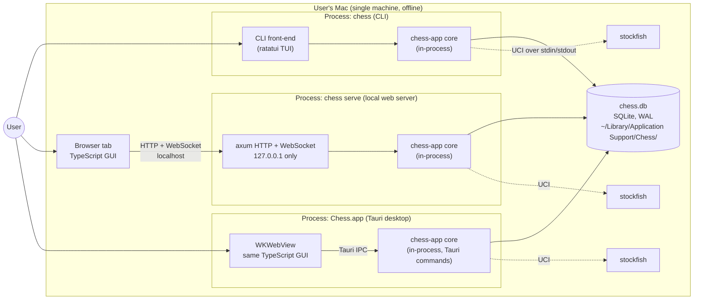
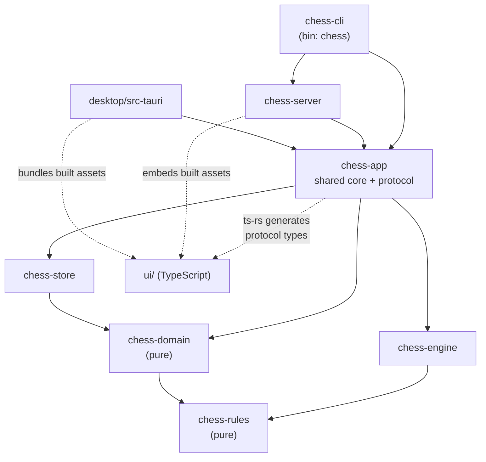
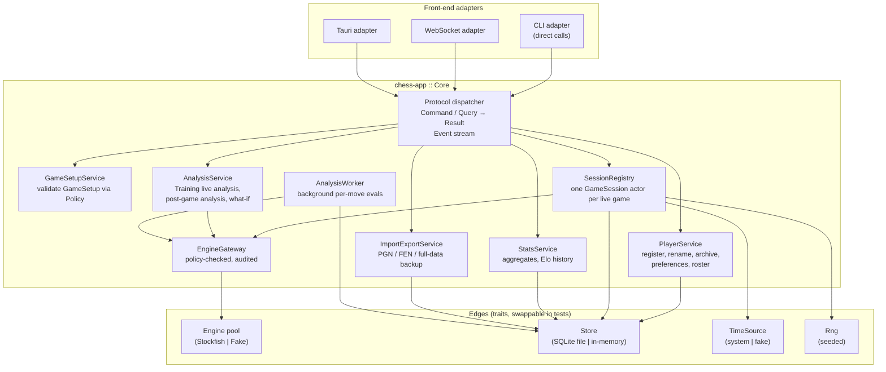
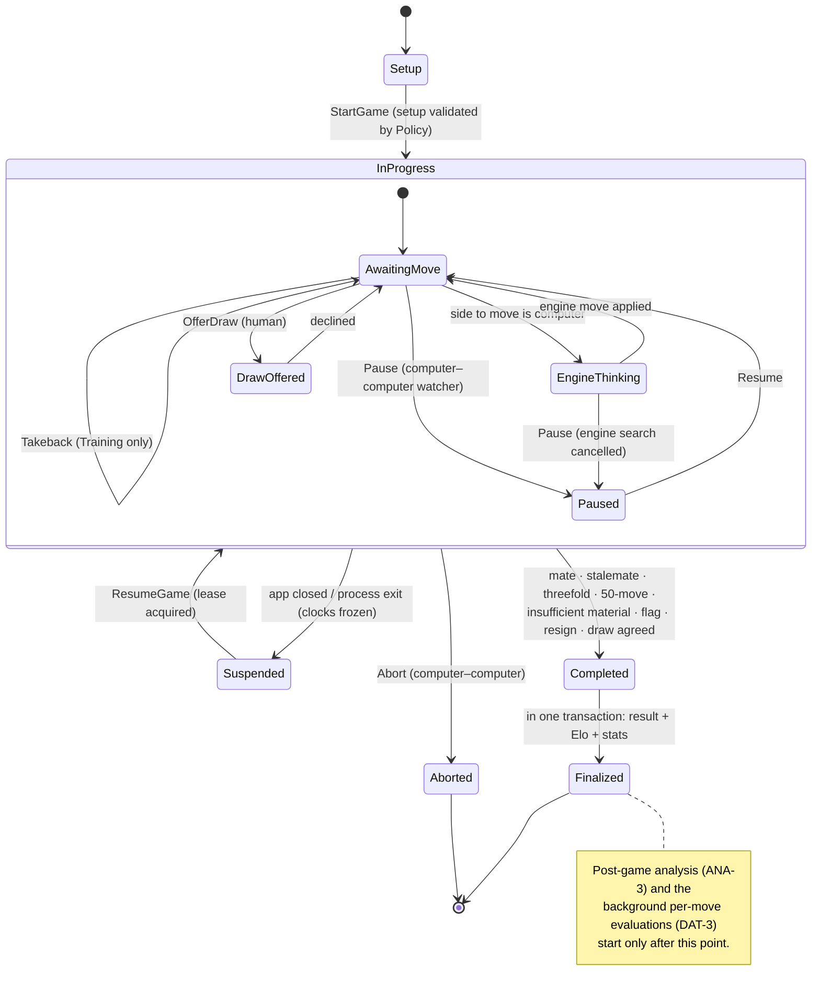
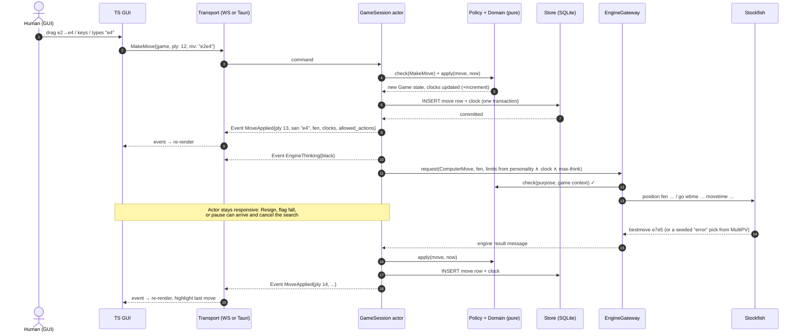
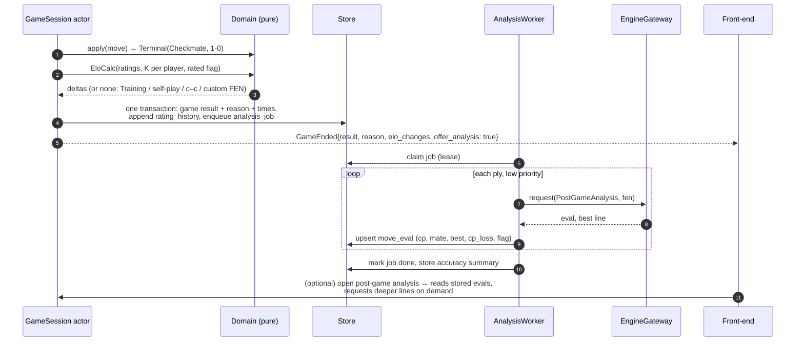
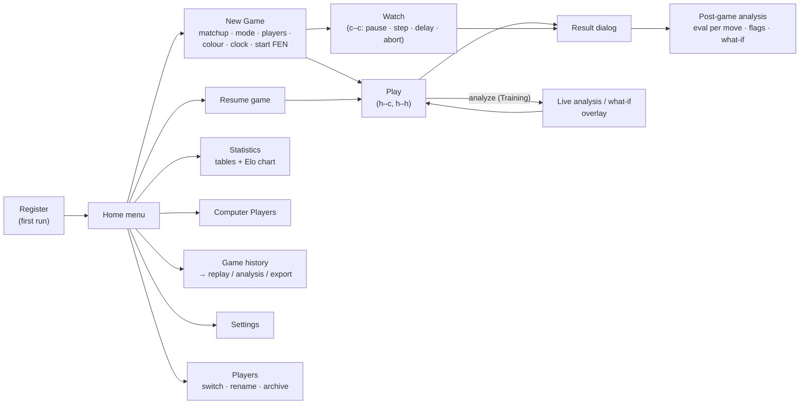
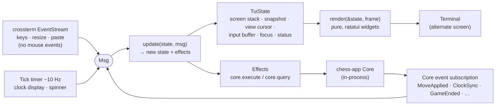
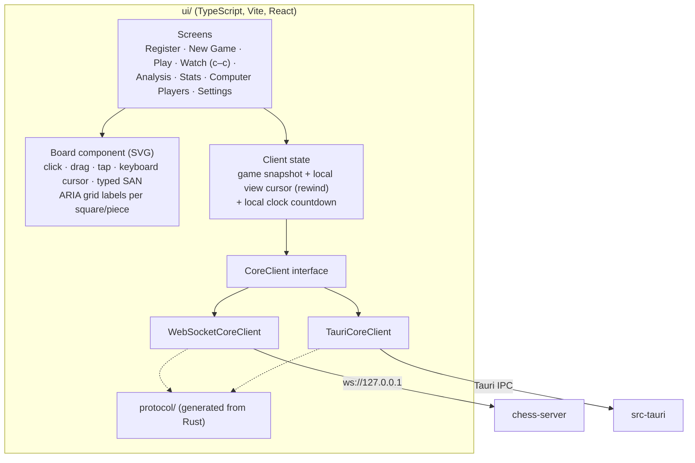
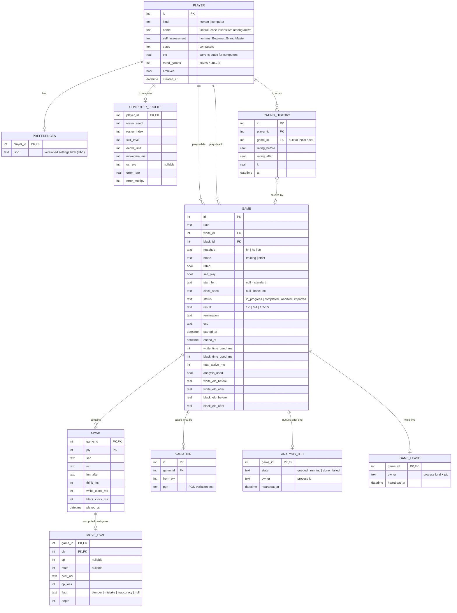

# Chess Application — Architecture

**Status (2026-10-25):** decisions D-1–D-3 and D-5–D-11 AGREED; **D-4 (GUI board) awaiting decision** (§11.1). Nothing here is implemented yet.
**Changes 2026-10-24 → 2026-10-25:**
- First draft created from the requirements and the user's stack choices.
- CLI changed to a full-screen ratatui TUI, keyboard only with typed moves and no mouse, plus plain and headless modes (§6.1, D-6).
- Offline operation for desktop, web, and CLI made explicit, with enforcement and tests (§8.1).
- Section 11 decisions recorded (§11.2); D-4 options compared in detail (§11.1).
**Anchors:** [requirements.md](requirements.md) (all AGREED) and [test-strategy.md](test-strategy.md).
**Status legend:** `AGREED` = confirmed by user · `PROPOSED` = suggested by Claude, awaiting decision.

### Inputs from the user (AGREED 2026-10-24)
| Topic | Decision |
|---|---|
| Language | Rust for the backend (all chess logic, engine control, persistence, servers, CLI). TypeScript for the GUI. |
| Desktop shell | Tauri. |
| Shared core | One core, shared by the CLI, web, and desktop front-ends. |
| CLI style | Full-screen, ratatui-style terminal UI (requirements CLI-1, amended). Keyboard only: moves are typed (no board cursor), and there is no mouse support. |

---

## 1. Architectural principles

1. **One Rust core owns every rule and decision.** Move legality, mode policy (Training/Strict), clocks, Elo, roster generation, game lifecycle, and persistence live in Rust. Front-ends render state and send intents; they never decide what is allowed. This is what makes "same scripted game in all three front-ends gives identical PGN" (PLAT-1) and "each front-end exposes exactly what the policy allows" (test-strategy principle 5) achievable.
2. **Functional core, imperative shell.** Pure crates (rules, domain) take data and return data. I/O — Stockfish processes, SQLite, wall-clock time, sockets, terminals — sits at the edges behind traits, so tests can swap in fakes (fake engine, fake clock, in-memory store).
3. **The engine is never exposed to a front-end.** Stockfish runs only inside the Rust process. Every engine request goes through one gateway that checks the request against the mode policy. Strict-mode integrity (ANA-1) is therefore enforced in one place, and a spy on that gateway proves it.
4. **One protocol, thin transports.** The core's API is a set of serializable commands, queries, and events. The CLI calls it in-process. The desktop app reaches it over Tauri IPC. The web UI reaches it over a localhost WebSocket. The TypeScript types are generated from the Rust types, so the two languages cannot drift apart.
5. **Every state change is durable before it is acknowledged.** Each move, clock update, and result is committed to SQLite (WAL mode) before the event is broadcast (NFR-2).

---

## 2. System context and deployment

Everything runs on the user's Mac. The desktop app, the web page, and the CLI all work with no Internet connection, including first launch (PLAT-3, §8.1), and nothing makes outbound connections (NFR-4).



Key points:
- **Three processes, one library.** Each entry point is its own OS process that links the same `chess-app` crate. There is no shared daemon. They coordinate only through the SQLite file (§7.3).
- **One `chess` binary** provides both the CLI (`chess`) and the web server (`chess serve`, which prints the URL and opens it in the default browser). That gives one thing to install on `PATH` (PLAT-1, NFR-5).
- **Stockfish runs as a native child process.** It is pinned to a specific release, built for arm64, and bundled next to the `chess` binary and inside `Chess.app` (as a Tauri sidecar). The WASM build is not needed, because the engine always runs in Rust, never in the browser.

---

## 3. Code organisation

### 3.1 Repository layout (PROPOSED)

```
chess/
├── Cargo.toml                 # Rust workspace
├── crates/
│   ├── chess-rules/           # board, move gen, SAN/UCI parse+format, FEN, PGN       (pure)
│   ├── chess-domain/          # game state machine, policy, clock, Elo, roster,       (pure)
│   │                          #   variation tree, stats aggregation, ASCII renderer
│   ├── chess-engine/          # Engine trait, UCI driver, Stockfish process pool,
│   │                          #   computer personalities, FakeEngine
│   ├── chess-store/           # SQLite schema, migrations, repositories, export/import
│   ├── chess-app/             # THE shared core: services, game session actors,
│   │                          #   engine gateway, protocol types (→ TS via ts-rs)
│   ├── chess-server/          # axum: static GUI assets + WebSocket protocol endpoint
│   └── chess-cli/             # bin "chess": ratatui TUI, plain mode, flags, `serve`
├── desktop/
│   └── src-tauri/             # Tauri shell: links chess-app, exposes commands/events
├── ui/                        # TypeScript GUI (Vite + React), shared by web & desktop
│   └── src/
│       ├── protocol/          # generated TS types (do not edit)
│       ├── transport/         # CoreClient interface + ws.ts + tauri.ts
│       ├── board/             # SVG board component (mouse, keyboard, typed, tap)
│       ├── screens/           # setup, play, analysis, stats, players, settings
│       └── themes/            # ≥10 board themes, ≥5 piece sets
├── e2e/
│   ├── scenarios/             # front-end-neutral scenario files (setup + moves + expected)
│   ├── cli/                   # PTY runner (vt100 screen parsing for the TUI)
│   └── gui/                   # Playwright runner (web + desktop)
├── third_party/stockfish/     # pinned version, build script, LICENSE, source offer
└── docs/
```

### 3.2 Crate dependency graph

Arrows point from a crate to the crates it depends on. Pure crates have no I/O dependencies.



### 3.3 Crate responsibilities

| Crate | Responsibility | Key types | Requirements |
|---|---|---|---|
| `chess-rules` | Positions, legal-move generation, check/mate/stalemate, draw detection, SAN and coordinate parsing (lenient: either case, optional `+ # x`, `0-0`), SAN formatting, FEN, PGN with variations. Proposed to wrap `shakmaty` + `pgn-reader` (GPL-3.0, already perft-verified) rather than writing move generation from scratch — see D-3. | `Position`, `Move`, `San`, `Fen`, `PgnGame` | RULE-1, CLI-3, RULE-5 |
| `chess-domain` | Game state machine; `Policy` (mode × matchup × state → allowed actions); `Clock` with an injected `TimeSource`; Elo calculator (K 40→32, no clamp, exclusions); class bands; seeded roster and personality generator; variation tree; stats aggregation; terminal-independent board renderer that produces a grid of styled cells (glyph, square shade, highlight) for each style (plain, Unicode, ANSI, no-color), used by both the TUI and plain mode. | `Game`, `GameSetup`, `Policy`, `Action`, `Clock`, `EloCalc`, `RosterGen`, `VariationTree`, `BoardGrid`, `BoardStyle` | PLY-1/5, GAME-1/3, RULE-2/3/4, ELO-1/2, PLY-4, ENG-2, ANA-2, UI-2/5, CLI-1/2, UI-3 |
| `chess-engine` | `Engine` trait; UCI driver over async stdin/stdout; process pool; timeouts, crash detection, restart; `Personality` → UCI options and search limits, plus seeded "random error" move selection; `FakeEngine` for tests. | `Engine`, `UciEngine`, `EnginePool`, `SearchLimits`, `Personality`, `FakeEngine` | ENG-1/2/3 |
| `chess-store` | SQLite access (`rusqlite`, bundled SQLite), WAL, busy timeout, versioned migrations with a pre-migration backup, repositories, game leases, analysis job queue, JSON/CSV/PGN export and import. | `Store`, `PlayerRepo`, `GameRepo`, `RatingRepo`, `JobQueue`, `Lease` | DAT-1/2/3, NFR-2 |
| `chess-app` | **The shared core.** Application services that combine domain, store, and engine. One actor per live game. `EngineGateway` (the only path to the engine, policy-checked). Background analysis worker. The protocol: `Command`, `Query`, `Event`, `Snapshot` DTOs. | `Core`, `GameSession`, `EngineGateway`, `AnalysisWorker`, `Command`, `Event`, `GameSnapshot` | all flow requirements |
| `chess-server` | axum app bound to `127.0.0.1`: serves the embedded GUI build, one WebSocket endpoint carrying the protocol, Host/Origin checks. | `serve(core, port)` | PLAT-1, DAT-1, NFR-4 |
| `chess-cli` | `chess` binary: argument parsing (`clap`); full-screen TUI (`ratatui` + `crossterm`) with screens, widgets, and an async event loop over the core; plain line-oriented mode; command/move/key disambiguation; scripted headless mode; `serve` subcommand. | `TuiApp`, `Screen`, `BoardWidget`, `InputLine`, `KeyMap`, `PlainRunner`, `InputParser` | CLI-1..4, UI-2/4, PLAT-1 |
| `desktop/src-tauri` | Tauri app: creates the `Core`, maps protocol commands onto Tauri commands, forwards events with `emit`, bundles the Stockfish sidecar. | — | PLAT-1, GUI-1 |

---

## 4. The shared core (`chess-app`)

### 4.1 Internal structure



### 4.2 Game sessions as actors

Each live game is one `GameSession`: a tokio task that owns that game's `chess_domain::Game` value. Commands reach it over an `mpsc` channel, and it publishes `Event`s on a `broadcast` channel. Every front-end — including two hot-seat humans on one screen — subscribes to the same stream.

- Commands are handled one at a time, so a game cannot race with itself: a human move, a flag falling, and an engine reply can never interleave.
- **Optimistic concurrency guards rewind (GAME-3).** Every move command carries the `ply` the client believes is current. If a client is rewound, or a computer move landed meanwhile, the `ply` does not match and the command is rejected with `StalePosition`. Rewind itself is purely client-side view state: the snapshot includes the FEN and SAN of every ply, so stepping back needs no engine and no server round trip, and it cannot touch the record.
- **Computer turns** are spawned as cancellable engine tasks whose results return to the actor as messages. The actor stays responsive while the engine thinks: a human can resign, a watcher can pause or abort, and a flag can fall (ENG-3, GAME-2).
- **Clocks** are domain values driven by an injected `TimeSource`. The actor arms a single timer for the active side's flag deadline. Clients receive `{white_ms, black_ms, running_side, as_of}` and count down locally, so there is no stream of tick events. The core alone decides when a flag falls.

### 4.3 Game state machine



### 4.4 Mode policy as a single table

`Policy::check(action, &GameContext) -> Result<(), Denied>` is a pure function and the single source of truth. `GameContext` holds the mode, matchup, game state, whose turn it is, whether that side is human or computer, and whether the game is still in progress.

| Action | Training (h–c) | Strict (h–c, h–h, c–c) |
|---|---|---|
| Takeback | ✅ to the human's turn | ❌ |
| Live analysis / what-if on the current game | ✅ human only | ❌ until the game ends |
| Rewind (client view) | ✅ human | ✅ human (either hot-seat human); ❌ c–c has no human player, but watchers may scroll the move list |
| Clock selection | ❌ always untimed | ✅ presets + custom |
| Offer draw | ✅ to the computer (eval ≤ 0 rule) | ✅ (h–h: to the other human; h–c: to the computer) |
| Pause / step / delay / abort | ❌ | c–c only |
| Rated | ❌ | ✅ unless self-play, custom FEN, or c–c |
| Post-game analysis | ✅ | ✅ |

Every `GameSnapshot` includes `allowed_actions`, computed from this table. Front-ends render controls from that list and never re-derive the rules themselves. The table drives (a) table-driven unit tests over the full mode × matchup × state product, and (b) per-front-end E2E checks that the visible controls match `allowed_actions` exactly.

### 4.5 Engine gateway and Strict-mode integrity

Every engine call passes through `EngineGateway::request(purpose, …)`, where:

```rust
enum EnginePurpose {
    ComputerMove { game_id, player_id },          // a computer side choosing its move
    ComputerDrawDecision { game_id, player_id },  // the "eval ≤ 0" check (RULE-2); result never shown
    LiveAnalysis { game_id },                     // Training only
    WhatIf { game_id },                           // Training live, or any finished game
    PostGameAnalysis { game_id },                 // finished games only
    Calibration,                                  // dev/nightly tooling
}
```

The gateway looks up the game's state and mode and calls `Policy::check` before it touches the engine. `LiveAnalysis` or `WhatIf` on an in-progress Strict game returns `Denied`, even if a modified client sends it directly over the WebSocket. Every call is recorded in an in-memory audit log, which is the "spy on engine calls" required by ANA-1's verification.

### 4.6 Computer Players

- **Roster generation** (pure, `chess-domain`): `RosterGen::new(seed)` produces 5 Players per class. Each gets a human-readable name and a `Personality { skill_level, depth_limit, movetime_ms, uci_elo: Option, error_rate, error_multipv }` drawn within the class bounds, plus a static Elo within the class band (Grand Master 2500–3000). Generation rejects duplicate parameter sets. The result is persisted once and never regenerated (PLY-4, ENG-2). "Generate more" continues the same deterministic stream.
- **Playing a move:** limits = min(personality movetime, the human's max-think-time preference (UI-1), a clock-derived budget). Classes in `UCI_Elo` range (≥ Stockfish's floor, about 1320) use `UCI_LimitStrength`. Beginner and Novice use a low `Skill Level`, shallow depth, and a random error: with probability `error_rate`, the core picks a non-best line from a MultiPV search. The RNG is seeded from `(game_id, ply)`, so replays are reproducible.
- **Calibration** is a separate `chess calibrate` dev subcommand (nightly CI). It plays matches between classes and reference settings and reports measured Elo and SPRT results against the assigned values.

### 4.7 Engine process management

| Use | Engine instances | Priority |
|---|---|---|
| Computer side(s) of a live game | One per computer side. Self-play c–c (same Player on both sides) gets two instances with identical options, so neither side shares the other's hash table. | Normal |
| Training live analysis / what-if | One shared analysis instance per process, `MultiPV 3` | Normal |
| Post-game analysis + background per-move evals | The same analysis instance; the background worker yields to interactive requests | Low (`nice`) |

Instances start lazily, which keeps CLI startup under 1 s (NFR-1). They are health-checked with `isready`, killed on timeout, and restarted transparently. If the binary is missing or crashes, the core emits `EngineUnavailable`, leaves the game in a resumable state (ENG-1), and lets the user retry or exit.

---

## 5. Protocol (front-end ↔ core)

One set of Rust types in `chess-app::protocol`, `serde`-serialized, with TypeScript types exported by `ts-rs` into `ui/src/protocol/`. A CI check fails if the generated files are stale.

### 5.1 Shape

| Kind | Examples |
|---|---|
| **Command** (changes state, returns `Result`) | `RegisterPlayer`, `RenamePlayer`, `ArchivePlayer`, `UpdatePreferences`, `GenerateComputerPlayers`, `StartGame(GameSetup)`, `ResumeGame`, `MakeMove{game_id, ply, mv}`, `Takeback`, `OfferDraw`, `RespondDraw`, `Resign`, `Pause`, `Resume`, `Step`, `SetMoveDelay`, `Abort`, `CancelEngine`, `ImportPgn`, `ImportFen`, `ImportData`, `SaveVariation` |
| **Query** (read-only) | `ListPlayers`, `GetPlayerStats{player_id}`, `GetRatingHistory`, `ListGames{filter}`, `GetGame`, `ExportPgn`, `ExportData`, `LegalMoves{fen}`, `Analyze{purpose, fen, multipv}` |
| **Event** (pushed, per game subscription) | `GameSnapshot` (full state on subscribe), `MoveApplied{ply, san, uci, fen, clocks, allowed_actions}`, `EngineThinking{side}`, `ClockSync`, `DrawOffered`, `GameEnded{result, reason, elo_changes}`, `AnalysisProgress`, `EngineUnavailable`, `LeaseLost` |

`GameSnapshot` carries everything a client needs to render and rewind without asking the server again: setup, players, every ply (SAN, UCI, FEN, timestamp, clock after the move), the current ply's legal moves (for highlighting and keyboard input), clocks, state, and `allowed_actions`.

### 5.2 Transports

| Front-end | Transport | Notes |
|---|---|---|
| CLI | In-process: `core.execute(cmd).await`, `core.subscribe(game_id)` | No serialization. |
| Web | One WebSocket at `ws://127.0.0.1:<port>/api`, JSON frames `{id, kind, body}` | Bound to loopback only. Rejects any `Host`/`Origin` other than `127.0.0.1:<port>` / `localhost:<port>` (blocks DNS rebinding and drive-by pages). |
| Desktop | Tauri `invoke("core", envelope)` + `listen("core-event")` | Same JSON envelope as the web, so the TS client differs only in its send/receive functions. No TCP port opened. |

In the UI, one `CoreClient` interface hides the difference:

```ts
interface CoreClient {
  execute<C extends Command>(cmd: C): Promise<ResultOf<C>>;
  query<Q extends Query>(q: Q): Promise<ResultOf<Q>>;
  subscribe(gameId: GameId, onEvent: (e: Event) => void): Unsubscribe;
}
// ui/src/transport/ws.ts    → WebSocketCoreClient
// ui/src/transport/tauri.ts → TauriCoreClient   (chosen at startup: window.__TAURI__ ?)
```

### 5.3 Example: human move then computer reply (Strict, timed)



### 5.4 Example: game end, rating, and background analysis



---

## 6. Front-ends

### 6.1 CLI (`chess`): ratatui terminal UI

The CLI is a full-screen terminal UI built with **`ratatui`** (rendering) and **`crossterm`** (terminal I/O, keys, resize). It is **keyboard only** (CLI-1/3, AGREED): moves are typed in algebraic notation, there is no board cursor, and mouse capture is never enabled — which also leaves the terminal's normal text selection and copy working. It links the core in-process like the other front-ends and follows the same rules as the GUI: it renders `GameSnapshot`s, shows only the controls in `allowed_actions`, keeps rewind as local view state, and counts clocks down locally from `ClockSync`.

#### Run modes

| Mode | Selected when | Behaviour |
|---|---|---|
| **TUI** (default) | stdin and stdout are terminals and no scripting flags are given | Alternate screen, raw mode, full-screen layout, live clocks and spinner |
| **Plain** | `--plain`, or stdin/stdout is not a terminal | Line-oriented transcript: board, last move, clocks, and prompt printed after each change. For screen readers (UI-4) and pipes. |
| **Headless** | scripting flags (`--matchup cvc --white … --black … --clock 5+0`) | No UI. Runs to completion, prints the PGN, and exits with a status code. Drives the cross-front-end scenario tests. |

All three modes share `InputParser` (command words, SAN, and coordinate moves) and the board renderer in `chess-domain`. That renderer produces a terminal-independent `BoardGrid`: per square, a glyph, a light/dark shade, and highlights (last move, check, rewound). The TUI's `BoardWidget` maps that grid to ratatui styles. Plain mode prints it as text lines. One snapshot suite therefore covers both modes (CLI-1/2, UI-3).

#### Play screen layout (80×24 minimum)

```text
┌ Chess ─ Strict · 5+0 · Rated ───────────────────────────────────── F1 help ┐
│    A  B  C  D  E  F  G  H        Black  Viktor Rook (Master 2310)   04:51  │
│ 8  ♜  ♞  ♝  ♛  ♚  ♝  ·  ♜  8     ⠿ thinking…                               │
│ 7  ♟  ♟  ♟  ♟  ·  ♟  ♟  ♟  7     ──────────────────────────────────────    │
│ 6  ·  ·  ·  ·  ·  ♞  ·  ·  6      1. e4      e5                            │
│ 5  ·  ·  ·  ·  ♘  ·  ·  ·  5      2. Nf3     Nf6                           │
│ 4  ·  ·  ·  ·  ♙  ·  ·  ·  4      3. Nxe5    …                             │
│ 3  ·  ·  ·  ·  ·  ·  ·  ·  3                                               │
│ 2  ♙  ♙  ♙  ♙  ·  ♙  ♙  ♙  2     ──────────────────────────────────────    │
│ 1  ♖  ♘  ♗  ♕  ♔  ♗  ·  ♖  1     White  Brian (1243)                04:38  │
│    A  B  C  D  E  F  G  H                                                  │
├────────────────────────────────────────────────────────────────────────────┤
│ Last: Nxe5 (White) · ←/→ rewind · End live · Tab focus · Esc clear         │
│ > _                                                                        │
└────────────────────────────────────────────────────────────────────────────┘
```

- The board panel sits on the left; the right panel holds the opponent, clocks, engine-thinking indicator, scrollable move list, and the bottom player. `flip` (or Black at the bottom) turns the board and its A–H/1–8 labels (CLI-2).
- The status line shows the last move, errors (e.g., "Illegal: Nf3 — no knight can reach f3"), the "live position has changed" badge while rewound (GAME-3), and context-sensitive key hints built from `allowed_actions`.
- The input line has editing, Up/Down history, and paste. Below 80×24 the whole screen is replaced by an "enlarge the terminal" message.

#### Screens



Each screen is a `Screen` implementation with its own state, key handling, and `render`. Forms (setup, settings, registration) use focusable fields where Tab/Shift-Tab moves and Enter confirms. Fields the policy disallows (e.g., Training for h–h, a clock in Training) are not offered (GAME-1). Statistics use ratatui's `Table`, `Chart`, and `Sparkline` widgets (UI-2, UI-5).

#### Event loop (Elm-style)



- **One `tokio::select!` loop** over terminal events, core events, and a tick. There are no blocking input threads, so engine moves, flag falls, and clock updates appear while the user is typing.
- **`update` is separate from `render`.** `update` can be unit-tested with synthetic `Msg`s and no terminal. `render` draws into a ratatui `TestBackend` for snapshot tests at fixed sizes.
- **Key routing (`KeyMap`, CLI-4).** Keys that can never start a move are bindings: ←/→ back/forward, End live, PgUp/PgDn move list, F1 help, Tab focus, Esc clear/cancel. Every printable character (letters, digits, `-`, `=`) goes to the input line. On Enter, `InputParser` resolves the text to a command word or a move. A unit test checks that no binding consumes a character that can begin SAN or coordinate notation. Because there is no board cursor, the arrow keys are reserved for rewind. The Watch screen has no move input, so it uses plain keys (Space, `s`, `+`/`-`, `a`).
- **Terminal hygiene.** A guard object enters raw mode and the alternate screen and restores both on `Drop`. A panic hook restores the terminal before printing the panic. Ctrl-C arrives as a key in raw mode and asks for confirmation before quitting. An in-progress game is already saved after every move, so quitting is always safe. Ctrl-Z restores the terminal, suspends via `SIGTSTP`, and redraws on `SIGCONT` (`signal-hook`).
- **Styles.** `BoardStyle` = plain ASCII, Unicode glyphs, ANSI colour, light/dark squares. With `NO_COLOR` or `--no-color`, no colour is emitted. The plain ASCII style also switches panel borders to an ASCII border set.
- **Startup (NFR-1).** The first frame is drawn before the engine starts; engines start lazily.

#### Subcommands

`chess` (TUI home), `chess play [setup flags]` (straight into a game), `chess serve [--port] [--no-open]`, `chess stats [player]` / `chess players` (open the TUI screen, or print tables in plain mode), `chess export|import`, `chess calibrate` (dev).

### 6.2 GUI (web and desktop, one codebase)



- **Framework:** React + TypeScript + Vite (AGREED, D-5): the largest ecosystem, mature testing tools (Testing Library, Playwright, axe), and good accessibility support.
- **Board:** our own SVG component (PROPOSED, D-4 — under review; options compared in §11.1). The keyboard model in GUI-2 (arrow cursor, Space to select, Enter to confirm, Esc to cancel, keyboard promotion picker) and the screen-reader labels in UI-4 are core requirements, and owning the component makes them straightforward. Themes are CSS custom properties for squares plus SVG piece sets; contrast ratios are checked by a unit test.
- **Rewind** is a local view cursor over the snapshot's ply list. While rewound, move input is disabled. The "live position has changed" badge appears when a `MoveApplied` arrives with the cursor behind live (GAME-3).
- **Elo chart:** a small charting dependency or hand-built SVG (decided at implementation time).

### 6.3 Desktop (Tauri)

- `src-tauri` creates the `Core` at startup, using the same data-directory resolution as the CLI. It registers one `core` command and forwards events.
- It bundles the Stockfish binary as a Tauri **sidecar**, plus the license notices.
- Packaging: an unsigned `.app`/`.dmg` for arm64 (PLAT-1), built with `cargo tauri build`.

---

## 7. Persistence

### 7.1 Technology

- **SQLite** through `rusqlite` with the `bundled` feature (no system dependency). Pragmas: `journal_mode=WAL`, `synchronous=NORMAL` (FULL for game-result transactions), `foreign_keys=ON`, `busy_timeout=5000`.
- **Location:** `~/Library/Application Support/Chess/chess.db`, overridable with `CHESS_DATA_DIR` (used by every test to isolate state).
- **Migrations:** numbered SQL files tracked with `PRAGMA user_version`. Before any migration, the file is copied with `VACUUM INTO chess.db.bak-v<N>`. Fixture databases for each released schema version are kept in the repo for migration tests (DAT-1).
- **Corruption:** on open, `PRAGMA quick_check`. If it fails, the app explains the problem, offers to restore the latest backup, and never overwrites the file silently.

### 7.2 Data model (PROPOSED)



Notes:
- **The `MOVE` rows are the source of truth.** The game state is rebuilt by replaying them from `start_fen`. PGN is produced on export, not stored redundantly (imported PGN headers go in a small `game_tags` table, omitted from the diagram).
- **Stats are SQL queries/views** filtered with `self_play = 0 AND status = 'completed'` for aggregates, while history lists include everything (UI-2, UI-5). Computer Players' W/L/D use the same queries.
- **Rating history is append-only.** The initial row is written at registration. An integration test asserts `elo == initial + Σ deltas` (ELO-1).
- **Time accounting (DAT-3):** `think_ms` per move and the per-side totals come from the session's `TimeSource` while the game is live. Time while the app is closed is never counted, because a suspended game has no running clock.

### 7.3 Multi-process coordination

The CLI, web server, and desktop app can all be open at once against the same file.

- **Writes** are short transactions, and WAL plus `busy_timeout` serialise them safely across processes (concurrent-access integration test for DAT-1).
- **Live games** are owned by exactly one process through a `GAME_LEASE` row, renewed every few seconds. Opening the same in-progress game elsewhere shows "this game is open in the CLI". If the heartbeat is stale (the owner crashed), the lease can be taken over — which is also how resume-after-kill works (RULE-5).
- **The background analysis queue** uses the same lease idea, so whichever process is running picks up pending jobs, and jobs survive restarts.
- Other screens (stats, player lists) re-query when they are opened. No cross-process push is needed in v1.

---

## 8. Cross-cutting concerns

| Concern | Approach | Requirements |
|---|---|---|
| Error handling | Rust: `thiserror` per crate, mapped at the protocol boundary to `{code, message, details}`. Front-ends show `message` and branch on `code` (e.g., `IllegalMove`, `StalePosition`, `Denied{reason}`, `EngineUnavailable`). | CLI-3, ENG-1 |
| Logging | `tracing` to a rotating file in the data dir. Off-device telemetry: none. | NFR-4 |
| Offline | No run-time Internet access anywhere; everything bundled; CSP enforces it. Details in §8.1. | PLAT-3 |
| Privacy / network | The web server binds to loopback only. A test runs a full session under a network-capture harness and asserts zero outbound connections. | NFR-4 |
| Determinism | `TimeSource` and `Rng` are injected everywhere. Engine tests use `Threads=1`, a fixed hash size, and fixed depth. | test-strategy |
| Licensing | Project licensed **GPL-3.0-or-later** (needed for distributed builds that bundle Stockfish; compatible with `shakmaty`). `cargo-deny` and an npm license checker in CI. Stockfish `COPYING` + source offer shipped in every artifact. | ENG-1, NFR-6 |
| Performance | Engines start lazily. SQLite opens in a few ms. The GUI is a static bundle, embedded in the server binary with `rust-embed`. Benchmarks are run in CI for startup and engine latency. | NFR-1, ENG-3 |
| Accessibility | GUI: ARIA grid board, live region announcing moves, focus ring, axe in E2E. CLI: the full-screen TUI is not reliably screen-reader friendly, so plain mode (`--plain`, automatic off-TTY) is the accessible path; `NO_COLOR` honoured in both. | UI-4 |

---

### 8.1 Offline operation (PLAT-3)

All three entry points must be fully usable with no Internet connection, from first launch. The architecture has no component that needs the network at run time. The table below lists every run-time dependency and how it is satisfied locally.

| Run-time dependency | How it is satisfied offline |
|---|---|
| Chess rules, game logic, Elo, clocks | Compiled into the Rust binaries (`chess`, `Chess.app`). |
| Engine (Stockfish) | Native binary bundled next to `chess` and inside `Chess.app` (D-9). Official Stockfish builds embed their NNUE network file, so no network file is downloaded. The pinned build is verified to start with networking disabled. |
| Data store | Local SQLite file in `~/Library/Application Support/Chess/`. Created on first launch; roster generated from a fixed seed. No account or server. |
| GUI code, styles, fonts | Vite builds a self-contained bundle: all JS/CSS, fonts (self-hosted, no Google Fonts), board themes, and SVG piece sets. Embedded into the `chess` binary (`rust-embed`) for the web, and bundled into `Chess.app` for desktop. No CDN references. |
| Web page transport | `chess serve` serves the bundle and the WebSocket on `127.0.0.1`. Works with Wi-Fi off, because loopback never leaves the machine. |
| Desktop transport | Tauri IPC in-process (D-1); no socket at all. |
| Help / documentation | Rendered from files shipped with the app (TUI help screen, GUI help page). External links (e.g., Stockfish source offer) are shown as text and never fetched automatically. |
| Updates, telemetry, crash reporting, license checks | None. The Tauri updater plugin is not included. |
| macOS launch checks | The desktop app is a locally built, unsigned build (PLAT-1). Built on the same Mac, it carries no quarantine attribute, so Gatekeeper's online check doesn't apply. |

**Enforcement, so offline can't silently regress:**
- **Content-Security-Policy** `default-src 'self'; connect-src 'self' ws://127.0.0.1:*` (web) and the equivalent Tauri `csp` config (desktop). Any accidental remote script, font, or image fails to load, and the E2E suite catches it.
- **Bundle scan in CI:** fails if the built GUI contains `http(s)://` resource references outside an allow-list (license texts, documentation links shown as text).
- **Offline E2E:** the PLAT-3 scenario (clean profile → register → timed game vs. a computer → post-game analysis → stats → export) runs for desktop, web (three browsers), and CLI with non-loopback networking blocked, under the NFR-4 network-capture harness.

**Build vs. run:** building from source needs the Internet once (crates, npm packages, the pinned Stockfish download in D-9). Running never does. If fully offline builds are wanted later, `cargo vendor`, an npm offline mirror, and a cached Stockfish archive cover that without architectural change.

## 9. Testing architecture (mapping test-strategy onto this design)

| Test level | Where | Tools |
|---|---|---|
| Unit | `chess-rules`, `chess-domain` (perft, SAN tables, Policy table, Elo vectors, clock with fake time, roster determinism, variation tree, `BoardGrid` snapshots); `chess-cli` (TUI `update` with synthetic messages, `render` into ratatui `TestBackend` at 80×24 and larger, key-map vs. SAN collision test) | `cargo test`, `proptest`, `insta` (snapshots), `cargo-mutants` (Elo, Policy) |
| Property / fuzz | random legal playouts; `parse(format(m)) == m`; arbitrary CLI input; protocol fuzzing at the WebSocket | `proptest`, `cargo-fuzz` |
| Core integration | `chess-app` with `FakeEngine` + in-memory or temp-file store: full game flows, Strict gateway spy, rewind/stale-ply rejection, lease takeover, crash-recovery (kill child process mid-write) | `tokio::test`, temp dirs |
| Engine integration | real Stockfish: UCI handshake, legal `bestmove`, tactics fixtures, crash/timeout recovery, latency | gated by `--features stockfish-tests` |
| CLI E2E | scenario files replayed through a PTY: TUI screens asserted by parsing the terminal output into a virtual screen; resize; terminal restored after quit/Ctrl-C/panic; plain mode as a transcript and via pipe; headless mode | `expectrl` + `vt100` (Rust) |
| GUI E2E (web) | same scenario files through the browser | Playwright: Chromium, WebKit, Firefox; axe; screenshot diffs per theme |
| GUI E2E (desktop) | same GUI suite against the Tauri app — **see risk R-1** | Playwright WebKit against a Tauri dev build plus a scripted smoke test of the real `.app` |
| Calibration / soak | `chess calibrate`; 1000-game c–c soak | nightly CI |

The same scenario format (`e2e/scenarios/*.yaml`: setup, inputs, expected PGN/result/visible controls) feeds the CLI and GUI runners, which gives "one scenario, three front-ends" (test-strategy principle 3, PLAT-1). Test names carry requirement IDs for the traceability matrix.

---

## 10. Requirements traceability (component view)

| Requirement group | Primary components |
|---|---|
| PLAT-1/2/3 | `chess-cli` (+ `serve`), `chess-server`, `desktop/src-tauri`, bundled Stockfish |
| PLY-1..5, GAME-1 | `chess-domain::{GameSetup, Policy}`, `GameSetupService`, setup screens / CLI flags |
| GAME-2 | `GameSession` (pause/step/delay/abort), Watch screen |
| GAME-3 | client view cursor + `ply` optimistic check in `GameSession` |
| RULE-1 | `chess-rules` |
| RULE-2/3 | `chess-domain::Game`, `GameSession`, `EngineGateway(ComputerDrawDecision)` |
| RULE-4 | `chess-domain::Clock`, `GameSession` timer, client countdown |
| RULE-5 | `GAME`/`MOVE` tables, `GAME_LEASE`, `ImportExportService` |
| ENG-1/2/3 | `chess-engine`, `RosterGen`, `EngineGateway`, `chess calibrate` |
| DAT-1/2/3 | `chess-store`, `ImportExportService`, `AnalysisWorker` |
| ELO-1/2 | `chess-domain::EloCalc`, finalize transaction, `RATING_HISTORY` |
| UI-1..5 | `PlayerService`, `StatsService`, GUI screens, CLI `stats`/`players`, themes, ASCII renderer |
| ANA-1/2/3 | `AnalysisService`, `EngineGateway`, `VariationTree`, `MOVE_EVAL` |
| CLI-1..4 | `chess-cli` (`TuiApp`, screens, `KeyMap`, `PlainRunner`), `chess-domain::BoardGrid`, `InputParser` |
| GUI-1..4 | `ui/`, `CoreClient` transports |
| NFR-1..6 | §8 cross-cutting, §9 testing |

---

## 11. Decisions

| ID | Decision | Recommendation | Alternatives / trade-off | Status |
|---|---|---|---|---|
| D-1 | How the desktop app reaches the core | Link `chess-app` in-process; Tauri IPC with the same envelope as the WebSocket | Desktop starts the embedded axum server and loads `http://127.0.0.1:<port>`: one transport everywhere and identical E2E paths, but it opens a port and is less idiomatic Tauri | AGREED 2026-10-25 |
| D-2 | Process topology | Each entry point embeds the core; coordination through SQLite leases | A single background daemon (launchd) that all front-ends talk to: one engine pool and live cross-process updates, but more moving parts and a daemon lifecycle to manage | AGREED 2026-10-25 |
| D-3 | Move generation | Wrap `shakmaty` + `pgn-reader` (GPL-3.0, mature, fast, perft-verified) | Write our own in `chess-rules`: full control and a learning exercise, but weeks of work and the risk of subtle rule bugs; perft tests still apply either way | AGREED 2026-10-25 |
| D-4 | GUI board | Own SVG board component, for full control of keyboard and a11y | `chessground` (Lichess, GPL-3.0), used directly or with our own keyboard/a11y layer on top. Full comparison in §11.1 | PROPOSED — under review |
| D-5 | UI framework | React + TypeScript + Vite | Svelte or SolidJS: smaller and faster, with a smaller testing/a11y ecosystem | AGREED 2026-10-25 |
| D-6 | CLI style | Full-screen TUI with `ratatui` + `crossterm`, Elm-style update/render; plain mode for screen readers and pipes; headless for scripts | — (decided by the user; requirements CLI-1 amended) | AGREED 2026-10-24 |
| D-7 | Rust ↔ TS type sharing | `ts-rs` | `specta` / `tauri-specta`: tighter Tauri integration, but less useful on the WebSocket path | AGREED 2026-10-25 |
| D-8 | Web server lifecycle | `chess serve` started by the user (prints and opens URL) | A launchd agent that is always running, so the URL "just works" | AGREED 2026-10-25 |
| D-9 | Stockfish acquisition | Pin one release; a build script downloads and checksums it at build time and bundles it (run time stays offline, §8.1) | Require `brew install stockfish` and find it on `PATH`: simpler builds, worse install story | AGREED 2026-10-25 |
| D-10 | Project license | GPL-3.0-or-later | Required only if builds are distributed; local-only use doesn't trigger GPL obligations, but choosing now avoids relicensing | AGREED 2026-10-25 |
| D-11 | Legal-move lookups for what-if branches | Ask the core (`LegalMoves{fen}` query; localhost round trip ≪ 1 ms) | Compile `chess-rules` to WASM for the UI: no server round trip, but a second build target and logic in two places | AGREED 2026-10-25 |

### 11.1 D-4 in detail: the GUI board component

**What the board must do (from AGREED requirements).**
- Mouse click-to-move and drag-and-drop, plus touch tap-to-move on the web (GUI-2).
- Keyboard: arrow-key cursor, Space to select, arrows to choose a destination, Enter to confirm, Esc to cancel, a keyboard-operable promotion picker. Selection without legal moves gives feedback (GUI-2).
- **Mixed input mid-move:** select with the mouse and confirm with Enter, or the reverse (GUI-2 verification). This means mouse, touch, and keyboard must share **one** selection state.
- Typed algebraic input next to the board (GUI-2c).
- Highlights for last move, check, and legal destinations; coordinates toggle; flip (GUI-3/4).
- Screen-reader labels for squares, pieces, and moves; visible focus; contrast-checked themes (UI-4), verified with axe and a VoiceOver walk-through.
- ≥10 board themes and ≥5 piece sets including high-contrast (UI-3), with screenshot tests.
- Read-only display while rewound, and an analysis/what-if board (GAME-3, ANA-2).

**The options.**

**A. Our own React + SVG board.** The board is a React component that renders an 8×8 SVG (or CSS-grid) layout directly from the `GameSnapshot` and a small local `BoardState` (cursor, selection, drag). Each square is a focusable cell in an ARIA grid.

**B. `chessground` used directly.** [chessground](https://github.com/lichess-org/chessground) is the board library from Lichess: TypeScript, GPL-3.0-or-later, framework-agnostic (it manages its own DOM inside an element you give it). It handles drag-and-drop, click-to-move, touch, animations, premoves, arrows/circles, coordinates, orientation, and highlights. You configure it with `Chessground(el, config)` and update it with `cg.set({...})`.

**C. Hybrid: `chessground` for visuals and pointer input, plus our own keyboard and accessibility layer.** chessground renders and handles mouse/touch. We add a keyboard cursor (drawn with chessground's shape API or a CSS overlay) that drives chessground through `selectSquare`/`move`, and a visually hidden ARIA grid that mirrors the position for screen readers.

| | **A. Own React + SVG** | **B. chessground directly** | **C. Hybrid** |
|---|---|---|---|
| Drag-and-drop, touch, animation polish | Must build it: pointer events with pointer capture, a ghost piece, snap-back, piece-slide animation. Achievable, but this is where most of the effort and the "feels cheap" risk sit. | Excellent and battle-tested on millions of Lichess games. | Excellent (from chessground). |
| Keyboard model of GUI-2 | Built exactly to spec. | **Not provided.** chessground has no keyboard cursor or focus model. (Lichess offers keyboard input as a separate text box, and blind users get a separate non-visual UI rather than the board.) Fails GUI-2b as is. | Built by us on top, but it must stay in sync with chessground's internal selection. |
| Mixed mouse + keyboard in one move | Natural: one React selection state that every input method updates. | Not possible without the keyboard layer. | Possible, but there are two sources of truth: chessground's internal `selected` square and our cursor state. Every event must be mirrored both ways. This is the main source of subtle bugs. |
| Screen readers (UI-4) | Squares are real ARIA grid cells with labels ("e4, white pawn, legal destination"); live region announces moves. Native and testable with axe. | Pieces are generic DOM elements without ARIA roles or labels. Fails UI-4 as is. | A hidden ARIA grid parallel to the visual board. It works, but it is two boards to keep consistent, and focus is on the hidden grid while sighted keyboard users look at the visual one. |
| Fit with React and our data flow | Declarative: render(snapshot) → board. No imperative sync; rewind and analysis boards are just different props. | Imperative: a `useEffect` wrapper calls `cg.set` on every change. Community React wrappers exist but are thinly maintained. State lives in two places (our snapshot and chessground). | Same imperative wrapper as B, plus the keyboard layer. |
| Legal moves and promotion | We already have legal moves in the snapshot; we draw destinations and a promotion picker (needed for keyboard anyway). | Takes legal destinations via `movable.dests` (easy from our snapshot). **No promotion picker** — we build it regardless. | Same as B. |
| Themes (UI-3) | CSS variables for squares, swappable SVG piece sets. Full control. | Themeable through CSS and piece CSS classes; Lichess uses it with many themes. Fine. | Same as B. |
| Testability (Playwright, axe, screenshots) | Stable, semantic selectors (`role=gridcell[name="e4…"]`); axe runs cleanly. | Drag tests need synthetic mouse events on chessground's DOM; axe will flag the unlabeled board. | Two DOMs to assert against; drag tests as in B. |
| Licence | Ours (GPL-3.0-or-later per D-10). | GPL-3.0-or-later: compatible with D-10. | Same as B. |
| Dependency risk | None beyond React. | One well-maintained dependency, tied to Lichess's priorities and release cycle. | Same as B, plus coupling to chessground internals (`selected`, shapes) that may change between versions. |
| Rough effort (board only) | Highest initial effort: roughly 1–2 weeks for drag, touch, and animation polish on top of the keyboard/a11y work every option needs. | Lowest to get a pretty board, but it doesn't meet GUI-2b/UI-4, so it is not acceptable alone. | Middle: chessground's polish, but the keyboard and a11y work is about the same as in A, plus sync logic. |

**What every option needs anyway.** Piece-set and board-theme assets with compatible licences (several Lichess piece sets have different licences, so each set gets a licence audit), a promotion picker, the typed-SAN input box, and keyboard/a11y E2E tests.

**Recommendation: A (own React + SVG board).** The agreed keyboard model, mixed-input requirement, and screen-reader requirement are where options B and C are weakest, and those requirements have explicit E2E and axe tests. With A, the keyboard and accessibility come built in rather than layered on top, there is one selection state, and the board is a pure function of the snapshot. The cost is building drag-and-drop and animation polish ourselves. To contain that risk, build the board early, behind a `Board` props interface, with its own Playwright and axe tests. If the drag polish turns out poor, switching that layer to C stays possible without touching the rest of the UI.

### 11.2 Decision log

| Date | Decision | IDs |
|---|---|---|
| 2026-10-24 | Rust backend, TypeScript UI, Tauri desktop, one shared core. | inputs |
| 2026-10-24 | CLI is a full-screen ratatui TUI, keyboard only, with plain and headless modes. | D-6 |
| 2026-10-25 | Accepted recommendations: in-process core with Tauri IPC (D-1); each entry point embeds the core, coordination via SQLite (D-2); `shakmaty` + `pgn-reader` (D-3); `ts-rs` (D-7); `chess serve` started by the user (D-8); pinned, bundled Stockfish downloaded at build time (D-9); GPL-3.0-or-later (D-10); legal-move lookups via the core (D-11). | D-1–D-3, D-7–D-11 |
| 2026-10-25 | React + TypeScript + Vite for the GUI. | D-5 |
| 2026-10-25 | Offline operation for desktop, web, and CLI made an explicit, tested v1 requirement; architecture confirmed to have no run-time network dependency (§8.1). | PLAT-3 |

## 12. Risks

| ID | Risk | Mitigation |
|---|---|---|
| R-1 | **`tauri-driver` (WebDriver) does not support macOS**, so "same E2E suite against the desktop shell" (GUI-1) can't use the standard Tauri E2E path on our only platform. | Run the full GUI suite in Playwright **WebKit** (same engine family as WKWebView) using the Tauri transport against a test harness, plus a scripted smoke test of the real `.app`. (D-1's rejected alternative — loading the UI from the local server — would have let the desktop app be driven exactly like the web app.) Revisit if Tauri adds macOS WebDriver support. |
| R-2 | Beginner/Novice strength (400/600) is below Stockfish's limiter; calibration may take several iterations. | Personality parameters live in data, not code; `chess calibrate` runs nightly; bands are adjusted without schema changes. |
| R-3 | Concurrent writers across three processes. | Short transactions, WAL, `busy_timeout`, leases; concurrency integration test in CI. |
| R-4 | GPL obligations if the app is ever distributed. | Choose GPL-3.0-or-later now (D-10); license audit in CI. |
| R-5 | Localhost web server reachable by other local apps or malicious web pages. | Loopback bind, strict Host/Origin checks, no CORS. Optional per-launch token in the URL if we want more. |
| R-6 | Full-screen TUIs read poorly with screen readers, and terminal state can be left broken on crashes. | Plain mode is a first-class, tested mode (automatic off-TTY); restore guard + panic hook + signal handling, each covered by a PTY test. |
| R-7 | Unicode chess glyph widths vary across terminal fonts, which can misalign the board. | Fixed cell width per square with padding; plain ASCII style always available; snapshot tests per style; manual check in Terminal.app and iTerm2. |

## 13. Next steps

1. Decide D-4 (§11.1).
2. Then: workspace skeleton, `chess-rules` + `chess-domain` with their unit tests first (the test-first core), followed by `chess-store`, `chess-engine`, `chess-app`, the CLI, and finally the GUI and shells.
