# Chess Application — Architecture

**Status: Baselined v1.0, 2026-10-26.** Every decision is AGREED except D-21 (DEFERRED, two-way, decided at implementation). ASM-1 is CONFIRMED. All three rounds of the user's answers are applied, and every question this document raised for the user is answered (§14). Nothing here is implemented yet.

**Amended 2026-10-27 (v1.0 amendment 1, user decisions; nothing renumbered):** a reset is allowed while the Player has unfinished games, and voids them (D-26, D-30, OQ-8 and G-20 closed). Stockfish 19 (`sf_19`) is the pinned engine (D-9, TBD-26 closed). One new non-blocking question for the user: Q-A18 (the architect's interpretation of how a voided game is shown, with a working default). See the change log below and §11.2.

**What remains open at baseline** (none of these needs a user decision; each has an owner and a closing step in §14):
- D-4 board spike, 2 days, the first GUI task (§11.1). Owner: GUI developer.
- Measurements on the M4 baseline: the §4.8 timeouts and the journal flush cost (ASM-2), and NFR-8 input latency. Owner: core developer, implementation step 2.
- Two facts about the pinned Stockfish 19 that could not be checked without downloading and running it (ASM-3, narrowed 2026-10-27): whether the official `stockfish-macos-universal` asset contains both arm64 and x86_64 slices, and its `UCI_Elo` floor and range. Owner: architect. The first run of the engine build script (step 2) closes it.
- Terminal resize behaviour in Terminal.app and iTerm2 (ASM-4, R-16). Owner: CLI developer, step 2.
- ECO opening-table source and its license (G-15, D-20). Owner: architect, step 1.
- The exact browserslist query for "the last 3 years" (§8.2). Owner: GUI developer, step 3.
- TBD-18: the wording of the screen-reader announcements; the events are fixed in §8.3. Owner: GUI developer, step 3.
- Tauri's sidecar naming rule for a universal target (OQ-11, split out of ASM-3 on 2026-10-27), checked against the pinned Tauri version when packaging is set up (§8.2). Owner: architect, step 3.
- D-21 (Elo chart library), DEFERRED.

**Diagrams:** Mermaid not machine-validated, because Node.js is not available on this machine. All 12 baseline diagrams were hand-checked once more on 2026-10-26 against the architecture-governance syntax rules (§6.1–§6.6 of that skill): quoted labels, no bare `end`, no `;` in sequence messages, labelled ER relationships, and balanced blocks. On 2026-10-27 the changed diagrams (the §4.3 statechart and the §7.2 ER diagram) and the new 13th diagram (the §7.2 reset sequence) were hand-checked against the same rules. That is a hand check only, not a parser run. Run `node <architecture-governance>/scripts/validate-mermaid.mjs docs/architecture.md` once Node.js is installed.

**Changes 2026-10-24 → 2026-10-26:**
- First draft created from the requirements and the user's stack choices.
- CLI changed to a full-screen ratatui TUI, keyboard only with typed moves and no mouse, plus plain and headless modes (§6.1, D-6).
- Offline operation for desktop, web, and CLI made explicit, with enforcement and tests (§8.1).
- Section 11 decisions recorded (§11.2).
- D-4 decided after two trade studies ([first pass](trade-study-gui-board.md), [refined](trade-study-gui-board-refined.md)): chessground + shared keyboard/accessibility overlay, with react-chessboard (patched) as the fallback (§6.2, §11.1).
- 2026-10-26: all diagrams reviewed against the requirements and decisions. Added: offline boundary, bundled Stockfish, CLI modes (§2); third-party dependencies (§3.2); Policy and event stream (§4.1); step, engine error, and draw rule (§4.3); board revert path (§5.3); full screen lists (§6.1, §6.2); clock checkpoint and `GAME_TAG` (§7.2); fallback adapter (§11.1).
- 2026-10-26, architecture review (traceability and completeness):
  - New sections: concurrency and threading model with timeouts (§4.8); error catalogue, protocol reliability (reconnect, idempotency, versioning), and internal interface contracts including PGN/FEN I/O (§5.5–§5.7); data ownership and transaction boundaries, and schema version skew (§7.4, §7.5); deployment and packaging (§8.2); accessibility details (§8.3); open items (§14).
  - Expanded: Policy table (Resign, CancelEngine), engine-move legality check, and `Calibration` scope (§4.4–§4.7); state machine (takeback during an engine search, pause freezes clocks, D-14/D-15 hooks; §4.3); protocol commands and events (§5.1); §5.3 (the engine reply happens only after an accepted move); §5.4 (post-game analysis goes through `AnalysisService`); CLI run-mode rule (§6.1); GUI settings effects (§6.2); `APP_SETTING` and notes on imported games (§7.2); `ui/` row and requirement IDs in §3.3.
  - §10 rewritten as a per-requirement allocation, with reverse (orphan) checks and requirement gaps. The systems engineer's PROPOSED requirements of the same day (PLAT-4, PLY-6, ENG-4, DAT-4–6, UI-6–9, ANA-4, CLI-5, GUI-5, NFR-7–9, IF-1–5) are allocated provisionally. Values are proposed for the TBDs assigned to the architect, and gaps are linked to their Q41–Q56.
  - §11: decisions D-12–D-22 added; consequences and revisit triggers for every decision (§11.3); study option "D1" renamed so it can't be mistaken for decision D-1. §12: risks R-9–R-12 added, R-2 mitigation corrected.
  - Marked as dependent on undecided requirements, without resolving them: Q41 (computer Elo), Q42 (draw offers), Q54/TBD-7/TBD-23 (durability tolerance; the `synchronous` pragma and checkpoint interval are placeholders), and the Ctrl-C confirmation. ECO table and sound assets added to the §8.1 offline table. TBD-1 input given (§10.1).
- 2026-10-26, user answers Q41–Q55 applied:
  - Dynamic Elo for computers with fixed engine parameters (Q41); humans offer draws, computers never do (Q42); room for future network play (§8.4, Q43).
  - Universal Intel + arm64 build, Tahoe minimum, M4 baseline, supported browsers and terminals (§8.2, Q46/Q47).
  - Profile chooser, 128-character unique names, confirmed reset (Q48); one unfinished game per mode (Q49). *(Superseded the same day: humans can only resign, which is a loss; abort exists only for a c–c watcher and has no effect on stats.)*
  - Merge import and missing-store flow (D-17, Q51); themes that follow the system, sound toggle, confirmations, English only (Q52); clock keeps running during engine failure (D-15, Q53).
  - Move journal so no completed move is ever lost (§7.6, D-23, Q54); `synchronous=FULL` + `fullfsync`.
  - Port precedence and config file (D-24), fluid GUI, TUI auto-resize (Q55).
  - New risks R-13–R-16, decisions D-23–D-27, gaps G-16–G-18, and follow-up questions Q-A1–Q-A12 (§14).
- 2026-10-26, second round of user answers applied:
  - Computer category follows its rating, the K-factor is shared, and c–c games are rated. Two Elo tracks (Training, Strict) for every Player (D-28), with Training games in W/L/D.
  - Interruptions are never aborts. Humans end games only by Resign (h–h asks which side). Abort is for the c–c watcher only, with no effect. State machine and Policy table rewritten.
  - One unfinished game per Player per mode (`UNFINISHED_SLOT`, D-27). Reset clears everything except Elo, humans only (D-26). Names unique case-sensitively, identity by UUID.
  - No confirm-move and no sound; move commit rules stated (§6.2). A tab close suspends immediately (D-14).
  - Platform: Tahoe and later on M1+, Intel while Apple supports it, browsers from the last 3 years. Max-think time comes from the active profile (§4.6). One bundle with the CLI inside (D-16 simplified, D-18 revised). Port scope settled. TUI fixed at 80×24 with a resize attempt.
  - Average length in moves and time. Export is one zip archive (D-29). High contrast = WCAG AA.
  - Traceability now covers GAME-4, PLY-7, UI-10, UI-11, RISK-1/2. A leftover duplicate timeout table in §4.8 was removed. R-17 added.
  - Mermaid not machine-validated: no Node.js was available. Diagrams were hand-checked against the governance syntax rules.
- 2026-10-26, final answers applied and **baselined as v1.0**:
  - Reset (D-26): the Player's old games stay in opponents' history and stats. They are hidden only from views of the reset Player, and a reset point starts that Player's rating history again (§7.2, §7.4).
  - Unfinished games (D-27): a human–computer game never uses a computer's slot, so any Player can always play any computer. Slots are held by each human Player, and by computers only in c–c games (Strict). Policy table, §7.2, §7.4, and §5.5 revised.
  - Computers have a Training Elo that changes in Training games. The K = 40 count is kept per track (`strict_rated_games`, `training_rated_games`), and a computer's category label follows its Strict Elo.
  - All PROPOSED decisions are AGREED: D-12, D-13, D-16–D-20, D-22–D-29. D-12 and D-16 are one-way for data, and the user accepted that (§11.3). D-21 stays DEFERRED. ASM-1 is CONFIRMED.
  - All PROPOSED requirements and TBR items in requirements.md are accepted (Q75), so §10.1 is final, not provisional. The architect-owned TBD values are set (§10.1). The §4.8 engine timeouts are aligned with the accepted EST values (TBD-12, TBD-13).
  - Open items closed or given an owner and a closing step (§10.3, §14). The c–c resume prompt gains Abort (§4.3). Diagrams hand-checked again; the `render(&state…)` label lost its `&`, and a `;` in a §5.3 message was escaped as `#59;`, and a `;` in a §4.3 transition label became a comma.

**Changes 2026-10-27 (v1.0 amendment 1; the baseline statement above stands, and no ID was renumbered):**
- **Reset with unfinished games (user: "allow it; the unfinished game does not count against either player").** `ResetPlayerData` no longer fails with `UnfinishedGameExists`. Its confirmation lists the unfinished games that will be voided, and the reset transaction **voids** each of them: new terminal state `Voided` (§4.3), new `GAME.status = 'voided'` (§7.2), new event `GameVoided` (§5.1), no Elo, W/L/D, or rating-history effect for anyone, and every `UNFINISHED_SLOT` row of the game released. The journal is closed, not deleted (§7.6). PGN export of voided and aborted games is now stated (§5.7, TBD-24 gains `EndStatus`). New reset sequence diagram (§7.2). D-26 revised, D-30 added; OQ-8 and G-20 resolved; `UnfinishedGameExists` stays for game setup only (§5.5). The architect's interpretation of the voided game's visibility is recorded as D-30 for the user to correct.
- **Stockfish 19 pinned (user: "use the latest Stockfish").** Stockfish 19, tag `sf_19`, published 2026-09-05, not a pre-release (verified 2026-10-27 from the GitHub release API). TBD-26 closed as a version choice. D-9 revised. The §8.2 build plan now prefers the official `stockfish-macos-universal` asset, accepted only if `lipo -info` shows both arm64 and x86_64, with the previous build-and-`lipo` plan as the fallback. ASM-3 narrowed to two unverified facts. §4.6 now reads the `UCI_Elo` range from the engine instead of assuming a floor. Any later Stockfish version needs a decision-log entry and a calibration re-run (§11.3).
**Anchors:** [requirements.md](requirements.md) and [test-strategy.md](test-strategy.md). The systems engineer is baselining requirements.md on 2026-10-26: every PROPOSED requirement and TBR item is accepted (Q75) and Q76–Q79 are answered, so every requirement is AGREED and mandatory (Must). §10 allocates every requirement ID in it.
**Status legend:** `AGREED` = confirmed by user · `CONFIRMED` = an assumption the user confirmed · `DEFERRED` = two-way door, decided at implementation time. Earlier drafts also used `PROPOSED` (suggested by Claude, awaiting decision) and `OPEN` (the user must choose). At baseline v1.0 no decision has either status; the words survive only in the change log and decision log, which record history.

### Inputs from the user (AGREED 2026-10-24)
| Topic | Decision |
|---|---|
| Language | Rust for the backend (all chess logic, engine control, persistence, servers, CLI). TypeScript for the GUI. |
| Desktop shell | Tauri. |
| Shared core | One core, shared by the CLI, web, and desktop front-ends. |
| CLI style | Full-screen, ratatui-style terminal UI (requirements CLI-1, amended). Keyboard only: moves are typed (no board cursor), and there is no mouse support. |

---

## 1. Architectural principles

1. **One Rust core owns every rule and decision.** Move legality, mode policy (Training/Strict), clocks, Elo, roster generation, game lifecycle, and persistence live in Rust. Front-ends render state and send intents; they never decide what is allowed. This is what makes "same scripted game in all three front-ends gives identical PGN" (PLAT-1) and "each front-end exposes exactly what the policy allows" (test-strategy principle 5) achievable.
2. **Functional core, imperative shell.** Pure crates (rules, domain) take data and return data. I/O — Stockfish processes, SQLite, wall-clock time, sockets, terminals — sits at the edges behind traits, so tests can swap in fakes (fake engine, fake clock, in-memory store).
3. **The engine is never exposed to a front-end.** Stockfish runs only inside the Rust process. Every engine request goes through one gateway that checks the request against the mode policy. Strict-mode integrity (ANA-1) is therefore enforced in one place, and a spy on that gateway proves it.
4. **One protocol, thin transports.** The core's API is a set of serializable commands, queries, and events. The CLI calls it in-process. The desktop app reaches it over Tauri IPC. The web UI reaches it over a localhost WebSocket. The TypeScript types are generated from the Rust types, so the two languages cannot drift apart.
5. **Every state change is durable before it is acknowledged.** Each move, clock checkpoint, and game end is appended to the game's local move journal and flushed to disk (`F_FULLFSYNC`) before the event is broadcast. SQLite is updated from the journal as soon as it is available. If the two disagree, the journal wins (§7.6, NFR-2, RULE-5, Q54).

---

## 2. System context and deployment

Everything runs on the user's Mac. The desktop app, the web page, and the CLI all work with no Internet connection, including first launch (PLAT-3, §8.1), and nothing makes outbound connections (NFR-4).

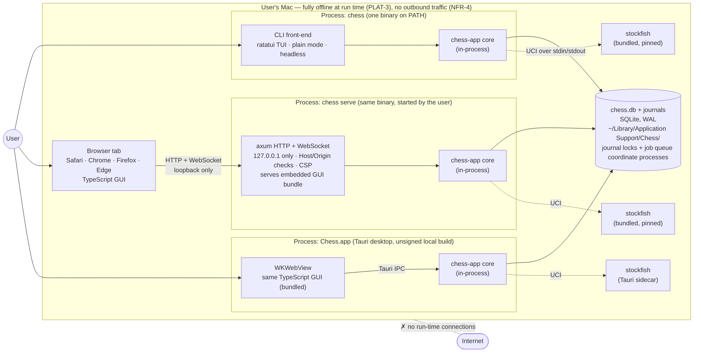

Key points:
- **Three processes, one library.** Each entry point is its own OS process that links the same `chess-app` crate. There is no shared daemon. They coordinate only through the data directory: the SQLite file and the per-game journal locks (§7.3, §7.6).
- **One `chess` binary** provides both the CLI (`chess`) and the web server (`chess serve`, which prints the URL and opens it in the default browser). It ships inside `Chess.app` and is put on `PATH` with a symlink, so there is one thing to install and one version (PLAT-1, NFR-5, D-16).
- **Stockfish runs as a native child process.** It is pinned to a specific release (Stockfish 19, `sf_19`, D-9), shipped for both arm64 and x86_64 (a universal build, Q46), and bundled once inside `Chess.app`, next to the `chess` CLI binary that also lives in the bundle (§8.2, D-16). The WASM build is not needed, because the engine always runs in Rust, never in the browser. Install locations and how each process finds its engine are covered in §8.2 (D-18).
- **Trust boundary.** The only boundary inside the Mac is loopback. Any local process can reach the `chess serve` port, and the browser is treated as untrusted input to the core (§5.2, R-5, D-22). Everything else stays inside one OS user account, used by one person (ASM-1, CONFIRMED).

---

## 3. Code organisation

### 3.1 Repository layout (baseline; a two-way door that may change during implementation)

```
chess/
├── Cargo.toml                 # Rust workspace
├── crates/
│   ├── chess-rules/           # board, move gen, SAN/UCI parse+format, FEN, PGN       (pure)
│   ├── chess-domain/          # game state machine, policy, clock, Elo, roster,       (pure)
│   │                          #   variation tree, stats aggregation, ASCII renderer,
│   │                          #   ECO classifier over a bundled opening table (D-20)
│   ├── chess-engine/          # Engine trait, UCI driver, Stockfish process pool,
│   │                          #   computer personalities, FakeEngine
│   ├── chess-store/           # SQLite schema, migrations, repositories, export/import
│   ├── chess-app/             # THE shared core: services, game session actors,
│   │                          #   engine gateway, protocol types (→ TS via ts-rs)
│   ├── chess-server/          # axum: static GUI assets + WebSocket protocol endpoint
│   └── chess-cli/             # bin "chess": ratatui TUI, plain mode, flags, `serve`
├── desktop/
│   └── src-tauri/             # Tauri shell: links chess-app, exposes commands/events
├── ui/                        # TypeScript GUI (Vite + React), shared by web & desktop
│   └── src/
│       ├── protocol/          # generated TS types (do not edit)
│       ├── transport/         # CoreClient interface + ws.ts + tauri.ts
│       ├── board/             # Board contract, BoardModel reducer, AccessibleOverlay,
│       │                      #   chessground adapter + Reconciler, PromotionPicker
│       ├── screens/           # register, home, setup, play, watch, analysis, history,
│       │                      #   stats, computer players, players, import/export, settings, help
│       └── themes/            # ≥10 board themes, ≥5 piece sets
├── e2e/
│   ├── scenarios/             # front-end-neutral scenario files (setup + moves + expected)
│   ├── cli/                   # PTY runner (vt100 screen parsing for the TUI)
│   └── gui/                   # Playwright runner (web + desktop)
├── third_party/stockfish/     # pinned version, build script, LICENSE, source offer
├── packaging/                 # install script for `chess` + engine, .app/.dmg config (§8.2)
└── docs/
```

### 3.2 Crate dependency graph

Arrows point from a crate to the crates it depends on. Pure crates have no I/O dependencies.

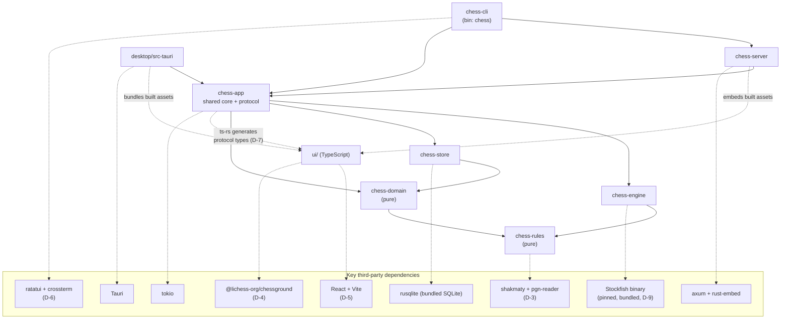

### 3.3 Crate responsibilities

| Crate | Responsibility | Key types | Requirements |
|---|---|---|---|
| `chess-rules` | Positions, legal-move generation, check/mate/stalemate, draw detection, SAN and coordinate parsing (lenient: either case, optional `+ # x`, `0-0`), SAN formatting, FEN, PGN with variations. Wraps `shakmaty` + `pgn-reader` (GPL-3.0, already perft-verified) rather than writing move generation from scratch (D-3, AGREED). | `Position`, `Move`, `San`, `Fen`, `PgnGame` | RULE-1, CLI-3, RULE-6/7/8, IF-1..3 |
| `chess-domain` | Game state machine; `Policy` (mode × matchup × state → allowed actions); `Clock` with an injected `TimeSource`; Elo calculator (K 40→32, no clamp, exclusions); class bands; seeded roster and personality generator; variation tree; stats aggregation; ECO classification of a move sequence against a bundled opening table (D-20); terminal-independent board renderer that produces a grid of styled cells (glyph, square shade, highlight) for each style (plain, Unicode, ANSI, no-color), used by both the TUI and plain mode. | `Game`, `GameSetup`, `Policy`, `Action`, `Clock`, `EloCalc`, `RosterGen`, `VariationTree`, `EcoTable`, `BoardGrid`, `BoardStyle` | PLY-1/5, GAME-1/3, RULE-2/3/4, ELO-1/2, PLY-4, ENG-2, ANA-2, DAT-3 (ECO), UI-2/5, CLI-1/2, UI-3 |
| `chess-engine` | `Engine` trait; UCI driver over async stdin/stdout; process pool; timeouts, crash detection, restart; engine binary discovery (D-18); `Personality` → UCI options and search limits, plus seeded "random error" move selection; `FakeEngine` for tests. | `Engine`, `UciEngine`, `EnginePool`, `SearchLimits`, `Personality`, `FakeEngine` | ENG-1/2/3, NFR-3 |
| `chess-store` | SQLite access (`rusqlite`, bundled SQLite), WAL, busy timeout, versioned migrations with a pre-migration backup, schema-version guard (D-16), repositories, game leases, analysis job queue, bulk row read/write for export and import (formats are owned by `ImportExportService`), `MoveJournal` (append + `F_FULLFSYNC`, `flock`, replay; §7.6). Runs on its own blocking thread (D-13). | `Store`, `PlayerRepo`, `GameRepo`, `RatingRepo`, `JobQueue`, `Lease` | DAT-1/2/3, RULE-5, NFR-2 |
| `chess-app` | **The shared core.** Application services that combine domain, store, and engine. One actor per live game. `EngineGateway` (the only path to the engine, policy-checked). Background analysis worker. The protocol: `Command`, `Query`, `Event`, `Snapshot` DTOs and the error catalogue (§5.5). | `Core`, `GameSession`, `EngineGateway`, `AnalysisWorker`, `Command`, `Event`, `GameSnapshot` | PLY-1..5, GAME-1..4, RULE-2..8, ENG-3/5, DAT-2/3, ELO-1/2, UI-1/2/5, ANA-1..3 (allocation in §10) |
| `chess-server` | axum app bound to `127.0.0.1`: serves the embedded GUI build, one WebSocket endpoint carrying the protocol, Host/Origin checks, CSP header, port selection. | `serve(core, port)` | PLAT-1, PLAT-3, PLAT-4, DAT-1, NFR-4, NFR-7 |
| `chess-cli` | `chess` binary: argument parsing (`clap`); full-screen TUI (`ratatui` + `crossterm`) with screens, widgets, and an async event loop over the core; plain line-oriented mode; command/move/key disambiguation; scripted headless mode; `serve` subcommand. | `TuiApp`, `Screen`, `BoardWidget`, `InputLine`, `KeyMap`, `PlainRunner`, `InputParser` | CLI-1..4, UI-2/4, PLAT-1 |
| `desktop/src-tauri` | Tauri app: creates the `Core`, maps protocol commands onto Tauri commands, forwards events with `emit`, bundles the Stockfish sidecar, sets the Tauri CSP. | — | PLAT-1, PLAT-3, GUI-1 |
| `ui/` (TypeScript) | One GUI bundle for web and desktop: screens, `Board` component (D-4), typed SAN input, client state (snapshot, view cursor, local clock countdown), themes, `CoreClient` transports. Holds no rules. Controls come from `allowed_actions`. | `CoreClient`, `BoardProps`, `BoardModel`, `AccessibleOverlay`, `Screen`s | GUI-1..4, UI-1..5, GAME-3 (view cursor), PLAT-2 |
| `packaging/` | Install script for `chess` + pinned engine, `.app`/`.dmg` build, license notices, install docs (§8.2). | — | PLAT-1/2, NFR-5, NFR-6 |

---

## 4. The shared core (`chess-app`)

### 4.1 Internal structure

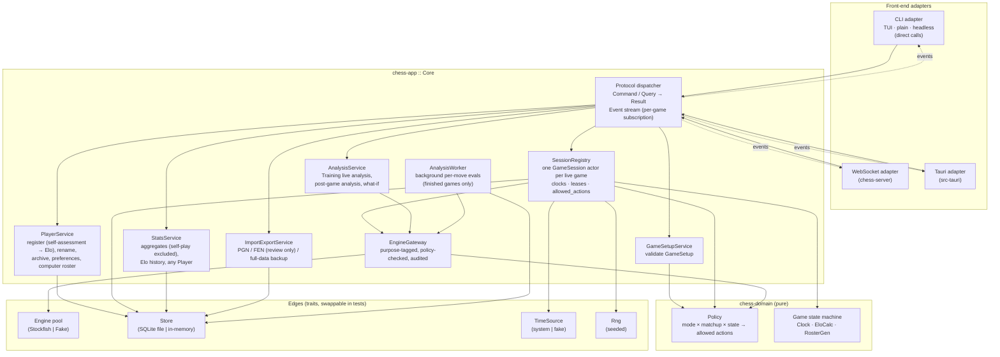

### 4.2 Game sessions as actors

Each live game is one `GameSession`: a tokio task that owns that game's `chess_domain::Game` value. Commands reach it over an `mpsc` channel, and it publishes `Event`s on a `broadcast` channel. Every front-end — including two hot-seat humans on one screen — subscribes to the same stream.

- Commands are handled one at a time, so a game cannot race with itself: a human move, a flag falling, and an engine reply can never interleave.
- **Optimistic concurrency guards rewind (GAME-3).** Every move command carries the `ply` the client believes is current. If a client is rewound, or a computer move landed meanwhile, the `ply` does not match and the command is rejected with `StalePosition`. Rewind itself is purely client-side view state: the snapshot includes the FEN and SAN of every ply, so stepping back needs no engine and no server round trip, and it cannot touch the record.
- **Computer turns** are spawned as cancellable engine tasks whose results return to the actor as messages. The actor stays responsive while the engine thinks: a human can resign, a watcher can pause or abort, and a flag can fall (ENG-5, NFR-8, GAME-2).
- **Clocks** are domain values driven by an injected `TimeSource`. The actor arms a single timer for the active side's flag deadline. Clients receive `{white_ms, black_ms, running_side, as_of}` and count down locally, so there is no stream of tick events. The core alone decides when a flag falls.

### 4.3 Game state machine

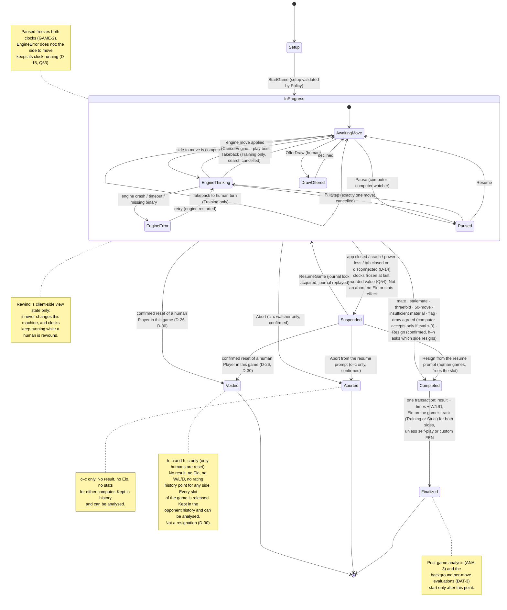

### 4.4 Mode policy as a single table

`Policy::check(action, &GameContext) -> Result<(), Denied>` is a pure function and the single source of truth. `GameContext` holds the mode, matchup, game state, whose turn it is, whether that side is human or computer, and whether the game is still in progress.

| Action | Training (h–c) | Strict (h–c, h–h, c–c) |
|---|---|---|
| Takeback | ✅ to the human's turn | ❌ |
| Live analysis / what-if on the current game | ✅ human only | ❌ until the game ends |
| Rewind (client view) | ✅ human | ✅ human (either hot-seat human); ❌ c–c has no human player, but watchers may scroll the move list |
| Clock selection | ❌ always untimed | ✅ presets + custom |
| Offer draw (humans only; a computer never offers, Q42) | ✅ to the computer, which accepts only if its eval ≤ 0 | ✅ h–h: to the other human. h–c: to the computer (eval ≤ 0 rule). ❌ c–c |
| Pause / step / delay | ❌ | c–c only |
| Resign (always confirmed) — the only way a human ends a game early | ✅ human: counts as a loss for Training Elo and W/L/D | ✅ h–c, h–h: loss for Strict Elo and W/L/D. In h–h the front-end asks which side resigns. ❌ c–c |
| Abort (always confirmed) | ❌ | c–c watcher only. Neither computer's Elo or stats change |
| Start a new game while a slot-holding Player has an unfinished game in this mode (D-27) | ❌ `UnfinishedGameExists`: resume it, or resign it. Only the human holds a Training slot. The computer is never blocked | ❌ same. h–h: each human holds a slot (one for self-play). h–c: only the human; the computer's slot is neither used nor checked, so any Player can always play any computer. c–c: each computer holds its Strict slot, and the setup offers resume or abort |
| CancelEngine ("move now", ENG-5) | ✅ on the computer's turn | ✅ h–c on the computer's turn; ❌ c–c (use Pause) |
| Elo track | **Training Elo** for both sides, human and computer (computers have a Training Elo too) | **Strict Elo** for both sides, including c–c between different computers. Never for self-play or a custom FEN start |
| Counts in W/L/D | ✅ (filterable by mode) | ✅. Self-play is excluded in both modes |
| Post-game analysis | ✅ | ✅ |

Every `GameSnapshot` includes `allowed_actions`, computed from this table. Front-ends render controls from that list and never re-derive the rules themselves. The table drives (a) table-driven unit tests over the full mode × matchup × state product, and (b) per-front-end E2E checks that the visible controls match `allowed_actions` exactly.

### 4.5 Engine gateway and Strict-mode integrity

Every engine call passes through `EngineGateway::request(purpose, …)`, where:

```rust
enum EnginePurpose {
    ComputerMove { game_id, player_id },          // a computer side choosing its move
    ComputerDrawDecision { game_id, player_id },  // the "eval ≤ 0" check (RULE-2); result never shown
    LiveAnalysis { game_id },                     // Training only
    WhatIf { game_id },                           // Training live, or any finished game
    PostGameAnalysis { game_id },                 // finished games only
    Calibration,                                  // dev/nightly tooling
}
```

The gateway looks up the game's state and mode and calls `Policy::check` before it touches the engine. `LiveAnalysis` or `WhatIf` on an in-progress Strict game returns `Denied`, even if a modified client sends it directly over the WebSocket. Every call is recorded in an in-memory audit log, which is the "spy on engine calls" required by ANA-1's verification. `Calibration` cannot be sent through the protocol. Only the `chess calibrate` dev subcommand builds it, and it never names a user game.

The gateway also validates engine output. Every `bestmove`, including a seeded "error" pick, is checked for legality with `chess-rules` before the session applies it. An illegal or unparsable move counts as an engine failure (§4.7), so the game can never enter an illegal state (NFR-3).

### 4.6 Computer Players

- **Roster generation** (pure, `chess-domain`): `RosterGen::new(seed)` produces 5 Players per class. Each gets a human-readable name and a `Personality { skill_level, depth_limit, movetime_ms, uci_elo: Option, error_rate, error_multipv }` drawn within the class bounds, plus **two starting ratings, Strict Elo and Training Elo, both equal to its class baseline** (Beginner 400, Novice 600, Intermediate 1200, Master 2200, Grand Master 2500). That is the same rule as a human's self-assessment (Q41). From then on both ratings are **dynamic**: every rated game updates both sides on that game's track by the Elo formula, with the same K-factor rule as humans: 40 for the first 30 rated games **on that track**, then 32. The two tracks count separately (`strict_rated_games`, `training_rated_games`; Q78). The change is written to `RATING_HISTORY`. Its **engine parameters stay fixed** forever, so its rating converges toward its real strength. The **category label follows the current Strict Elo** (Q79) through the ELO-1 bands, never the Training Elo, while the engine settings stay those of the class it was created in. Generation rejects duplicate parameter sets. The result is persisted once and never regenerated (PLY-4, ENG-2). "Generate more" continues the same deterministic stream.
- **Playing a move:** limits = min(personality movetime, the active profile's max-think-time preference (UI-1), a clock-derived budget). Classes whose target strength lies inside the engine's `UCI_Elo` range use `UCI_LimitStrength`. The range is **never hard-coded**: `chess-engine` reads the `min` and `max` of `option name UCI_Elo type spin …` from the `uci` handshake of the pinned binary (Stockfish 19, D-9), and passes it as data to `RosterGen` (still pure) and to `chess calibrate`. An engine integration test asserts that every stored `COMPUTER_PROFILE.uci_elo` lies inside the range the bundled binary reports. Earlier releases had a floor of 1320; Stockfish 19's floor is not yet verified (ASM-3). If the range changes, calibration is re-run before release. Beginner and Novice use a low `Skill Level`, shallow depth, and a random error: with probability `error_rate`, the core picks a non-best line from a MultiPV search. The RNG is seeded from `(game_id, ply)`, so replays are reproducible.
- **Calibration** is a separate `chess calibrate` dev subcommand (nightly CI). It plays matches between classes and reference settings and reports measured Elo and SPRT results against the class baselines, on the baseline machine: M4, 16 GB, macOS Tahoe (Q47). Because ratings are now dynamic (Q41), calibration is used to set the generator bounds before release and as a regression check. It never rewrites a released Player's parameters (R-2). Strength depends on `Threads`, `Hash`, and hardware, so computer-Player instances use fixed `Threads`/`Hash` values. Those values are recorded with each calibration run. Changing them means recalibrating.
- **Whose max-think time applies (UI-1, user 2026-10-26).** It is always the **active profile's** setting, meaning the Player chosen in the profile chooser for that front-end session. In h–c it caps the computer's moves. In c–c it caps both computers' moves for the watching profile. In h–h there are no engine moves, so it caps only the engine analysis that profile requests: post-game analysis, deeper lines, and what-if. It can only shorten a limit, never lengthen it. The session passes the active profile to `EngineGateway` with each request.

### 4.7 Engine process management

| Use | Engine instances | Priority |
|---|---|---|
| Computer side(s) of a live game | One per computer side. Self-play c–c (same Player on both sides) gets two instances with identical options, so neither side shares the other's hash table. | Normal |
| Training live analysis / what-if | One shared analysis instance per process, `MultiPV 3` | Normal |
| Post-game analysis + background per-move evals | The same analysis instance; the background worker yields to interactive requests | Low (`nice`) |

Instances start lazily, which keeps CLI startup under 1 s (NFR-1). They are health-checked with `isready`, killed on timeout, and restarted transparently. If the binary is missing or crashes, the core emits `EngineUnavailable`, leaves the game in a resumable state (ENG-1), and lets the user retry (`RetryEngine`) or leave (the game is suspended). Engine failures are: process exit, no `uciok`/`readyok` within the handshake timeout, no `bestmove` within the search deadline (§4.8), or an illegal or unparsable move (§4.5). While the engine is unavailable, the side to move's clock keeps running (D-15, decided by Q53). A computer that can't recover in time can lose on time.

### 4.8 Concurrency and threading model (D-13)

Nothing slow ever runs on a UI thread: the browser main thread, the WKWebView main thread, or the TUI's `select!` loop. Engine searches run in a separate OS process. SQLite calls run on a dedicated store thread. The UI only sends commands and receives events.

| Execution context | Runs | Must not |
|---|---|---|
| tokio multi-thread runtime, one per process | Protocol dispatcher, `GameSession` actors, engine I/O tasks (async stdin/stdout), `AnalysisWorker`, axum (web), Tauri command handlers (desktop), TUI event loop (CLI) | Block. `rusqlite` is synchronous, so no SQLite call runs on a runtime worker |
| Store thread, one per process | Owns the single write connection. Requests arrive over a channel, and every transaction in §7.4 runs here. Read queries (stats, history) use a small pool of read connections through `spawn_blocking`. WAL lets readers run during a write | Hold a transaction across an `await` or an engine call |
| Stockfish child processes | Searches (§4.7) | Be reached by anything but `chess-engine` |
| `GameSession` actor, one tokio task per live game | All state changes of its game, one message at a time (§4.2) | Wait on the engine inline. Results come back as messages |
| GUI main thread (JS) | Rendering, `BoardModel` reducer, local clock countdown | Compute rules. Legal moves arrive in the snapshot, and what-if moves use `LegalMoves` (D-11) |
| TUI loop (`tokio::select!`) | Key, tick, signal, and core-event handling, plus `render` | Wait on a core future inline. Effects are spawned, and results come back as `Msg`s |

**Ordering and durability.** The actor applies a command to a copy of its `Game`, then appends the resulting record to the game's move journal and flushes it with `F_FULLFSYNC` (§7.6). Only after that does it swap in the new state and broadcast the event (principle 5). Writing to SQLite happens afterwards, on the store thread, so a busy or locked database never delays a move. If the journal write fails (disk full or read-only), the old state stays and the command returns `JournalWriteFailed` (§5.5).

**Backpressure.** Event channels are bounded `broadcast` channels. A subscriber that lags (`RecvError::Lagged`) is sent a fresh `GameSnapshot` instead of the missed events, so a slow WebSocket client can never stall a game.

**Timeouts and periods.** Values are `ESTIMATE`s for the baseline machine (M4, 16 GB, macOS Tahoe; Q47, Q53), to be confirmed by the engine integration benchmarks. Tests set them through config. Intel Macs use the same wall-clock values, so they get less search in the same time (R-14).

| Item | Value | On expiry |
|---|---|---|
| UCI handshake (`uci`→`uciok`, `isready`→`readyok`) (ENG-4, TBD-13) | 5 s (the accepted EST in ENG-4). Startup is expected to be well under 1 s on the baseline | Kill and restart once, then `EngineUnavailable` |
| Search deadline (ENG-4, TBD-13) | at the search's own limit + 500 ms, send `stop` | No `bestmove` by the limit + 2 s (the accepted EST in ENG-4) → kill, engine failure |
| `CancelEngine` → move played (ENG-5, TBD-12) | ≤ 200 ms (the accepted EST). Design target 100 ms (`stop` → `bestmove`) | Treated as a search-deadline failure |
| Computer move, top class (ENG-3) | ≤ 3 s by default, capped by the clock budget and the max-think preference | — |
| Training live analysis (ANA-1) | MultiPV 3, streamed, refined until the user leaves, capped at 10 s per position | Shows the deepest result so far |
| Background per-move evaluation (DAT-3) | 200 ms per ply at low priority (about 30 s for an 80-move game) | Job resumes from the last ply (§7.4) |
| On-demand deeper line / what-if (ANA-2/3) | 2 s per request | Shows the best line so far |
| Journal flush (`F_FULLFSYNC`) per record | a few ms per move. Measured in the NFR-8 latency test | `JournalWriteFailed` |
| Journal clock checkpoint (RULE-5, Q54, TBD-7) | every 1 s while a clock runs, plus on every move, pause, and suspend | After a crash, the clock is restored to the last checkpoint: at most 1 s is lost |
| Journal → SQLite apply | after every journal record, retried with backoff (0.1 s → 5 s) while the DB is busy or locked | Play continues. The backlog is shown in the status line if it exceeds 30 s |
| SQLite `busy_timeout` | 5 s (§7.1) | `StoreBusy` for non-game writes. Game writes are retried from the journal |
| Game lock (journal `flock`) and lease row heartbeat (DAT-4, TBD-28) | the lock is released by the OS when the owner exits or crashes. Heartbeat every 2 s, used only for display | Another process can take over immediately after a crash (§7.3) |
| Client command timeout (GUI) | 10 s | Show "core not responding", resubscribe (§5.6) |
| Last front-end detaches (tab closed, WebSocket dropped; D-14) | immediately, no grace | `Suspend` is journalled and the clocks freeze at the recorded value. When a client resubscribes, the game resumes |

---

## 5. Protocol (front-end ↔ core)

One set of Rust types in `chess-app::protocol`, `serde`-serialized, with TypeScript types exported by `ts-rs` into `ui/src/protocol/`. A CI check fails if the generated files are stale.

### 5.1 Shape

| Kind | Examples |
|---|---|
| **Command** (changes state, returns `Result`) | `RegisterPlayer`, `RenamePlayer`, `ArchivePlayer`, `UpdatePreferences`, `GenerateComputerPlayers`, `StartGame{game_uuid, GameSetup}`, `ResumeGame`, `DetachGame`, `MakeMove{game_id, ply, mv}`, `Takeback{ply}`, `OfferDraw`, `RespondDraw`, `Resign{side, confirmed}` (h–h: the side chosen in the prompt), `Pause`, `Resume`, `Step`, `SetMoveDelay`, `Abort{confirmed}` (c–c watcher only), `CancelEngine`, `RetryEngine`, `ImportPgn`, `ImportFen`, `PreviewDataImport{file}` → conflicts, `ApplyDataImport{plan}`, `CreateFreshStore`, `RestoreBackup`, `SaveVariation`, `DeleteVariation`, `SelectProfile{player_id}`, `ArchivePlayer{confirmed}`, `ResetPlayerData{player_id, confirmed, void_game_ids}` (humans only. Unconfirmed, it returns `ConfirmationRequired` listing the unfinished games that will be voided, and the confirmed command echoes that list back as `void_game_ids`, §7.2) |
| **Query** (no change to the record) | `ListUnfinishedGames` (at most one per mode, Q49), `ListPlayers{kind, include_archived}`, `GetPreferences{player_id}`, `GetPlayerStats{player_id}`, `GetRatingHistory`, `ListGames{filter}`, `GetGame`, `GetGameAnalysis{game_id}` (stored `MOVE_EVAL` rows and job state), `ExportPgn`, `ExportData`, `LegalMoves{fen}`, `Analyze{purpose, fen, multipv}` (policy-checked; may set `analysis_used`) |
| **Event** (pushed, per game subscription) | `GameSnapshot` (full state on subscribe), `MoveApplied{ply, san, uci, fen, clocks, allowed_actions}`, `EngineThinking{side}`, `ClockSync`, `TakebackApplied{to_ply}`, `DrawOffered`, `DrawDeclined`, `PauseChanged{paused}`, `GameEnded{result, reason, elo_changes}`, `GameVoided{game_id, reset_player_id}` (the game was voided by a reset of one of its human Players, D-30; the client leaves the game screen, shows why, and sends no more commands for it), `RatingsUpdated`, `GameSuspended`, `StoreBacklog{records}`, `AnalysisProgress`, `EngineUnavailable`, `EngineRecovered`, `LeaseLost` |

`GameSnapshot` carries everything a client needs to render and rewind without asking the server again: setup, players, every ply (SAN, UCI, FEN, timestamp, clock after the move), the current ply's legal moves (for highlighting and keyboard input), clocks, state, and `allowed_actions`.

### 5.2 Transports

| Front-end | Transport | Notes |
|---|---|---|
| CLI | In-process: `core.execute(cmd).await`, `core.subscribe(game_id)` | No serialization. |
| Web | One WebSocket at `ws://127.0.0.1:<port>/api`, JSON frames `{id, kind, body}` | Bound to loopback only. Rejects any `Host`/`Origin` other than `127.0.0.1:<port>` / `localhost:<port>` (blocks DNS rebinding and drive-by pages). |
| Desktop | Tauri `invoke("core", envelope)` + `listen("core-event")` | Same JSON envelope as the web, so the TS client differs only in its send/receive functions. No TCP port opened. |

In the UI, one `CoreClient` interface hides the difference:

```ts
interface CoreClient {
  execute<C extends Command>(cmd: C): Promise<ResultOf<C>>;
  query<Q extends Query>(q: Q): Promise<ResultOf<Q>>;
  subscribe(gameId: GameId, onEvent: (e: Event) => void): Unsubscribe;
}
// ui/src/transport/ws.ts    → WebSocketCoreClient
// ui/src/transport/tauri.ts → TauriCoreClient   (chosen at startup: window.__TAURI__ ?)
```

### 5.3 Example: human move then computer reply (Strict, timed)

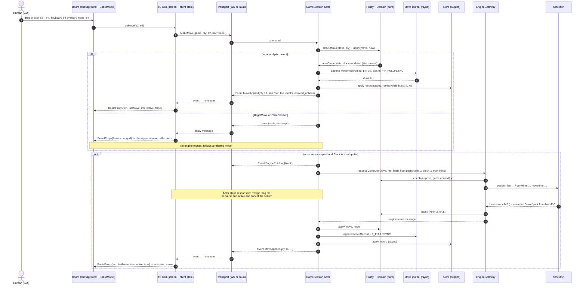

### 5.4 Example: game end, rating, and background analysis

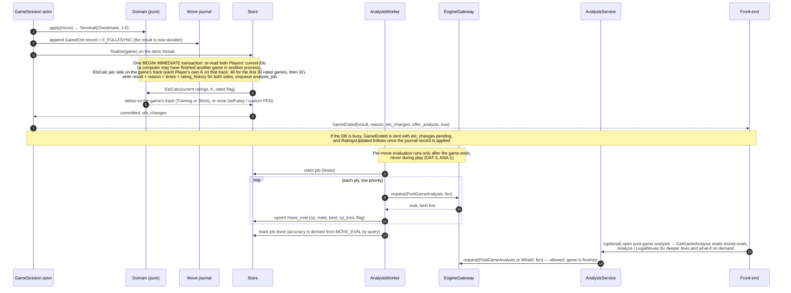

### 5.5 Error catalogue

Every `Result` error crosses the protocol as `{code, message, details}`. `code` is a stable string from this table. Front-ends branch on `code` and show `message`, and new codes may be added without breaking clients (§5.6). Rust crates use `thiserror` and are mapped to these codes in `chess-app`. No internal error text (paths, SQL) reaches `message`. Internal detail goes to the log.

| Code | Raised by | Meaning | Client behaviour | Retry? |
|---|---|---|---|---|
| `ConfirmationRequired{action, voids}` | services | A destructive command (resign, c–c abort, archive, reset player data) was sent without `confirmed: true` (Q48, Q52). The core enforces this, so no front-end can skip the prompt. For a reset, `voids` lists the Player's unfinished games (opponent, mode, moves played) that the reset will void (D-30). It is also returned when, at commit time, the Player has an unfinished game that is not in the confirmed reset's `void_game_ids`, so a game the user never saw listed is never voided. A listed game that ended normally in the meantime is simply not voided | Show the confirmation dialog. For a reset, the dialog says that each listed game will be voided: no result, and it counts for neither player | After confirming |
| `UnfinishedGameExists{game_id, mode, player_id}` | `GameSetupService` | A slot-holding Player in the new game (a human, or a computer in a c–c game) already has an unfinished game in that mode (GAME-4, D-27). Since 2026-10-27 it is **not** a reset outcome: a reset voids unfinished games instead (D-30) | Offer Resume, or Resign (human games) or Abort (c–c), each confirmed | After resume, resign, or abort |
| `JournalWriteFailed{cause}` | `GameSession` | The move journal can't be written (disk full, read-only) | The move isn't made. Show the cause. The clock keeps running | User-initiated |
| `StoreMissing` | `chess-store` on open | The data dir shows an earlier store existed (marker or backups), but `chess.db` is gone (Q51) | Choose: start fresh, or import from a file | — |
| `ImportConflicts{list}` | `ImportExportService` | Preview found Players or games that already exist (Q51) | For each one, choose Replace, or Keep both as distinct identities | After choosing |
| `IllegalMove{reason}` | `GameSession` / `chess-rules` | Move not legal in the current position | Show reason, keep input editable (CLI-3), revert the piece (GUI) | No |
| `StalePosition{live_ply}` | `GameSession` | `ply` ≠ live ply (rewound, or a move landed meanwhile) | Show the live-position badge, refresh from the snapshot | After refresh |
| `Denied{reason}` | `Policy` (via services and gateway) | Action not allowed in this mode, matchup, or state | Should not happen for a correct client (controls come from `allowed_actions`). Show reason | No |
| `ValidationFailed{field, reason}` | `PlayerService`, `GameSetupService`, preferences | Bad name (empty, duplicate case-insensitively among active Players, too long), bad setup or setting | Highlight the field | After fixing input |
| `ParseError{kind: Pgn\|Fen, game_index, line, col, reason}` | `ImportExportService` | Malformed PGN/FEN (RULE-7, RULE-8, IF-2, IF-3) | List errors per game. The other games in the file still import | No |
| `NotFound{entity, id}` | services | Unknown Player, game, or variation | Refresh the list | No |
| `GameLeased{owner_kind}` | `SessionRegistry` | The game is live in another process ("open in the CLI") | Show the owner, offer read-only view | When the owner releases it or its lease goes stale |
| `LeaseLost` (event) | `GameSession` | This process lost the lease (another process took it over after a stall) | Drop to read-only, explain | No |
| `EngineUnavailable{cause}` | `chess-engine` / gateway | Binary missing, crash, timeout, illegal output | Offer Retry / Leave (ENG-1) | `RetryEngine` |
| `StoreBusy` | `chess-store` | `busy_timeout` exceeded | Transparent retry once in the core, then show | Yes, once |
| `StoreUnavailable{cause}` | `chess-store` | I/O error, disk full, read-only file | For non-game writes: show. A live game keeps playing from the journal, and the backlog is applied later (§7.6) | User-initiated |
| `StoreCorrupt` | `chess-store` on open | `quick_check` failed (§7.1) | Restore-from-backup flow | — |
| `SchemaTooNew{db_version, app_version}` | `chess-store` on open | The database was migrated by a newer build (D-16) | Tell the user to update this entry point. Nothing is written | — |
| `Busy{reason}` | `ImportExportService` | Import or restore needs exclusive access, but another process is live (§7.4) | Ask the user to close the other entry points | Yes |
| `ProtocolMismatch{server, client}` | WebSocket adapter | A browser tab from an older build (D-16) | Hard reload | After reload |
| `Internal{id}` | any | Bug. Logged with a correlation id | Generic message with the id | No |

### 5.6 Protocol reliability, idempotency, and versioning

- **Envelope.** `{id, kind, body}`. `id` is a client-chosen request id, echoed in the response. The web and desktop transports have a per-request client timeout (§4.8).
- **Idempotency.**
  - `MakeMove`, `Takeback{ply}`, `Step`, `OfferDraw`, `RespondDraw`, and `Resign` are guarded by the game state. A duplicate after a reconnect gets `StalePosition` or `Denied` and changes nothing. A command for a voided game gets `Denied{reason: voided}`.
  - A duplicate confirmed `ResetPlayerData` is harmless: the games it listed are already voided, so it voids nothing, adds a second reset point at the same rating, and moves `reset_at` past no game, which changes no view. Pending requests are never replayed blindly anyway (see Reconnect).
  - `StartGame` carries a client-generated `game_uuid`. A repeat with the same uuid returns the existing game instead of creating a second one.
  - Imports are all-or-nothing per game and dedupe on a content hash, so re-importing the same PGN reports "already imported".
  - `RegisterPlayer` relies on unique names.
- **Reconnect (web).** If the WebSocket drops, the client reconnects with backoff (0.5, 1, 2, 4 s, capped), resubscribes, and treats the new `GameSnapshot` as authoritative. Pending requests fail with a "connection lost" message and are never replayed blindly. While disconnected, inputs are disabled and a banner is shown. If the session gets no subscriber back, D-14 decides what the game does.
- **Versioning.** The bundle and the core always come from the same build: the bundle is embedded in `chess` or bundled in `Chess.app`. The handshake sends `protocol_version` (the build version) both ways. A mismatch, such as a stale tab after an upgrade, returns `ProtocolMismatch` and asks for a reload. Within one version, unknown event kinds are ignored by clients, which keeps tests tolerant of additive changes. There is no external API, so no deprecation policy is needed beyond this.

### 5.7 Internal interface contracts

| Interface | Provider → consumer | Style | Contract essentials | Failure behaviour |
|---|---|---|---|---|
| Protocol (`Command`/`Query`/`Event`) | `chess-app` → CLI, `chess-server`, `src-tauri`, `ui/` | Async request/response plus a per-game event stream | §5.1–§5.6. TS types generated (D-7). `allowed_actions` in every snapshot | §5.5 codes, §5.6 reconnect |
| `Engine` trait | `chess-engine` → `EngineGateway` | Async, cancellable | `search(position, SearchLimits, multipv) → SearchResult{best, pv, score, depth}`, `stop()`, `health()`. Only the gateway holds an `Engine` | Typed `EngineError` → §4.7 |
| `Store` trait and repositories | `chess-store` → `chess-app` services | Calls to the store thread over a channel (D-13) | One method per transaction in §7.4. No SQL outside `chess-store` | `StoreBusy` / `StoreUnavailable` / `SchemaTooNew` |
| `TimeSource`, `Rng` | edges → `chess-domain`, `GameSession` | Sync, injected | Monotonic time for clocks, wall time only for timestamps. `Rng` seeded from `(game_id, ply)` or the roster seed | Not applicable |
| PGN/FEN I/O | `chess-rules` (wrapping `pgn-reader`/`shakmaty`) → `ImportExportService`, `GameSetupService`, `AnalysisService` | Pure functions | **Parse:** FEN must be a legal position, or it's rejected with a reason. PGN is streamed game by game, and every SAN is validated by replay. **Export (IF-1):** Seven Tag Roster plus `SetUp`/`FEN` for custom starts, `TimeControl` when timed, `Termination`, and custom tags `Mode`, `Rated`, `WhiteClass`, `BlackClass`, `EndStatus` (TBD-24). `Mode` also names the rating scale. **Games that ended without a result** (watcher-aborted c–c, and voided by a reset, D-30) are exported the same way: `[Result "*"]` with the movetext ending in `*`, `[Termination "abandoned"]` (a standard PGN termination value, so other tools read it as a game that stopped without a result rather than one still in progress), and the custom tag `[EndStatus "aborted"]` or `[EndStatus "voided"]`, which tells the two apart and lets the full-data import restore `GAME.status`. `EndStatus` is written only for those two statuses. Also imported `GAME_TAG`s, saved variations from `VARIATION`, UTF-8, and deterministic output (byte-identical from every front-end). **Import (IF-2):** multi-game files; UTF-8, falling back to Latin-1 per game; comments, NAGs, and variations kept; files over 10 MB rejected (TBD-25, `ESTIMATE`). **FEN (IF-3):** six fields, legality checked. **Full-data export (IF-5, DAT-2):** one zip archive (D-29) holding `manifest.json` (`format_version`, build version, export time), `games.pgn` (every game, with custom tags `GameUUID`, `WhiteUUID`, `BlackUUID` and `[%clk]`/`[%emt]` comments so clocks and think times round-trip), `players.json` (including `reset_at`), `ratings.json` (both tracks, full history, both rated-game counters), and `settings.json` (preferences, `APP_SETTING`). Engine evaluations are not exported; they are recomputed after import. Import accepts older format versions and rejects newer ones. FEN export is not in v1 (IF-3). Round-trip: `parse(export(g))` gives the same move list (RULE-6, RULE-7) | `ParseError` with game index, line, and column. One bad game never aborts the rest of a file |
| FEN uses | — | — | **Start position** in `GameSetup` (GAME-1, unrated) vs. **Import FEN** on the Import screen, which opens an analysis board and creates no game ("review only") | — |
| `BoardGrid` renderer | `chess-domain` → TUI `BoardWidget`, `PlainRunner` | Pure | Grid of `{glyph, shade, highlight}` per `BoardStyle` and orientation (CLI-2, UI-3) | Not applicable |
| `Board` contract (`BoardProps`/`onMove`) | `ui/board` → GUI screens | React props | §11.1. Screens never touch chessground | Rejected move → `fen` re-set, piece reverts |
| `CoreClient` | `ui/transport` → GUI client state | Promise plus subscription | §5.2. Two implementations with identical behaviour (GUI-1) | §5.6 |

---

## 6. Front-ends

### 6.1 CLI (`chess`): ratatui terminal UI

The CLI is a full-screen terminal UI built with **`ratatui`** (rendering) and **`crossterm`** (terminal I/O, keys, resize). It is **keyboard only** (CLI-1/3, AGREED): moves are typed in algebraic notation, there is no board cursor, and mouse capture is never enabled — which also leaves the terminal's normal text selection and copy working. It links the core in-process like the other front-ends and follows the same rules as the GUI: it renders `GameSnapshot`s, shows only the controls in `allowed_actions`, keeps rewind as local view state, and counts clocks down locally from `ClockSync`.

#### Run modes

| Mode | Selected when | Behaviour |
|---|---|---|
| **TUI** (default) | stdin and stdout are terminals and no scripting flags are given | Alternate screen, raw mode, full-screen layout, live clocks and spinner |
| **Plain** | `--plain`, or stdin/stdout is not a terminal | Line-oriented transcript: board, last move, clocks, and prompt printed after each change. For screen readers (UI-4) and pipes. |
| **Headless** | scripting flags (`--matchup cvc --white … --black … --clock 5+0`) | No UI. Runs to completion, prints the PGN, and exits with a status code. Drives the cross-front-end scenario tests. |

**Selection rule (D-19).** Rules are checked in order:
1. `--headless`, or top-level setup flags with no subcommand (`chess --matchup … --white …`, as in CLI-4), selects headless. Headless needs a fully specified setup, or it exits with a usage error. A human side in headless reads moves from stdin, one per line.
2. `--plain`, or stdin/stdout not a TTY, selects plain.
3. Otherwise TUI. `chess play [setup flags]` opens the TUI pre-filled with the setup.

Exit codes (CLI-5, TBD-21): 0 game reached a result, 1 usage or setup error, 2 engine unavailable, 3 store error. PGN goes to stdout, and messages go to stderr. `save` (CLI-4) only confirms "game saved", because every move is already durable.

**Plain mode and screen readers.** Plain mode never prints clock ticks. It prints the clocks with each move and as warnings at fixed thresholds (e.g., 60 s, 10 s), so a screen reader isn't flooded. Opponent moves are printed as they arrive, even while the user is typing.

All three modes share `InputParser` (command words, SAN, and coordinate moves) and the board renderer in `chess-domain`. That renderer produces a terminal-independent `BoardGrid`: per square, a glyph, a light/dark shade, and highlights (last move, check, rewound). The TUI's `BoardWidget` maps that grid to ratatui styles. Plain mode prints it as text lines. One snapshot suite therefore covers both modes (CLI-1/2, UI-3).

#### Play screen layout (80×24 minimum)

```text
┌ Chess ─ Strict · 5+0 · Rated ───────────────────────────────────── F1 help ┐
│    A  B  C  D  E  F  G  H        Black  Viktor Rook (Master 2310)   04:51  │
│ 8  ♜  ♞  ♝  ♛  ♚  ♝  ·  ♜  8     ⠿ thinking…                               │
│ 7  ♟  ♟  ♟  ♟  ·  ♟  ♟  ♟  7     ──────────────────────────────────────    │
│ 6  ·  ·  ·  ·  ·  ♞  ·  ·  6      1. e4      e5                            │
│ 5  ·  ·  ·  ·  ♘  ·  ·  ·  5      2. Nf3     Nf6                           │
│ 4  ·  ·  ·  ·  ♙  ·  ·  ·  4      3. Nxe5    …                             │
│ 3  ·  ·  ·  ·  ·  ·  ·  ·  3                                               │
│ 2  ♙  ♙  ♙  ♙  ·  ♙  ♙  ♙  2     ──────────────────────────────────────    │
│ 1  ♖  ♘  ♗  ♕  ♔  ♗  ·  ♖  1     White  Brian (1243)                04:38  │
│    A  B  C  D  E  F  G  H                                                  │
├────────────────────────────────────────────────────────────────────────────┤
│ Last: Nxe5 (White) · ←/→ rewind · End live · Tab focus · Esc clear         │
│ > _                                                                        │
└────────────────────────────────────────────────────────────────────────────┘
```

- The board panel sits on the left; the right panel holds the opponent, clocks, engine-thinking indicator, scrollable move list, and the bottom player. `flip` (or Black at the bottom) turns the board and its A–H/1–8 labels (CLI-2).
- The status line shows the last move, errors (e.g., "Illegal: Nf3 — no knight can reach f3"), the "live position has changed" badge while rewound (GAME-3), and context-sensitive key hints built from `allowed_actions`.
- The input line has editing, Up/Down history, and paste.
- **Minimum size (CLI-1, Q55): fixed at 80×24.** Every screen is designed to fit 80×24. If the terminal is smaller:
  1. At startup or on resize, the TUI asks the terminal to resize itself to 80×24 with the xterm window-manipulation sequence `CSI 8 ; 24 ; 80 t`. Terminal.app and iTerm2 are expected to honour it; this is checked in both (R-16, and iTerm2 has a setting that can block it). It records the original size first (`CSI 18 t`) and restores it on exit as part of terminal hygiene.
  2. If no resize event of at least 80×24 arrives within 300 ms (`ESTIMATE`), the screen is replaced by a "please enlarge the terminal to 80×24" message. Inside tmux or screen the sequence is ignored, so the message appears.
  3. The TUI never asks again until the user resizes, so it doesn't fight a user who shrinks the window on purpose.

#### Screens

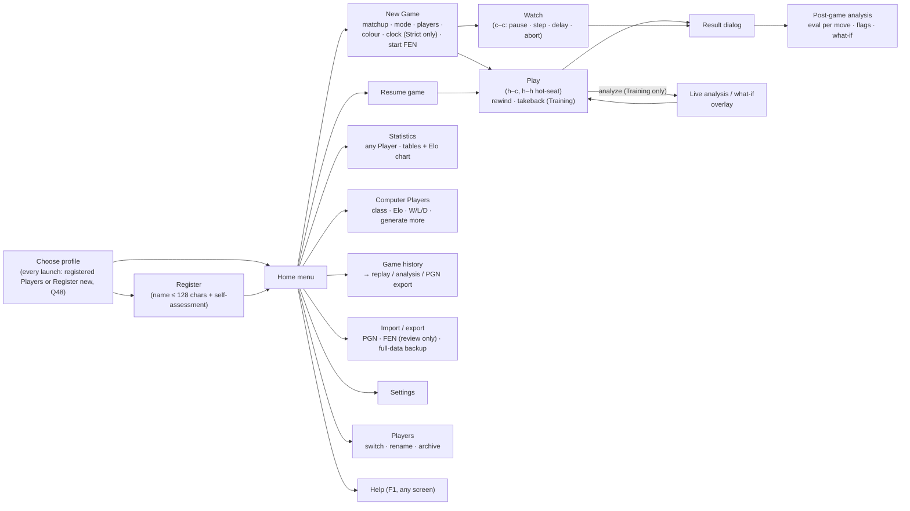

Each screen is a `Screen` implementation with its own state, key handling, and `render`. Forms (setup, settings, registration) use focusable fields where Tab/Shift-Tab moves and Enter confirms. Fields the policy disallows (e.g., Training for h–h, a clock in Training) are not offered (GAME-1). Statistics use ratatui's `Table`, `Chart`, and `Sparkline` widgets (UI-2, UI-5).

#### Event loop (Elm-style)

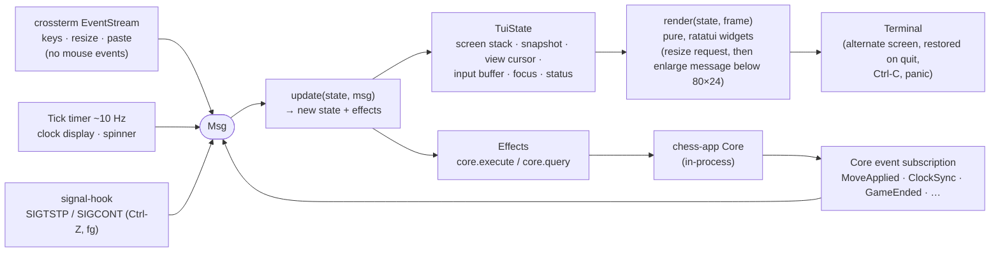

- **One `tokio::select!` loop** over terminal events, core events, and a tick. There are no blocking input threads, so engine moves, flag falls, and clock updates appear while the user is typing.
- **`update` is separate from `render`.** `update` can be unit-tested with synthetic `Msg`s and no terminal. `render` draws into a ratatui `TestBackend` for snapshot tests at fixed sizes.
- **Key routing (`KeyMap`, CLI-4).** Keys that can never start a move are bindings: ←/→ back/forward, End live, PgUp/PgDn move list, F1 help, Tab focus, Esc clear/cancel. Every printable character (letters, digits, `-`, `=`) goes to the input line. On Enter, `InputParser` resolves the text to a command word or a move. A unit test checks that no binding consumes a character that can begin SAN or coordinate notation. Because there is no board cursor, the arrow keys are reserved for rewind. The Watch screen has no move input, so it uses plain keys (Space, `s`, `+`/`-`, `a`).
- **Terminal hygiene.** A guard object enters raw mode and the alternate screen and restores both on `Drop`. A panic hook restores the terminal before printing the panic. Ctrl-C arrives as a key in raw mode and always asks for confirmation before quitting (Q52). Every move is already journalled (§7.6), so quitting is always safe. Resign (in hot-seat h–h, after asking which side resigns), c–c abort, archive, and "reset player data" also always ask, and the core refuses them without `confirmed: true` (§5.5). Ctrl-Z restores the terminal, suspends via `SIGTSTP`, and redraws on `SIGCONT` (`signal-hook`).
- **Styles.** `BoardStyle` = plain ASCII, Unicode glyphs, ANSI colour, light/dark squares. With `NO_COLOR` or `--no-color`, no colour is emitted. The plain ASCII style also switches panel borders to an ASCII border set.
- **Startup (NFR-1).** The first frame is drawn before the engine starts; engines start lazily.

#### Subcommands

`chess` (profile chooser, then TUI home), `chess play [--player <name>] [setup flags]` (straight into a game), `chess serve [--port <n>] [--no-open]` (port precedence in §8.2), `chess stats [player]` / `chess players` (open the TUI screen, or print tables in plain mode), `chess export|import`, `chess calibrate` (dev).

### 6.2 GUI (web and desktop, one codebase)

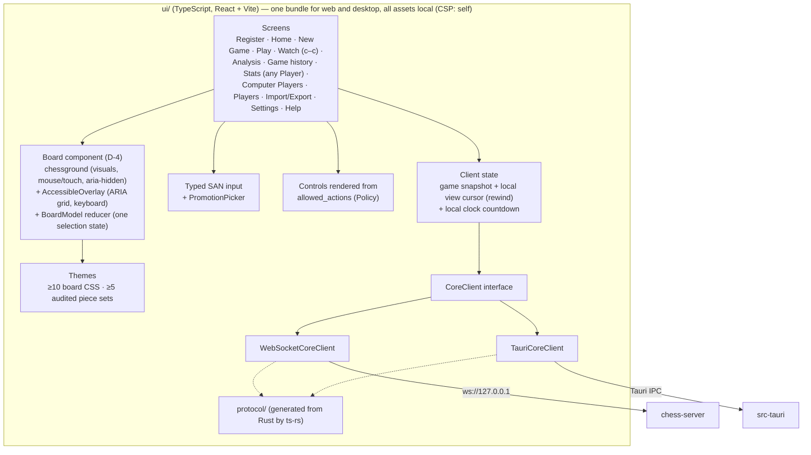

- **Framework:** React + TypeScript + Vite (AGREED, D-5): the largest ecosystem, mature testing tools (Testing Library, Playwright, axe), and good accessibility support.
- **Board (AGREED, D-4):** `@lichess-org/chessground` (pinned 10.x, GPL-3.0-or-later) renders the board and handles mouse, touch, and animation, wrapped by our own React component. Our shared layer adds the keyboard model (GUI-2) and screen-reader support (UI-4): a transparent ARIA-grid overlay and a `BoardModel` reducer that owns the one selection state. Full design in §11.1. Themes are chessground CSS classes for boards plus license-audited SVG piece sets; contrast ratios are checked by a unit test.
- **Rewind** is a local view cursor over the snapshot's ply list. While rewound, move input is disabled. The "live position has changed" badge appears when a `MoveApplied` arrives with the cursor behind live (GAME-3).
- **Elo chart:** a small charting dependency or hand-built SVG (D-21, DEFERRED). Either way it has a text or table alternative for screen readers (UI-4).
- **Settings take effect in the client (UI-1, GUI-3).** `PREFERENCES` drive:
  - `BoardProps`: theme, piece set, orientation, coordinates on/off (GUI-3, default on), legal-move hints;
  - app colour theme (UI-10): System (default, follows `prefers-color-scheme` and switches live when macOS appearance changes), Light, Dark, or another bundled theme. It is applied as CSS custom properties on the root element. Every theme, the high-contrast one included, meets WCAG AA (UI-7), and nothing more is required of the high-contrast theme;
  - the default opponent class and colour in New Game.
  Changes are saved with `UpdatePreferences` and apply immediately. The other entry points pick them up the next time they read preferences.
- **Move commit rules (GUI-2, Q52).** All input methods are active during play, and there is no confirm-move setting and no "default input method" setting. A move commits:
  - mouse or touch: when the piece is dropped on a legal square (click-click: on the second click);
  - keyboard overlay: when the destination square is selected with Enter/Space;
  - typed SAN: on Enter.
  A promotion opens the `PromotionPicker` first, and the move commits when a piece is chosen.
- **No sound in v1** (Q52). There are no sound assets, no sound setting, and no terminal bell.
- **Language.** English only in v1 (Q52). UI strings still live in one module per front-end, which keeps the help content (UI-9) and messages (NFR-9) in one place.
- **Layout (Q55).** There is no minimum window size. The layout is fluid (CSS grid with `clamp()` sizing), and the board is a square sized from its container. A `ResizeObserver` triggers chessground's `redrawAll()`, which keeps the `AccessibleOverlay` aligned at every size. Below a narrow breakpoint, panels stack under the board instead of beside it.
- **Profiles (Q48).** Each GUI session starts at the profile chooser: registered Players, or Register new. The chosen Player is session state (`SelectProfile`), so two tabs or apps can use different profiles. `APP_SETTING.last_active_player` only pre-selects the list.
- **Game feedback (GUI-4).** Last move, check, and legal destinations come from `BoardProps`. The move list comes from the snapshot's plies. Captured pieces are derived in the client from the snapshot (material difference at the viewed ply). The result dialog is shown on `GameEnded`, and the thinking indicator on `EngineThinking`.
- **Connection loss (web).** §5.6: banner, inputs disabled, then reconnect and resnapshot.

### 6.3 Desktop (Tauri)

- `src-tauri` creates the `Core` at startup, using the same data-directory resolution as the CLI. It registers one `core` command and forwards events.
- It bundles the Stockfish binary as a Tauri **sidecar**, the `chess` CLI binary beside it (symlinked onto `PATH`, §8.2), and the license notices. There is one bundle, so CLI and desktop are always the same version (D-16).
- Packaging: an unsigned universal (arm64 + x86_64) `.app`/`.dmg` (PLAT-1, Q46), built with `cargo tauri build --target universal-apple-darwin`. See §8.2.
- Single instance: a second launch focuses the existing window instead of starting another core. Closing the window quits the app, which suspends any live game (RULE-5).

---

## 7. Persistence

### 7.1 Technology

- **SQLite** through `rusqlite` with the `bundled` feature (no system dependency). Pragmas: `journal_mode=WAL`, `synchronous=FULL`, `fullfsync=ON` and `checkpoint_fullfsync=ON` (on macOS a plain `fsync` does not flush the drive's cache, so this makes SQLite use `F_FULLFSYNC`), `foreign_keys=ON`, `busy_timeout=5000`.
- **Durability (NFR-2, RULE-5, Q54: decided).** No completed move is ever lost, whatever happens: app crash, kill, disconnect, OS crash, or power loss. Every move is written to the game's move journal and flushed with `F_FULLFSYNC` before it is acknowledged. The journal is then applied to SQLite, whose own commits are also fully synced (§7.6). After any interruption, the clock comes back at the last recorded value: the last move or 1 s checkpoint, so at most 1 s of clock is lost (TBD-7 proposed: 1 s). TBD-23 (moves lost on power loss) is 0. The flush costs a few ms per move (`ESTIMATE`, measured by the NFR-8 latency test), which is negligible at chess move rates.
- **Location:** `~/Library/Application Support/Chess/chess.db`, overridable with `CHESS_DATA_DIR` (used by every test to isolate state).
- **Migrations:** numbered SQL files tracked with `PRAGMA user_version`. Before any migration, the file is copied with `VACUUM INTO chess.db.bak-v<N>`. Fixture databases for each released schema version are kept in the repo for migration tests (DAT-1).
- **Corruption:** on open, `PRAGMA quick_check`. If it fails, the app explains the problem, offers to restore the latest backup, and never overwrites the file silently (DAT-5). After a restore, pending journals are replayed on top, so moves made after the backup are kept (§7.6).
- **Missing store (Q51).** When a store is created, a `store.id` file (store uuid, creation time) is written next to it. On open, if `chess.db` is absent:
  - nothing else in the data dir (no `store.id`, backups, or journals) means a genuine first launch. The store is created silently (PLAT-3) and the profile chooser opens on Register.
  - any trace of an earlier store returns `StoreMissing`. The user chooses **start fresh** (`CreateFreshStore`, keeping the traces aside in `missing-<date>/`) or **import from a file** (a full-data export or a backup).

### 7.2 Data model (baseline v1.0)

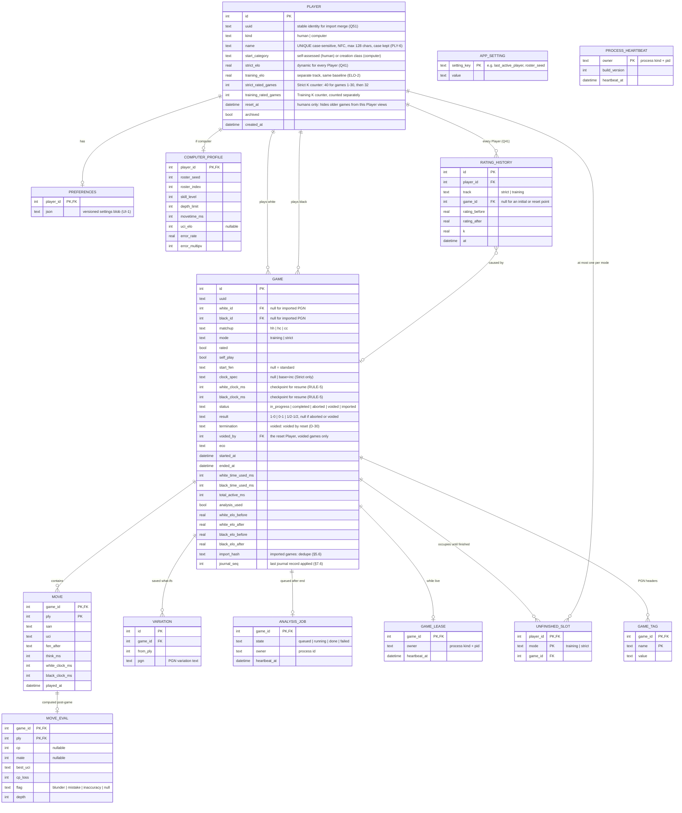

Notes:
- **The `MOVE` rows are the source of truth.** The game state is rebuilt by replaying them from `start_fen`. PGN is produced on export, not stored redundantly. Imported PGN headers go in `GAME_TAG`; imported games may have no registered Players, so `white_id`/`black_id` are nullable for them.
- **Imported games** (`status = 'imported'`) have null `matchup`/`mode`, `rated = 0`, null `think_ms`, and no analysis job. Post-game analysis runs on demand. They are never counted in stats or Elo (RULE-7).
- **`APP_SETTING`** holds machine-wide values: the last active Player (PLY-3) and the roster seed (PLY-4). Per-Player settings stay in `PREFERENCES` (UI-1). **`PROCESS_HEARTBEAT`** lists live entry points and their build versions. It is used by D-16 and the exclusive operations in §7.4.
- **`analysis_used`** is set by the gateway the first time it grants `LiveAnalysis` or `WhatIf` for a Training game (DAT-3).
- **Stats are SQL queries/views** filtered with `self_play = 0 AND status = 'completed'` for aggregates, while history lists include everything (UI-2, UI-5). Computer Players' W/L/D use the same queries.
- **Two Elo tracks for every Player (Q41, ELO-1/2).** Each Player, human or computer, has a **Strict Elo** and a **Training Elo**, both starting at the same category baseline. A finished game updates the track of its mode (`GAME.mode`) for both sides, unless it is self-play or started from a custom FEN (`rated = 0`). That includes c–c games between different computers. `GAME.*_elo_before/after` hold the values on that game's track. Each track has its own rated-game counter (`strict_rated_games`, `training_rated_games`), which sets that track's K: 40 for its first 30 rated games, then 32 (Q78). Because two processes may finish games against the same computer Player at the same time, finalize re-reads both current ratings inside its `BEGIN IMMEDIATE` transaction (§5.4).
- **Rating history is append-only, one series per track.** The initial row for each track is written when the Player is created. An integration test asserts `elo == initial + Σ deltas` per Player and per track (ELO-1). The displayed category of a computer follows its current Strict Elo (§4.6, Q79).
- **One unfinished game per mode, per Player (GAME-4, D-27; user 2026-10-26).** `StartGame` inserts one `UNFINISHED_SLOT` row, keyed by `(player_id, mode)`, for each slot-holding Player in the game:
  - h–h (Strict): each human, or one row for self-play;
  - h–c (Training or Strict): the human only. A human–computer game never uses or checks the computer's slot, so any Player can always play any computer, even one that has an unfinished game;
  - c–c (Strict): each computer, or one row for self-play.
  The slot limit therefore applies to every human Player, and to a computer only in c–c games. A computer with an unfinished c–c game can't start another c–c game until that one ends or is aborted, but humans can still play it. The primary key makes a second unfinished game impossible across all processes, and the error is `UnfinishedGameExists`. Rows are deleted in the finalize, abort, or reset (void) transaction. `StartGame` is therefore a synchronous DB transaction: it fails with `StoreBusy` if the DB is locked, which is acceptable because no clock is running yet.
- **Ending a game early (GAME-4, RULE-2).** An interruption the player didn't choose (crash, engine or power failure, closed tab) is never an abort. The game stays `in_progress` in the journal and DB, and resumes with no Elo or stats effect. A human ends a game early only by **Resign** (confirmed; h–h asks which side). That is a normal result and counts as a loss for Elo on the game's track and for W/L/D. **Abort** exists only for a watcher ending a c–c game: `status = 'aborted'`, no result, no Elo and no stats for either computer. It stays in history and can be analysed (ANA-4). The only other way a game ends without a result is a **void** by a reset (`status = 'voided'`, D-30, below).
- **Player reset (PLY-7, D-26; user 2026-10-26, amended 2026-10-27).** Humans only; computers can't be reset. `ResetPlayerData{confirmed, void_game_ids}` runs one transaction: it sets `reset_at`, restores default `PREFERENCES`, appends a reset point to `RATING_HISTORY` on each track (`game_id` null, `rating_before` = `rating_after` = the current value), and voids every unfinished game of the Player (below). Both current ratings and both rated-game counters are kept, so the next rated game uses the kept K. Nothing is deleted.
  - **Views of the reset Player** show only what came after `reset_at`: statistics, W/L/D, game history, saved variations, and the rating history and chart. That applies in every front-end and in the "stats for any Player" views (UI-5). The ELO-1 check restarts at the reset point: current = reset point + Σ later deltas.
  - **Opponents' views are unchanged** (Q76): the Player's earlier games stay in every opponent's game history, statistics, W/L/D, and head-to-head, computers included, under the Player's current name.
  - The full-data export still contains every game and `reset_at` (DAT-2), so an import shows the same views.
  - **Unfinished games are voided by the reset (D-30; user 2026-10-27, closes OQ-8).** *Superseded rule (baseline v1.0): a reset was refused with `UnfinishedGameExists` while the Player had an unfinished game.* Now the reset is allowed, and the unfinished game does not count against either player:
    - **Confirmation.** The unconfirmed command returns `ConfirmationRequired{action: reset, voids}`, listing each unfinished game (opponent, mode, moves played). Every front-end's dialog says that these games will be voided: no result, no rating change, not counted for either player. The confirmed command echoes the list as `void_game_ids`. If at commit time the Player has an unfinished game that is not in that list, nothing is written and the confirmation is asked again (§5.5).
    - **Inside the reset transaction**, for each unfinished game of the Player: `GAME.status = 'voided'`, `result` null, `termination = 'voided by reset'`, `voided_by` = the reset Player, `ended_at` = the reset time. No Elo change, no `*_rated_games` change, no W/L/D, and no `RATING_HISTORY` row for any side: the reset Player, a human opponent, or a computer. Every `UNFINISHED_SLOT` row that points to the game is deleted, whichever Player holds it (the opponent human in h–h, both rows of a self-play game), and its `GAME_LEASE` row is deleted. An `ANALYSIS_JOB` is enqueued as for an aborted game, so the opponent can analyse it.
    - **Journal and lock.** Before the transaction, `PlayerService` tries the game's journal `flock`. If it gets the lock (the game is suspended), it first replays unapplied journal records, so every completed move is in `MOVE` (NFR-2). After the commit it appends a `Voided` record with `F_FULLFSYNC`, closes the journal, and moves it to `journal/done/` (the normal lifecycle of a final game, §7.6). The journal is not deleted by the reset. If the game is live in this process, `PlayerService` sends `Void` to its `GameSession` through the `SessionRegistry` after the commit. If it is live in another process, that process's `GameSession` finds out at its next lease heartbeat (its `GAME_LEASE` row is gone, at most 2 s, `ESTIMATE`) or at its next journal apply, whichever comes first. Either way the session cancels any engine search, appends `Voided`, closes its journal, releases its `flock`, emits `GameVoided`, and stops. A move made in that short window is still journalled and applied to `MOVE` (no completed move is lost), but the status stays `voided`. A `GameEnd` in that window is skipped by finalize, because the status is already final (§7.4).
    - **Which record wins.** The journal wins on moves and clocks (§7.6). The void is a store decision made in the reset transaction, so `status = 'voided'` is final and no journal replay changes it.
    - **Visibility (architect's interpretation, D-30, for the user to correct).** The voided game stays in the opponent's game history, marked "voided by reset", with no result, and can be analysed (ANA-4). It is hidden from the reset Player's own views by the `reset_at` rule (Q76), because it started before `reset_at`. It is not a resignation, so the Q60 loss rule does not apply. It is never counted in W/L/D or Elo for anyone: stats aggregates already filter on `status = 'completed'`.

Reset with unfinished games (D-30). Question this diagram answers: how does a reset void a suspended game and a game that is live in another process, without losing a move or touching any rating?

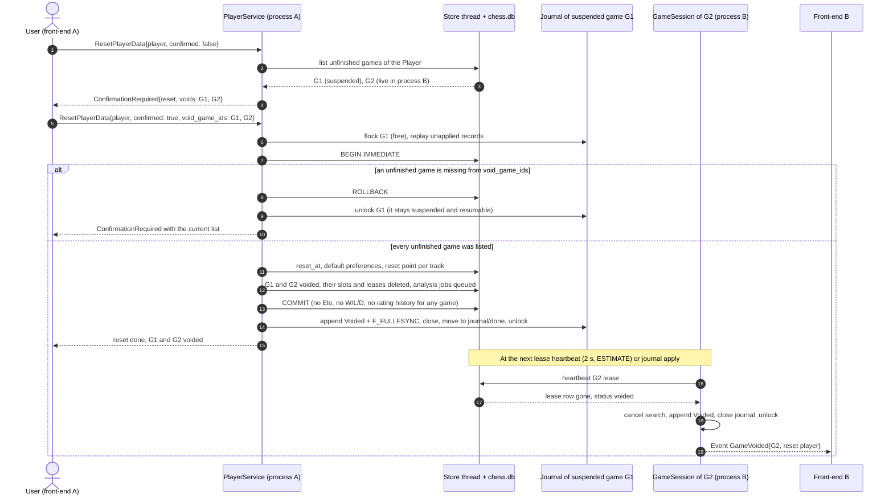
- **Names (PLY-6).** At most 128 user-perceived characters (Unicode extended grapheme clusters, UAX #29, as PLY-6 counts them), stored NFC-normalized with case kept. They are unique **case-sensitively** ("Anna" and "anna" are different names) across all Players, including computer and archived ones. Players are identified by `uuid`, never by name.
- **Average game length (UI-2).** Reported both in moves (full moves = ⌈plies / 2⌉) and in time (`total_active_ms`), from the same filtered queries.
- **Time accounting (DAT-3):** `think_ms` per move and the per-side totals come from the session's `TimeSource` while the game is live. Time while the app is closed is never counted, because a suspended game has no running clock. The session checkpoints both clocks into the journal every 1 s while a clock runs, and on every move, pause, and suspend (§7.6). The checkpoints are applied to `GAME.white_clock_ms`/`black_clock_ms`, so a resumed game restarts from the last recorded remaining time, including the side to move's partial thinking time (RULE-5, Q54). After any crash, disconnect, or reset, at most one checkpoint interval (1 s) is lost.

### 7.3 Multi-process coordination

The CLI, web server, and desktop app can all be open at once against the same file.

- **Writes** are short transactions, and WAL plus `busy_timeout` serialise them safely across processes (concurrent-access integration test for DAT-1).
- **Live games** are owned by exactly one process: the one holding an exclusive `flock` on the game's journal file (§7.6). The OS releases the lock the instant the owner exits or crashes, so another process can resume immediately (DAT-4; TBD-28 proposed: no wait after a crash). The `GAME_LEASE` row (owner kind, pid, heartbeat every 2 s) is only for display: opening the same game elsewhere shows "this game is open in the CLI". A hung but still-running owner keeps the lock, and the message tells the user which process to quit.
- **The background analysis queue** uses the same lease idea, so whichever process is running picks up pending jobs, and jobs survive restarts.
- Other screens (stats, player lists) re-query when they are opened. No cross-process push is needed in v1.

### 7.4 Data ownership and transaction boundaries

One writer per entity, and every invariant is enforced inside one SQLite transaction on the store thread (D-13).

| Entity | System of record (writer) | Readers | Transaction boundary and invariant |
|---|---|---|---|
| `PLAYER`, `PREFERENCES` | `PlayerService` | all services, front-ends via queries | **Register:** `PLAYER` + default `PREFERENCES` + an initial `RATING_HISTORY` row per track (Strict and Training), all-or-nothing (PLY-2, ELO-1). `name` UNIQUE, case-sensitive (PLY-6). **Reset (confirmed, humans only):** `reset_at` + default `PREFERENCES` + one reset point per track in `RATING_HISTORY` + the void of each unfinished game of the Player (`GAME.status = 'voided'`, every `UNFINISHED_SLOT` and `GAME_LEASE` row of the game deleted, analysis job queued, no rating or W/L/D effect for any side), one `BEGIN IMMEDIATE` transaction. Ratings and K counters untouched (PLY-7, D-26, D-30). For the void, `PlayerService` is a second writer of `GAME.status` and `UNFINISHED_SLOT` beside `GameSession`. The `BEGIN IMMEDIATE` serialisation and the "skip if already final" rule keep the two from conflicting (§7.2). `PlayerService` writes only initial and reset points to `RATING_HISTORY`; every game delta is written by finalize |
| `COMPUTER_PROFILE` | `PlayerService` (via `RosterGen`) | `EngineGateway`, stats | Roster batch inserted in one transaction, together with each computer Player's two baseline rating rows. Profile rows are never updated after insert: engine parameters are fixed (PLY-4, Q41) |
| `GAME` (header), `MOVE`, `UNFINISHED_SLOT` | `GameSession` (live), `GameSetupService` (start), `ImportExportService` (imported) | stats, analysis, export | **Start:** `GAME` + `Start` journal record + one `UNFINISHED_SLOT` per slot-holding Player (every human; computers only in c–c, D-27), in one synchronous transaction (GAME-4). **Move:** journal record + `F_FULLFSYNC` first (the durability point). Then `MOVE` row + `GAME` clock + `journal_seq`, one transaction per applied batch (NFR-2, §7.6). **Takeback:** a journal record, then delete the trailing `MOVE` rows in one transaction |
| `GAME` result, `RATING_HISTORY`, `PLAYER.*_elo` / `*_rated_games`, `ANALYSIS_JOB` | `GameSession` finalize | stats | **Finalize** (completed, including resignation): `GameEnd` journal record first. Then one `BEGIN IMMEDIATE` transaction: re-read both Players' ratings on the game's track (Training or Strict), compute result + times + Elo deltas for both sides on that track + history rows, delete the `UNFINISHED_SLOT` rows, enqueue the analysis job (ELO-1/2, §5.4). **c–c abort:** status, slot deletion, and job, with no ratings. Both are idempotent on replay: skipped if the status is already final (`completed`, `aborted`, or `voided`) |
| `MOVE_EVAL`, `ANALYSIS_JOB` state | `AnalysisWorker` | `AnalysisService`, stats | One upsert per ply. A partial run resumes from the last ply |
| `VARIATION` | `AnalysisService` | export | Per save or delete |
| `GAME_TAG`, imported `GAME`/`MOVE` | `ImportExportService` | export, history | One transaction per imported game |
| Journal files (`journal/<game_uuid>.jnl`) | the `GameSession` holding the file's `flock` | recovery in any process | Append-only, one writer. Truncated only after its records are applied and the game is final (§7.6) |
| `GAME_LEASE`, `PROCESS_HEARTBEAT` | `SessionRegistry`, `Core` startup | all processes | Display and liveness only. Compare-and-set on `heartbeat_at` |
| Whole database (`ImportData`, `RestoreBackup`, migrations) | `ImportExportService` / `chess-store` | — | **Exclusive:** refused with `Busy` if `PROCESS_HEARTBEAT` shows another live process. Pending journals are replayed first. Runs under `BEGIN EXCLUSIVE` after a `VACUUM INTO` backup. Data import merges (D-17, see below) |

**Data import merges (D-17, decided by Q51).**
1. `PreviewDataImport` matches Players by `uuid` (computers by `(roster_seed, roster_index)`) and games by `uuid`. A different Player with an identical name is also a conflict, because names are unique. It returns `ImportConflicts`.
2. For each conflict the user picks **Replace**: the imported record, with its rating history, replaces the local one. Or **Keep both**: the imported record gets a new `uuid` and a suffixed name such as "Brian (imported 2)", so it stays a distinct identity. Non-conflicting records are added.
3. `ApplyDataImport{plan}` writes everything in one transaction, then re-checks the Elo invariant per Player.
4. If any step fails, nothing is written and the backup is untouched.

Multi-game PGN files are supported by `ImportPgn` (IF-2).

A suspended game is `in_progress` with no journal lock held, so the stored status needs no separate `suspended` value.

Cross-process consistency is eventual only for screens that are open in another process: they re-query when opened (§7.3). Live game state is never shared, because the lease gives each live game one owner.

### 7.5 One version everywhere (D-16; one-way for data, accepted by the user)

The CLI and the desktop app must never be different versions. They ship and update together as one bundle (§8.2), so v1 has **no** machinery for mixed versions working together. It only detects a mismatch and refuses, with a message.
- **One build version** is compiled into the bundle and covers `chess`, `Chess.app`, the GUI bundle, the journal format, and the schema version.
- **Against the database.** On open, a `user_version` newer than the build's schema returns `SchemaTooNew`, writes nothing, and says "this data was written by a newer Chess. Update the app." An older `user_version` is a normal upgrade: the build migrates after a `VACUUM INTO` backup (DAT-6), but only when no other process is live. Before migrating, it replays all pending journals.
- **Against running processes.** Every process records its build version in `PROCESS_HEARTBEAT`. If a live process of a different version is found, which can only happen in the middle of an upgrade, startup is refused with "Chess version X is still running (CLI / web server / desktop). Quit it first."
- **Against a running server or a stale tab.** A second `chess serve` of another version is refused the same way. A browser tab from another build gets `ProtocolMismatch` and reloads (§5.6).
- **Journals.** The header's `journal_version` must equal the build's. A different value is refused with the same message.
- **One-way for data (accepted by the user, 2026-10-26).** Once a newer build has migrated `chess.db`, no older build can open it. The only way back is the pre-migration backup `chess.db.bak-v<N>`, with pending journals replayed on top, or a full-data export and import (§11.3).
- Tests: an older build opens a newer DB (`SchemaTooNew`); a heartbeat from another version is refused; migration replays journals first (DAT-1).

### 7.6 Move journal: the local cache that always wins (Q54, D-23)

The user's rule (Q54) has three parts:
- every move is cached locally and written to the database when the database is available;
- after any disconnect, hard reset, close, or crash, the clock is restored to the last recorded clock time;
- if the cache and the database disagree, the local cache wins.

**Files.** One append-only file per live game, `<data dir>/journal/<game_uuid>.jnl`. It starts with a header (`journal_version`, `game_uuid`, `store.id`). Each record is `{seq, kind, payload, crc32}`, length-prefixed. The kinds are:
- `Start{setup}`, `Move{ply, uci, san, think_ms, clocks_after}`, `Takeback{to_ply}`;
- `Clock{white_ms, black_ms, running_side}`: every 1 s while a clock runs, and on pause and suspend;
- `DrawOffer`/`DrawDeclined`, `Pause`/`Resume`, `Suspend`, `GameEnd{result, reason}` (including resignation and its side), `Abort` (c–c only), `Voided{reset_player_id}` (written after the reset transaction commits, D-30, §7.2).

**Write path.**
1. The `GameSession` holds an exclusive `flock` on its journal for as long as it owns the game. That lock *is* the lease (§7.3).
2. For each state change it appends the record and calls `fcntl(F_FULLFSYNC)`. Only then is the event broadcast, the move acknowledged, and the clock switched.
3. The record is passed to the store thread. In one transaction, the store thread writes the corresponding rows and `GAME.journal_seq = seq`.
4. If the DB is busy or locked (another process's write, an import, a migration) or unavailable, the store thread retries with backoff while play continues. The backlog is reported with `StoreBacklog`.

**Recovery (resume, takeover, startup).** Any process that acquires a game's `flock` first replays the journal:
- records with `seq > GAME.journal_seq` are applied in order;
- if a DB row differs from the journal for the same ply, for example after `RestoreBackup` brought back an older DB, the DB rows from that ply on are replaced by the journal's (**the cache wins**);
- the clock is restored from the latest `Move` or `Clock` record;
- a torn final record (bad CRC or short length) is dropped. It was never acknowledged, so no completed move is lost;
- if `GAME.status` is already `voided` but the journal has no `Voided` record (a crash between the reset commit and the journal write), the moves are applied, `Voided` is appended, and the journal is closed. The game is never resumed (D-30).

**Lifecycle.** After `GameEnd`/`Abort` and a successful finalize, or after `Voided` (whose store transaction is the reset itself), the journal is renamed to `journal/done/` and deleted once the next backup has run. Startup scans for journals with no live lock and replays them, which recovers games interrupted by an OS crash or power loss.

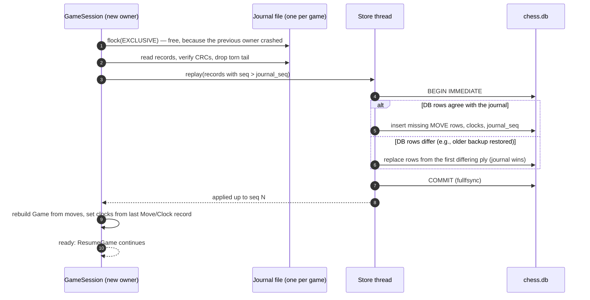

**Why a journal instead of only SQLite with `synchronous=FULL`?** FULL alone would also make each commit durable. But a move would then wait on the shared database, which another process may lock (busy timeout, import, migration), and Q54 explicitly asks for a local cache that survives the database being unavailable and that wins on disagreement. The journal costs one extra `F_FULLFSYNC` per move. Alternative: keep only SQLite with FULL, and make moves fail with `StoreBusy` when the DB is locked. That is simpler, but it doesn't meet Q54's "written when available".

**Browser and desktop.** The cache lives in the core process, on the Mac's disk. The browser holds no authoritative state. After a WebSocket drop, the page reloads the snapshot (§5.6). A dropped tab suspends the game at once and freezes its clocks (D-14).

---

## 8. Cross-cutting concerns

| Concern | Approach | Requirements |
|---|---|---|
| Error handling | Rust: `thiserror` per crate, mapped at the protocol boundary to `{code, message, details}` (catalogue in §5.5). Front-ends show `message` and branch on `code`. State changes only after the journal flush (§4.8, §7.6), so every error leaves the game as it was and resumable. | CLI-3, ENG-1, RULE-5, NFR-2 |
| Logging | `tracing` to a rotating file in the data dir, with a correlation id per request (`Internal{id}`). No move-by-move PII beyond Player names. Off-device telemetry: none. | NFR-4 (derived: supportability) |
| Security | Data dir created `0700` and `chess.db` `0600`. Web: loopback bind, Host/Origin allow-list, CSP, no CORS (R-5, D-22). The core validates every protocol message and never trusts client-computed state (principle 1). One person per Mac account is confirmed (ASM-1, CONFIRMED), so the loopback server has no access token (D-22). | NFR-4, PLAT-3 |
| Offline | No run-time Internet access anywhere; everything bundled; CSP enforces it. Details in §8.1. | PLAT-3 |
| Privacy / network | The web server binds to loopback only. A test runs a full session under a network-capture harness and asserts zero outbound connections. | NFR-4 |
| Determinism | `TimeSource` and `Rng` are injected everywhere. Engine tests use `Threads=1`, a fixed hash size, and fixed depth. | test-strategy |
| Licensing | Project licensed **GPL-3.0-or-later** (needed for distributed builds that bundle Stockfish; compatible with `shakmaty`). `cargo-deny` and an npm license checker in CI. Stockfish `COPYING` + source offer shipped in every artifact. | ENG-1, NFR-6 |
| Performance | Engines start lazily. SQLite opens in a few ms. The GUI is a static bundle, embedded in the server binary with `rust-embed`. Benchmarks are run in CI for startup and engine latency. | NFR-1, ENG-3 |
| Accessibility | GUI: ARIA grid board, live region announcing moves, focus ring, axe in E2E. CLI: the full-screen TUI is not reliably screen-reader friendly, so plain mode (`--plain`, automatic off-TTY) is the accessible path; `NO_COLOR` honoured in both. Details in §8.3. | UI-4, GUI-2 |
| Packaging and install | One build version for every artifact, an install script for the CLI, and an unsigned `.app`. Details in §8.2. | PLAT-1/2, NFR-5 |

---

### 8.1 Offline operation (PLAT-3)

All three entry points must be fully usable with no Internet connection, from first launch. The architecture has no component that needs the network at run time. The table below lists every run-time dependency and how it is satisfied locally.

| Run-time dependency | How it is satisfied offline |
|---|---|
| Chess rules, game logic, Elo, clocks | Compiled into the Rust binaries (`chess`, `Chess.app`). |
| Engine (Stockfish) | Native universal binary bundled inside `Chess.app`, next to the bundled `chess` CLI (D-9, §8.2). Official Stockfish builds embed their NNUE network file, so no network file is downloaded. The pinned build is verified to start with networking disabled. |
| Data store | Local SQLite file in `~/Library/Application Support/Chess/`. Created on first launch; roster generated from a fixed seed. No account or server. |
| GUI code, styles, fonts | Vite builds a self-contained bundle: all JS/CSS, fonts (self-hosted, no Google Fonts), board themes, and SVG piece sets. Embedded into the `chess` binary (`rust-embed`) for the web, and bundled into `Chess.app` for desktop. No CDN references. |
| Web page transport | `chess serve` serves the bundle and the WebSocket on `127.0.0.1`. Works with Wi-Fi off, because loopback never leaves the machine. |
| Desktop transport | Tauri IPC in-process (D-1); no socket at all. |
| ECO opening table (DAT-3) | Bundled data file compiled into `chess-domain` (D-20). Never downloaded. Its license is checked under NFR-6 |
| Help / documentation | Rendered from files shipped with the app (TUI help screen, GUI help page). External links (e.g., Stockfish source offer) are shown as text and never fetched automatically. |
| Updates, telemetry, crash reporting, license checks | None. The Tauri updater plugin is not included. |
| macOS launch checks | The desktop app is a locally built, unsigned build (PLAT-1). Built on the same Mac, it carries no quarantine attribute, so Gatekeeper's online check doesn't apply. |

**Enforcement, so offline can't silently regress:**
- **Content-Security-Policy** `default-src 'self'; connect-src 'self' ws://127.0.0.1:*` (web) and the equivalent Tauri `csp` config (desktop). Any accidental remote script, font, or image fails to load, and the E2E suite catches it.
- **Bundle scan in CI:** fails if the built GUI contains `http(s)://` resource references outside an allow-list (license texts, documentation links shown as text).
- **Offline E2E:** the PLAT-3 scenario (clean profile → register → timed game vs. a computer → post-game analysis → stats → export) runs for desktop, web (three browsers), and CLI with non-loopback networking blocked, under the NFR-4 network-capture harness.

**Build vs. run:** building from source needs the Internet once (crates, npm packages, the pinned Stockfish download in D-9). Running never does. If fully offline builds are wanted later, `cargo vendor`, an npm offline mirror, and a cached Stockfish archive cover that without architectural change.

### 8.2 Deployment and packaging (D-18; one bundle per D-16)

| Artifact | Contents | Installed to | Engine lookup |
|---|---|---|---|
| `Chess.app`, the only artifact | Tauri app, GUI bundle, the `chess` CLI binary (web server included) in `Contents/MacOS/`, one universal pinned `stockfish` next to it, `LICENSES/`, Stockfish source offer | `.dmg` → `/Applications` (unsigned, universal) | `<exe dir>/stockfish`, in the same bundle for both entry points. `CHESS_STOCKFISH` overrides it for dev and tests only. **Never `PATH`**, so the pinned version (D-9) is always the one used |
| `chess` on `PATH` | A symlink, not a copy: `~/.local/bin/chess` → `/Applications/Chess.app/Contents/MacOS/chess` | Created by `packaging/install-cli.sh` (or the app's "Install command-line tool" menu item), which checks that `~/.local/bin` is on `PATH` and prints the line to add if not (PLAT-1) | — |
| Data | `chess.db`, journals, backups, logs, `config.toml` | `~/Library/Application Support/Chess/` (or `CHESS_DATA_DIR`), shared by all entry points | — |

- **One bundle, one version (D-16).** Replacing `Chess.app` updates the CLI, web server, desktop app, and engine together, because the symlink always points into the current bundle. A separately copied `chess` binary is not a supported install.
- **Platform (PLAT-2, Q46, Q47, user answer 2026-10-26).**
  - **Target:** macOS Tahoe **and every later release**, on any Apple silicon Mac (M1 and newer), and on Intel Macs for as long as Apple's macOS supports them (R-13). The minimum deployment target stays macOS 26.0 (Tahoe): `MACOSX_DEPLOYMENT_TARGET=26.0` for `chess`, and Tauri `bundle.macOS.minimumSystemVersion = "26.0"` for `Chess.app`. There is no upper bound.
  - **What "and later" implies:**
    - builds use the current Xcode SDK;
    - each new macOS release is tested before support is claimed: smoke test, engine integration, offline E2E, and the desktop E2E against the new WKWebView, starting on the developer betas;
    - pinned dependencies with OS contact (Tauri, WKWebView behaviour, crossterm/terminal behaviour, Stockfish builds) are re-checked and bumped when a release breaks them;
    - deprecated APIs are tracked in CI warnings;
    - the platform matrix (§9) gains a column per supported macOS release.
  - **Build:** `chess` is built for `aarch64-apple-darwin` and `x86_64-apple-darwin` and joined with `lipo`. The arm64 slice covers M1 and newer. `Chess.app` uses the universal Tauri target.
  - **Stockfish (revised 2026-10-27): Stockfish 19, tag `sf_19`** (D-9). Stockfish 19 ships "universal binaries" that detect the CPU's features at run time, so there is no longer a choice between AVX2, AVX-512, and other variants (release notes, checked 2026-10-27). The build script `third_party/stockfish/fetch.sh` follows this plan:
    1. **Preferred path: the official `stockfish-macos-universal.tar.gz` asset** of the `sf_19` release. The script downloads it once, checks it against the SHA-256 recorded in the script (written when the pin was made), extracts it, and runs `lipo -info` on the binary. It accepts the asset **only if both `arm64` and `x86_64` are listed**. Then it runs the binary once with `uci` and records the `UCI_Elo` range it reports (§4.6). That first run closes ASM-3. With run-time CPU dispatch, the single x86_64 slice covers every Intel Mac that Tahoe supports, with no AVX2 build and no run-time file choice. This is confirmed by the engine integration tests on the Intel Mac of the platform matrix (§9).
    2. **Fallback, used only if `lipo -info` does not show both architectures:** the previous plan. Build Stockfish 19 from the checksummed `sf_19` source archive for `arm64` and for `x86_64`, and join the two with `lipo` into one universal `stockfish`. If the source build offers the same run-time CPU dispatch as the release binaries (checked in its build documentation when the fallback is needed), one x86_64 build is enough. If not, the old conditional plan applies: an AVX2 build checked against Apple's Tahoe-compatible Intel models, and, if one variant can't cover them all, two x86 files chosen at run time from `sysctl hw.optional.avx2_0`.
    - **CI test:** a packaging test runs `lipo -info` on the bundled `Chess.app/Contents/MacOS/stockfish` and fails unless it lists both `arm64` and `x86_64`. It also checks the engine's `id name` line names Stockfish 19, so a different binary can't slip in.
    - **License:** the Stockfish 19 release notes say it is "licensed under the GPL license". The build script reads the exact GPL version from the shipped `COPYING` file (requirements TBC-9) and the license audit records it. `COPYING` and the source offer ship in every artifact (§8, NFR-6).
    - **Network:** Stockfish 19 uses the new SFNNv16 network architecture. The existing offline test (§8.1) checks that the bundled binary starts and searches with networking disabled, which proves its network file is embedded.
    - For the sidecar, follow Tauri's naming rule for universal targets (OQ-11, to verify against the pinned Tauri version).
  - **Performance baseline:** M4, 16 GB, Tahoe (NFR-1, ENG-3, NFR-8, calibration, the §4.8 timeouts). M1–M3 and Intel Macs are supported but slower (R-14).
  - **Browsers:** Safari, Chrome, Firefox, and Edge releases from the last 3 years. Vite's JS and CSS build target is derived from a browserslist query for releases of those four browsers from the last 3 years. The exact query is checked with `npx browserslist` when the build is set up. Playwright tests the current engines; the oldest supported version of each is smoke-tested manually per release.
  - **Terminals:** Terminal.app and iTerm2.
- **Install docs (NFR-5)** live in the README: build prerequisites (needs the Internet once, §8.1), `make release`, opening the `.dmg`, installing the CLI symlink, `chess serve`, and uninstall (delete the app and the symlink; data stays until the user deletes the data dir).
- **Port and config file (PLAT-4, Q55, TBD-3).** The port setting applies only to `chess serve` and the browser URL. The CLI play modes run the core in-process and the desktop app uses IPC (D-1), so neither uses a port.
  - Precedence: (1) the `--port <n>` flag, then (2) `server.port` in `config.toml`, then (3) the default, 8765 (TBD-3).
  - The config file is `~/Library/Application Support/Chess/config.toml`. `--config <path>` or `CHESS_CONFIG` points elsewhere, which tests use. It is created only when the user saves a setting, and unknown keys are kept and warned about.
  - The page connects back to the origin it was served from. A fixed port keeps that origin stable for the Host/Origin allow-list (NFR-7).
  - If the port is taken, `chess serve` exits non-zero with a message naming the port. If the holder is another `chess serve` (found in `PROCESS_HEARTBEAT`), the message prints that server's URL. This matches PLAT-4.
- **No auto-update** (§8.1). Upgrading means replacing `Chess.app`.

### 8.3 Accessibility details (UI-4, GUI-2)

| Area | Mechanism | Verification hook |
|---|---|---|
| Keyboard | Every screen is reachable and operable by keyboard (Tab order, Enter/Space, Esc closes dialogs). The board uses `AccessibleOverlay` (§11.1), and the SAN field is always available | Playwright keyboard-only scenario per screen |
| Screen reader (GUI) | Squares labelled "e4, white knight". The live region announces own move confirmed, opponent move, check, draw offer, game end, and clock warnings at fixed thresholds (no per-second announcements). The Elo chart has a table alternative. Dialogs move focus in and return it on close | axe, scripted VoiceOver walk-through (M) |
| Screen reader (CLI) | Plain mode, as in §6.1 (no tick output) | PTY transcript tests |
| Contrast | High-contrast board theme and piece set. Unit test checks theme contrast ratios against WCAG 2.2 AA (4.5:1 text, 3:1 non-text; UI-7) | U: contrast test per theme |
| Motion | `prefers-reduced-motion` turns off chessground animation (`animation.enabled = false`) | E: emulated media query |
| App themes | Light, Dark, and System (follows `prefers-color-scheme`) plus other bundled themes (Q52). All are checked against UI-7 | Contrast unit test per theme; screenshots in both schemes |
| Confirmations | Resign (h–h: which side), c–c abort, archive, reset player data, and TUI quit (Ctrl-C) always ask (Q52). The reset dialog lists each unfinished game it will void and says it counts for neither player (D-30). Dialogs are focus-trapped and announced, and Esc cancels | E: keyboard-only confirm and cancel |
| Colour independence | Last move, check, and selection use outline or pattern as well as colour. TUI highlights use reverse video or markers when `NO_COLOR` is set | Screenshot and snapshot tests |

### 8.4 Room for network play later (Q43, not built in v1)

v1 stays fully offline (PLAT-3, NFR-4): there is no listener beyond loopback and no outbound connection. Network play is a planned future enhancement, and these existing choices keep it cheap to add without building any of it now:
- **The core is already authoritative and remote-ready.** All rules, clocks, and the Policy run in the core (principle 1), and front-ends speak one serializable protocol (§5). A remote opponent would be one more front-end adapter that sends commands (`MakeMove{ply}` with the optimistic check) and receives events.
- **Identity.** Players and games carry `uuid`s (§7.2, Q51), so records can later be matched across machines.
- **A new seat type.** A "remote human" side can be added to `GameSetup` and the Policy table as a new matchup, without changing the existing rows.
- **The transport seam** is the `chess-server` WebSocket adapter (§5.2). The future work is TLS, authentication, NAT traversal or a relay, and a server-side clock authority between two cores.
- **What would have to change, and is deliberately absent now:** binding beyond loopback, CSP `connect-src` beyond self, and any outbound traffic. These need a requirements change (PLAT-3, NFR-4) and a new decision record. The offline enforcement in §8.1 would then become per-feature, not global.

## 9. Testing architecture (mapping test-strategy onto this design)

| Test level | Where | Tools |
|---|---|---|
| Unit | `chess-rules`, `chess-domain` (perft, SAN tables, Policy table, Elo vectors, clock with fake time, roster determinism, variation tree, `BoardGrid` snapshots); `chess-cli` (TUI `update` with synthetic messages, `render` into ratatui `TestBackend` at 80×24 and larger, key-map vs. SAN collision test) | `cargo test`, `proptest`, `insta` (snapshots), `cargo-mutants` (Elo, Policy) |
| Property / fuzz | random legal playouts; `parse(format(m)) == m`; arbitrary CLI input; protocol fuzzing at the WebSocket | `proptest`, `cargo-fuzz` |
| Core integration | `chess-app` with `FakeEngine` + in-memory or temp-file store: full game flows, Strict gateway spy, rewind/stale-ply rejection, lease takeover, crash-recovery (kill child process mid-write); failure injection for each §5.5 code (fake engine returning an illegal move, hanging, or crashing; store busy, full, or read-only; `SchemaTooNew` from a newer fixture DB); lagged event subscriber gets a snapshot; duplicate `StartGame{game_uuid}` and resent `MakeMove` are idempotent; slow fake store doesn't stall the clock timer (R-11); reset with unfinished games (D-30): a suspended game, a game live in the same process, and a game live in a second process are each voided, every slot is released, no rating, counter, W/L/D, or rating-history row changes for any side, a game started after the confirmation prompt causes a new `ConfirmationRequired`, and a kill between the reset commit and the `Voided` journal record recovers to `voided` | `tokio::test`, temp dirs |
| Engine integration | real Stockfish (the pinned Stockfish 19): UCI handshake, `id name` names the pinned version, the reported `UCI_Elo` range contains every stored `COMPUTER_PROFILE.uci_elo` (§4.6), legal `bestmove`, tactics fixtures, crash/timeout recovery, latency | gated by `--features stockfish-tests` |
| CLI E2E | scenario files replayed through a PTY: TUI screens asserted by parsing the terminal output into a virtual screen; resize; terminal restored after quit/Ctrl-C/panic; plain mode as a transcript and via pipe; headless mode | `expectrl` + `vt100` (Rust) |
| GUI E2E (web) | same scenario files through the browser | Playwright: WebKit (for Safari), the `chrome` and `msedge` channels, Firefox; axe; screenshot diffs per theme, including light and dark app themes and emulated `prefers-color-scheme`; fluid-resize checks |
| Packaging | `lipo -info` on the bundled `stockfish` lists both `arm64` and `x86_64` (§8.2); also a step of the engine build script | CI script |
| Platform matrix | arm64 (the M4 baseline, plus one older M-series Mac if available) and x86_64, on Tahoe and on each later macOS release, starting at its developer beta: smoke test, engine integration, offline E2E, desktop E2E. Intel needs a physical Intel Mac for as long as Intel is supported (R-13) | manual + scripted |
| GUI E2E (desktop) | same GUI suite against the Tauri app — **see risk R-1** | Playwright WebKit against a Tauri dev build plus a scripted smoke test of the real `.app` |
| Calibration / soak | `chess calibrate`; 1000-game c–c soak | nightly CI |

The same scenario format (`e2e/scenarios/*.yaml`: setup, inputs, expected PGN/result/visible controls) feeds the CLI and GUI runners, which gives "one scenario, three front-ends" (test-strategy principle 3, PLAT-1). Test names carry requirement IDs for the traceability matrix.

---

## 10. Requirements traceability (component view)

### 10.1 Allocation: every requirement to one primary component

The **primary** component is accountable for the requirement. Supporting components take part. Verification hooks point to §9 and to the requirement's own verification list.

| Req | Primary component | Supporting | Design refs |
|---|---|---|---|
| PLAT-1 | `packaging/` (three entry points, one build) | `chess-cli` (+ `serve`), `chess-server`, `desktop/src-tauri` | §2, §6.3, §8.2 |
| PLAT-2 | `packaging/` (universal build, Tahoe minimum) | `ui/` (Safari, Chrome, Firefox, Edge), TUI on Terminal.app and iTerm2 | §8.2, §9 |
| PLAT-3 | Offline enforcement (CSP, bundle scan, offline E2E) | every artifact. Bundled engine, fonts, themes, ECO table | §8.1 |
| PLY-1 | `chess-domain::GameSetup` | `GameSetupService`, setup screens, CLI flags | §4.4 |
| PLY-2 | `PlayerService` (register; profile chooser at launch) | `EloCalc` start values on both tracks, `PREFERENCES`, Register screens | §6.1, §6.2, §7.4 |
| PLY-3 | Profile chooser at launch in every front-end (`SelectProfile`, Q48) | `GameSetupService` (side assignment), `APP_SETTING.last_active_player` (pre-selection only) | §6.1, §6.2, §7.2 |
| PLY-4 | `chess-domain::RosterGen` | `PlayerService`, `COMPUTER_PROFILE`, Computer Players screens | §4.6 |
| PLY-5 | `chess-domain::Policy` | `allowed_actions` in every front-end, `EngineGateway` | §4.4, §4.5 |
| GAME-1 | `GameSetupService` | `Policy`, New Game screens (TUI, GUI), CLI flags | §4.4, §6.1 |
| GAME-2 | `GameSession` (pause, step, delay, watcher-only abort) | Watch screens | §4.3, §4.4 |
| GAME-3 | Front-end view cursor (TUI `TuiState`, GUI client state) | `GameSession` `ply` check (`StalePosition`) | §4.2, §6.2 |
| GAME-4 | `GameSetupService` + `UNFINISHED_SLOT` (one unfinished game per mode for each human, and for each computer in c–c only; D-27) | Resign as the only early end for humans, c–c watcher abort, `UnfinishedGameExists` (setup only), resume prompt, slots released by a reset void (D-30) | §4.3, §4.4, §7.2 |
| RULE-1 | `chess-rules` | — | D-3 |
| RULE-2 | `chess-domain::Game` (termination) | `GameSession`, `EngineGateway(ComputerDrawDecision)` | §4.3, §4.5 |
| RULE-3 | `chess-domain::Game` (takeback) | `Policy`, `GameSession` | §4.3, §7.4 |
| RULE-4 | `chess-domain::Clock` | `GameSession` flag timer, client countdown, `SearchLimits` budget | §4.2 |
| RULE-5 | Move journal (§7.6) + `GameSession` (auto-save and resume) | `chess-store` (applies the journal), `SessionRegistry` (journal lock) | §7.2, §7.3, §7.6, D-23 |
| RULE-6 | `ImportExportService` (PGN export of any stored game) | `chess-rules` PGN writer (IF-1), history screens | §5.7 |
| RULE-7 | `ImportExportService` (PGN import, review only) | `chess-rules` PGN reader (IF-2); imported games are unrated (`status = 'imported'`) | §5.7, §7.2 |
| RULE-8 | `GameSetupService` (FEN start position, always unrated) | `chess-rules` FEN parser (IF-3), Import screen's analysis board | §5.7, §7.2 |
| ENG-1 | `chess-engine` | `packaging/` (bundled engine), `EngineGateway` failure handling | §4.7, §8.2 |
| ENG-2 | `chess-domain::RosterGen` + `Personality` | `chess-engine` (UCI options), `chess calibrate` | §4.6 |
| ENG-3 | `chess-engine::SearchLimits` (min of personality, the active profile's max think, and the clock budget) | `GameSession`, `EngineGateway` | §4.6, §4.8 |
| ENG-5 | `GameSession` (`CancelEngine` → UCI `stop` → best move so far, ≤ 200 ms) | `chess-engine`, every front-end's cancel control or key | §4.4, §4.8 |
| DAT-1 | `chess-store` | leases, migrations, D-16 | §7 |
| DAT-2 | `ImportExportService` (merge import, zip export) | `chess-store` exclusive ops | §5.7, §7.4, D-17 |
| DAT-3 | `chess-store` schema | `GameSession` time accounting, `AnalysisWorker`, ECO classifier (D-20) | §7.2, §5.4 |
| ELO-1 | `chess-domain::EloCalc` (both sides, human and computer, Q41; K per track from that track's rated-game counter, Q78) | finalize transaction re-reads current ratings, `RATING_HISTORY` | §5.4, §7.2, §7.4 |
| ELO-2 | `chess-domain::Policy` + `EloCalc` (Elo track = game mode: Training Elo or Strict Elo) | `PLAYER.*_elo`, `RATING_HISTORY.track` | §4.4, §7.2 |
| UI-1 | `PlayerService` (`PREFERENCES`) | GUI/TUI settings screens, gateway (active profile's max think, §4.6). No sound or confirm-move settings | §6.2, §4.6 |
| UI-2 | `StatsService` (W/L/D including Training; average length in moves and time) | Stats screens (TUI `Chart`, GUI chart D-21) | §7.2 |
| UI-3 | `ui/themes` (GUI), `chess-domain::BoardStyle` (CLI) | contrast test | §6.2 |
| UI-4 | `ui/board` `AccessibleOverlay` + `LiveRegion` (GUI), `PlainRunner` (CLI) | §8.3 | §11.1 |
| UI-5 | `StatsService` | Computer Players screen, with an Elo chart for computers too (Q41). Category label from the Strict Elo (Q79) | §4.6, §7.2 |
| ANA-1 | `EngineGateway` (+ `Policy`) | `AnalysisService`, audit log spy | §4.5 |
| ANA-2 | `AnalysisService` + `VariationTree` | `LegalMoves` (D-11), `VARIATION` | §5.1 |
| ANA-3 | `AnalysisService` | `AnalysisWorker`, `MOVE_EVAL` | §5.4 |
| CLI-1 | `chess-cli` (`TuiApp`, screens; 80×24 with resize attempt) | `PlainRunner`, terminal guard | §6.1 |
| CLI-2 | `chess-domain::BoardGrid` | `BoardWidget` | §6.1 |
| CLI-3 | `chess-cli::InputParser` | `chess-rules` SAN parsing | §6.1 |
| CLI-4 | `chess-cli::KeyMap` + `clap` flags | headless runner, D-19 | §6.1 |
| GUI-1 | `ui/` (one bundle) | `CoreClient` with two transports, R-1 | §5.2, §6.2 |
| GUI-2 | `ui/board` (`BoardModel`, overlay, chessground adapter; commit on drop, Enter, or destination select) | SAN input, `PromotionPicker` | §6.2, §11.1 |
| GUI-3 | `ui/board` (coordinates option) | `PREFERENCES` | §6.2 |
| GUI-4 | `ui/` Play screen | `EngineThinking` / `GameEnded` events | §6.2 |
| NFR-1 | Lazy engine start + first frame before engine | embedded bundle, startup benchmark | §4.7, §6.1 |
| NFR-2 | `chess-store` (WAL, transactions in §7.4) | durable-before-ack (§4.8) | §7 |
| NFR-3 | `EngineGateway` legality check + `chess-rules` | fuzz, 1000-game soak | §4.5 |
| NFR-4 | `chess-server` loopback + no telemetry | network-capture harness | §8, §8.1 |
| NFR-5 | `packaging/` + README install docs | — | §8.2 |
| NFR-6 | CI license audit (`cargo-deny`, npm checker) | `third_party/`, notices in every artifact | §8 |

Every requirement in requirements.md at its 2026-10-26 baseline has a primary component (checked by script against the requirement headings and tables; re-checked by script on 2026-10-27 against requirements.md v1.0 Amendment 1: all 78 requirement and RISK IDs have an allocation row, and Amendment 1 added no new requirement ID): the original requirements, and the baseline splits RULE-6–RULE-8 (from RULE-5) and ENG-5 (from ENG-3), in the table above, plus every other ID added on 2026-10-26 in the table below. Every AGREED requirement is a mandatory "shall" (user, 2026-10-26), so none of them may be left without an architectural home or deferred.

**Requirements added by the systems engineer on 2026-10-26.** All of them are AGREED at baseline (Q75 accepted every PROPOSED requirement and TBR item), so these allocations are final:

| Req | Primary component | Supporting | Design refs |
|---|---|---|---|
| PLAT-4 | `chess-cli serve` → `chess-server` | `packaging/` | §8.2, D-8 |
| PLAT-5 | `packaging/` (one `Chess.app` bundle with `chess` and Stockfish) | `chess-store` (version stamp), `chess-server` / gateway (version handshake) | §7.5, §8.2, D-16, D-18 |
| PLY-6 | `PlayerService` (`ValidationFailed`; unique case-sensitive, ≤ 128 chars) | Register/rename screens | §5.5, §7.2, §7.4 |
| PLY-7 | `PlayerService::reset` (`reset_at`, reset points, confirmed, humans only, voids the Player's unfinished games; D-26, D-30) | `ConfirmationRequired{voids}` (lists the games to be voided); `GameSession` (`Void`, `GameVoided`); stats and history queries for the reset Player filter by `reset_at`, opponents' queries don't (Q76) | §4.3, §5.1, §5.5, §7.2, §7.4, §7.6 |
| ENG-4 | `chess-engine` + `EngineGateway` failure path | `GameSession` (`EngineError`), D-15 | §4.7, §4.8 |
| DAT-4 | `SessionRegistry` (journal `flock`, `GAME_LEASE` for display) | `GameLeased` error | §7.3, §7.6 |
| DAT-5 | `chess-store` (`quick_check`, restore flow) | `RestoreBackup` | §7.1 |
| DAT-6 | `chess-store` migrations (`VACUUM INTO` backup) | D-16 | §7.1, §7.5 |
| UI-6 | `ui/board` `LiveRegion` | §8.3 announcement list | §8.3 |
| UI-7 | `ui/themes` + contrast unit test (WCAG AA for every theme, high contrast included) | axe | §6.2, §8.3 |
| UI-8 | `AccessibleOverlay` focus ring + global focus styles | — | §11.1, §8.3 |
| UI-9 | Help screens (TUI, GUI), content bundled. CLI help is generated from `KeyMap`, so it can't drift | plain-mode `help` | §6.1, §8.1 |
| UI-10 | `ui/themes` app colour themes (System / Light / Dark / others; live switch on appearance change) | `PREFERENCES` | §6.2, §8.3 |
| UI-11 | English-only string modules per front-end | help content (UI-9) | §6.2 |
| ANA-4 | `AnalysisService` (from game history) | `GetGameAnalysis`, history screens | §5.1 |
| CLI-5 | `chess-cli` headless runner | exit codes (§6.1, TBD-21) | §6.1 |
| GUI-5 | `ui/` fluid layout. No minimum size (Q55) | `ResizeObserver` → chessground `redrawAll` | §6.2, §11.1 |
| NFR-7 | `chess-server` Host/Origin allow-list | D-22 | §5.2 |
| NFR-8 | Concurrency model (D-13): no blocking on UI threads | `CancelEngine`, latency test | §4.8 |
| NFR-9 | Error catalogue (`code` → message) | every front-end | §5.5 |
| IF-1, IF-2, IF-3 | `chess-rules` PGN/FEN + `ImportExportService` | — | §5.7 |
| IF-4 | `chess-engine` + `third_party/stockfish` (D-9: Stockfish 19, `sf_19`) | `packaging/` (`lipo -info` check) | §4.6, §8.2 |
| IF-5 | `ImportExportService` (format version) | D-17 | §5.7, §7.4 |
| RISK-1 (requirements risk) | Mirrored by architecture risk R-13 (Tahoe is the last Intel macOS) | D-25 | §12 |
| RISK-2 (requirements risk) | Mirrored by architecture risk R-17 (computer rating drift). Test and calibration stores are isolated | `CHESS_DATA_DIR`, `chess calibrate` | §4.6, §12 |

**Values for the TBDs that requirements.md assigns to the architect (set at baseline v1.0):**
- TBD-3: default port 8765 (§8.2).
- TBD-13: follows the accepted EST in ENG-4: 5 s for a readiness reply, and 2 s past the move's time limit (§4.8).
- TBD-21: exit codes 0 result reached, 1 usage or setup error, 2 engine unavailable, 3 store error (§6.1).
- TBD-24: custom tags `Mode`, `Rated`, `WhiteClass`, `BlackClass`, plus `EndStatus` (`aborted` | `voided`, only for games that ended without a result; added 2026-10-27, D-30) (§5.7).
- TBD-25: 10 MB (§5.7, `ESTIMATE`).
- TBD-28: 0 s. The journal `flock` is released by the OS when the owner exits or crashes, so another process can take over at once (§4.8, §7.3).
- TBD-29: `config.toml` (TOML) in the data dir, overridable with `--config` or `CHESS_CONFIG` (§8.2, D-24).
- TBD-26: **Stockfish 19, tag `sf_19`** (published 2026-09-05, not a pre-release; https://github.com/official-stockfish/Stockfish/releases/tag/sf_19, checked 2026-10-27). Closed as a version choice (user 2026-10-27: "use the latest Stockfish"). Two facts about it are still checked at the first engine build-script run (ASM-3, step 2). A later version needs a decision-log entry and a calibration re-run (D-9, §11.3).
- TBD-18: **still open.** The events to announce are fixed in §8.3; the exact wording is written with the GUI string module in step 3 and checked in the scripted VoiceOver walk-through (owner: GUI developer).
- Closed by the user and met by the design: TBD-1 (Tahoe minimum, §8.2), TBD-7 and TBD-23 (last recorded clock value, no completed move lost: §7.1, §7.6), TBD-12 (≤ 200 ms EST, §4.8).

### 10.2 Reverse check: elements without a driving requirement

| Element | Driver | Verdict |
|---|---|---|
| `chess calibrate`, `EnginePurpose::Calibration` | ENG-2 calibration verification (dev tooling, not shipped behaviour) | Keep. Not reachable through the protocol (§4.5) |
| `tracing` log file | none directly. Derived: supportability and correlation ids (§5.5) | Keep. Local only (NFR-4) |
| `GAME.uuid`, `import_hash` | derived from DAT-2 (export/import identity) and §5.6 idempotency | Keep |
| `PROCESS_HEARTBEAT`, `SchemaTooNew` | derived from DAT-1 (concurrent access, migrations) and D-16 | Keep. Requirements gap G-9 asks for an explicit requirement |
| `APP_SETTING` | PLY-3 (switching), PLY-4 (seed) | Keep |
| `Internal{id}` correlation ids | derived | Keep |

There are no orphan components.

### 10.3 Requirement gaps found by this review (for the systems engineer)

The last column links each gap to the item the systems engineer opened in requirements.md on 2026-10-26, where one exists. "new" means the gap is not covered there yet. All three rounds of the user's answers (2026-10-26) are reflected below.

| ID | Gap | Affects | Status at baseline v1.0 (2026-10-26) | Systems-engineer item |
|---|---|---|---|---|
| G-1 | Web "app closed" undefined | RULE-5, RULE-4 | **Resolved:** a closed or disconnected tab suspends the game at once (D-14) | Q66 |
| G-2 | Clock during engine failure | ENG-1, RULE-4 | **Resolved:** keeps running (D-15) | ENG-4 |
| G-3 | Full-data import semantics | DAT-2 | **Resolved:** merge (D-17). Export is one archive (§5.7) | IF-5 |
| G-4 | Whose max-think-time setting applies in c–c and h–h | UI-1, ENG-3 | **Resolved:** the active profile's setting. c–c: caps both computers. h–h: caps engine analysis only (§4.6) | Q69 |
| G-5 | CLI scope of UI-1 settings | UI-1, CLI-1 | **Resolved:** no sound and no confirm-move in v1. All inputs are always active | Q65 |
| G-6 | Training games in W/L/D | UI-2 | **Resolved:** counted, with a separate Training Elo | ELO-2 |
| G-7 | Meaning of "user can cancel" | ENG-3 | **Resolved:** the ENG-3 amendment was accepted (Q75). `CancelEngine` = move now, within 200 ms (TBD-12) | ENG-3 amendment (c) |
| G-8 | Accessibility not quantified | UI-4 | **Resolved:** WCAG AA for every theme, high contrast included (UI-7) | Q68 |
| G-9 | Mixed builds sharing one DB | DAT-1 | **Resolved:** never allowed. Detected and refused (D-16) | — |
| G-10 | Recalibration after release | ENG-2 | Resolved (Q41) | — |
| G-11 | Baseline machine | NFR-1, ENG-3 | Resolved: M4, 16 GB, Tahoe (performance baseline only) | — |
| G-12 | Name rules | PLY-6 | **Resolved:** ≤ 128 characters, unique case-sensitively, case kept. Identity is the UUID | Q63 |
| G-13 | Stale clock log row | RULE-4 | Done | — |
| G-14 | No way to leave a game | GAME-4 | **Resolved:** Resign (counts as a loss). Abort is c–c watcher only | Q60 |
| G-19 | Does an h–c game use the computer's unfinished-game slot? | GAME-4 | **Resolved:** no. Slots are held by humans, and by computers only in c–c (D-27) | Q77 |
| G-20 | Reset while the Player has an unfinished game | PLY-7, GAME-4 | **Resolved 2026-10-27 (user):** allowed. Each unfinished game is voided and counts against neither player (D-30, §7.2). The systems engineer adds the rule to PLY-7 | user decision 2026-10-27 |
| G-15 | ECO data source and license | DAT-3, PLAT-3, NFR-6 | **Open (owner: architect, step 1).** Bundling a table is accepted (DAT-3 (a), D-20). Closing step: pick a GPL-compatible source, record its license under NFR-6, and add it to `third_party/` | DAT-3 amendment (a) |
| G-16 | Computer Elo vs. the old ELO-1 text | ELO-1, PLY-4, UI-5 | **Resolved:** dynamic on two tracks (Training too, for computers), c–c rated, K counted per track, label follows the Strict Elo | Q57–Q59, Q78, Q79 |
| G-17 | Abort-as-loss rules | GAME-4 | **Resolved:** replaced by Resign; the c–c watcher abort has no effect | Q60 |
| G-18 | Reset scope | PLY-7 | **Resolved:** everything except Elo, humans only. Old games are hidden only from the reset Player's views and stay in opponents' history and stats (D-26) | Q62, Q76 |

---

## 11. Decisions

| ID | Decision | Recommendation | Alternatives / trade-off | Status |
|---|---|---|---|---|
| D-1 | How the desktop app reaches the core | Link `chess-app` in-process; Tauri IPC with the same envelope as the WebSocket | Desktop starts the embedded axum server and loads `http://127.0.0.1:<port>`: one transport everywhere and identical E2E paths, but it opens a port and is less idiomatic Tauri | AGREED 2026-10-25 |
| D-2 | Process topology | Each entry point embeds the core; coordination through SQLite leases | A single background daemon (launchd) that all front-ends talk to: one engine pool and live cross-process updates, but more moving parts and a daemon lifecycle to manage | AGREED 2026-10-25 |
| D-3 | Move generation | Wrap `shakmaty` + `pgn-reader` (GPL-3.0, mature, fast, perft-verified) | Write our own in `chess-rules`: full control and a learning exercise, but weeks of work and the risk of subtle rule bugs; perft tests still apply either way | AGREED 2026-10-25 |
| D-4 | GUI board | `@lichess-org/chessground` + our shared keyboard/accessibility layer (overlay ARIA grid + `BoardModel` reducer); own board ruled out for v1 | Fallback: react-chessboard + same layer, patched (study option D1, not decision D-1). Studies: [first pass](trade-study-gui-board.md), [refined](trade-study-gui-board-refined.md) | AGREED 2026-10-25 |
| D-5 | UI framework | React + TypeScript + Vite | Svelte or SolidJS: smaller and faster, with a smaller testing/a11y ecosystem | AGREED 2026-10-25 |
| D-6 | CLI style | Full-screen TUI with `ratatui` + `crossterm`, Elm-style update/render; plain mode for screen readers and pipes; headless for scripts | — (decided by the user; requirements CLI-1 amended) | AGREED 2026-10-24 |
| D-7 | Rust ↔ TS type sharing | `ts-rs` | `specta` / `tauri-specta`: tighter Tauri integration, but less useful on the WebSocket path | AGREED 2026-10-25 |
| D-8 | Web server lifecycle | `chess serve` started by the user (prints and opens URL) | A launchd agent that is always running, so the URL "just works" | AGREED 2026-10-25 |
| D-9 | Stockfish acquisition | Pin one release; a build script downloads and checksums it at build time and bundles it (run time stays offline, §8.1). **Pinned release (2026-10-27): Stockfish 19, tag `sf_19`.** Preferred: the official `stockfish-macos-universal.tar.gz` asset, accepted only if `lipo -info` shows arm64 and x86_64. Fallback: build arm64 and x86_64 from the `sf_19` source and join them with `lipo` (§8.2) | Require `brew install stockfish` and find it on `PATH`: simpler builds, worse install story. Stay on an earlier release: no reason, as the user asked for the latest | AGREED 2026-10-25. Version AGREED 2026-10-27 (user: "use the latest Stockfish") |
| D-10 | Project license | GPL-3.0-or-later | Required only if builds are distributed; local-only use doesn't trigger GPL obligations, but choosing now avoids relicensing | AGREED 2026-10-25 |
| D-11 | Legal-move lookups for what-if branches | Ask the core (`LegalMoves{fen}` query; localhost round trip ≪ 1 ms, `ESTIMATE`) | Compile `chess-rules` to WASM for the UI: no server round trip, but a second build target and logic in two places | AGREED 2026-10-25 |
| D-12 | Data store technology | SQLite via `rusqlite` (bundled), WAL, one file shared by all entry points (§7.1) | A store per process synced through files: no shared-file locking, but conflicts. An embedded KV store (e.g., sled/redb): no SQL for stats, weaker multi-process support | AGREED 2026-10-26 (user, final round). One-way for data; the user accepted the consequences (§11.3) |
| D-13 | Concurrency model | tokio runtime, one actor per live game, SQLite on a dedicated store thread, engines as child processes (§4.8) | Async SQLite crate (`sqlx`): fewer threads, but a second SQLite binding and less control over transactions. Global mutex around the store: simpler, but blocks the runtime | AGREED 2026-10-26 (user, final round) |
| D-14 | Live game with no front-end attached (tab closed, WebSocket dropped, c–c with no watcher) | **Decided:** suspend immediately. `Suspend` is journalled, clocks freeze at the recorded value, and the game resumes when a client resubscribes | Grace period; keep running | AGREED 2026-10-26 (user) |
| D-15 | Clocks while the engine has failed (`EngineError`) | **B (decided):** the side to move's clock keeps running. A computer that can't recover in time can lose on time | A: freeze both clocks. C: adjudicate | AGREED 2026-10-26 (user, Q53) |
| D-16 | Version consistency | CLI and desktop ship and update together as one bundle (§8.2). Any mismatch with the DB, a running process, a server, or a tab is detected and refused with a message. No mixed-version support (§7.5) | Backward-compatible mixed versions (rejected by the user) | AGREED 2026-10-26 (user, final round). One-way for data; the user accepted the consequences (§7.5, §11.3) |
| D-17 | Full-data import (DAT-2) | **Merge (decided):** preview the conflicts, then the user picks Replace or Keep both (distinct identity) for each one. One exclusive transaction after a backup (§7.4) | Replace all; import only into an empty store | AGREED 2026-10-26 (user, Q51; merge mechanics accepted in the final round) |
| D-18 | Install layout and engine discovery | `Chess.app` is the only artifact. It contains `chess` and `stockfish`, and `chess` is symlinked onto `PATH`. The engine is found next to the executable, never on `PATH` (§8.2) | Separate CLI install in `~/.local` (dropped: it allowed version skew); Homebrew formula | AGREED 2026-10-26 (user, final round) |
| D-19 | CLI run-mode selection | Ordered rule: headless if `--headless` or top-level setup flags; plain if `--plain` or no TTY; otherwise TUI (§6.1) | Explicit subcommands only (`chess headless …`): unambiguous, but changes the CLI-4 example syntax | AGREED 2026-10-26 (user, final round) |
| D-20 | ECO classification | Bundled opening table in `chess-domain`, matched by position after each move. The data source is chosen for a GPL-compatible license and checked by NFR-6 | Leave ECO empty except for imported PGN `ECO` tags: no data dependency, but DAT-3 isn't met | AGREED 2026-10-26 (user, final round). The data source is still to be picked (G-15) |
| D-21 | GUI Elo chart | A small charting dependency or hand-built SVG | — | DEFERRED (two-way, at implementation) |
| D-22 | Web endpoint authentication | No per-launch token in v1. Host/Origin checks stop browser-borne attacks, and a local process could read `chess.db` directly anyway | Per-launch token in the URL: stops other local processes from driving the core, at the cost of bookmarkable URLs | AGREED 2026-10-26 (user, final round). ASM-1 CONFIRMED |
| D-23 | How "no completed move is ever lost" is met (Q54) | A per-game append-only move journal, flushed with `F_FULLFSYNC` before each acknowledgement. It is applied to SQLite when available, and the journal wins on disagreement. Its `flock` is the live-game lease (§7.6) | SQLite only with `synchronous=FULL`: simpler, but moves block or fail when another process holds the DB, and there is no local cache to prefer (Q54 asks for one) | AGREED 2026-10-26 (user, final round) (the rule itself via Q54) |
| D-24 | Config file and port resolution (Q55) | `config.toml` in the data dir. Precedence: CLI flag, then config file, then default 8765 | Environment variable only; a `~/.config/chess/` (XDG) location | AGREED 2026-10-26 (user: precedence Q55; location and default port in the final round) |
| D-25 | Target platform and build | macOS Tahoe and later, on Apple silicon (M1+) and on Intel while Apple supports it. Universal arm64 + x86_64 `Chess.app` (with `chess` and Stockfish). M4/16 GB is the performance baseline. Browsers: the last 3 years of Safari, Chrome, Firefox, Edge | arm64 only | AGREED 2026-10-26 (user). x86 Stockfish variant accepted. 2026-10-27: with Stockfish 19's run-time CPU dispatch, one x86_64 slice is expected to cover every Intel Mac; whether the official macOS asset holds both slices is checked under ASM-3 |
| D-26 | Player reset (PLY-7) | Humans only. *Revised 2026-10-27: allowed with unfinished games, which the reset voids (D-30); the baseline rule "only with no unfinished game" is superseded.* Clears everything except both Elo ratings and both rated-game counters. It sets a `reset_at` epoch, restores default preferences, and writes a reset point on each rating track. Views of the reset Player show only games and rating points after `reset_at`. Opponents' history and stats keep the old games (§7.2) | Delete the Player's games (also removes them from opponents' history and stats) | AGREED 2026-10-26 (user, final round) (Q76: old games stay in opponents' views). Revised 2026-10-27 (user: "allow it; the unfinished game does not count against either player") |
| D-27 | Where and for whom "one unfinished game per mode per Player" is enforced (GAME-4) | `UNFINISHED_SLOT(player_id, mode)` primary key, written in the `StartGame` transaction. Every human Player holds a slot in each game it plays. A computer holds a Strict slot only in c–c games. A human–computer game never uses or checks the computer's slot, so any Player can always play any computer | A service-level check (racy across processes). Computers also blocked by h–c games (rejected by the user: nobody could play a computer that has an unfinished game) | AGREED 2026-10-26 (user, final round) (Q77: h–c never uses the computer's slot) |
| D-28 | Two Elo tracks (ELO-2, user 2026-10-26) | `strict_elo` / `training_elo` and one rated-game counter per track (`strict_rated_games`, `training_rated_games`) for every Player, human and computer. `RATING_HISTORY.track`. The game's mode selects the track, and each track's counter sets its K (Q78). A computer's label follows the Strict Elo (Q79) | One shared Elo, with Training excluded (the earlier rule) | AGREED 2026-10-26 (user, final round) |
| D-29 | Full-data export format (DAT-2, IF-5) | One zip: `manifest.json`, `games.pgn` with UUID and clock tags, `players.json`, `ratings.json`, `settings.json` (§5.7) | A folder; a single JSON | AGREED 2026-10-26 (user, final round) |
| D-30 | What a reset does to the Player's unfinished games (PLY-7, GAME-4; closes OQ-8) | **Void them in the reset transaction.** The confirmation lists them. Each gets `status = 'voided'` (terminal state `Voided`, §4.3), no result, no Elo, counter, W/L/D, or rating-history change for any side, and every `UNFINISHED_SLOT` row of the game is released. The journal is closed, not deleted. A live session gets `GameVoided` and stops. **Interpretation (architect, for the user to correct, Q-A18):** the voided game stays in the opponent's history marked "voided by reset", with no result, and can be analysed. It is hidden from the reset Player's views by `reset_at` (Q76). It is not a resignation, so the Q60 loss rule doesn't apply. Exported as `Result "*"`, `Termination "abandoned"`, `EndStatus "voided"` (§5.7) | (a) Refuse the reset while a game is unfinished (the baseline rule; rejected by the user). (b) Treat each unfinished game as resigned by the reset Player (rejected: the user said it counts against neither player). (c) Delete the unfinished game (rejected: it would remove it from the opponent's history, against Q76) | AGREED 2026-10-27 (user decision). Visibility details are an interpretation (Q-A18) |

### 11.1 D-4: the GUI board component (AGREED 2026-10-25)

**Decision.** chessground plus our own shared keyboard and accessibility layer (Option C in the [refined trade study](trade-study-gui-board-refined.md)). The user ruled out building our own board for v1. The [first-pass study](trade-study-gui-board.md) is kept for the record. **Fallback:** react-chessboard with the same layer and a small patch removing its built-in keyboard drag (study Option D1, not decision D-1), if the spike below fails.

**Why.** C and D1 scored nearly level (88.8 vs. 87.4). C was chosen because:
- the main reason for using a library is mature pointer interaction, and chessground's is proven on Lichess;
- C's weak spot (selection reconciliation) is our own testable code, while D1's (a carried patch, a single maintainer, a pending drag-engine migration) are external;
- chessground is inert to focus and assistive technology as shipped, so it needs no modification.

**Design.**

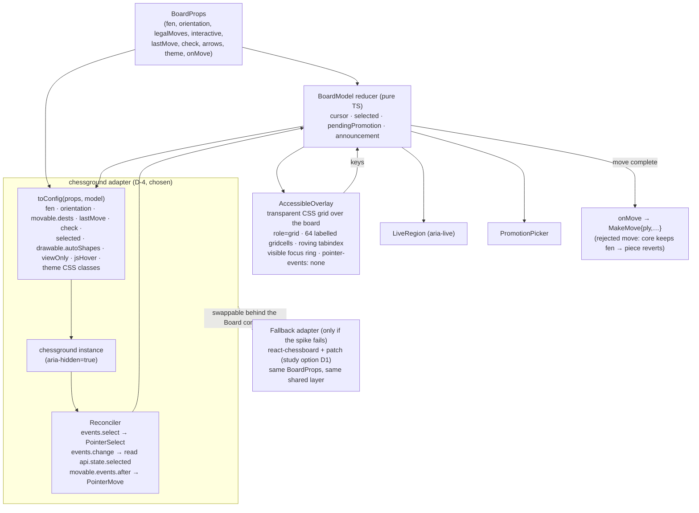

- **`Board` contract.** Screens use the board only through `BoardProps` (refined study §5, first-pass §5.0), so the fallback replaces just the adapter.
- **One selection state.** `BoardModel` is the source of truth. Its selection is pushed into chessground with the `selected` config value. chessground's own changes come back through `events.select` (including drag start). Silent unselects, which fire no event, are caught on `events.change` by reading `api.state.selected`.
- **Accessibility overlay.** A transparent ARIA grid sized from chessground's `---cg-width`/`---cg-height` CSS variables sits exactly over the squares.
  - Keyboard focus and the VoiceOver cursor land on the real squares.
  - Mouse and touch pass through to chessground.
  - The chessground board is `aria-hidden="true"`, which is axe-clean because chessground has no focusable elements.
- **Moves.** Pointer moves are applied optimistically by chessground and confirmed by the core's next snapshot. A rejected move (e.g., `StalePosition`) is reverted by re-setting `fen`. Keyboard moves go through `onMove` and are animated when the snapshot's `fen` arrives.
- **Read-only.** `viewOnly` while rewound (GAME-3), on computer turns, and in computer–computer games.
- **Spike (2 days, first GUI task).** The exit criteria are:
  1. `BoardModel.selected` equals `api.state.selected` after every step of scripted mixed mouse/keyboard sequences: click→Enter, Space→click, drag→Esc, click elsewhere, rejected-move revert, and promotion by mouse and by keyboard.
  2. axe is clean.
  3. The overlay aligns in both orientations at three sizes.
  4. Drag works in Safari, Chrome, Firefox, Edge, and the Tauri WKWebView.
  5. The overlay stays aligned during continuous window resizing down to a narrow width (no GUI minimum size, Q55).

  If criterion 1 can't be met reliably, switch the adapter to study option D1 (about 3–4 days; the shared layer carries over).
- **Upstream.** Propose a configurable sensor list to react-chessboard, to keep the fallback patch-free.

### 11.2 Decision log

| Date | Decision | IDs |
|---|---|---|
| 2026-10-24 | Rust backend, TypeScript UI, Tauri desktop, one shared core. | inputs |
| 2026-10-24 | CLI is a full-screen ratatui TUI, keyboard only, with plain and headless modes. | D-6 |
| 2026-10-25 | Accepted recommendations: in-process core with Tauri IPC (D-1); each entry point embeds the core, coordination via SQLite (D-2); `shakmaty` + `pgn-reader` (D-3); `ts-rs` (D-7); `chess serve` started by the user (D-8); pinned, bundled Stockfish downloaded at build time (D-9); GPL-3.0-or-later (D-10); legal-move lookups via the core (D-11). | D-1–D-3, D-7–D-11 |
| 2026-10-25 | React + TypeScript + Vite for the GUI. | D-5 |
| 2026-10-25 | Offline operation for desktop, web, and CLI made an explicit, tested v1 requirement; architecture confirmed to have no run-time network dependency (§8.1). | PLAT-3 |
| 2026-10-25 | v1 will not build its own board component (user decision after the first-pass trade study). | D-4 |
| 2026-10-25 | GUI board = chessground + shared keyboard/accessibility layer, gated by a 2-day spike; fallback react-chessboard + layer (patched). | D-4 |
| 2026-10-26 | Architecture review: D-12, D-13, D-16, D-18–D-20, D-22 PROPOSED; D-21 DEFERRED; D-14, D-15, D-17 OPEN (user-visible rules, need the user's choice). No AGREED decision was changed. | D-12–D-22 |
| 2026-10-26 | User answers Q41–Q55: D-15 decided (clock keeps running), D-17 decided (merge). D-23–D-27 added from Q46–Q49, Q54, Q55. D-14 is still OPEN. | D-15, D-17, D-23–D-27 |
| 2026-10-26 | Second round of user answers: D-14 decided (suspend immediately). D-16 simplified to one bundle with mismatch refusal. D-18, D-25, D-26, D-27 revised. D-28 (two Elo tracks) and D-29 (export archive) added. Human abort removed in favour of Resign. | D-14, D-16, D-18, D-25–D-29 |
| 2026-10-26 | Final answers: every PROPOSED decision accepted and AGREED (D-12, D-13, D-16, D-18–D-20, D-22–D-24, D-26–D-29, plus the mechanisms in D-17 and D-25). D-12 and D-16 recorded as one-way for data, consequences accepted by the user. D-26 revised: old games stay in opponents' views (Q76). D-27 revised: an h–c game never uses the computer's slot (Q77). D-28: computers' Training Elo, K counted per track (Q78), label from the Strict Elo (Q79). ASM-1 CONFIRMED. D-21 stays DEFERRED. Architecture baselined as v1.0. | D-12–D-29 |
| 2026-10-27 | v1.0 amendment 1 (user decisions). Reset with unfinished games allowed: they are voided and count against neither player (D-30 added, D-26 revised, OQ-8 and G-20 closed, `UnfinishedGameExists` kept for setup only). The voided game's visibility is an architect interpretation (Q-A18). Stockfish 19 (`sf_19`, 2026-09-05) pinned as the latest release (D-9 revised, TBD-26 closed); build plan prefers the official universal macOS asset, checked with `lipo -info`, with the separate-builds plan as fallback; ASM-3 narrowed. No ID renumbered. | D-9, D-25, D-26, D-30 |

### 11.3 Door type, consequences, and revisit triggers

One-way door = costly to reverse: weeks of work or data migration. Rationale for D-1–D-11 is in the table above and in §11.1. D-4 is gated by its spike.

| ID | Door | Main consequences | Revisit trigger | Escape route |
|---|---|---|---|---|
| D-1 | Two-way | No TCP port for desktop. The desktop E2E can't drive the app exactly like the web (R-1) | Tauri gains macOS WebDriver, or desktop/web divergence bugs appear | Switch the desktop to the local server transport; `CoreClient` already abstracts it |
| D-2 | One-way (moderate) | Engine pool per process. No live cross-process updates. Leases needed (R-3, R-9) | A need for live cross-process sync, or contention bugs | Extract a daemon that hosts `chess-app`. The front-ends already speak the protocol |
| D-3 | One-way (moderate) | GPL dependency (fits D-10). Rules quality inherited, and perft-verified | A blocking bug or license change upstream | Own implementation behind the `chess-rules` API |
| D-4 | Two-way (behind the `Board` contract) | Our Reconciler carries selection-sync risk (R-8) | Spike fails, or a chessground upgrade breaks the Reconciler | Study option D1 adapter (3–4 days) |
| D-5 | One-way (UI rewrite) | Ecosystem for testing and accessibility | — (low likelihood) | — |
| D-6 | Two-way | Plain mode must stay first-class (R-6) | Screen-reader users report TUI problems | Plain mode already exists |
| D-7 | Two-way | CI staleness check needed | Tauri-specific typing needs | `specta` |
| D-8 | Two-way | The user must start `chess serve` | The user wants the URL to "just work" | launchd agent |
| D-9 | Two-way | Builds need the Internet once (§8.1). Stockfish 19 is a major release: **any later Stockfish version needs its own decision-log entry and a full calibration re-run** (§4.6), because strength, the `UCI_Elo` range, and the network change between releases. Engine parameters of existing computer Players stay fixed (PLY-4), so a version change can shift their real strength | Fully offline builds wanted; a Stockfish release fixes a bug that affects us; the official macOS asset fails the `lipo -info` check (use the fallback build) | Vendored archive; fallback build from source (§8.2) |
| D-10 | One-way | All code GPL-3.0-or-later | A non-GPL dependency is needed | — (relicensing requires all authors) |
| D-11 | Two-way | Round trip per what-if move | Measured latency is noticeable | WASM `chess-rules` |
| D-12 | One-way (data). **Accepted by the user, 2026-10-26** | SQL stats views, WAL multi-process. Every entry point and the journal design depend on it, and the user's data lives in its format | Corruption or contention under real use | Full-data export and import (DAT-2) into a new store |
| D-13 | Two-way | One store thread per process: writes are serialised per process | Store-thread queueing visible in latency benchmarks | Connection pool or `sqlx` behind the `Store` trait |
| D-14 | Two-way | Closing a tab pauses that game's clock, the same as quitting the app | User feedback | Add a grace period |
| D-15 | Two-way (code) | A computer can lose on time while its engine recovers | User feedback | Freeze clocks (option A) |
| D-16 | One-way (data). **Accepted by the user, 2026-10-26** | One bundle only; partial installs unsupported. A store migrated by a newer build can never be opened by an older one (`SchemaTooNew`), so a downgrade means restoring the pre-migration backup or exporting and re-importing | A need to ship the CLI separately, or to downgrade | Restore `chess.db.bak-v<N>` (journals replay on top), or export and import; add compatibility rules for a separate CLI |
| D-17 | One-way for user data (a merged store can't be un-merged, except from the pre-import backup) | Records need stable `uuid`s; Replace/Keep-both UI | Merge errors reported | Restore the automatic backup |
| D-18 | Two-way | Install script maintained | Distribution beyond one Mac | Homebrew formula |
| D-19 | Two-way | Ordered rule must be documented in help | Confusion in scripts | Explicit `--headless` only |
| D-20 | Two-way | Bundled data file and its license | Data quality issues | Swap the table |
| D-21 | Two-way | — | — | — |
| D-22 | Two-way | Any local process can drive the core | ASM-1 changes (shared Mac accounts, or the app is distributed) | Add a token |
| D-23 | Two-way (behind `GameSession`) | One extra fsync per move. Recovery code paths need failure-injection tests (R-15) | Journal and DB bugs, or measured latency over the NFR-8 budget | SQLite FULL only |
| D-24 | Two-way | One more file to document (NFR-5) | User prefers XDG | Read both locations |
| D-25 | One-way-ish (support commitment) | Re-testing on every new macOS release. Intel test hardware while Intel is supported. Two Stockfish slices | A macOS release drops Intel (expected after Tahoe, R-13) | Freeze Intel at its last macOS; arm64 continues |
| D-26 | Two-way (no data destroyed) | Queries for the reset Player filter by `reset_at`; opponents' queries don't. Reset points in `RATING_HISTORY`. Unfinished games are voided, not refused (D-30) | User wants a physical wipe | Add deletion |
| D-27 | Two-way | `StartGame` needs the DB. Computers are never blocked by h–c games, so one computer can be in many unfinished h–c games at once (one per human per mode) | Slot rules change | Change which participants insert slots |
| D-28 | One-way (data model; splitting history later is hard) | Two rating series and two K counters per Player in stats and charts | — | Merge tracks in views |
| D-29 | Two-way (versioned) | Exporter and importer per `format_version` | — | New format version |
| D-30 | Two-way as a rule (code in `PlayerService` and queries). Each void is permanent for that game: it can't be resumed or given a result afterwards, except by restoring the pre-reset backup | `PlayerService` becomes a second writer of `GAME.status` and `UNFINISHED_SLOT`. Cross-process sessions learn of the void within one lease heartbeat (2 s, `ESTIMATE`). New state, event, journal record, status value, and PGN tag | The user corrects the interpretation (Q-A18), or users report voids they didn't expect | Change visibility in queries only (no data change). Stronger warning in the confirmation |

## 12. Risks

| ID | Risk | Mitigation |
|---|---|---|
| R-1 | **`tauri-driver` (WebDriver) does not support macOS**, so "same E2E suite against the desktop shell" (GUI-1) can't use the standard Tauri E2E path on our only platform. | Run the full GUI suite in Playwright **WebKit** (same engine family as WKWebView) using the Tauri transport against a test harness, plus a scripted smoke test of the real `.app`. (D-1's rejected alternative — loading the UI from the local server — would have let the desktop app be driven exactly like the web app.) Revisit if Tauri adds macOS WebDriver support. |
| R-2 | Beginner/Novice strength (400/600) is below Stockfish's limiter; calibration may take several iterations. | Personality parameters live in data, not code, and `chess calibrate` runs nightly on the M4 baseline. Generator bounds are tuned **before v1**. After release, engine parameters never change (PLY-4). Ratings are dynamic (Q41), so a Player whose parameters play weaker or stronger than its category simply drifts to its true rating. Calibration error therefore shows up as rating drift, not as a defect. |
| R-3 | Concurrent writers across three processes. | Short transactions, WAL, `busy_timeout`, leases; concurrency integration test in CI. |
| R-4 | GPL obligations if the app is ever distributed. | Choose GPL-3.0-or-later now (D-10); license audit in CI. |
| R-5 | Localhost web server reachable by other local apps or malicious web pages. | Loopback bind, strict Host/Origin checks, no CORS. Optional per-launch token in the URL if we want more. |
| R-6 | Full-screen TUIs read poorly with screen readers, and terminal state can be left broken on crashes. | Plain mode is a first-class, tested mode (automatic off-TTY); restore guard + panic hook + signal handling, each covered by a PTY test. |
| R-7 | Unicode chess glyph widths vary across terminal fonts, which can misalign the board. | Fixed cell width per square with padding; plain ASCII style always available; snapshot tests per style; manual check in Terminal.app and iTerm2. |
| R-9 | Builds of different versions share one DB (an upgraded CLI next to an old `Chess.app`), so an old build could misread a migrated schema. | D-16: `SchemaTooNew` guard, migrate only when alone, one build version for all artifacts; fixture test. |
| R-10 | A closed tab or a dropped WebSocket now suspends the game at once (D-14), so a brief network-free reload or a crash of the browser pauses a timed game. A player could also close the tab to stop their own clock, exactly as quitting the app allows (RULE-5). | Accepted, because it is the user's rule. Suspension and resume are journalled (§7.6). Reconnect resumes automatically, so a reload costs only the reload time. |
| R-11 | Synchronous `rusqlite` calls on async workers stall the actors and the TUI loop (clock display, NFR-8 responsiveness). | D-13 store thread. A lint or review rule against `Store` use outside the store thread, and a latency test with a slow fake store. |
| R-12 | Several processes running engines at once (e.g., a c–c game in the CLI and a game in `Chess.app`) compete for CPU. Computer strength and move times drift from calibration (ENG-2, ENG-3). | Fixed `Threads`/`Hash` per instance; background analysis at low priority; time limits by `movetime`, not depth, for clocked games; a soak test with two processes. |
| R-8 | chessground's internal selection drifts from `BoardModel` in an unanticipated input sequence (it fires no event on unselect). | Single Reconciler module; reconciliation on `events.select`/`events.change`/`after`; scripted mixed-input Playwright suite; spike exit criterion; fallback to react-chessboard (study option D1) behind the same `Board` contract. |
| R-13 | **Intel support depends on Apple.** The app must support Tahoe and every later macOS (user, 2026-10-26), but later releases may drop Intel Macs. Apple said at WWDC 2025 that Tahoe is the last macOS release for Intel Macs (from memory, `Unverified` online; re-check at each app release under the PLAT-2 release checklist). Mirrors requirements RISK-1. | Keep the universal build (D-25). When a macOS release drops Intel, Intel support stays frozen at the last macOS that runs on it, and arm64 continues. Re-test on each new release (§8.2). Keep one Intel Mac for the platform matrix while Intel is supported. |
| R-14 | Intel Macs and M1–M3 Macs search fewer nodes in the same `movetime`, so computer Players play weaker there than on the M4 baseline, and timeouts tuned on M4 may be tight. | Timeouts have generous grace values (§4.8). Dynamic ratings (Q41) absorb the strength difference over time. Engine integration tests run on the Intel machine too. |
| R-17 | Computer ratings now change (Q41) on two tracks, including through c–c games. Ratings can drift away from real strength, and soak or calibration runs could pollute the user's ratings (mirrors RISK-2). | `chess calibrate`, soak, and every test run against an isolated store (`CHESS_DATA_DIR` set to a temp dir; calibrate refuses to run on the default data dir). Engine parameters stay fixed, so drift reflects real results only. Monitor class-band spread in the nightly report. |
| R-15 | Journal-to-DB recovery (replay, conflict replacement, torn tails, takeover) is new code on the most critical path (no completed move lost). | Failure-injection tests: kill at every write point, corrupt the journal tail, restore an older backup, and contend for the DB from another process. A property test checks that replay is idempotent. |
| R-16 | The TUI's resize request (`CSI 8 t`) can be disabled by the user's terminal settings (e.g., iTerm2) or ignored inside tmux/screen. | Fall back to the "please enlarge" message (§6.1). PTY tests cover both paths. |
| R-18 | A reset voids games of other people too (D-30): in a hot-seat h–h game, one human's reset voids the game in progress for the other human, who may have been winning. | Accepted, because it is the user's rule (2026-10-27). The confirmation names each game, its opponent, and the moves played, and says the game will count for neither player. The opponent's history keeps the game, marked "voided by reset", and it can still be analysed. |

## 13. Next steps

1. Workspace skeleton, then `chess-rules` + `chess-domain` with their unit tests first (the test-first core).
2. `chess-store`, `chess-engine`, `chess-app`, then the CLI (TUI, plain, headless).
3. GUI: start with the 2-day board spike (§11.1) against the `Board` contract, then screens, transports, and the Tauri shell.
4. Close the remaining open items in §14 at the step named there: G-15 (ECO source) in step 1; ASM-2, ASM-3 (closed by the first run of the Stockfish 19 build script), and ASM-4 in step 2; the D-4 spike (OQ-9), the browserslist query (OQ-10), the Tauri sidecar naming (OQ-11), and the TBD-18 wording in step 3. TBD-26 was closed on 2026-10-27 (Stockfish 19).
5. ~~The systems engineer confirms OQ-8 (reset with an unfinished game).~~ Done 2026-10-27: the user decided (D-30). The systems engineer adds the void rule to PLY-7 (and its verification), updates TBD-24 (`EndStatus`) and TBD-26 (Stockfish 19) in requirements.md, and fixes any requirements.md inconsistencies that remain. The user may correct the D-30 visibility interpretation (Q-A18).

## 14. Assumptions and open items

| ID | Type | Statement | Validation / owner | Blocks |
|---|---|---|---|---|
| ASM-1 | Assumption, **CONFIRMED** (user, 2026-10-26) | One person uses the Mac account. Other local users and processes are not adversaries, so the loopback server needs no access token (D-22) | Confirmed. Revisit if the app is distributed or the Mac account is shared | — |
| ASM-2 | Assumption | The timeout and period values in §4.8 are `ESTIMATE`s for the M4, 16 GB, Tahoe baseline, and the journal flush costs a few ms per move | **Open.** Owner: core developer. Closing step: measure in the engine and core integration tests and the NFR-8 latency test (step 2); change values only through the decision log | — |
| ASM-3 | Assumption (narrowed 2026-10-27) | About the pinned Stockfish 19 (`sf_19`), two facts not verified because the binary could not be downloaded and run here: (1) the official `stockfish-macos-universal.tar.gz` asset contains both arm64 and x86_64 slices; (2) its `UCI_Elo` floor and range. These are requirements.md TBC-7 and TBC-8. The exact GPL version (TBC-9) is read from the shipped `COPYING` in the same step. *Verified 2026-10-27 from the GitHub release API and notes:* version, tag, date, not a pre-release, the asset names, universal binaries with run-time CPU-feature detection, the SFNNv16 network, and the GPL license statement. The embedded network is proven by the offline test (§8.1). Tauri sidecar naming moved to OQ-11 | **Open.** Owner: architect. Closing step: implementation step 2 (engine build script). **The first build-script run closes it:** `lipo -info` answers (1) and selects the preferred or fallback path (§8.2); the `uci` handshake answers (2), and the value is recorded for §4.6 and calibration | Calibration bounds (not the design: §4.6 reads the range at run time), the §8.2 path choice |
| ASM-4 | Assumption | Terminal.app and iTerm2 honour `CSI 8 ; rows ; cols t` in their default settings | **Open.** Owner: CLI developer. Closing step: PTY and manual check (R-16), step 2. The fallback message already covers failure | — |
| OQ-1 | Resolved | D-14: suspend immediately when no front-end is attached (user, 2026-10-26) | — | — |
| OQ-2 | Resolved | D-15: clock keeps running (Q53) | — | — |
| OQ-3 | Resolved | D-17: merge (Q51) | — | — |
| OQ-4 | Resolved | Requirement gaps G-1–G-20 are resolved, except G-15 (ECO source, architect, step 1). G-20 was resolved 2026-10-27 (D-30) | — | — |
| OQ-5 | Resolved | All PROPOSED requirements were accepted (Q75), so the §10.1 allocation is final | — | — |
| OQ-6 | Resolved | Q41, Q42, Q54, and Ctrl-C (Q52) are answered and applied (§4.4, §4.6, §6.1, §7.1, §7.6) | — | — |
| OQ-7 | Resolved | GUI light/dark theme: defined by Q52 (§6.2) and backed by UI-10 | — | — |
| OQ-8 | Resolved 2026-10-27 | Reset with an unfinished game. *Baseline rule (superseded): the reset was refused.* User decision: "allow it; the unfinished game does not count against either player." Each unfinished game is voided in the reset transaction (D-30, §7.2). Systems engineer to add the rule to PLY-7 (G-20) | — | — |
| OQ-9 | Measurement | The D-4 board spike (§11.1) | **Open.** Owner: GUI developer. Closing step: run the 2-day spike as the first GUI task (step 3). On failure, switch to the study option D1 adapter | D-4 adapter |
| OQ-10 | Measurement | The browserslist query for "the last 3 years" of the four browsers (§8.2) | **Open.** Owner: GUI developer. Closing step: check with `npx browserslist` when the build is set up (step 3) | — |
| OQ-11 | Check | Tauri's sidecar naming rule for a universal target (split out of ASM-3 on 2026-10-27, §8.2) | **Open.** Owner: architect. Closing step: check against the pinned Tauri version when packaging is set up (step 3) | — |

**Follow-up questions for the user (Q-A).** IDs are never reused. Answered questions stay listed with their answer.

| ID | Question | Status / working default | Where |
|---|---|---|---|
| Q-A1 | Tab closed during a timed game? | **Answered:** suspend immediately (D-14) | §4.3 |
| Q-A2 | One unfinished game per machine or per Player? | **Answered:** per Player; c–c counts for each computer (D-27) | §7.2 |
| Q-A3 | Case-variant names duplicates? | **Answered:** no. Names are unique case-sensitively, and identity is the UUID | §7.2 |
| Q-A4 | What does a reset clear? | **Answered:** everything except Elo, humans only (D-26). See Q-A15 | §7.2 |
| Q-A5 | Do c–c games change computer Elo? | **Answered:** yes, both computers (Strict track) | §4.4 |
| Q-A6 | Hot-seat abort / c–c abort? | **Answered:** humans only Resign (h–h asks which side). The watcher's c–c abort has no effect | §4.4 |
| Q-A7 | Computer category label? | **Answered:** follows its current Strict rating (Q79). Engine settings fixed | §4.6 |
| Q-A8 | Port scope? | **Answered:** `chess serve` and the browser URL only | §8.2 |
| Q-A9 | Computer K-factor? | **Answered:** same as humans | §4.6 |
| Q-A10 | Aborted Strict game in W/L/D? | **Superseded:** human games have no abort; a resignation counts in Elo and W/L/D | §7.2 |
| Q-A11 | Terminal bell for sound? | **Superseded:** no sound in v1 | §6.2 |
| Q-A12 | Do you accept the PROPOSED decisions D-12, D-13, D-16, D-18–D-20, D-22–D-24, the mechanisms in D-26–D-29, and ASM-1? | **Answered:** yes, all AGREED 2026-10-26. D-12 and D-16 are one-way for data, consequences accepted. ASM-1 CONFIRMED | §11 |
| Q-A13 | Whose max-think time in c–c and h–h? | **Answered:** the active profile's. In h–h it applies to engine analysis only | §4.6 |
| Q-A14 | macOS releases after Tahoe? | **Answered:** Tahoe and every later release must be supported. Intel only as long as Apple supports it (R-13) | §8.2 |
| Q-A15 | After a reset, should the Player's old games be hidden from their own views, or deleted outright, which also removes them from opponents' history? | **Answered:** hidden. They stay in opponents' history and stats and are hidden only from the reset Player's views (D-26, Q76) | §7.2, D-26 |
| Q-A16 | In a Strict h–c game, does the computer also use up its one unfinished Strict slot? | **Answered:** no. Human–computer games never use a computer's slot, so any Player can always play any computer. Computers hold slots only in c–c (D-27, Q77) | §7.2, D-27 |
| Q-A17 | Do computers also get a Training Elo that changes in Training games against humans? | **Answered:** yes. The K = 40 count is per track (Q78), and the label follows the Strict Elo (Q79) | §4.6, D-28 |
| Q-A18 | A voided game (D-30): is the architect's reading right? It stays in the opponent's history marked "voided by reset", with no result, and can be analysed; it is hidden from the reset Player's own views; it is not a resignation, so no loss is recorded | **Open, non-blocking. Working default:** as stated, in force until the user corrects it. Changing it touches queries only | §7.2, D-30 |
