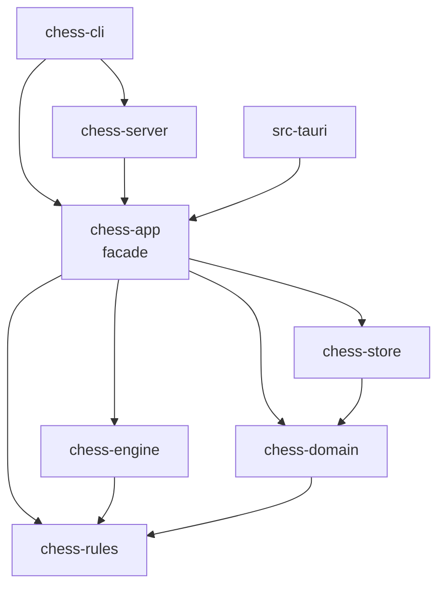

# SDD-architect-triage: system-architect triage of the cross-SDD review

| Field | Value |
|---|---|
| Document | docs/design/SDD-architect-triage.md |
| Version | 0.1 DRAFT |
| Date | 2026-10-30 |
| Approver | **PENDING.** Brian Prascher for every G2 and G3 item. The system-architect agent's desk review (G1) is recorded per row; it never satisfies G2 or G3 |
| Stance | System architect (architecture-governance, decision-records, interface-contracts, data-architecture). Rulings and recommendations only. `architecture.md`, `requirements.md` and the nine SDDs are **not edited**. Nothing is committed |
| Input | [SDD-consistency-review](SDD-consistency-review.md) (XC-1 to XC-30, ED-1 to ED-8, D-1 to D-33, OW-1 to OW-24, UR-01 to UR-52); architecture sections 1, 3.2 to 3.4, 5.5 to 5.7, 7.6; spot checks in the store, domain, engine and app SDDs (grep, not a full read) |
| Gate | This document is G0 (text). The rulings below are **recommendations** for G2/G3 items (SWE-001 section 3). Rows marked G1 are a desk review by this role, recorded as such. No human approval is claimed |
| Evidence | `[OBS ...]` read in this session. `[INF]` inferred. `[UNV]` not verified. No registry or web lookup was made: every version, feature flag and crate API statement is `[UNV]` until looked up |

---

## 1 Summary

| Item | Count |
|---|---|
| XC mismatches triaged | 30 (every one dispositioned) |
| Register findings (UR) triaged | 52 (every one dispositioned) |
| Edges ED-1 to ED-8 | 1 accepted, 7 rejected or not needed |
| Third-party rows D-4 to D-32 not in 3.4 | accepted in principle 13, rejected 5, deferred 2 (section 7) |
| Rulings that change the architecture text | 12 cross-cutting rulings (TR-1 to TR-12), 14 proposed amendments (AMD-1 to AMD-14) |
| Draft ADRs | 10 (section 4) |
| Needs Brian Prascher | 13 ordered decisions (section 5); everything else is G0/G1 or a text correction |
| Routed to the systems engineer | 26 questions (section 7) |

**What I found most important.** Three of the disputes come from one architecture defect: architecture 5.7 names `ImportExportService`, `GameSetupService` and `AnalysisService` (all in `chess-app`) as consumers of `chess-rules`, but the 3.2 graph has no `app -> rules` edge. Adding that edge, plus one rule that front-ends see only the `chess-app` facade, removes the XC-9, XC-10, XC-11 and XC-12 conflicts without any re-export through `chess-domain`. Second, the roster is generated from the live `UCI_Elo` range of the engine (XC-25). That makes the permanent roster depend on the binary found at run time. The fix is to pin the range as a constant that the engine integration test checks. Third, the store, journal and domain disagree about identity (integer ids against UUIDs). One id policy (UUID newtypes everywhere outside the store) settles XC-2 and XC-7 together.

**Stored-format timing.** Nothing is released. Every schema or journal change below is therefore a G3 *decision* but a cheap *change*. They should all be taken in one batch before the first store code is written (decision 4).

---

## 2 Cross-cutting rulings

The rulings are firm recommendations. Each names its gate, the consumers it touches, and how to roll it back.

### TR-1 One edge rule for the front-ends (XC-9, XC-10, XC-11, XC-12; ED-1 to ED-8)

1. **`chess-app` is the only facade.** `chess-cli`, `chess-server` and `src-tauri` depend on `chess-app` (and `chess-cli` also on `chess-server`, as 3.2 already draws). They have no edge to `chess-rules`, `chess-domain`, `chess-store` or `chess-engine`. ED-2, ED-3, ED-5, ED-6, ED-7 are rejected.
2. **`chess-app -> chess-rules` is added (ED-1 accepted).** This is an architecture defect, not a new need: 5.7 already makes three `chess-app` services the consumers of `chess-rules`. A direct edge is clearer than a re-export through `chess-domain`, which would make the "pure domain" crate carry the API of another crate.
3. **`chess-domain` and `chess-store` do not re-export `chess-rules` types.** The store keeps its own small stored-side enum in its journal DTOs (ED-8 rejected). That also keeps the stored format independent of a `chess-rules` enum.
4. **What a front-end may use from below `chess-app`** is exactly the curated list of named `pub use` items in the `chess-app` `lib.rs`. No glob re-exports. Each item names its consumer in the app SDD (initially: `BoardGrid`, `BoardStyle`, `BoardView`, `Cell` and the other cell types from `chess-domain`; `DataDir` is *not* re-exported, see 5). The list is checked by a fitness function (FF-1).
5. **Production wiring is inside `chess-app`.**
   - `Core::open_default(cfg: CoreConfig) -> Result<Core, OpenError>` builds the production engine factory, system clock and OS random source itself. `Core::open(cfg, Seams)` stays as the test and calibration entry (`Seams` per TR-2). `Core::open_for_calibration` is unchanged.
   - `chess_app::resolve_data_dir(flag: Option<&Path>, env: &dyn Fn(&str) -> Option<String>) -> Result<DataDirChoice, ConfigError>` is a thin wrapper over the store's `DataDir::resolve`. The resolution logic has one owner (the store). `DataDirChoice` is an app type holding the path and its source.
   - `Core::build_info()` returns `{build_version, protocol_version}`.
   - `chess_app::new_game_uuid() -> GameId` is the helper for the CLI. The GUI keeps Web Crypto (arch 5.6: the client generates the uuid, so any UUIDv4 source is fine).
6. **`BoardGrid` input** (XC-12): the domain adds `BoardGrid::from_fen(fen: &str, view: &BoardView, style, orientation)` and `BoardView.last_move` carries UCI text (or two squares), so no front-end needs a `Position`. `BoardStyle` is `Plain, Unicode, Ansi, NoColor`; the CLI text follows the domain.

Gate **G2** (a dependency edge, and the public surface of `chess-app`). Consumers: all three front-ends and `chess-domain` (one added constructor). Rollback: removing the app edge means moving the three services' rules calls behind a trait in `chess-domain`, which is about a day of rework before code exists and large afterwards, so decide now. Door: two-way before code, one-way-ish after.

### TR-2 Store is one concrete handle; no `dyn Store`, no fake store (XC-4, XC-5; UR-51)

- `chess_store::Store` is a cheap clonable handle to the store thread (D-13). `chess-app` holds the concrete `Store`, not `Arc<dyn Store>`, and not a generic parameter. A generic `Core<S>` would spread through the server, CLI and Tauri crates for the benefit of tests only. A boxed-future `dyn` trait would duplicate a 40-method surface.
- The journal is also the concrete `chess-store` type. Tests use a temp-directory `Store` plus `FaultPlan` (store R-ST-2, accepted). `StoreApi` stays in the store SDD as a documentation contract; it is not used as a seam.
- `Seams` becomes `{ engine: Arc<dyn EngineFactory>, time: Arc<dyn TimeSource>, rng: Arc<dyn Rng>, data_dir: DataDir }`. `dyn` is kept where more than one real implementation exists (UCI engine and `FakeEngine`; system and fake clocks).
- Architecture text "in-memory store" (principle 2, section 9) becomes "temp-directory store". A SQLite `:memory:` database cannot use WAL, so the wording could not be met anyway (store FIND-ST-13).
- Fitness function FF-2: the full core integration suite using a temp-dir store runs within a budget set at the first run (`ESTIMATE`, to be measured). If it is too slow, introduce a fake behind a trait *then*; the change is mechanical.

Gate **G2** (interface style across crates). Consumers: `-app`, `-cli`, `-server`, `-tauri` test plans (CT-SRV-22..27, CT-TAU-01, DD-CLI-10 "in-memory store" becomes "temp-dir store"). Rollback: add a trait and a fake later without changing callers' public types. Door: two-way.

### TR-3 One identity policy: UUID newtypes outside the store (XC-2, XC-7; UR-03)

- `GameId(Uuid)` and `PlayerId(Uuid)` are defined in `chess-domain` (it already needs `uuid` for `game_uuid` and the UUIDv5 roster identity, so no extra dependency). The domain's `PlayerId(i64)` is replaced.
- The store keeps `PLAYER.id` and `GAME.id` integers as **internal row keys only**. The store API takes and returns `PlayerId`/`GameId` (UUID). Integer ids never cross the store boundary, the journal, the protocol or an export.
- Why: the journal must survive a restore, which can reuse integer ids (store FIND-ST-01; arch 7.6 limit R-19). The protocol already says UUID strings (app DD-APP-03). With one policy there is no mapping entity and no conversion in `JournalCodec`.
- The `Start` record carries `white_uuid`, `black_uuid` as the store already designed; domain `GameSetup` then converts to it by field copy.

Gate **G2** (domain type, store API, protocol). Rollback before release: change the newtype's inner type; after release the UUIDs are in stored data and exports, which is why it is decided now. Door: one-way at release.

### TR-4 Journal contract (XC-1, XC-2; UR-03, UR-04, UR-05)

- **Owner of the format:** `chess-store` (arch 3.3, 7.6, store 3.11.1). **Owner of the vocabulary of state changes:** `chess-domain` (`Fact`). **Owner of the conversion:** a new design entity in `chess-app`, `JournalCodec` (pure: `fact_to_record(&Fact, &RecordCtx) -> JournalRecord`, `record_to_fact(&JournalRecord) -> Fact`, and the `Start`/`GameEnd` assemblers that add finalize inputs).
- **One Fact maps to exactly one record kind**, per this table (the architecture list gains two kinds):

| Domain `Fact` | Journal record |
|---|---|
| `Start` | `Start` |
| `Move` | `Move` |
| `Takeback` | `Takeback` |
| `Clock` / checkpoint | `Clock` |
| `DrawOffer`, `DrawDeclined` | `DrawOffer`, `DrawDeclined` |
| `DrawDropped` | **`DrawDropped` (new)** |
| `Pause` | `Pause` |
| `PlayResume` (resume after `Pause`) | `Resume` (the architecture name is kept) |
| `Suspend` | `Suspend` |
| `SuspendResume` | **`SuspendResume` (new)** |
| `Outcome` (end) | `GameEnd` |
| `Abort` | `Abort` |
| `Voided` | `Voided` |

- **No implicit-resume fallback.** The domain implements an implicit rule "any non-terminal fact after `Suspend` resumes it". Remove it. Replay should have one interpretation, journals are only written by this app, and nothing is released. A `Move` in `Paused` is a stepped move, stated once in the domain replay rules; no `Step` kind.
- **Field gaps closed by construction:** `fen_after` and `wall_ms` come from the post-state and `Stamp` that `Game::decide` already returns, so the codec adds them; the domain `Fact::Move` does not change. `white_ms`/`black_ms` are **nullable** in `Move` and `Clock` payloads (untimed games). `GameEnd` carries the finalize inputs (`ended_at`, `eco`, `opening_name`, `analysis_used`) added by the app at finalize, not by the domain `Outcome`.
- **Start order (UR-04, accept DR-APP-04):** claim the slot and insert the game row in one store transaction, then create the journal with `Start`, then acknowledge. A crash between the two leaves an `in_progress` row with no journal. Resume treats that as a game with zero moves, replayed from `start_fen`; no new state.
- **Round-trip test:** a property test over every `Fact` variant (`record_to_fact(fact_to_record(f)) == f`) is the conformance check (FF-3).
- `journal_version` stays 1 (nothing released).

Gate **G3** for the new kinds and nullable payloads (stored format); **G2** for the `JournalCodec` entity. Consumers: store SDD (kinds, payloads), domain SDD (remove fallback), app SDD (new entity, ALG-APP-01/02, DD-APP-09). Rollback: before release, edit the list. After release, add a `journal_version` and keep the old reader. Door: one-way at release.

### TR-5 `content_hash` (XC-6; UR-07)

- **Nullable until terminal.** `GAME.content_hash` becomes `TEXT NULL`. It is set in the finalize transaction (and in the abort and void transactions, which also produce exportable games). An `in_progress` game has none.
- **One function, one owner:** `ImportExportService` in `chess-app` computes `content_hash(game) = "sha256:" + hex(SHA-256(canonical_form))`. The `canonical_form` string comes from `chess-rules` (IFP-RUL-5). The algorithm prefix keeps the value versionable. Import dedupe and finalize use the same function. A fitness check (FF-4) compares the hash a live game stores with the hash re-imported from its own exported PGN.
- **Tag set:** recommended as the Seven Tag Roster plus `SetUp`, `FEN`, `TimeControl`, and the SAN movetext with the result. Excluded: `GameUUID`, `WhiteUUID`, `BlackUUID`, `Mode`, `Rated`, `WhiteClass`, `BlackClass`, `EndStatus`, `Termination`. Reason: a PGN from another tool has none of the custom tags, and a duplicate must be detectable across origins. This is a reading of CR-4.2 ("identical tags and moves") and is routed to the systems engineer (Q-SE-1).
- **Crate:** a SHA-256 implementation in `chess-app` only; the pure crates stay free of it. Name and version are looked up before adding (section 7). A non-cryptographic hash is not recommended, because a false duplicate silently drops a game.

Gate **G2** (dependency, ADR) with **G3** for the nullability (schema). Rollback before release: trivial. Door: one-way at release, softened by the algorithm prefix.

### TR-6 `Personality` ownership (XC-8; UR-11; ED-4)

- `chess-domain::Personality` is the **stored and identity** type: `error_permille: u16` (integer), `skill_level`, `depth_limit`, `movetime_ms`, `uci_elo: Option<u32>`, `error_multipv`. The store keeps the column as `error_permille INTEGER`, so the UNIQUE index (ENG-2) uses integer equality, not float equality. This is a rename and type change of `COMPUTER_PROFILE.error_rate REAL`.
- `chess-engine::EnginePersonality` is what the engine needs (`error_rate: f64 = permille / 1000.0` computed by the conversion). The engine SDD's choice (R-EN-1) is accepted. **No `engine -> domain` edge** (ED-4 stays "not needed").
- **The conversion is one function in `chess-app`** (`personality_to_engine`), with a unit test that each permille value in 0..=1000 converts exactly and deterministically. It is a design entity in the app SDD (today absent).

Gate **G2**; the column type change is part of the G3 stored-format batch (decision 4). Rollback: two-way (the column is unreleased).

### TR-7 Statistics aggregation has one owner: the domain (XC-13; UR-09)

- `chess-domain::aggregate`, `rating_series`, `check_history` and `counts_in_aggregates` own the **predicate** (`self_play = 0`, completed, not custom-start, inside the reset window) and the **empty-state rule** (CR-4.15).
- The store returns **rows**, filtered only by structural keys (the Player, the reset window `started_at >= reset_at`, the side, and a `LIMIT`). The SQL views `player_stats` and `head_to_head` are dropped from the store design. `games_for_history` stays as a row query.
- `StatsService` in `chess-app` calls store then domain and maps to DTOs. It adds no filter and no arithmetic.
- Cost: the store ships more rows per query. This is a local single-user store with a modest game count. FF-5 measures `player_stats` on a 10 000-game fixture against the NFR budget. If it fails, a SQL fast path may be added, guarded by a differential test against the domain function.

Gate **G2** (store API and responsibilities). Rollback: add a view later. Door: two-way.

### TR-8 Typed-move parsing has one owner: `chess-rules` (XC-11; UR-10)

- `Position::parse_move(text, Typed)` in `chess-rules` is the only implementation. The CLI matcher and the TypeScript matcher (UF-UI-2) are not written.
- The protocol gains a read-only `Query::ParseMove{game_id, ply, text} -> ParsedMove{uci, san} | IllegalMove | ParseError`. It parses against the position at `ply` of the live or viewed game and returns `StalePosition` if `ply` is not the live ply and the game is live. The CLI calls it in process; the GUI calls it over WebSocket or IPC.
- Rejected: typed text in `MakeMove.mv`. It mixes parse and execute and weakens the UCI-only idempotency of `MakeMove` (5.6).
- Fitness check FF-6: the round-trip time of `ParseMove` over loopback stays inside the GUI input budget (a requirement for typed-input latency was not found in the SDD set; Q-SE-6).
- The CLI SDD text edited by E-11 (needs a `Position`) is corrected again: the CLI needs no `Position`, only the query.

Gate **G2** (protocol addition, arch 5.1/5.7). Rollback: remove the query; typed input would then need a client matcher. Door: two-way.

### TR-9 Roster independent of the live engine (XC-25; UR-12; FIND-DOM-4)

- **Defect:** `RosterGen::new(seed, Some(range))` fed from the handshake makes the permanent personality depend on the binary found at run time. Two machines (or an engine bump) would generate different Players from the same seed and index, which breaks D-34's promise that `(roster_seed, roster_index)` fixes the Player.
- **Ruling:** the `UCI_Elo` range is a **pinned constant of the bundled engine**: `chess_engine::PINNED_UCI_ELO_RANGE`, set from the engine build step (ASM-3), checked by the existing integration test EI-EN-02 against the real binary's handshake, and failing CI when the engine pin changes without the constant. `chess-app` passes the constant to `RosterGen`. At run time, `EngineGateway` additionally clamps `UCI_Elo` into the handshake range for the *search only*, never for the stored value; a mismatch with the constant is logged and treated as an installation defect.
- The first-launch roster no longer waits for the engine (lazy engine and NFR-1 stay intact). The default 25 Players are generated with the constant.
- **Next index per class (`k`):** `StoreApi::next_roster_index(class)` returns the highest stored `roster_index` for the class plus one, read and used inside the insert transaction with the `UNIQUE(roster_seed, roster_index)` constraint as the arbiter; on a unique violation retry once (UR-49). The app SDD's "next positions continue the seed's stream" is replaced by this.
- **Roster identity (FIND-DOM-4):** accept the SDD proposal in principle (interleaved index `5*k + class`, UUIDv5 over a name string `chess-roster/v1/{seed}/{index}`). Pools, bounds and the default seed stay editable until the first release, then are permanent.
- The value of the pinned range is **unknown** until the Stockfish 19 build is run (ASM-3). Do not write a number into any document before then.

Gate **G2**, one-way once released (D-34). Consumers: domain (`RosterGen::new` takes a plain range value), engine (a constant), app (wiring), store (`next_roster_index`).

### TR-10 Dependency policy (section 6 of the review; UR-08)

Principles: prefer the standard library; prefer the crate the ecosystem leader already pulls in; name features; one crate per job; every row gets a version lookup, licence check and CVE scan (SWE-001 section 5) before it is written into 3.4. Dispositions are in section 7. Versions are **not stated here**.

### TR-11 Wire types of domain values (XC-22; UR-50)

- `ts-rs` derives are added to the small set of domain value types that appear in commands (`GameSetup`, `Mode`, `Matchup`, `ClockSpec`, `Category`, `Preferences`) behind a Cargo feature `ts` that `chess-app` enables. The domain stays pure (a derive macro adds no I/O), and the wire shape has one definition. The alternative (mirroring in the app) doubles the types and adds conversion code for no benefit.
- Domain `Command` (for `decide`) is renamed `GameCommand` so that it cannot be confused with `protocol::Command`. `Fact`, `Outcome` (domain) and `Event` (protocol) stay distinct vocabularies; the app SDD says so once.
- The `ts-rs` limits (64-bit integers become `number` or `bigint`; `ResultOf` helper) are handled in the app SDD (UR-50). The rule: no `i64`/`u64` field is exposed that can exceed 2^53 (timestamps in milliseconds are fine).

Gate **G2** (a dependency edge of the domain crate to an already-baselined crate). Rollback: remove the feature and mirror.

### TR-12 Seeded randomness (XC-15; UR-13)

- `SplitMix64` stays duplicated (domain for roster and colour draw; engine for the error pick): about ten lines, no shared crate, no `engine -> domain` edge. Both copies carry the same published constants and a shared test-vector file (a fixture in each crate's `tests/`, identical content, checked by a CI diff). 
- The seed for the error pick is `error_pick_seed(game_id: GameId, ply: u32) -> u64`, **one function in `chess-domain`** (it owns the generator and `GameId`), called by `chess-app`, passed to the engine as `seed: u64` in `SearchRequest`. `ComputerMove` and the app `RngFactory` carry the seed value; the app SDD adds the field.
- `TimeSource` and `Rng` traits live in `chess-domain`; implementations are in `chess-app` (arch 5.7 says "edges").

Gate G1 for the function (domain, desk review); the `SearchRequest.seed` field is already in the engine SDD.

---

## 3 Disposition table

Legend. **Class**: AD architecture defect; AG architecture gap; SD SDD defect; SEQ systems-engineer requirement question; UD user decision; INFO information only. **Disp**: ACC accept the SDD proposal; ALT recommend an alternative; DEF defer; REJ reject. **Tier**: gate tier of the resolution (G1 = my desk review is enough; G2/G3 = Brian, recommendation only). **Artifact**: AMD-n architecture amendment (section 6); SDD-x edit; Q-SE-n question (section 7).

### 3.1 Cross-SDD mismatches XC-1 to XC-30

| ID | Class | Disp | Reasoning | Tier | Artifact |
|---|---|---|---|---|---|
| XC-1 | AG | ACC (names changed) | Architecture 7.6 omits two state changes the machine needs. Add `DrawDropped` and `SuspendResume`; keep store `Resume` for domain `PlayResume`; drop the implicit-resume fallback. TR-4 | G3 | AMD-4; SDD-store, SDD-domain edits |
| XC-2 | AG + SD | ALT | The conversion owner is right (`chess-app`) but there is no entity. Add `JournalCodec`; close field gaps by construction; nullable clocks; UUID ids (TR-3, TR-4) | G2 (entity), G3 (payloads) | AMD-4; SDD-app new DD; SDD-store payloads |
| XC-3 | SD | ACC (edits E-1 to E-3 stand) | Provider's shape wins. Residual: the store builds `GameFacts` and `RatedSide` from rows; with TR-7 the rows are the same rows. `Side` problem solved by TR-1.3 | G1 (desk review of the edits) | none further |
| XC-4 | AD | ALT | Principle 2 wording ("in-memory store") cannot be met. Store position wins: concrete handle, temp-dir store, `dyn` kept only for engine, time, rng (TR-2) | G2 | AMD-2; SDD-app, -cli, -server, -tauri test text |
| XC-5 | SD | ACC | Adopt the store's names and shapes (provider authoritative); map `SlotTaken`, `UnlistedUnfinishedGames` and the finalize request in the app; add `OtherVersionRunning` and `Exclusive` to the app error table (UR-36). Journal port is the concrete store journal (TR-2); its API is added to 5.7 | G1 (shapes), G2 for the removal of `JournalPort` as a seam (TR-2) | SDD-app edit; AMD-3 |
| XC-6 | AG | ALT | A live game has no hash at insert. Nullable until terminal; one function in the app; algorithm-prefixed value (TR-5) | G3 + G2 | AMD-5, AMD-8; SDD-store, -app, -rules edits; Q-SE-1 |
| XC-7 | AD | ALT | UUID newtypes outside the store; integer ids store-internal (TR-3) | G2 | AMD-5; SDD-domain, -store, -app edits |
| XC-8 | AG | ACC (engine R-EN-1) + ALT (store type) | Three representations. Domain permille integer, engine f64, one conversion in the app; store column becomes `INTEGER` permille (TR-6). ED-4 not needed | G2; schema in G3 batch | AMD-3, AMD-5; SDD-store, -app edits |
| XC-9 | AD | ALT | Add `app -> rules`; reject cli edges and re-export through the domain; store keeps its own side enum (TR-1) | G2 | AMD-1; SDD-rules, -domain, -app, -cli edits |
| XC-10 | AG | ACC (modified) | Provide `Core::open_default`, `resolve_data_dir` wrapper, `build_info`, `new_game_uuid` in the app (TR-1.5). Live-entry-point/port hint deferred (XC-27) | G1 (additions inside the app) with G2 for `Seams` (TR-2) | AMD-1; SDD-app edit |
| XC-11 | AG | ALT | `Query::ParseMove`; rules is the sole parser; no CLI or TS matcher (TR-8) | G2 | AMD-6; SDD-app, -cli, -ui edits; Q-SE-6 |
| XC-12 | SD | ALT | `BoardGrid::from_fen` and a UCI-text `BoardView` in the domain; style names follow the domain (TR-1.6) | G1 | SDD-domain, -cli edits |
| XC-13 | AD | ALT | Domain owns predicate and arithmetic; store returns rows; service is thin (TR-7) | G2 | SDD-store, -domain, -app edits |
| XC-14 | SD | ALT | Domain `Game` observes ECO per move (standard start only) and the app reads `view().eco` at finalize; imports use `eco_for_import` only for standard starts, none for custom starts (rules FIND-RUL-7) | G1 | SDD-app edit (DD-APP-10, DD-APP-15) |
| XC-15 | SD | ALT | Duplicate generator accepted with shared vectors; seed function in the domain; `seed` field in `ComputerMove` (TR-12) | G1 | SDD-domain, -app, -engine edits |
| XC-16 | SD | ACC (store value) | One value: 10 s for the process heartbeat and the analysis-job claim (store), lease heartbeat 2 s. `ESTIMATE`; unit tests inject the clock | G1 (value) | SDD-app edit (ASM-APP-10); AMD-13 |
| XC-17 | SD | ACC (domain wins) | Domain owns `slot_holders` and `check_player_action`; the app calls them and maps results. `WhatIf` precondition is the domain's (adds "human to move"). New `Denied` reasons (`game_open`, `archived_player`) need an additive catalogue entry or are dropped (UR-23) | G1 (SDD edits); G2 for catalogue entries | AMD-14; SDD-app edit; Q-SE-3 |
| XC-18 | SD | ALT | Engine SDD policy: restart only before a request; an in-flight failure is returned, `RetryEngine` is the next request. Correct app DD-APP-10 and 4.9 | G1 | SDD-app edit; Q-SE-12 (confirm F-3.7) |
| XC-19 | SD | ACC (banners E-12 to E-14 stand) | Replace the stale bodies at v0.2. Missing kinds `subscribe`, `unsubscribe`, `subscribe_global` are defined in the app SDD (UR-29) | G0 (text); G2 (kinds, batched in decision 10) | AMD-6; SDD-server, -ui, -tauri, -app edits |
| XC-20 | UD | ALT | See decision 9. Recommended: base64 inside frames with a documented archive size limit; browser downloads a Blob; the desktop shell writes to a fixed folder and reports the path; no dialog plugin | G2 | AMD-6; SDD-app, -server, -ui, -tauri edits; Q-SE-8 |
| XC-21 | SD | ACC | App defines `legal_moves: [{uci, san}]` for the current ply and `allowed_actions: ActionKind[]` (domain enum); UI follows the generated types | G1 | SDD-app, -ui edits |
| XC-22 | AG | ALT | Feature-gated `ts-rs` derive on the domain value types; rename domain `Command` to `GameCommand` (TR-11) | G2 | AMD-1, AMD-8; SDD-domain, -app edits |
| XC-23 | SD | ACC | Domain provides `ClockSpec::from_minutes_plus_seconds(m, s)`; PGN `TimeControl` seconds map directly to `ClockSpec` seconds. App ALG-APP-02 drops its own `Clock` struct and uses the domain `Clock` and its flag-on-zero rule | G1 | SDD-domain, -cli, -app edits |
| XC-24 | SD | ALT | `VariationTree` has a consumer: the PGN writer/reader mapping for saved variations (RULE-6 export, IF-2 import). The client holds the tree for the UI (D-11). The app SDD must reference it in `ImportExportService`. Entity stays | G1 | SDD-app edit; Q-SE-9 |
| XC-25 | AD | ALT | Pinned engine range constant; roster independent of the engine; `next_roster_index` in the store (TR-9) | G2, one-way at release | AMD-7; SDD-domain, -engine, -app, -store edits |
| XC-26 | SD | ACC | Rules adds `Fen::as_str`/`Display`. App quotes the engine's `search(SearchRequest)`, `EnginePool`/`EngineHandle`. `UciMove` to `Move` uses `Move::from_uci` (rules). Score point of view: see UR-15 (White's) | G1 | SDD-rules, -app edits; AMD-3 |
| XC-27 | SD | ACC + DEF | `build_version` is `TEXT`; the app's `int` is wrong. Port hint deferred: no requirement found for it | G3 (schema, in the batch) for TEXT | SDD-app edit; Q-SE-14 |
| XC-28 | SEQ | DEF | No setting writes `config.toml` in v1 and it is read-only for the CLI. The architecture sentence "created only when the user saves a setting" has no producer. Needs the systems engineer | G1 | Q-SE-15; AMD-9 if SE confirms read-only |
| XC-29 | SD + AG | ACC | Apply "supporting" in the SDDs that over-claim primary; list the enabling-system blocks as an out-of-SDD item with their own scripts; F-8.1/F-8.2 statements belong to `functional_decomp.md` (SE-owned) | G0 | SDD-app, -rules, -ui, -tauri edits; AMD-11; Q-SE-16 |
| XC-30 | SD | ACC (at v0.2) | Normalise to `PREFIX-nnn`; one prefix family per kind; no `GATE-` ids | G0 | all SDDs at v0.2 |

### 3.2 Upstream findings UR-01 to UR-52

| ID | Class | Disp | Reasoning | Tier | Artifact |
|---|---|---|---|---|---|
| UR-01 | AD | ALT | TR-1: add `app -> rules`; no cli edges; no re-export through the domain | G2 | AMD-1 |
| UR-02 | AG | ACC (modified) | `open_default`, resolver wrapper, version getter, uuid helper; live-process query deferred (XC-27) | G1 | AMD-1; SDD-app |
| UR-03 | AG | ACC (names changed) | TR-4; fields per the closing table; UUID ids | G3 | AMD-4 |
| UR-04 | AG | ACC | Start order: store transaction (slot arbiter), then journal `Start`, then ack. Row without journal resumes as zero moves | G2 | AMD-4; SDD-app, -store |
| UR-05 | AG | ACC | Add the journal API to 5.7 (concrete store type); fsync on the blocking pool; short busy timeout for apply | G1 | AMD-3 |
| UR-06 | INFO | ACC | Elo inside the finalize transaction is already arch 7.4. Text confirmed after E-1 to E-3 | G1 | none |
| UR-07 | AG | ALT | TR-5 | G2/G3 | AMD-5, AMD-8; Q-SE-1 |
| UR-08 | AG | ACC in principle | Section 7 table; versions after lookup | G2 | AMD-8 |
| UR-09 | AD | ALT | TR-7 | G2 | SDD edits |
| UR-10 | AG | ALT | TR-8 | G2 | AMD-6 |
| UR-11 | AG | ACC + ALT | TR-6: conversion in app; permille integer in the store | G2 | AMD-3, AMD-5 |
| UR-12 | UD | ACC in principle | Interleaved index, UUIDv5 name string, default seed, pools and bounds: accept the scheme; freeze values at the first-release gate (D-34). First-launch range is TR-9 | G2, one-way at release | AMD-7 |
| UR-13 | SD | ACC | Traits in the domain, impls in the app; seed function in the domain (TR-12) | G1 | SDD-domain, -app |
| UR-14 | SEQ | ACC (owner) | Engine owns the budget formula (DD-EN-009). Constants are `ESTIMATE`; the systems engineer confirms the clock behaviour intended in the Clocks requirement | G1 | Q-SE-10 |
| UR-15 | UD | ALT | Recommend White's point of view for `MOVE_EVAL.cp` and `mate` (positive = good for White; `mate` signed with the same sign), the app normalises the engine's side-to-move score, the start-position evaluation `E_0` is transient (ASM-APP-07). Stored data, so G3 | G3 | AMD-5; Q-SE-2 (ANA-3) |
| UR-16 | SEQ | DEF | "Eval 0 or worse" is ambiguous. Recommended reading: from the computer's own point of view, the computer accepts when it is not better. The requirement owner decides | G1 | Q-SE-11 |
| UR-17 | SD | ACC | 10 s / 2 s / retry values (XC-16); define the `LeaseLost` trigger as "lock acquired by another pid or journal file replaced" or drop the event; registry acquires, session holds | G1 | AMD-13; SDD-app |
| UR-18 | AG | ACC (TEXT) + DEF (port) | `build_version TEXT`. The port column waits for a requirement (Q-SE-14) | G3 | AMD-5 |
| UR-19 | SEQ | DEF (leaning ACC) | Add `player_id` (who saved) and `created_at` to `VARIATION` if D-26 hides a reset Player's variations; single line plus anchor ply per row. The rule is a requirement | G3 | AMD-5; Q-SE-9 |
| UR-20 | AD | ACC | Wording: termination detection is a `chess-rules` query invoked by the domain; precedence of end reasons is the SE's | G1 | AMD-10; Q-SE-4 |
| UR-21 | SEQ | ACC | Termination strings and the PGN mapping follow the architecture 5.7 text (standard values); domain strings are internal | G1 | Q-SE-5 |
| UR-22 | SEQ | DEF | Open clock behaviours (custom limits, who starts the clock, increment rule, c-c step, takeback in `EngineError`, reset boundary) | G1 | Q-SE-4 |
| UR-23 | AD + SEQ | ACC | Domain `check_player_action` owns the policy; add rows to the policy table (4.4); archived Player as a side is a requirement question | G2 (4.4 table) | AMD-14; Q-SE-3 |
| UR-24 | SEQ | DEF | Custom FEN already mate/stalemate; ECO for custom starts: not classified | G1 | Q-SE-5 |
| UR-25 | AD | ACC | CLI owns the TUI Elo chart renderer; the domain exports only series data | G1 | SDD-domain |
| UR-26 | AD | ACC (`[UNV]`) | Write the en-passant square always: deterministic, engine-compatible, and `fen_after` is recomputable from the moves, so the choice is cheap to reverse. Check against the FEN/PGN standards text when the rules crate is written | G1 | SDD-rules |
| UR-27 | SEQ | ACC (details) | Keep the longer line, tie by smaller code then name; CI verifies the SHA-256 of the TSV; no ECO tags on export unless the SE asks | G1 | Q-SE-7 |
| UR-28 | SEQ | DEF | PGN 10 MB (TBD-25, `ESTIMATE`); archive limit and frame cap follow decision 9 | G1 | Q-SE-8 |
| UR-29 | AG | ACC | Envelope kinds, `hello`, `subscribe`, `unsubscribe`, `subscribe_global`, decode-error code defined in the app SDD (it governs the protocol) | G2 | AMD-6 |
| UR-30 | AG | ACC | `FrontEndSession`, global event stream, 5 s attach window, reconnect = `ResumeGame` then `subscribe` | G2 | AMD-6 |
| UR-31 | AG | ACC | Recovery mode when the store cannot open; retry = call `open` again | G2 | AMD-6 |
| UR-32 | AG | ACC | Game-scoped addressing, `Takeback{ply}` (the ply to rewind to) with the journal field `to_ply` mapped by the codec, `StopAnalysis`, `Analyze` as a query, `FreeAnalysis`. Names fixed in the app SDD; ANA-1 is the SE's | G2 | AMD-6; Q-SE-2 |
| UR-33 | SD | ACC | XC-21 | G1 | SDD-app, -ui |
| UR-34 | INFO | ACC | `Core::shutdown` awaitable per IFP-APP-05 | G1 | none |
| UR-35 | UD | ALT | Decision 9 | G2 | AMD-6 |
| UR-36 | AG | ACC | New codes are additive (5.6 allows it): `OtherVersionRunning`, import invariant, engine causes, undecodable frame. `JournalUnreadable` stays an error only when nothing is readable; with partial damage the resume reply carries the count | G1 (additive) | AMD-14 |
| UR-37 | AD | ACC | "Sidecar" means a bundled helper binary only. `chess-engine` spawns `<exe dir>/stockfish`. A shell-spawn path would be G2 and is not recommended (one spawn path) | G1 | AMD-9 |
| UR-38 | AD | ACC | Rename the Tauri main binary in config so `Contents/MacOS/chess` (CLI) does not collide on a case-insensitive volume | G1 | AMD-9 |
| UR-39 | SD | ACC | Priority by preemption lanes, not `nice`; `Threads` and `Hash` placeholders (computer 1 thread / 16 MB; analysis 2 threads / 64 MB, `ESTIMATE`) set before the first calibration run | G1 | AMD-12 |
| UR-40 | SD | ACC | Add `updates`, `lines`, `SearchPosition::Moves`; repetition history in the engine position. Engine API additions, documented in 5.7 | G1 | AMD-3 |
| UR-41 | SEQ | ALT | As XC-18 | G1 | Q-SE-12 |
| UR-42 | SEQ | DEF | CSP floor or exact policy, `localhost` in `connect-src`, Tauri CSP | G1 | Q-SE-13 |
| UR-43 | SEQ | DEF | Requests without `Origin` under NFR-7 | G0 | Q-SE-13 |
| UR-44 | SD | ACC | Add server limits to the 4.8 timeout table | G0 | AMD-13 |
| UR-45 | UD | ALT | Decision 11 | G2 | AMD-8 |
| UR-46 | SEQ | DEF | As XC-28 | G1 | Q-SE-15 |
| UR-47 | SEQ | DEF | CLI scope not in requirements: SIGTERM/SIGHUP exit status, setup flags, subcommand exit codes, plain mode beyond the transcript | G1 | Q-SE-17 |
| UR-48 | SD | ACC + ALT | Add the four intra-core edges to 4.1. Log file: one file per process kind (name carries the entry point), which removes the rotation race without a lock (alternative to ALG-APP-14) | G1 | AMD-10; SDD-app |
| UR-49 | SD | ACC | Grapheme guard at 4096 code points (ASM-APP-05, SE to confirm); roster race: retry once on unique violation | G1 | SDD-app; Q-SE-18 |
| UR-50 | SD | ACC | `ts-rs` limits as TR-11 | G1 | SDD-app |
| UR-51 | SD | ACC + SEQ | Order backup, migrate, replay (R-ST-6); any verified backup counts for the 24 h rule (SE confirms the DAT-5 reading); "in-memory" wording per TR-2; timestamps and replay order stay in the store SDD | G1 (G3 for stored timestamps if they change) | AMD-2; Q-SE-19 |
| UR-52 | SEQ | DEF | GUI items: bundle budget, TBD-18 wording, key bindings, `BoardProps` additions. UF-UI-4 is internal | G0/G1 | Q-SE-20 |

### 3.3 Dependency edges ED-1 to ED-8

| ID | Disp | Reasoning |
|---|---|---|
| ED-1 `app -> rules` | ACC (G2) | Architecture defect: 5.7 already names app services as consumers of rules |
| ED-2 `cli -> rules` | REJ | TR-1, TR-8: the CLI uses the facade and `ParseMove` |
| ED-3 `cli -> domain` | REJ | `BoardGrid` is a curated re-export of the app facade (TR-1.4) |
| ED-4 `engine -> domain` | REJ (not needed) | `EnginePersonality` and a `u64` seed (TR-6, TR-12) |
| ED-5, ED-6, ED-7 `cli`/`server`/`tauri -> engine, store` | REJ | `Core::open_default` (TR-1.5) |
| ED-8 `store -> rules` | REJ | Store journal DTOs use their own side enum |

---

## 4 Proposed draft ADRs (short)

Proposed numbering continues the architecture decision log (last is D-37). Status of all: **Proposed, not approved.** Each lists the door type and a revisit trigger.

### D-38 (draft). Front-end edge rule and `chess-app` facade
- **Context:** the SDDs took three positions on how front-ends reach rules, domain, store and engine (XC-9 to XC-12).
- **Decision:** TR-1. Add `app -> rules`. Front-ends depend on `chess-app` only. Curated named `pub use` list. `Core::open_default`, `resolve_data_dir`, `build_info`, `new_game_uuid`.
- **Options considered:** (A) add cli edges to rules, domain, store, engine; (B) re-export through `chess-domain`; (C) facade in `chess-app` (chosen).
- **Consequences:** the app SDD grows a "public API" section; the domain gains `from_fen`; test seams shrink (TR-2).
- **Door:** two-way before code. **Revisit:** if the curated list exceeds about 15 items or a front-end needs a new lower-crate type twice.
- **Rollback:** reintroduce the specific edge (G2).

### D-39 (draft). Store is a concrete handle; no fake store
- **Decision:** TR-2. **Options:** `dyn Store` with boxed futures; generic `Core<S>`; concrete handle with temp-dir tests (chosen).
- **Consequences:** tests touch disk; `FaultPlan` provides failure injection. **Door:** two-way. **Revisit:** core integration suite exceeds its time budget (FF-2). **Rollback:** introduce a trait and a fake.

### D-40 (draft). Identity: UUID newtypes outside the store
- **Decision:** TR-3. **Options:** keep integer `PlayerId` and convert at the boundary; UUID newtypes (chosen).
- **Consequences:** store API signatures change; the domain `PlayerId` type changes. **Door:** two-way now, one-way after release. **Revisit:** a measured store-lookup cost problem.

### D-41 (draft). Journal contract and stored-format batch
- **Decision:** TR-4 plus nullable clocks, `content_hash` nullable (TR-5), `error_permille INTEGER` (TR-6), `build_version TEXT`, `MOVE_EVAL` point of view, `VARIATION` owner (pending Q-SE-9). All before the first store code. `journal_version` and `format_version` stay 1.
- **Options:** keep the architecture's kinds and rely on implicit rules; add kinds (chosen). **Door:** one-way at release. **Revisit:** first release gate. **Rollback:** before release, edit the schema; after release, add a version and a reader.

### D-42 (draft). `content_hash`
- **Decision:** TR-5. SHA-256 over the rules `canonical_form`, prefixed with the algorithm, nullable until terminal, one function in the app. **Options:** hash in rules (adds a crate to a pure crate); non-cryptographic hash (false-duplicate risk). **Door:** one-way at release (mitigated by the prefix). **Revisit:** a false duplicate is reported.

### D-43 (draft). `Personality` representation
- **Decision:** TR-6. **Options:** `engine -> domain` edge sharing one type; separate types with an app conversion (chosen). **Door:** two-way; the column type is in the D-41 batch.

### D-44 (draft). Statistics: domain computes, store returns rows
- **Decision:** TR-7. **Options:** SQL views; SQL plus domain duplicate; domain over rows (chosen). **Door:** two-way. **Revisit:** FF-5 fails on the 10 000-game fixture.

### D-45 (draft). Typed-move parsing via `Query::ParseMove`
- **Decision:** TR-8. **Options:** typed text in `MakeMove.mv`; client matchers in CLI and TypeScript; query (chosen). **Door:** two-way. **Revisit:** typed input feels slow over WebSocket.

### D-46 (draft). Roster independent of the live engine
- **Decision:** TR-9. **Options:** generate after the handshake (breaks lazy engine and determinism); generate with `None` and patch later (mutates a permanent Player); pinned constant (chosen). **Door:** one-way at release (D-34). **Revisit:** an engine bump changes the range: the CI test fails and calibration is re-run (arch 4.6).

### D-47 (draft). Dependency admission
- **Decision:** TR-10 and section 7. **Door:** two-way per crate. **Revisit:** a CVE, licence or MSRV conflict.

---

## 5 Decisions needed from Brian Prascher (ordered)

Order: first the structural rulings that unblock the SDDs, then stored formats, then the rest. For each, "Recommended" is my answer. A single "accept all recommendations" is a reasonable reply; the numbers below can be answered one by one.

| # | Decision | Tier | Recommended answer | Confidence | If you say no |
|---|---|---|---|---|---|
| 1 | **Edge rule (TR-1, D-38).** Add `chess-app -> chess-rules`; front-ends depend only on `chess-app`; curated re-exports; `Core::open_default`, resolver wrapper, version and uuid helpers in the app | G2 | **Accept** | High: it fixes a gap in the architecture's own 5.7 | Re-do XC-9 to XC-12 with cli edges (more edges, no facade) |
| 2 | **Store style (TR-2, D-39).** Concrete `Store`, no `dyn`, no fake store; temp-dir tests with `FaultPlan`; `dyn` only for engine, time, rng | G2 | **Accept** | High | App and three front-ends keep `Arc<dyn Store>`; the store SDD must then build a 40-method fake or boxed-future trait |
| 3 | **Identity (TR-3, D-40).** `GameId`/`PlayerId` are UUID newtypes everywhere outside the store | G2 | **Accept** | High | Keep integer ids and write a mapping entity in the app |
| 4 | **Stored-format batch before store code (TR-4, TR-5, TR-6, D-41, D-42).** New kinds `DrawDropped`, `SuspendResume`; nullable clocks; `content_hash` nullable until terminal, SHA-256 with prefix; `error_permille INTEGER`; `PROCESS_HEARTBEAT.build_version TEXT`; `Fact`/`JournalRecord` 1:1 with `JournalCodec` in the app | G3 | **Accept as one batch** (nothing is released; this is the cheapest moment) | High on the kinds, Medium on the hash tag set (needs Q-SE-1) | Domain keeps the implicit-resume fallback and `Voided`-style gaps; replay semantics stay ambiguous |
| 5 | **Typed moves (TR-8, D-45).** `Query::ParseMove`; rules is the only parser; no CLI or TypeScript matcher | G2 | **Accept** | Medium: GUI latency not measured (FF-6) | GUI keeps a TypeScript matcher with shared test vectors (principle 1 weakened) |
| 6 | **Statistics owner (TR-7, D-44).** Domain computes; store returns rows; drop the SQL stats views | G2 | **Accept** | Medium: the performance budget is unmeasured (FF-5) | Store SQL views own it; the domain function is deleted |
| 7 | **Roster vs engine range (TR-9, D-46).** Pin the `UCI_Elo` range as an engine constant tested against the binary; roster independent of the handshake; interleaved index scheme; freeze names, seed and bounds at the first-release gate | G2, one-way at release | **Accept** (the actual number waits for the Stockfish 19 build, ASM-3) | High on the principle | Roster remains engine-dependent and non-deterministic across machines |
| 8 | **Wire types of domain values (TR-11).** Feature-gated `ts-rs` derive in `chess-domain`; rename domain `Command` to `GameCommand` | G2 | **Accept** | High | Mirror the six types in the app |
| 9 | **File transfer (XC-20, UR-35).** Browser: base64 inside frames (32 MiB frame cap), Blob download. Desktop: the shell writes the export to a fixed folder (the user's Downloads folder) and shows the path; imports use the file input. A documented archive size limit with a clear `ValidationFailed` message; the CLI handles big files by path. No dialog plugin | G2 | **Accept** | Medium: archive size in real use is unknown; limit is an `ESTIMATE` | HTTP upload/download routes on the server (a second kind of endpoint; Host/Origin checks apply) or the dialog plugin (widens the webview's reach) |
| 10 | **Protocol additions (UR-29 to UR-32, UR-36).** Accept the app SDD as governing: envelope kinds, `subscribe`, `unsubscribe`, `subscribe_global`, `FrontEndSession`, global stream, 5 s attach window, recovery mode, game-scoped addressing, additive error codes | G2 | **Accept as a package** | High | Each item goes back to the app owner individually |
| 11 | **Dependencies (TR-10, section 7).** Accept the listed crates in principle; versions looked up before they enter 3.4. Includes **desktop single instance (UR-45)**: use the official Tauri single-instance plugin, accepting a small extra dependency, only if the systems engineer confirms the requirement (Q-SE-21) | G2 | **Accept in principle** | Medium: no lookup done | Name alternatives per row |
| 12 | **Score point of view (UR-15).** `MOVE_EVAL.cp` and `mate` are stored from White's point of view | G3 | **Accept** | High | Store side-to-move scores; every reader must flip |
| 13 | **Variations (UR-19, XC-24).** Keep `VariationTree` for PGN mapping; add `player_id` and `created_at` to `VARIATION` after the systems engineer confirms the reset rule (D-26) | G3 | **Accept after Q-SE-9** | Medium | Variations are visible to every participant; no `player_id` |

Not for Brian (my G1 or text only): XC-3, 5, 12, 14 to 18, 21, 23, 24, 26, 29, 30 and UR rows marked G0/G1.

---

## 6 Proposed architecture amendments

Not applied. Each is a candidate for the next architecture amendment, to be decided after the user decisions above. Tier is the tier of the amendment.

| ID | Section | Change | Driven by | Tier |
|---|---|---|---|---|
| AMD-1 | 3.2, 3.3 | Add `app -> rules`. State the facade rule. Add tokio, serde (domain, store), `ts-rs` feature on domain to the graph. Chess-app row: facade, `Core::open_default`, `resolve_data_dir`, `build_info`, `new_game_uuid`, `JournalCodec`. CLI row: depends on app (and server) only | TR-1, TR-11 | G2 |
| AMD-2 | 1 (principle 2), 5.7, 9 | "in-memory store" becomes "temp-directory store". `Store` row: concrete handle, `dyn` not used | TR-2 | G2 |
| AMD-3 | 5.7 | `Engine` trait row: `search(SearchRequest)`, `EnginePool`/`EngineHandle`, `EnginePersonality` (domain `Personality` converted in the app). Add the journal API row. Add `Fen::as_str`. Engine additions (`updates`, `lines`, `SearchPosition::Moves`) | TR-6, XC-26, UR-05, UR-40 | G2 |
| AMD-4 | 7.6 | Journal kinds: add `DrawDropped`, `SuspendResume`; state `Fact`-to-record table; `Move` payload gains `fen_after`, `wall_ms`; clocks nullable; `Start` carries UUIDs; start order | TR-4 | G3 |
| AMD-5 | 7.2 | `GAME.content_hash` nullable until terminal; `COMPUTER_PROFILE.error_permille INTEGER`; `PROCESS_HEARTBEAT.build_version TEXT`; `MOVE_EVAL` White's point of view; `VARIATION` owner and time (pending SE); integer ids internal | TR-3, 5, 6, UR-15, UR-18, UR-19 | G3 |
| AMD-6 | 5.1, 5.2, 5.6 | `Query::ParseMove`; `subscribe`/`unsubscribe`/`subscribe_global`; `FrontEndSession`; global events; recovery mode; file transfer; game-scoped addressing | TR-8, UR-29 to UR-32, UR-35 | G2 |
| AMD-7 | 4.6 | Roster: pinned range constant; interleaved index; `next_roster_index`; remove handshake-fed generation | TR-9 | G2 |
| AMD-8 | 3.4 | Add dependency rows after lookup (section 7) and `clap`; tokio feature sets per crate | TR-10 | G2 |
| AMD-9 | 2, 6.3, 8.2 | "Sidecar" means bundled helper; the core spawns the engine. Tauri main binary renamed. `config.toml` wording per Q-SE-15 | UR-37, UR-38, XC-28 | G1 |
| AMD-10 | 3.3, 4.1 | Termination detection wording; intra-core edges; log file per process kind | UR-20, UR-48 | G1 |
| AMD-11 | 10.1 | Single primary component per requirement where the SDDs double-claim; enabling-system rows noted as outside the SDD set | XC-29 | G0 |
| AMD-12 | 4.7 | Priority by preemption lanes; `Threads`/`Hash` placeholders | UR-39 | G1 |
| AMD-13 | 4.8 | Timeout table: heartbeat 10 s, lease 2 s, job claim 10 s, server limits | XC-16, UR-17, UR-44 | G0 |
| AMD-14 | 4.4, 5.5 | Policy table rows for `computer_player`, `active_player`, `archived_player`, `game_open` (if kept); additive error codes; `JournalUnreadable` semantics | XC-17, UR-23, UR-36 | G2 (4.4), G1 (5.5 additive) |

### Target dependency graph if decisions 1, 2, 8 are accepted

Question this view answers: which crate may call which, after the edge rule.

The only new solid edge is `app --> rules`. The front-ends have no other new edges.

---

## 7 Dependencies and questions routed to the systems engineer

### 7.1 Dependency dispositions (section 6 of the review)

All versions, feature sets and licences are `[UNV]`: each row needs a registry lookup, a licence check and a CVE scan before it enters 3.4. Dispositions are in principle.

| # | Dependency | Disp | Note |
|---|---|---|---|
| D-3 | `serde` for domain, store | ACC | 3.2 omission; rules and engine stay free of it |
| D-4 | `serde_json` | ACC | journal payloads, protocol, archive |
| D-5 | `uuid` (v5 feature) | ACC | domain, store, app; the CLI uses `new_game_uuid()` |
| D-6 | `crc32fast` | ACC | boring; a hand-written CRC is not worth the review cost |
| D-7 | `libc` / `rustix` | DEF (spike first) | The standard library may already provide `flock` (`File::lock`) and `F_FULLFSYNC` on macOS `sync_all`; `[UNV]`. Verify in a 30-minute spike on the target toolchain. Add `rustix` (safe wrappers) only if the standard library is not enough; `libc` last, with one documented `unsafe` module |
| D-8 | `tokio` features | ACC | features listed per crate in the SDDs; 3.2 corrected (AMD-1) |
| D-11 | `tracing-subscriber` | ACC | |
| D-15 | ZIP library | ACC in principle | choose after lookup; deflate only, no unneeded features |
| D-16 | SHA-256 implementation | ACC in principle | `chess-app` only (TR-5) |
| D-17 | `futures-util` (and `tokio-stream` only if needed) | ACC (narrowed) | not the umbrella `futures` crate; crossterm `event-stream` feature for the CLI |
| D-18 | `tokio-util` (cancellation token) | ACC | same project family as tokio |
| D-21 | `clap` | ACC | arch 3.3 already names it; omission in 3.4 is an architecture defect |
| D-22 | `signal-hook` | REJ | `tokio::signal` handles signals; raising SIGTSTP uses the D-7 outcome |
| D-24 | single-instance mechanism | DEF | requires Q-SE-21 first; official Tauri plugin preferred; a lock file cannot focus the first window |
| D-25 | native save dialog plugin | REJ | decision 9 |
| D-27 | Testing Library plus a DOM environment (test only) | ACC | dev dependency |
| D-28 | schema validator for core messages | REJ (not adopted) | envelope checks only; types are generated |
| D-30 | `arc-swap`-like cell | REJ | use `RwLock` or `tokio::sync::watch`; one reader pattern does not justify a crate |
| D-31 | `rand`, `rand_chacha` | REJ | own `SplitMix64` (TR-12) |
| D-32 | Lichess openings data snapshot | ACC | data dependency: add to the NFR-6 licence audit; CC0 claim `[UNV]` until the file is read |

Unchanged (already in 3.4): D-1, D-2, D-9, D-10, D-12 to D-14, D-19, D-20, D-23, D-26, D-29, D-33.

### 7.2 Questions for the systems engineer

| ID | Question | From |
|---|---|---|
| Q-SE-1 | Which PGN tags count as "identical tags" for a duplicate (CR-4.2)? Recommended: Seven Tag Roster plus `SetUp`, `FEN`, `TimeControl`, excluding all custom tags | XC-6, UR-07 |
| Q-SE-2 | ANA-1/ANA-3: confirm White's point of view for stored evaluations, a transient start-position evaluation, and the meaning of `Takeback{ply}` | UR-15, UR-32 |
| Q-SE-3 | Is an archived Player allowed as a side in a new game? Which `Denied` reasons does the requirement set recognise (`game_open`, `archived_player`)? | XC-17, UR-23 |
| Q-SE-4 | Precedence of end reasons when several apply; open clock behaviours (custom limits, who starts the clock, increment rule, c-c step, takeback in `EngineError`, reset boundary) | UR-20, UR-22 |
| Q-SE-5 | Termination strings and PGN `Termination` mapping; custom FEN that is already mate or stalemate; ECO for imported custom starts | UR-21, UR-24 |
| Q-SE-6 | Is there a latency requirement for typed-move input in the GUI? (decides whether a per-keystroke query is acceptable) | TR-8 |
| Q-SE-7 | ECO tags on export: wanted or not | UR-27 |
| Q-SE-8 | Import limits: PGN 10 MB (TBD-25), archive size limit and the behaviour when it is exceeded | XC-20, UR-28 |
| Q-SE-9 | VARIATION: single line or tree per row (OQ-DOM-3); does D-26 hide a reset Player's saved variations (needs `player_id`)? | XC-24, UR-19 |
| Q-SE-10 | Confirm the intended clock-driven search budget behaviour for the computer ("Clocks" row) so the engine formula constants can be checked | UR-14 |
| Q-SE-11 | Computer draw decision: from whose point of view is "eval 0 or worse"? | UR-16 |
| Q-SE-12 | F-3.7 / ENG-1: failure in flight is reported and not retried; the next request is `RetryEngine`. Confirm | XC-18, UR-41 |
| Q-SE-13 | CSP exactness (PLAT-3 floor or exact), `localhost` in `connect-src`, requests without `Origin` (NFR-7) | UR-42, UR-43 |
| Q-SE-14 | Is a port hint ("open in the server at port N") a requirement? If yes, the store needs a port column | XC-10, XC-27 |
| Q-SE-15 | Does anything write `config.toml` in v1 (UI-1)? If not, state it as hand-edited and read-only | XC-28, UR-46 |
| Q-SE-16 | `functional_decomp.md`: F-8.1 (three launch processes, only the desktop SDD claims it) and F-8.2 (CLI half) need a one-line statement; F-8.6 to F-8.10 have no SDD by design | XC-29 |
| Q-SE-17 | CLI scope not in requirements: SIGTERM/SIGHUP exit status, setup flags, subcommand exit codes, plain mode beyond the transcript | UR-47 |
| Q-SE-18 | Name guard at 4096 code points (PLY-6 bounds clusters only): acceptable? | UR-49 |
| Q-SE-19 | DAT-5: does any verified backup (pre-upgrade or pre-import) count as "the newest backup" for the 24 h rule? | UR-51 |
| Q-SE-20 | GUI items: bundle size budget, TBD-18 wording, key bindings, `BoardProps` additions | UR-52 |
| Q-SE-21 | Is "single instance of the desktop app" a requirement, and must the second launch focus the first window? | UR-45 |
| Q-SE-22 | Is `FEN` en-passant written always or only when a capture is legal, under PLAT-1 byte-identical output? (SA ruling UR-26 is "always"; confirm there is no external expectation) | UR-26 |
| Q-SE-23 | Elo chart in the TUI (domain FIND-DOM-11): confirm the CLI renderer satisfies the requirement and the GUI chart is separate | UR-25 |
| Q-SE-24 | Custom-start ECO and opening name: confirm "unclassified" is acceptable on stored games | XC-14 |
| Q-SE-25 | Clock units: confirm `--clock 5+0` is minutes plus seconds (CLI-?) and the PGN `TimeControl` in seconds | XC-23 |
| Q-SE-26 | "Computer accepts a draw" and "sidecar" wording: confirm that neither changes a requirement | UR-16, UR-37 |

---

## 8 Fitness functions proposed by the rulings

| ID | Check | Source |
|---|---|---|
| FF-1 | `cargo tree`/`cargo deny` rule: front-end crates list only `chess-app` (and `chess-server` for the CLI) among workspace dependencies; the `chess-app` public `pub use` list equals the SDD list | TR-1 |
| FF-2 | Time of the core integration suite with a temp-dir store stays inside a budget set at the first run | TR-2 |
| FF-3 | Property test: `record_to_fact(fact_to_record(f)) == f` for every `Fact` variant | TR-4 |
| FF-4 | Hash stored for a finished game equals the hash of its re-imported exported PGN | TR-5 |
| FF-5 | `player_stats` on a 10 000-game fixture inside the NFR budget | TR-7 |
| FF-6 | `ParseMove` round trip over loopback inside the input budget (budget from Q-SE-6) | TR-8 |
| FF-7 | EI-EN-02 asserts `PINNED_UCI_ELO_RANGE` equals the real handshake range; CI fails on mismatch | TR-9 |
| FF-8 | Identical `SplitMix64` test-vector files in domain and engine | TR-12 |

---

## 9 Not analyzed, assumptions, record

**Not analyzed.** The SDDs were read only at the sections the review cites, plus spot checks of the store, domain, engine and app text (grep). The UR rows UR-42, UR-47, UR-52 were triaged from the review's one-line summaries and the findings I opened; rows I did not open in the SDDs rely on the review's description (`[INF]`). Performance claims (TR-2, TR-7, TR-8) are unmeasured. Crate names, versions, features and the standard-library claims in D-7 are unverified. Requirements and use cases were not re-read.

**Assumptions.** ASM-T1: nothing is released, so stored-format changes are cheap now. ASM-T2: the local single-user profile (FIND-016) makes test-time disk use acceptable. ASM-T3: game counts stay in the thousands. Validation: T1 by the first-release gate; T2 by FF-2; T3 by FF-5.

**Validation.** Mermaid in this document: `[RAN node ~/.claude/skills/architecture-governance/scripts/validate-mermaid.mjs]` -> 1/1 block parsed OK, 2026-10-30. A parse pass proves syntax, not readability.

**Approval.** PENDING. Brian Prascher for decisions 1 to 13. The systems engineer for Q-SE-1 to Q-SE-26. No commit was made.
