# SDD-chess-app: Software Design Description of the shared core

| Field | Value |
|---|---|
| Document | `docs/design/SDD-chess-app.md` |
| Version | **1.0 BASELINED** (2026-11-05; supersedes 0.4.8 DRAFT) (0.4.7 DRAFT, 0.4.6 DRAFT and 0.4.5 DRAFT of 2026-11-05 superseded; change log in section 14) |
| Date | 2026-11-05 (v0.4.4: 2026-11-04) |
| Block | `chess-app core` (crate `chess-app`; architecture §2.2 allocation names `chess-app core :: Protocol dispatcher`, `PlayerService`, `GameSetupService`, `SessionRegistry`, `GameSession`, `EngineGateway`, `AnalysisService`, `AnalysisWorker`, `StatsService`, `ImportExportService`, `Diagnostic log`, and the whole-core duty F-2.5.7) |
| Owner | Software engineer role (Claude), for Brian Prascher |
| Approver | **Baselined at v1.0 by Brian Prascher (G2), 2026-11-05 (tracker chess-a0r.1.53, decision recorded); G1 desk reviews as recorded in the Gate record; open conditions are listed in the 1.0 row of the change log. No other approval is claimed.** *Earlier status, kept as history and superseded by the preceding sentence:* **Pending for this document.** Nobody has approved this text. The **decisions it implements** were approved by Brian Prascher on 2026-10-31 ([SDD-architect-triage](SDD-architect-triage.md) section 5, decisions 1 to 13, with the modifications to 9, 11 and 13; requirements Amendment 7, CR-9.1; architecture amendment 7, D-38 to D-50). That approval covers the decisions, not this text. Architecture Amendment 8 (D-63 to D-73, SF-01 to SF-22) was approved by Brian Prascher on 2026-11-04, carried into the SDDs; version 0.4 carried it into this text except the `GameContextProvider` edits of D-74. Brian confirmed D-74 as a G2 decision on 2026-11-04 (beads chess-a0r.1.19) and version 0.4.1 applies those edits (section 11.2 OQ-APP-007 RESOLVED). Version 0.4.1 also applies D-78, D-79 and D-80, which the architect ruled under Brian's delegation on 2026-11-04 (Addendum D). **Brian ratified D-79 and D-80 on 2026-11-04 (beads chess-a0r.1.30); D-78 was not ratified then; Brian ratified D-78, option A, on 2026-11-04 (architecture OQ-28 closed, Addendum F; CR-12 item 1).** Version 0.4.4 applies Brian's decisions of 2026-11-04 (OQ-26 `NewGame.started_at`, OQ-27, OQ-28, D-83 rated G2) and the limited re-review findings RR-A-3 and RR-S-1 as text; it has not been reviewed. Version 0.4.2 answers the app-owned findings of the OQ-16 desk review (architecture Addendum E: D-82 to D-88, text only, not reviewed). **Version 0.4.1 had no desk review** *(Update 2026-11-04: the two OQ-16 desk reviews were held on version 0.4.1 of the three SDDs and returned PASS WITH CONDITIONS; version 0.4.2 answers them and has not been re-reviewed.)*; OQ-16 was open until the system-architect and the systems engineer had reviewed the batch in the SDDs (separate invocations from the author). **Status 2026-11-05: OQ-16 is closed (closed 2026-11-04 by Brian Prascher, gate G-2, beads chess-a0r.1.47 `[OBS architecture.md:2764]`); the sentence is the history of 0.4 to 0.4.4.** Implementation is G1 (System Architect desk review, SWE-001 §3) |
| Gate record | **1.0 BASELINE, 2026-11-05: G2 acceptance by Brian Prascher, chess-a0r.1.53 (OQ-APP-015 option B, D-89; baseline v1.0 of the eight readiness-checked SDDs in docs/engineering/readiness-step2-3.md, verdict READY-WITH-CONDITIONS; conditions open as listed in the 1.0 change-log row; residual risk FIND-R23-015, lightly reviewed text, accepted by Brian). The fix-pass text applied after the G1 limited re-review (docs/design/SDD-G1-rereview-2026-11-05.md) was not independently re-reviewed.** *Earlier record, kept as history:* Drafting versions up to 0.4.1 was text edits that implement approved decisions: **G0** (SWE-001 §3, `swe-governance` Q10); **version 0.4.2 is G1 (text)**: it carries the architect's rulings D-82 to D-88 (Addendum E), with the one G2 item (`NewGame.started_at`), which was PROPOSED FOR BRIAN then and is applied in 0.4.4 after Brian decided it; **version 0.4.3 is G1 (text), the tier the systems-engineer desk review gives finding M-3**: it adds verification cases for D-74 (UT-APP-38, CT-APP-34) and changes no design, no interface and no other decision; **version 0.4.4 is G1 (text)** for the text it adds and carries Brian's decisions of 2026-11-04 (`NewGame.started_at`, G2, as an input of `chess-store`; D-78 ratified, G2). No `GATE-` ID is allocated here (SWE-001 ASM-S5 reserves `GATE-101` onward; the gate register assigns numbers). Implementation of `chess-app` inside the §3.2 edges and §5.7 contracts as amended is **G1**. Anything not in the approved package (the open items of section 11.2) would be G1 to G3 and waits for the approver named there **Versions 0.4.5 to 0.4.8:** 0.4.5 and 0.4.6 are G0 for wording and G1 (text) for the OQ-APP-015 item; **0.4.7 is G1 (text)** and applies architecture D-89 (Addendum G; GATE-012 is the architect's record of it); **0.4.8 is G1 (text)** and applies the G1 desk re-review findings of `SDD-G1-rereview-2026-11-05.md` (work order CR-4 T-B reopen 1). The re-review is a recommendation, not an approval. The text of 0.4.8 has had no independent review |
| Rulings applied | **Amendment 8 (2026-11-04): D-63 to D-73, SF-01 to SF-22; D-76 for the test tools; D-77 (no `calibration` Cargo feature)**; **D-74 (`GameContextProvider`, confirmed by Brian, G2, 2026-11-04); D-79 and D-80 (Addendum D, ruled by the architect under Brian's delegation and ratified by Brian, 2026-11-04) and D-78 (ruled under delegation, **ratified by Brian, option A, 2026-11-04**); D-82 to D-88 (Addendum E, the architect's rulings, not reviewed)**; Addendum A of architecture amendment 7 (Brian Prascher's rulings on the joint review, 2026-10-31): D-41 and D-42 as amended, D-46 as amended, D-51 to D-58, and D-59 (two-step ECO import, ACCEPTED; requirements CR-9.8 to CR-9.13); joint-review findings FIND-JR-001 to 009, 012, 013, 015, 017, 018, 019 as dispositioned in 14; TR-1 to TR-12; XC-4, 5, 10, 11, 13 to 27, 29, 30; UR-02 to 05, 09 to 13, 17, 19 to 23, 29 to 36, 39 to 41, 48 to 50; decisions 1 to 13; SE interpretations Q-SE-1, 2, 3, 4, 5, 9, 11, 12, 18, 25 (CR-9.2); **D-89 (Addendum G, 2026-11-05; ruled on by Brian Prascher, beads chess-a0r.1.53, as ALG-APP-01 step 5a states; its content rules (3) to (6) are the architect's, and the G1 re-review of it is a recommendation, not an approval)** |
| ID format (XC-30) | Existing IDs are **not renumbered** (`UF-APP-01`, `DD-APP-01`, `ASM-APP-01` stay as they are). Findings keep their `UF-APP-nn` form; a finding added in this or a later version uses the one family `FIND-APP-nnn`. New IDs use `PREFIX-nnn` where a number is needed (`FIND-APP-001`, `OQ-APP-001`); entities added in v0.2 continue the existing numbering (`DD-APP-18`, `DD-APP-19`, `ALG-APP-15`, `ASM-APP-20`) |
| Source revisions read | architecture.md v1.0 through Amendment 8 and Addenda A to G of 2026-11-04 and 2026-11-05 (D-38 to D-89, SF-01 to SF-22; §4.6, §5.1, §5.5 to §5.8, §7.6 re-read for 0.3 and 0.4); D-59 is AGREED in §5.8; [SDD-v0.2-joint-review](SDD-v0.2-joint-review.md) including section 7; functional_decomp.md v1.0; requirements.md v1.0 Amendment 8 with extensions 1 and 2 (CR-9 to CR-12); test-strategy.md 1.0 Amendment 8 `[UNV: not re-read for 0.4.8]`; SWE-001 v1.1.1; [SDD-architect-triage](SDD-architect-triage.md); [SDD-SE-desk-answers](SDD-SE-desk-answers.md); [SDD-consistency-review](SDD-consistency-review.md); [SDD-chess-store](SDD-chess-store.md) v0.4.4; use cases UC-1 to UC-29 v1.0 (file names only); [SDD-G1-rereview-2026-11-05](SDD-G1-rereview-2026-11-05.md) (read for 0.4.8) |
| Code | **None exists.** Every "Code:" path below is a planned path. Nothing in this document was compiled or run (`[UNV]` for every claim about compiler, crate, or tool behaviour not marked otherwise) |
| Siblings | [SDD-chess-rules](SDD-chess-rules.md), [SDD-chess-domain](SDD-chess-domain.md), [SDD-chess-store](SDD-chess-store.md), [SDD-chess-engine](SDD-chess-engine.md), [SDD-chess-server](SDD-chess-server.md), [SDD-chess-cli](SDD-chess-cli.md), [SDD-ui](SDD-ui.md), [SDD-desktop-tauri](SDD-desktop-tauri.md). The store SDD v0.2 was read for this version. The others are being brought to v0.2 in parallel; **names this SDD takes from them come from the triage rulings, not from their text** (`[INF]`), and are confirmed at the joint review |

Conventions. `DD-APP-nn` design entity of this block. `IFP-APP-n` / `IFR-APP-n` provided / required interface. `SEQ-APP-n` sequence. `ST-APP-n` state diagram. `UF-APP-nn` upstream finding (section 11). `ASM-APP-nn` assumption (section 12). `CT-APP-nn` / `UT-APP-nn` **planned** test groups (none written). Evidence tags follow `swe-governance` §6: `[OBS file §]` read in this session, `[INF]` inferred, `[ASM-APP-nn]`, `[UNV]`. A name written `X (proposed)` is this SDD's proposal for a symbol that the architecture does not name; the owning sibling SDD or the architect decides.

---

## 1 Introduction

### 1.1 Purpose and audience

This SDD gives the detailed design of the shared core `chess-app`: the one Rust crate that every front-end links (CLI in-process, `chess-server` over WebSocket, `desktop/src-tauri` over Tauri IPC) [OBS architecture §2, §3.3, principle 4]. It is written for the core developer who implements the crate, for the System Architect who reviews it as a G1 desk review, and for the owners of the sibling SDDs, who need the contracts at the crate's edges.

### 1.2 Scope

In scope: protocol dispatcher and event stream; protocol types and their `ts-rs` export; error catalogue mapping; the `ConfirmationRequired` mechanism; name validation; `PlayerService`; `GameSetupService`; `SessionRegistry`; `GameSession` actors; `EngineGateway` and Strict-mode integrity; `AnalysisService`; `AnalysisWorker`; `StatsService`; `ImportExportService`; the diagnostic log; the `Core` facade and its life cycle (open, recovery mode, shutdown), which no architecture box owns but every part needs (DD-APP-01); `JournalCodec`, the pure conversion between a domain `Fact` and a journal record (DD-APP-18); `personality_to_engine`, the one conversion between the stored `Personality` and the engine's `EnginePersonality` (DD-APP-19); `CalibrationService`, the calibration run (matches, SPRT, report; DD-APP-20, D-57); and the curated `pub use` surface that the front-ends may use (IFP-APP-06).

Out of scope (owned by siblings, used here through the contracts of section 4.7): rules, SAN, FEN and PGN grammar, the `canonical_form` and the typed-move parser (`chess-rules`); `Game`, `Clock`, `Policy`, `check_player_action`, `slot_holders`, `EloCalc`, `RosterGen`, `VariationTree`, `EcoTable`, the statistics functions (`chess-domain`); UCI driver and process pool (`chess-engine`); SQL, migrations, backups, journal file format (`chess-store`); WebSocket framing and Host/Origin checks (`chess-server`); Tauri commands (`desktop/src-tauri`); TUI and `chess` subcommands (`chess-cli`); the TypeScript client (`ui/`). Packaging, CI and the scheduling of the nightly calibration job are enabling-system blocks (architecture §2.1); the calibration run itself is in this crate (DD-APP-20, D-57).

### 1.3 References

| Ref | Document and sections actually read |
|---|---|
| [A] | `docs/architecture.md` (amendment 7): header and amendments; §1 principles; §2, §2.1, §2.2 (allocation names); §3.1 to §3.4 (layout, dependency graph, crate responsibilities, baseline versions); §4.1 to §4.8; §5.1 to §5.7; §6.1 run modes (selection rule only); §7.1 to §7.6; §8 cross-cutting table; §9 testing architecture; §10.1 to §10.4; §11 decisions D-1 to D-37 and door types; §12 risks R-1 to R-20; §14 assumptions. Not read: §6.2, §6.3, §8.1 to §8.4, §11.1 (front-end and packaging detail) |
| [F] | `docs/functional_decomp.md`: the rows allocated to `chess-app core` and its parts (F-1.x, F-2.x, F-3.x, F-4.5, F-5.x, F-6.10 to F-6.14, F-7.4.1, F-7.4.2, F-7.4.6) and the allocation table of section 3 |
| [R] | `docs/requirements.md`: PLY-2, PLY-4, PLY-6, PLY-7, GAME-4, ENG-4, ENG-5, DAT-3, DAT-4, DAT-7, UI-1, UI-12, ANA-1 to ANA-4, section 11 non-functional table (NFR-1 to NFR-10). Other requirement texts were taken from [A] §10.1 and [F] trace columns, not from [R] itself |
| [T] | `docs/test-strategy.md` in full |
| [P] | `docs/engineering/SWE-001-engagement-profile.md` v1.1 in full |
| [U] | `docs/use_cases/` directory listing only (UC titles). Use case bodies were not read |

### 1.4 Definitions

| Term | Meaning here |
|---|---|
| Part | A named sub-block of `chess-app core` in architecture §2.2 |
| Front-end session | One attached front-end: a CLI run, one WebSocket connection, or the Tauri window. It carries the **active Player** (PLY-2 amendment) and a trust level. The architecture refers to it ("the Player that this front-end session has selected", §5.5 `Denied`; "the session passes the active profile", §4.6) but defines no type for it (UF-APP-04). This SDD names it `FrontEndSession` (proposed) |
| Slot | An `UNFINISHED_SLOT` row `(player_id, mode)` [OBS A §7.2] |
| Held game | A suspended game opened only to resign or abort it from the resume prompt (design term, DD-APP-09) |
| Seam | A trait through which `chess-app` reaches an edge so tests can substitute a fake. After D-39 the seams are `EngineFactory`, `TimeSource`, `Rng` and the `data_dir` value. **The store is not a seam**: `Store` and `MoveJournal` are concrete types, and tests use a temp-directory store with `FaultPlan` [OBS A §4.1 as amended] |
| Fact, Outcome, Event, Command | Four distinct vocabularies. `Fact` and `Outcome` belong to `chess-domain` (state changes of a game); the domain's input to `Game::decide` is `GameCommand` (renamed from `Command`, TR-11); `protocol::Command`, `Query` and `Event` belong to this crate. A `GameCommand` is never a `protocol::Command`, and an `Event` is never a `Fact` |

---

## 2 Scope, allocation and inputs

### 2.1 Functions allocated to this block

Taken verbatim from the allocation cells of [F] (counts agree with the [F] section 3 tally: GameSession 14, PlayerService 10, SessionRegistry 3, EngineGateway 3, AnalysisService 5, GameSetupService 2, StatsService 2, ImportExportService 4, Protocol dispatcher 2, AnalysisWorker 1, Diagnostic log 1, whole core 1).

| Part | Functions | Design entity |
|---|---|---|
| Whole core | F-2.5.7 Require confirmation of destructive actions | DD-APP-05 |
| Protocol dispatcher | F-7.4.1 Dispatch commands and queries; F-7.4.2 Publish game events | DD-APP-02 |
| PlayerService | F-1.1 Register; F-1.2 Validate name; F-1.3 Rename; F-1.4 Archive; F-1.5 Select active Player; F-1.6 Generate computer Players; F-1.7 Preferences; F-1.8.1 Request reset confirmation; F-1.8.2 Apply reset marker; F-2.6.4 Void game | DD-APP-06, DD-APP-07 |
| GameSetupService | F-2.1.1 Validate game setup; F-2.1.2 Enforce unfinished-game limit | DD-APP-08 |
| SessionRegistry | F-2.1.4 Start game (session creation, idempotent by `game_uuid`); F-2.6.2 Resume unfinished game; F-2.6.3 Lock live game to one process | DD-APP-09 |
| GameSession | F-2.2.3 Apply move; F-2.4.2 Declare flag fall; F-2.4.3 Freeze and restore clocks; F-2.5.1 Takeback; F-2.5.2 Offer and answer draw; F-2.5.3 Resign; F-2.5.4 Pace watched game; F-2.5.5 Abort watched game; F-2.6.1 Suspend on interruption; F-2.6.5 Finalise completed game; F-2.6.6 Record game statistics data; F-3.6 Cancel computer search; F-3.7 Handle engine failure; F-7.4.6 Reject stale and duplicate requests | DD-APP-10 |
| EngineGateway | F-3.3 Gate engine requests; F-3.5 Validate engine output; F-3.8 Decide computer draw response | DD-APP-11 |
| AnalysisService | F-5.1 Analyse live position; F-5.2 Explore what-if; F-5.3 Save or discard variation; F-5.4 Analyse completed game; F-5.6 Open analysis of stored game | DD-APP-12 |
| AnalysisWorker | F-5.5 Evaluate moves in background | DD-APP-13 |
| StatsService | F-4.5 Aggregate statistics; F-1.8.3 Limit views to post-reset history | DD-APP-14 |
| ImportExportService | F-6.10 Export PGN; F-6.11 Import PGN; F-6.12 Export all data; F-6.13 Merge imported data | DD-APP-15 |
| Diagnostic log | F-6.14 Log diagnostics locally | DD-APP-16 |

Functions the core *uses* but that are allocated to a sibling part: F-2.1.3 and F-2.2.1, F-2.2.2 (`chess-rules`); F-2.2.4, F-2.3.1, F-2.4.1, F-4.1, F-4.2, F-4.4, F-4.6 (`Game domain`, `Policy`); F-3.1, F-3.4 (`chess-engine`); F-4.3, F-6.2 to F-6.9, F-6.15, F-8.5 (`chess-store`) [OBS F allocation cells].

### 2.2 Requirements allocated

Primary or shared-primary requirements for this block come from [A] §10.1 (rows whose primary or supporting component is a `chess-app` part) and are traced per design entity in section 9. Summary:

| Group | Requirement IDs | Role of this block |
|---|---|---|
| Players | PLY-2, PLY-3, PLY-4 (human management), PLY-6, PLY-7, UI-1 | primary (`PlayerService`, name validation). PLY-4 roster generation is **supporting**: the primary is `chess-domain::RosterGen` (architecture §10.1, XC-29) |
| Games | GAME-1, GAME-2, GAME-4, RULE-5, ENG-4, ENG-5 | primary (`GameSetupService`, `SessionRegistry`, `GameSession`; RULE-5 and ENG-4 are co-primary with `chess-store` and `chess-engine`) |
| Games (supporting) | GAME-3 (stale-ply guard only), RULE-2, RULE-3, RULE-4, ENG-3 (limit assembly) | **supporting**: the primary is `chess-domain` (`Game`, `Clock`, `Policy`) for RULE-2 to RULE-4 and `chess-engine` for ENG-3 (XC-29). This block triggers, journals and orchestrates |
| Engine integrity | ANA-1, NFR-3 (legality check) | primary (`EngineGateway`) |
| Analysis | ANA-2, ANA-3, ANA-4, DAT-3 (evaluations) | primary (`AnalysisService`, `AnalysisWorker`) |
| Data exchange | RULE-6, RULE-7, RULE-8, IF-1, IF-2, IF-3, IF-5, DAT-2 | primary for orchestration and archive format (`ImportExportService`); IF-1 to IF-3 are co-primary with `chess-rules` (grammar); `chess-rules` is supporting for RULE-6 to RULE-8 |
| Statistics | UI-2, UI-5 | primary (`StatsService`) |
| Cross-cutting | UI-12, NFR-8 (no blocking), NFR-9 (messages), NFR-10 (log), DAT-4 (journal lock use), DAT-7 (all-or-nothing, void-unreadable) | primary (`Protocol dispatcher`, whole core, `Diagnostic log`) or shared with `chess-store` |
| Cross-cutting (supporting) | PLAT-1 (one protocol: the primary is `packaging/`, which makes the three front-ends one release), PLAT-3, PLAT-5 | **supporting** (XC-29). The enabling-system blocks (`packaging/`, `third_party/stockfish/`, `CI checks`, release checklist) have no SDD by design (CR-4.17); F-8.1 and F-8.2 statements belong to `functional_decomp.md` (Q-SE-16) |
| Supporting only | ELO-1, ELO-2 (domain computes, store transacts, this block triggers finalise), DAT-1, DAT-5, DAT-6, NFR-2 (durable before ack), NFR-4 | supporting |

Design values with provenance used below: 128 grapheme clusters (PLY-6, [R]) with a 4096 code-point robustness guard (SE interpretation Q-SE-18, confirmed); roster batch 1 to 25, default 5 (TBD-31, EST); log 10 MB x 3 files (TBD-32, EST); analysis caps (ANA-1: N 1 to 5, depth 20 or 10 s, EST; [A] §4.8 table); flag thresholds 50/100/300 cp (ANA-3, EST, TBD-20); PGN import size limit 10 MB (TBD-25, EST); **archive import size limit through a frame about 24 MiB (TBD-35, ESTIMATE, from the 32 MiB message cap and the 4/3 growth of base64 `[INF]`)**; timeouts of [A] §4.8 (all EST, ASM-2). Values introduced by this SDD carry `ESTIMATE` and an `ASM-APP` entry.

---

## 3 Design overview

### 3.1 Viewpoints included and omitted

| # | IEEE 1016 viewpoint | Section | Included | Reason if omitted |
|---|---|---|---|---|
| 1 | Context | 4.1 | Yes | |
| 2 | Composition | 4.2 | Yes | |
| 3 | Logical (types) | 4.3 | Yes | |
| 4 | Dependency | 4.4 | Yes | |
| 5 | Information | 4.5 | Yes, as an ownership and data-use table | No `erDiagram`: `chess-app` owns no persistent schema (the schema is `chess-store`'s, [A] §7.2). The block owns in-memory state and the archive file formats |
| 6 | Patterns use | 4.6 | Yes | |
| 7 | Interface | 4.7 | Yes | |
| 8 | Structure | 4.8 | Yes | |
| 9 | Interaction | 4.9 | Yes | |
| 10 | State dynamics | 4.10 | Yes | |
| 11 | Algorithm | 4.11 | Yes | |
| 12 | Resource | 4.12 | Yes | |

### 3.2 Reading guide

Section 4 answers each viewpoint's concern once for the whole block. Section 5 gives one design entity per core part (the unit of review and of implementation order). Sections 6 to 9 are the cross-cutting maps the task requires: errors, concurrency, verification, traceability. Section 11 lists what the upstream documents must settle; several of those items change the design, so read it before approving.

---

## 4 Design viewpoints

### 4.1 Context viewpoint

**Concern:** who talks to the core, through what, and what lies outside it.

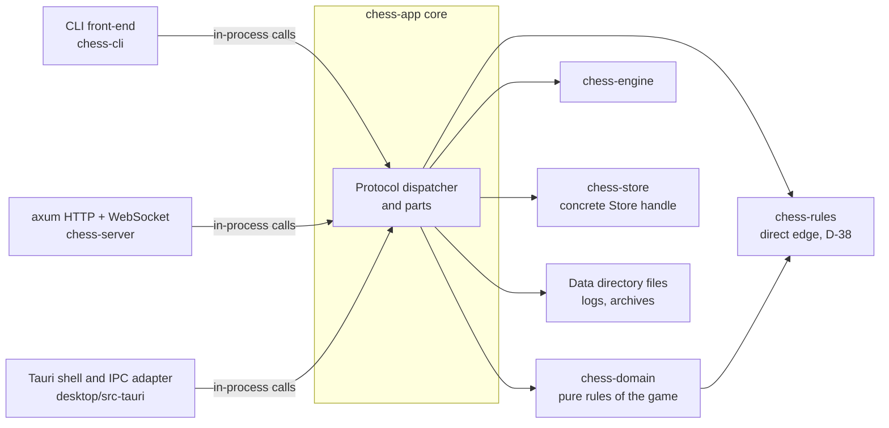

| Neighbour | Direction | What crosses |
|---|---|---|
| Three front-ends | in and out | `chess-cli`, `chess-server` and `desktop/src-tauri` depend on `chess-app` and on no other lower crate (TR-1.1; `chess-cli` also on `chess-server`). They see only the curated `pub use` list (IFP-APP-06). Typed `Command`/`Query`, `Reply`/`ProtocolError`, `Event` streams (IFP-APP-01 to 03). The JSON envelope `{id, kind, body}` is defined here and encoded and decoded by the transport using helpers from this crate (DD-APP-03) |
| `chess-domain` | out | Pure calls: `Game`, `Clock`, `Policy`, `EloCalc`, `RosterGen`, `VariationTree`, `EcoTable` (IFR-APP-04) |
| `chess-rules` | out, direct | SAN, FEN, PGN reader and writer, `canonical_form`, legality, `Position::parse_move` (IFR-APP-05). The edge `chess-app -> chess-rules` exists in §3.2 since amendment 7 (D-38; UF-APP-01 RESOLVED). `chess-domain` and `chess-store` do not re-export `chess-rules` types |
| `chess-engine` | out | `Engine` trait and pool, held only by `EngineGateway` (IFR-APP-01) |
| `chess-store` | out | The concrete `Store` handle to the store thread, plus the concrete `MoveJournal`/`JournalWriter` types (IFR-APP-02, IFR-APP-03). No trait, no fake (D-39) |
| Data directory | out | `logs/chess.log*` written by this block; archive files written or read by `ImportExportService` at paths given by trusted in-process callers only (IFR-APP-06) |

Trust boundary: the browser is untrusted input (principle 1, R-5, D-22). Everything arriving from the WebSocket transport is a client-controlled value: it is deserialised with `deny_unknown_fields`, validated by the owning service, and never trusted for state (SWE-001 §6 SEC/SER row) [INF from A §8 Security row and P §6].

### 4.2 Composition viewpoint

**Concern:** decomposition into parts and what each is for.

| DD | Part | Purpose (one line) | Architecture §2.2 name |
|---|---|---|---|
| DD-APP-01 | `Core` facade | Wires parts and seams, owns life cycle (open, recovery mode, shutdown), hands out `FrontEndSession`s | `chess-app core` |
| DD-APP-02 | Protocol dispatcher and event stream | Routes commands and queries, maps errors, publishes events, resynchronises lagging subscribers | `chess-app core :: Protocol dispatcher` |
| DD-APP-03 | Protocol types and `ts-rs` export | One set of serde types; generated TypeScript | (part of `chess-app::protocol`) |
| DD-APP-04 | `AppError` and catalogue mapping | Typed internal errors mapped to the §5.5 codes and messages | (cross-cutting, [A] §8 Error handling row) |
| DD-APP-05 | Confirmation mechanism | One shared check and a proof token | whole core (F-2.5.7) |
| DD-APP-06 | Name validation | Trim, NFC, grapheme count, characters, uniqueness | `PlayerService` (F-1.2) |
| DD-APP-07 | `PlayerService` | Players, preferences, active Player, roster generation, reset, void | `PlayerService` |
| DD-APP-08 | `GameSetupService` | Validate a `GameSetup`, reserve slots, start | `GameSetupService` |
| DD-APP-09 | `SessionRegistry` | One session per live game, resume list, journal lock, held games | `SessionRegistry` |
| DD-APP-10 | `GameSession` actor | All state changes of one live game | `GameSession` |
| DD-APP-11 | `EngineGateway` | The only path to the engine; policy check, audit, legality check | `EngineGateway` |
| DD-APP-12 | `AnalysisService` | Live analysis, what-if, variations, stored-game analysis views | `AnalysisService` |
| DD-APP-13 | `AnalysisWorker` | Background per-move evaluation of finished games | `AnalysisWorker` |
| DD-APP-14 | `StatsService` | Read models: statistics, history, rating series | `StatsService` |
| DD-APP-15 | `ImportExportService` | PGN export and import, full-data archive export, preview and apply | `ImportExportService` |
| DD-APP-16 | Diagnostic log | Identifier-only, size-rotated local log | `Diagnostic log` |
| DD-APP-17 | Edge seams | The traits through which the core reaches engine, store, journal, time, randomness | (principle 2, [A] §4.1 "Edges") |
| DD-APP-18 | `JournalCodec` | Pure conversion between a domain `Fact` and a journal record | (cross-cutting, [A] §5.7) |
| DD-APP-19 | `personality_to_engine` | The one conversion between the stored and the engine personality | (cross-cutting, D-43) |
| DD-APP-20 | `CalibrationService` | Calibration matches, SPRT and report on a `Core` from `open_for_calibration` (D-57) | `chess-app core :: Calibration run` (architecture §2.2) |

### 4.3 Logical viewpoint

**Concern:** the static structure of the key types and who owns them. Only types that cross a part boundary are shown. Field lists are indicative; the exact serde shapes are fixed in `chess-app::protocol` (DD-APP-03).

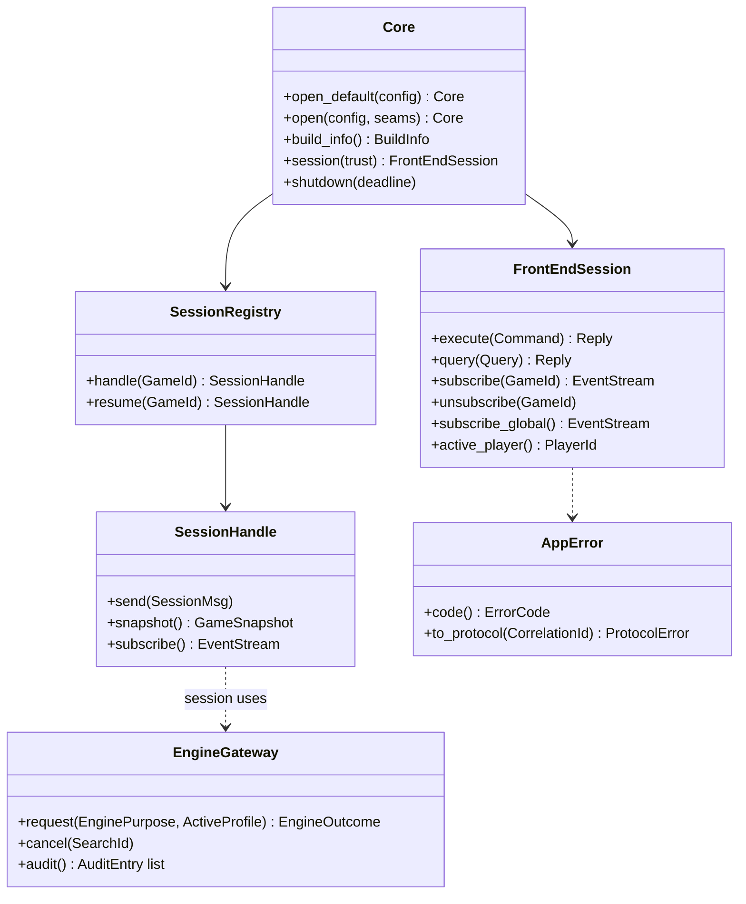

Ownership rules [INF from A §4.2, §4.8, §7.4]: the `Game` value is owned by exactly one `GameSession` task and never shared; events are `Arc<Event>`; `Command` and `Query` values are moved into the service that handles them; the `Store` handle is a concrete clonable value held by `Core` and lent to parts, and the `Engine` factory, `TimeSource` and `Rng` are `Arc<dyn Trait>` seams.

### 4.4 Dependency viewpoint

**Concern:** build-time and run-time interconnections, and whether they respect the architecture.

Crate level (architecture §3.2 as amended, D-38): `chess-app` depends on `chess-engine`, `chess-store`, `chess-domain` and **`chess-rules`**; it is depended on by `chess-cli`, `chess-server`, `desktop/src-tauri`, which depend on no other lower crate; `ts-rs` generates types into `ui/` [OBS A §3.2]. The edge rule is checked by FF-1 (`cargo tree` / `cargo deny`: front-end crates list only `chess-app`, and `chess-server` for the CLI, among workspace dependencies; the `pub use` list equals IFP-APP-06). Third-party libraries named in §3.2 for this crate: `tokio`, `unicode-segmentation`, `unicode-normalization`; named in §3.4 and used by this design: `serde`, `thiserror`, `tracing`, `tracing-appender`, `ts-rs`. **Admitted in principle by decision 11 and architecture §3.4 (D-47), each still needing a registry lookup, licence check and CVE scan before a version is written; no version is stated here `[UNV]`:** `serde_json`, `uuid` (v5 feature), a ZIP library (deflate only), a SHA-256 implementation (this crate only), `tracing-subscriber`, `tokio-util` (cancellation), `futures-util` (and `tokio-stream` only if needed). Rejected: `signal-hook`, a native dialog plugin, a single-instance plugin, an `arc-swap`-like cell, `rand`/`rand_chacha` (the seeded generator is the domain's `SplitMix64`).

Intra-crate edges (architecture §4.1 as amended, AMD-10, UR-48). The four edges that v0.1 had to draw dashed, `PlayerService -> SessionRegistry`, `GameSetupService -> SessionRegistry`, `AnalysisService -> Store` and `EngineGateway -> Store`, are now in §4.1 and drawn solid (UF-APP-16 RESOLVED). Where the gateway gets the game state it checks is settled by D-74 (confirmed by Brian Prascher, G2, 2026-11-04; architecture OQ-13 closed): the `GameContextProvider` trait, drawn solid:

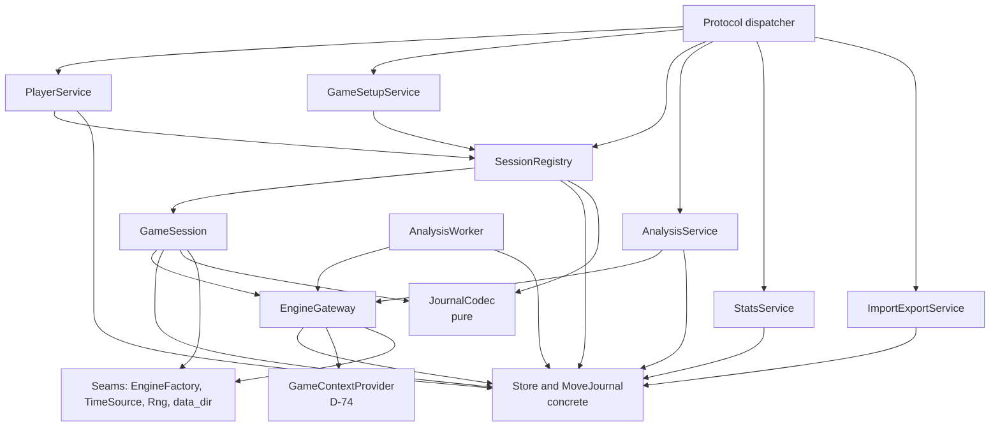

Rules enforced by module visibility and review [INF]:

1. No part other than `EngineGateway` names `chess_engine::Engine` (principle 3, [A] §5.7).
2. No SQL and no `rusqlite` type outside `chess-store` ([A] §5.7). `chess-app` sees only the concrete `Store`, `MoveJournal` and `JournalWriter` types, and the integer row ids of the store never reach it (D-40).
3. No cycle: `GameSession` depends on `EngineGateway`; the gateway needs game state but takes it through a `GameContextProvider` trait (DD-APP-17) implemented by `SessionRegistry` plus the store, so the gateway never names the registry (D-74). The direction is dependency inversion: the gateway depends on the trait and `SessionRegistry` implements it, so the existing chain `SessionRegistry -> GameSession -> EngineGateway` has no cycle. The trait is private to `chess-app` (`seams.rs`, `pub(crate)`, not in the curated `pub use` list).
4. `PlayerService` reaches `SessionRegistry` only through a small `SessionControl` trait (`prepare_void`, `finish_void`) so the dependency is explicit and fakeable.
5. Transports never import a part; they see `Core`, `FrontEndSession`, protocol types.

### 4.5 Information viewpoint

**Concern:** which data the block owns, reads, writes, and at what transaction boundary. The system of record for every table is fixed in [A] §7.4; this table restricts to the writes this block performs.

| Datum | Owner in this block | Access | Boundary and invariant [OBS A §7.4] |
|---|---|---|---|
| `PLAYER`, `PREFERENCES`, initial and reset `RATING_HISTORY` rows | `PlayerService` | write via `Store` | Register, rename, archive, preferences: one transaction each. Reset: one `BEGIN IMMEDIATE` including the void of every unfinished game |
| `COMPUTER_PROFILE` + two baseline history rows per computer | `PlayerService` (via `RosterGen`) | write | Batch of N in one transaction, rows never updated |
| `GAME` header, `UNFINISHED_SLOT` at start | `GameSetupService` | write | One transaction; `UnfinishedGameExists` on primary-key conflict |
| `MOVE`, `GAME` clocks, `journal_seq`, result, `RATING_HISTORY` game rows, `ANALYSIS_JOB` enqueue | `GameSession` (through `Store` finalize and apply) | write | Journal first, then store thread; finalize is one `BEGIN IMMEDIATE` |
| `MOVE_EVAL`, `ANALYSIS_JOB` state | `AnalysisWorker` | write | One upsert per ply |
| `VARIATION` (one saved line, anchor `from_ply`, `created_at`; no player) | `AnalysisService` | write | Per save or delete; a save from the final position is refused (decision 13) |
| `GAME`/`MOVE`/`GAME_TAG` of imported games, `GAME.content_hash` | `ImportExportService` | write | One transaction per imported game; whole-database import exclusive. The hash of every terminal game, imported or played, is computed by one function here (DD-APP-15) |
| `APP_SETTING.last_active_player`, `roster_seed` | `PlayerService` | write | One transaction per key; `PlayerService` is the named writer since amendment 7 (UF-APP-16 RESOLVED) |
| `GAME.analysis_used` | `EngineGateway` (first grant of live analysis or what-if) | write | Single-column update; [A] §7.2 note |
| Statistics, history, rating series | `StatsService` | read only | The store returns rows filtered by structural keys (Player, reset window, side, limit); the domain applies the predicate and aggregates (TR-7). `StatsService` maps to DTOs |
| `logs/chess-<process kind>.log*` | `Diagnostic log` | write (files) | Append-only, size rotated; one file set per process kind (UR-48) |
| Archive files, PGN files | `ImportExportService` | read, write | Write by temp file then rename [P §6 FIO] |
| In-memory only | `SessionRegistry` map, `GameSession` state, gateway audit log, subscriber counts, active Player per `FrontEndSession` | | Lost on exit by design; the journal and store are the record |

Formats owned by this block (sources: [A] §5.7): the PGN export contract (written by `chess-rules`' writer, assembled and tagged here), the full-data archive (`manifest.json`, `games.pgn`, `players.json`, `ratings.json`, `settings.json`, `games.json`; `format_version` 1 [OBS A §5.7]), the `content_hash` string format (`"sha256:" + hex`, DD-APP-15) and the log line format (DD-APP-16). The journal **format** is `chess-store`'s; the **conversion** from a domain `Fact` to it is this block's (DD-APP-18).

### 4.6 Patterns-use viewpoint

**Concern:** recognised solutions reused, why, and how misuse would show.

| Pattern | Where | Why | Misuse tell |
|---|---|---|---|
| Actor (task plus mailbox) | `GameSession` | Per-game serialisation without locks (D-13, [A] §4.2) | A `Mutex<Game>` appears; an `await` on the engine inside the handler |
| Facade | `Core`, `FrontEndSession` | One entry for three transports (principle 4) | Transports reach into a service |
| Command / Query / Event (CQS) | protocol | Serialisable intents and pushed facts [A] §5.1 | A `Query` that writes (UF-APP-03) |
| Type-state / proof token | `ConfirmedToken`, `ValidatedName` | Make "unconfirmed" and "unvalidated" unrepresentable at the call site | A `pub` constructor or `Default` on the token |
| Ports and adapters | seams (DD-APP-17): engine, time, rng, data dir | Fake engine, fake clock, temp-directory store with `FaultPlan` (principle 2 as amended, D-39) | A test needs a real engine process for a unit-level behaviour; or a trait appears in front of `Store` without FF-2 failing |
| Generation counter (epoch) | engine searches, flag timer in `GameSession` | Discard results of a cancelled search or a re-armed timer | A result applied without comparing its id |
| Write-ahead log | journal before store (D-23) | Durable before acknowledged | Event broadcast before `append` returns |
| Priority queue with preemption | gateway lanes (interactive over background) | One engine instance, two kinds of work (UF-APP-12) | Background search holds the engine while a human waits |
| Two-phase import (preview then apply) | `ImportExportService` | Decide on conflicts before any write (D-17, D-34) | A partial write followed by a prompt |
| Strategy (clock-budget, flag classification as pure functions) | session, worker | Table-testable arithmetic | Arithmetic inlined in handlers |

### 4.7 Interface viewpoint

**Concern:** what the block offers, what it needs, and the exact contracts. Contracts follow architecture §5.7; the `Protocol` row is the one this block provides.

#### 4.7.1 Provided interfaces

**IFP-APP-01 Core API** (consumers: `chess-cli`, `chess-server`, `desktop/src-tauri`). Matches [A] §5.2 (`core.execute(cmd).await`, `core.subscribe(game_id)`) with one addition, the session handle (UF-APP-04).

```rust
// design-level sketch, not compiled [UNV]
pub struct CoreConfig { pub data_dir: DataDirChoice, pub build_version: String, /* timeouts, see 4.12 */ }
pub struct DataDirChoice { pub path: PathBuf, pub source: DataDirSource }          // Flag | Env | Default
// Test entry only (feature `test-support`). The store is NOT a seam (D-39); `data_dir` is the store's DataDir value.
pub struct Seams { pub engine: Arc<dyn EngineFactory>, pub time: Arc<dyn TimeSource>,
                   pub rng: Arc<dyn Rng>, pub data_dir: DataDir }
pub struct BuildInfo { pub build_version: String, pub protocol_version: u32 }       // build_version is TEXT (XC-27)

impl Core {
    /// Production wiring is inside this crate (TR-1.5): the UCI engine factory, the system clock and the
    /// OS random source are built here. Front-ends call this one.
    pub async fn open_default(cfg: CoreConfig) -> Result<Core, OpenError>;        // Ready or RecoveryMode, DD-APP-01
    pub async fn open(cfg: CoreConfig, seams: Seams) -> Result<Core, OpenError>;  // tests (feature test-support)
    pub async fn open_for_calibration(cfg: CoreConfig) -> Result<Core, OpenError>; // refuses a directory that holds a store (D-73); DD-APP-20
    pub fn build_info(&self) -> BuildInfo;
    pub fn session(&self, trust: Trust) -> FrontEndSession;                        // Trust::{InProcess, Remote}
    pub async fn shutdown(&self, deadline: Duration);                              // suspend all games, emit ServerStopping
    pub fn state(&self) -> CoreState;                                              // Ready or NeedsRecovery(StoreProblem)
}
/// Thin wrapper over the store's `DataDir::resolve`; the resolution logic has one owner, the store (TR-1.5).
pub fn resolve_data_dir(flag: Option<&Path>, env: &dyn Fn(&str) -> Option<String>)
    -> Result<DataDirChoice, ConfigError>;
pub fn new_game_uuid() -> GameId;       // helper for the CLI; the GUI uses Web Crypto (any UUIDv4 source is fine)

impl FrontEndSession {
    pub async fn execute(&self, cmd: Command) -> Result<Reply, ProtocolError>;
    pub async fn query(&self, q: Query) -> Result<Reply, ProtocolError>;
    pub async fn subscribe(&self, game: GameId) -> Result<EventStream, ProtocolError>;
    pub fn unsubscribe(&self, game: GameId);                                        // detach; same effect as dropping the stream
    pub fn subscribe_global(&self) -> EventStream;                                  // process-wide events, UF-APP-05
    pub fn active_player(&self) -> Option<PlayerId>;
}
```

| Aspect | Contract |
|---|---|
| Semantics | `execute` and `query` complete when the effect is durable (commands) or read (queries). Each call runs on its own runtime task so a panic becomes `Internal{id}` and never unwinds into a transport (DD-APP-02) |
| Errors | Only `ProtocolError{code, message, details}` with `code` from the catalogue (section 6). No path, SQL, or panic text in `message` [OBS A §5.5] |
| Idempotency | As [A] §5.6: ply-guarded commands, `StartGame{game_uuid}`, imports by content hash. `Takeback{game_id, ply}` carries `ply` as a **stale-command guard only** (Q-SE-2): the core derives the target from RULE-3, rejects with `StalePosition` when `ply` differs from the live ply, and the codec writes the computed target as the journal field `to_ply` |
| Threading | `Send + Sync + 'static`; callable from any runtime task. No call blocks a UI thread: all awaits are on runtime workers, SQLite is on the store thread (D-13) |
| Preconditions | Core in `Ready`, except the recovery commands of DD-APP-01 |

**IFP-APP-02 Event stream.** `EventStream` implements `futures::Stream<Item = EventEnvelope>`, where `EventEnvelope{game_id, seq, event}` (D-53). First item for a game subscription is a full `GameSnapshot`. For a game subscription `game_id` is the game and `seq` is that game's counter, strictly increasing and gap-free per subscription. For the global stream `game_id` is null and `seq` is a per-subscription counter that increases strictly but **may show a gap** after the receiver lagged: global events are notifications and the client re-queries, so no snapshot is sent to repair a gap. An event about one stored game, such as `AnalysisProgress`, names the game inside `event`, not in the envelope. A lagging receiver is resynchronised by a fresh `GameSnapshot` (DD-APP-02). Dropping the stream or calling `unsubscribe` detaches; when the last subscriber of a live game detaches the session suspends at once (D-14). **Attach window (UR-30):** a session that is new or resumed and has no subscriber yet suspends after 5 s (`ESTIMATE`). **Reconnect:** after a transport drop the session has already suspended (D-14), so a client reconnects with `ResumeGame` and then `subscribe` (architecture §5.1). The global stream (`subscribe_global`) carries `ServerStopping`, `StoreBacklog`, `AnalysisProgress` of stored games and `RatingsUpdated`; these four events are not part of a game subscription.

**IFP-APP-03 Wire envelope.** A frame is `{id?, kind, body}` (D-53, architecture §5.2 and §5.6). `id` is a client-chosen request id; it is present on `command`, `query`, `subscribe`, `unsubscribe` and `subscribe_global` frames and is echoed on the `result` or `error` that answers them. `hello` and `event` frames carry **no `id`** (a pushed frame answers no request). An `error` for a frame that could not be decoded has no `id` unless one could be read from it. **Kinds (UR-29, decision 10; this SDD governs the exact shapes):** `hello` (first frame, carries `protocol_version`), `command`, `query`, `subscribe`, `unsubscribe`, `subscribe_global`, `result`, `error`, `event`. The body of an `event` frame is `EventEnvelope{game_id, seq, event}`. A frame that does not decode (bad JSON, unknown kind, unknown field, a frame before `hello`) is answered with the error code `MalformedFrame{reason}` (D-54, architecture §5.5; `reason` one of `bad_json`, `unknown_kind`, `unknown_field`, `before_hello`) and the transport closes the socket. The WebSocket close code is the server's choice (server design ASM-SRV-1) and is not fixed here. `ProtocolMismatch` keeps only the version mismatch. Encode and decode functions live in `chess-app::protocol::envelope` so `chess-server` and `desktop/src-tauri` share them [OBS A §5.2 "same JSON envelope"]. `check_version(client, server)` returns `ProtocolMismatch{server, client}`; the adapters call it and raise the error, as [A] §5.5 assigns [INF].

**File transfer (decision 9, XC-20, UR-35; D-49).** File contents travel **inside frames as base64 bytes**; no HTTP upload or download route and no dialog plugin exist. A remote (WebSocket) or Tauri session sends and receives `FileRef::Bytes`; only an in-process CLI session may use `FileRef::Path` (DD-APP-15). Browser: file input in, Blob download out. Desktop: the shell writes an export to the user's Downloads folder and rewrites the reply (D-55). **Export reply (D-55):** `ExportPgn` and `ExportData` return `ExportedFile{name, media_type, content}` where `content` is `Bytes{base64}` or `Saved{path}`. The core returns `Bytes` to a remote or Tauri session; the Tauri shell writes the file and rewrites `content` to `Saved{path}` before the reply reaches the UI; an in-process CLI export that names an output file gets `Saved{path}` from the core. A write that fails gives `ExportWriteFailed{cause}` (`folder_missing`, `permission_denied`, `disk_full`, `io_error`), raised by the Tauri shell and by `ImportExportService` for a CLI `--output` or `FileRef::Path`; no partial file is left at the final name (temp file, then rename) and the game and the store are unchanged. Limits: PGN file 10 MB (TBD-25, `ESTIMATE`); archive file about 24 MiB through a frame (TBD-35, `ESTIMATE`, from the 32 MiB message cap and the 4/3 growth of base64 `[INF]`). A file over its limit is rejected **before it is read** with `ValidationFailed{field: file, reason: too_large}`; the message gives the limit, the file size and, for an archive, the CLI alternative (NFR-9). The limit numbers are in the message text only: `ValidationFailed` has `{field, reason}` and the architecture (§5.5, §4.8) adds no structured fields, so a client does not parse them (FIND-JR-019, OQ-APP-010). The store is unchanged. A CLI import by path has no frame limit. The limit restricts DAT-2 and IF-5 for the GUI path only (CR-9.5).

**IFP-APP-04 Calibration entry (dev tooling; D-57).** `Core::open_for_calibration(cfg)` (Amd 8, D-73, Board BP-015; Board-recommended and confirmed by Brian on 2026-11-04 as a minor item; G1) **requires an empty or absent directory, or one carrying a calibration marker that it wrote itself, and refuses any directory that already holds `chess.db`, `store.id` or `journal/`** (`CalibrationError::DirectoryRefused`), not only the default directory (R-17); a user whose store is elsewhere (`CHESS_DATA_DIR`, `--data-dir`) is therefore protected, and the first launch of a calibration run (which creates 25 computer Players) never happens in a user's store. D-57's ownership is unchanged. It returns the `Core` that the calibration run needs, a handle that can construct `EnginePurpose::Calibration` (DD-APP-11). `chess_app::calibration` (DD-APP-20) provides `run(&Core, CalibrationPlan) -> Result<CalibrationReport, CalibrationError>`, which plays the matches through `EngineGateway`, runs the SPRT and builds the report. `chess calibrate` in `chess-cli` only parses its arguments, opens that `Core`, calls `run` and prints the report. Neither `open_for_calibration` nor `run` is reachable through any `Command` or `Query`. The plan and report shapes belong to this design (DD-APP-20).

**IFP-APP-05 Shutdown.** `Core::shutdown(deadline)` stops accepting commands, emits `ServerStopping` on the global stream, suspends every live session with its journal flush, then returns; at most 5 s ESTIMATE ([A] §4.8 table).

**IFP-APP-06 Curated `pub use` surface (TR-1.4, D-38).** What a front-end may use from below `chess-app` is **exactly** the list of named `pub use` items in `lib.rs`. No glob re-exports. `chess-cli`, `chess-server` and `desktop/src-tauri` name no other type from `chess-rules`, `chess-domain`, `chess-store` or `chess-engine`. Initial list (`[INF]` from the triage; each item names its consumer; confirmed at the joint review):

| Item | Origin | Consumer |
|---|---|---|
| `Core`, `CoreConfig`, `CoreState`, `OpenError`, `Trust`, `FrontEndSession`, `EventStream`, `BuildInfo` | this crate | all three front-ends |
| `resolve_data_dir`, `DataDirChoice`, `DataDirSource`, `ConfigError`, `new_game_uuid` | this crate | `chess-cli`, `chess-server`, `src-tauri` (data directory, CLI game uuid) |
| `Command`, `Query`, `Reply`, `Event`, `EventEnvelope`, `GameSnapshot`, `ProtocolError`, `ErrorCode`, envelope encode/decode and `check_version` | `protocol` | all three; `chess-server` and `src-tauri` encode and decode frames |
| `GameId`, `PlayerId`, `GameSetup`, `Mode`, `Matchup`, `ClockSpec`, `Category`, `Preferences` (the domain value types that appear in commands, with their feature-gated `ts-rs` derive, TR-11) | `chess-domain` | all three |
| `BoardGrid`, `BoardStyle`, `BoardView`, `Orientation`, `Cell`, `Shade`, `Highlight` (the whole set; "and the other cell types" is struck, FIND-JR-005) | `chess-domain` | `chess-cli` (TUI `BoardWidget`, `PlainRunner`; the CLI calls `BoardGrid::from_fen(fen, &BoardView, style, orientation)`) |
| `Seams`, `Core::open`, `Core::open_for_calibration`, `calibration::run`, `CalibrationPlan`, `CalibrationReport`, `CalibrationError` | this crate | `chess calibrate` and tests; `Seams` and `Core::open` behind the `test-support` feature |
| `FakeEngine` factory (`test_support::fake_engine_factory()` (proposed name), returning an `Arc<dyn EngineFactory>`) and the temp-directory store helper (`test_support::temp_data_dir()` (proposed name), returning a `DataDir`) | this crate, re-exporting the engine's `FakeEngine` and the store's `DataDir` constructor | tests of `chess-cli`, `chess-server`, `desktop/src-tauri`; Cargo feature `test-support` only, not compiled into a release build (architecture §5.7 "Test support", FIND-JR-006) |

`DataDir` is **not** re-exported in a release build; under `test-support` only the helper above returns one. The `test-support` feature makes `chess-app` use the `test-support` feature of `chess-engine` (the `FakeEngine`) and of `chess-store` (`FaultPlan`); both edges already exist, so the crate graph does not change. The list is checked by FF-1 (a test compares the crate's public items with this table). Revisit if the list exceeds about 15 items or a front-end needs a new lower-crate type twice (D-38 revisit trigger).

Routing of every protocol item (the contract between DD-APP-02 and the services). Items from [A] §5.1; "to" is the owning part:

| Item | To | Item | To |
|---|---|---|---|
| `RegisterPlayer`, `RenamePlayer`, `ArchivePlayer`, `UpdatePreferences`, `GenerateComputerPlayers`, `SelectProfile`, `ResetPlayerData`, `VoidUnreadableGame` | `PlayerService` | `GetPlayerStats`, `GetRatingHistory`, `ListGames`, `GetGame` | `StatsService` |
| `ListPlayers`, `GetPreferences` | `PlayerService` | `LegalMoves`, `ParseMove`, `Analyze`, `StopAnalysis`, `GetGameAnalysis`, `SaveVariation`, `DeleteVariation` | `AnalysisService` (`ParseMove` takes the position at `ply` from the live session snapshot or the stored moves and parses with `chess-rules`; ASM-APP-20) |
| `StartGame` | `GameSetupService` | `ImportPgn`, `ResolveImport`, `CancelImport`, `ImportFen`, `ExportPgn`, `ExportData`, `PreviewDataImport`, `ApplyDataImport` | `ImportExportService` |
| `ResumeGame`, `DetachGame`, `ListUnfinishedGames` | `SessionRegistry` | `CreateFreshStore`, `RestoreBackup` | `Core` recovery handler (DD-APP-01) |
| `MakeMove`, `Takeback`, `OfferDraw`, `RespondDraw`, `Resign`, `Pause`, `Resume`, `Step`, `SetMoveDelay`, `Abort`, `CancelEngine`, `RetryEngine` | `SessionRegistry` lookup, then the `GameSession` mailbox (held-game path for `Resign`/`Abort` on a suspended game) | | |

A unit test keeps the table honest: an exhaustive `match` over `Command` and `Query` with no wildcard arm, so a new variant does not compile until it is routed (UT-APP-02).

#### 4.7.2 Required interfaces

Names marked (proposed) are not in the architecture; the owning sibling SDD decides them. Everything the architecture does name is quoted.

| ID | Provider | What this block needs | Source |
|---|---|---|---|
| IFR-APP-01 | `chess-engine` | `Engine` trait: `search(SearchRequest) -> SearchResult{best, pv, lines, score, depth}`, `stop()`, `health()`. `SearchRequest{position, limits, multipv, new_game, seed, updates}`; `SearchPosition` is `Fen` or `Moves{start, moves}`; `updates` is an optional throttled stream of `SearchInfo` for `AnalysisProgress`; `seed` is the error-pick seed. `EnginePool` hands out `EngineHandle`s (`computer_side(key, personality)`, `analysis(priority)`); `EnginePersonality` is the engine's own type; `PINNED_UCI_ELO_RANGE` constant; typed `EngineError`. Scores come back from the side to move's point of view. Only `EngineGateway` holds a handle | [OBS A §5.7 as amended (UR-40), §3.3, §4.7]; shapes `[INF]` from the engine design, confirmed at the joint review |
| IFR-APP-02 | `chess-store` | The concrete `Store` handle (including `roster_indexes() -> Vec<u32>`, which replaces `next_roster_index`, and `reset_player(..., voids: Vec<VoidSpec{game_id, content_hash}>)`): "one method per transaction in §7.4", run on the store thread, with a read pool; the API takes and returns `GameId`/`PlayerId` (UUID), never integer ids; typed errors `StoreBusy`, `StoreUnavailable`, `SchemaTooNew`, `StoreMissing`, `StoreCorrupt`, `BackupFailed`, `Busy`, `OtherVersionRunning`. Statistics methods return rows only (TR-7). No trait, no fake (D-39) | [OBS A §5.7, §7.4, §5.5]. Method names are those of [SDD-chess-store](SDD-chess-store.md) 3.7.2, which is authoritative for its own API (section 5.0) |
| IFR-APP-03 | `chess-store` (`MoveJournal`) | Concrete types: `MoveJournal::create(&GameId)`, `open_for_resume(&Store, &GameId) -> (JournalWriter, Recovered)`, `probe(&GameId)`; `JournalWriter::append(JournalRecord) -> Seq` durable on return (`F_FULLFSYNC`); on failure the writer truncates to the last acknowledged length or is poisoned (`WriteFailed` with cause `Poisoned`; D-82, store 3.7.3), blocking I/O on the blocking pool; `close_final()`. The record type is the store's `JournalRecord`; conversion from a domain `Fact` is `JournalCodec` (DD-APP-18) | [OBS A §5.7 as amended (AMD-3), §7.6] |
| IFR-APP-04 | `chess-domain` | `Game` (`decide(GameCommand) -> (Vec<Fact>, post-state, Stamp)`, `evolve`, takeback, draw offer, pause, resign, flag, termination, clocks with `running_side`, `view()` including `eco`), `Clock` and `ClockSpec`, `Policy::check(action, &GameContext)`, `check_player_action`, `slot_holders`, `allowed_actions`, `EloCalc`, `RosterGen`, `first_k_after(class, &[u32]) -> k`, `VariationTree`, `EcoTable` (observed for every start, CR-9.11) and the ECO import functions `classify_import(tag, classified) -> EcoImportOutcome` (*Agree*, *Mismatch*, *TagOnly*, *TableOnly*, *Neither*) and `resolve(&outcome, Option<EcoChoice>) -> Result<EcoFields, EcoUnanswered>` with `EcoChoice` = `KeepPgn` | `KeepTable` (D-59; signatures from the domain SDD 3.11.9 `[OBS]`), `GameSetup`, class bands, `aggregate`, `rating_series`, `check_history`, `counts_in_aggregates`, `error_pick_seed`, `TimeSource` and `Rng` traits, `BoardGrid` | [OBS A §3.3, §4.4, §5.7 as amended]. Names are those of the triage rulings; exact signatures come from SDD-chess-domain v0.2 (`[INF]`, confirmed at the joint review) |
| IFR-APP-05 | `chess-rules` | Direct edge since amendment 7. Position and FEN parse with legality, `Fen::as_str`/`Display`, SAN/UCI parse and format, `Move::from_uci`, `Position::parse_move(text, Typed) -> MatchedMove{mv, uci, san}` (the only typed-move parser; the rules type was renamed from `ParsedMove`, D-52; `mv` stays inside `chess-rules` and this crate, and the wire type `ParsedMove{uci, san}` is built here), PGN streaming reader, the single canonical PGN writer, `canonical_form`, legal-move generation, termination detection (called by the domain) | [OBS A §5.7, §3.3 as amended] |
| IFR-APP-06 | OS / filesystem | Directory creation `0700`, files `0600`, temp-file-then-rename, `flock` on the log lock file, ZIP read and write | [OBS P §6 FIO, A §8 Security] |
| IFR-APP-07 | `TimeSource`, `Rng` | Traits defined in `chess-domain`; **the implementations live in this crate** (system clock, OS random source; fakes for tests). Monotonic time for clocks, wall time for timestamps; `Rng` seeded from the roster seed, and for the engine error pick by `error_pick_seed(game_id, ply)` (one function in `chess-domain`, TR-12) passed as `SearchRequest.seed` | [OBS A §5.7 as amended] |

### 4.8 Structure viewpoint

**Concern:** internal organisation of the crate (planned; no code exists). Modules map one-to-one to design entities so a reviewer can find the code for a `DD-`.

```
crates/chess-app/src/
  lib.rs                 the curated named `pub use` list (IFP-APP-06), no glob re-exports  DD-APP-01
  core.rs                Core, open_default, open, build_info, CoreConfig, CoreState,       DD-APP-01
                         resolve_data_dir, new_game_uuid, recovery handler, shutdown
  production.rs          production wiring: UCI engine factory, system clock, OS rng        DD-APP-17
  dispatch.rs            routing, panic isolation, EventStream, global bus                  DD-APP-02
  protocol/              command.rs query.rs reply.rs event.rs envelope.rs error_code.rs    DD-APP-03
                         (ts-rs derives; one file per kind)
  error.rs               AppError, ErrorCode, messages.rs (catalogue strings)               DD-APP-04
  confirm.rs             ConfirmAction, ConfirmedToken, require_confirmation                DD-APP-05
  names.rs               ValidatedName, validate_name                                       DD-APP-06
  players.rs             PlayerService, reset orchestration                                 DD-APP-07
  setup.rs               GameSetupService, slot table                                       DD-APP-08
  registry.rs            SessionRegistry, SessionHandle, held games, resume list            DD-APP-09
  session/               mod.rs actor.rs engine_turn.rs clock_timer.rs journal_io.rs        DD-APP-10
                         snapshot.rs finalize.rs
  gateway.rs             EngineGateway, EnginePurpose, audit log, lanes                     DD-APP-11
  analysis/              service.rs worker.rs flags.rs                                      DD-APP-12, 13
  stats.rs               StatsService, ViewScope                                            DD-APP-14
  io/                    export_pgn.rs import_pgn.rs data_export.rs data_import.rs          DD-APP-15
                         archive.rs (zip, manifest, games_json.rs)
  diag.rs                typed log events, RotatingFile, init                               DD-APP-16
  seams.rs               Seams, traits: EngineFactory, GameContextProvider, SessionControl  DD-APP-17
  journal_codec.rs       fact_to_record, record_to_fact, record_to_replay_item, assemblers  DD-APP-18
  convert.rs             personality_to_engine, uci_range_from_engine                       DD-APP-19
  calibration.rs         CalibrationService: run, CalibrationPlan, CalibrationReport, SPRT  DD-APP-20
  test_support.rs        (feature test-support) fake-engine factory, temp-directory store   DD-APP-17
```

Layering inside the crate: `protocol` and `error` at the bottom (no dependencies on parts); `seams` and `diag` next; services above them; `registry`/`session` above `gateway`; `dispatch` and `core` on top. A part may call only parts below or beside it as drawn in 4.4.

### 4.9 Interaction viewpoint

**Concern:** how the parts collaborate for the flows that carry the requirements, including failure paths. The pure-domain and store internals are in the sibling SDDs; the architecture's own sequences ([A] §5.3, §5.4, §7.2 reset, §7.6 recovery) are refined here at the `chess-app` level, not redrawn.

**SEQ-APP-01 Subscribe, publish, resynchronise a lagging subscriber, detach** (F-7.4.2, D-14, [A] §4.8 Backpressure).

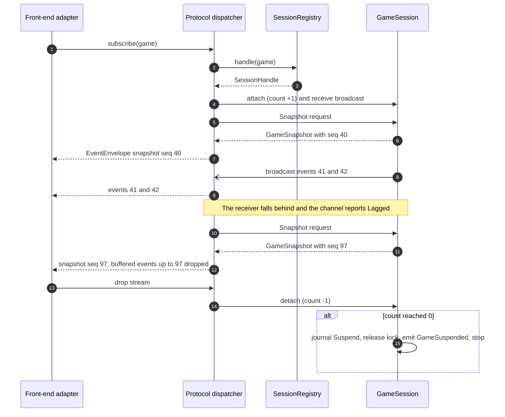

Ordering guarantee: the dispatcher subscribes to the broadcast channel **before** asking for the snapshot; the snapshot message is handled in mailbox order and carries the `seq` of the last event it reflects; the stream discards any buffered event with `seq` at or below the snapshot's. So a subscriber sees neither a gap nor a duplicate.

**SEQ-APP-02 Move, journal, event, computer reply; stale, illegal and journal-failure paths** (F-2.2.3, F-7.4.6, [A] §4.8 Ordering, §5.3).

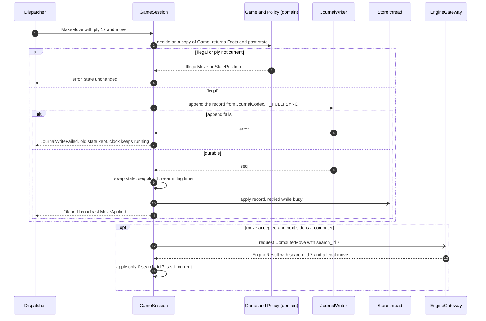

**SEQ-APP-03 Takeback while the engine thinks, late engine result discarded** (F-2.5.1, D-33).

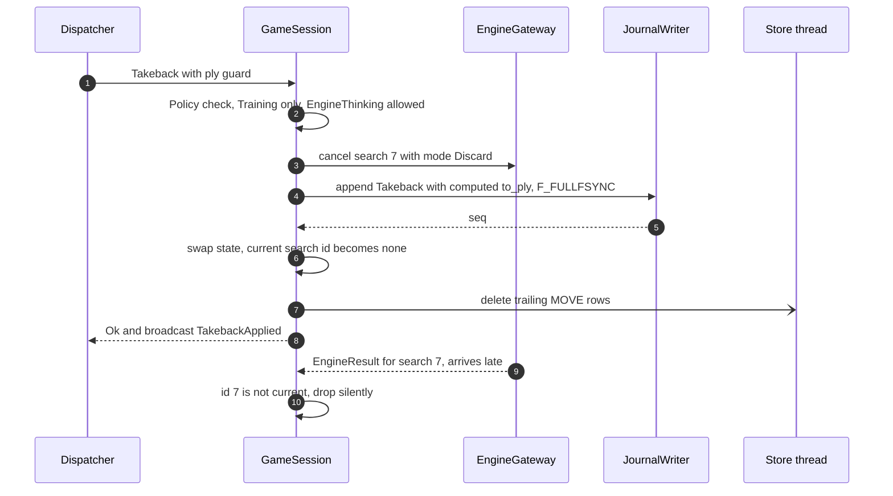

**SEQ-APP-04 Strict-mode integrity at the gateway** (ANA-1, F-3.3, [A] §4.5).

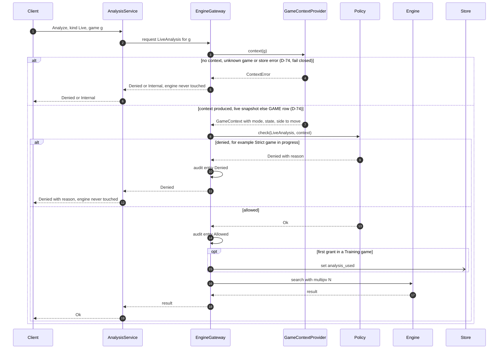

**SEQ-APP-05 Confirmed reset that voids unfinished games** (F-1.8.1, F-1.8.2, F-2.6.4, D-30; refines [A] §7.2).

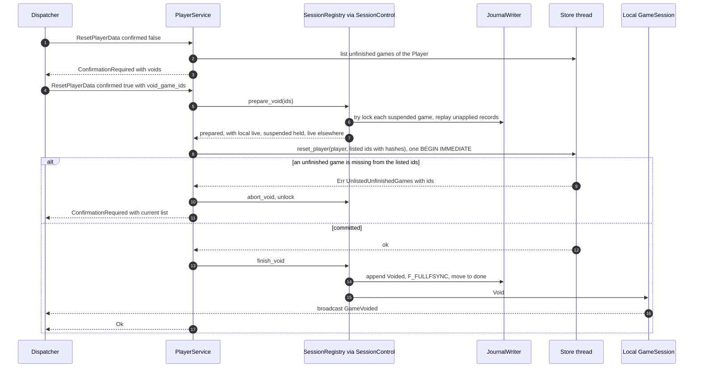

**SEQ-APP-06 PGN import: preview-before-write on duplicates and ECO mismatches** (F-6.11, IF-2, D-34, D-59).

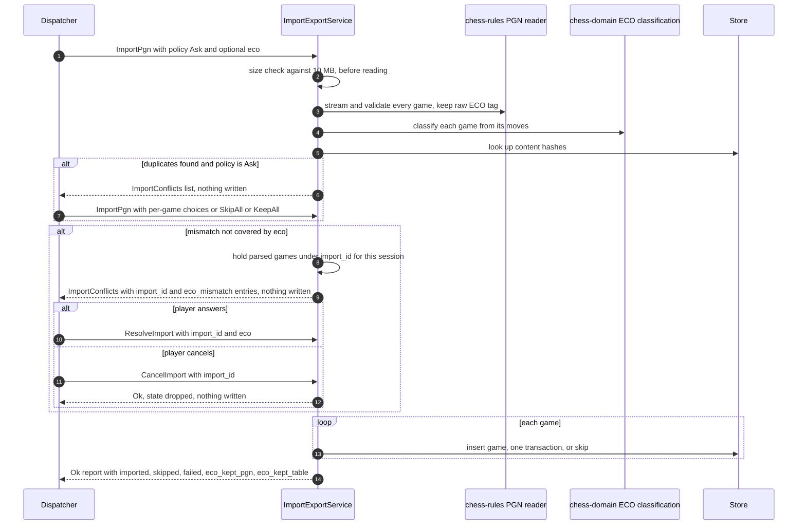

**SEQ-APP-07 `Core::open`, recovery mode, ready** (F-6.5 to F-6.9 are `chess-store`'s; the orchestration is DD-APP-01).

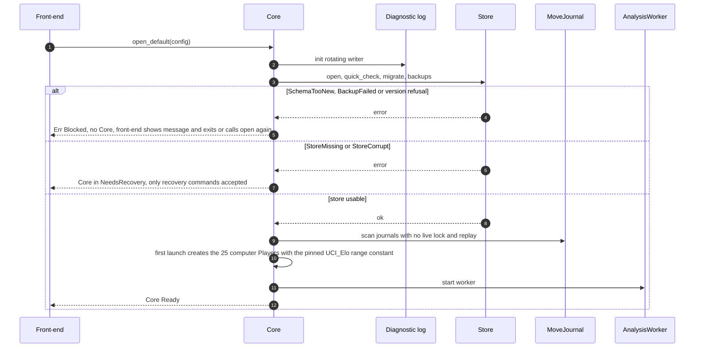

**SEQ-APP-08 Start order: store transaction, then journal `Start`, then acknowledge** (F-2.1.4, UR-04, architecture §7.4 as amended).

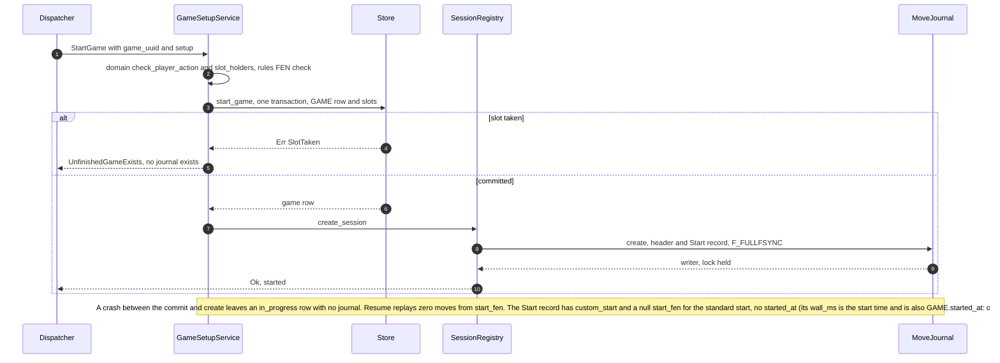

**SEQ-APP-09 Resume of an interrupted game: crash recovery** (D-58, D-65, D-78, D-79, D-80, FIND-JR-002, OQ-DOM-007; architecture §7.6). *D-79:* the registry feeds `Game::replay` with `ReplayItem`s from `record_to_replay_item`. *D-78:* the session seeds its `TimeTotals` with `seed_from_facts` over the replayed facts before accepting any command (accepted loss, option A ratified by Brian: a resumed game may lose up to the unfinished turn at each stop and is not required to). *D-80:* a game left by a degraded `Detach` is an interrupted game and takes the `recovered` path of this sequence; if the first recovery append fails, `resume` and `open_held` return `JournalWriteFailed{cause}`, release the lock and leave the journal as it is. *Amd 8 (D-65 part 1, G2, approved by Brian, 2026-11-04):* after `replay` and before `decide(Suspend)` or `decide(SuspendResume)`, the session evaluates the termination rules on the replayed position (the domain reports `terminal`); a terminal position is **ended** (the `Ended` fact and its `GameEnd` record are journalled, the game is finalized), never resumed. The rule applies to every resume, including `open_held`. A `Move` record without its `Ended` record is the case; a kill between them is tested for each terminal reason (CT-APP-29). The step is also subject to the durable-prefix rule of ALG-APP-01 step 5a.

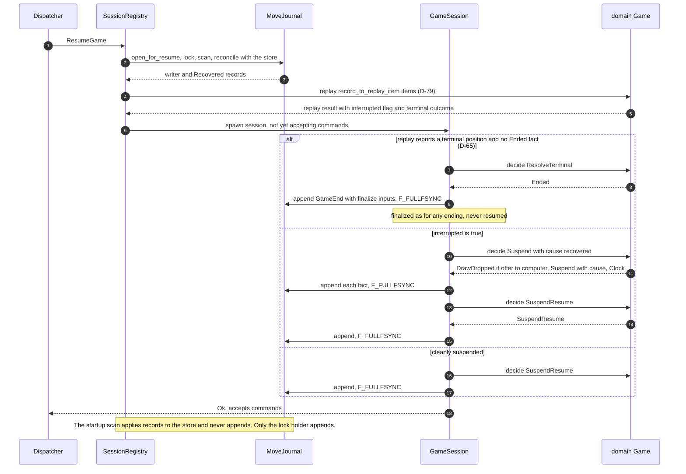

**Analysis worker loop** (F-5.5; refines [A] §5.4). One question: what happens to one job, and what yields.

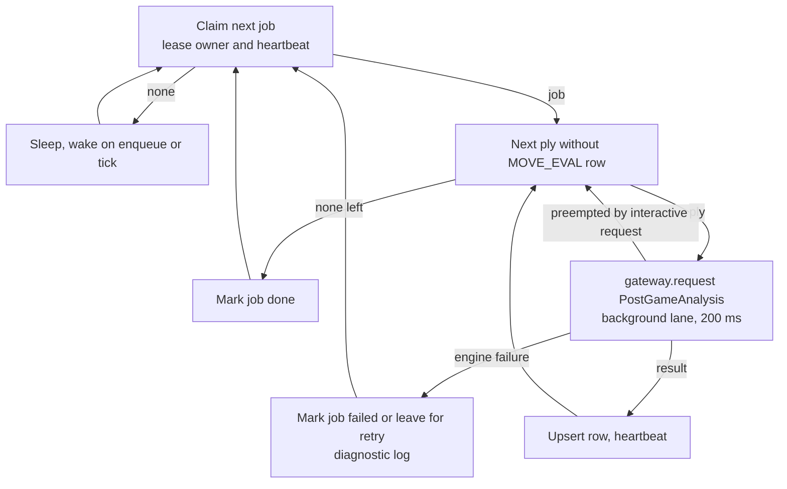

### 4.10 State dynamics viewpoint

**Concern:** behaviour by state and event. The game's own state machine (Setup, InProgress with AwaitingMove, EngineThinking, EngineError, DrawOffered, Paused, Suspended, Completed, Finalized, Aborted, Voided) is architecture §4.3 and is implemented by `chess-domain::Game` plus the actor; it is not redrawn. This section adds the machines that belong to `chess-app`.

**ST-APP-1 Core life cycle** (DD-APP-01).

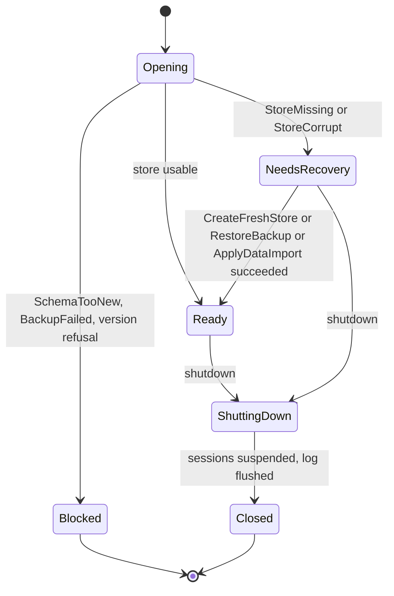

**ST-APP-2 Session life cycle in the registry** (DD-APP-09, DD-APP-10). `Live` hides the architecture §4.3 machine.

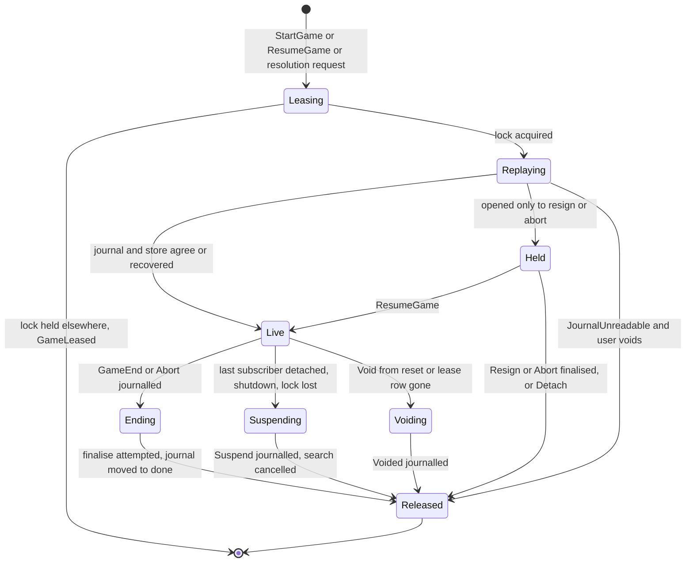

**Session mailbox: effect by state** (condensed from [A] §4.3, §4.4; "Denied" carries the reason from `Policy`). `S` is the actor; every accepted row ends with journal append before swap and broadcast.

| Message | Accepted in | Effect | Rejected with |
|---|---|---|---|
| `MakeMove{ply, mv}` | AwaitingMove, human side to move | validate, journal, swap, broadcast, maybe start engine turn | `IllegalMove`, `StalePosition{live_ply}`, `Denied` (not your turn, rewound is client-side only), `JournalWriteFailed` |
| `Takeback{ply}` | AwaitingMove or EngineThinking, Training h-c only; also `EngineError` (SE interpretation Q-SE-4 (f): it abandons the failed request and returns the human's turn) | `ply` is the stale guard; the target comes from RULE-3; cancel search if any (Discard), journal `Takeback{to_ply}`, swap | `Denied`, `NothingToTakeBack`, `StalePosition` |
| `OfferDraw` | AwaitingMove, offerer's turn, none pending, not blocked | journal `DrawOffer` then `Clock` with clocks stopped; to a computer start `ComputerDrawDecision` | `Denied{draw_not_own_turn, draw_engine_busy, draw_offer_pending, draw_repeat_blocked, draw_not_available}` |
| `RespondDraw{accept}` | DrawOffered, responder is a human | accept: end 1/2-1/2 "draw agreed"; decline: journal `DrawDeclined`, restart clocks, set `offer_blocked_for` | `Denied` |
| `Resign{side, confirmed}` | InProgress or Held, human games | confirmation, journal `GameEnd`, finalise | `ConfirmationRequired`, `Denied` (c-c) |
| `Abort{confirmed}` | InProgress or Held, c-c only | confirmation, journal `Abort`, abort transaction | `ConfirmationRequired`, `Denied` |
| `Pause`, `Resume`, `Step`, `SetMoveDelay` | c-c only | cancel search on Pause (Discard); Step plays exactly one move | `Denied` |
| `CancelEngine` | EngineThinking in h-c | cancel with `PlayBest`; result applied normally, target 200 ms | `Denied` |
| `RetryEngine` | EngineError | the next request restarts the engine (XC-18); new search id | `Denied` |
| `Void{reason, reset_player}` (internal) | any non-final | cancel search, journal `Voided`, emit `GameVoided`, stop | none |
| `EngineResult{search_id, outcome}` (internal) | EngineThinking, id current | validate, apply as a move; failure moves to EngineError | stale id dropped |
| `FlagFired{generation}` (internal) | clock running, generation current | end on time (draw if the opponent cannot mate) | stale generation dropped |
| `Detach`, subscriber count 0 | InProgress | `Game::decide(Suspend)` returns the facts (`DrawDropped` first when an offer to a computer is pending, then `Suspend` and `Clock`); the session journals each. An offer to a human is kept. Stop. A later resume journals `SuspendResume` (the session never creates a `DrawDropped` itself) | none |
| `Detach`, `Shutdown` | JournalDegraded | none: no fact is appended (no `Suspend`, no `Clock`); release the journal lock; stop. The next resume recovers with `Suspend{cause: recovered}` (D-80, D-58, ALG-APP-01 step 5b) | none |

### 4.11 Algorithm viewpoint

**Concern:** the procedural logic where correctness is subtle. Each has a unit-testable pure core.

**ALG-APP-01 Journal-first command handling** (all state-changing session messages; D-23, [A] §4.8 Ordering).
1. Read the message; check `Policy`/state; reject without side effects.
2. Clone `Game`; call `decide(GameCommand)` on the clone with `now = time.monotonic()`. It returns the `Fact`s, the post-state and the `Stamp` (wall time) (domain; the domain's `Command` was renamed `GameCommand`, TR-11).
3. `JournalCodec::fact_to_record(&Fact, &RecordCtx)` (DD-APP-18) builds one journal record per `Fact`. `fen_after` and `wall_ms` come from the post-state and the `Stamp`; `Start`, `GameEnd`, `Abort` and `Voided` get their extra inputs from the assemblers (`Start`: `rated`, `self_play`; `GameEnd`: the finalize inputs including the three time totals, D-63; `Voided`: `content_hash`, `ended_at`, D-69). The `Suspend` fact carries its `cause` (SF-21) and `Start` has no `started_at` field (SF-16; the record's `wall_ms` is the start time). The codec is pure and adds nothing else.
4. `journal.append(record).await` (blocking work on the blocking pool; returns after `F_FULLFSYNC`). On error: drop the clone, return `JournalWriteFailed{cause}`; the clocks of the old state keep running because nothing changed. *D-82 (Addendum E, F-01):* the writer has already truncated the file back to the last acknowledged length and synced (store 3.7.3), so the file is as before and **the `seq` is not consumed**: the next record reuses it. If the writer reports `WriteFailed` with the cause `Poisoned` (its cleanup failed, or the future was dropped before the outcome was known), the session **enters `JournalDegraded` (step 5b) even though the step had a single record**, because every later append is refused; the clone is still dropped and the clocks of the old state hold from then on. *D-89 (Addendum G):* this entry into `JournalDegraded` publishes a snapshot by the entry rule in step 5a (cause (b)); this step does not restate it.
5. Swap the clone in; `seq += 1`; recompute the flag deadline and engine need; broadcast `Arc<Event>`.
5a. **A step with several facts: adopt the durable prefix (Amd 8, D-65 part 2, Board BP-003; G1, inside this crate).** A step can return several facts (`Move` and `Ended`; `DrawOffer` and `Clock`; `DrawDropped`, `Suspend` and `Clock`), appended one by one with a sync each. If append *k* fails after appends 1 to *k*-1 are durable, the session does **not** drop the clone as in step 4. It applies to its `Game`, in order, exactly the facts whose records were synced (with `evolve`), **hands those records to the store applier as in step 6, in order** (the live database catches up at once; if the process stops first, the resume applies them from `seq > GAME.journal_seq` and no move is lost; RR-A-3, Addendum F; UT-APP-40), discards the rest (the writer's cleanup has removed the failing record from the file, or the writer is poisoned; D-82) and sets the degraded state `JournalDegraded`; what is then published and answered, and in which order, is the entry rule below. A retry of the failed command is rejected as stale (`StalePosition`, existing code), because its ply has moved. The journal and the session never disagree about a move.
    **Entry rule: on entering `JournalDegraded` (architecture D-89, Addendum G; ruled by Brian Prascher on 2026-11-05, beads chess-a0r.1.53, resolves OQ-APP-015; G1, inside this crate).** This is the rule of the architecture; this SDD states it for the code and decides none of it. The text of D-89 has had no desk review. `[UNV]` nothing here was compiled or run.
    1. *What is published.* Exactly one `GameSnapshot` (an existing event kind), to the subscribers the session has at that moment, and nothing else for the entry. No event is published for an adopted or a discarded fact (not `MoveApplied`, `Clock`, `ClockSync`, `GameEnded` or any other kind). With no subscriber nothing is sent.
    2. *Entry (both causes, every time).* An entry is a change into `JournalDegraded` from a state that is not degraded. It covers (a) step 5a (an adopted durable prefix, including a prefix of one fact) and (b) step 4 with a `Poisoned` writer (no adopted fact, D-82). A session that is already degraded makes no entry: a refused command, a failed re-check append (step 5b) and a query publish nothing. A resumed game is a new session; if it degrades again it enters again and publishes to its own subscribers. Leaving the state (the terminal re-check journals `Ended`) publishes `GameEnded` through the normal finalize path and no second snapshot.
    3. *Order.* Apply the durable prefix (none for cause (b)); hand its records to the store applier in order (step 6); set `JournalDegraded`; publish the snapshot; answer the failed command with `JournalWriteFailed{cause}`; run the step 5b terminal re-check; if the re-check journals `Ended`, the finalize path publishes `GameEnded` after the snapshot. The store hand-off comes before publication, so a subscriber never sees a state the store has not been handed (RR-A-3, FIND-R23-010).
    4. *Content, existing fields only.* The adopted state (plies, `legal_moves`, `state`); the next `seq` of the subscription (gap-free, as the lag snapshot, IFP-APP-02); `allowed_actions` holding only the `ActionKind`s the degraded session still accepts (rule in item 6); `clocks`, the domain `ClockSync` (DD-APP-03), with the adopted `white_ms` and `black_ms` as held and `running_side` null (`as_of` as for any snapshot; for an untimed game see DD-APP-03). The snapshot builder applies this projection. The `Game` value, `Policy::check`, `Policy::allowed_actions` and `GameContext` are not changed (a new `GameContext` field would be a `chess-domain` change, G2).
    5. *Every snapshot of a degraded session.* The projection of item 4 applies to the entry snapshot, to the first-item snapshot of a later subscriber and to a lag snapshot (IFP-APP-02, DD-APP-02), so each snapshot of a degraded session says that moves are refused and the clocks are held.
    6. *`allowed_actions` of a degraded session (SwE proposal; D-80 does not list kinds).* D-80 accepts only read-only queries, `Detach` and `Shutdown`, and refuses everything that appends a record, changes a clock or starts the engine. `Detach` and `Shutdown` are session messages, not `ActionKind`s, so they are not listed (`[INF]`, domain SDD 3.11.5 table has no such kind). Of the `ActionKind`s of the domain policy table, the degraded list is the policy list **restricted to the kinds that need no append, no clock change and no engine start**: that is `Rewind` (a client-side view of plies the snapshot already carries) and nothing else. `LiveAnalysis` and `WhatIf` are left out because each starts an engine search on the live game (and the first grant sets `analysis_used`, via the `EngineGateway`, DD-APP-11); `Takeback`, `OfferDraw`, `RespondDraw`, `Resign`, `Abort`, `Pause`, `PlayResume`, `Step`, `SetMoveDelay`, `CancelEngine`, `RetryEngine`, `MakeMove` and `SelectClock` are left out as D-80 refuses them or they change a clock or start the engine; `PostGameAnalysis` is not offered while the game is in progress. So the list is `[Rewind]` for a human game that the policy lists `Rewind` for, and empty for a computer-against-computer game. Open: whether the analysis service must also refuse `Analyze` for a degraded live game so that the list equals what the session accepts (D-80 says "no engine search starts" and does not mention the analysis service): OQ-APP-016 (b).
    7. *Limit.* No new event kind, error code, protocol field, edge, §5.7 contract or stored format. If the generated `GameSnapshot` type cannot carry item 4 without a new field, stop: that is a protocol change and G2 for Brian (D-89). The type of the snapshot clocks is stated in DD-APP-03 (OQ-APP-016 (a) resolved).
5b. **`JournalDegraded` (the command set D-65 part 2 left to this design; fixed by D-80, ruled under Brian's delegation and ratified by Brian, 2026-11-04).** *What the session publishes on entry is the entry rule of step 5a (D-89); this step does not restate it.* On entry the session runs the terminal re-check at once on its adopted position (`Game::pending_termination`, `decide(ResolveTerminal)`, domain 3.11.1) with the same append path, **which appends only through a writer that is not poisoned (D-82): if the failed step poisoned the writer, the re-check cannot append, the session stays degraded and the re-check runs at the resume**; if that journals the missing `Ended`, the session finalizes as for any ending and leaves the degraded state with the game ended. This re-check is the **only append** the degraded session makes: it journals a fact the failed step had already decided. If the position is not terminal, or the re-check's own append fails, the session stays degraded and accepts **only**: read-only queries (the game view, `GetGame`, subscriptions), which show the adopted prefix; `Detach`; and `Shutdown`. **`Detach` and `Shutdown` release the journal lock and append nothing** (no `Suspend`, no `Clock`): the next resume finds a journal that ends in a non-terminal state that is not `Suspended`, which is the interrupted-game case of D-58, and writes `Suspend{cause: recovered}` and `SuspendResume` in a fresh session. Every other command is answered with `JournalWriteFailed{cause}`, with no state change and no new record: `MakeMove`, `Takeback`, `OfferDraw`, `RespondDraw`, `Resign`, `Abort`, `Pause`, `PlayResume`, `Step`, a move-now request, the engine turn and a flag fall. **`Resign` and `Abort` are refused because they append an `Ended` or `Aborted` fact**, which is not consistent with a session whose write path just failed (and after a terminal re-check whose own append failed, a `Resign` could overturn the result); the player reaches them in two steps: `Detach`, then the resume prompt, whose `open_held` session accepts `Resign`, `Abort` and `Detach`. The clocks of the adopted state keep their last values, no flag timer is armed and no engine search starts. The session leaves `JournalDegraded` only by the terminal re-check above or by a resume (a new session). If the journal volume is still unwritable at the resume, the recovery append fails and the game stays unfinished with its journal intact (journal-first, NFR-2). D-80 depends on the `open_held` behaviour of finding XC-APP-A8-2, which the architect accepted as written (D-86, Addendum E): the held session journals no `SuspendResume`, stays `Suspended` in the domain, and the route Detach, resume prompt, `open_held`, `Resign` or `Abort` was re-checked and holds. `Abort` exists only for computer-against-computer games, so in other games the way out is `Resign`.
6. Hand the record to the store applier (a channel to the store thread); do not await it.
The single-threaded mailbox makes steps 2 to 5 atomic with respect to other messages. A crash between 4 and 5 loses nothing: the record is durable and replay rebuilds the state [INF from A §7.6].

**ALG-APP-02 Clock timer and checkpoints** (RULE-4, RULE-5, F-2.4.3).
- The clock is the **domain `Clock`** built from a `ClockSpec` (XC-23): this block has no `Clock` struct of its own and applies the domain's flag-on-zero rule. `ClockSpec` comes from the setup (the CLI converts `--clock 5+0` with `ClockSpec::from_minutes_plus_seconds(5, 0)`: `base+increment` is minutes plus seconds, SE interpretation Q-SE-25 confirmed; a PGN `TimeControl` is in seconds and maps to `ClockSpec` seconds directly). The session reads `{white_ms, black_ms, running_side, as_of_mono}` from it; for an untimed game `white_ms` and `black_ms` are `None` and the journal clocks are null. One deadline `now + remaining(running_side)` is armed; each arming increments `timer_generation`. `FlagFired{generation}` with a stale generation is dropped.
- A checkpoint tick every 1 s while `running_side` is `Some` appends a `Clock` record (same path as ALG-APP-01 step 4, no event unless the state changed). On `Pause`, `DrawOffer`, `Suspend` and every move a `Clock` record with the new `running_side` is appended. A resume from `Suspend` first appends `SuspendResume`, a resume from `Pause` appends `Resume` (D-41: no implicit resume exists in replay). `EngineError` does not stop the clock (D-15).
- Clients receive `{white_ms, black_ms, running_side, as_of}` with `as_of` a wall timestamp and count down locally; `ClockSync` is emitted on transitions of `running_side` and on subscribe, not periodically [ASM-APP-04].
- Flag fall: end the game as a loss on time for the side to move, or a draw when the opponent cannot mate by any legal sequence (`Game` decides, F-2.2.4). Untimed games arm no timer.

**ALG-APP-03 Engine turn with generation ids** (F-3.6, F-3.7, NFR-8).
`engine_turn` starts when the side to move is a computer and the state is AwaitingMove: increment `search_id`, spawn `gateway.request(ComputerMove{...}, limits)`, move to EngineThinking. The spawned task owns no game state; it sends `EngineResult{search_id, outcome}` back through the mailbox. On any message that invalidates the search (Takeback, Pause, Void, Resign, Suspend, Abort) the actor sets `current_search = None` and calls `gateway.cancel(search_id, mode)`. `CancelMode::PlayBest` is used by `CancelEngine`: the engine receives `stop` and its `bestmove` arrives as an ordinary result for the current id. `Discard` ignores the late result. Limits passed in: personality `movetime`, the active profile's maximum think time (from the `FrontEndSession` that owns the game), clock remaining and increment; the combination `min(...)` and the clock-derived budget are computed in `chess-engine` (budget formula DD-EN-009; the engine owner holds the constants, all `ESTIMATE`, UR-14, Q-SE-10) [UF-APP-18]. The request carries `seed = error_pick_seed(game_id, ply)` (one function in `chess-domain`, TR-12) and the converted `EnginePersonality` (DD-APP-19); `ComputerMove` and the audit entry record the seed. **Engine restart rule (XC-18, Q-SE-12 confirmed):** the engine is restarted transparently only *before* a request, when the pool finds a crash while the engine was idle. A failure *in flight* (crash, handshake timeout, no `bestmove` by limit + 2 s, illegal output) is returned to the session as `EngineError`; it is not repeated automatically. The user's next request, `RetryEngine`, restarts the engine and asks again.

**ALG-APP-04 Computer draw decision** (F-3.8, RULE-2, [A] §4.4; Q-SE-11, ANSWERED by RULE-2: "only if its own evaluation, from its own side, is <= 0"). A draw offer is made only on the offerer's turn, so in the searched position **the human is to move**. A UCI score is relative to the side to move [UNV, to be confirmed by the engine integration test, ASM-APP-19]. The score is first normalised to White's point of view (ALG-APP-15); the computer's own evaluation `e_c` is then `cp_white` when the computer plays White and `-cp_white` when it plays Black. **Accept iff `e_c <= 0`.** A mate against the computer counts as negative (accept), a mate for the computer as positive (decline). The gateway returns `DrawDecision::{Accept, Decline}` only; the number is never returned or logged (RULE-2 "result never shown"). Table-test vectors: equal position, human up a queen, human down a queen, forced mate either way, each with the computer as White and as Black [UF-APP-18].

**ALG-APP-05 Name validation** (PLY-6, F-1.2; [R] PLY-6 amendments). Input `&str`, output `ValidatedName` or `ValidationFailed{field: "name", reason}`.
1. Cheap guard: more than 4096 code points, reject `too_long` without segmenting [ASM-APP-05, UF-APP-21]. The guard is a robustness bound reported as the existing `too_long` rule, so no fifth message exists (SE interpretation Q-SE-18, confirmed by CR-9.2; it can reject a 128-cluster name over 4096 code points that PLY-6's wording would accept, and the Decision Log records this).
2. `trim()` (Unicode White_Space) then NFC.
3. Empty: `empty`.
4. `graphemes(true).count() > 128`: `too_long`.
5. Any char with `is_control()` (category Cc) or U+2028 or U+2029 (the only Zl and Zp characters): `character_not_allowed`.
6. Uniqueness (case-sensitive, exact on the stored NFC string) by `store.find_player_by_name(name)` (store name per SDD-chess-store 3.7.2, XC-5), giving `already_used` and, when the owner is archived, the "by an archived Player" suffix. The authoritative check is the UNIQUE index at insert: a constraint violation maps to the same error, which closes the race between two processes [INF].
Failure order is the order above, so a name with two defects always reports the same rule [ASM-APP-05]. Case is never folded. Computer names produced by `RosterGen` pass steps 2 to 5 as a defence.

**ALG-APP-06 Confirmation check** (F-2.5.7, UI-12). `require_confirmation(action, confirmed, voids) -> Result<ConfirmedToken, AppError>` returns `ConfirmationRequired{action, voids}` when `confirmed` is false. Order inside every owning service: (1) existence and kind checks (`NotFound`, `Denied{computer_player}`), (2) `Policy` or state checks (`Denied`), (3) other validation, (4) confirmation, (5) execution, which takes the token as an argument. A command that would be denied is therefore never offered for confirmation. Cancelling in a front-end sends nothing, so cancel changes nothing by construction.

**ALG-APP-07 Slot holders and start** (GAME-4, D-27, F-2.1.2). The rule is owned by `chess-domain`: `slot_holders(&GameSetup)` returns the slot-holding Players and `check_player_action` returns the refusal for a Player action (XC-17, AMD-14, Q-SE-3 confirmed). `GameSetupService` **calls** them and maps the result; it keeps no copy of the table. The table below is the specification that the domain function is unit-tested against ([A] §7.2), reproduced so that the app-level test (UT-APP-04) checks the mapping:

| Matchup | Slot rows inserted at start (mode = the game's mode) |
|---|---|
| h-h (Strict) | each human; one row for self-play |
| h-c (Training or Strict) | the human only; the computer's slot is neither used nor checked |
| c-c (Strict) | each computer; one row for self-play |

Start: validate setup (matchup/mode/Players/colours/clock/FEN against `Policy`, `check_player_action` and `GameSetup` rules; Training only for h-c; Training untimed; headless is c-c only at the CLI, not here); look up `game_uuid` (return the existing game if found, F-2.1.4); one store transaction (`start_game`) inserting `GAME` and the slot rows (`SlotTaken{game_id, mode, player_id}` becomes `UnfinishedGameExists{game_id, mode, player_id}`, reporting the first conflicting holder); then create the journal with its `Start` record (UUIDs, never integer ids) and spawn the session; then acknowledge (SEQ-APP-08). Order rationale and crash behaviour: DD-APP-08.

**ALG-APP-08 Resume list** (GAME-1, [A] §4.4 Resume list). `ListUnfinishedGames{player_id}` reads `GAME` rows with `status = 'in_progress'` in which the Player plays either side (self-play once) **plus every unfinished c-c game**, in one store query. Each row is tagged `GameLeased{owner_kind}` when `GAME_LEASE` shows another process (display only; the real lock decision is `flock`). A game live in this process is tagged "open here".

**ALG-APP-09 PGN duplicate detection and content hash** (IF-2, D-34, D-42, TR-5, Q-SE-1). One function, `content_hash(game) -> String`, in `ImportExportService`: `"sha256:v1:" + hex(SHA-256(canonical_form))` (Amd 8, D-68, SF-03; spelling chosen by Brian, 2026-11-04), where `canonical_form` is the string produced by `chess-rules` (IFP-RUL-5). `v1` is the version of `canonical_form`, not of the algorithm; the algorithm prefix `sha256:` stays first. **The importer compares only values with the same version**; a value of another version never matches a stored hash and is not an error. A change of `canonical_form` after release bumps the version.

**`Date` rule (D-68, SF-04; decided by Brian, 2026-11-04).** For a game this application played, the `Date` tag of the canonical form is the **UTC calendar date of `started_at`**, written `YYYY.MM.DD`; it is independent of the time zone and of the export day. For an imported game it is the tag value stored in `GAME_TAG`. **Hash scope (SF-04):** the stored hash is the hash of the game **as of game end** (names, `Date` and rule-owned tags as then), so FF-4 holds only when no Player is renamed between export and re-import, and its test says so. **A voided game's hash is advisory (D-67 (i)):** FF-4 and the second property of DD-APP-18 exclude `Voided`. **Tag set (SE interpretation Q-SE-1, confirmed by CR-9.2):** the Seven Tag Roster values plus `SetUp`, `FEN` and `TimeControl` when present, plus the SAN movetext with the result. Excluded: `GameUUID`, `WhiteUUID`, `BlackUUID`, `Mode`, `Rated`, `WhiteClass`, `BlackClass`, `EndStatus`, `Termination`, `ECO`, rating tags and any unknown tag. Reason: a PGN from another tool has none of the custom tags, and a duplicate must be detectable across origins. The same function serves import dedupe and the finalize, abort and void transactions, so a live game and its re-imported export hash alike (FF-4). `SHA-256` is implemented in this crate only; the pure crates stay free of it; the crate is chosen after a registry lookup (decision 11) `[UNV]`. A game is a duplicate when its hash (same version) equals a stored game's hash or an earlier game's hash in the same file. An unfinished stored game has no hash (`NULL`) and never matches an imported copy (acceptable: an import is a review-only copy). Skipped duplicates are counted, not errors.

**ALG-APP-10 Full-data export** (F-6.12, IF-5, D-29, D-34). Streams from the store (bulk read) into a temp ZIP: `manifest.json` (`format_version` 1, build version, export time), `games.pgn` (every game incl. archived Players' and unfinished; custom tags `GameUUID`, `WhiteUUID`, `BlackUUID`; `[%clk]` and `[%emt]` comments), `players.json` (incl. `reset_at`, archived), `ratings.json` (both tracks, full history, both counters), `settings.json` (preferences, `APP_SETTING`), `games.json` keyed by `GameUUID` with the stored fields listed in [A] §5.7 (including ECO code, opening name and the termination string, which PGN `Termination` cannot carry in full) and the per-ply analysis results with `engine_version`. **Saved variations** are exported through the PGN writer: each `VARIATION` row is a line anchored at `from_ply`, mapped by `VariationTree` (DD-APP-15). Entry order is fixed; renamed into place only after the ZIP is complete. The export itself is never size-limited; the GUI path returns the bytes inside a frame (IFP-APP-03).

**ALG-APP-11 Full-data import: preview and apply** (F-6.13, D-17, D-34, [A] §7.4 merge). Preview: for a Remote or Tauri session, reject an archive over about 24 MiB (TBD-35, `ESTIMATE`) with `ValidationFailed{field: file, reason: too_large}` **before reading it**; the CLI by path has no limit. Read the ZIP, check `format_version` (older accepted, newer rejected with a message), parse; match Players by `uuid` (computers by `(roster_seed, roster_index)`), games by `uuid`; a different Player with an identical name is a conflict; produce `ImportConflicts{list}` and an `ImportPlan`. Apply: the plan names the archive by content hash and carries the user's Replace or Keep-both choice per conflict; `ApplyDataImport{plan, confirmed}` re-reads the archive, verifies the hash, recomputes conflicts and rejects a plan that no longer matches (the client cannot inject rows), then calls the store's exclusive import in one transaction; a failed post-check (for example the Elo invariant per Player) returns `ImportInvariantFailed{check}` with nothing written and the pre-import backup untouched. Unfinished games: restored as unfinished unless a slot would be doubled (then review-only with no result, listed in the preview); a game live in this process is reported and kept. An archive without `games.json` imports using PGN tags and defaults and queues background evaluation of all finished games (F-5.5). The ECO mismatch question of D-59 is asked only for games whose stored fields come from PGN tags (DD-APP-15); a game with `eco` and `opening_name` in `games.json` keeps them. **Archive imports are stateless:** preview lists the `eco_mismatch` entries (no `import_id`), and `ApplyDataImport{plan, eco, confirmed}` carries the answers; an unanswered mismatch is refused with `ImportConflicts` again and nothing is written. There is no `ResolveImport` or `CancelImport` for archives.

**ALG-APP-12 Evaluation, centipawn loss and flags** (F-5.5, ANA-3, [R] thresholds EST/TBD-20; CR-9.3). Let `W_k` be the evaluation of the position after ply `k` **from White's point of view** (positive is good for White; a mate for White is signed the same way) and `W_0` the start position. This is the stored and displayed convention (`MOVE_EVAL.cp` and `mate`, decision 12, SE interpretation Q-SE-2, ANA-1 and ANA-3 wording). Only the centipawn loss is the mover's: for the move at ply `k`, `cp_loss_k = max(0, W_{k-1} - W_k)` when White moved and `max(0, W_k - W_{k-1})` when Black moved. Mate scores: a mover who had a forced mate and no longer has one, or whose move allows a mate against, is a blunder regardless of cp. Otherwise: inaccuracy 50 to 99, mistake 100 to 299, blunder at least 300. Each ply costs one 200 ms search (n+1 for n plies). **`W_0` is transient**: it is computed when needed and not stored, so after an archive import (which carries no start-position evaluation) the analysis view shows the start position as "evaluating..." until it is computed (ASM-APP-07 confirmed).

**ALG-APP-15 Score normalisation** (UR-15, decision 12). The engine reports a score from the side to move's point of view (`score_stm`, `[UNV]` until the engine integration test, ASM-APP-19). `EngineGateway` converts once, at the boundary: `cp_white = score_stm` if White is to move in the searched position, else `-score_stm`; a mate score is signed the same way. Nothing downstream (worker, draw decision, live analysis stream, storage) sees a side-to-move score. A unit test covers both sides to move, centipawn and mate (UT-APP-07, UT-APP-17).

**ALG-APP-16 Pending import with ECO resolutions** (D-59, D-60, D-62, CR-9.12, CR-9.13). The held state stores the `on_duplicate` policy of the `ImportPgn` call; `ResolveImport` has no policy field. State per `FrontEndSession`: `Option<PendingImport{import_id, games, file_kind, created_at, last_touch}>`. `ImportPgn`: size check; replace any pending import of this session (the old one is dropped); parse and classify every game (domain `classify_import`); compute duplicates; for each game, resolve its ECO (domain `resolve` with the `EcoChoice` from `eco.per_game[game_index]`, else `eco.default`): *agree* and *tag only* keep the file's code (empty name when only the tag exists, per CR-9.8 and OQ-ECO-2). **The tag is normalised first (ruling 2 of 2026-11-01): trimmed and upper-cased; it is well-formed only as `A00` to `E99`, and a malformed tag counts as no tag. The comparison with the table and the stored `GAME.eco` use the normalised code**; the raw text is never stored, *table only* takes code and name from the table, and *mismatch* is resolved by `eco.per_game[game_index]`, else `eco.default`, else it is unanswered. If any mismatch is unanswered, store the pending state (when `eco` was absent or incomplete) and return `ImportConflicts{import_id, list}`; write nothing. `ResolveImport`: look up by `import_id` and session, else `NotFound{entity: import}`; apply the answers; an unanswered mismatch returns `ImportConflicts` again; re-check duplicates and Player conflicts; write each game in its own transaction; count `eco_kept_pgn` and `eco_kept_table` over the mismatch games that were answered; drop the state. Keeping the PGN's ECO stores the file's code and an **empty** `opening_name`; keeping the table's stores the table's code and name. A timer drops the state after the idle time-out (10 minutes `ESTIMATE`), on session end and on `CancelImport`. The answer is not stored anywhere. `GameSession`, the journal and the engine take no part.

**ALG-APP-13 View scope for statistics** (PLY-7, F-1.8.3, [A] §7.2, TR-7, D-44). `StatsService` is thin: it calls the store, then the domain, and maps to DTOs. It adds **no filter and no arithmetic**. Every statistics, history and rating-series query takes a `subject: PlayerId`. (1) The **store** returns rows filtered only by structural keys: the subject, the reset window `started_at >= reset_at` for a human with `reset_at`, the side and a limit (`stats_rows`, `head_to_head_rows`, `games_for_history`; the SQL views `player_stats` and `head_to_head` do not exist). (2) The **domain** applies the predicate (`self_play = 0`, completed, not a custom start; voided and aborted games appear in history lists but in no aggregate) and the empty-state rule (CR-4.15) in `aggregate`, `rating_series`, `check_history` and `counts_in_aggregates`. The filter belongs to the **subject**, not to the viewer: Y's statistics include games against X from before X's reset, X's do not [INF from A §7.2 "Opponents' views are unchanged", R PLY-7]. Average length in moves = full moves = `ceil(plies/2)`; in time = `total_active_ms`. Empty results return zero counts and "no games yet" markers, not errors. FF-5 measures `player_stats` on a 10 000-game fixture; a SQL fast path is allowed only behind a differential test against the domain function.

**ALG-APP-14 Diagnostic log rotation** (NFR-10, TBD-32; UR-48 alternative accepted). **One log file set per process kind**: the file name carries the entry point, `logs/chess-cli.log`, `logs/chess-serve.log`, `logs/chess-desktop.log` (names proposed, ASM-APP-08). Three different processes therefore never share a file, which removes the rotation race between kinds without a lock; `logs/chess.log.lock` is not used. `RotatingFile` writes lines in append mode; before each write batch it checks the active file size; at 10 MiB it renames `<name>.log.1` to `<name>.log.2` (overwriting) and `<name>.log` to `<name>.log.1`, and opens a new `<name>.log`. **Residual case:** two processes of the *same* kind (two terminals running `chess`) can still rotate at the same moment. The worst outcome is that a few lines land in a rotated file or one rotated file is overwritten; the active file is never lost. A writer whose descriptor points at a renamed file compares inode with the path every 64 writes and reopens. This residual risk is accepted (ASM-APP-08). "3 files kept" is read as the active file plus two rotated [UF-APP-15 RESOLVED by UR-48].

### 4.12 Resource viewpoint

**Concern:** threads, tasks, channels, timeouts, memory and descriptors. Timeouts and periods are quoted from [A] §4.8 (all ESTIMATE for the M4 baseline, ASM-2); new values are `ESTIMATE`s of this SDD.

| Resource | Design | Source |
|---|---|---|
| Runtime | One tokio multi-thread runtime per process, owned by the transport or CLI; `chess-app` creates none and uses `tokio::spawn` | [A] §4.8 |
| Tasks | one per live `GameSession`; one per in-flight command (panic isolation); one per engine search; one `AnalysisWorker`; one store-applier per session; one log writer thread | [INF] |
| Mailbox | `mpsc` bounded 64 per session (`ESTIMATE`). Senders await capacity; a full mailbox for 2 s returns `Internal` rather than blocking a transport thread | ASM-APP-09 |
| Event channel | `broadcast` bounded 256 per session (`ESTIMATE`); lag handled by snapshot | [A] §4.8 Backpressure; size ASM-APP-09 |
| Blocking work | SQLite on the store thread; read queries on `spawn_blocking`; journal `append`/`F_FULLFSYNC`, `flock`, ZIP and PGN file I/O on the blocking pool (never on a runtime worker) | [A] §4.8 table; journal placement UF-APP-10 |
| Descriptors per live game | one journal fd (held `flock`), engine stdin/stdout pipes shared per engine instance | [INF] |
| Engine instances | one per computer side of a live game (two for self-play c-c); one shared analysis instance per process; started lazily | [OBS A §4.7] |
| Memory | `Game` value plus move list per session; audit log ring of 1024 entries in production, unbounded in test builds; a PGN import held in memory up to 10 MB (TBD-25); a GUI archive import up to about 24 MiB (TBD-35); one frame up to 32 MiB at the transport (architecture §4.8) | ESTIMATE, ASM-APP-09 |
| Timeouts used | handshake 5 s; search deadline limit+500 ms `stop`, kill at limit+2 s; cancel to move 200 ms (design target 100 ms); computer move 3 s top class; analysis 10 s live cap, 2 s on demand; background 200 ms per ply; clock checkpoint 1 s; lease heartbeat 2 s (display only); `PROCESS_HEARTBEAT` refresh 10 s; analysis-job claim lease 10 s; busy_timeout 5 s; client command timeout 10 s; shutdown 5 s | [OBS A §4.8 table as amended (XC-16)] |
| Initial attach window | A new or resumed session with no subscriber suspends after 5 s (`ESTIMATE`) | ASM-APP-03, UF-APP-05 |
| Analysis job lease | claim lease **10 s** (`ESTIMATE`; the one value shared with the process heartbeat; the 6 s of v0.1 is withdrawn); the worker refreshes after every ply | XC-16, UR-17, ASM-APP-10, UF-APP-14 |
| Log | 10 MiB per file, 3 files, per process kind | TBD-32, UR-48 |
| Disk | archive export and import use a temp file in the data directory and need about the archive size free; failure returns `StoreUnavailable` with the next step. A desktop export is written by the shell to the Downloads folder | [INF] |

---

## 5 Design entities

Each entity follows the `implementation-design-1016` record. "Traces" cites requirement, function and decision IDs found in the sources listed in 1.3. "Code" is a planned path (no code exists). Every entity that does I/O or parses input states its failure behaviour. Verification IDs are planned groups defined in section 8.

### 5.0 Store, journal and seam contracts this design uses

The store SDD ([SDD-chess-store](SDD-chess-store.md) 3.7 v0.2) is authoritative for its own API; this block calls it as written and keeps no proposal of its own. `Store` is the concrete handle (D-39). The methods used, by service:

| Service | Store methods |
|---|---|
| `PlayerService` | `register_player`, `rename_player`, `archive_player` (re-checks unfinished games atomically), `update_preferences`, `roster_indexes`, `insert_computers`, `reset_player(player, voids: Vec<VoidSpec{game_id, content_hash}>)`, `void_unreadable_game`, `find_player_by_name`, `list_players`, `get_preferences`, `get_app_setting`/`set_app_setting` |
| `GameSetupService`, `SessionRegistry`, `GameSession` | `start_game`, `apply_records`, `finalize_game(FinalizeRequest)`, `abort_game`, `set_analysis_used`, `lease_beat`/`lease_upsert`/`lease_delete`, `list_unfinished`, `get_game`, `game_moves` |
| `AnalysisWorker`, `AnalysisService`, `EngineGateway` | `claim_job`, `job_heartbeat`, `complete_job`/`fail_job`, `enqueue_unevaluated_games`, `upsert_move_eval`, `get_game_analysis`, `save_variation`, `delete_variation`, `list_variations`, `set_analysis_used` |
| `StatsService` | `stats_rows`, `head_to_head_rows`, `games_for_history`, `rating_history` (rows only) |
| `ImportExportService` | `RowIo` (export snapshot, `apply_import`, lookups including `find_games_by_content_hash`), `sync_backlog` |
| `Core` | `Store::open` and `OpenReport`, `CreateFreshStore`, `RestoreService`, `BackupManager`, process registry |

Shapes the app maps (not renamed): `reset_player` fails with `UnlistedUnfinishedGames{ids}`, which becomes `ConfirmationRequired{reset, voids}`; `start_game` returns the existing game for a known `GameId` and fails with `SlotTaken`, which becomes `UnfinishedGameExists`; `finalize_game` takes a `FinalizeRequest` (store 3.7.2) whose inputs the app assembles, including `eco`, `opening_name`, `analysis_used` and `content_hash`; there is no `delete_trailing_moves` (a `Takeback` journal record applied by `apply_records` deletes the rows); `OtherVersionRunning` and `Exclusive` are in the error table of section 6. Elo is computed inside the store's finalize transaction through the `store -> domain` edge (`EloCalc`), the only way the transaction can re-read current ratings and write them atomically (UF-APP-11 RESOLVED; architecture §5.4, §7.4). The journal is the concrete `MoveJournal`/`JournalWriter` (IFR-APP-03), with the start order of SEQ-APP-08.

### DD-APP-01 Core facade and life cycle
- **Type:** struct plus state machine (ST-APP-1). **Component:** `chess-app::core`.
- **Purpose:** wire the parts, hold the seams, run start-up and shutdown, and gate commands by state. **Traces:** PLAT-1, DAT-5/DAT-6/DAT-7 (recovery entry), PLAT-3 (first launch without network), PLY-4 (25-Player roster), NFR-1 (lazy engine, first frame before engine), NFR-4 (no network code), D-13, D-16, D-35; F-6.5 to F-6.9 are the store's, orchestrated here.
- **Function:** `open_default(cfg)` (production wiring inside this crate: UCI engine factory, system clock, OS random source; TR-1.5), `open(cfg, Seams)` (tests; `Seams {engine, time, rng, data_dir}`), `build_info()` (`{build_version, protocol_version}`), `session(trust)`, `state`, `shutdown`, `open_for_calibration` (the `Core` for the calibration run, DD-APP-20), and the recovery handler for `CreateFreshStore`, `RestoreBackup{confirmed}` (confirmation via DD-APP-05). Free functions: `resolve_data_dir(flag, env) -> DataDirChoice` (a thin wrapper over the store's `DataDir::resolve`; one owner of the resolution logic) and `new_game_uuid() -> GameId`. The `Store` is built here from the resolved directory; it is not injected. In `NeedsRecovery` the dispatcher accepts only `CreateFreshStore`, `RestoreBackup`, `PreviewDataImport`, `ApplyDataImport`; everything else returns the stored problem (`StoreMissing` or `StoreCorrupt`). After a successful recovery command the Core re-runs the start-up steps of SEQ-APP-07 and becomes `Ready`.
- **Dependencies:** all parts, seams, DD-APP-16.
- **Data:** `CoreState`; global event bus (`broadcast`); process heartbeat task writing `PROCESS_HEARTBEAT` (refresh **10 s** `ESTIMATE`, XC-16; the lease-row heartbeat of a game stays 2 s, display only); `build_version` as text (`TEXT`, XC-27).
- **Processing:** start-up order is fixed: log (the file set of this process kind, ALG-APP-14), store open (the store's order is backup, migrate, then replay: quick_check, pre-upgrade backup, migration, journal replay; the automatic backup runs after start-up; [A] §7.1), journal scan for unlocked journals ([A] §7.6 last paragraph), which **applies records to the store only and never appends to a journal** (no `Game` exists there to call `decide`, so it cannot create a fact; only a `GameSession` or `SessionRegistry` that holds a journal's lock and a `Game` appends; D-58, FIND-JR-002, D-72 BP-011). *Amd 8 (D-72, BP-012):* when the scan finds several `GameEnd` journals whose finalize did not commit, it finalizes them ascending by the record's `ended_at`, ties by `game_uuid` (the rule of `RestoreBackup`), because two games against the same computer Player change its rating in order; an unapplied `Voided` record is applied through `apply_records` (D-69, SF-06); the repair of a `voided` row with no `Voided` record is made by the process that takes the lock through `SessionRegistry`, with `ended_at`, `content_hash` and `reset_player` read from the `GAME` row (D-67 (iii)), not by the scan itself: a game interrupted by a crash is recovered when it is next resumed (DD-APP-09), first-launch roster, analysis worker, `Ready`. The engine pool is not started (lazy, NFR-1). **The first-launch roster does not wait for the engine:** the 25 default Players are generated with the pinned constant `chess_engine::PINNED_UCI_ELO_RANGE` (TR-9, D-46), so lazy engine start and NFR-1 stay intact. Its value is unknown until the Stockfish 19 build is run (ASM-3) and is written in no document.
- **Failure behaviour:** `SchemaTooNew`, `BackupFailed` and a version refusal (`OtherVersionRunning{version, kind}`) return `OpenError::Blocked` and no `Core` ([A] §5.5: "Nothing is written"; "A newer front-end never opens an old-version store without the upgrade"), so the front-end shows the message and exits or calls `open_default` again (retry means calling open again, UR-31). `StoreMissing`, `StoreCorrupt` give a `Core` in recovery mode (UF-APP-09). A failure in the roster step on first launch aborts `open` with `StoreUnavailable` and leaves no half roster (one transaction).
- **Concurrency:** `Core` is `Send + Sync`; state in a `RwLock` or a `tokio::sync::watch` (an `arc-swap`-like cell was rejected, review row D-30); shutdown is idempotent.
- **Rationale:** recovery commands exist in the protocol, so a `Core` must exist while the store is unusable; the alternative, a separate "recovery API", would add a second protocol surface (rejected). A `Blocked` state without a `Core` keeps the invariant "a live `Core` never touches a store it may not open".
- **Verification:** CT-APP-11, CT-APP-15, CT-APP-05. **Code:** `crates/chess-app/src/core.rs` (planned).

### DD-APP-02 Protocol dispatcher and event stream
- **Type:** module (routing, publication). **Part:** `chess-app core :: Protocol dispatcher`.
- **Purpose:** receive commands and queries from any front-end, run them off every UI thread, return a result or catalogue error; publish events, resynchronise lagging subscribers, detect the last subscriber leaving. **Traces:** F-7.4.1, F-7.4.2, PLAT-1, NFR-8, NFR-9, D-7, D-13, D-14, [A] §4.2, §5.6.
- **Function:**
  1. `execute`/`query`: `tokio::spawn` the handler, await the `JoinHandle`; `Err(JoinError)` from a panic becomes `Internal{id}` with a fresh `CorrelationId`, logged with the panic payload type only (ASM-APP-01).
  2. Route per the table in 4.7.1. Match is exhaustive.
  3. Map `AppError` to `ProtocolError` (DD-APP-04), logging once at this boundary.
  4. `subscribe(game)`: SEQ-APP-01; `unsubscribe(game)` is the explicit detach (envelope kinds `subscribe` and `unsubscribe`). `subscribe_global()` (kind `subscribe_global`): process-wide stream for `ServerStopping`, `StoreBacklog`, `AnalysisProgress` of stored games, `RatingsUpdated` (UF-APP-05 RESOLVED by UR-29, UR-30). In recovery mode only the recovery commands run (DD-APP-01).
  5. `EventStream` wraps `broadcast::Receiver<Arc<EventEnvelope>>`; on `RecvError::Lagged` it requests a snapshot and yields it, dropping buffered items with `seq` not above the snapshot's. *D-89:* while the session is `JournalDegraded` the snapshot it yields carries the projection of the entry rule (ALG-APP-01 step 5a, items 4 and 5), as does the first-item snapshot of a new subscription; a degraded entry itself is one snapshot published to the current subscribers by the session, not by this stream's lag path.
- **Dependencies:** all services (as routes), DD-APP-04. **Interface:** IFP-APP-01 to 03.
- **Resources:** one short task per call; no per-connection state beyond the `FrontEndSession`.
- **Concurrency:** commands for one game serialise in that game's mailbox; commands for different games and queries run in parallel. A client that disconnects mid-command does not cancel the spawned handler, so a command is never half done (each is atomic, DAT-7).
- **Failure behaviour:** an unknown or malformed message is a decode error at the transport (`deny_unknown_fields`) and never reaches a service; a closed mailbox (session ended) returns `NotFound{entity: game}`; a full mailbox for 2 s returns `Internal` (ASM-APP-09).
- **Rationale:** spawn per command isolates panics and keeps a slow transport from cancelling work. Rejected: running handlers inline on the caller (a panic would unwind into axum or Tauri), and a central actor for all commands (would serialise unrelated games, violating NFR-8).
- **Verification:** UT-APP-02, UT-APP-10, CT-APP-06, CT-APP-02. **Code:** `dispatch.rs`.

### DD-APP-03 Protocol types and `ts-rs` export
- **Type:** data types. **Component:** `chess-app::protocol`. **Traces:** D-7, PLAT-1, GUI-1 (one `CoreClient`), PLAT-5 (`protocol_version`), [A] §5.1, §5.2, §5.6.
- **Function:** `Command`, `Query` (enums named exactly as [A] §5.1, including `Query::ParseMove{game_id, ply, text}` returning `ParsedMove{uci, san}` or `IllegalMove{reason}` or `ParseError{kind: move, reason, ...}`, and `StalePosition{live_ply}` when the game is live and `ply` is not the live ply, D-45, D-51, D-52; shapes below), `ResolveImport{import_id, eco}` and `CancelImport{import_id}` (D-59, DD-APP-15), `Reply` (one variant per command and query, same variant name, so a TypeScript client can narrow with `Extract`; the `ResultOf<C>` helper is the client's, SDD-ui), `Event`, `EventEnvelope{game_id, seq, event}` (`game_id` null on the global stream, D-53), `ExportedFile{name, media_type, content: Bytes{base64} | Saved{path}}` (D-55), `EcoResolutions` and `EcoMismatch` (D-59), `GameSnapshot`, `ProtocolError{code, message, details}`, `Hello{protocol_version}`, the frame envelope with the kinds of IFP-APP-03. Typed text is **not** accepted in `MakeMove.mv`, which stays UCI-only (idempotency, [A] §5.6). **Typed-move reply shapes (D-51, D-52).** Success is `ParsedMove{uci, san}`: `uci` lowercase long algebraic (promotion letter in lower case), `san` canonical for that position. The `chess-rules` type `MatchedMove{mv, uci, san}` is mapped to it here; `mv` never crosses the protocol (`chess-rules` has no `serde`), and a client plays the move with `MakeMove{mv: uci}`. Text that is understood but names no legal move (rules `NoMatch`) is `IllegalMove{reason}`. Text that cannot be read is **one code, `ParseError`, with a `kind` tag**: `Pgn` and `Fen` keep `{game_index, line, col, reason}`; `move` carries `reason` and the extra fields of that reason only, in `details`: `empty`, `too_long` (rules: over 16 bytes) and `syntax` (including a non-ASCII byte) carry none; `lowercase_piece` carries `suggestion` and `promotion_required` carries `choices` (both passed through from `chess-rules` unchanged); `ambiguous` carries `candidates`, the canonical SAN of every matching legal move in the order `chess-rules` returns them. The mapping from the rules error to these shapes is made once, in this crate (`AnalysisService`, DD-APP-12).
- **Shape rules:** serde with an adjacent tag (`kind`, `body`) matching the envelope; `deny_unknown_fields` on every inbound type (SWE-001 §6 SEC/SER); millisecond and count fields are `i64` or `u32` with `#[ts(type = "number")]` where `ts-rs` would otherwise emit `bigint`; identifiers are UUID strings; no `Option<Option<_>>`. **No `i64`/`u64` field is exposed that can exceed 2^53** (timestamps in milliseconds are fine; TR-11, UR-50). `GameSnapshot` carries what [A] §5.1 lists: setup, players, every ply (SAN, UCI, FEN, timestamp, clock after the move), clocks, state, plus `seq`; and, fixed here (XC-21, UR-33): **`legal_moves: [{uci, san}]` for the current ply** (SAN so the GUI never formats a move) and **`allowed_actions: ActionKind[]`**, where `ActionKind` is the domain enum and the UI follows the generated types. *D-89 (Addendum G):* for a session in `JournalDegraded` every `GameSnapshot` carries `allowed_actions` reduced as in ALG-APP-01 step 5a item 6 and clocks with the held `white_ms` and `black_ms` and `running_side` null; no field is added for this. **`GameSnapshot.clocks` is the domain `ClockSync`** (`{white_ms, black_ms, running_side: Option<Side>, as_of}`), the `clocks` of `Game::view`'s `GameView` (domain IFP-DOM-2) `[OBS SDD-chess-domain.md:367, :372]`; `running_side` is null when the clocks are stopped `[OBS architecture.md:602]`. This settles OQ-APP-016 (a) (2026-11-05) as a text statement about an existing field: no field and no protocol change. That the generated `ts-rs` snapshot type carries these fields, and the view-to-snapshot step of the builder, are `[INF]`/`[UNV]` until the code exists; if the type cannot carry `running_side`, stop: that is a protocol change and G2 for Brian (D-89). **Untimed game (FND-RR2-02, `[INF]`):** `GameView.clocks` is not optional and `ClockSync.white_ms` and `black_ms` are `u64`, not optional `[OBS domain:367, :372]`, so the snapshot of an untimed game carries `clocks` of the same type, not an absent or null field. The journal `Clock` record, whose two values are null when untimed (the journal codec table of this SDD), is a different type and is not the snapshot. The domain does not state which values `Clock::sync` returns for `spec = None`, so none is assumed here (open for the domain owner at step 1). A front-end tells timed from untimed by the snapshot's `setup` (`clock_spec` null `[INF]`) and reads none of `white_ms`, `black_ms`, `running_side` for an untimed game. The D-89 projection applies unchanged to an untimed game (values as held, `running_side` null).
- **Domain value types on the wire (TR-11, decision 8).** `GameSetup`, `Mode`, `Matchup`, `ClockSpec`, `Category` and `Preferences` (and the `GameId`/`PlayerId` newtypes) derive `ts_rs::TS` inside `chess-domain` behind a Cargo feature `ts` that this crate enables; the domain stays pure (a derive macro adds no I/O) and the wire shape has one definition. The domain's `Command` is renamed `GameCommand`, so `protocol::Command` cannot be confused with it. `Fact` and `Outcome` (domain) and `Event` (protocol) stay distinct vocabularies (1.4). The `ts-rs` limits (64-bit integers become `number` or `bigint`; no command-to-reply type map, hence one `Reply` variant per command and the client's `ResultOf`) are handled by the rules above. Additions to [A] §5.1 made by this SDD, all additive and listed in section 11 (the typed-move, envelope, `MalformedFrame` and export shapes are now the architect's, Addendum A, D-51 to D-55): `FrontEndSession`, `seq`, `subscribe_global`, game ids on game-scoped commands (UF-APP-06), `StopAnalysis` (UF-APP-07), `ImportPgn` per-game choices and `FileRef` (UF-APP-08), and the two-step ECO import `ImportPgn{..., eco?}`, `ResolveImport`, `CancelImport` (D-59).
- **Export:** every public protocol type derives `ts_rs::TS` with an export path into `ui/src/protocol/`; a CI step regenerates and fails on `git diff` (staleness check, [A] §5). How `ts-rs` 12.0.1 chooses the output directory and renders serde attributes and 64-bit integers was **not verified** (no code, no network lookup in this task); the step must be confirmed against the library's documentation when the crate is created (ASM-APP-02, UF-APP-19).
- **Failure behaviour:** not applicable (types). Decode errors are the transport's.
- **Rationale:** one Rust definition, generated TypeScript, CI-checked, is what makes "the two languages cannot drift" (principle 4) testable. Rejected: hand-written TypeScript (drift) and `specta` (D-7).
- **Verification:** UT-APP-13. **Code:** `protocol/` (planned).

### DD-APP-04 `AppError` and catalogue mapping
- **Type:** error enum with `thiserror` ([A] §8 Error handling row; P §6 ERR row). **Traces:** NFR-9, DAT-7, [A] §5.5.
- **Function:** one variant per catalogue code of section 6, including the additive codes of amendment 7 (`OtherVersionRunning`, `ImportInvariantFailed`, the `EngineUnavailable` causes, `MalformedFrame` (D-54), `ExportWriteFailed{cause}` (D-55), `ParseError{kind: move}` (D-51), `Denied{state_not_allowed}` with `details.game_ids` for `SelectProfile` (D-56), `NotFound{entity: import}` (D-59), `Denied{archived_player}`, `ValidationFailed{file, too_large}` and `{from_ply, no_move_after_position}`), plus wrapping variants for `EngineError`, `StoreError`, `JournalError`, rules errors. `code() -> ErrorCode` is a total `match` (no wildcard). `to_protocol(correlation) -> ProtocolError` builds `message` from a static English template per code (UI-11 English only) that names what failed and, where one exists, the next step (NFR-9); wording is written with the code and reviewed against NFR-9. The one message text fixed by the architecture is `NothingToTakeBack`: "Nothing to take back" [OBS A §5.5].
- **Rules:** `message` and `details` never contain a path, SQL text, a panic string or a Player name that the client did not supply in the same request (the rejection of a name may echo the offending field, not another Player's name; "by an archived Player" names no one). Internal detail goes to the log with the correlation id.
- **Failure behaviour:** unmapped internal errors become `Internal{id}`.
- **Rationale:** a total `match` makes "every protocol error code has a message" (NFR-9 verification) a compile-time property.
- **Verification:** UT-APP-09. **Code:** `error.rs`, `messages.rs`.

### DD-APP-05 Confirmation mechanism (`ConfirmationRequired`)
- **Type:** helper plus proof token. **Part:** whole core, F-2.5.7 (not a box of its own, [A] §4.1). **Traces:** UI-12, RULE-2, GAME-2, PLY-4, PLY-7, DAT-2, DAT-5; the seventh UI-12 action (TUI Ctrl-C) is the TUI's own dialog and `VoidUnreadableGame` is its own explicit offer (H-20, UI-12 CR-5 amendment), so neither uses this mechanism.
- **Function:** `enum ConfirmAction { Resign, AbortComputerGame, ArchivePlayer, ResetPlayerData, ApplyDataImport, RestoreBackup }`; `fn require_confirmation(action, confirmed, voids) -> Result<ConfirmedToken, AppError>`; `ConfirmedToken` has a private constructor and is consumed by the service function that executes the action, so an unconfirmed execution does not compile. Order of checks: ALG-APP-06.
- **Reset specifics:** the unconfirmed reset returns `ConfirmationRequired{action: reset, voids}`; the confirmed one must echo the list as `void_game_ids`; a mismatch at commit returns `ConfirmationRequired` again with the current list ([A] §5.5). A listed game that ended normally in the meantime is simply not voided.
- **Failure behaviour:** none beyond the error itself; cancel sends no command and changes nothing.
- **Rationale:** the core enforces the prompt "so no front-end can skip it" ([A] §5.5). Rejected: a dispatcher-level middleware (it would need to know each action's semantic validation order and would ask for confirmation of denied actions).
- **Verification:** UT-APP-03, CT-APP-07. **Code:** `confirm.rs`.

### DD-APP-06 Name validation
- **Type:** pure function and newtype `ValidatedName`. **Traces:** PLY-6, F-1.2, CR-4.1, TBD-4, NFR-9. Algorithm ALG-APP-05.
- **Function:** `validate_name(raw) -> Result<ValidatedName, ValidationFailed>` (shape rules); `PlayerService` adds uniqueness through the store. `ValidatedName` has no public constructor; `Store::register_player` and `rename_player` accept only it.
- **Dependencies:** `unicode-segmentation` (grapheme count), `unicode-normalization` (NFC), both named in [A] §3.2/§3.4.
- **Failure behaviour:** returns `ValidationFailed{field: name, reason: empty or too_long or character_not_allowed or already_used}`; never panics on any input (property test with arbitrary strings). The 4096 code-point guard of ALG-APP-05 reports `too_long` (Q-SE-18, confirmed).
- **Rationale:** count extended grapheme clusters, not code points, per UAX #29 as PLY-6 states; fold nothing but NFC. Rejected: case-insensitive uniqueness, which the architecture text once said and [A] amendment 2 corrected.
- **Verification:** UT-APP-01 (table in PLY-6's verification: 128 clusters from 256 code points accepted, 129 rejected, tab and newline rejected, "  Brian " stored "Brian", NFC/NFD "Zoe" duplicate, "Brian" and "brian" both accepted, archived collision message). **Code:** `names.rs`.

### DD-APP-07 PlayerService
- **Type:** service. **Part:** `chess-app core :: PlayerService`. **Traces:** F-1.1 to F-1.7, F-1.8.1, F-1.8.2, F-2.6.4; PLY-2, PLY-3, PLY-4, PLY-6, PLY-7, UI-1, GAME-4, DAT-7, UI-12, D-26, D-30, D-34, D-35, TBD-31.
- **Function:**

| Operation | Rule and processing |
|---|---|
| `register(name, category)` | `validate_name`; five categories only (`ValidationFailed{field: category}`); initial Strict and Training Elo = category baseline from `chess-domain` (400/600/1200/2200/2500); `store.register_player` writes `PLAYER`, default `PREFERENCES`, one initial `RATING_HISTORY` row per track, all-or-nothing. Never changes the active Player; at launch the front-end follows with `SelectProfile` (PLY-2 amendment) |
| `select_profile(player)` | player exists, human, not archived (`NotFound` or `Denied{archived_player}` through domain `check_player_action`); sets `FrontEndSession.active_player`; writes `APP_SETTING.last_active_player` (pre-selection only). **Enforced in the core (D-56, OQ-APP-001 RESOLVED):** the call is refused while the calling `FrontEndSession` has a game open, meaning it holds a subscription to the game or its `GameSession` handle. The reply is `Denied{reason: state_not_allowed}` with `details.game_ids` (the open games). **No `game_open` reason is added** (XC-17, AMD-14, D-56). A suspended game that nobody has attached does not count, and neither does another front-end's open game. The domain does not own the rule because it needs the session |
| `rename(player, name)` | human only (`Denied{computer_player}`); `validate_name`; identity stays the UUID |
| `archive(player, confirmed)` | ALG-APP-06 order: exists; human; not the session's active Player (domain `check_player_action` gives `Denied{computer_player}` or `Denied{active_player}`); no unfinished game (`PlayerHasUnfinishedGames{game_ids}`, its own code: no `game_open` reason is needed, §4.4); confirmation; transaction that re-checks unfinished games atomically. No un-archive |
| `update_preferences(player, prefs)` | typed `Preferences` (versioned blob, `deny_unknown_fields`): default opponent category, board theme, piece theme, GUI colour theme, default side, legal-move hints, coordinate orientation, maximum engine think time (UI-1). Invalid values are rejected with `ValidationFailed{field, reason}`; defaults for a new Player. Bounds of the think-time field are not stated upstream (ASM-APP-16). No sound or confirm-move field exists |
| `generate_computer(category, count)` | count 1 to 25 else `ValidationFailed{field: count}`; seed from `APP_SETTING.roster_seed`; **roster flow (architecture §4.6, Addendum A ruling 3, D-46; FIND-JR-008):** (1) `store.roster_indexes()` returns every stored `roster_index` as a `Vec<u32>`; the store has no class column and knows nothing of the interleaving. (2) The domain `first_k_after(class, &stored)` returns *k* for the class: 0 when no stored index belongs to the class, else one more than the largest *k* among the class's indices (an index `5*k + c` belongs to class ordinal `c`). (3) `RosterGen::new(seed, uci_range)` with the pinned range converted from `PINNED_UCI_ELO_RANGE` by the one conversion in `convert.rs` (DD-APP-19); the handshake is never used. (4) `RosterGen::generate(class, first_k, count, uci_range)`, with a `taken: &dyn Fn(&str) -> bool` predicate over all used names so any used name is skipped, returns N `NewComputer` with the UUIDv5 identity `chess-roster/v1/{seed}/{index}` (index `5*k + class`), the `Personality` (`error_permille` integer) and two baseline ratings. (5) `store.insert_computers(batch)` in one transaction, all or none. The read (1) and the insert (5) are two store calls, so `UNIQUE(roster_seed, roster_index)` is the arbiter: on `RosterIndexTaken` (a race with another process) or a name violation the whole sequence 1 to 5 is repeated **once** with a fresh read, and a second failure returns `StoreBusy` (UF-APP-22, TR-9, UR-49). A change to the interleaving touches `chess-domain` only |
| `ensure_roster()` | first launch: five per class in one transaction with the pinned range, using the flow above (PLY-4, test-strategy "25-Player roster"); does not wait for the engine |
| `reset(player, confirmed, void_game_ids)` | SEQ-APP-05. Human only. Unconfirmed: list unfinished games (opponent, mode, moves played) and return `ConfirmationRequired{voids}`. Confirmed: `SessionControl::prepare_void`, then `store.reset_player` in one `BEGIN IMMEDIATE`, passing each listed game as a `VoidSpec{game_id, content_hash}` with the `content_hash` this crate computed before the transaction (ruling 1, D-42; OQ-APP-005 RESOLVED) (sets `reset_at`, default preferences, a reset point per track, voids each listed game, deletes slots and lease rows, enqueues analysis jobs, no rating or W/L/D effect), then `finish_void`. Ratings and K counters untouched. *Amd 8 (D-67 (ii), D-69):* for a game **live in this process**, `prepare_void` calls `store.sync_backlog` or takes the move list from the session's in-memory `Game`, so the `content_hash` of its `VoidSpec` covers every move; the commit time written to `GAME.ended_at` is the `ended_at` of the `Voided` record |
| `void_unreadable(game)` | F-2.6.4, DAT-7: `store.void_unreadable_game(game, content_hash)` (store name, XC-5) with slot release; no confirmation step (the offer dialog is the explicit choice). *Amd 8 (D-67 (iv)):* the call now **passes a hash**: `content_hash` of whatever moves are readable, **zero moves allowed**, computed by the one function of ALG-APP-09 (the earlier text passed none, which the `NOT NULL`-for-terminal CHECK of SF-17 would reject). The hash of a voided game is advisory. The holder then appends `Voided` (with `ended_at` = the void time) and passes it to `apply_records` (SF-06) |
| `list_players(kind, include_archived)` | archived hidden by default; computer category label computed from the current Strict Elo with the ELO-1 class bands in `chess-domain` (F-4.4) |

- **Dependencies:** `Store`, `chess-domain` (`RosterGen`, `first_k_after`, class bands), DD-APP-05, DD-APP-06, `SessionControl` (IFR from DD-APP-09), DD-APP-17.
- **Failure behaviour:** every store-changing operation is all-or-nothing; any failure returns `StoreUnavailable{cause}` or `StoreBusy` with a message naming the failure and the next step (DAT-7, NFR-9) and leaves the store as it was. A crash between the reset commit and the `Voided` journal record recovers to `voided` at the next replay (journal rule, [A] §7.6).
- **Concurrency:** stateless apart from the `FrontEndSession`; `PlayerService` is a second writer of `GAME.status` and `UNFINISHED_SLOT` beside `GameSession` (D-30) and relies on `BEGIN IMMEDIATE` plus "skip if already final" in finalize.
- **Rationale:** reset and void stay in `PlayerService` because F-2.6.4 and [A] §7.4 allocate them there; the registry only supplies lock handling. Rejected: a `GameLifecycleService` (would add a part the architecture does not name, D-32).
- **Verification:** UT-APP-01, UT-APP-03, CT-APP-07, CT-APP-10. **Code:** `players.rs`.

### DD-APP-08 GameSetupService
- **Type:** service. **Part:** `chess-app core :: GameSetupService`. **Traces:** F-2.1.1, F-2.1.2; GAME-1, GAME-4, PLY-1, PLY-3, PLY-5, RULE-8, D-27; F-2.1.3 and F-2.1.4 are used.
- **Function:** `start(game_uuid, GameSetup)`:
  1. Resolve both Players through the domain: `check_player_action` (exist; an archived Player chosen as a side gives `Denied{archived_player}`, an additive code, AMD-14, Q-SE-3 confirmed: not offered in any list, but validated because another front-end can archive between listing and starting) and `slot_holders`; matchup/mode/colours/clock against `Policy` and `GameSetup` rules (Training only for h-c; Training untimed; c-c Strict; custom clock limits per TBD-34 `ESTIMATE`; custom FEN parsed and legality-checked through `chess-rules`, game marked unrated). A custom FEN that is legal but already checkmate or stalemate is rejected for a new game with `ValidationFailed{field: start_fen, reason: terminal_position}` (reason name proposed; SE interpretation Q-SE-5, confirmed; it needs a new verification case under UC-5 ext 5a); it is accepted for opening an analysis. Failures are `ValidationFailed{field, reason}` or `Denied{reason}`.
  2. If `game_uuid` already exists, return the existing game id (idempotent, [A] §5.6); a different setup under the same uuid is `ValidationFailed{field: game_uuid, reason: uuid_reused}`.
  2a. **One stamp (D-84, F-02, architecture §7.6):** take the start `Stamp` once, before step 3. It is `Fact::Start.started_at`, therefore the `wall_ms` of the `Start` record, **and `GAME.started_at`**. **The row receives it through `NewGame.started_at: i64`** (a `WallMs`; decided by Brian Prascher on 2026-11-04, G2, architecture OQ-26 option A): `GameSetupService` puts the stamp's `WallMs` in the `NewGame` it builds for step 3, and the same `Stamp` builds `Fact::Start`; no front-end supplies it and the `StartGame` command is unchanged.
  3. `store.start_game(plan)` (the `NewGame` carries `started_at`, step 2a): one synchronous transaction inserting `GAME` and the slot rows of ALG-APP-07; `SlotTaken` becomes `UnfinishedGameExists{game_id, mode, player_id}` for the first conflicting holder.
  4. `SessionRegistry::create_session` creates the journal (`Start` record with `white` and `black` as UUIDs, durable), acquires its lock and spawns the `GameSession` (F-2.1.4); then the start is acknowledged (SEQ-APP-08).
- **Crash behaviour of the order:** a crash after step 3 and before step 4's journal write leaves a `GAME` row in progress with no journal and no moves. Resume treats that as a game with zero moves replayed from `start_fen`; no new state exists for it (DAT-7 "longest intact run held by the journal or the store"). **The resume appends the `Start` record as record 1 with `wall_ms = GAME.started_at` read from the row and its fields from the row (frozen `rated`, `self_play`, `custom_start`, players, matchup, mode, `start_fen`, clock), so the row and the journal agree from the first record (D-84).** Such a row holds a slot for a start that was never acknowledged; it is kept as a zero-move game, not voided, and the resume list shows it with zero moves (D-88, F-13). Architecture §7.4 as amended adopts this order (UR-04, DR-APP-04): the slot claim and the `GAME` row come first because a file append cannot join a SQL transaction, and a failed slot insert never leaves a journal behind (UF-APP-11 RESOLVED, ASM-APP-14 confirmed).
- **Failure behaviour:** `StoreBusy` on a locked database is acceptable because no clock is running ([A] §7.2 slot note); `JournalWriteFailed` at step 4 leaves a startable-by-resume game and returns the error.
- **Rationale:** slot enforcement by primary key is race-free across processes; a service-level check is not (D-27 alternatives).
- **Verification:** UT-APP-04, CT-APP-01, CT-APP-02, CT-APP-08. **Code:** `setup.rs`.

### DD-APP-09 SessionRegistry
- **Type:** service plus map of live sessions. **Part:** `chess-app core :: SessionRegistry`. **Traces:** F-2.1.4, F-2.6.2, F-2.6.3; DAT-4, RULE-5, GAME-1, GAME-4, DAT-7, TBD-28, TBD-30, D-14, D-23, D-35; `GameLeased`, `JournalUnreadable`.
- **Function:**

| Operation | Behaviour |
|---|---|
| `create_session(game, setup)` | create journal, hold its exclusive lock, spawn session, insert `SessionHandle` |
| `resume(game)` | If live here, return its handle (idempotent). Else `MoveJournal::open_for_resume(&store, &game)`: `Locked{owner}` gives `GameLeased{owner_kind}` from the `GAME_LEASE` row. Else replay (the store applies records with `seq` above `journal_seq`; the journal wins on disagreement; torn tail dropped silently; middle damage resumes from the longest intact run on a **rebased journal** (D-83: store 3.11.3; the intact run is copied byte for byte, so the seed below still counts every `Move` of the intact run, taken-back plies included; the time of taken-back plies in the lost part is not counted; D-83 is rated G2 and approved by Brian; a run with no `Start` gets one synthesized from the row, and a final or voided game is not rebased, store 3.11.3) and returns the recovered count with the reply; neither readable gives `JournalUnreadable{game_id, recovered_moves: 0}` and the client offers `VoidUnreadableGame`). Rebuild `Game` by feeding `Game::replay` with the `ReplayItem`s that `JournalCodec::record_to_replay_item` returns for the recovered records (D-79; `Move` items carry the record's `san` and `fen_after` as a `MoveCheck`, every other item has `check = None`), from `start_fen` (a game row with no journal file is zero moves; there is no implicit resume: a `SuspendResume` record ends a `Suspend`, DD-APP-18); restore clocks from the last `Move` or `Clock` record (null for an untimed game); **seed the time totals (D-78):** before accepting any command the session seeds its `TimeTotals` with `TimeTotals::seed_from_facts` over the replayed facts (the sum of `think_ms` of every `Move` fact per side, taken-back plies included, `total_active_ms` = white + black); the unfinished turn at each stop and any `DrawOffered` time are not counted by the seed, and that is the stated loss, which Brian accepted (option A: it **may** lose up to one turn of time per stop and is not required to; domain 3.11.13); an offer pending to a human survives. **Crash recovery (D-58, FIND-JR-002):** when the replay reports `interrupted = true` (the journal ends in a non-terminal state that is not `Suspended`: a crash, kill or power loss), the new `GameSession` calls `Game::decide(Suspend)` and journals the facts it returns (`DrawDropped` first when an offer to a computer was pending, then `Suspend` and `Clock`), and then calls `Game::decide(SuspendResume)` and journals that, **before the session accepts any command**; clocks stay at the last recorded `Move` or `Clock` values, because time while the process was down is never counted (SEQ-APP-09). A game that was cleanly suspended gets only `SuspendResume`. *Amd 8:* (a) **terminal re-check first (D-65 part 1, G2, approved):** if the replay reports a terminal position with no `Ended` fact, the session journals the `Ended` fact (`decide(ResolveTerminal)`) and its `GameEnd` record and finalizes; **the `ended_at` of that `GameEnd` is the `wall_ms` (`played_at`) of the last ply, not the resume time (D-85, F-08; the record's own `wall_ms` is the resume time)**; the game is **ended, not resumed**, and no `Suspend`, `SuspendResume` or clock restart is written; (b) the `Suspend` of the crash-recovery step carries `cause = recovered` (SF-21); (c) several facts of one step follow the durable-prefix rule (ALG-APP-01 step 5a); (d) if the store holds a later record than the journal (`db_seq > last_intact_seq`), the store reports damage and `JournalUnreadable{game_id, recovered_moves}` is returned with the reply (D-66); (e) **if the first recovery append fails** (the crash-recovery `Suspend` and its `Clock`, or `SuspendResume`), `resume` returns `JournalWriteFailed{cause}`, releases the lock and leaves the journal as it is, so the game stays unfinished and intact and the next resume tries again (D-80) `[UNV: this SDD did not state it before 0.4.1]`. **`Game::decide` is the only emitter of `DrawDropped`**: the registry and the session journal the facts they are given and create none. Spawn session |
| `open_held(game)` | As `resume` (including the terminal re-check and the crash-recovery `Suspend`) but the session starts in `Held`: no clock, no engine; accepts only `Resign`, `Abort`, `Detach`. *Amd 8 (D-72, BP-011, the "clock fact for a held game" left to this design):* a held session **does not journal `SuspendResume`**; its `Game` stays in the domain state `Suspended` (T16 and T17 allow `Resign` and `Abort` from `Suspended`), so no clock fact that restarts a clock is written and the clocks stay at the last recorded values (finding XC-APP-A8-2). `open_held` seeds `TimeTotals` with `seed_from_facts` before accepting any command, as `resume` does (D-78). It is the route to `Resign` and `Abort` for a game left by a degraded `Detach` (D-80): the recovery `Suspend{cause: recovered}` is journalled first, and if that append fails `open_held` returns `JournalWriteFailed{cause}`, releases the lock and leaves the journal as it is. Used when the user resolves a suspended game from the resume prompt without playing (F-2.5.3, GAME-4) |
| `handle(game)` | lookup; absent gives `NotFound` |
| `list_unfinished(player)` | ALG-APP-08 |
| `prepare_void(ids)`, `finish_void`, `abort_void` | for `PlayerService`: for each id try the lock; suspended: replay unapplied records then keep the lock; live here: remember handle; live elsewhere: nothing here (that process learns at its next lease heartbeat, below). `finish_void` appends `Voided` (with `content_hash` as committed and `ended_at` = the reset's commit time, D-69, **read back from the `GAME.ended_at` of the voided game with `get_game` after `reset_player` committed (JR5-004): the store writes it from its own injected wall clock, `VoidSpec` and the return value gain no field, and the app never uses `now`**) + `F_FULLFSYNC`, passes the appended record to `store.apply_records` (its DB effect sets `journal_seq` to the record's `seq`, so the journal can move to `done/`; SF-06), closes, moves the journal to `done/`, and sends `Void` to local sessions |
| `shutdown_all(deadline)` | suspend every live session (journal flush each), within the deadline |
| `released(game)` | session task reports exit; entry removed; lock already released with the file descriptor |

- **Data:** `RwLock<HashMap<GameId, SessionHandle>>`; subscriber counts via the `Subscription` guard (RAII) in `SessionHandle`.
- **Failure behaviour:** `GameLeased` names the owning front-end kind (DAT-4); a stale `GAME_LEASE` row never blocks, because the lock is authoritative; a session task that panics is observed through its `JoinHandle`: the registry removes it, logs `Internal`, the OS closes the descriptor and the lock, and the game is resumable.
- **Concurrency:** map operations are short; no lock held across `.await` of journal or store calls (P §6 CON/LCK row).
- **Rationale:** the lock is acquired by the registry and handed to the session so that "who owns the game" has one writer; [A] §7.6 says the session holds it and §3.3 puts `MoveJournal` in the store, both consistent with this (UF-APP-13 RESOLVED by UR-17: the registry acquires, the session holds). `LeaseLost` is raised only when the journal lock is held by another pid or the journal file was replaced (architecture §4.8 as amended). `Held` avoids starting a clock or an engine search for a game the user only wants to end.
- **Verification:** CT-APP-03, CT-APP-04, CT-APP-07, CT-APP-11. **Code:** `registry.rs`.

### DD-APP-10 GameSession actor
- **Type:** actor (tokio task). **Part:** `chess-app core :: GameSession`. **Traces:** F-2.2.3, F-2.4.2, F-2.4.3, F-2.5.1 to F-2.5.5, F-2.6.1, F-2.6.5, F-2.6.6, F-3.6, F-3.7, F-7.4.6; GAME-2, GAME-3, GAME-4, RULE-2, RULE-3, RULE-4, RULE-5, ENG-3, ENG-4, ENG-5, DAT-3, NFR-2, NFR-3, NFR-8, ELO-1/ELO-2 (trigger), D-14, D-15, D-23, D-33.
- **State owned:** `Game` (domain), `search_id`, `timer_generation`, `seq`, `offer_blocked_for` (inside `Game`), subscriber count, journal handle, store-applier channel, engine handles via the gateway. Never shared.
- **Mailbox** (4.10 table) and a `select!` over: mailbox receive, flag deadline, 1 s checkpoint tick, 2 s lease tick, initial-attach deadline.
- **Processing:** ALG-APP-01 to ALG-APP-03. Highlights:
  - Reject stale (`StalePosition{live_ply}`) and duplicate requests with no change (F-7.4.6). A command for a voided game returns `Denied{reason: voided}` ([A] §5.6).
  - Computer turn: ALG-APP-03; the engine result is validated by the gateway (legality) and again applied through `Game` (illegal cannot enter).
  - `EngineError` (XC-18, Q-SE-12 confirmed; F-3.7's "restart once" is read this way and is corrected there by the systems engineer): a failure **in flight** is reported with `EngineUnavailable{cause}` and is not retried automatically; the side to move's clock keeps running (D-15); the user's next request, `RetryEngine`, restarts the engine and starts a new search; recovery emits `EngineRecovered`. A crash found while the engine is idle is restarted before the next request (engine pool). A draw offer to a computer is dropped on engine failure (ENG-4): `Game::decide` returns the `DrawDropped{by, cause: engine_failure}` fact and the session journals it; the session creates none.
  - Takeback bounds and record removal: `Game` computes the earliest reachable ply; the session journals `Takeback{to_ply}` (the command's `ply` is only a stale guard) and hands the record to the applier, which deletes the trailing `MOVE` rows (`apply_records`); replay reaches the same state because the journal keeps the record.
  - Finalise (F-2.6.5): the `Ended` fact becomes a `GameEnd` record whose finalize inputs (`ended_at`, `eco`, `opening_name`, `analysis_used`, `content_hash` and, *Amd 8 (D-63, SF-01)*, `white_time_used_ms`, `black_time_used_ms`, `total_active_ms`) are added by the `GameEnd` assembler of `JournalCodec` (DD-APP-18); the session measures the three totals while the game is live with the domain's `time_accrual` and `TimeTotals` (domain 3.11.13: time is charged when spent and never refunded; a pending draw offer counts in `total_active_ms` only; paused, suspended and closed time is excluded), and a resumed game seeds them with `TimeTotals::seed_from_facts` (D-78: the sum of `think_ms` over every `Move` fact, taken-back plies included; the unfinished turn at each stop and `DrawOffered` time are the stated loss, accepted by Brian (D-78 ratified, option A); no journal field; finding XC-APP-A8-3 resolved); it is journalled first, then `store.finalize_game(FinalizeRequest)` is called with the same inputs, so a live finalize and a finalize from the journal alone give the same `GAME` row (UT-APP-26) (one `BEGIN IMMEDIATE`: re-read both ratings on the game's track, Elo for both sides unless self-play or custom FEN, result, times, history rows, slot deletion, analysis job). Reply and `GameEnded{result, reason, elo_changes, offer_analysis: true}` follow. If the store is busy after one transparent retry (`StoreBusy` in [A] §5.5), `GameEnded` goes out with `elo_changes` pending, a background task retries with backoff (0.1 s to 5 s), and `RatingsUpdated` follows. After success the registry moves the journal to `done/`.
  - Record data (F-2.6.6, DAT-3): per-move `think_ms` and per-side time from `TimeSource` (monotonic), engine parameters used by each computer side (from the Player's profile at start), mode, rating track, `analysis_used`, and the ECO classification: the domain `Game` observes the ECO table after each move for **every start**, standard or custom (CR-9.11; the "standard start only" restriction is removed), and the session reads **`view().eco`** at finalize (XC-14, D-20). A game from a custom start that never reaches a named position has no code and no name; one that transposes into a named position is classified by it; a FEN equal to the standard start in **all six FEN fields** counts as a standard start (`StartPosition::from_fen`, D-64, SF-02; DAT-3 as amended by CR-9.8 and CR-9.11), so the `Start` record has `custom_start = false` and a null `start_fen`, and `rated` is false only for a custom start or self-play. `content_hash` is computed by the one function of DD-APP-15.
  - Lease: every 2 s `store.lease_beat` (store name, XC-5); a vanished row or `status = voided` makes the session void itself (cancel search, journal `Voided`, `GameVoided`, stop), within 2 s of a reset in another process (PLY-7). *Amd 8 (D-67 (iii), D-69):* the session builds its `Voided` record from the `RowGone{status, voided_by, content_hash, ended_at}` that `lease_beat` returned (`reason = reset`, `reset_player = voided_by`, `content_hash` and `ended_at` **copied from the `GAME` row, never `now`**), passes it to `apply_records` after the append, and appends nothing further. **D-67 (v):** if a `GameEnd` was already journalled in the window before the session saw `RowGone`, it is superseded by the already-committed void: the finalize returns `AlreadyFinal`, the session appends nothing further and a restore skips the pair (finding XC-APP-A8-4: the architecture's "the pair" is read in 3.11.4 of the store SDD).
  - Suspend (F-2.6.1): subscriber count 0, shutdown, or lock loss: cancel search (Discard), `Game::decide(Suspend{cause})` returns the facts (`DrawDropped` for an offer to a computer, then `Suspend{cause}`, `Clock`; `cause` is `detach` for subscriber count 0 or lock loss, `shutdown` for `Core::shutdown`, SF-21) and the session journals them, then `GameSuspended`, release. Resume journals `SuspendResume` first (DD-APP-09).
- **Events produced:** `MoveApplied`, `EngineThinking`, `ClockSync`, `TakebackApplied`, `DrawOffered`, `DrawDeclined`, `PauseChanged`, `GameEnded`, `GameVoided`, `RatingsUpdated`, `GameSuspended`, `StoreBacklog`, `AnalysisProgress` (live analysis), `EngineUnavailable`, `EngineRecovered`, `LeaseLost` (UF-APP-13). Each carries `seq`.
- **Failure behaviour:** every error leaves the game as it was and resumable ([A] §8 Error handling row): journal failure gives `JournalWriteFailed{cause}` and no state change; store apply failure never delays play (backlog event after 30 s, [A] §4.8); engine failure as above; a panic in the task ends the session, the descriptor closes, the registry reports `Internal`, the next resume replays the journal.
- **Concurrency:** one message at a time; the only awaits inside a handler are the journal append (blocking pool) and gateway cancel; the engine is never awaited inline (ENG-5, NFR-8).
- **Rationale:** copy-apply-journal-swap makes "durable before acknowledged" a property of the code shape (principle 5); generation ids make cancellation races harmless without locks. Rejected: applying to the live `Game` and undoing on journal failure (an undo path is untested code on the critical path, R-15).
- **Verification:** UT-APP-08, CT-APP-01 to CT-APP-04, CT-APP-06 to CT-APP-08, CT-APP-13, CT-APP-14. **Code:** `session/`.

### DD-APP-11 EngineGateway
- **Type:** service with priority lanes. **Part:** `chess-app core :: EngineGateway`. **Traces:** F-3.3, F-3.5, F-3.8; ANA-1, PLY-5, NFR-3, RULE-2, ENG-3, ENG-4, UI-1, R-5, R-17; [A] §4.5.
- **Function:** `request(purpose, active_profile) -> EngineOutcome`, `cancel(search_id, mode)`, `audit()`.
  1. Build `GameContext` for purposes that name a game through `GameContextProvider::context(game_id) -> Result<GameContext, ContextError>` (DD-APP-17, D-74). **Live game:** the registry returns the `GameContext` that the `GameSession` last published after a completed handler (a read-only snapshot behind a `tokio::sync::watch` or a short `RwLock`); there is no message to the actor, so a request raised by the session itself (`ComputerMove`) cannot wait on its own mailbox. **Not live in this process:** the context is built from the `GAME` row through `Store::get_game` (mode, matchup, status, the two kinds); a game `in_progress` in the store and not live here is the domain's existing suspended state, and a final status maps to the matching terminal state. **Fail closed:** the gateway never takes game state from its caller; if no context can be produced (unknown game, store error) it returns `Denied` or `Internal` and the engine is not touched. Only `FreeAnalysis` and `Calibration`, which name no stored game, skip the provider. A snapshot read by another task (`AnalysisService`) can be one handler behind; that is safe because the mode and the in-progress status do not change while a game is live and the Strict rule denies live analysis on that pair alone (D-74). If a store-built context needs a new state value in `chess-domain`, that is a separate G2 change and is not decided here.
  2. `Policy::check(action_for(purpose), &ctx)` before any engine contact. Mapping (action names proposed to SDD-chess-domain):

| `EnginePurpose` | Policy action | Allowed when |
|---|---|---|
| `ComputerMove{game, player}` | engine move | game in progress, that side is a computer, state AwaitingMove or EngineThinking |
| `ComputerDrawDecision{game, player}` | draw decision | a draw offer to that computer is pending |
| `LiveAnalysis{game}` | live analysis | Training, in progress, human's turn |
| `WhatIf{game}` | what-if | Training in progress **with a human to move** (the domain's precondition, AMD-14), or any finished game |
| `PostGameAnalysis{game}` | post-game analysis | game finished (completed, aborted, voided, imported) |
| `FreeAnalysis` (name fixed here; architecture §5.1) | none, never names a stored game | analysis board from an imported FEN; never alters data |
| `Calibration` | none | only constructible from the `open_for_calibration` handle |

  3. Append an `AuditEntry{seq, purpose tag, game id, Allowed or Denied(reason), time}` (identifiers only, no FEN, no names) to an in-memory ring (1024 in production; unbounded under `cfg(test)` or a test feature) that tests read as the "spy on engine calls" required by ANA-1.
  4. First grant of `LiveAnalysis` or `WhatIf` in a Training game sets `GAME.analysis_used` once (`set_analysis_used`, store name, XC-5; [A] §7.2 note); a store failure here is logged and does not block the analysis.
  5. Build the `SearchRequest` (`position` as `Fen` or `Moves{start, moves}` so repetition and the fifty-move count are visible; `seed = error_pick_seed(game_id, ply)` for a computer move; `updates` for live analysis) and the `EnginePersonality` through `personality_to_engine` (DD-APP-19). `UCI_Elo` is clamped into the handshake range **for the search only**, never for the stored value; a mismatch with `PINNED_UCI_ELO_RANGE` is logged as an installation defect (TR-9). Execute on the right lane: **interactive** (computer moves, live analysis, what-if, draw decisions, on-demand post-game) before **background** (worker). A background search is preempted by `stop` when an interactive request arrives, and the worker re-queues the ply (UF-APP-12).
  6. Validate output (F-3.5): every `bestmove`, including a seeded "error" pick, is parsed and checked legal by `chess-rules` for the searched position; illegal or unparsable is an engine failure (`EngineUnavailable{cause}` to the session, game never enters an illegal state, NFR-3).
  7. Normalise every score to White's point of view (ALG-APP-15) before it leaves the gateway. `ComputerDrawDecision` returns `Accept` or `Decline` only (ALG-APP-04).
- **Type-level integrity:** the wire type for analysis (`AnalysisKind::{Live, WhatIf, PostGame}`, carried by `Analyze`) is not `EnginePurpose`; `Calibration` and `ComputerMove` are unrepresentable in a `Command` or `Query`. The only code that holds the engine pool is this module (module privacy plus a `deny` lint on `chess_engine::Engine` outside `gateway.rs`, review rule from R-11 style).
- **Failure behaviour:** `Denied{reason}` with the audit entry written first; `EngineUnavailable{cause}` on crash, handshake timeout (5 s), no `bestmove` by limit + 2 s, missing binary or illegal output, with `cause` one of `spawn_failed`, `crashed`, `handshake_timeout`, `search_deadline`, `illegal_move` (architecture §5.5; the names are fixed here). A failure in flight is returned, not retried (XC-18); only an engine found dead while idle is restarted before the next request (pool policy, `chess-engine`).
- **Concurrency:** one shared analysis instance per process serialises analysis work; computer sides have their own instances ([A] §4.7). No lock held across `.await` of an engine call except the lane queue itself.
- **Rationale:** a single choke point makes ANA-1 provable by a spy (principle 3). Rejected: policy checks in `AnalysisService` and `GameSession` separately (two places to forget), and `nice` for the background worker on a shared instance (a single instance has a single priority, UF-APP-12).
- **Verification:** UT-APP-05, UT-APP-06, **UT-APP-38 and CT-APP-34 (the `GameContextProvider` of D-74: live snapshot, `get_game` fallback, fail closed, M-3)**, CT-APP-01 (spy), CT-APP-05, CT-APP-13; random-input property test of illegal engine output (`proptest`, stable; no fuzzer, D-76; NFR-3, [A] §9; accepted loss: no coverage-guided fuzzing). **Code:** `gateway.rs`.

### DD-APP-12 AnalysisService
- **Type:** service. **Part:** `chess-app core :: AnalysisService`. **Traces:** F-5.1 to F-5.4, F-5.6; ANA-1, ANA-2, ANA-3, ANA-4, D-11, D-9.
- **Function:**
  - `analyze(kind, game, fen, multipv)`: multipv 1 to 5, default 3 (ANA-1); `Live` requests `LiveAnalysis` and streams `AnalysisProgress` on the game's event channel until depth 20 or 10 s (EST) or one of: a newer request for that game, a move or takeback, the game leaving InProgress, the last subscriber detaching, or the explicit `StopAnalysis{game_id}` command (UF-APP-07 RESOLVED by architecture §5.1); `WhatIf` and `PostGame` are single-shot with a 2 s budget (ANA-2/3, [A] §4.8); the first result of a live request is expected within 1 s (ANA-1, EST).
  - `legal_moves(fen)`: pure, through `chess-rules`, no engine (D-11). `parse_move(game_id, ply, text)` (`Query::ParseMove`, D-45): takes the position at `ply` from the live session snapshot or the stored moves, calls `Position::parse_move(text, Typed)` in `chess-rules` (the only typed-move parser) and maps its `MatchedMove{mv, uci, san}` to the wire `ParsedMove{uci, san}`; a rules `NoMatch` becomes `IllegalMove{reason}`, and the other rules errors become `ParseError{kind: move, reason, ...}` with the extra fields of DD-APP-03 (D-51, D-52); for a live game with `ply` not the live ply it returns `StalePosition{live_ply}`. Read-only; the loopback round trip is checked by FF-6 against NFR-8 (100 ms, `ESTIMATE`); clients send it on Enter or after a debounce, never per keystroke (Q-SE-6).
  - `get_game_analysis(game)`: stored `MOVE_EVAL` rows, job state, `evaluated` and `total` ply counts so a client shows "n of N plies evaluated"; unevaluated plies are returned as absent values with no flag ("evaluating…" is rendered by the client, ANA-3 amendment).
  - `save_variation(game_id, from_ply, moves)` / `delete_variation`: the client holds the tree (D-11); the service replays the moves from the game's position at `from_ply` through `chess-rules`, rejects an illegal sequence with `IllegalMove`, and stores **one line** (PGN variation text, anchor `from_ply`, `created_at`; no player, PLY-7 hides it with its game) in `VARIATION`. **Saving from the final position (`from_ply` at or beyond the game's last ply) is refused** with `ValidationFailed{field: from_ply, reason: no_move_after_position}` (decision 13, CR-9.4): a variation needs a move to branch from and PGN has no place for a branch after the last move. The branch can still be played and discarded. `VariationTree` (domain) is the structure that the PGN writer and reader map (DD-APP-15, XC-24). Payload shape (ASM-APP-11) is the list of SAN moves from the anchor.
  - `open stored game` (F-5.6): `GetGame` plus `get_game_analysis` for completed, resigned, aborted, voided or imported games; unfinished games are resumed, not analysed (ANA-4).
- **Never** changes result, Elo or statistics (ANA-3, ANA-4). The only write besides variations is `analysis_used` by the gateway.
- **Failure behaviour:** `Denied` from the gateway is returned unchanged; `EngineUnavailable` is returned with the partial result discarded; `NotFound` for an unknown game; `ParseError{Fen}` for a bad FEN.
- **Concurrency:** stateless except per-game live-analysis tasks tracked in a map keyed by game; at most one per game.
- **Rationale:** keeping the variation tree in the client avoids a server-side per-user object with its own life cycle. Rejected: server-held what-if sessions.
- **Verification:** UT-APP-05, UT-APP-07, CT-APP-01, CT-APP-12. **Code:** `analysis/service.rs`.

### DD-APP-13 AnalysisWorker
- **Type:** background task, one per process. **Part:** `chess-app core :: AnalysisWorker`. **Traces:** F-5.5, DAT-3, ANA-3, DAT-2 (queues unevaluated imports), NFR-2, NFR-8.
- **Function:** the loop in the 4.9 flowchart. Claims `ANALYSIS_JOB` rows with a lease (`owner`, `heartbeat_at`); for each ply with no `MOVE_EVAL` row requests `PostGameAnalysis` on the background lane (200 ms per ply, [A] §4.8); computes `cp_loss` and flags (ALG-APP-12) from White's-point-of-view scores (ALG-APP-15); upserts one row per ply with `engine_version`; resumes from the last evaluated ply after an interruption; takes only jobs of finished games (`Policy` through the gateway is a second guard, "never during play", DAT-3).
- **Failure behaviour:** engine failure marks the job `failed` or leaves it for retry with backoff and logs the code; a crash leaves a `running` job with a stale heartbeat that any process reclaims after the 10 s claim lease (XC-16, ASM-APP-10, UF-APP-14); a store busy error retries.
- **Concurrency:** one job at a time per process; yields to interactive requests by preemption; its progress is read by clients through `GetGameAnalysis` and the global stream.
- **Rationale:** per-ply upserts make partial work durable and resumable. Rejected: evaluating inside `GameSession` after the game (would hold the actor).
- **Verification:** UT-APP-07, CT-APP-12. **Code:** `analysis/worker.rs`, `analysis/flags.rs`.

### DD-APP-14 StatsService
- **Type:** read-model service. **Part:** `chess-app core :: StatsService`. **Traces:** F-4.5, F-1.8.3; UI-2, UI-5, PLY-7, DAT-3, Q76, D-26. Algorithm ALG-APP-13.
- **Thin by rule (TR-7, D-44):** the service calls the store for **rows**, passes them to the domain functions (`aggregate`, `rating_series`, `check_history`, `counts_in_aggregates`) and maps the result to DTOs. It adds no filter and no arithmetic. The domain owns the predicate and the empty-state rule; the store filters by structural keys only (ALG-APP-13).
- **Function:** `GetPlayerStats(player)` (W/L/D by colour, mode and opponent, Training included with a mode breakdown, average length in moves and time, both Elo tracks), `GetRatingHistory(player)`, `ListGames(filter)` (history incl. voided, aborted, imported and custom-start games with their markers), `GetGame(game)` (move list, tags, eco and opening name, variations). Computer Players use the same queries; their category label comes from the Strict Elo.
- **Failure behaviour:** read errors return `StoreUnavailable` or `StoreBusy`; an empty history is a normal result (zero counts, "no games yet" marker), not an error.
- **Concurrency:** queries run on the store's read pool through `spawn_blocking` (WAL lets readers run during a write).
- **Rationale:** the subject-based `reset_at` filter lives in one place so history, stats and charts cannot disagree. `ListGames` and `GetGame` are assigned here by this SDD (no function row names them; ASM-APP-12).
- **Verification:** UT-APP-12, CT-APP-07, CT-APP-09. **Code:** `stats.rs`.

### DD-APP-15 ImportExportService
- **Type:** service with sub-modules. **Part:** `chess-app core :: ImportExportService`. **Traces:** F-6.10 to F-6.13; RULE-6, RULE-7, RULE-8, IF-1, IF-2, IF-3, IF-5, DAT-2, DAT-3, DAT-7, UI-12, D-17, D-29, D-34, TBD-25.
- **Function:**
  - **Content hash (TR-5, D-42, D-68):** `content_hash(game)` is one function here (ALG-APP-09): `"sha256:v1:" + hex(SHA-256(canonical_form))` over the `chess-rules` canonical form, with the `Date` rule of SF-04. Import dedupe and the finalize, abort and void transactions use it; FF-4 compares the hash a live game stores with the hash re-imported from its own exported PGN, **for completed and aborted games only and when no Player was renamed in between** (voided games are advisory, D-67).
  - **Export PGN:** assemble tags and variations and `[%clk]`/`[%emt]` comments from the store, map each saved `VARIATION` line through `VariationTree` (XC-24) into the variation input of the single canonical writer in `chess-rules` so every front-end gets the same bytes; unfinished game as `Result "*"` with no `Termination` and no `EndStatus`; voided and aborted games with `Termination "abandoned"` and `EndStatus`; export changes nothing in the game.
  - **Import PGN:** two phases (SEQ-APP-06). Files over 10 MB are rejected before parsing with `ValidationFailed{field: file, reason: too_large}` (TBD-25, EST; the message gives the limit and the file size); UTF-8, falling back to Latin-1 per game; each game replayed to validate SAN; **the import path computes `content_hash` (ALG-APP-09) for every imported game before the store call, so SF-17's CHECK on `status = 'imported'` rows holds (D-78 (5), XC-ST-A8-2, ASM-9; ASM-9 stays open until this text is accepted)**; comments, NAGs and variations kept (the reader's variation output is mapped into saved lines through `VariationTree`; **how imported nested variations are stored so that their nesting round-trips is OPEN**, architecture OQ-15, OQ-APP-002: this design stores one line per `VARIATION` row and does not decide the nesting); the ECO of an imported game comes from the domain's classification of its moves with the file's raw `ECO` tag (DAT-3 as amended by CR-9.8, CR-9.11, CR-9.12; the earlier "standard start only" rule and Q-SE-24 are superseded): a tagged custom start keeps the file's code with an empty name, an untagged custom start stays unclassified until it reaches a named position, and a FEN equal to the standard start counts as a standard start. A disagreement between tag and table asks the player (**two-step import, D-59, next bullet**). Imported games are review-only, `status = 'imported'`, unrated, no analysis job (F-5.5 queues them only when imported through a data archive without results). Result is a report `{imported, skipped, failed[ParseError{kind: Pgn, game_index, line, col, reason}], eco_kept_pgn, eco_kept_table}`; one bad game never aborts the rest; each game is one transaction.
  - **Two-step PGN import with an ECO mismatch (D-59 ACCEPTED, architecture §5.8, CR-9.12, CR-9.13; SEQ-APP-06, ALG-APP-16).** `chess-rules` keeps the raw `ECO` tag (it already keeps unknown tags for round trips) and the domain classifies each game from its moves. The pure outcome is *agree*, *mismatch* (both exist and differ), *tag only* (the table finds nothing: the file's code is kept), *table only* (no tag: the table supplies code and name) or *neither*; only *mismatch* asks. `ImportPgn{file, on_duplicate, eco?}` keeps its name; `eco` is an optional `EcoResolutions{default: keep_pgn | keep_table | none, per_game: {game_index: keep_pgn | keep_table}}`. A file with no mismatch behaves as before. If a mismatch is not covered by `eco`, **nothing is written** and the reply is the error `ImportConflicts{import_id, list}` with one entry of kind `eco_mismatch` per mismatching game: `{game_index, white, black, tag_eco, table_eco, table_name, ply, moves_san}`. `tag_eco` is the normalised tag; `tag_name?` is dropped (the name is empty when the PGN's ECO is kept, so there is nothing to show); `ply` is where the table matched; `moves_san` is the additive text of the moves from the start to that position in SAN, for the TUI and the dialog (ruling 4 of 2026-11-01; the field name is `moves_san` as in architecture §5.8, D-60). The service keeps the parsed games in memory under `import_id`, bound to the calling `FrontEndSession` (**one pending import per session**; the file is never stored on disk). `ResolveImport{import_id, eco}` completes the import and returns the usual report; `CancelImport{import_id}` drops the state and writes nothing; a second `CancelImport` is a no-op. An answer is per game; the "apply to all remaining" shortcut sets `default`. A `ResolveImport` that leaves a mismatch unanswered is refused with `ImportConflicts` again and writes nothing. **Decided answers (CR-9.13, replacing OQ-ECO-1 to 3):** interactive front-ends ask per game with "apply to all remaining"; **plain mode asks the question when standard input is a terminal** (ruling 1 of 2026-11-01); only a run whose standard input is not a terminal, and headless runs, are non-interactive and must be given an explicit `keep_pgn` or `keep_table`, otherwise they **fail with exit code 1, list the mismatching games and write nothing**. The core is unaffected: it only returns `ImportConflicts` or accepts `eco`; the terminal test is `chess-cli`'s (the option name and the exit value are `chess-cli`'s and TBD-36's); **when the PGN's ECO is kept the stored code is the normalised tag and the stored `opening_name` is empty**; the answer is **not remembered** in v1 (no `PREFERENCES` key). The held state is dropped on `CancelImport`, on session end, when the same session starts another import, and after an idle time-out of **10 minutes `ESTIMATE`** (the value of architecture §5.8, D-60). `ResolveImport` with an unknown, expired or foreign `import_id` returns `NotFound{entity: import, id}` and the client starts again from `ImportPgn`. Between question and answer another process can add a game: duplicates and Player conflicts are checked again when each game is written, as for any import, and a game that has become a duplicate follows `on_duplicate`. **Ply 0 of a custom start is looked up too** (ruling 3): the domain observes the start position as well as the position after each move. The ECO tag is ignored by the duplicate hash (D-42), so the answer never changes whether a game is a duplicate. The size limits (10 MB PGN, about 24 MiB archive) are checked on the first call, before parsing.
  - **Archive preview and apply with ECO (D-59; stateless, ruling 5 of 2026-11-01, FIND-JR3-004).** `PreviewDataImport` returns the `eco_mismatch` entries in its `ImportConflicts{list}` with **no `import_id`**: the core holds no state for an archive (apply re-reads the archive and verifies its hash, ALG-APP-11). The choices travel in `ApplyDataImport{plan, eco, confirmed}` (additive `eco: EcoResolutions`, per game and `default`). `ResolveImport` and `CancelImport` are for PGN imports only; with an archive-style id they return `NotFound{entity: import}`. Cancelling an archive import is closing the dialog: nothing was held or written. The question applies **only to a game whose stored fields come from PGN tags** (an archive without `games.json`, or a game missing from it). A game with stored `eco` and `opening_name` in `games.json` keeps them and asks nothing, because this application produced them. This is the architect's reading of "every imported PGN with an `ECO` tag" and needs the systems engineer's confirmation (OQ-APP-012).
  - **Import FEN (`ImportFen`):** validate through `chess-rules` and return the normalised FEN; no game is created, nothing is stored (RULE-8, IF-3).
  - **Export data / preview / apply:** ALG-APP-10, ALG-APP-11.
  - `FileRef = Path(PathBuf) or Bytes(Vec<u8>)`. `Path` is honoured only for in-process CLI sessions; a `Remote` (WebSocket) or Tauri session sends and receives `Bytes` only (base64 inside the frame, IFP-APP-03), because a path chosen by a browser client would be arbitrary file access (P §6 FIO row) [UF-APP-08 RESOLVED by decision 9]. Files written by this crate go to a temp file and are renamed. **Archive limit:** a GUI archive import over about 24 MiB (TBD-35, `ESTIMATE`) is rejected before it is read with `ValidationFailed{field: file, reason: too_large}`, naming the limit, the file size and the CLI alternative; the CLI imports by path with no limit; the export is never limited (CR-9.5).
- **Dependencies:** `chess-rules` (direct edge), `chess-domain` (`VariationTree`, the ECO import classification, `EcoTable`), `Store`, ZIP, JSON and SHA-256 libraries (admitted in principle, versions after lookup `[UNV]`), DD-APP-05 (apply-import confirmation).
- **Failure behaviour:** `ParseError`, `ImportConflicts{list}` (duplicates, Player conflicts, or `eco_mismatch` entries with an `import_id`), `NotFound{entity: import}`, `ExportWriteFailed{cause}`, `ImportInvariantFailed{check}` (nothing written, backup untouched), `ValidationFailed{file, too_large}`, `Busy{reason}` when another process is live (exclusive operations, [A] §7.4), `StoreUnavailable` with the store unchanged on any failure (all-or-nothing), `ConfirmationRequired` for apply; an archive of a newer `format_version` is rejected with a message, older accepted.
- **Concurrency:** parsing runs on the blocking pool; the pending import is a per-`FrontEndSession` slot (one at a time) with an idle timer; per-game transactions are sequential; exclusive import runs under the store's `BEGIN EXCLUSIVE` after a `VACUUM INTO` backup.
- **Journal and store impact of D-59: none.** An imported game has `status = 'imported'` and no journal, and writes the same `GAME.eco` and `GAME.opening_name` columns as before; only the values depend on the answer, and the answer is not stored. [SDD-chess-store](SDD-chess-store.md) needs no change for it. Only the pending-import state (in memory, per session) is new, and it is in this crate.
- **Rationale:** preview-before-write means a conflict prompt never follows a partial import; re-verifying the plan against the archive hash means the plan is a convenience, not an authority. Rejected: a replace option for PGN duplicates (CR-4.2).
- **Verification:** UT-APP-14, UT-APP-15, CT-APP-09, CT-APP-10, CT-APP-11. **Code:** `io/`.

### DD-APP-16 Diagnostic log
- **Type:** module. **Part:** `chess-app core :: Diagnostic log`. **Traces:** F-6.14, NFR-10, NFR-9, NFR-4, TBD-32, [A] §8 Logging row.
- **Function:** typed events only: `diag::event(Level, DiagEvent)` where `DiagEvent` is an enum whose payload fields are identifier types (`GameId`, `PlayerId`, `ErrorCode`, `CorrelationId`, counts, durations) and `&'static str` codes; there is no free-text field, so a Player name or a move list has no way in. Error detail from an underlying error's `Display` is included only after passing `scrub_detail`, which drops anything after the first colon of a store or engine error that could echo values; the `Display` impls are reviewed not to interpolate names or moves (ASM-APP-17). Output: `tracing` to `<data dir>/logs/chess-<process kind>.log` (one file set per process kind: CLI, serve, desktop; UR-48) through a non-blocking writer thread with the size-triggered `RotatingFile` (ALG-APP-14: 10 MiB, 3 files). Never uploaded (NFR-4).
- **Events logged (NFR-10):** start-up, engine start and failure, store errors, migrations, imports, restores, panics (type only), every `Internal{id}`.
- **Failure behaviour:** a log write failure never fails a command and never writes to stdout or stderr (a TUI owns them); a counter of dropped lines is logged when writing resumes.
- **Concurrency:** the three process kinds write different files, so the rotation race between kinds does not exist; two processes of the same kind can still race (ALG-APP-14, ASM-APP-08). No lock is used (UF-APP-15 RESOLVED by UR-48).
- **Rationale:** making the privacy rule a type property is stronger than a review rule and is testable by compile-fail test. Rejected: `tracing` macros with arbitrary fields at call sites.
- **Verification:** UT-APP-11, CT-APP-16. **Code:** `diag.rs`.

### DD-APP-17 Edge seams
- **Type:** traits and one struct. **Traces:** principle 2 as amended, [A] §4.1 Edges, §5.7, §9 (fake engine, fake clock, temp-directory store), D-39.
- **Function:** `Seams { engine: Arc<dyn EngineFactory>, time: Arc<dyn TimeSource>, rng: Arc<dyn Rng>, data_dir: DataDir }`. `dyn` is kept only where more than one real implementation exists: the UCI engine and `FakeEngine`; the system clock and a fake clock; the OS random source and a seeded one. **The store and the journal are not seams** (`Store`, `MoveJournal`, `JournalWriter` are concrete; no `JournalPort`, no in-memory store double). Internal traits: `GameContextProvider` (read-only game state for the gateway; D-74: `context(game_id) -> Result<GameContext, ContextError>`, implemented by `SessionRegistry` with the live snapshot and the `get_game` fallback, fail closed; `pub(crate)`, not re-exported), `SessionControl` (void preparation, for `PlayerService`), `AnalysisUsedSink` (the gateway's single write). `TimeSource` and `Rng` are **defined in `chess-domain`**; their implementations are in `production.rs` (system) and in test code (fake). **`EngineFactory` is defined in `chess-app` (`seams.rs`) and the production factory is written here too**, over the concrete spawn API that `chess-engine` publishes (`EnginePool` and its handles; the engine has no edge to `chess-app` and needs no factory trait; ruling 6 of 2026-11-01, FIND-JR3-003). `FakeEngine` (from `chess-engine` behind its `test-support` feature) implements the same `Engine` trait, and the fake factory in this crate wraps it. The exact public constructor names are the engine SDD's to cite (OQ-APP-014). **Test factory (FIND-JR-006, architecture §5.7 "Test support"):** under this crate's `test-support` feature, `chess-app` offers a `FakeEngine` factory and a temp-directory-store helper (IFP-APP-06), so the tests of `chess-cli`, `chess-server` and `desktop/src-tauri` build a `Core` through `Core::open(cfg, Seams)` without an edge to `chess-engine` or `chess-store`. Nothing in it is compiled into a release build. Tests use a `Store` over a temporary directory with `FaultPlan` (store DD-ST-024). FF-2 watches the core integration suite's run time; if it exceeds its budget (set at the first run, `ESTIMATE`) a trait and a fake are introduced then, mechanically.
- **Failure behaviour:** each trait returns typed errors, never panics on an expected condition.
- **Rationale:** tests substitute the edges that have two real implementations; the traits are also the dependency-inversion points that remove cycles (4.4). A generic `Core<S>` would spread through three front-end crates for the benefit of tests only, and a `dyn Store` with boxed futures would duplicate a 40-method surface (D-39).
- **Verification:** all `CT-APP` groups run on the fake engine and clock over a temp-directory store. **Code:** `seams.rs`, `production.rs`.

### DD-APP-18 JournalCodec
- **Type:** pure functions and four assemblers. **Component:** `chess-app::journal_codec`. **Traces:** NFR-2, RULE-5, DAT-7, D-23, D-40, D-41; XC-2, UR-03, UR-04. **Owner of the conversion** (TR-4): the format belongs to `chess-store`, the vocabulary to `chess-domain` (`Fact`), the conversion to this block.
- **Function:** `fact_to_record(&Fact, &RecordCtx) -> JournalRecord`; `record_to_fact(&JournalRecord) -> Fact` (stays as the Fact-only conversion); `record_to_replay_item(&JournalRecord) -> ReplayItem` (D-79: `check = Some(MoveCheck{san, fen_after})` for a `Move` record, `None` for every other kind; resume feeds `Game::replay` with these items; the codec stays pure); and three assemblers that add what the `Fact` does not carry: `assemble_start(&GameSetup, ids, rated, self_play) -> JournalRecord` (UUIDs only; adds `rated` and `self_play`, frozen history and authoritative for a restored row, D-64; `custom_start` comes from `setup.start.is_custom()` and `start_fen` is null exactly for `StartPosition::Standard`, SF-02, SF-13; **no `started_at` argument or field**: the start time is the record's `wall_ms`, SF-16), `assemble_game_end(&Outcome, FinalizeInputs) -> JournalRecord` (adds `ended_at`, `eco`, `opening_name`, `analysis_used`, `content_hash` and, *Amd 8 (D-63, SF-01)*, `white_time_used_ms`, `black_time_used_ms`, `total_active_ms` in `FinalizeInputs`; `reason` is written as the snake_case code of SF-15 and the codec maps it 1:1 to the unchanged `GAME.termination` string), `assemble_abort(ended_at, content_hash) -> JournalRecord` and `assemble_voided(&Fact::Voided, content_hash, ended_at) -> JournalRecord` (add `content_hash`, Addendum A ruling 1, FIND-JR-001, and *Amd 8 (D-69, SF-05)* `ended_at`: on a reset the commit time written to `GAME.ended_at`, for an unreadable void the void time, and for a `Voided` appended later (repair, other process) copied from the `GAME` row, never `now`). For a reset, the `content_hash` of each voided game is computed before the store transaction and passed in the `VoidSpec{game_id, content_hash}` of `reset_player`; the `Voided` record carries the hash committed to the `GAME` row (advisory, D-67). `RecordCtx` holds the post-state and `Stamp` returned by `Game::decide`, so `fen_after` and `wall_ms` are closed by construction and the domain `Fact::Move` does not change. Clocks are `Option`: `None` for an untimed game, written as null.
- **Ply base (amendment 1.0.1, B3, D-92; text only).** `Fact::Move.ply` is the number of plies already played (zero-based; it equals `expected_ply`), and the journal record `Move.ply` stores that value **as is**: `fact_to_record` and `record_to_fact` add and subtract nothing, so the round trip of FF-3 holds without a conversion. The one-based `MOVE.ply` is written by the store applier (`MOVE.ply = journal ply + 1`, store SDD 3.11.3). The protocol `MakeMove{ply}` and `StalePosition{live_ply}` already use the zero-based live ply, so the stale-command guard and the journal agree `[INF desk-review-G1-step1.md B3]`.
- **One `Fact`, exactly one record kind. This table is the table of architecture §7.6 as amended by Addendum A (rulings 1 and 2, D-41, D-42), column for column; architecture §7.6 is authoritative and this table must be kept equal to it.** Column 3 lists the payload fields taken from the `Fact` (each written into the record); column 4 lists the fields the codec adds from the `RecordCtx` or an assembler and that `record_to_fact` ignores. That is why the FF-3 round trip holds by construction. The variant names are the domain's (`Ended`, `Aborted`).

| Domain `Fact` | Journal record | Payload fields taken from the `Fact` | Payload fields added by the codec (not in the `Fact`) |
|---|---|---|---|
| `Start{setup, started_at}` | `Start` | `game` (= `setup.game_id`), `white`, `black` (the two `Seat` players), `white_kind`, `black_kind` (`human` or `computer`), `matchup`, `mode`, `custom_start` (bool; defined once, D-64, SF-02), `start_fen` (JSON `null` exactly for the standard start, SF-02, SF-13), `clock_spec` (null when untimed; `<base>+<inc>` seconds, SF-11). There is no `started_at` field: `started_at` is the record's `wall_ms` (SF-16, decided by Brian, 2026-11-04; the same rule as `Move.played_at`) | `rated`, `self_play` (from the `Start` assembler; frozen, authoritative for the restored `GAME` row, never recomputed) |
| `Move{ply, mv, think_ms, clocks_after, played_at}` | `Move` | `ply`, `uci` (= `mv.to_uci()`), `think_ms`, `white_ms`, `black_ms` (both null when untimed). `played_at` is the record's `wall_ms` | `san`, `fen_after` (from the `RecordCtx`; replay recomputes the SAN and compares; *Amd 8, D-72 (BP-013, G2, approved):* a SAN mismatch with a legal `uci` is not an error: `uci` is trusted, `san` and `fen_after` are recomputed and the event is logged. `record_to_replay_item` passes `san` and `fen_after` to the domain replay as a `MoveCheck` (D-79; `Fact` is unchanged); a `fen_after` difference stops replay and a SAN-only difference is a logged warning, see [SDD-chess-domain](SDD-chess-domain.md) 3.11.1) |
| `Takeback{to_ply}` | `Takeback` | `to_ply` (the computed target; the command's `ply` is only a guard) | none |
| `Clock{clocks, running}` | `Clock` | `white_ms`, `black_ms` (both null when untimed), `running_side` (null when stopped) | none |
| `DrawOffer{by}`, `DrawDeclined{by}` | `DrawOffer`, `DrawDeclined` | `by` (side) | none |
| `DrawDropped{by, cause}` | `DrawDropped` | `by` (the side whose offer was dropped), `cause`: `engine_failure` or `suspend` (replay checks `by` against the pending offer; a mismatch is logged and replay continues, never an error: SF-22) | none |
| `Suspend{cause}` | `Suspend` | `cause`: `detach`, `shutdown` or `recovered` (a D-14 detach, a server stop, a D-58 crash recovery); SF-21, decided by Brian, 2026-11-04; `Fact::Suspend` and `decide(Suspend)` carry it (G2 for the domain and this crate, approved). The session passes `detach` for a D-14 detach or a lock loss, `shutdown` for `Core::shutdown`, `recovered` for the D-58 step | none |
| `Pause`, `PlayResume`, `SuspendResume` | `Pause`, `Resume`, `SuspendResume` | none: the payload is `{}` | none |
| `Ended{outcome}` (`Outcome{result, reason}`) | `GameEnd` | `result`, `reason` (stable snake_case codes of domain 3.5, SF-15; the codec maps them 1:1 to the unchanged `GAME.termination` strings) | `ended_at`, `eco`, `opening_name`, `analysis_used`, **`content_hash`**, and, *Amd 8 (D-63, SF-01)*, **`white_time_used_ms`, `black_time_used_ms`, `total_active_ms`** (`FinalizeInputs`, from `assemble_game_end`) |
| `Aborted` | `Abort` | none | `ended_at`, **`content_hash`** |
| `Voided{reason, reset_player}` | `Voided` | `reason` (`VoidReason`: `reset` or `unreadable`, SF-10), `reset_player` (UUID or null) | **`content_hash`** (advisory, D-67), and, *Amd 8 (D-69, SF-05)*, **`ended_at`** |

- **`DrawDropped` has one emitter.** `Game::decide` is the only place a `DrawDropped` fact is created (on `Suspend` with an offer to a computer pending, and on an engine failure during a computer draw decision). The codec only converts it. The session and the registry never build one (D-58, FIND-JR-002).
- **Not carried** (architecture §7.6 flag 1): `resigning_side` in `GameEnd` and the setup JSON in `Start`. The earlier drop of "times" is **rejected** (D-63): the three time totals are in `GameEnd`.
- **No implicit resume.** Replay has one interpretation: a `SuspendResume` record ends a `Suspend`; a `Resume` ends a `Pause`. A `Move` in `Paused` is a stepped move (stated once in the domain replay rules); there is no `Step` kind.
- **Sides** are converted between the domain's side and the store's `StoredSide` here (the store has no edge to `chess-rules`).
- **Failure behaviour:** the functions are total over the known kinds; `record_to_fact` and `record_to_replay_item` on a record of an unknown kind return a typed `CodecError` (the store's `deny_unknown_fields` already rejects unknown payload fields). No panics.
- **Conformance:** a property test over every `Fact` variant, `record_to_fact(fact_to_record(f, ctx)) == f` (FF-3, UT-APP-16); a clause of the same property (D-79): for a `Move` record, `record_to_replay_item` yields the `Fact` that `record_to_fact` yields, and its `MoveCheck` equals the record's `san` and `fen_after`; for `GameEnd`, `Abort` and `Voided`, a second property: the finalize inputs (including the three time totals) and `content_hash` that an assembler writes are the ones the decoder reads back, and the `ended_at` of `Voided` (FF-3, extended by Amd 8; the second property excludes the hash equality of `Voided` against a recomputation, D-67, and nothing else: it still checks that the decoder reads back the written hash and `ended_at`; this is the one reading of architecture §9 FF-3, Addendum E JR5-002); **the first property has a precondition: for `Start` and `Move` the record carries no copy of the stamp (SF-16), so the generator derives `ctx.wall_ms` from the fact (`started_at`, `played_at`) (F-10)**; a third test finalizes a game live and from its `GameEnd` record alone and compares all `GAME` columns (UT-APP-26); a fourth: a restore of a journal with no later change gives the same `started_at` as the live row (UT-APP-36, D-84); per kind, a test asserts that the payload field names equal columns 3 and 4 of the table above (UT-APP-24). Start order: SEQ-APP-08; crash behaviour DD-APP-09 and SEQ-APP-09.
- **Rationale:** before v0.2 no entity owned the conversion and the field sets did not match (nullable clocks, UUID ids, finalize inputs, `fen_after`). A codec in one place keeps the journal format independent of domain types and the domain independent of file layout. Rejected: serialising domain types into the journal (a domain change would silently change what old journals mean) and conversion inside the store (the store would need the domain vocabulary and `chess-rules`).
- **Verification:** UT-APP-16, CT-APP-04. **Code:** `journal_codec.rs` (planned).

### DD-APP-19 `personality_to_engine`
- **Type:** pure function. **Component:** `chess-app::convert`. **Traces:** ENG-2, ENG-3, PLY-5, D-43; XC-8, UR-11.
- **Function:** `personality_to_engine(&Personality) -> EnginePersonality`. The stored `Personality` (`chess-domain`) has `error_permille: u16`, `skill_level`, `depth_limit`, `movetime_ms`, `uci_elo: Option<u32>`, `error_multipv`. The engine's `EnginePersonality` has `error_rate: f64 = f64::from(permille) / 1000.0`. There is **no `engine -> domain` edge**; this is the one place the two meet. The seed is not part of the personality (`SearchRequest.seed`). **Range conversion (FIND-JR-009):** the same module holds `uci_range_from_engine(EloRange{min, max}) -> UciEloRange{min, max}`, the one conversion from the engine's `PINNED_UCI_ELO_RANGE` constant to the domain type that `RosterGen::new` takes (there is no `engine -> domain` edge). Architecture §4.6 has `chess-app` pass the constant to `RosterGen` and to the calibration run; the constant has no value yet (ASM-3) and none is written here.
- **Failure behaviour:** total for `0..=1000`; a permille above 1000 is a stored-data defect and returns a typed error (the store's CHECK prevents it).
- **Verification:** UT-APP-18: every permille value `0..=1000` converts exactly and deterministically (the quotient is the same on every call and round-trips through `round(rate * 1000)`); UT-APP-22: the range conversion keeps `min` and `max`, and every `uci_elo` that `RosterGen` produces over many seeds lies inside the converted range (FF-7; the engine SDD names `chess-app` as the place of this check). **Code:** `convert.rs` (planned).

### DD-APP-20 CalibrationService
- **Type:** module with one entry function and plain data types. **Component:** `chess-app::calibration`. **Part:** `chess-app core :: Calibration run` (architecture §2.2, D-57). **Traces:** F-3.9 (allocated to `CI checks`, the nightly job; this block is the implementing block), ENG-2, R-2, R-17, D-9; architecture §4.5, §4.6 "Calibration". Closes FIND-JR-017.
- **Purpose:** play the calibration matches between the computer classes and reference settings, run the SPRT, and build the report of measured Elo and SPRT results against the class baselines, on the baseline machine (M4, 16 GB, macOS Tahoe; Q47). Used to set the generator bounds before release and as a regression check; it never rewrites a released Player's parameters (R-2).
- **Function:** `run(core: &Core, plan: CalibrationPlan) -> Result<CalibrationReport, CalibrationError>` (async). `CalibrationPlan` holds the classes and reference settings to compare, the games per pairing, the SPRT bounds and error rates, the `Threads` and `Hash` values (the §4.7 placeholders, recorded with each run) and a seed; `CalibrationReport` holds, per pairing, the games, the score, the Elo difference with its interval, the SPRT decision, and the recorded `Threads`, `Hash`, engine version and machine. The exact fields and the SPRT parameters are not in any upstream document and are set at implementation `[UNV]` (OQ-APP-011). The function plays through `EngineGateway` with `EnginePurpose::Calibration` (DD-APP-11), on a `Core` from `Core::open_for_calibration(cfg)`, which applies the directory guard of D-73 (IFP-APP-04; R-17); the matches write no user game. **There is no `calibration` Cargo feature in v1 (OQ-24 closed by D-77, Brian, 2026-11-04):** the calibration code is compiled into `chess-app` as designed, guarded from the wire (UT-APP-05) and by the directory guard.
- **Callers:** `chess calibrate` in `chess-cli` (a dev subcommand) parses arguments, calls `Core::open_for_calibration`, calls `run` and prints the report; it holds no match, SPRT or report logic. The nightly CI job (F-3.9) starts the subcommand. The run is **not** a protocol command and cannot be named in a `Command` or `Query` (UT-APP-05).
- **Dependencies:** `EngineGateway` (DD-APP-11), `chess-domain` (`RosterGen`, `EloCalc` for the Elo difference), `chess_engine::PINNED_UCI_ELO_RANGE` (through DD-APP-19). No store write of a user game; the store is the throw-away calibration directory.
- **Failure behaviour:** a typed `CalibrationError` (engine unavailable, plan invalid, directory refused: a non-empty directory without the calibration marker, or one holding `chess.db`, `store.id` or `journal/`, D-73); a failed pairing is reported and does not hide the others; the user's store is never touched.
- **Rationale:** the run needs a store, a roster and a gateway, which only this crate has; `chess-engine` would gain edges, and `chess-cli` would hold match logic against D-38 (D-57 alternatives).
- **Verification:** UT-APP-05 (unreachable from the wire types), UT-APP-23 (SPRT arithmetic on fixed vectors), UT-APP-27 (directory guard table), CT-APP-26. **Code:** `calibration.rs` (planned).

---

## 6 Error handling mapped to the §5.5 catalogue

Every error crosses the protocol as `{code, message, details}`; codes are stable; no internal text reaches `message` ([A] §5.5). The table says what this block does with each code. "Not this block" means the code is raised by a sibling and only carried here.

| Code | Raised in this block by | This block's behaviour |
|---|---|---|
| `ConfirmationRequired{action, voids}` | services via DD-APP-05 | Returned after validation and before execution; reset returns the list and re-asks on a stale list |
| `UnfinishedGameExists{game_id, mode, player_id}` | `GameSetupService` | From the store's `SlotTaken`; setup only, never a reset outcome |
| `JournalWriteFailed{cause}` | `GameSession` | State unchanged, clock keeps running, user-initiated retry; **after a poisoned writer, a repeated code or a multi-record step the session is `JournalDegraded` (D-80, D-82): clocks hold, only queries, `Detach` and `Shutdown` are accepted** |
| `StoreMissing` | carried from `chess-store` open | Puts `Core` in `NeedsRecovery`; replied to every non-recovery command |
| `ImportConflicts{list}` | `ImportExportService` | PGN: before any write; data archive: from preview. *D-59:* also the reply for an unanswered ECO mismatch: `ImportConflicts{import_id, list}` with `eco_mismatch` entries `{game_index, white, black, tag_eco, table_eco, table_name, ply, moves_san}`; nothing is written and the pending import waits for `ResolveImport` or `CancelImport` |
| `IllegalMove{reason}` | `GameSession`, `AnalysisService` (variations) | No state change; no engine request follows |
| `StalePosition{live_ply}` | `GameSession` | No state change; client refreshes from the snapshot |
| `Denied{reason}` | `Policy`, `check_player_action` and `slot_holders` (domain) via services and gateway; also `computer_player`, `active_player`, `archived_player`, `voided`, the draw reasons, and `state_not_allowed` for `SelectProfile` while the session has a game open | Audit entry written for gateway denials; reasons are stable strings. `archived_player` is additive (architecture §5.5, AMD-14). **`game_open` is not added** (XC-17, D-56): `SelectProfile` with a game open gets the existing `state_not_allowed` with `details.game_ids`, and archiving a Player with an unfinished game already has `PlayerHasUnfinishedGames` |
| `ValidationFailed{field, reason}` | `PlayerService`, `GameSetupService`, `ImportExportService`, `AnalysisService`, preferences | Rule named in `reason`; name rules per ALG-APP-05. Additive reasons of amendment 7: `{file, too_large}` (the message gives the limit, the file size and, for an archive, the CLI alternative; the store is unchanged) and `{from_ply, no_move_after_position}` (a variation from the final position, decision 13). `{start_fen, terminal_position}` for a custom start that is already mate or stalemate (Q-SE-5; reason name proposed) |
| `ParseError{kind, game_index, line, col, reason}` | `ImportExportService` | Per game; other games still import (`kind` is `Pgn` or `Fen`) |
| `ParseError{kind: move, reason, ...}` | `AnalysisService` (`Query::ParseMove`) | D-51. `reason` is `empty`, `too_long`, `syntax`, `lowercase_piece` (`suggestion`), `promotion_required` (`choices`) or `ambiguous` (`candidates`); the extra fields travel in `details` (DD-APP-03). Text that is understood but names no legal move is `IllegalMove` |
| `NotFound{entity, id}` | services, dispatcher | Unknown Player, game, variation; closed mailbox for a finished session; *D-59:* `entity: import` for a `ResolveImport` with an unknown, expired or foreign `import_id` |
| `ExportWriteFailed{cause}` | `ImportExportService` (CLI file); the Tauri shell raises its own | D-55. `cause` is `folder_missing`, `permission_denied`, `disk_full` or `io_error`; no partial file at the final name; game and store unchanged; the message names the cause and the next step |
| `GameLeased{owner_kind}` | `SessionRegistry` | From the held lock and `GAME_LEASE` row |
| `LeaseLost` (event) | `GameSession` | Drop to read-only and explain. Raised only when the journal lock is held by another pid or the journal file was replaced (UF-APP-13 RESOLVED) |
| `EngineUnavailable{cause}` | `EngineGateway` / `GameSession` | Game stays resumable; Retry or leave; clock keeps running. `cause` is `spawn_failed`, `crashed`, `handshake_timeout`, `search_deadline` or `illegal_move`. A failure in flight is reported, not retried (XC-18) |
| `StoreBusy` | carried | One transparent retry in the core, then returned |
| `StoreUnavailable{cause}` | carried | Store-changing commands are all-or-nothing; message names failure and next step; live game continues from the journal |
| `StoreCorrupt` | carried at open | Recovery mode; restore flow |
| `SchemaTooNew{db_version, app_version}` | carried at open | `OpenError::Blocked`; nothing written |
| `Busy{reason}` | `ImportExportService`, `Core` | Exclusive import or restore while another process is live (the store's `Exclusive`) |
| `OtherVersionRunning{version, kind}` | carried at open from `chess-store` | `OpenError::Blocked`; the message names the version and the front-end kind and says to quit it first. Additive (UR-36) |
| `ImportInvariantFailed{check}` | `ImportExportService` | A post-check of an import failed (for example the Elo invariant per Player); nothing was written, the backup is untouched. Additive (UR-36; the store's `ImportInvariant`) |
| `MalformedFrame{reason}` | transport, using the helpers of DD-APP-03 | A frame that does not decode (`reason`: `bad_json`, `unknown_kind`, `unknown_field`, `before_hello`); the transport then closes the socket (D-54, architecture §5.5; the close code is the server's choice) |
| `ProtocolMismatch{server, client}` | helper only; the adapter raises it | `check_version` in DD-APP-03; only a version mismatch (D-54) |
| `NothingToTakeBack` | `GameSession` | "Nothing to take back"; nothing changes |
| `PlayerHasUnfinishedGames{game_ids}` | `PlayerService` | Archive refused; names the games |
| `BackupFailed{cause}` | carried at open | `OpenError::Blocked`; retry means calling `open` again (UF-APP-09) |
| `JournalUnreadable{game_id, recovered_moves}` | `SessionRegistry` | Partial damage resumes and reports the count with the reply; nothing readable returns this error and the client offers `VoidUnreadableGame` (UF-APP-23) |
| `ConfigInvalid{file, line, reason}` | not this block (`chess-cli`) | None |
| `Internal{id}` | dispatcher | Panic, bug, unmapped error; logged with the correlation id |

Cross-cutting: all-or-nothing for each store-changing command (DAT-7) is achieved by one store-thread transaction per command or, for restore and migration, by the store's copy-then-rename ([A] §4.1 cross-cutting duties). Errors are values (`Result`), no panics for expected conditions, no `unwrap` outside tests (P §6 ERR row).

---

## 7 Concurrency (architecture §4.8)

| Context | What of this block runs there | Must not |
|---|---|---|
| tokio runtime (owned by the process) | dispatcher, services, `GameSession` actors, gateway lanes, engine I/O tasks, `AnalysisWorker`, live-analysis tasks, event streams | Block. No SQLite, no `fsync`, no ZIP or file I/O inline |
| Store thread | every write transaction of section 4.5; reads through the read pool | Be held across an `await`; be called from a runtime worker |
| Blocking pool | journal `append` + `F_FULLFSYNC`, `flock`, PGN/ZIP parsing and writing, log rotation checks | Hold the runtime |
| Engine child processes | searches | Be reached except through the gateway |
| Front-end UI threads | none of this block | Wait on a core future inline (CLI `select!`, GUI main thread) |

Rules: (1) one actor per game; (2) at most one in-flight journal append per game (the actor awaits it before the next message); (3) channel bounds in 4.12; (4) a lagging subscriber receives a snapshot, never stalls a game ([A] §4.8 Backpressure); (5) no lock is held across `.await` and `Send`/`Sync` bounds are compiler-checked (P §6 CON/LCK row); (6) lock order where two locks exist: registry map before any per-session state, never the reverse; (7) shutdown is cooperative with the 5 s bound, after which the process may exit because every acknowledged move is already durable ([A] §4.8 table). Cross-process coordination is by the journal `flock`, `GAME_LEASE`, `PROCESS_HEARTBEAT` and the job queue only ([A] §7.3).

---

## 8 Verification mapping to test-strategy.md

Test groups are **planned**, none written. Names carry requirement IDs so the traceability matrix can be generated (test-strategy principle 4). Levels follow [T] "Levels" and [A] §9. Static checks and the CVE scan are CI gates (P §5, §6, [T] Quality gates). Mutation testing is proposed for the gateway's purpose-to-action mapping and the confirmation order, in addition to the gates for Elo and mode policy in `chess-domain` (ASM-APP-18). Target for the pure modules of this crate (names, confirm, flags, slot table, view scope, draw decision): at least 90 percent line coverage, as for the rules, Elo, clock, policy and parser modules ([T] Quality gates) (ASM-APP-18).

| ID | Level | Content | Requirements | Test-strategy and §9 reference |
|---|---|---|---|---|
| UT-APP-01 | Unit | Name table of PLY-6 verification, property test: no panic on arbitrary strings | PLY-6 | Unit: name rules |
| UT-APP-02 | Unit (compile-time) | Exhaustive routing `match`; every `Command`/`Query` has a reply variant | PLAT-1 | Unit |
| UT-APP-03 | Unit | Confirmation token and check order; every ConfirmAction; denied action not offered | UI-12 | Unit |
| UT-APP-04 | Unit | Slot-holder table for every matchup and mode, incl. self-play | GAME-4 | Unit: unfinished-game limit |
| UT-APP-05 | Unit (table) | Gateway: every purpose x mode x matchup x state, expected Allowed or Denied; `Calibration` unreachable from the wire types (D-77: no Cargo feature gates it, so the test is the guard) | ANA-1, PLY-5 | Unit: Policy table; Strict-mode integrity |
| UT-APP-06 | Unit | Draw-decision vectors from the computer's own side, White and Black (ALG-APP-04) | RULE-2 | Unit |
| UT-APP-07 | Unit | `cp_loss` and flag vectors from White's-point-of-view scores incl. mate gained and lost, thresholds at 49/50/99/100/299/300 | ANA-3, DAT-3 | Unit; tactics fixtures |
| UT-APP-08 | Unit | Clock timer arithmetic with fake time; generation ids; flag fall incl. draw when the opponent cannot mate | RULE-4, RULE-5 | Unit: clock with fake time |
| UT-APP-09 | Unit | `ErrorCode` mapping total; every code has a non-empty message that names the failure | NFR-9 | Unit; [A] §9 |
| UT-APP-10 | Unit | `EventStream` lag handling: no gap, no duplicate | NFR-8 | Core integration: lagged subscriber |
| UT-APP-11 | Unit | `RotatingFile` with a fake filesystem; typed events have no free text | NFR-10 | |
| UT-APP-12 | Unit | `StatsService` is thin: the store's rows reach the domain functions unchanged, the reset window comes from the subject, and the service adds no filter (a test with rows the predicate must exclude); empty states come from the domain | PLY-7, UI-2, UI-5, D-44 | Unit: stats |
| UT-APP-13 | Unit and CI | Serde round trip, `deny_unknown_fields`, generated TypeScript staleness check | PLAT-1 | [A] §5 CI check |
| UT-APP-14 | Unit | Content hash: stable under tag order; ignores custom tags, `Termination`, `ECO` and unknown tags; includes `SetUp`, `FEN`, `TimeControl`; `"sha256:"` prefix; duplicate detection in file and against store | IF-2, TR-5 | Unit |
| UT-APP-15 | Unit | Archive build then parse round trip; archive without `games.json`; older and newer `format_version` | DAT-2, IF-5 | Integration: export ZIP round trip |
| UT-APP-16 | Property | `record_to_fact(fact_to_record(f, ctx)) == f` for every `Fact` variant, with and without clocks, with UUID ids, `ctx.wall_ms` derived from `started_at` or `played_at` of the fact (FF-3, F-10); `fen_after` and `wall_ms` come from the post-state and `Stamp`; no implicit resume | NFR-2, RULE-5 | Property |
| UT-APP-17 | Unit | Score normalisation (ALG-APP-15): centipawn and mate, White and Black to move | ANA-3 | Unit |
| UT-APP-18 | Unit | `personality_to_engine` converts each permille `0..=1000` exactly and deterministically (DD-APP-19) | ENG-2 | Unit |
| UT-APP-19 | Unit and CI | The crate's public items equal the table of IFP-APP-06; front-end crates list only `chess-app` (and `chess-server` for the CLI) among workspace dependencies (FF-1) | PLAT-1 | CI dependency check |
| UT-APP-20 | Unit | File limits: PGN over 10 MB and archive over about 24 MiB through a frame give `ValidationFailed{file, too_large}` with limit, size and (archive) CLI alternative, before reading; the CLI path has no limit; `FileRef::Path` refused for a remote session | IF-2, DAT-2 | Unit |
| UT-APP-21 | Unit | `Query::ParseMove`: SAN, UCI-like and lenient input through `chess-rules`; success is `ParsedMove{uci, san}` with lowercase `uci`; `StalePosition{live_ply}` for a live game at another ply; a rules `NoMatch` gives `IllegalMove`; every reason of `ParseError{kind: move}` (`empty`, `too_long`, `syntax`, `lowercase_piece` with `suggestion`, `promotion_required` with `choices`, `ambiguous` with `candidates` in rules order) carries exactly its own extra fields (D-51, D-52) | CLI-3, GUI-2 | Unit |
| UT-APP-22 | Unit | `uci_range_from_engine` keeps `min` and `max`; every `uci_elo` that `RosterGen` produces for many seeds lies inside the converted range (FF-7); `first_k_after` is called with the full `roster_indexes()` vector and the indices it yields are `5*k + class` | ENG-2, D-46 | Unit |
| UT-APP-23 | Unit | Calibration: SPRT decision and Elo-difference arithmetic on fixed vectors; `run` refuses a `Core` whose directory is the default one | R-17, D-57 | Unit |
| UT-APP-24 | Unit | `JournalCodec`: per record kind, the payload field names equal architecture §7.6 columns 3 and 4 (including `Start` with `white_kind`, `black_kind`, `custom_start`, a null `start_fen` for the standard start and no `started_at`; `DrawDropped{by, cause}`; empty `{}` for `Pause`, `Resume`, `SuspendResume`; `Suspend` with `cause`; `content_hash` in `GameEnd`, `Abort`, `Voided`; the three time totals in `GameEnd`; `ended_at` in `Voided`; snake_case `reason` codes mapped 1:1 to `GAME.termination`); an assembler's finalize inputs round-trip; `DrawDropped` is never produced by the codec or the session, only converted; a `Move` record's `san` and `fen_after` equal the `MoveCheck` that `record_to_replay_item` returns (D-79) | FF-3, D-41, D-42 | Unit |
| UT-APP-25 | Unit | ECO import outcome to `eco_mismatch` entries and resolutions (ALG-APP-16): *agree*, *tag only*, *table only*, *neither* ask nothing; *mismatch* asks; `per_game` beats `default`; keeping the PGN's ECO stores an empty `opening_name`; `eco_kept_pgn` and `eco_kept_table` counts; the pending state is dropped on cancel, session end, a second import and the idle time-out (fake clock); one import per session | CR-9.12, CR-9.13, D-59 | Unit |
| UT-APP-26 | Unit | Finalize live and finalize from the `GameEnd` record alone (the restore path) give the same `GAME` row: all columns compared, including the three time totals and `ended_at` (D-63, SF-01; the app half of FF-3 extended by Amendment 8) | D-63, FF-3 | Unit |
| UT-APP-27 | Unit (table) | `open_for_calibration` directory guard (D-73): an absent directory and an empty one are accepted; one carrying only the calibration marker the function wrote is accepted; a directory holding `chess.db`, `store.id` or `journal/` is refused with `CalibrationError::DirectoryRefused` whether or not it is the default directory; no `calibration` Cargo feature exists (D-77) | D-73, D-77 | Unit |
| UT-APP-28 | Unit (error injection) | Durable prefix (ALG-APP-01 step 5a, D-65 part 2): `FaultPlan`-style error on the second append of `Move` + `Ended`, of `DrawOffer` + `Clock`, and of `DrawDropped` + `Suspend` + `Clock`: the session adopts the synced facts, answers `JournalWriteFailed{cause}`, enters `JournalDegraded`, rejects a retry of the failed command as `StalePosition`, rejects every move-making command (including `Resign`, `Abort` and a move-now request) with `JournalWriteFailed{cause}` again; after each injected failure assert (D-80): queries answer from the adopted prefix; each refused command leaves the journal length unchanged; `Detach` and `Shutdown` append nothing and release the lock; the next resume writes `Suspend{recovered}` and `SuspendResume`; `open_held` then accepts `Resign` and `Abort`; no flag timer is armed and no engine starts; the journal and the session agree about every move. **Entry snapshot (D-89, added 2026-11-05):** (a) one `GameSnapshot` reaches each current subscriber and nothing else for the entry (no `MoveApplied`, `Clock`, `ClockSync`, `GameEnded`, and no event for a discarded fact); (b) with no subscriber nothing is sent and the session still enters the state; (c) `seq` is contiguous per subscription (no gap, none repeated); (d) the snapshot shows the adopted state; `allowed_actions` is the reduced list of ALG-APP-01 step 5a item 6 (no move-making kind; empty for a computer-against-computer game); `clocks` is the domain `ClockSync` and holds the adopted `white_ms` and `black_ms` with `running_side` null (a timed game); **untimed (FND-RR2-02):** for an untimed human game and for an untimed computer-against-computer game the snapshot carries `clocks` of the same type with `running_side` null, the projection changes nothing else, and the test asserts no value of `white_ms` or `black_ms` until the domain states them; (e) order, with a spy on the channel to the store thread and on the subscriber: the records reach the applier before the snapshot is published, and the snapshot is published before the `JournalWriteFailed` reply; where the re-check journals `Ended`, `GameEnded` follows the snapshot and no second snapshot is sent; (f) a refused command in the degraded state publishes nothing and a failed re-check append publishes nothing; (g) a subscriber that attaches later, and a subscriber forced to lag, each receive a snapshot with the same projection; (h) a resumed game that degrades again publishes again to its own subscribers | NFR-2, D-65, D-80, D-89 | Unit |
| UT-APP-29 | Unit (table) | `Start` assembler and the statistics predicate for the four starts of BP-005 (standard FEN; standard placement with another move counter; a different placement; an imported game with a FEN tag equal to the standard start); these inputs are a subset of the one drift-guard table defined in UT-RUL-031 row (5) (seven rows, one source file named there, FND-G1-003): `custom_start`, `start_fen` (null for the standard start), `rated` and whether the game counts in statistics; `Start` has no `started_at` (SF-02, SF-13, SF-16, D-64) | RULE-8, D-64 | Unit |
| UT-APP-30 | Unit | `record_to_replay_item` (D-79) passes `san` and `fen_after` to the domain replay as a `MoveCheck`: a SAN-only mismatch with a legal `uci` is logged and replay continues with the recomputed values; an illegal `uci` or any `fen_after` mismatch stops replay with `JournalUnreadable`; a `DrawDropped.by` mismatch is logged and replay continues (D-72 BP-013, SF-22) | D-72, D-79, SF-22 | Unit |
| UT-APP-31 | Unit | `Suspend` carries its `cause` through the codec for `detach`, `shutdown`, `recovered`; the session passes `recovered` in the crash-recovery step, `detach` for subscriber count 0 or lock loss and `shutdown` for `Core::shutdown` (SF-21); a held session (`open_held`) journals no `SuspendResume` (XC-APP-A8-2) | SF-21, D-72 | Unit |
| UT-APP-32 | Unit | A game stopped and resumed N times with a fake `TimeSource` finalizes with per-Player totals *T(P)* and a `total_active_ms` *T* that satisfy the bounds of domain 3.11.13 (architecture §11.4.14): **L(P) <= T(P) <= U(P)**, where L(P) is the sum of `think_ms` of every completed turn of *P* in the journal (taken-back plies included) plus the live time of the final segment, and U(P) is the totals a never-stopped replay of the same moves and readings gives (the fake `TimeSource` yields both); and **L(white) + L(black) <= T <= U(total)**. The case **accepts** a shortfall of up to the unfinished turn of the side to move at each stop (and `DrawOffered` time, which the seed does not count) and **does not require** one: it passes whether the unfinished turn is lost or recovered (a variant whose seed adds the clean-stop `wall_ms` gap also passes), and nothing asserts equality with L. A game that is never stopped stores exact totals (*T* = U). Taken-back plies' `think_ms` are in the seed. The start and end times are not affected by a stop (DAT-3 time clause; D-78 ratified, option A) | DAT-3, D-78, D-63 | Unit |
| UT-APP-33 | Unit | Every imported game row has a `content_hash` before the store call and satisfies the SF-17 CHECK (D-78 (5), XC-ST-A8-2) | D-78, SF-17 | Unit |
| UT-APP-34 | Unit (error injection) | `resume` and `open_held` with an injected failure on the first recovery append: `JournalWriteFailed{cause}` is returned, the lock is released and the journal is unchanged (D-80) | D-80 | Unit |
| UT-APP-35 | Unit (error injection) | Poisoned writer (D-82): a failed single-record step whose cleanup also fails (`journal.truncate_error`) puts the session in `JournalDegraded`: queries answer, every move-making command returns `JournalWriteFailed{cause}` with the journal unchanged, the terminal re-check does not append, `Detach` releases the lock, clocks hold, no flag timer is armed; a failed single-record step whose cleanup succeeds leaves the session live, the `seq` unconsumed and the clock running. **Entry snapshot (D-89, added 2026-11-05):** the poisoned single-record entry (no adopted fact) publishes exactly one snapshot to the current subscribers, with the projection of UT-APP-28 (d), before the `JournalWriteFailed` reply; the state in it equals the pre-step state; a second failing command in the same session publishes no second snapshot; a failed single-record step whose cleanup succeeds publishes no snapshot (the session did not enter the state); with no subscriber nothing is sent | NFR-2, D-82, D-80, D-89 |
| UT-APP-36 | Unit | One start stamp (D-84): the `Start` record's `wall_ms` equals `Fact::Start.started_at`; **`GAME.started_at` equals that same value: the session passes the one `Stamp`'s `WallMs` in `NewGame.started_at` (a spy on `start_game` sees it) and the store writes it unchanged (architecture OQ-26 option A, decided by Brian on 2026-11-04)**; a row with no journal gets a `Start` at `seq` 1 with `wall_ms = GAME.started_at` read from the row and fields from the row; a restore of a journal with no later change gives the same `started_at` and the same UTC `Date` (SF-04) as the live row, also for a start within a second before UTC midnight | D-84, SF-16, FF-3 |
| UT-APP-37 | Unit | Terminal re-check `ended_at` (D-85): a replayed journal that ends with a mating `Move` and no `Ended` finalizes with `ended_at` equal to that `Move`'s `wall_ms`, the `GameEnd` record's `wall_ms` is the resume time; two such games recovered in reverse order are finalized in order of `ended_at` | D-85, D-72 |
| UT-APP-38 | Unit | `GameContextProvider` (D-74; desk review M-3) behind the gateway, with a spy on engine queries and a counter on provider calls. (a) **Live game:** the provider returns a `GameContext` equal to the one the `GameSession` published after its last completed handler, and answers while that session's mailbox is blocked (a `ComputerMove` request raised by the session itself does not wait on its own mailbox). (b) **Not live in this process:** the context is built from the `GAME` row by `Store::get_game`: an `in_progress` row gives the domain's suspended state, a row with a final status gives the matching terminal state. (c) **Fail closed:** an unknown `game_id` and an injected `get_game` store error each give `ContextError`, the gateway returns `Denied` or `Internal` (never `Allowed`), and **the engine spy shows 0 queries**. (d) **Stale by one handler:** a snapshot one handler behind (publish held back after a move) for a Strict game in progress still gives `LiveAnalysis` `Denied`, because mode and in-progress status do not change while a game is live. (e) `FreeAnalysis` and `Calibration` make 0 provider calls. (f) A request cannot carry its own `GameContext` (no field exists; compile-time) | ANA-1, PLY-5, D-74 | Unit: Policy table; Strict-mode integrity |
| UT-APP-39 | Unit | OQ-27 option A, FF-4 (architecture §9): a PGN imported with `[SetUp "1"]` and `[FEN "<the standard start>"]` is stored with `custom_start = 0` and `start_fen = NULL` (UT-APP-29 row 4), and its `content_hash` equals the `content_hash` of the PGN that `ExportPgn` writes for the stored game once re-imported (`canonical_form` omits `SetUp` and `FEN` for the standard start, UT-RUL-031); a game with the standard placement and another move counter keeps `SetUp` and `FEN` in the canonical form and has a different hash | RULE-8, IF-2, DAT-3, D-68 |
| UT-APP-40 | Unit (error injection) | Durable prefix reaches the applier (ALG-APP-01 step 5a, RR-A-3): after an injected failure on append *k* of a multi-fact step, a spy on the channel to the store thread sees records 1 to *k*-1 handed over in order, and the `GAME` and `MOVE` rows and `GAME.journal_seq` catch up without a resume; with the applier held back and the process killed, the resume applies the same records from `seq > GAME.journal_seq` and no move is lost | NFR-2, D-65, D-82 |
| CT-APP-01 | Core integration | Full game flows on `FakeEngine`; **spy proves zero engine queries for an in-progress Strict game, even for a hand-built analysis command** | ANA-1, GAME-1, PLY-3 | [A] §9 Core integration |
| CT-APP-02 | Core integration | Rewind/stale ply, duplicate `MakeMove`, repeated `StartGame{game_uuid}` | GAME-3, [A] §5.6 | same |
| CT-APP-03 | Core integration (two processes) | Second process gets `GameLeased` naming the owner; after the owner is killed it resumes at once | DAT-4 | same: lease takeover |
| CT-APP-04 | Core integration | Kill at every write point; torn tail dropped; damaged middle record; journal wins; clock restored; replay idempotent | RULE-5, NFR-2, DAT-7, R-15 | same: crash recovery |
| CT-APP-05 | Failure injection | One test per code of section 6: fake engine illegal move, hang, crash; store busy, full, read-only; `SchemaTooNew` fixture | NFR-3, NFR-9, ENG-4 | same |
| CT-APP-06 | Core integration | Lagged subscriber gets a snapshot; a busy store does not stall the flag timer: a temp-directory `Store` with `FaultPlan` delays on the apply path (there is no fake store, D-39) | NFR-8, R-11 | same |
| CT-APP-07 | Core integration | Reset with unfinished games: suspended, live same process, live in a second process; new unfinished game after the prompt re-asks; kill between commit and `Voided` recovers to `voided`; no rating, counter, W/L/D or history row changes | PLY-7, GAME-4, D-30 | same: reset voiding |
| CT-APP-08 | Core integration | Takeback bounds and record removal, draw offer (clocks stop, repeat block, engine failure drops it), `movenow` only in EngineThinking h-c, resume list scope | RULE-2, RULE-3, ENG-5, GAME-1, D-33 | same: amendment 2 behaviours |
| CT-APP-09 | Core integration | PGN duplicates skip and keep-both, no replace; `games.json` round trip; archive without it; unfinished-game import with and without a slot clash; custom-start exclusion; exclusive import returns `Busy` | RULE-6, RULE-7, IF-2, DAT-2, IF-5 | same |
| CT-APP-10 | Fault injection | Each store-changing command with a failing store leaves the store byte-identical and shows the message | DAT-7 | same |
| CT-APP-11 | Core integration | Recovery mode: `StoreMissing`, `CreateFreshStore`, `RestoreBackup` with a game finished after the backup (each rating moves once, in end-time order), `journal/unrestored/` case | DAT-5, DAT-7 | same |
| CT-APP-12 | Core integration | Worker resumes after kill; yields to an interactive request; "n of N plies evaluated"; evaluation never starts for an in-progress game | DAT-3, ANA-3, ANA-4 | same |
| CT-APP-13 | Core integration | Engine failure timings (5 s handshake, limit + 2 s), clock keeps running, retry resumes | ENG-4, D-15 | same |
| CT-APP-14 | Core integration (two processes) | Two processes finalise games of one computer concurrently: `elo == initial + sum of deltas` per track | ELO-1, ELO-2 | Property: rating history |
| CT-APP-15 | Core integration | `shutdown` suspends every game and emits `ServerStopping` within 5 s | PLAT-4 (core part), NFR-2 | [A] §4.8 table |
| CT-APP-16 | Integration | Forced engine and store failures with a known Player name and FEN: the log file contains neither | NFR-10 | |
| CT-APP-17 | Core integration | Start order: slot conflict leaves no journal; kill between the store commit and journal create resumes as zero moves from `start_fen`; the start is acknowledged only after the journal `Start` is durable | GAME-4, DAT-7, UR-04 | same: crash recovery |
| CT-APP-18 | Core integration | FF-4: the hash stored for a completed or aborted game equals the hash of its re-imported exported PGN, with no rename between export and re-import (a renamed Player gives a different hash, the test says so; voided games are excluded, D-67); the value has the form `sha256:v1:<64 lowercase hex>` and a value with another version never matches (SF-03); a game that spans UTC midnight gets the `Date` of its `started_at` (SF-04); an untagged custom-start game imports with no ECO, a tagged custom-start game keeps the file's code with an empty name, and a custom-start game that transposes into a named position is classified by it (CR-9.8, CR-9.11); **a game imported with a `FEN` tag equal to the standard start has the same stored hash as its own export (OQ-27 option A: no known gap)**; the mismatch prompt is CT-APP-23 | IF-2, DAT-3 | same |
| CT-APP-19 | Core integration | Variations: save from a mid-game ply stores one line with `created_at`; save from the final position gives `ValidationFailed{from_ply, no_move_after_position}` and writes nothing | ANA-2, CR-9.4 | same |
| CT-APP-20 | Core integration | Roster: the 25 default Players are identical on two runs and do not wait for the engine; `generate_computer` after humans share names; `roster_indexes` then `first_k_after` then `generate` then `insert_computers`; a forced `RosterIndexTaken` repeats the sequence once with a fresh read and a second failure returns `StoreBusy` | PLY-4, ENG-2, D-46 | same |
| CT-APP-21 | Core integration | FF-2, FF-5, FF-6 measurements: suite time with the temp-directory store; statistics rows and aggregation (`stats_rows`, `games_for_history`, domain `aggregate`) on a 10 000-game fixture; `ParseMove` loopback round trip (budget NFR-8, 100 ms `ESTIMATE`); thresholds are set at the first run | NFR-8, UI-2 | fitness functions |
| CT-APP-22 | Core integration | Engine failure in flight is reported once and not retried; `RetryEngine` restarts and asks again; an idle crash is restarted before the next request | ENG-4, XC-18 | same |
| CT-APP-23 | Core integration | Two-step PGN import (D-59): a file with one mismatch returns `ImportConflicts{import_id, list}` with an `eco_mismatch` entry and writes nothing; `ResolveImport` with `keep_pgn` stores the file's code and an empty name, with `keep_table` the table's code and name; `CancelImport` writes nothing and a second one is a no-op; an unknown, expired or foreign `import_id` gives `NotFound{entity: import}`; a multi-game file lists every mismatch in one reply and `default` answers the rest; a duplicate that appears between question and answer follows the `on_duplicate` policy held with the state; an archive without `games.json` asks in `PreviewDataImport` (no `import_id`) and the answers travel in `ApplyDataImport`, an archive with `games.json` asks nothing for games that have stored `eco`; a lower-case or padded tag is normalised, a malformed tag counts as no tag; a custom start whose own FEN is a named position is classified at ply 0; each entry has `moves_san` and no `tag_name` | IF-2, DAT-3, CR-9.12, CR-9.13 | same |
| CT-APP-24 | Core integration | Crash recovery (SEQ-APP-09): kill a game with a pending offer to a computer; the next resume journals `DrawDropped`, `Suspend` (with `cause = recovered`), `Clock`, `SuspendResume` in that order before any command is accepted, clocks at the last recorded values; a cleanly suspended game journals only `SuspendResume`; the startup scan applies records and appends nothing; a second kill during recovery recovers again | RULE-5, NFR-2, D-58 | same: crash recovery |
| CT-APP-25 | Core integration | `SelectProfile` while the session has a game open gives `Denied{state_not_allowed}` with `details.game_ids`; a suspended game nobody attached and another front-end's open game do not count | PLY-2, D-56 | same |
| CT-APP-26 | Core integration | Calibration: a short `CalibrationPlan` on `FakeEngine` over a temp directory returns a `CalibrationReport` and writes no user game; `open_for_calibration` refuses the default data directory and any directory that holds `chess.db`, `store.id` or `journal/` (D-73) | R-17, D-57, D-73 | same |
| CT-APP-27 | Core integration | Front-end test support: a `Core` built from the `test-support` fake-engine factory and the temp-directory helper, without naming `chess-engine` or `chess-store` in the test crate's manifest (checked for a front-end fixture crate) | FIND-JR-006 | same |
| CT-APP-28 | Core integration | Event envelope and frames (D-53, D-54): a game subscription's `seq` has no gap; a global subscription's `seq` increases strictly and may gap after a lag; `hello` and `event` frames have no `id`; each `MalformedFrame` reason closes the transport; `ExportPgn` and `ExportData` return `ExportedFile`, and a CLI `--output` failure gives `ExportWriteFailed` with each cause and no partial file | PLAT-1, D-53 to D-55 | same |
| CT-APP-29 | Core integration | Terminal re-check (D-65 part 1): `FaultPlan` kill between the `Move` record and the `GameEnd` record for each terminal reason (checkmate, stalemate, insufficient material, threefold repetition, fifty-move rule); the next resume journals `GameEnd`, finalizes once with the same Elo and statistics as live play, writes no `Suspend`, `SuspendResume` or clock restart, and `open_held` does the same | RULE-1, NFR-2, D-65 | same: crash recovery |
| CT-APP-30 | Core integration | Reconcile with the store ahead of a truncated journal (D-66): the journal is truncated by one acknowledged record that the store holds; resume keeps every stored `MOVE` row, returns `JournalUnreadable{game_id, recovered_moves}` and the game continues from the longer run | NFR-2, D-66 | same |
| CT-APP-31 | Core integration | Startup finalize order (D-72 BP-012): two `GameEnd` journals of the same computer Player whose finalize did not commit, in both file orders, finalize ascending by `ended_at` (ties by `game_uuid`) and give the rating of in-order play | ELO-1, D-72 | same |
| CT-APP-32 | Core integration | Void paths (D-67, D-69): (a) `prepare_void` of a live game calls `sync_backlog` or uses the in-memory `Game`, so the stored `VoidSpec` hash covers every move; (b) a session live in another process builds its `Voided` from the `RowGone` data (`content_hash`, `voided_by`, `ended_at` copied from the row, not `now`) and the journal moves to `done/`; (c) `void_unreadable` with zero readable moves stores a non-NULL hash; (d) a `GameEnd` appended before the session saw `RowGone` is superseded and a restore skips it | PLY-7, D-67, D-69 | same |
| CT-APP-33 | Core integration | `ENOTSUP` injected into the store's open probe: `Core::open` returns `DurabilityUnsupported{path, errno}`, no `Core` is returned, the front-end message names the path and the way out (D-71). Part of the NFR-2 full-sync refusal case with CT-ST-085 and CT-ST-001 (CR-12 item b, TBR-4) | NFR-2, D-71 | same |
| CT-APP-34 | Core integration | D-74 through the real `SessionRegistry` and a temp-directory store with `FakeEngine` (desk review M-3). (a) A Strict game in progress that is live here: a hand-built `Analyze` of kind `Live` is `Denied` and **the engine spy shows 0 queries**. (b) The same game after `Detach` (not live here, `in_progress` in the store) and the same game live in a second `Core` on the same directory: `Denied`, **0 engine queries**. (c) A Training game that is finished (row only): `PostGame` analysis is `Allowed` and the context came from the row. (d) An unknown `game_id`, and a `get_game` failure injected with `FaultPlan`: `Denied` or `Internal`, **0 engine queries**, and the store is unchanged. (e) A computer move in a live game is requested by the session itself and completes while the provider answers from the live snapshot (no deadlock on the mailbox) | ANA-1, PLY-5, D-74 | same |

End-to-end behaviour in the three front-ends ("one scenario, three front-ends", PLAT-1) is verified by the CLI, GUI and desktop SDDs; this block supplies the scenario runner's core target. Performance: the NFR-8 latency test measures the whole path (flush, core, transport, render); the budget split inside this block is a Should (CR-7.4) and not designed here.

---

## 9 Requirement-to-design traceability

Requirement text and allocation from [A] §10.1 and [R]; "role" is P (primary) or S (supporting) for this block.

| Requirement | Role | Design entities | Verification |
|---|---|---|---|
| PLAT-1 | S (protocol; primary is `packaging/`, XC-29) | DD-APP-02, 03 | UT-APP-02, 13, 19, CT-APP-01 |
| PLAT-3 | S (no network at first launch) | DD-APP-01, 16 | dependency review (no network crates; an inspection, no case ID exists in this SDD: gap); system-level case E2E-TAU-03 (offline, network capture; SDD-desktop-tauri) `[INF]`. CT-APP-11 is the recovery-mode case (DAT-5, DAT-7) and does not test a first launch without network, so it is no longer cited here |
| PLAT-5 | S (handshake helper) | DD-APP-03, 01 | CT-APP-05 |
| PLY-1 | S | DD-APP-08 | UT-APP-04, CT-APP-01 |
| PLY-2 | P | DD-APP-07 | UT-APP-01, CT-APP-10 |
| PLY-3 | P | DD-APP-07, 08 | CT-APP-01 |
| PLY-4 | P (human management); S (generation, primary is `chess-domain::RosterGen`) | DD-APP-07, 19 | CT-APP-10, 20 |
| PLY-5 | S (policy use) | DD-APP-08, 10, 11 | UT-APP-05, UT-APP-38, CT-APP-34 |
| PLY-6 | P | DD-APP-06, 07 | UT-APP-01 |
| PLY-7 | P | DD-APP-07, 09, 10, 14, 05 | CT-APP-07, UT-APP-12 |
| GAME-1 | P | DD-APP-08, 09 | CT-APP-01, 08 |
| GAME-2 | P | DD-APP-10 | CT-APP-08 |
| GAME-3 | S (stale-ply guard) | DD-APP-10 | CT-APP-02 |
| GAME-4 | P | DD-APP-08, 09, 07 | UT-APP-04, CT-APP-03, 07 |
| RULE-2 | S (primary is `chess-domain`) | DD-APP-10, 11 | UT-APP-06, CT-APP-08 |
| RULE-3 | S (primary is `chess-domain`) | DD-APP-10 | CT-APP-08 |
| RULE-4 | S (timer) | DD-APP-10 | UT-APP-08 |
| RULE-5 | P (co-primary with `chess-store`) | DD-APP-09, 10, 17, 18 | UT-APP-16, CT-APP-04, 17 |
| RULE-6 | P (`chess-rules` is supporting) | DD-APP-15 | UT-APP-15, CT-APP-09, 18 |
| RULE-7 | P (`chess-rules` is supporting) | DD-APP-15 | CT-APP-09 |
| RULE-8 | P (`chess-rules` is supporting) | DD-APP-08, 15, 12 | CT-APP-01, 09, UT-APP-29, UT-APP-39 |
| ENG-3 | S (limits input) | DD-APP-10, 11 | CT-APP-13 |
| ENG-4 | P (co-primary with `chess-engine`) | DD-APP-10, 11 | CT-APP-13, 22 |
| ENG-5 | P | DD-APP-10, 11 | CT-APP-08 |
| DAT-2 | P | DD-APP-15 | UT-APP-15, CT-APP-09 |
| DAT-3 | P (record data, evaluations) | DD-APP-10, 13, 18 | CT-APP-01, 12, 18, 23, UT-APP-26, UT-APP-32, UT-APP-36, UT-APP-39 |
| DAT-4 | P | DD-APP-09 | CT-APP-03 |
| DAT-5, DAT-6 | S (recovery entry, blocked open) | DD-APP-01, 15 | CT-APP-11 |
| DAT-7 | P (shared) | DD-APP-01, 07, 09, 15 | CT-APP-04, 10 |
| ELO-1, ELO-2 | S (finalise trigger) | DD-APP-10, 18 | CT-APP-14 |
| UI-1 | P (preferences) | DD-APP-07, 11 | UT-APP-03, CT-APP-10 |
| UI-2, UI-5 | P | DD-APP-14 | UT-APP-12, CT-APP-21 |
| UI-12 | P | DD-APP-05 | UT-APP-03 |
| ANA-1 | P | DD-APP-11, 12 | UT-APP-05, UT-APP-38, CT-APP-01, CT-APP-34 |
| ANA-2 | P | DD-APP-12 | CT-APP-12 |
| ANA-3 | P | DD-APP-12, 13 | UT-APP-07, CT-APP-12 |
| ANA-4 | P | DD-APP-12, 14 | CT-APP-12 |
| NFR-2 | S | DD-APP-10, 18 | CT-APP-04, 15, 24, 29, 30, 33 (the D-71 full-sync refusal case, CR-12 item b, TBR-4, with CT-ST-085 and CT-ST-001), UT-APP-16, 28, 34, 35, 37, 40 |
| NFR-3 | P (legality) | DD-APP-11 | UT-APP-05, CT-APP-05 |
| NFR-4 | S | DD-APP-16; no network dependency | dependency review (an inspection; no case ID exists in this SDD, FIND-R23-013 gap); system-level case E2E-TAU-03 (offline, network capture; SDD-desktop-tauri) `[INF]` |
| NFR-8 | P | DD-APP-02, 10 | CT-APP-06 |
| NFR-9 | P | DD-APP-04 | UT-APP-09, CT-APP-05 |
| NFR-10 | P | DD-APP-16 | UT-APP-11, CT-APP-16 |
| IF-1, IF-2, IF-3 | P (orchestration; co-primary with `chess-rules`) | DD-APP-15 | UT-APP-14, 20, CT-APP-09, 18 |
| IF-5 | P | DD-APP-15 | UT-APP-15, CT-APP-09 |

Reverse check (design element with no driver): DD-APP-17 seams derive from principle 2 and [T] principle 2; DD-APP-18 (`JournalCodec`) derives from NFR-2, RULE-5 and D-41; DD-APP-19 (`personality_to_engine`) from ENG-2 and D-43; the curated `pub use` list (IFP-APP-06) from principle 4 and D-38; `FrontEndSession`, `seq`, `subscribe_global`, recovery mode and `Held` derive from requirements via the findings of section 11, not from an architecture statement, and are the places where this SDD adds design the architecture does not show. Requirements allocated to `chess-app` in [A] §10.1 that this SDD does not cover: none identified; PLAT-4's server lifecycle and CLI-5 exit codes are `chess-cli`'s and `chess-server`'s. Every function of 2.1 has an entity.

---

## 10 Design rationale and decisions

| ID | Decision | Alternatives rejected | Door |
|---|---|---|---|
| DR-APP-01 | `FrontEndSession` carries the active Player and trust level; `Core::session(trust)` | Pass the active Player in every command (clients could lie about it); a process-global active Player (wrong with several tabs) | Two-way (internal), but a protocol-visible API shape (UF-APP-04) |
| DR-APP-02 | Spawn each command on its own task | Inline handlers; one central actor | Two-way |
| DR-APP-03 | `ConfirmedToken` type-state | Middleware; boolean flags | Two-way |
| DR-APP-04 | Store first, then journal `Start`, at game start | One "transaction" including a file append (impossible); journal first (orphan journal on slot conflict) | Two-way (code), depends on resume tolerating a missing journal |
| DR-APP-05 | `Held` sessions for resolving suspended games | Full resume then resign (starts a clock and an engine search for a game the user is ending) | Two-way |
| DR-APP-06 | `Core` in recovery mode while the store is unusable | Separate recovery protocol; refuse to start | Two-way, protocol-visible |
| DR-APP-07 | Event `seq` plus snapshot-on-subscribe | Replay buffers; at-most-once events | Two-way, wire-visible |
| DR-APP-08 | Wire analysis type distinct from `EnginePurpose`; `Calibration` unrepresentable on the wire | One enum for both (a modified client could name `Calibration`, [A] §4.5 only forbids it by convention) | Two-way |
| DR-APP-09 | Gateway lanes with preemption, no `nice` | A second analysis engine instance (doubles memory; possible if preemption latency proves visible) | Two-way |
| DR-APP-10 | Two-phase PGN import; archive plans re-verified against the archive hash | Prompt mid-import; trust the client plan | Two-way |
| DR-APP-11 | Evaluations stored from White's point of view (decision 12 approved; CR-9.3) | Side-to-move (flips per ply; harder to chart) | One-way once data is stored; no release yet (ASM-APP-07) |
| DR-APP-12 | Typed diagnostic events with no free text | Macros with arbitrary fields plus review | Two-way |
| DR-APP-13 | **Superseded.** v0.1 consumed `chess-rules` through a `chess-domain` re-export. Replaced by the direct edge `chess-app -> chess-rules` and the facade rule (D-38, decision 1, approved) | Re-export through the domain (makes the pure domain carry another crate's API) | Two-way before code |
| DR-APP-14 | `JournalCodec` is a pure entity of this crate (DD-APP-18) | Convert in the store (needs the domain vocabulary and `chess-rules`); serialise domain types into the journal | Two-way in code; the record kinds are one-way at release (D-41) |
| DR-APP-15 | `chess-app` is the only facade; production wiring inside it (`open_default`); curated `pub use` list (IFP-APP-06) | cli edges to rules, domain, store, engine; re-export through the domain | Two-way before code |
| DR-APP-16 | The store is a concrete handle held by `Core`; seams only where two real implementations exist (DD-APP-17) | `Arc<dyn Store>` with boxed futures; generic `Core<S>` | Two-way (FF-2 is the trigger) |
| DR-APP-17 | File contents travel as base64 inside frames with a documented archive limit; the shell writes desktop exports to Downloads (decision 9) | HTTP upload and download routes; a native dialog plugin | Two-way |
| DR-APP-18 | Logs: one file set per process kind (UR-48) | Advisory-lock rotation of one shared file | Two-way |

**ADR requests.** The ADR drafts of v0.1 (rules reachability, front-end session and global stream, recovery mode, engine priority, dependencies) are **accepted and recorded as architecture D-38 to D-50** (decisions 1, 8, 9, 10, 11 of the triage). This SDD makes no further ADR request. Open design questions are in section 11.2.

---

## 11 Open issues and upstream findings (for the architect and the systems engineer)

None of the upstream documents was modified. "Sev" is the effect on this design: **Major** changes an interface, a dependency edge or the protocol; **Minor** needs a statement or a value. Owner: SA = System Architect, SE = Systems Engineer, sibling = another SDD. The v0.1 text of each finding is kept unchanged in the first five columns; the last column gives the v0.2 status and the ruling. Findings use the ID form `UF-APP-nn` (not renumbered, XC-30); a finding added from now on is `FIND-APP-nnn`.

### 11.1 Findings of v0.1

| ID | Sev | Finding | Evidence | Proposed resolution | Owner | Status and ruling (v0.2) |
|---|---|---|---|---|---|---|
| UF-APP-01 | Major | §3.2 has no `chess-app -> chess-rules` edge, yet §2.2/§5.7 give SAN/FEN/PGN I/O, legality checking and the PGN writer to parts of `chess-app` (and the CLI parser, §10.1 CLI-3, uses SAN parsing). Rust code needs a direct dependency or a re-export | [A] §3.2, §5.7, §4.5, §10.1 | Re-export `chess-rules` from `chess-domain` (no new edge), or add the edge (Q4, G2) | SA, sibling domain | **RESOLVED** (TR-1, D-38, decision 1): direct edge `app -> rules`; facade rule; no re-export |
| UF-APP-02 | Major | The design needs libraries absent from §3.4: JSON, ZIP, content hash (algorithm unspecified), UUID type, `tracing-subscriber`, cancellation helper, `Stream` trait crate | [A] §3.4, §5.7, §4.6 | Decide and version-check each (guardrail 5), add to §3.4 | SA | **RESOLVED** in principle (decision 11, D-47). Versions OPEN `[UNV]`: lookup, licence and CVE scan before they enter architecture 3.4 |
| UF-APP-03 | Major | `Analyze{purpose, fen, multipv}` is a **Query** but "may set `analysis_used`", contradicting "no change to the record"; it carries no `game_id`, which `EnginePurpose::LiveAnalysis{game_id}` needs; no purpose exists for the analysis board of an imported FEN (no game) | [A] §5.1, §4.5, §7.2 note, §5.7 "FEN uses" | Make `Analyze` carry `game_id` or a `FreeAnalysis` kind; state that the `analysis_used` write is allowed on a query or make live analysis a command | SA | **RESOLVED** (AMD-6): `Analyze` carries `game_id`, `FreeAnalysis` named, `StopAnalysis` added. The architecture keeps "may set `analysis_used`" on a query as a noted exception (OQ-APP-003) |
| UF-APP-04 | Major | No front-end session type, yet the active Player (`Denied{active_player}`, "Whose max-think time applies") is per front-end session and §5.2 shows `core.execute(cmd)` with no session | [A] §5.5, §4.6, §5.2, PLY-2 amendment | Add `FrontEndSession` (DR-APP-01) | SA | **RESOLVED** (UR-30, decision 10, D-48): `FrontEndSession` |
| UF-APP-05 | Major | Events are "per game subscription" but `ServerStopping`, `StoreBacklog`, `RatingsUpdated`, `AnalysisProgress` of stored games have no game; after a WebSocket drop the session has already suspended (D-14), so "resubscribes" needs `ResumeGame` first; a new session with no subscriber yet would suspend at once without an attach window | [A] §5.1, §5.6, §4.8 last rows, D-14 | Global stream; document reconnect = `ResumeGame` then `subscribe`; 5 s initial attach window (ASM-APP-03) | SA | **RESOLVED** (UR-30): global stream, 5 s attach window, reconnect = `ResumeGame` then `subscribe` |
| UF-APP-06 | Minor | Only `MakeMove` shows `game_id`; `Takeback{ply}` is ambiguous against the journal's `Takeback{to_ply}`; `SaveVariation` and `DeleteVariation` payloads are unspecified | [A] §5.1, §7.6 | Add `game_id` to all game-scoped commands; define payloads (ASM-APP-11) | SA | **RESOLVED** (UR-32): game-scoped addressing; `Takeback{ply}` is a stale guard, the codec writes `to_ply`; variation payload defined (ASM-APP-11) |
| UF-APP-07 | Minor | ANA-1 says analysis runs "unless the user stops it" and §4.8 "refined until the user leaves", but no `StopAnalysis` command exists | [R] ANA-1, [A] §5.1, §4.8 | Add `StopAnalysis{game_id}`; until then implicit stops of DD-APP-12 | SA, SE | **RESOLVED** (UR-32): `StopAnalysis{game_id}` |
| UF-APP-08 | Major | `ImportPgn{file, on_duplicate}` cannot express the per-collision prompt with "apply to all remaining"; `file` is undefined (path or bytes); a browser cannot send a path and a path chosen by a remote client is arbitrary file access | [A] §5.1, §5.5 `ImportConflicts`, §5.7 | `FileRef` with `Path` for in-process callers only; `DuplicatePolicy` incl. per-game choices | SA | **RESOLVED** (decision 9, D-49, XC-20): `FileRef`; bytes only for remote and Tauri sessions; per-game choices stay app design. Extended by D-59: `ImportPgn` gains `eco?`, with `ResolveImport` and `CancelImport` |
| UF-APP-09 | Major | `StoreMissing`/`StoreCorrupt` are raised "on open" but recovery is by commands (`CreateFreshStore`, `RestoreBackup`), so a `Core` must exist with an unusable store; `BackupFailed` offers "Retry" with no command | [A] §5.5, §5.1, §7.1 | Recovery mode (DR-APP-06); retry = call `open` again | SA | **RESOLVED** (UR-31, decision 10): recovery mode; retry = call `open` again |
| UF-APP-10 | Major | The journal API consumed by `GameSession` is not in §5.7; §3.3 puts `MoveJournal` in `chess-store`, §4.8 has the actor append and `F_FULLFSYNC`; §4.8 forbids blocking on runtime workers but names no thread for the journal fsync; a `Clock` record every second per game adds an fsync per second | [A] §3.3, §4.8, §5.7, §7.6 | Add a `JournalPort` contract (IFR-APP-03), run it on the blocking pool | sibling store, SA | **RESOLVED** (UR-05, AMD-3): concrete `MoveJournal`/`JournalWriter` in architecture 5.7; blocking pool |
| UF-APP-11 | Major | Ownership of Elo-in-transaction (store calling `EloCalc`, or this block passing a function) and of the finalise contract is implicit; §7.4 says the start transaction includes the journal `Start` record, which a file append cannot join | [A] §5.4, §7.4 | State both contracts in §5.7; start order of DD-APP-08 | SA, sibling store | **RESOLVED** (UR-04, UR-06, AMD-4): start order store first; Elo inside the store transaction |
| UF-APP-12 | Minor | One shared analysis instance per process is both "Normal" (live analysis) and "Low (`nice`)" (background); one process has one priority | [A] §4.7 table | Preemption lanes (DR-APP-09) or a second instance | SA | **RESOLVED** (UR-39, AMD-12): preemption lanes; `Threads` and `Hash` placeholders set before the first calibration run |
| UF-APP-13 | Minor | `LeaseLost` ("another process took it over after a stall") cannot happen while this process holds the `flock` (§7.3 says a hung owner keeps the lock); who holds the lock, registry or session, differs between §7.3 and §7.6 | [A] §5.5, §7.3, §7.6 | Define the trigger (journal file replaced, `GAME_LEASE` row owned by another pid) or drop the event; registry acquires, session holds | SA | **RESOLVED** (UR-17, AMD-13): trigger defined; the registry acquires, the session holds |
| UF-APP-14 | Minor | No stale-lease timeout for `ANALYSIS_JOB` (only a 2 s heartbeat for games) | [A] §7.2 ER, §7.3, §4.8 | 6 s ESTIMATE (ASM-APP-10) | SA | **RESOLVED** (XC-16, UR-17): claim lease 10 s |
| UF-APP-15 | Minor | The diagnostic log file is shared by up to three processes; size rotation by rename races | [A] §8 Logging, NFR-10 | Advisory-lock rotation (ALG-APP-14) or one file per process kind | SA | **RESOLVED** (UR-48): one file set per process kind |
| UF-APP-16 | Minor | §4.1 omits edges the design needs: `PlayerService -> SessionRegistry` (void), `GameSetupService -> SessionRegistry`, `AnalysisService -> Store` (`VARIATION`), `EngineGateway -> Store` (`analysis_used`) and a game-state source for the gateway; `APP_SETTING` has no writer in the §7.4 ownership table | [A] §4.1, §7.2, §7.4 | Redraw §4.1; name `PlayerService` as writer | SA | **RESOLVED** (UR-48, AMD-10): four edges in 4.1; `PlayerService` is the `APP_SETTING` writer. The fifth item, the game-state source for the gateway, is **RESOLVED by D-74** (2026-11-04): the `GameContextProvider` trait, edge `EngineGateway -> GameContextProvider` drawn solid in 4.1 |
| UF-APP-17 | Minor | `MOVE_EVAL.cp`/`mate` sign convention is unstated; the evaluation of the start position (needed for the first move's loss) has no row; mate handling in flags is only "throws away a forced mate or allows one" | [A] §7.2, [R] ANA-3 | White's point of view; transient `E_0` (ASM-APP-07) | SA, SE | **RESOLVED** (decision 12, UR-15, CR-9.3): White's point of view; `E_0` transient (Q-SE-2) |
| UF-APP-18 | Minor | "Computer accepts a draw only if eval is 0 or worse" does not say whose point of view; the clock-derived search budget formula ("computer budgets from remaining time") is not specified anywhere read | [A] §4.4, §4.6; [T] Clocks row | State POV (ALG-APP-04); assign the budget formula to `chess-engine` or domain | SE, sibling engine | **RESOLVED** (Q-SE-11 ANSWERED, UR-14, Q-SE-10): draw rule from the computer's own side; budget formula owned by `chess-engine` |
| UF-APP-19 | Minor | `ts-rs` cannot derive a command-to-reply type map (`ResultOf<C>`); 64-bit integers may map to `bigint`; `PROCESS_HEARTBEAT.build_version` is an `int` while the handshake sends a build version string | [A] §5.2, §7.2 | One `Reply` variant per command; `number` overrides; define the build version type | SA, sibling ui | **RESOLVED** (TR-11, UR-50, XC-27): `ts-rs` limits; `build_version` is `TEXT`. The `ts-rs` export behaviour stays `[UNV]` until the crate exists (ASM-APP-02) |
| UF-APP-20 | Minor | Not stated whether an archived Player may be chosen as a side in setup | [R] PLY-2, PLY-4; [A] §5.5 | `Denied{archived_player}` (proposed) | SE | **RESOLVED** (Q-SE-3 confirmed, XC-17, AMD-14): additive `Denied{archived_player}` |
| UF-APP-21 | Minor | PLY-6 bounds grapheme clusters, not code points; an unbounded cluster makes counting expensive | [R] PLY-6 | Guard at 4096 code points (ASM-APP-05) | SE | **RESOLVED** (Q-SE-18 confirmed, UR-49): 4096 code points, reported as `too_long` |
| UF-APP-22 | Minor | "No request can fail on a name" for roster generation is not race-free across processes (a human registers the same name in another process between the used-name read and the insert) | [A] §4.6, [R] PLY-4 | Retry once on unique violation | SA | **RESOLVED** (UR-49): retry once on a unique violation |
| UF-APP-23 | Minor | `JournalUnreadable{game_id, recovered_moves}` is listed as an error code, but with partial damage the resume succeeds and only reports the count | [A] §5.5, §7.6 | Reply carries the count; error only when nothing is readable | SA | **RESOLVED** (UR-36, AMD-14): error only when nothing is readable; the reply carries the count otherwise |

Gate effect: the G2 items (UF-APP-01, 02, 03, 04, 05, 08, 09) were decided in the approved package (decisions 1, 8, 9, 10, 11; 2026-10-31); the rest were G1 and are accepted in the triage. Nothing in the table is pending approval except the dependency versions.

### 11.2 Open items after v0.2

Nothing here is decided. Each needs the owner named; none is approved.

| ID | Item | Owner | Gate if adopted |
|---|---|---|---|
| OQ-APP-001 | **RESOLVED 2026-10-31** (D-56, reviewed and confirmed by Brian Prascher, G2): `PlayerService.select_profile` refuses while the calling `FrontEndSession` has a game open, with `Denied{state_not_allowed}` and `details.game_ids`. No `game_open` reason is added. Applied in DD-APP-07 and section 6 | Closed | G2 (decided) |
| OQ-APP-002 | How imported nested PGN variations are stored so that the DAT-2 round trip keeps their nesting (architecture OQ-15). Left open; this design stores one line per `VARIATION` row | System architect, systems engineer | G3 |
| OQ-APP-003 | `Analyze` stays a query that may set `analysis_used` (architecture §5.1). CQS says a query does not write; recorded as an accepted exception, to be confirmed | System architect | G2 |
| OQ-APP-004 | Names proposed here and not in the architecture: the reason `terminal_position` for a custom FEN that is already mate or stalemate, and the log file names per process kind. All additive. (`MalformedFrame{reason}` is **RESOLVED**: D-54, architecture §5.5.) | System architect | G1/G2 (catalogue) |
| OQ-APP-005 | **RESOLVED 2026-10-31** (Addendum A, ruling 1, D-42, Brian Prascher, G3): `content_hash` is carried in the `GameEnd`, `Abort` and `Voided` payloads and in `VoidSpec`; for a reset this crate computes the hash of every listed game before the commit. Applied in DD-APP-18, DD-APP-07 and IFR-APP-02 | Closed | G3 (decided) |
| OQ-APP-006 | Names taken from siblings come from the triage and addendum A, not from their v0.2 text (domain: `check_player_action`, `slot_holders`, `classify_import`, `resolve`, `EcoChoice`, `view().eco`, `GameCommand`, `error_pick_seed`, `first_k_after`, `ClockSpec::from_minutes_plus_seconds`, `aggregate`; engine: `SearchRequest`, `EnginePool`, `PINNED_UCI_ELO_RANGE`, `FakeEngine`; rules: `Position::parse_move` returning `MatchedMove`, `canonical_form`, raw `ECO` tag access). Confirm at the joint review. The `pub use` list (IFP-APP-06) needs the same confirmation | Software engineer, at the joint review | G0 |
| OQ-APP-007 | **RESOLVED 2026-11-04** (D-74, confirmed by Brian Prascher as a G2 decision, beads chess-a0r.1.19; architecture OQ-13 closed): the gateway gets the game state through the `GameContextProvider` trait (DD-APP-17), live snapshot first, then the `GAME` row via the store, fail closed. Applied in section 4.4 (diagram and rule 3), DD-APP-11 step 1, DD-APP-17 and SEQ-APP-04 | System architect | G2 |
| OQ-APP-008 | Dependency versions, features and licences for `serde_json`, `uuid`, ZIP, SHA-256, `tracing-subscriber`, `tokio-util`, `futures-util` (decision 11). The `ts-rs` export behaviour (ASM-APP-02) and the `unicode-*` behaviour are `[UNV]` | Software engineer, at implementation | G2 per dependency edge |
| OQ-APP-009 | TBD-35 (archive limit, `ESTIMATE`) is confirmed on the baseline Mac; the number is the systems engineer's to register | Systems engineer | G0 |
| OQ-APP-010 | FIND-JR-019: the limit and file-size numbers of `ValidationFailed{file, too_large}` are in the message text only, because the architecture (§5.5, §4.8) gives `ValidationFailed` just `{field, reason}`. SDD-ui OQ-UI-001 asks whether they come from the message or from exported constants. A structured form (additive `details.limit_bytes`, `details.size_bytes`) would be a catalogue change; not decided here | System architect | G1 (additive) |
| OQ-APP-011 | Calibration: the fields of `CalibrationPlan` and `CalibrationReport`, the SPRT parameters and where the `Threads` and `Hash` values are recorded are not in any upstream text; this SDD names the entities (DD-APP-20) and leaves the values to implementation | Software engineer, at implementation | G1 |
| OQ-APP-012 | **Partly closed 2026-11-01** (Brian Prascher: normalisation, ply 0, `moves_san`, stateless archives, plain mode asks on a terminal). Still open: D-59 archive reading: the ECO question applies only to games whose stored fields come from PGN tags (an archive without `games.json`, or a game missing from it). Architecture §5.8 marks it as the architect's reading of CR-9.12 and asks the systems engineer to confirm. The domain names are now `classify_import`, `resolve`, `EcoChoice`. The idle time-out of the pending import (10 minutes) stays an `ESTIMATE` set in this design (ruling 7; FIND-JR3-014: the System Architect records it) | Systems engineer; domain and rules owners | G1 |
| OQ-APP-013 | FIND-JR-010 (**closed in the domain**: no `RngFactory` is left there) and FIND-JR-016 (CLI exit-code table and UI `Denied` text) are not in this file's scope. This SDD already builds the seed in the gateway step 5 as `error_pick_seed(game_id, ply)` and carries no seed in `ComputerMove`; nothing was changed here | Domain, CLI and UI owners | G0 |
| OQ-APP-014 | The public constructor names of `chess-engine` that the production and fake `EngineFactory` need (pool creation, `FakeEngine` builder) are not stated in the engine SDD in a form this SDD can cite. Ruling 6 puts the trait and both factories in `chess-app` | Engine SDD owner | G0 |
| OQ-APP-015 | **RESOLVED 2026-11-05.** Question (reworded per FND-G1-007: on entering `JournalDegraded`, from an adopted durable prefix or from a poisoned writer with no adopted fact), what does the session publish? Closed by architecture **D-89** (Addendum G), on **Brian Prascher's ruling of 2026-11-05 (beads chess-a0r.1.53)**: one `GameSnapshot` to the current subscribers on every entry. This SDD states the rule at ALG-APP-01 step 5a and does not own the decision. Internal-origin case of option C (FND-G1-007 (b)): with nothing published, an engine move or a flag fall that fails to save has no replying front-end, so nobody would learn of the failure or call `GetGame`; option C was not taken. Cases: UT-APP-28, UT-APP-35. Desk-review findings FND-G1-005, FND-G1-006 (CLI and UI SDDs) and FND-G1-007 are applied in 0.4.7 in the text; no desk review of that text yet | Architect (D-89); text applied by the app SDD owner | G1 |
| OQ-APP-016 | (2026-11-05, D-89 residue; split in 0.4.8 per the G1 re-review) **(a) RESOLVED 2026-11-05:** `GameSnapshot.clocks` is the domain `ClockSync` including `running_side`, stated in DD-APP-03 from `[OBS SDD-chess-domain.md:367, :372]` and `[OBS architecture.md:602]` (FND-RR2-03); no field added; the untimed values stay with the domain owner (FND-RR2-02). **(b) OPEN, Minor, G1; must close before the CLI and UI reducers are coded:** `allowed_actions` of a degraded session is `[Rewind]` or empty by the SwE proposal in ALG-APP-01 step 5a item 6; D-80 lists no kinds. Does the analysis service also refuse `Analyze` (`LiveAnalysis`, `WhatIf`) for a degraded live game, so that the list equals what the session accepts? Architect question, not assumed. **Contract case to allocate with (b) (FND-RR2-04, not allocated yet, no ID chosen):** one `CT-APP` case, shared with the CLI and UI fixtures, over the full mode, matchup and state product: no non-degraded in-progress context yields an `allowed_actions` list within `{Rewind}`, and the degraded projection does; it is cited from UT-CLI-017 and UT-UI-015 once allocated, and it changes if (b) changes the degraded list | Architect (b); then app SDD owner | G1 |

---

### 11.3 Findings of version 0.4 (alignment with Amendment 8)

Points where the architecture leaves a choice or the SDDs differ. They are findings for the architect or the systems engineer; this SDD records the choice it made.

| ID | Sev | Finding | This SDD's choice | Owner |
|---|---|---|---|---|
| XC-APP-A8-1 | Major | D-65 part 2 leaves "the exact command set in the degraded state" to the app design | **Ruled D-80, applied** (2026-11-04, under Brian's delegation; **ratified by Brian, 2026-11-04**): ALG-APP-01 step 5b: queries, `Detach` and `Shutdown`; `Detach` and `Shutdown` append nothing; `Resign` and `Abort` are refused and reached after `Detach` and a resume through `open_held`. D-82 adds one way into the state (a poisoned writer) | Closed (ratified) |
| XC-APP-A8-2 | Minor | D-72 leaves "the meaning of the `SuspendResume` clock fact for `open_held`" to the app design | A held session journals no `SuspendResume` and stays `Suspended` in the domain (`Resign` and `Abort` are allowed from `Suspended`). **Ruled D-86 (architect, 2026-11-04, Addendum E): accepted as written; D-80's route re-checked and holds** | Applied (G1, not reviewed) |
| XC-APP-A8-3 | Major | The time totals (D-63) have no durable source for the time accumulated before a suspend or crash (see XC-DOM-A8-1) | **Ruled D-78, applied** (2026-11-04, under Brian's delegation): no journal field; the session seeds `TimeTotals` with `seed_from_facts` (sum of `think_ms` over every `Move` fact, taken-back plies included); the unfinished turn at each stop and draw-offer time are the stated loss | **Applied; D-78 is ratified by Brian (option A, 2026-11-04; architecture OQ-28 closed, Addendum F); ASM-10 is closed (an untimed game records `think_ms`)** |
| XC-APP-A8-4 | Minor | D-67 (v) says the session "appends nothing further and a restore skips the pair", but a repair can append `Voided` after a `GameEnd` (so the pair exists in a journal) | The session appends no `Voided` after its own `GameEnd`; the repair path may; the domain accepts `Ended` then `Voided` in replay (domain T18). **Ruled D-87 (architect, 2026-11-04, Addendum E): a journal with `GameEnd` then `Voided` is voided; the `GameEnd` is never finalized by a scan, a resume or a restore; `Abort` then `Voided` is not a pair this design produces and is reported as damage (RR-A-2, Addendum F)** | Applied (G1, not reviewed) |
| XC-APP-A8-5 | Minor | D-67 (iii) says "`get_game` or `LeaseBeat`" | **Ruled D-78 (5), applied** (2026-11-04, under Brian's delegation): both reads stay; the live session reads `RowGone` from `lease_beat`, the repair path reads `get_game` | Applied (G1; independent of the DAT-3 choice) |
| XC-APP-A8-6 | Info | D-74 (`GameContextProvider`) was PROPOSED when 0.4 was written; its app edits were not made in 0.4 (L1 excluded): DD-APP-11 step 1, DD-APP-17, SEQ-APP-04, §4.4 diagram and rule 3, OQ-APP-007, UF-APP-16 note | **Ruled D-74, applied** (confirmed by Brian, G2, 2026-11-04, beads chess-a0r.1.19): the L1 edits are made in 0.4.1 in DD-APP-11 step 1, DD-APP-17, SEQ-APP-04, the 4.4 diagram and rule 3, OQ-APP-007 and the UF-APP-16 note | Closed |
| XC-APP-A8-7 | Major | OQ-16 desk review F-01: after a failed or ambiguous append the file is indeterminate | **Ruled D-82** (architect, 2026-11-04, Addendum E): the writer truncates and syncs or is poisoned; step 4 and step 5b state the consequences; UT-APP-35 | Applied (G1, not reviewed) |
| XC-APP-A8-8 | Major | OQ-16 desk review F-02: `GAME.started_at` and `Start.wall_ms` come from two moments | **D-84**: one stamp, invariant applied (ALG-APP-07, DD-APP-08, resume, UT-APP-36). **`NewGame.started_at`: decided by Brian on 2026-11-04 (G2, OQ-26 option A) and applied in ALG-APP-07 step 2a (0.4.4)** | Applied (G2 decided by Brian) |
| XC-APP-A8-9 | Minor | OQ-16 desk review F-08: `ended_at` of a game ended by the terminal re-check | **Ruled D-85**: the final `Move`'s `wall_ms`; UT-APP-37 | Applied (G1, not reviewed) |
| XC-APP-A8-10 | Minor | Desk review JR5-004: how the app learns the reset's commit time | Read back from the `GAME` row with `get_game`; no new field (`finish_void`) | Applied (G1) |

## 12 Risks, assumptions, not analyzed

### 12.1 Risks

| ID | Risk | Mitigation in this design |
|---|---|---|
| RSK-APP-01 | The critical path (journal, replay, void, takeback) is new code on the most critical path (R-15) | Copy-apply-journal-swap, generation ids, CT-APP-04/07 kill-at-every-write-point, idempotent replay property test |
| RSK-APP-02 | Sibling contracts assumed here differ from what the siblings design. v0.2 takes the store's names from its SDD; domain, engine and rules names come from the triage | Section 5.0, the IFR tables and OQ-APP-006 list every assumption; reconcile at the joint review of all v0.2 SDDs |
| RSK-APP-03 | The protocol package (decision 10) changes `ui/`, `chess-server` and Tauri designs | Approved as a package; those SDDs are being brought to v0.2; the `ts-rs` CI check catches drift |
| RSK-APP-04 | Preemptive background evaluation may thrash the engine and starve the worker | Re-queue the ply; measure in CT-APP-12 and the NFR-8 test |
| RSK-APP-05 | A per-second `Clock` journal record adds an fsync per live game per second | Flush cost measured under ASM-2; checkpoint interval is TBD-7 and can change by decision |

### 12.2 Assumptions (validation plan)

| ID | Assumption | Validation |
|---|---|---|
| ASM-APP-01 | The workspace builds with `panic = "unwind"` so a handler panic is caught as `JoinError` | Check `Cargo.toml` profiles at crate creation; CI test with a forced panic |
| ASM-APP-02 | `ts-rs` 12.0.1 supports serde adjacent tags and `deny_unknown_fields` without conflict, controls the export directory as designed, and can be told to emit `number` for 64-bit fields | Read the library's documentation and run its export at crate creation (`[UNV]` now) |
| ASM-APP-03 | A session without a subscriber suspends after a 5 s attach window | Accepted in the protocol package (UR-30); `ESTIMATE` (D-14 says "immediately" for a detach) |
| ASM-APP-04 | `ClockSync` is sent on transitions and subscribe only, not periodically | SDD-ui confirms the client needs no periodic sync (same machine, local countdown) |
| ASM-APP-05 | Name failure order is empty, too_long, character_not_allowed, already_used; code point guard 4096 | Guard confirmed (Q-SE-18, CR-9.2); order pinned by UT-APP-01 |
| ASM-APP-06 | `content_hash` is `"sha256:v1:" + hex(SHA-256(canonical_form))` (D-68, SF-03) over the Seven Tag Roster, with `Date` = the UTC date of `started_at` (SF-04), `SetUp`, `FEN` (both omitted when the `FEN` equals the standard start, OQ-27 option A, decided by Brian on 2026-11-04), `TimeControl` and the SAN movetext | Decided (D-42, Q-SE-1 confirmed); the SHA-256 crate is chosen after lookup `[UNV]` |
| ASM-APP-07 | `MOVE_EVAL.cp`/`mate` are stored from White's point of view; `E_0` is transient | Confirmed (decision 12, Q-SE-2, CR-9.3) |
| ASM-APP-08 | "3 files kept" means the active file plus two rotated, per process kind; the same-kind rotation race is tolerated; file names `chess-cli.log`, `chess-serve.log`, `chess-desktop.log` | SE confirms the first (NFR-10, TBD-32); names OQ-APP-004 |
| ASM-APP-09 | Mailbox 64, event channel 256, audit ring 1024, 2 s mailbox-full limit | `ESTIMATE`; measure with the 1000-game soak |
| ASM-APP-10 | Analysis job claim lease is 10 s; the process heartbeat refreshes every 10 s; the game lease row every 2 s | `ESTIMATE`, XC-16 (the 6 s of v0.1 is withdrawn) |
| ASM-APP-11 | Game-scoped commands carry `game_id`; variation payload is a list of SAN moves from an anchor ply | Accepted (UR-32); the payload shape is app design |
| ASM-APP-12 | `ListGames` and `GetGame` belong to `StatsService`; `ImportFen` to `ImportExportService`; `LegalMoves` to `AnalysisService` | No function row names them; SA confirms |
| ASM-APP-13 | Sibling API names in IFR-APP-01 to 05 (the store's are quoted from its SDD; the others from the triage) | Reconcile at the joint review (OQ-APP-006) |
| ASM-APP-14 | Start order: store transaction, then journal `Start`; resume tolerates a missing journal when the store holds the game | Confirmed (UR-04, architecture §7.4 as amended; store SDD 3.9.2) |
| ASM-APP-15 | The reset view filter uses `started_at >= reset_at` | Equivalent to `ended_at` because every unfinished game is voided at reset; SE confirms for imported games |
| ASM-APP-16 | Think-time preference bounds: any positive integer of milliseconds is accepted; larger than the personality's limit has no effect | SE states bounds in UI-1 |
| ASM-APP-17 | The `Display` of store and engine errors does not interpolate names or moves | Review rule plus CT-APP-16 |
| ASM-APP-18 | 90 percent line coverage for the pure modules and mutation testing on the gateway mapping and confirmation order | Owner confirms as part of the quality gate |
| ASM-APP-19 | A UCI score is relative to the side to move | Engine integration test with `stockfish-tests` (ALG-APP-04, ALG-APP-15) `[UNV]` |
| ASM-APP-20 | `Query::ParseMove` is routed to `AnalysisService`, which reads the position from the live snapshot or the stored moves | Not named by any function row; architect confirms (like ASM-APP-12) |
| ASM-APP-21 | The curated `pub use` list of IFP-APP-06 is complete for the three front-ends | FF-1 and the front-end SDDs (OQ-APP-006) |

### 12.3 Not analyzed or not run

No code exists, so nothing was built, run, linted, scanned or measured. Mermaid validation: see 13.1. Not read: architecture §6.2, §6.3, §8.1 to §8.4, §11.1; requirement texts beyond those listed in 1.3 (their content here comes from [A] §10.1 and the function tables) and the CR-9 wording; use case bodies; the v0.2 text of the domain, engine, rules, server, cli, ui and desktop SDDs (names taken from the triage); the GUI trade studies. `ts-rs` 12.0.1 behaviour is `[UNV]`. Performance budgets inside the block (NFR-8 split) are a Should and not designed. The exact wording of user-facing messages is written with the code. Cross-process behaviours (lease, heartbeat, exclusive import) are designed from the architecture text and untested. Library behaviour (`tokio`, `ts-rs`, `unicode-*`, `zip`) is `[UNV]`. No dependency was checked for existence, version, licence or vulnerabilities (guardrail 5, P §5).

---

## 13 Review and approval record

### 13.1 Checks run on this document

| Check | Result |
|---|---|
| Baseline v1.0 (2026-11-05) | **Baselined by Brian Prascher (G2), 2026-11-05, tracker chess-a0r.1.53.** The rows below record the state at the last 0.4.x revision and are kept as history. Where they say Pending, Not done or Not reviewed, the baseline decision and the Gate record in the header apply; the open conditions are in the 1.0 change-log row. No independent review of the final fix-pass text was held (accepted residual risk FIND-R23-015) |
| Mermaid syntax | [RAN `node ~/.claude/skills/swe-governance/scripts/validate-mermaid.mjs docs/design/SDD-chess-app.md` -> 13 block(s) checked, 0 failed, 2026-10-30 for v0.1; v0.2 -> 14 block(s) checked, 0 failed, 2026-10-31; v0.3 -> 15 block(s) checked, 0 failed, 2026-11-01; v0.4 -> 15 block(s) checked, 0 failed, 2026-11-04]. SEQ-APP-06 was redrawn and SEQ-APP-09 added in v0.3; SEQ-APP-08 (a Note) and SEQ-APP-09 (terminal re-check, `Suspend` cause) were edited in v0.4. A parse pass proves syntax, not readability |
| Sibling cross-links | Relative links to the eight sibling file names; targets may not exist yet |

### 13.2 Reviewer pass

No Reviewer pass has been done. This draft was written by the Engineer stance only. A G1 desk review by the System Architect (SWE-001 §3) and a separate adversarial pass are still required before any implementation; findings will be recorded here as `FIND-` entries with dispositions.

### 13.3 Approval

| Role | Name | Status | Date | Reference |
|---|---|---|---|---|
| Engineer | Software engineer role | Drafted | 2026-10-30 | this file |
| System Architect (G1 desk review of this text) | system-architect agent | **PENDING** | | |
| Human approver, decisions 1 to 13 this text implements | Brian Prascher | **APPROVED** (decisions, not this text) | 2026-10-31 | [SDD-architect-triage](SDD-architect-triage.md) section 5; requirements CR-9.1 |
| Human approver, open items OQ-APP-002, 003, 004, 006 to 013 | Brian Prascher / system architect as named in 11.2 | **PENDING** | | |
| Human approver, Addendum A rulings and decisions D-51 to D-58, D-59 this text implements | Brian Prascher | **APPROVED** as decisions (D-51 to D-55, D-57, D-58 "for review"; D-56 reviewed and confirmed; D-59 AGREED), not this text | 2026-10-31 | architecture §11.2; requirements CR-9.8 to CR-9.13 |
| Systems Engineer (findings UF-APP-07, 17, 18, 20, 21) | | **PENDING** | | |

No approval of this document is claimed. The approval of the decisions is cited from the triage and is not repeated here as a new approval.

---

## 14 Change log

| Version | Date | Change |
|---|---|---|
| 0.1 DRAFT | 2026-10-30 | First draft. Edits E-4 to E-9 of the consistency review (store operation names) were applied to 5.0, ALG-APP-05, DD-APP-07, DD-APP-10 and DD-APP-11; E-6 to DD-APP-07 |
| 0.2 DRAFT | 2026-10-31 | Implements the approved triage (decisions 1 to 13, CR-9, architecture amendment 7). The E-n reconciliation paragraph of 5.0 is removed because the names are now corrected in the text. Added: `JournalCodec` (DD-APP-18, FF-3), `personality_to_engine` (DD-APP-19), `Core::open_default`, `resolve_data_dir`, `build_info`, `new_game_uuid`, the curated `pub use` list (IFP-APP-06), `Seams {engine, time, rng, data_dir}`, concrete `Store` (no `dyn`, no fake), direct `chess-app -> chess-rules` edge, start order (SEQ-APP-08), score normalisation (ALG-APP-15). Changed: `Query::ParseMove`, envelope kinds, `subscribe`/`unsubscribe`/`subscribe_global`, `FrontEndSession`, recovery mode, file transfer with the archive limit (TBD-35, `ESTIMATE`) and `ValidationFailed{file, too_large}`, base64 in frames; `StatsService` thin; `content_hash` function; engine restart rule; domain policy functions and `Denied{archived_player}` (`game_open` not added); ECO via `view().eco` and `eco_for_import`; domain `Clock` and `ClockSpec`; `VariationTree` in the PGN writer and reader; snapshot `legal_moves` and `allowed_actions`; `ts-rs` limits; log file per process kind; 4096 code-point guard; White's-point-of-view scores; heartbeat 10 s and lease 2 s; XC-29 "supporting"; XC-30 ID rule. UF-APP-01 to 23 dispositioned (11.1). New open items OQ-APP-001 to 009 (11.2). Imported nested variations left OPEN |
| 0.3 DRAFT | 2026-11-01 | Applies architecture amendment 7 addendum A and the joint review dispositions (G0 text edits; nothing self-approved). `JournalCodec` table equal to architecture §7.6 and FF-3: `content_hash` in `GameEnd`, `Abort`, `Voided` and `VoidSpec`, `Start` with `white_kind`, `black_kind`, `custom_start`, empty payload for `Pause`, `Resume`, `Suspend`, `SuspendResume`, `DrawDropped{by, cause}`, domain names `Ended` and `Aborted`, four assemblers (FIND-JR-001, -003, -004). Resume performs the crash-recovery step (`decide(Suspend)` then `decide(SuspendResume)`, SEQ-APP-09, CT-APP-24); the startup scan never appends; `Game::decide` is the only `DrawDropped` emitter (D-58, FIND-JR-002). Roster flow `roster_indexes`, `first_k_after`, `generate`, `insert_computers`, one retry on `RosterIndexTaken`, then `StoreBusy` (FIND-JR-008, D-46); `uci_range_from_engine` and UT-APP-22 (FIND-JR-009). `CalibrationService` (DD-APP-20, D-57, FIND-JR-017); `Core::open_for_calibration` stays. `test-support` `FakeEngine` factory and temp-directory helper; `Orientation`, `Cell`, `Shade`, `Highlight` named in IFP-APP-06 (FIND-JR-005, -006). `ParseMove` shapes (D-51, D-52), `EventEnvelope` and `id` rules (D-53), `MalformedFrame` (D-54), `ExportedFile` and `ExportWriteFailed` (D-55), `select_profile` check with `Denied{state_not_allowed}` and `details.game_ids` (D-56, OQ-APP-001 closed). CR-9.8, CR-9.11: ECO observed for every start, tagged custom start keeps the file's code, CT-APP-18 corrected. D-59 ACCEPTED: `ImportPgn{..., eco?}`, `ImportConflicts{import_id, list}` with `eco_mismatch`, `ResolveImport`, `CancelImport`, per-session pending state, idle time-out, archive rule, report counts `eco_kept_pgn` and `eco_kept_table`, SEQ-APP-06 redrawn, ALG-APP-16, UT-APP-25, CT-APP-23; the store needs no change for it. CT-APP-06 reworded to a temp-directory store with `FaultPlan` (FIND-JR-018); `player_stats` wording removed. `too_large` limit numbers left open (OQ-APP-010). OQ-APP-001 and OQ-APP-005 RESOLVED; new OQ-APP-010 to 013 |
| 0.3 DRAFT (rev. 2) | 2026-11-01 | Applies Brian Prascher's rulings of 2026-11-01 and the app findings of the v0.3 joint review. Plain mode asks the ECO question on a terminal; non-terminal and headless runs need an explicit option, else exit 1, list, write nothing. Stored ECO is the normalised tag (trim, upper-case, `A00` to `E99`, malformed = no tag) with an empty name; ply 0 of a custom start is looked up. `eco_mismatch` entries gain `moves_san` and lose `tag_name?`. Archive imports are stateless (`ApplyDataImport` carries `eco`; no `import_id`; `CancelImport` is PGN only). `EngineFactory` is defined and implemented in `chess-app` (OQ-APP-014). Domain names `classify_import`, `resolve`, `EcoChoice` (FIND-JR3-007). DD-APP-18 cross-reference corrected to DD-APP-09 and SEQ-APP-09; the suspend wording no longer reads as two `Suspend` writes; source-revision note updated (FIND-JR3-011). Idle time-out stays an `ESTIMATE`. |
| 0.3.1 DRAFT | 2026-11-01 | G0. Applies architecture addendum B and C (D-60, D-61 and D-62 (architecture addendum B and C)). **D-62 (OQ-23 closed):** the two-pass PGN flow of SEQ-APP-06 stands; `ResolveImport{import_id, eco}` has no `on_duplicate`; the held state keeps the policy of the creating `ImportPgn`. IFP-APP-03 `eco_mismatch` entry corrected to `moves_san`, no `tag_name?` (FIND-JR4-002). Wording about the architecture being updated removed (FIND-JR4-003). **D-61:** `EngineFactory` stays here (OQ-APP-014 narrowed to the engine's constructor names). Version label unified (FIND-JR4-005) |
| 0.4 DRAFT | 2026-11-04 | G0 (text). Carries architecture **Amendment 8** (D-63 to D-73, SF-01 to SF-22; approved by Brian Prascher on 2026-11-04, carried into the SDDs) into the app design, **except D-74** (PROPOSED; the L1 edits to DD-APP-11 step 1, DD-APP-17, SEQ-APP-04, the 4.4 diagram and rule 3, OQ-APP-007 and the UF-APP-16 note are not made). **D-65:** terminal re-check on resume before `Suspend`/`SuspendResume`, durable prefix and the `JournalDegraded` command set (ALG-APP-01 steps 5a, 5b; `resume`; SEQ-APP-09). **D-63, SF-01:** the three time totals in `FinalizeInputs` and `GameEnd`; the session measures them with the domain `TimeTotals`. **D-64, SF-02, SF-13, SF-16:** `Start` assembler: `custom_start`, null `start_fen` for the standard start, no `started_at`. **SF-21:** `Suspend.cause`. **SF-15, SF-10, SF-22:** snake_case reason codes, `VoidReason` strings, `DrawDropped.by` mismatch logged. **D-67:** FF-4 and the second property exclude `Voided` (ALG-APP-09, DD-APP-18, CT-APP-18); `prepare_void` syncs or uses the in-memory `Game`; live-elsewhere `Voided` built from `RowGone`; `void_unreadable` passes a hash (zero moves allowed). **D-68, SF-03, SF-04:** `sha256:v1:<hex>`, same-version comparison, `Date` = UTC date of `started_at`, hash as of game end. **D-69:** `Voided.ended_at`, `apply_records` of `Voided`. **D-72:** startup finalize order, SAN policy via `MoveCheck`, D-58 wording, held session. **D-73, D-77:** `open_for_calibration` directory guard; no `calibration` Cargo feature. **D-71:** `DurabilityUnsupported` returns no `Core`. **D-76 (L5):** the DD-APP-11 "fuzz" verification is a `proptest` random-input test. New tests UT-APP-26 to 31 and CT-APP-29 to 33; UT-APP-05, UT-APP-24, CT-APP-18, CT-APP-24 and CT-APP-26 changed. No ID renumbered. Not approved, not desk-reviewed; OQ-16 stays open |
| 0.4.1 DRAFT | 2026-11-04 | G0 (text); the decisions applied are G2 (D-74, confirmed by Brian Prascher, beads chess-a0r.1.19) and G2/G1 rulings of the architect under Brian's delegation (D-78, D-79, D-80; D-79 and D-80 were ratified by Brian on 2026-11-04, see 0.4.2). **D-74:** `GameContextProvider` edge drawn solid in 4.1 and rule 3 cites D-74; DD-APP-11 step 1 states the live snapshot, the `get_game` fallback and the fail-closed rule; DD-APP-17 names the trait; SEQ-APP-04 gains the fail-closed branch; OQ-APP-007 RESOLVED; UF-APP-16 note; XC-APP-A8-6 closed. **D-78:** resume and `open_held` seed `TimeTotals` with `seed_from_facts`; the finalise bullet states the rule and its loss; import computes `content_hash` for every imported game (DD-APP-15, XC-ST-A8-2); UT-APP-32, UT-APP-33 added; XC-APP-A8-3 and XC-APP-A8-5 closed. **D-79:** `record_to_replay_item` in DD-APP-18, the codec table `Move` row, the file layout, the resume row and SEQ-APP-09; UT-APP-24 and UT-APP-30 changed; the FF-3 property gains the `MoveCheck` clause. **D-80:** ALG-APP-01 step 5b rewritten (`Detach` and `Shutdown` append nothing; `Resign` and `Abort` refused and why), session table row for `Detach`/`Shutdown` in `JournalDegraded`, `resume` and `open_held` recovery-append failure, UT-APP-28 extended, UT-APP-34 added; XC-APP-A8-1 closed. XC-APP-A8-2 and XC-APP-A8-4 stay open for the desk review. No ID renumbered. Not approved, not desk-reviewed; OQ-16 stays open |
| 0.4.2 DRAFT | 2026-11-04 | G1 (text). Answers the app-owned findings of the OQ-16 desk review (architecture Addendum E, chess-a0r.1.31, **not reviewed**): **D-82** (ALG-APP-01 steps 4, 5a, 5b; a `Poisoned` cause enters `JournalDegraded`; UT-APP-35), **D-84** (one start stamp: ALG-APP-07 via `GameSetupService` step 2a, DD-APP-08 "row without journal" `Start`, SEQ-APP-04 note; `NewGame.started_at` PROPOSED FOR BRIAN, OQ-26; UT-APP-36), **D-83** (resume rebase note), **D-85** (`ended_at` of the re-check, UT-APP-37), **D-86**, **D-87**, **D-88**, FF-3 reading and precondition (DD-APP-18, UT-APP-16), JR5-004 (`finish_void`). D-79 and D-80 are marked ratified by Brian (2026-11-04); D-78 is marked not ratified, XC-APP-A8-3 re-labelled "applied, open". New XC rows XC-APP-A8-7 to XC-APP-A8-10. Nothing is approved |
| 0.4.3 DRAFT | 2026-11-04 | G1 (text); work order chess-a0r.1.32 (CR-3 task T-B, baseline B3). **M-3 (chess-a0r.1.26):** D-74 (`GameContextProvider`, G2, confirmed by Brian, beads chess-a0r.1.19) had no verification case of its own. Added **UT-APP-38** (live snapshot, `get_game` fallback, fail closed with 0 engine queries, stale-by-one-handler, `FreeAnalysis` and `Calibration` skip the provider) and **CT-APP-34** (the same through the real registry and a temp-directory store), the DD-APP-11 verification line and the ANA-1 and PLY-5 traceability rows. No design text, interface, decision or other test changed; D-78 and its tests untouched. Not approved, not desk-reviewed; the cases are design text and none exists as code `[UNV]` |
| 0.4.4 DRAFT | 2026-11-04 | G1 (text) carrying Brian Prascher's decisions of 2026-11-04 (architecture Addendum F, chess-a0r.1.41; requirements CR-12), **not reviewed**. **OQ-26 (G2, option A):** ALG-APP-07 step 2a: the session's one start `Stamp` goes into `NewGame.started_at`, the `StartGame` command is unchanged; UT-APP-36 asserts it. **OQ-27 (G3, option A):** ASM-APP-06 and CT-APP-18 state the canonical form omits `SetUp` and `FEN` for the standard start; new UT-APP-39. **OQ-28 (G2, option A):** D-78 is ratified; SEQ-APP-09, DD-APP-09, the finalise bullet and XC-APP-A8-3 say the loss is accepted and not required; **UT-APP-32 is reworded to a lower and an upper bound** (L(P) <= T(P) <= U(P), `total_active_ms` bounds) in place of "equals ... minus the unfinished turn" (XC-DOM-A8-4, m-10). **RR-A-3:** step 5a hands the adopted records to the applier; new UT-APP-40. **RR-A-2:** XC-APP-A8-4 says `GameEnd` only. **m-4:** CT-APP-33 is part of the NFR-2 full-sync refusal case. **RR-S-1:** the NFR-2, RULE-8 and DAT-3 rows of the traceability matrix list the missing tests. **RR-S-6:** approver text reads "approved by Brian Prascher on 2026-11-04, carried into the SDDs". No ID renumbered. No Mermaid block edited |
| 0.4.5 DRAFT | 2026-11-05 | **G0** for the wording items; **G1 (text; needs the later architect desk review, not self-approved)** for the OQ-APP-015 item (chess-a0r.1.38, chess-a0r.1.44). **FIND-R23-010:** architecture D-80 and the event list do not settle whether step 5a publishes a snapshot, so no choice is made; the question is recorded as OQ-APP-015 with options and a pointer in step 5a (the CLI and UI SDDs point to it). **FIND-R23-006:** header Approver row status marker (OQ-16 closed 2026-11-04, Brian Prascher, G-2, chess-a0r.1.47). **FIND-R23-007:** "Source revisions read" refreshed. **FIND-R23-013:** NFR-4 trace row points to the existing E2E-TAU-03 and states the gap for a dependency-review case. Noted, not moved: an OQ-APP-014 row sits inside this change-log table between the 0.3 rows. No ID renumbered. Not approved, not desk-reviewed |
| 0.4.6 DRAFT | 2026-11-05 | **G0** (wording and trace; no decision changed; chess-a0r.1.44, "G1 desk review fixes", fix cycle 1). **FND-G1-003:** UT-APP-29 names its inputs as a subset of the single drift-guard table of UT-RUL-031 row (5). **PLAT-3 trace row:** CT-APP-11 (recovery mode) removed from the row because it does not test a first launch without network; the row states the dependency-review inspection and E2E-TAU-03 `[INF]`, and the gap. **OQ-APP-014** row moved from this table to the open-question table (no ID change). **OQ-APP-015 is not ruled and stays open**; a one-line pointer to the desk review's recommendation (option B) is added, FND-G1-005, FND-G1-006 and FND-G1-007 are not applied. No ID renumbered. Not approved |
| 0.4.7 DRAFT | 2026-11-05 | **G1 (text, inside `chess-app`; no desk review yet, not self-approved).** Work order CR-4 T-B (chess-a0r.1.54.2). Applies architecture **D-89** (Addendum G; Brian Prascher's ruling of 2026-11-05, beads chess-a0r.1.53) as text. **ALG-APP-01:** step 5a "Open (OQ-APP-015)" sentence replaced by the entry rule "on entering `JournalDegraded`" (items 1 to 7: one snapshot, both causes, order, content, every snapshot of a degraded session, `allowed_actions` rule, limit); steps 4 and 5b refer to it. **DD-APP-02** (lag and first-item snapshot carry the projection) and **DD-APP-03** (shape rule). **Tests:** UT-APP-28 and UT-APP-35 extended (cases (a) to (h)); no ID added or renumbered. **OQ-APP-015 RESOLVED** (pointer to D-89 and chess-a0r.1.53; not presented as this SDD's decision); **new OQ-APP-016**: the snapshot clocks' field list is not in this SDD, so `running_side` is `[INF]`/`[UNV]` (G2 for Brian if absent), and the analysis-service question for the degraded `allowed_actions`. **FND-G1-005 and FND-G1-007 applied** (FND-G1-006 is applied in the CLI and UI SDDs). `allowed_actions` content (`[Rewind]` or empty) is a SwE proposal, `[UNV]`. Nothing compiled or run. No Mermaid edited. No ID renumbered. Not approved |
| 0.4.8 DRAFT | 2026-11-05 | **G1 (text, inside `chess-app`).** Work order CR-4 T-B reopen 1 (chess-a0r.1.54.2), applying `SDD-G1-rereview-2026-11-05.md`. **FND-RR2-03:** DD-APP-03 states that `GameSnapshot.clocks` is the domain `ClockSync` with `running_side` null when stopped (`[OBS]` domain:367, :372 and architecture.md:602); ALG-APP-01 step 5a items 4, 6 and 7 point to it. **OQ-APP-016 split:** (a) RESOLVED; (b) stays open, Minor, must close before the CLI and UI reducers are coded; the contract case of FND-RR2-04 is noted in the row, not allocated. **FND-RR2-02:** DD-APP-03 states the untimed projection (`clocks` of the same type, not absent; values for `spec = None` left to the domain owner, `[INF]`); UT-APP-28 (d) adds an untimed human game and an untimed computer-against-computer game. **FND-RR2-09:** Version, Gate record, Rulings applied and Source revisions rows brought to 0.4.8, D-89 and Addendum G. The `GameEnded` exit of FND-RR2-01 is already in step 5a items 2 and 3 and step 5b and needed no change here; it is applied in the CLI and UI SDDs. The line cites in architecture 11.4.15 are the architect's. Nothing compiled or run `[UNV]`. No Mermaid edited. No ID renumbered. G1 (text); **not desk-reviewed by an independent reviewer after this fix**; not self-approved; no label changed to 1.0. |
| 1.0 BASELINED | 2026-11-05 | **Baselined by Brian Prascher (G2), tracker chess-a0r.1.53 (ruling of 2026-11-05 accepting the PM recommendations).** Label change only: no design content changed from 0.4.8 DRAFT. Basis: readiness-step2-3.md (READY-WITH-CONDITIONS), the OQ-APP-015 cycle (D-89, option B; SDD-G1-rereview-2026-11-05.md, APPROVE WITH CONDITIONS, fix pass applied). Residual risks accepted by Brian: FIND-R23-015 (lightly reviewed text); fix-pass text after the limited re-review not independently re-reviewed; OQ-APP-016(b) open, Minor. Open conditions: chess-ddu (OQ-APP-016(b), FND-RR2-04 and FND-RR2-06; owner software-engineer with an architect desk review; before the CLI and UI reducers are coded); chess-bix (architecture 11.4.15 fact 8 and D-89 untimed-game alignment; owner architect; with the next architecture amendment, before app code); chess-2bb (XC-DOM-A8-5; owner software-engineer; at step-1 domain code); chess-e64 (TBR-4, NFR-2 full-sync refusal case; systems-engineer proposes, Brian reviews; before store code chess-a0r.3.6); chess-out (OQ-17 part 1, final G2 acceptance by Brian of docs/engineering/dependency-lookup-step1.md v0.2; before the first Cargo.toml entry, chess-a0r.2.2); chess-ckq (OQ-14 spike scope and GATE-101+ records; owner software-engineer; first store code and each block's first code task); TBD-36 (CLI signal and subcommand exit status; Brian, G3; chess-a0r.3.16, before CLI code). The rules SDD (0.3.5 DRAFT) is not part of this baseline. No other approval is claimed |
| 1.0.1 BASELINED (amendment) | 2026-11-09 | **G1 text note only (no design change; chess-fwm, baseline B4; Decision Log CR-16, entered in requirements.md 2026-11-09).** Records Brian Prascher's decision of 2026-11-09 (B3; architecture Addendum H, D-92): the journal record `Move.ply` is the domain value as is, `JournalCodec` converts nothing, and the store applier writes `MOVE.ply = journal ply + 1`. Text added in DD-APP-18 JournalCodec (bullet "Ply base"). Related reading for the app owner (desk review D9, D15; not decisions): the protocol layer rejects a missing `clock` or `start` key (`GameSetup` serde defaults are for hand-written JSON only); the engine path and the human path of `RespondDraw` are separate commands. No protocol, record or edge change. The Approver and Status cells are unchanged; no approval of this amendment is claimed |
