# SDD-chess-app: Software Design Description of the shared core

| Field | Value |
|---|---|
| Document | `docs/design/SDD-chess-app.md` |
| Version | **0.1 DRAFT** |
| Date | 2026-10-30 |
| Block | `chess-app core` (crate `chess-app`; architecture §2.2 allocation names `chess-app core :: Protocol dispatcher`, `PlayerService`, `GameSetupService`, `SessionRegistry`, `GameSession`, `EngineGateway`, `AnalysisService`, `AnalysisWorker`, `StatsService`, `ImportExportService`, `Diagnostic log`, and the whole-core duty F-2.5.7) |
| Owner | Software engineer role (Claude), for Brian Prascher |
| Approver | **Pending.** Nobody has approved this document. G0 needs no approver, but the design it describes is G1 to implement (System Architect desk review, SWE-001 §3) and parts of it raise G2 questions (section 11) |
| Gate record | Drafting this SDD is documents only: **G0** (SWE-001 §3, `swe-governance` Q10). Gate ID not allocated here: SWE-001 ASM-S5 reserves `GATE-101` onward and sibling SDDs are being written in parallel, so the gate register assigns the number. Implementation of `chess-app` inside the §3.2 edges and §5.7 contracts is **G1**; items marked UF-APP in section 11 that touch a dependency edge, a protocol shape, or a new dependency are **G2** and wait for Brian Prascher |
| Source revisions read | architecture.md v1.0 amendment 6; functional_decomp.md v1.0; requirements.md v1.0 Amendment 6; test-strategy.md 1.0 Amendment 6; SWE-001 v1.1; use cases UC-1 to UC-29 v1.0 (file names only) |
| Code | **None exists.** Every "Code:" path below is a planned path. Nothing in this document was compiled or run (`[UNV]` for every claim about compiler, crate, or tool behaviour not marked otherwise) |
| Siblings | [SDD-chess-rules](SDD-chess-rules.md), [SDD-chess-domain](SDD-chess-domain.md), [SDD-chess-store](SDD-chess-store.md), [SDD-chess-engine](SDD-chess-engine.md), [SDD-chess-server](SDD-chess-server.md), [SDD-chess-cli](SDD-chess-cli.md), [SDD-ui](SDD-ui.md), [SDD-desktop-tauri](SDD-desktop-tauri.md) (written in parallel; their contents were not read) |

Conventions. `DD-APP-nn` design entity of this block. `IFP-APP-n` / `IFR-APP-n` provided / required interface. `SEQ-APP-n` sequence. `ST-APP-n` state diagram. `UF-APP-nn` upstream finding (section 11). `ASM-APP-nn` assumption (section 12). `CT-APP-nn` / `UT-APP-nn` **planned** test groups (none written). Evidence tags follow `swe-governance` §6: `[OBS file §]` read in this session, `[INF]` inferred, `[ASM-APP-nn]`, `[UNV]`. A name written `X (proposed)` is this SDD's proposal for a symbol that the architecture does not name; the owning sibling SDD or the architect decides.

---

## 1 Introduction

### 1.1 Purpose and audience

This SDD gives the detailed design of the shared core `chess-app`: the one Rust crate that every front-end links (CLI in-process, `chess-server` over WebSocket, `desktop/src-tauri` over Tauri IPC) [OBS architecture §2, §3.3, principle 4]. It is written for the core developer who implements the crate, for the System Architect who reviews it as a G1 desk review, and for the owners of the sibling SDDs, who need the contracts at the crate's edges.

### 1.2 Scope

In scope: protocol dispatcher and event stream; protocol types and their `ts-rs` export; error catalogue mapping; the `ConfirmationRequired` mechanism; name validation; `PlayerService`; `GameSetupService`; `SessionRegistry`; `GameSession` actors; `EngineGateway` and Strict-mode integrity; `AnalysisService`; `AnalysisWorker`; `StatsService`; `ImportExportService`; the diagnostic log; the `Core` facade and its life cycle (open, recovery mode, shutdown), which no architecture box owns but every part needs (DD-APP-01).

Out of scope (owned by siblings, used here through the contracts of section 4.7): rules, SAN, FEN and PGN grammar (`chess-rules`); `Game`, `Clock`, `Policy`, `EloCalc`, `RosterGen`, `VariationTree`, `EcoTable` (`chess-domain`); UCI driver and process pool (`chess-engine`); SQL, migrations, backups, journal file format (`chess-store`); WebSocket framing and Host/Origin checks (`chess-server`); Tauri commands (`desktop/src-tauri`); TUI and `chess` subcommands (`chess-cli`); the TypeScript client (`ui/`). Packaging, CI and calibration scheduling are enabling-system blocks (architecture §2.1).

### 1.3 References

| Ref | Document and sections actually read |
|---|---|
| [A] | `docs/architecture.md`: header and amendments; §1 principles; §2, §2.1, §2.2 (allocation names); §3.1 to §3.4 (layout, dependency graph, crate responsibilities, baseline versions); §4.1 to §4.8; §5.1 to §5.7; §6.1 run modes (selection rule only); §7.1 to §7.6; §8 cross-cutting table; §9 testing architecture; §10.1 to §10.4; §11 decisions D-1 to D-37 and door types; §12 risks R-1 to R-20; §14 assumptions. Not read: §6.2, §6.3, §8.1 to §8.4, §11.1 (front-end and packaging detail) |
| [F] | `docs/functional_decomp.md`: the rows allocated to `chess-app core` and its parts (F-1.x, F-2.x, F-3.x, F-4.5, F-5.x, F-6.10 to F-6.14, F-7.4.1, F-7.4.2, F-7.4.6) and the allocation table of section 3 |
| [R] | `docs/requirements.md`: PLY-2, PLY-4, PLY-6, PLY-7, GAME-4, ENG-4, ENG-5, DAT-3, DAT-4, DAT-7, UI-1, UI-12, ANA-1 to ANA-4, section 11 non-functional table (NFR-1 to NFR-10). Other requirement texts were taken from [A] §10.1 and [F] trace columns, not from [R] itself |
| [T] | `docs/test-strategy.md` in full |
| [P] | `docs/engineering/SWE-001-engagement-profile.md` v1.1 in full |
| [U] | `docs/use_cases/` directory listing only (UC titles). Use case bodies were not read |

### 1.4 Definitions

| Term | Meaning here |
|---|---|
| Part | A named sub-block of `chess-app core` in architecture §2.2 |
| Front-end session | One attached front-end: a CLI run, one WebSocket connection, or the Tauri window. It carries the **active Player** (PLY-2 amendment) and a trust level. The architecture refers to it ("the Player that this front-end session has selected", §5.5 `Denied`; "the session passes the active profile", §4.6) but defines no type for it (UF-APP-04). This SDD names it `FrontEndSession` (proposed) |
| Slot | An `UNFINISHED_SLOT` row `(player_id, mode)` [OBS A §7.2] |
| Held game | A suspended game opened only to resign or abort it from the resume prompt (design term, DD-APP-09) |
| Seam | A trait through which `chess-app` reaches an edge (`Engine`, `Store`, `TimeSource`, `Rng`) so tests can substitute fakes [OBS A principle 2, §4.1] |

---

## 2 Scope, allocation and inputs

### 2.1 Functions allocated to this block

Taken verbatim from the allocation cells of [F] (counts agree with the [F] section 3 tally: GameSession 14, PlayerService 10, SessionRegistry 3, EngineGateway 3, AnalysisService 5, GameSetupService 2, StatsService 2, ImportExportService 4, Protocol dispatcher 2, AnalysisWorker 1, Diagnostic log 1, whole core 1).

| Part | Functions | Design entity |
|---|---|---|
| Whole core | F-2.5.7 Require confirmation of destructive actions | DD-APP-05 |
| Protocol dispatcher | F-7.4.1 Dispatch commands and queries; F-7.4.2 Publish game events | DD-APP-02 |
| PlayerService | F-1.1 Register; F-1.2 Validate name; F-1.3 Rename; F-1.4 Archive; F-1.5 Select active Player; F-1.6 Generate computer Players; F-1.7 Preferences; F-1.8.1 Request reset confirmation; F-1.8.2 Apply reset marker; F-2.6.4 Void game | DD-APP-06, DD-APP-07 |
| GameSetupService | F-2.1.1 Validate game setup; F-2.1.2 Enforce unfinished-game limit | DD-APP-08 |
| SessionRegistry | F-2.1.4 Start game (session creation, idempotent by `game_uuid`); F-2.6.2 Resume unfinished game; F-2.6.3 Lock live game to one process | DD-APP-09 |
| GameSession | F-2.2.3 Apply move; F-2.4.2 Declare flag fall; F-2.4.3 Freeze and restore clocks; F-2.5.1 Takeback; F-2.5.2 Offer and answer draw; F-2.5.3 Resign; F-2.5.4 Pace watched game; F-2.5.5 Abort watched game; F-2.6.1 Suspend on interruption; F-2.6.5 Finalise completed game; F-2.6.6 Record game statistics data; F-3.6 Cancel computer search; F-3.7 Handle engine failure; F-7.4.6 Reject stale and duplicate requests | DD-APP-10 |
| EngineGateway | F-3.3 Gate engine requests; F-3.5 Validate engine output; F-3.8 Decide computer draw response | DD-APP-11 |
| AnalysisService | F-5.1 Analyse live position; F-5.2 Explore what-if; F-5.3 Save or discard variation; F-5.4 Analyse completed game; F-5.6 Open analysis of stored game | DD-APP-12 |
| AnalysisWorker | F-5.5 Evaluate moves in background | DD-APP-13 |
| StatsService | F-4.5 Aggregate statistics; F-1.8.3 Limit views to post-reset history | DD-APP-14 |
| ImportExportService | F-6.10 Export PGN; F-6.11 Import PGN; F-6.12 Export all data; F-6.13 Merge imported data | DD-APP-15 |
| Diagnostic log | F-6.14 Log diagnostics locally | DD-APP-16 |

Functions the core *uses* but that are allocated to a sibling part: F-2.1.3 and F-2.2.1, F-2.2.2 (`chess-rules`); F-2.2.4, F-2.3.1, F-2.4.1, F-4.1, F-4.2, F-4.4, F-4.6 (`Game domain`, `Policy`); F-3.1, F-3.4 (`chess-engine`); F-4.3, F-6.2 to F-6.9, F-6.15, F-8.5 (`chess-store`) [OBS F allocation cells].

### 2.2 Requirements allocated

Primary or shared-primary requirements for this block come from [A] §10.1 (rows whose primary or supporting component is a `chess-app` part) and are traced per design entity in section 9. Summary:

| Group | Requirement IDs | Role of this block |
|---|---|---|
| Players | PLY-2, PLY-3, PLY-4 (human management, generation), PLY-6, PLY-7, UI-1 | primary (`PlayerService`, name validation) |
| Games | GAME-1, GAME-2, GAME-3 (stale-ply guard only), GAME-4, RULE-2, RULE-3, RULE-4, RULE-5, ENG-3 (limit assembly), ENG-4, ENG-5 | primary (`GameSetupService`, `SessionRegistry`, `GameSession`); supporting for rules, clock arithmetic, store |
| Engine integrity | ANA-1, NFR-3 (legality check) | primary (`EngineGateway`) |
| Analysis | ANA-2, ANA-3, ANA-4, DAT-3 (evaluations) | primary (`AnalysisService`, `AnalysisWorker`) |
| Data exchange | RULE-6, RULE-7, RULE-8, IF-1, IF-2, IF-3, IF-5, DAT-2 | primary for orchestration and archive format (`ImportExportService`); grammar in `chess-rules` |
| Statistics | UI-2, UI-5 | primary (`StatsService`) |
| Cross-cutting | PLAT-1 (one protocol), UI-12, NFR-8 (no blocking), NFR-9 (messages), NFR-10 (log), DAT-4 (journal lock use), DAT-7 (all-or-nothing, void-unreadable) | primary (`Protocol dispatcher`, whole core, `Diagnostic log`) or shared with `chess-store` |
| Supporting only | ELO-1, ELO-2 (domain computes, store transacts, this block triggers finalise), DAT-1, DAT-5, DAT-6, NFR-2 (durable before ack), NFR-4 | supporting |

Design values with provenance used below: 128 grapheme clusters (PLY-6, [R]); roster batch 1 to 25, default 5 (TBD-31, EST); log 10 MB x 3 files (TBD-32, EST); analysis caps (ANA-1: N 1 to 5, depth 20 or 10 s, EST; [A] §4.8 table); flag thresholds 50/100/300 cp (ANA-3, EST, TBD-20); import size limit 10 MB (TBD-25, EST); timeouts of [A] §4.8 (all EST, ASM-2). Values introduced by this SDD carry `ESTIMATE` and an `ASM-APP` entry.

---

## 3 Design overview

### 3.1 Viewpoints included and omitted

| # | IEEE 1016 viewpoint | Section | Included | Reason if omitted |
|---|---|---|---|---|
| 1 | Context | 4.1 | Yes | |
| 2 | Composition | 4.2 | Yes | |
| 3 | Logical (types) | 4.3 | Yes | |
| 4 | Dependency | 4.4 | Yes | |
| 5 | Information | 4.5 | Yes, as an ownership and data-use table | No `erDiagram`: `chess-app` owns no persistent schema (the schema is `chess-store`'s, [A] §7.2). The block owns in-memory state and the archive file formats |
| 6 | Patterns use | 4.6 | Yes | |
| 7 | Interface | 4.7 | Yes | |
| 8 | Structure | 4.8 | Yes | |
| 9 | Interaction | 4.9 | Yes | |
| 10 | State dynamics | 4.10 | Yes | |
| 11 | Algorithm | 4.11 | Yes | |
| 12 | Resource | 4.12 | Yes | |

### 3.2 Reading guide

Section 4 answers each viewpoint's concern once for the whole block. Section 5 gives one design entity per core part (the unit of review and of implementation order). Sections 6 to 9 are the cross-cutting maps the task requires: errors, concurrency, verification, traceability. Section 11 lists what the upstream documents must settle; several of those items change the design, so read it before approving.

---

## 4 Design viewpoints

### 4.1 Context viewpoint

**Concern:** who talks to the core, through what, and what lies outside it.

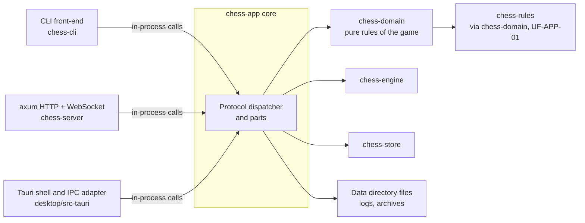

| Neighbour | Direction | What crosses |
|---|---|---|
| Three transport blocks | in and out | Typed `Command`/`Query`, `Reply`/`ProtocolError`, `Event` streams (IFP-APP-01 to 03). The JSON envelope `{id, kind, body}` is defined here and encoded and decoded by the transport using helpers from this crate (DD-APP-03) |
| `chess-domain` | out | Pure calls: `Game`, `Clock`, `Policy`, `EloCalc`, `RosterGen`, `VariationTree`, `EcoTable` (IFR-APP-04) |
| `chess-rules` | out, indirectly | SAN, FEN, PGN reader and writer, legality (IFR-APP-05). The §3.2 graph has no direct edge (UF-APP-01) |
| `chess-engine` | out | `Engine` trait and pool, held only by `EngineGateway` (IFR-APP-01) |
| `chess-store` | out | `Store` trait on the store thread, plus the move journal (IFR-APP-02, IFR-APP-03) |
| Data directory | out | `logs/chess.log*` written by this block; archive files written or read by `ImportExportService` at paths given by trusted in-process callers only (IFR-APP-06) |

Trust boundary: the browser is untrusted input (principle 1, R-5, D-22). Everything arriving from the WebSocket transport is a client-controlled value: it is deserialised with `deny_unknown_fields`, validated by the owning service, and never trusted for state (SWE-001 §6 SEC/SER row) [INF from A §8 Security row and P §6].

### 4.2 Composition viewpoint

**Concern:** decomposition into parts and what each is for.

| DD | Part | Purpose (one line) | Architecture §2.2 name |
|---|---|---|---|
| DD-APP-01 | `Core` facade | Wires parts and seams, owns life cycle (open, recovery mode, shutdown), hands out `FrontEndSession`s | `chess-app core` |
| DD-APP-02 | Protocol dispatcher and event stream | Routes commands and queries, maps errors, publishes events, resynchronises lagging subscribers | `chess-app core :: Protocol dispatcher` |
| DD-APP-03 | Protocol types and `ts-rs` export | One set of serde types; generated TypeScript | (part of `chess-app::protocol`) |
| DD-APP-04 | `AppError` and catalogue mapping | Typed internal errors mapped to the §5.5 codes and messages | (cross-cutting, [A] §8 Error handling row) |
| DD-APP-05 | Confirmation mechanism | One shared check and a proof token | whole core (F-2.5.7) |
| DD-APP-06 | Name validation | Trim, NFC, grapheme count, characters, uniqueness | `PlayerService` (F-1.2) |
| DD-APP-07 | `PlayerService` | Players, preferences, active Player, roster generation, reset, void | `PlayerService` |
| DD-APP-08 | `GameSetupService` | Validate a `GameSetup`, reserve slots, start | `GameSetupService` |
| DD-APP-09 | `SessionRegistry` | One session per live game, resume list, journal lock, held games | `SessionRegistry` |
| DD-APP-10 | `GameSession` actor | All state changes of one live game | `GameSession` |
| DD-APP-11 | `EngineGateway` | The only path to the engine; policy check, audit, legality check | `EngineGateway` |
| DD-APP-12 | `AnalysisService` | Live analysis, what-if, variations, stored-game analysis views | `AnalysisService` |
| DD-APP-13 | `AnalysisWorker` | Background per-move evaluation of finished games | `AnalysisWorker` |
| DD-APP-14 | `StatsService` | Read models: statistics, history, rating series | `StatsService` |
| DD-APP-15 | `ImportExportService` | PGN export and import, full-data archive export, preview and apply | `ImportExportService` |
| DD-APP-16 | Diagnostic log | Identifier-only, size-rotated local log | `Diagnostic log` |
| DD-APP-17 | Edge seams | The traits through which the core reaches engine, store, journal, time, randomness | (principle 2, [A] §4.1 "Edges") |

### 4.3 Logical viewpoint

**Concern:** the static structure of the key types and who owns them. Only types that cross a part boundary are shown. Field lists are indicative; the exact serde shapes are fixed in `chess-app::protocol` (DD-APP-03).

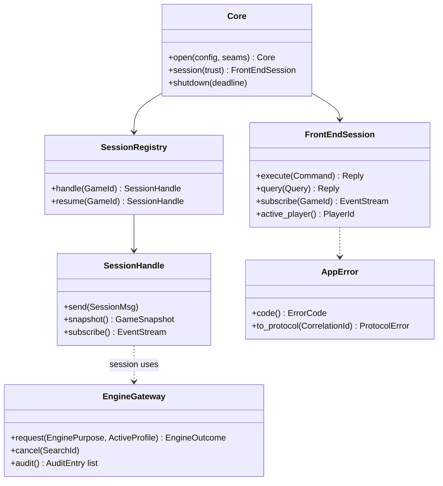

Ownership rules [INF from A §4.2, §4.8, §7.4]: the `Game` value is owned by exactly one `GameSession` task and never shared; events are `Arc<Event>`; `Command` and `Query` values are moved into the service that handles them; `Store` and `Engine` handles are `Arc<dyn Trait>` held by `Core` and lent to parts.

### 4.4 Dependency viewpoint

**Concern:** build-time and run-time interconnections, and whether they respect the architecture.

Crate level (architecture §3.2, unchanged): `chess-app` depends on `chess-engine`, `chess-store`, `chess-domain`; it is depended on by `chess-cli`, `chess-server`, `desktop/src-tauri`; `ts-rs` generates types into `ui/` [OBS A §3.2]. Third-party libraries named in §3.2 for this crate: `tokio`, `unicode-segmentation`, `unicode-normalization`; named in §3.4 and used by this design: `serde`, `thiserror`, `tracing`, `tracing-appender`, `ts-rs`. **Not named in the baseline and needed by this design (UF-APP-02, each a dependency decision, none chosen or version-checked here):** a JSON library (`serde_json`), a ZIP library, a content-hash function, a UUID type, `tracing-subscriber`, `tokio-util` or equivalent cancellation, `futures`/`tokio-stream`.

Intra-crate edges (compare with the architecture §4.1 diagram; dashed = not drawn there, UF-APP-16):

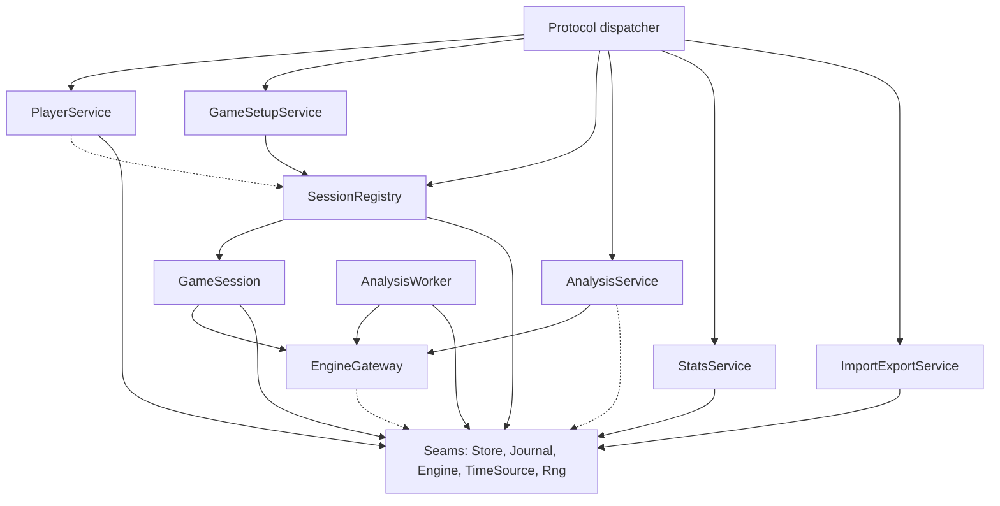

Rules enforced by module visibility and review [INF]:

1. No part other than `EngineGateway` names `chess_engine::Engine` (principle 3, [A] §5.7).
2. No SQL and no `rusqlite` type outside `chess-store` ([A] §5.7). `chess-app` sees only the `Store` and journal traits.
3. No cycle: `GameSession` depends on `EngineGateway`; the gateway needs game state but takes it through a `GameContextProvider` trait (DD-APP-17) implemented by `SessionRegistry` plus the store, so the gateway never names the registry.
4. `PlayerService` reaches `SessionRegistry` only through a small `SessionControl` trait (`prepare_void`, `finish_void`) so the dependency is explicit and fakeable.
5. Transports never import a part; they see `Core`, `FrontEndSession`, protocol types.

### 4.5 Information viewpoint

**Concern:** which data the block owns, reads, writes, and at what transaction boundary. The system of record for every table is fixed in [A] §7.4; this table restricts to the writes this block performs.

| Datum | Owner in this block | Access | Boundary and invariant [OBS A §7.4] |
|---|---|---|---|
| `PLAYER`, `PREFERENCES`, initial and reset `RATING_HISTORY` rows | `PlayerService` | write via `Store` | Register, rename, archive, preferences: one transaction each. Reset: one `BEGIN IMMEDIATE` including the void of every unfinished game |
| `COMPUTER_PROFILE` + two baseline history rows per computer | `PlayerService` (via `RosterGen`) | write | Batch of N in one transaction, rows never updated |
| `GAME` header, `UNFINISHED_SLOT` at start | `GameSetupService` | write | One transaction; `UnfinishedGameExists` on primary-key conflict |
| `MOVE`, `GAME` clocks, `journal_seq`, result, `RATING_HISTORY` game rows, `ANALYSIS_JOB` enqueue | `GameSession` (through `Store` finalize and apply) | write | Journal first, then store thread; finalize is one `BEGIN IMMEDIATE` |
| `MOVE_EVAL`, `ANALYSIS_JOB` state | `AnalysisWorker` | write | One upsert per ply |
| `VARIATION` | `AnalysisService` | write | Per save or delete |
| `GAME`/`MOVE`/`GAME_TAG` of imported games | `ImportExportService` | write | One transaction per imported game; whole-database import exclusive |
| `APP_SETTING.last_active_player` | `PlayerService` | write | Writer not named in [A] §7.4 (UF-APP-16) |
| `GAME.analysis_used` | `EngineGateway` (first grant of live analysis or what-if) | write | Single-column update; [A] §7.2 note |
| Statistics, history, rating series | `StatsService` | read only | Filtered by subject Player's `reset_at` |
| `chess.log*` | `Diagnostic log` | write (files) | Append-only, size rotated |
| Archive files, PGN files | `ImportExportService` | read, write | Write by temp file then rename [P §6 FIO] |
| In-memory only | `SessionRegistry` map, `GameSession` state, gateway audit log, subscriber counts, active Player per `FrontEndSession` | | Lost on exit by design; the journal and store are the record |

Formats owned by this block (sources: [A] §5.7): the PGN export contract (written by `chess-rules`' writer, assembled and tagged here), the full-data archive (`manifest.json`, `games.pgn`, `players.json`, `ratings.json`, `settings.json`, `games.json`; `format_version` 1 [OBS A §5.7]), and the log line format (DD-APP-16).

### 4.6 Patterns-use viewpoint

**Concern:** recognised solutions reused, why, and how misuse would show.

| Pattern | Where | Why | Misuse tell |
|---|---|---|---|
| Actor (task plus mailbox) | `GameSession` | Per-game serialisation without locks (D-13, [A] §4.2) | A `Mutex<Game>` appears; an `await` on the engine inside the handler |
| Facade | `Core`, `FrontEndSession` | One entry for three transports (principle 4) | Transports reach into a service |
| Command / Query / Event (CQS) | protocol | Serialisable intents and pushed facts [A] §5.1 | A `Query` that writes (UF-APP-03) |
| Type-state / proof token | `ConfirmedToken`, `ValidatedName` | Make "unconfirmed" and "unvalidated" unrepresentable at the call site | A `pub` constructor or `Default` on the token |
| Ports and adapters | seams (DD-APP-17) | Fake engine, fake clock, in-memory store (principle 2) | A test needs a real process for a unit-level behaviour |
| Generation counter (epoch) | engine searches, flag timer in `GameSession` | Discard results of a cancelled search or a re-armed timer | A result applied without comparing its id |
| Write-ahead log | journal before store (D-23) | Durable before acknowledged | Event broadcast before `append` returns |
| Priority queue with preemption | gateway lanes (interactive over background) | One engine instance, two kinds of work (UF-APP-12) | Background search holds the engine while a human waits |
| Two-phase import (preview then apply) | `ImportExportService` | Decide on conflicts before any write (D-17, D-34) | A partial write followed by a prompt |
| Strategy (clock-budget, flag classification as pure functions) | session, worker | Table-testable arithmetic | Arithmetic inlined in handlers |

### 4.7 Interface viewpoint

**Concern:** what the block offers, what it needs, and the exact contracts. Contracts follow architecture §5.7; the `Protocol` row is the one this block provides.

#### 4.7.1 Provided interfaces

**IFP-APP-01 Core API** (consumers: `chess-cli`, `chess-server`, `desktop/src-tauri`). Matches [A] §5.2 (`core.execute(cmd).await`, `core.subscribe(game_id)`) with one addition, the session handle (UF-APP-04).

```rust
// design-level sketch, not compiled [UNV]
pub struct CoreConfig { pub data_dir: PathBuf, pub build_version: BuildVersion, /* timeouts, see 4.12 */ }
pub struct Seams { pub engine: Arc<dyn EngineFactory>, pub store: Arc<dyn Store>, pub journal: Arc<dyn JournalPort>,
                   pub time: Arc<dyn TimeSource>, pub rng: Arc<dyn RngFactory> }
impl Core {
    pub async fn open(cfg: CoreConfig, seams: Seams) -> Result<Core, OpenError>;   // Ready or RecoveryMode, DD-APP-01
    pub fn session(&self, trust: Trust) -> FrontEndSession;                        // Trust::{InProcess, Remote}
    pub async fn shutdown(&self, deadline: Duration);                              // suspend all games, emit ServerStopping
    pub fn state(&self) -> CoreState;                                              // Ready or NeedsRecovery(StoreProblem)
}
impl FrontEndSession {
    pub async fn execute(&self, cmd: Command) -> Result<Reply, ProtocolError>;
    pub async fn query(&self, q: Query) -> Result<Reply, ProtocolError>;
    pub async fn subscribe(&self, game: GameId) -> Result<EventStream, ProtocolError>;
    pub fn subscribe_global(&self) -> EventStream;                                  // process-wide events, UF-APP-05
}
```

| Aspect | Contract |
|---|---|
| Semantics | `execute` and `query` complete when the effect is durable (commands) or read (queries). Each call runs on its own runtime task so a panic becomes `Internal{id}` and never unwinds into a transport (DD-APP-02) |
| Errors | Only `ProtocolError{code, message, details}` with `code` from the catalogue (section 6). No path, SQL, or panic text in `message` [OBS A §5.5] |
| Idempotency | As [A] §5.6: ply-guarded commands, `StartGame{game_uuid}`, imports by content hash |
| Threading | `Send + Sync + 'static`; callable from any runtime task. No call blocks a UI thread: all awaits are on runtime workers, SQLite is on the store thread (D-13) |
| Preconditions | Core in `Ready`, except the recovery commands of DD-APP-01 |

**IFP-APP-02 Event stream.** `EventStream` implements `futures::Stream<Item = EventEnvelope>`. First item for a game subscription is a full `GameSnapshot`. Every later item carries a per-game `seq` (strictly increasing, gap-free per subscription). A lagging receiver is resynchronised by a fresh `GameSnapshot` (DD-APP-02). Dropping the stream detaches; when the last subscriber of a live game detaches the session suspends at once (D-14).

**IFP-APP-03 Wire envelope.** `{id, kind, body}` request, `{id, ok, body}` or `{id, error}` response, `{game_id, seq, kind, body}` event, plus a `Hello{protocol_version}` handshake message. Encode and decode functions live in `chess-app::protocol::envelope` so `chess-server` and `desktop/src-tauri` share them [OBS A §5.2 "same JSON envelope"]. `check_version(client, server)` returns `ProtocolMismatch{server, client}`; the adapters call it and raise the error, as [A] §5.5 assigns [INF].

**IFP-APP-04 Calibration entry (dev tooling).** `Core::open_for_calibration(cfg)` refuses the default data directory (R-17) and returns a handle that can construct `EnginePurpose::Calibration` (DD-APP-11). Not reachable through any `Command` or `Query`.

**IFP-APP-05 Shutdown.** `Core::shutdown(deadline)` stops accepting commands, emits `ServerStopping` on the global stream, suspends every live session with its journal flush, then returns; at most 5 s ESTIMATE ([A] §4.8 table).

Routing of every protocol item (the contract between DD-APP-02 and the services). Items from [A] §5.1; "to" is the owning part:

| Item | To | Item | To |
|---|---|---|---|
| `RegisterPlayer`, `RenamePlayer`, `ArchivePlayer`, `UpdatePreferences`, `GenerateComputerPlayers`, `SelectProfile`, `ResetPlayerData`, `VoidUnreadableGame` | `PlayerService` | `GetPlayerStats`, `GetRatingHistory`, `ListGames`, `GetGame` | `StatsService` |
| `ListPlayers`, `GetPreferences` | `PlayerService` | `LegalMoves`, `Analyze`, `GetGameAnalysis`, `SaveVariation`, `DeleteVariation` | `AnalysisService` |
| `StartGame` | `GameSetupService` | `ImportPgn`, `ImportFen`, `ExportPgn`, `ExportData`, `PreviewDataImport`, `ApplyDataImport` | `ImportExportService` |
| `ResumeGame`, `DetachGame`, `ListUnfinishedGames` | `SessionRegistry` | `CreateFreshStore`, `RestoreBackup` | `Core` recovery handler (DD-APP-01) |
| `MakeMove`, `Takeback`, `OfferDraw`, `RespondDraw`, `Resign`, `Pause`, `Resume`, `Step`, `SetMoveDelay`, `Abort`, `CancelEngine`, `RetryEngine` | `SessionRegistry` lookup, then the `GameSession` mailbox (held-game path for `Resign`/`Abort` on a suspended game) | | |

A unit test keeps the table honest: an exhaustive `match` over `Command` and `Query` with no wildcard arm, so a new variant does not compile until it is routed (UT-APP-02).

#### 4.7.2 Required interfaces

Names marked (proposed) are not in the architecture; the owning sibling SDD decides them. Everything the architecture does name is quoted.

| ID | Provider | What this block needs | Source |
|---|---|---|---|
| IFR-APP-01 | `chess-engine` | `Engine` trait: `search(position, SearchLimits, multipv) -> SearchResult{best, pv, score, depth}`, `stop()`, `health()`; an `EnginePool` / factory to obtain instances per role (computer side, shared analysis); typed `EngineError`. Only `EngineGateway` holds it | [OBS A §5.7, §3.3, §4.7] |
| IFR-APP-02 | `chess-store` | `Store` trait: "one method per transaction in §7.4" and repositories `PlayerRepo`, `GameRepo`, `RatingRepo`, `JobQueue`, `Lease`, run on the store thread; read pool for queries; typed errors `StoreBusy`, `StoreUnavailable`, `SchemaTooNew`, `StoreMissing`, `StoreCorrupt`, `BackupFailed`, `Busy` | [OBS A §5.7, §7.4, §5.5]. The method list in section 5.0 is this SDD's proposal for what §7.4 implies |
| IFR-APP-03 | `chess-store` (`MoveJournal`) | `JournalPort` (proposed): `create(game_uuid, Start) -> JournalHandle` with `flock`; `open_exclusive(game_uuid) -> Result<JournalHandle, Locked{owner}>`; `append(record) -> Seq` durable on return (`F_FULLFSYNC`); `replay_into_store`; `close_to_done`. Blocking calls run off the runtime workers | [OBS A §3.3, §7.6]. API not in §5.7 (UF-APP-10) |
| IFR-APP-04 | `chess-domain` | `Game` (apply move, takeback, draw offer, pause, resign, flag, termination, clocks with `running_side`), `Clock`, `Policy::check(action, &GameContext)` and `allowed_actions`, `EloCalc`, `RosterGen`, `VariationTree`, `EcoTable`, `GameSetup`, class bands | [OBS A §3.3, §4.4]. Method names (proposed) to be reconciled with SDD-chess-domain |
| IFR-APP-05 | `chess-rules` | Position and FEN parse with legality, SAN/UCI parse and format, PGN streaming reader, canonical PGN writer, legal-move generation. Reached through a re-export from `chess-domain` unless UF-APP-01 adds the edge | [OBS A §5.7, §3.3] |
| IFR-APP-06 | OS / filesystem | Directory creation `0700`, files `0600`, temp-file-then-rename, `flock` on the log lock file, ZIP read and write | [OBS P §6 FIO, A §8 Security] |
| IFR-APP-07 | `TimeSource`, `Rng` | Monotonic time for clocks, wall time for timestamps; `Rng` seeded from `(game_id, ply)` or the roster seed | [OBS A §5.7] |

### 4.8 Structure viewpoint

**Concern:** internal organisation of the crate (planned; no code exists). Modules map one-to-one to design entities so a reviewer can find the code for a `DD-`.

```
crates/chess-app/src/
  lib.rs                 re-exports: Core, FrontEndSession, protocol types, Seams            DD-APP-01
  core.rs                Core, CoreConfig, CoreState, recovery handler, shutdown            DD-APP-01
  dispatch.rs            routing, panic isolation, EventStream, global bus                  DD-APP-02
  protocol/              command.rs query.rs reply.rs event.rs envelope.rs error_code.rs    DD-APP-03
                         (ts-rs derives; one file per kind)
  error.rs               AppError, ErrorCode, messages.rs (catalogue strings)               DD-APP-04
  confirm.rs             ConfirmAction, ConfirmedToken, require_confirmation                DD-APP-05
  names.rs               ValidatedName, validate_name                                       DD-APP-06
  players.rs             PlayerService, reset orchestration                                 DD-APP-07
  setup.rs               GameSetupService, slot table                                       DD-APP-08
  registry.rs            SessionRegistry, SessionHandle, held games, resume list            DD-APP-09
  session/               mod.rs actor.rs engine_turn.rs clock_timer.rs journal_io.rs        DD-APP-10
                         snapshot.rs finalize.rs
  gateway.rs             EngineGateway, EnginePurpose, audit log, lanes                     DD-APP-11
  analysis/              service.rs worker.rs flags.rs                                      DD-APP-12, 13
  stats.rs               StatsService, ViewScope                                            DD-APP-14
  io/                    export_pgn.rs import_pgn.rs data_export.rs data_import.rs          DD-APP-15
                         archive.rs (zip, manifest, games_json.rs)
  diag.rs                typed log events, RotatingFile, init                               DD-APP-16
  seams.rs               traits: EngineFactory, Store, JournalPort, TimeSource, RngFactory, GameContextProvider   DD-APP-17
```

Layering inside the crate: `protocol` and `error` at the bottom (no dependencies on parts); `seams` and `diag` next; services above them; `registry`/`session` above `gateway`; `dispatch` and `core` on top. A part may call only parts below or beside it as drawn in 4.4.

### 4.9 Interaction viewpoint

**Concern:** how the parts collaborate for the flows that carry the requirements, including failure paths. The pure-domain and store internals are in the sibling SDDs; the architecture's own sequences ([A] §5.3, §5.4, §7.2 reset, §7.6 recovery) are refined here at the `chess-app` level, not redrawn.

**SEQ-APP-01 Subscribe, publish, resynchronise a lagging subscriber, detach** (F-7.4.2, D-14, [A] §4.8 Backpressure).

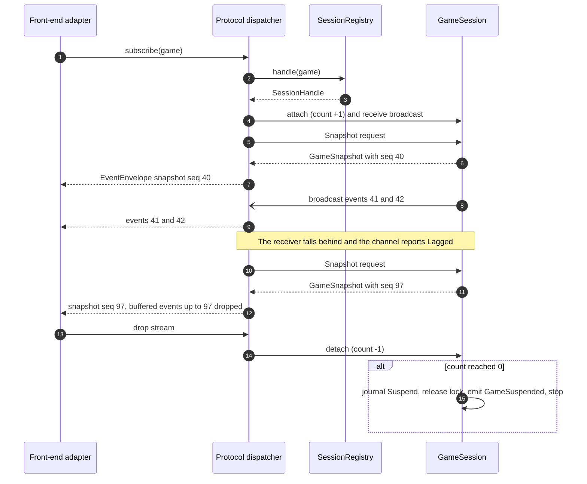

Ordering guarantee: the dispatcher subscribes to the broadcast channel **before** asking for the snapshot; the snapshot message is handled in mailbox order and carries the `seq` of the last event it reflects; the stream discards any buffered event with `seq` at or below the snapshot's. So a subscriber sees neither a gap nor a duplicate.

**SEQ-APP-02 Move, journal, event, computer reply; stale, illegal and journal-failure paths** (F-2.2.3, F-7.4.6, [A] §4.8 Ordering, §5.3).

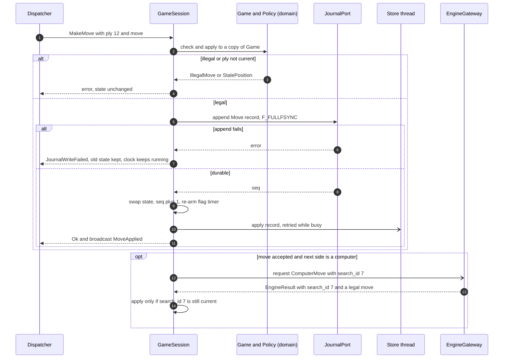

**SEQ-APP-03 Takeback while the engine thinks, late engine result discarded** (F-2.5.1, D-33).

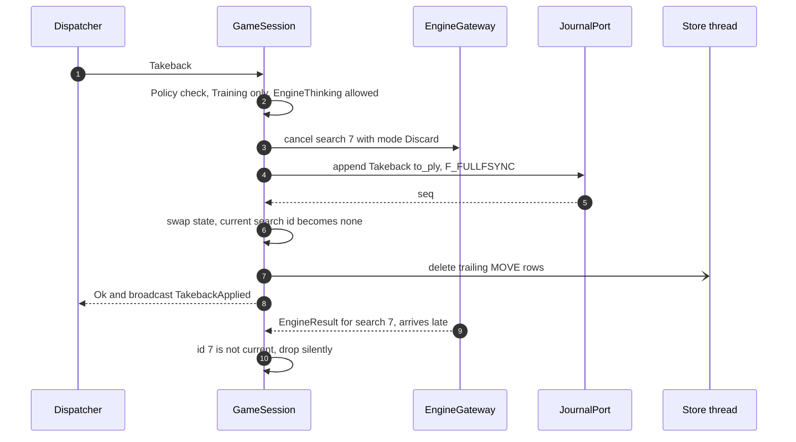

**SEQ-APP-04 Strict-mode integrity at the gateway** (ANA-1, F-3.3, [A] §4.5).

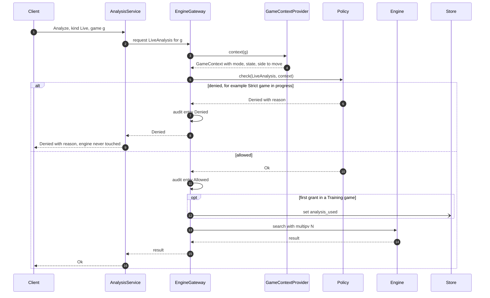

**SEQ-APP-05 Confirmed reset that voids unfinished games** (F-1.8.1, F-1.8.2, F-2.6.4, D-30; refines [A] §7.2).

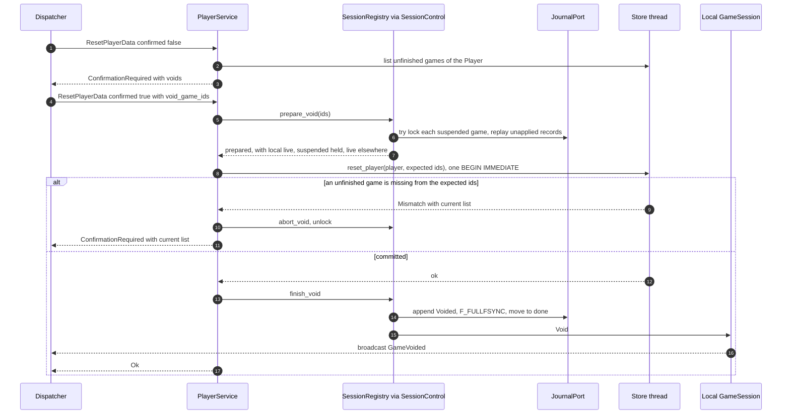

**SEQ-APP-06 PGN import: preview-before-write on duplicates** (F-6.11, IF-2, D-34).

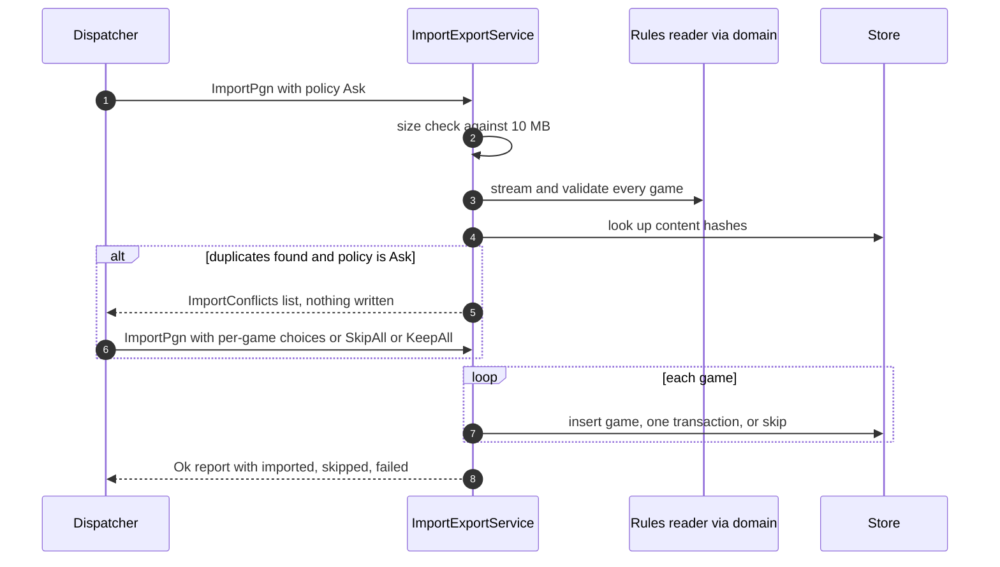

**SEQ-APP-07 `Core::open`, recovery mode, ready** (F-6.5 to F-6.9 are `chess-store`'s; the orchestration is DD-APP-01).

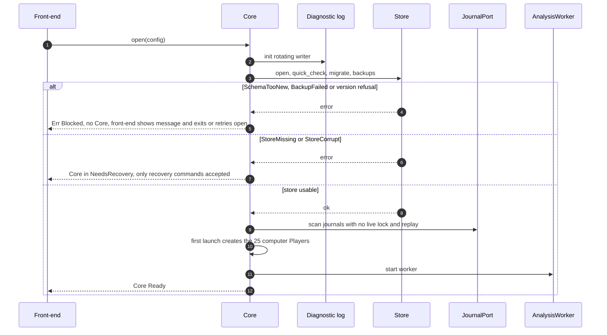

**Analysis worker loop** (F-5.5; refines [A] §5.4). One question: what happens to one job, and what yields.

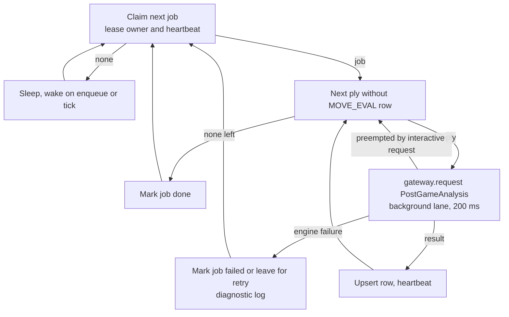

### 4.10 State dynamics viewpoint

**Concern:** behaviour by state and event. The game's own state machine (Setup, InProgress with AwaitingMove, EngineThinking, EngineError, DrawOffered, Paused, Suspended, Completed, Finalized, Aborted, Voided) is architecture §4.3 and is implemented by `chess-domain::Game` plus the actor; it is not redrawn. This section adds the machines that belong to `chess-app`.

**ST-APP-1 Core life cycle** (DD-APP-01).

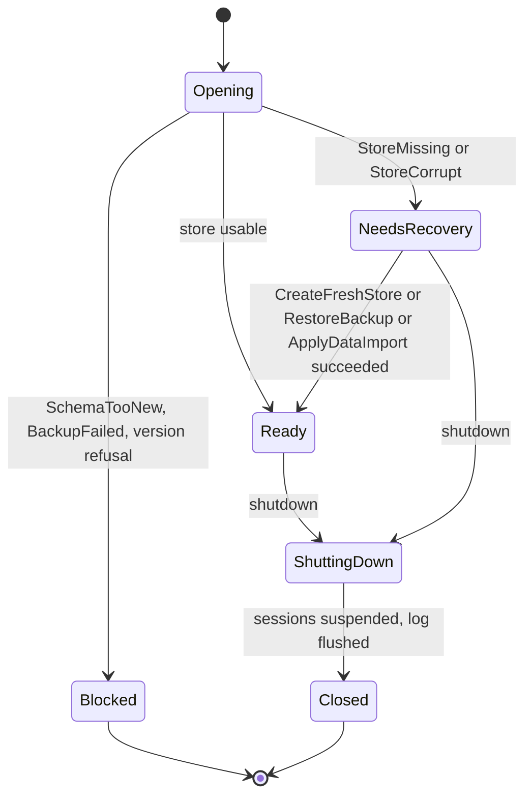

**ST-APP-2 Session life cycle in the registry** (DD-APP-09, DD-APP-10). `Live` hides the architecture §4.3 machine.

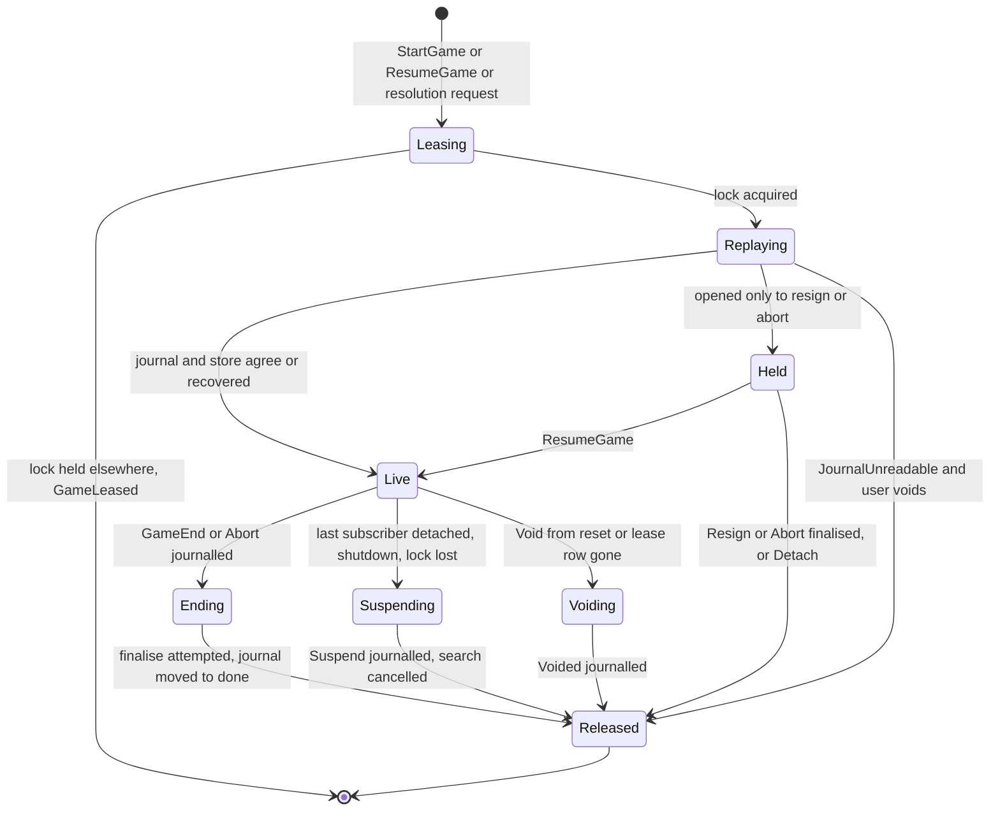

**Session mailbox: effect by state** (condensed from [A] §4.3, §4.4; "Denied" carries the reason from `Policy`). `S` is the actor; every accepted row ends with journal append before swap and broadcast.

| Message | Accepted in | Effect | Rejected with |
|---|---|---|---|
| `MakeMove{ply, mv}` | AwaitingMove, human side to move | validate, journal, swap, broadcast, maybe start engine turn | `IllegalMove`, `StalePosition{live_ply}`, `Denied` (not your turn, rewound is client-side only), `JournalWriteFailed` |
| `Takeback` | AwaitingMove or EngineThinking, Training h-c only | cancel search if any (Discard), journal `Takeback{to_ply}`, swap | `Denied`, `NothingToTakeBack` |
| `OfferDraw` | AwaitingMove, offerer's turn, none pending, not blocked | journal `DrawOffer` then `Clock` with clocks stopped; to a computer start `ComputerDrawDecision` | `Denied{draw_not_own_turn, draw_engine_busy, draw_offer_pending, draw_repeat_blocked, draw_not_available}` |
| `RespondDraw{accept}` | DrawOffered, responder is a human | accept: end 1/2-1/2 "draw agreed"; decline: journal `DrawDeclined`, restart clocks, set `offer_blocked_for` | `Denied` |
| `Resign{side, confirmed}` | InProgress or Held, human games | confirmation, journal `GameEnd`, finalise | `ConfirmationRequired`, `Denied` (c-c) |
| `Abort{confirmed}` | InProgress or Held, c-c only | confirmation, journal `Abort`, abort transaction | `ConfirmationRequired`, `Denied` |
| `Pause`, `Resume`, `Step`, `SetMoveDelay` | c-c only | cancel search on Pause (Discard); Step plays exactly one move | `Denied` |
| `CancelEngine` | EngineThinking in h-c | cancel with `PlayBest`; result applied normally, target 200 ms | `Denied` |
| `RetryEngine` | EngineError | restart engine, new search id | `Denied` |
| `Void{reason, reset_player}` (internal) | any non-final | cancel search, journal `Voided`, emit `GameVoided`, stop | none |
| `EngineResult{search_id, outcome}` (internal) | EngineThinking, id current | validate, apply as a move; failure moves to EngineError | stale id dropped |
| `FlagFired{generation}` (internal) | clock running, generation current | end on time (draw if the opponent cannot mate) | stale generation dropped |
| `Detach`, subscriber count 0 | InProgress | journal `Suspend`, drop offer to a computer, keep offer to a human, stop | none |

### 4.11 Algorithm viewpoint

**Concern:** the procedural logic where correctness is subtle. Each has a unit-testable pure core.

**ALG-APP-01 Journal-first command handling** (all state-changing session messages; D-23, [A] §4.8 Ordering).
1. Read the message; check `Policy`/state; reject without side effects.
2. Clone `Game`; apply the change to the clone with `now = time.monotonic()`.
3. Build the journal record(s) from the clone's delta.
4. `journal.append(record).await` (blocking work on the blocking pool; returns after `F_FULLFSYNC`). On error: drop the clone, return `JournalWriteFailed{cause}`; the clocks of the old state keep running because nothing changed.
5. Swap the clone in; `seq += 1`; recompute the flag deadline and engine need; broadcast `Arc<Event>`.
6. Hand the record to the store applier (a channel to the store thread); do not await it.
The single-threaded mailbox makes steps 2 to 5 atomic with respect to other messages. A crash between 4 and 5 loses nothing: the record is durable and replay rebuilds the state [INF from A §7.6].

**ALG-APP-02 Clock timer and checkpoints** (RULE-4, RULE-5, F-2.4.3).
- `Clock` holds `{white_ms, black_ms, running_side: Option<Side>, as_of_mono}`. One deadline `now + remaining(running_side)` is armed; each arming increments `timer_generation`. `FlagFired{generation}` with a stale generation is dropped.
- A checkpoint tick every 1 s while `running_side` is `Some` appends a `Clock` record (same path as ALG-APP-01 step 4, no event unless the state changed). On `Pause`, `DrawOffer`, `Suspend` and every move a `Clock` record with the new `running_side` is appended. `EngineError` does not stop the clock (D-15).
- Clients receive `{white_ms, black_ms, running_side, as_of}` with `as_of` a wall timestamp and count down locally; `ClockSync` is emitted on transitions of `running_side` and on subscribe, not periodically [ASM-APP-04].
- Flag fall: end the game as a loss on time for the side to move, or a draw when the opponent cannot mate by any legal sequence (`Game` decides, F-2.2.4). Untimed games arm no timer.

**ALG-APP-03 Engine turn with generation ids** (F-3.6, F-3.7, NFR-8).
`engine_turn` starts when the side to move is a computer and the state is AwaitingMove: increment `search_id`, spawn `gateway.request(ComputerMove{...}, limits)`, move to EngineThinking. The spawned task owns no game state; it sends `EngineResult{search_id, outcome}` back through the mailbox. On any message that invalidates the search (Takeback, Pause, Void, Resign, Suspend, Abort) the actor sets `current_search = None` and calls `gateway.cancel(search_id, mode)`. `CancelMode::PlayBest` is used by `CancelEngine`: the engine receives `stop` and its `bestmove` arrives as an ordinary result for the current id. `Discard` ignores the late result. Limits passed in: personality `movetime`, the active profile's maximum think time (from the `FrontEndSession` that owns the game), clock remaining and increment; the combination `min(...)` and the clock-derived budget are computed in `chess-engine`/domain (F-3.4) [UF-APP-18].

**ALG-APP-04 Computer draw decision** (F-3.8, RULE-2, [A] §4.4). A draw offer is made only on the offerer's turn, so in the searched position **the human is to move**. A UCI score is relative to the side to move [UNV, to be confirmed by the engine integration test]. The computer's own evaluation is therefore `-score_stm`, and "accept only if its eval is 0 or worse" becomes: **accept iff `score_stm >= 0`**, with a mate score for the side to move (the human) counting as positive, a mate against the human as negative. The gateway returns `DrawDecision::{Accept, Decline}` only; the number is never returned or logged (RULE-2 "result never shown"). Table-test vectors: equal position, human up a queen, human down a queen, forced mate either way [UF-APP-18].

**ALG-APP-05 Name validation** (PLY-6, F-1.2; [R] PLY-6 amendments). Input `&str`, output `ValidatedName` or `ValidationFailed{field: "name", reason}`.
1. Cheap guard: more than 4096 code points, reject `too_long` without segmenting [ASM-APP-05, UF-APP-21].
2. `trim()` (Unicode White_Space) then NFC.
3. Empty: `empty`.
4. `graphemes(true).count() > 128`: `too_long`.
5. Any char with `is_control()` (category Cc) or U+2028 or U+2029 (the only Zl and Zp characters): `character_not_allowed`.
6. Uniqueness (case-sensitive, exact on the stored NFC string) by `store.find_player_by_name(name)` (store name per SDD-chess-store 3.7.2, XC-5), giving `already_used` and, when the owner is archived, the "by an archived Player" suffix. The authoritative check is the UNIQUE index at insert: a constraint violation maps to the same error, which closes the race between two processes [INF].
Failure order is the order above, so a name with two defects always reports the same rule [ASM-APP-05]. Case is never folded. Computer names produced by `RosterGen` pass steps 2 to 5 as a defence.

**ALG-APP-06 Confirmation check** (F-2.5.7, UI-12). `require_confirmation(action, confirmed, voids) -> Result<ConfirmedToken, AppError>` returns `ConfirmationRequired{action, voids}` when `confirmed` is false. Order inside every owning service: (1) existence and kind checks (`NotFound`, `Denied{computer_player}`), (2) `Policy` or state checks (`Denied`), (3) other validation, (4) confirmation, (5) execution, which takes the token as an argument. A command that would be denied is therefore never offered for confirmation. Cancelling in a front-end sends nothing, so cancel changes nothing by construction.

**ALG-APP-07 Slot holders and start** (GAME-4, D-27, F-2.1.2). Table owned by `GameSetupService`, unit-tested against [A] §7.2:

| Matchup | Slot rows inserted at start (mode = the game's mode) |
|---|---|
| h-h (Strict) | each human; one row for self-play |
| h-c (Training or Strict) | the human only; the computer's slot is neither used nor checked |
| c-c (Strict) | each computer; one row for self-play |

Start: validate setup (matchup/mode/Players/colours/clock/FEN against `Policy` and `GameSetup` rules; Training only for h-c; Training untimed; headless is c-c only at the CLI, not here); look up `game_uuid` (return the existing game if found, F-2.1.4); one store transaction inserting `GAME` and the slot rows (`UnfinishedGameExists{game_id, mode, player_id}` on conflict, reporting the first conflicting holder); then create the journal with its `Start{setup}` record and spawn the session. Order rationale and crash behaviour: DD-APP-08.

**ALG-APP-08 Resume list** (GAME-1, [A] §4.4 Resume list). `ListUnfinishedGames{player_id}` reads `GAME` rows with `status = 'in_progress'` in which the Player plays either side (self-play once) **plus every unfinished c-c game**, in one store query. Each row is tagged `GameLeased{owner_kind}` when `GAME_LEASE` shows another process (display only; the real lock decision is `flock`). A game live in this process is tagged "open here".

**ALG-APP-09 PGN duplicate detection and content hash** (IF-2, D-34). `content_hash` = hash of the canonical tag set (Seven Tag Roster plus the custom tags that define identity) and canonical SAN movetext, produced by the `chess-rules` writer's canonical form so every front-end gets the same hash. Hash function is not named upstream (UF-APP-02); `ASM-APP-06` assumes a cryptographic hash with a stable output encoding. A game is a duplicate when its hash equals a stored game's hash or an earlier game's hash in the same file. Skipped duplicates are counted, not errors.

**ALG-APP-10 Full-data export** (F-6.12, IF-5, D-29, D-34). Streams from the store (bulk read) into a temp ZIP: `manifest.json` (`format_version` 1, build version, export time), `games.pgn` (every game incl. archived Players' and unfinished; custom tags `GameUUID`, `WhiteUUID`, `BlackUUID`; `[%clk]` and `[%emt]` comments), `players.json` (incl. `reset_at`, archived), `ratings.json` (both tracks, full history, both counters), `settings.json` (preferences, `APP_SETTING`), `games.json` keyed by `GameUUID` with the stored fields listed in [A] §5.7 and the per-ply analysis results with `engine_version`. Entry order is fixed; renamed into place only after the ZIP is complete.

**ALG-APP-11 Full-data import: preview and apply** (F-6.13, D-17, D-34, [A] §7.4 merge). Preview: read the ZIP, check `format_version` (older accepted, newer rejected with a message), parse; match Players by `uuid` (computers by `(roster_seed, roster_index)`), games by `uuid`; a different Player with an identical name is a conflict; produce `ImportConflicts{list}` and an `ImportPlan`. Apply: the plan names the archive by content hash and carries the user's Replace or Keep-both choice per conflict; `ApplyDataImport{plan, confirmed}` re-reads the archive, verifies the hash, recomputes conflicts and rejects a plan that no longer matches (the client cannot inject rows), then calls the store's exclusive import in one transaction. Unfinished games: restored as unfinished unless a slot would be doubled (then review-only with no result, listed in the preview); a game live in this process is reported and kept. An archive without `games.json` imports using PGN tags and defaults and queues background evaluation of all finished games (F-5.5).

**ALG-APP-12 Evaluation, centipawn loss and flags** (F-5.5, ANA-3, [R] thresholds EST/TBD-20). Let `E_k` be the evaluation of the position after ply `k` from the side to move's point of view, `E_0` the start position. For the move at ply `k` the mover's loss is `cp_loss_k = max(0, E_{k-1} + E_k)` (the mover could have had `E_{k-1}`; after the move the opponent stands at `E_k`). Mate scores: a mover who had a forced mate (`E_{k-1}` is mate for the mover) and no longer has one, or whose move allows a mate against (`E_k` is mate for the opponent), is a blunder regardless of cp. Otherwise: inaccuracy 50 to 99, mistake 100 to 299, blunder at least 300. Each ply costs one 200 ms search (n+1 for n plies, `E_0` is transient). The sign convention stored in `MOVE_EVAL.cp`/`mate` and the treatment of `E_0` are not fixed upstream; this design stores **White's point of view** [ASM-APP-07, UF-APP-17].

**ALG-APP-13 View scope for statistics** (PLY-7, F-1.8.3, [A] §7.2). Every statistics, history, rating-series and variation query takes a `subject: PlayerId`. If the subject is a human with `reset_at`, rows are restricted to games with `started_at >= reset_at` and rating points at or after the reset point; otherwise unrestricted. The filter belongs to the **subject**, not to the viewer: Y's statistics include games against X from before X's reset, X's do not [INF from A §7.2 "Opponents' views are unchanged", R PLY-7]. Aggregates add `self_play = 0 AND status = 'completed' AND start_fen IS NULL`; voided and aborted games appear in history lists but in no aggregate. Average length in moves = full moves = `ceil(plies/2)`; in time = `total_active_ms`. Empty results return zero counts and "no games yet" markers, not errors.

**ALG-APP-14 Diagnostic log rotation** (NFR-10, TBD-32). `RotatingFile` writes lines in append mode; before each write batch it checks the active file size; at 10 MiB it takes an advisory `flock` on `logs/chess.log.lock`, re-checks (another process may have rotated), renames `chess.log.1` to `chess.log.2` (overwriting), `chess.log` to `chess.log.1`, opens a new `chess.log`, releases the lock. A writer whose descriptor points at a renamed file compares inode with the path every 64 writes and reopens. "3 files kept" is read as the active file plus two rotated [ASM-APP-08, UF-APP-15].

### 4.12 Resource viewpoint

**Concern:** threads, tasks, channels, timeouts, memory and descriptors. Timeouts and periods are quoted from [A] §4.8 (all ESTIMATE for the M4 baseline, ASM-2); new values are `ESTIMATE`s of this SDD.

| Resource | Design | Source |
|---|---|---|
| Runtime | One tokio multi-thread runtime per process, owned by the transport or CLI; `chess-app` creates none and uses `tokio::spawn` | [A] §4.8 |
| Tasks | one per live `GameSession`; one per in-flight command (panic isolation); one per engine search; one `AnalysisWorker`; one store-applier per session; one log writer thread | [INF] |
| Mailbox | `mpsc` bounded 64 per session (`ESTIMATE`). Senders await capacity; a full mailbox for 2 s returns `Internal` rather than blocking a transport thread | ASM-APP-09 |
| Event channel | `broadcast` bounded 256 per session (`ESTIMATE`); lag handled by snapshot | [A] §4.8 Backpressure; size ASM-APP-09 |
| Blocking work | SQLite on the store thread; read queries on `spawn_blocking`; journal `append`/`F_FULLFSYNC`, `flock`, ZIP and PGN file I/O on the blocking pool (never on a runtime worker) | [A] §4.8 table; journal placement UF-APP-10 |
| Descriptors per live game | one journal fd (held `flock`), engine stdin/stdout pipes shared per engine instance | [INF] |
| Engine instances | one per computer side of a live game (two for self-play c-c); one shared analysis instance per process; started lazily | [OBS A §4.7] |
| Memory | `Game` value plus move list per session; audit log ring of 1024 entries in production, unbounded in test builds; import held in memory up to 10 MB (TBD-25) | ESTIMATE, ASM-APP-09 |
| Timeouts used | handshake 5 s; search deadline limit+500 ms `stop`, kill at limit+2 s; cancel to move 200 ms (design target 100 ms); computer move 3 s top class; analysis 10 s live cap, 2 s on demand; background 200 ms per ply; clock checkpoint 1 s; lease heartbeat 2 s; busy_timeout 5 s; client command timeout 10 s; shutdown 5 s | [OBS A §4.8 table] |
| Initial attach window | A new or resumed session with no subscriber suspends after 5 s (`ESTIMATE`) | ASM-APP-03, UF-APP-05 |
| Analysis job lease | stale after 3 missed heartbeats = 6 s (`ESTIMATE`) | ASM-APP-10, UF-APP-14 |
| Log | 10 MiB per file, 3 files | TBD-32 |
| Disk | archive export and import use a temp file in the data directory and need about the archive size free; failure returns `StoreUnavailable` with the next step | [INF] |

---

## 5 Design entities

Each entity follows the `implementation-design-1016` record. "Traces" cites requirement, function and decision IDs found in the sources listed in 1.3. "Code" is a planned path (no code exists). Every entity that does I/O or parses input states its failure behaviour. Verification IDs are planned groups defined in section 8.

### 5.0 Store operations this design assumes (proposed, owned by SDD-chess-store)

[A] §5.7 says "one method per transaction in §7.4". Reading §7.4 and §7.6, the block needs these (names proposed, all return typed store errors): `register_player`, `rename_player`, `archive_player` (re-checks unfinished games atomically), `update_preferences`, `insert_roster_batch`, `reset_player(player, expected_void_ids) -> Done or Mismatch{current}`, `void_game(game, reason)`, `name_owner(name)`, `list_players`, `get_preferences`, `set_app_setting`, `start_game(plan) -> Started or Existing or SlotConflict{holder}`, `apply_journal_records`, `finalize_game(game, end) -> FinalizeOutcome{elo_changes}`, `abort_game`, `delete_trailing_moves`, `lease_heartbeat(game) -> LeaseState`, `list_unfinished(player)`, `claim_analysis_job`, `heartbeat_analysis_job`, `upsert_move_eval`, `mark_analysis_job`, `enqueue_analysis_jobs_for_unevaluated`, `get_game_analysis`, `mark_analysis_used`, `save_variation`, `delete_variation`, statistics and history queries taking a `ViewScope`, `import_game`, `bulk_read_all`, `import_exclusive(plan_rows)`, `create_fresh_store`, `restore_backup`. Whether `finalize_game` computes Elo inside `chess-store` through the `store -> domain` edge or receives a rating function from here is open (UF-APP-11); this SDD assumes the store calls `EloCalc` (the only way the transaction can re-read current ratings and write them atomically, [A] §5.4).

**Reconciliation with SDD-chess-store 3.7.2 (consistency review XC-5; the store is authoritative for its own API).** Where the names above differ, use the store's: `insert_roster_batch` is `insert_computers`; `apply_journal_records` is `apply_records`; `lease_heartbeat` is `lease_beat`; `name_owner` is `find_player_by_name`; `void_game` (unreadable) is `void_unreadable_game`; `mark_analysis_used` is `set_analysis_used`; `claim_analysis_job`, `heartbeat_analysis_job`, `mark_analysis_job` are `claim_job`, `job_heartbeat`, `complete_job`/`fail_job`; `enqueue_analysis_jobs_for_unevaluated` is `enqueue_unevaluated_games`. Shapes that differ and are **not** renamed here (open, XC-5): `reset_player` returns a store error `UnlistedUnfinishedGames{ids}`, not `Done or Mismatch{current}`; `start_game` returns the existing game for a known `uuid` and fails with `SlotTaken`, not `Started/Existing/SlotConflict`; `finalize_game` takes a `FinalizeRequest` with the inputs listed in store 3.7.2; there is no `delete_trailing_moves` (a `Takeback` journal record applied by `apply_records` deletes the rows); `import_game`, `bulk_read_all`, `import_exclusive` are the `RowIo` interface (IFP-ST-05); `create_fresh_store` and `restore_backup` are the `Opener` and `RestoreService` (IFP-ST-03/04). The journal port differs too: store has `MoveJournal::create(&game_uuid)`, `open_for_resume(&store, &game_uuid)`, `probe`, `JournalWriter::append`, `close_final`.

### DD-APP-01 Core facade and life cycle
- **Type:** struct plus state machine (ST-APP-1). **Component:** `chess-app::core`.
- **Purpose:** wire the parts, hold the seams, run start-up and shutdown, and gate commands by state. **Traces:** PLAT-1, DAT-5/DAT-6/DAT-7 (recovery entry), PLAT-3 (first launch without network), PLY-4 (25-Player roster), NFR-1 (lazy engine, first frame before engine), NFR-4 (no network code), D-13, D-16, D-35; F-6.5 to F-6.9 are the store's, orchestrated here.
- **Function:** `open`, `session(trust)`, `state`, `shutdown`, `open_for_calibration`, and the recovery handler for `CreateFreshStore`, `RestoreBackup{confirmed}` (confirmation via DD-APP-05). In `NeedsRecovery` the dispatcher accepts only `CreateFreshStore`, `RestoreBackup`, `PreviewDataImport`, `ApplyDataImport`; everything else returns the stored problem (`StoreMissing` or `StoreCorrupt`). After a successful recovery command the Core re-runs the start-up steps of SEQ-APP-07 and becomes `Ready`.
- **Dependencies:** all parts, seams, DD-APP-16.
- **Data:** `CoreState`; global event bus (`broadcast`); process heartbeat task writing `PROCESS_HEARTBEAT` (interval 2 s `ESTIMATE`, same as the lease heartbeat [A] §4.8); build version.
- **Processing:** start-up order is fixed: log, store open (quick_check, migrate, automatic backup are the store's), journal scan and replay for unlocked journals ([A] §7.6 last paragraph), first-launch roster, analysis worker, `Ready`. The engine pool is not started (lazy, NFR-1).
- **Failure behaviour:** `SchemaTooNew`, `BackupFailed` and a version refusal return `OpenError::Blocked` and no `Core` ([A] §5.5: "Nothing is written"; "A newer front-end never opens an old-version store without the upgrade"), so the front-end shows the message and exits or calls `open` again. `StoreMissing`, `StoreCorrupt` give a `Core` in recovery mode (UF-APP-09). A failure in the roster step on first launch aborts `open` with `StoreUnavailable` and leaves no half roster (one transaction).
- **Concurrency:** `Core` is `Send + Sync`; state in an `ArcSwap`-like cell or `RwLock`; shutdown is idempotent.
- **Rationale:** recovery commands exist in the protocol, so a `Core` must exist while the store is unusable; the alternative, a separate "recovery API", would add a second protocol surface (rejected). A `Blocked` state without a `Core` keeps the invariant "a live `Core` never touches a store it may not open".
- **Verification:** CT-APP-11, CT-APP-15, CT-APP-05. **Code:** `crates/chess-app/src/core.rs` (planned).

### DD-APP-02 Protocol dispatcher and event stream
- **Type:** module (routing, publication). **Part:** `chess-app core :: Protocol dispatcher`.
- **Purpose:** receive commands and queries from any front-end, run them off every UI thread, return a result or catalogue error; publish events, resynchronise lagging subscribers, detect the last subscriber leaving. **Traces:** F-7.4.1, F-7.4.2, PLAT-1, NFR-8, NFR-9, D-7, D-13, D-14, [A] §4.2, §5.6.
- **Function:**
  1. `execute`/`query`: `tokio::spawn` the handler, await the `JoinHandle`; `Err(JoinError)` from a panic becomes `Internal{id}` with a fresh `CorrelationId`, logged with the panic payload type only (ASM-APP-01).
  2. Route per the table in 4.7.1. Match is exhaustive.
  3. Map `AppError` to `ProtocolError` (DD-APP-04), logging once at this boundary.
  4. `subscribe(game)`: SEQ-APP-01. `subscribe_global()`: process-wide stream for `ServerStopping`, `StoreBacklog`, `AnalysisProgress` of stored games, `RatingsUpdated` (UF-APP-05).
  5. `EventStream` wraps `broadcast::Receiver<Arc<EventEnvelope>>`; on `RecvError::Lagged` it requests a snapshot and yields it, dropping buffered items with `seq` not above the snapshot's.
- **Dependencies:** all services (as routes), DD-APP-04. **Interface:** IFP-APP-01 to 03.
- **Resources:** one short task per call; no per-connection state beyond the `FrontEndSession`.
- **Concurrency:** commands for one game serialise in that game's mailbox; commands for different games and queries run in parallel. A client that disconnects mid-command does not cancel the spawned handler, so a command is never half done (each is atomic, DAT-7).
- **Failure behaviour:** an unknown or malformed message is a decode error at the transport (`deny_unknown_fields`) and never reaches a service; a closed mailbox (session ended) returns `NotFound{entity: game}`; a full mailbox for 2 s returns `Internal` (ASM-APP-09).
- **Rationale:** spawn per command isolates panics and keeps a slow transport from cancelling work. Rejected: running handlers inline on the caller (a panic would unwind into axum or Tauri), and a central actor for all commands (would serialise unrelated games, violating NFR-8).
- **Verification:** UT-APP-02, UT-APP-10, CT-APP-06, CT-APP-02. **Code:** `dispatch.rs`.

### DD-APP-03 Protocol types and `ts-rs` export
- **Type:** data types. **Component:** `chess-app::protocol`. **Traces:** D-7, PLAT-1, GUI-1 (one `CoreClient`), PLAT-5 (`protocol_version`), [A] §5.1, §5.2, §5.6.
- **Function:** `Command`, `Query` (enums named exactly as [A] §5.1), `Reply` (one variant per command and query, same variant name, so a TypeScript client can narrow with `Extract`; the `ResultOf<C>` helper is the client's, SDD-ui), `Event`, `EventEnvelope{game_id, seq, event}`, `GameSnapshot`, `ProtocolError{code, message, details}`, `Hello{protocol_version}`, request and response envelopes.
- **Shape rules:** serde with an adjacent tag (`kind`, `body`) matching the envelope; `deny_unknown_fields` on every inbound type (SWE-001 §6 SEC/SER); millisecond and count fields are `i64` or `u32` with `#[ts(type = "number")]` where `ts-rs` would otherwise emit `bigint`; identifiers are UUID strings; no `Option<Option<_>>`. `GameSnapshot` carries what [A] §5.1 lists: setup, players, every ply (SAN, UCI, FEN, timestamp, clock after the move), the current ply's legal moves, clocks, state, `allowed_actions`, plus `seq` (proposed). Additions to [A] §5.1 made by this SDD, all additive and listed in section 11: `FrontEndSession`, `seq`, `subscribe_global`, game ids on game-scoped commands (UF-APP-06), `StopAnalysis` (UF-APP-07), `ImportPgn` per-game choices and `FileRef` (UF-APP-08).
- **Export:** every public protocol type derives `ts_rs::TS` with an export path into `ui/src/protocol/`; a CI step regenerates and fails on `git diff` (staleness check, [A] §5). How `ts-rs` 12.0.1 chooses the output directory and renders serde attributes and 64-bit integers was **not verified** (no code, no network lookup in this task); the step must be confirmed against the library's documentation when the crate is created (ASM-APP-02, UF-APP-19).
- **Failure behaviour:** not applicable (types). Decode errors are the transport's.
- **Rationale:** one Rust definition, generated TypeScript, CI-checked, is what makes "the two languages cannot drift" (principle 4) testable. Rejected: hand-written TypeScript (drift) and `specta` (D-7).
- **Verification:** UT-APP-13. **Code:** `protocol/` (planned).

### DD-APP-04 `AppError` and catalogue mapping
- **Type:** error enum with `thiserror` ([A] §8 Error handling row; P §6 ERR row). **Traces:** NFR-9, DAT-7, [A] §5.5.
- **Function:** one variant per catalogue code of section 6 plus wrapping variants for `EngineError`, `StoreError`, `JournalError`, rules errors. `code() -> ErrorCode` is a total `match` (no wildcard). `to_protocol(correlation) -> ProtocolError` builds `message` from a static English template per code (UI-11 English only) that names what failed and, where one exists, the next step (NFR-9); wording is written with the code and reviewed against NFR-9. The one message text fixed by the architecture is `NothingToTakeBack`: "Nothing to take back" [OBS A §5.5].
- **Rules:** `message` and `details` never contain a path, SQL text, a panic string or a Player name that the client did not supply in the same request (the rejection of a name may echo the offending field, not another Player's name; "by an archived Player" names no one). Internal detail goes to the log with the correlation id.
- **Failure behaviour:** unmapped internal errors become `Internal{id}`.
- **Rationale:** a total `match` makes "every protocol error code has a message" (NFR-9 verification) a compile-time property.
- **Verification:** UT-APP-09. **Code:** `error.rs`, `messages.rs`.

### DD-APP-05 Confirmation mechanism (`ConfirmationRequired`)
- **Type:** helper plus proof token. **Part:** whole core, F-2.5.7 (not a box of its own, [A] §4.1). **Traces:** UI-12, RULE-2, GAME-2, PLY-4, PLY-7, DAT-2, DAT-5; the seventh UI-12 action (TUI Ctrl-C) is the TUI's own dialog and `VoidUnreadableGame` is its own explicit offer (H-20, UI-12 CR-5 amendment), so neither uses this mechanism.
- **Function:** `enum ConfirmAction { Resign, AbortComputerGame, ArchivePlayer, ResetPlayerData, ApplyDataImport, RestoreBackup }`; `fn require_confirmation(action, confirmed, voids) -> Result<ConfirmedToken, AppError>`; `ConfirmedToken` has a private constructor and is consumed by the service function that executes the action, so an unconfirmed execution does not compile. Order of checks: ALG-APP-06.
- **Reset specifics:** the unconfirmed reset returns `ConfirmationRequired{action: reset, voids}`; the confirmed one must echo the list as `void_game_ids`; a mismatch at commit returns `ConfirmationRequired` again with the current list ([A] §5.5). A listed game that ended normally in the meantime is simply not voided.
- **Failure behaviour:** none beyond the error itself; cancel sends no command and changes nothing.
- **Rationale:** the core enforces the prompt "so no front-end can skip it" ([A] §5.5). Rejected: a dispatcher-level middleware (it would need to know each action's semantic validation order and would ask for confirmation of denied actions).
- **Verification:** UT-APP-03, CT-APP-07. **Code:** `confirm.rs`.

### DD-APP-06 Name validation
- **Type:** pure function and newtype `ValidatedName`. **Traces:** PLY-6, F-1.2, CR-4.1, TBD-4, NFR-9. Algorithm ALG-APP-05.
- **Function:** `validate_name(raw) -> Result<ValidatedName, ValidationFailed>` (shape rules); `PlayerService` adds uniqueness through the store. `ValidatedName` has no public constructor; `Store::register_player` and `rename_player` accept only it.
- **Dependencies:** `unicode-segmentation` (grapheme count), `unicode-normalization` (NFC), both named in [A] §3.2/§3.4.
- **Failure behaviour:** returns `ValidationFailed{field: name, reason: empty or too_long or character_not_allowed or already_used}`; never panics on any input (property test with arbitrary strings).
- **Rationale:** count extended grapheme clusters, not code points, per UAX #29 as PLY-6 states; fold nothing but NFC. Rejected: case-insensitive uniqueness, which the architecture text once said and [A] amendment 2 corrected.
- **Verification:** UT-APP-01 (table in PLY-6's verification: 128 clusters from 256 code points accepted, 129 rejected, tab and newline rejected, "  Brian " stored "Brian", NFC/NFD "Zoe" duplicate, "Brian" and "brian" both accepted, archived collision message). **Code:** `names.rs`.

### DD-APP-07 PlayerService
- **Type:** service. **Part:** `chess-app core :: PlayerService`. **Traces:** F-1.1 to F-1.7, F-1.8.1, F-1.8.2, F-2.6.4; PLY-2, PLY-3, PLY-4, PLY-6, PLY-7, UI-1, GAME-4, DAT-7, UI-12, D-26, D-30, D-34, D-35, TBD-31.
- **Function:**

| Operation | Rule and processing |
|---|---|
| `register(name, category)` | `validate_name`; five categories only (`ValidationFailed{field: category}`); initial Strict and Training Elo = category baseline from `chess-domain` (400/600/1200/2200/2500); `store.register_player` writes `PLAYER`, default `PREFERENCES`, one initial `RATING_HISTORY` row per track, all-or-nothing. Never changes the active Player; at launch the front-end follows with `SelectProfile` (PLY-2 amendment) |
| `select_profile(player)` | player exists, human, not archived (`NotFound` or `Denied`); `Denied{game_open}` (proposed reason) if this `FrontEndSession` has a live game open (PLY-2: switch only while no game is open); sets `FrontEndSession.active_player`; writes `APP_SETTING.last_active_player` (pre-selection only) |
| `rename(player, name)` | human only (`Denied{computer_player}`); `validate_name`; identity stays the UUID |
| `archive(player, confirmed)` | ALG-APP-06 order: exists; human; not the session's active Player (`Denied{active_player}`); no unfinished game (`PlayerHasUnfinishedGames{game_ids}`); confirmation; transaction that re-checks unfinished games atomically. No un-archive |
| `update_preferences(player, prefs)` | typed `Preferences` (versioned blob, `deny_unknown_fields`): default opponent category, board theme, piece theme, GUI colour theme, default side, legal-move hints, coordinate orientation, maximum engine think time (UI-1). Invalid values are rejected with `ValidationFailed{field, reason}`; defaults for a new Player. Bounds of the think-time field are not stated upstream (ASM-APP-16). No sound or confirm-move field exists |
| `generate_computer(category, count)` | count 1 to 25 else `ValidationFailed{field: count}`; seed from `APP_SETTING.roster_seed`; next positions continue the seed's stream; `RosterGen::generate` (domain IFP-DOM-5) takes a `taken: &dyn Fn(&str) -> bool` predicate over all used names (XC-25) and skips any used name, returns N `NewComputer` with UUIDv5 identity, personality and two baseline ratings; one transaction inserts all or none; on a unique-name race reload used names and retry once, then `StoreBusy` (UF-APP-22) |
| `ensure_roster()` | first launch: five per class in one transaction (PLY-4, test-strategy "25-Player roster") |
| `reset(player, confirmed, void_game_ids)` | SEQ-APP-05. Human only. Unconfirmed: list unfinished games (opponent, mode, moves played) and return `ConfirmationRequired{voids}`. Confirmed: `SessionControl::prepare_void`, then `store.reset_player` in one `BEGIN IMMEDIATE` (sets `reset_at`, default preferences, a reset point per track, voids each listed game, deletes slots and lease rows, enqueues analysis jobs, no rating or W/L/D effect), then `finish_void`. Ratings and K counters untouched |
| `void_unreadable(game)` | F-2.6.4, DAT-7: `store.void_unreadable_game(game)` (store name, XC-5) with slot release; no confirmation step (the offer dialog is the explicit choice) |
| `list_players(kind, include_archived)` | archived hidden by default; computer category label computed from the current Strict Elo with the ELO-1 class bands in `chess-domain` (F-4.4) |

- **Dependencies:** `Store`, `chess-domain` (`RosterGen`, class bands), DD-APP-05, DD-APP-06, `SessionControl` (IFR from DD-APP-09), DD-APP-17.
- **Failure behaviour:** every store-changing operation is all-or-nothing; any failure returns `StoreUnavailable{cause}` or `StoreBusy` with a message naming the failure and the next step (DAT-7, NFR-9) and leaves the store as it was. A crash between the reset commit and the `Voided` journal record recovers to `voided` at the next replay (journal rule, [A] §7.6).
- **Concurrency:** stateless apart from the `FrontEndSession`; `PlayerService` is a second writer of `GAME.status` and `UNFINISHED_SLOT` beside `GameSession` (D-30) and relies on `BEGIN IMMEDIATE` plus "skip if already final" in finalize.
- **Rationale:** reset and void stay in `PlayerService` because F-2.6.4 and [A] §7.4 allocate them there; the registry only supplies lock handling. Rejected: a `GameLifecycleService` (would add a part the architecture does not name, D-32).
- **Verification:** UT-APP-01, UT-APP-03, CT-APP-07, CT-APP-10. **Code:** `players.rs`.

### DD-APP-08 GameSetupService
- **Type:** service. **Part:** `chess-app core :: GameSetupService`. **Traces:** F-2.1.1, F-2.1.2; GAME-1, GAME-4, PLY-1, PLY-3, PLY-5, RULE-8, D-27; F-2.1.3 and F-2.1.4 are used.
- **Function:** `start(game_uuid, GameSetup)`:
  1. Resolve both Players (exist; not archived, otherwise `Denied{archived_player}` (proposed, UF-APP-20)); matchup/mode/colours/clock against `Policy` and `GameSetup` rules (Training only for h-c; Training untimed; c-c Strict; custom FEN parsed and legality-checked through `chess-rules`, game marked unrated). Failures are `ValidationFailed{field, reason}` or `Denied{reason}`.
  2. If `game_uuid` already exists, return the existing game id (idempotent, [A] §5.6); a different setup under the same uuid is `ValidationFailed{field: game_uuid, reason: uuid_reused}`.
  3. `store.start_game(plan)`: one synchronous transaction inserting `GAME` and the slot rows of ALG-APP-07; `SlotConflict` becomes `UnfinishedGameExists{game_id, mode, player_id}` for the first conflicting holder.
  4. `SessionRegistry::create_session` creates the journal (`Start{setup}` record, durable), acquires its lock and spawns the `GameSession` (F-2.1.4).
- **Crash behaviour of the order:** a crash after step 3 and before step 4's journal write leaves a `GAME` row in progress with no journal and no moves. Resume must treat a missing journal as an empty journal when the store holds the game (DAT-7 "longest intact run held by the journal or the store"). The architecture text puts the journal record inside the start transaction ([A] §7.4 "GAME + Start journal record + one UNFINISHED_SLOT per slot-holding Player, in one synchronous transaction"), which a file append cannot join; this SDD orders the store first so a failed slot insert never leaves a journal behind (UF-APP-11, ASM-APP-14).
- **Failure behaviour:** `StoreBusy` on a locked database is acceptable because no clock is running ([A] §7.2 slot note); `JournalWriteFailed` at step 4 leaves a startable-by-resume game and returns the error.
- **Rationale:** slot enforcement by primary key is race-free across processes; a service-level check is not (D-27 alternatives).
- **Verification:** UT-APP-04, CT-APP-01, CT-APP-02, CT-APP-08. **Code:** `setup.rs`.

### DD-APP-09 SessionRegistry
- **Type:** service plus map of live sessions. **Part:** `chess-app core :: SessionRegistry`. **Traces:** F-2.1.4, F-2.6.2, F-2.6.3; DAT-4, RULE-5, GAME-1, GAME-4, DAT-7, TBD-28, TBD-30, D-14, D-23, D-35; `GameLeased`, `JournalUnreadable`.
- **Function:**

| Operation | Behaviour |
|---|---|
| `create_session(game, setup)` | create journal, hold its exclusive lock, spawn session, insert `SessionHandle` |
| `resume(game)` | If live here, return its handle (idempotent). Else `journal.open_exclusive`: `Locked{owner}` gives `GameLeased{owner_kind}` from the `GAME_LEASE` row. Else replay (store applies records with `seq` above `journal_seq`; the journal wins on disagreement; torn tail dropped silently; middle damage resumes from the longest intact run and returns the recovered count with the reply; neither readable gives `JournalUnreadable{game_id, recovered_moves: 0}` and the client offers `VoidUnreadableGame`). Build `Game` from `start_fen` and moves, restore clocks from the last `Move` or `Clock` record; an offer pending to a human survives, an offer to a computer is dropped. Spawn session |
| `open_held(game)` | As `resume` but the session starts in `Held`: no clock, no engine; accepts only `Resign`, `Abort`, `Detach`. Used when the user resolves a suspended game from the resume prompt without playing (F-2.5.3, GAME-4) |
| `handle(game)` | lookup; absent gives `NotFound` |
| `list_unfinished(player)` | ALG-APP-08 |
| `prepare_void(ids)`, `finish_void`, `abort_void` | for `PlayerService`: for each id try the lock; suspended: replay unapplied records then keep the lock; live here: remember handle; live elsewhere: nothing (that process learns at its next lease heartbeat). `finish_void` appends `Voided` + `F_FULLFSYNC`, closes, moves the journal to `done/`, and sends `Void` to local sessions |
| `shutdown_all(deadline)` | suspend every live session (journal flush each), within the deadline |
| `released(game)` | session task reports exit; entry removed; lock already released with the file descriptor |

- **Data:** `RwLock<HashMap<GameId, SessionHandle>>`; subscriber counts via the `Subscription` guard (RAII) in `SessionHandle`.
- **Failure behaviour:** `GameLeased` names the owning front-end kind (DAT-4); a stale `GAME_LEASE` row never blocks, because the lock is authoritative; a session task that panics is observed through its `JoinHandle`: the registry removes it, logs `Internal`, the OS closes the descriptor and the lock, and the game is resumable.
- **Concurrency:** map operations are short; no lock held across `.await` of journal or store calls (P §6 CON/LCK row).
- **Rationale:** the lock is acquired by the registry and handed to the session so that "who owns the game" has one writer; [A] §7.6 says the session holds it and §3.3 puts `MoveJournal` in the store, both consistent with this (UF-APP-13). `Held` avoids starting a clock or an engine search for a game the user only wants to end.
- **Verification:** CT-APP-03, CT-APP-04, CT-APP-07, CT-APP-11. **Code:** `registry.rs`.

### DD-APP-10 GameSession actor
- **Type:** actor (tokio task). **Part:** `chess-app core :: GameSession`. **Traces:** F-2.2.3, F-2.4.2, F-2.4.3, F-2.5.1 to F-2.5.5, F-2.6.1, F-2.6.5, F-2.6.6, F-3.6, F-3.7, F-7.4.6; GAME-2, GAME-3, GAME-4, RULE-2, RULE-3, RULE-4, RULE-5, ENG-3, ENG-4, ENG-5, DAT-3, NFR-2, NFR-3, NFR-8, ELO-1/ELO-2 (trigger), D-14, D-15, D-23, D-33.
- **State owned:** `Game` (domain), `search_id`, `timer_generation`, `seq`, `offer_blocked_for` (inside `Game`), subscriber count, journal handle, store-applier channel, engine handles via the gateway. Never shared.
- **Mailbox** (4.10 table) and a `select!` over: mailbox receive, flag deadline, 1 s checkpoint tick, 2 s lease tick, initial-attach deadline.
- **Processing:** ALG-APP-01 to ALG-APP-03. Highlights:
  - Reject stale (`StalePosition{live_ply}`) and duplicate requests with no change (F-7.4.6). A command for a voided game returns `Denied{reason: voided}` ([A] §5.6).
  - Computer turn: ALG-APP-03; the engine result is validated by the gateway (legality) and again applied through `Game` (illegal cannot enter).
  - `EngineError`: restart once (gateway/engine), then emit `EngineUnavailable{cause}`; the side to move's clock keeps running (D-15); `RetryEngine` starts a new search; recovery emits `EngineRecovered`. A draw offer to a computer is dropped on engine failure (ENG-4).
  - Takeback bounds and record removal: `Game` computes the earliest reachable ply; the session journals `Takeback{to_ply}` then asks the store to delete trailing `MOVE` rows; replay reaches the same state because the journal keeps the record.
  - Finalise (F-2.6.5): journal `GameEnd{result, reason}` first, then `store.finalize_game` (one `BEGIN IMMEDIATE`: re-read both ratings on the game's track, Elo for both sides unless self-play or custom FEN, result, times, history rows, slot deletion, analysis job). Reply and `GameEnded{result, reason, elo_changes, offer_analysis: true}` follow. If the store is busy after one transparent retry (`StoreBusy` in [A] §5.5), `GameEnded` goes out with `elo_changes` pending, a background task retries with backoff (0.1 s to 5 s), and `RatingsUpdated` follows. After success the registry moves the journal to `done/`.
  - Record data (F-2.6.6, DAT-3): per-move `think_ms` and per-side time from `TimeSource` (monotonic), engine parameters used by each computer side (from the Player's profile at start), mode, rating track, `analysis_used`, ECO classification via `EcoTable` at game end (`GAME.eco`, `GAME.opening_name`, D-20).
  - Lease: every 2 s `store.lease_beat` (store name, XC-5); a vanished row or `status = voided` makes the session void itself (cancel search, journal `Voided`, `GameVoided`, stop), within 2 s of a reset in another process (PLY-7).
  - Suspend (F-2.6.1): subscriber count 0, shutdown, or lock loss: cancel search (Discard), journal `Suspend` (clocks frozen at the recorded values), drop an offer to a computer, `GameSuspended`, release.
- **Events produced:** `MoveApplied`, `EngineThinking`, `ClockSync`, `TakebackApplied`, `DrawOffered`, `DrawDeclined`, `PauseChanged`, `GameEnded`, `GameVoided`, `RatingsUpdated`, `GameSuspended`, `StoreBacklog`, `AnalysisProgress` (live analysis), `EngineUnavailable`, `EngineRecovered`, `LeaseLost` (UF-APP-13). Each carries `seq`.
- **Failure behaviour:** every error leaves the game as it was and resumable ([A] §8 Error handling row): journal failure gives `JournalWriteFailed{cause}` and no state change; store apply failure never delays play (backlog event after 30 s, [A] §4.8); engine failure as above; a panic in the task ends the session, the descriptor closes, the registry reports `Internal`, the next resume replays the journal.
- **Concurrency:** one message at a time; the only awaits inside a handler are the journal append (blocking pool) and gateway cancel; the engine is never awaited inline (ENG-5, NFR-8).
- **Rationale:** copy-apply-journal-swap makes "durable before acknowledged" a property of the code shape (principle 5); generation ids make cancellation races harmless without locks. Rejected: applying to the live `Game` and undoing on journal failure (an undo path is untested code on the critical path, R-15).
- **Verification:** UT-APP-08, CT-APP-01 to CT-APP-04, CT-APP-06 to CT-APP-08, CT-APP-13, CT-APP-14. **Code:** `session/`.

### DD-APP-11 EngineGateway
- **Type:** service with priority lanes. **Part:** `chess-app core :: EngineGateway`. **Traces:** F-3.3, F-3.5, F-3.8; ANA-1, PLY-5, NFR-3, RULE-2, ENG-3, ENG-4, UI-1, R-5, R-17; [A] §4.5.
- **Function:** `request(purpose, active_profile) -> EngineOutcome`, `cancel(search_id, mode)`, `audit()`.
  1. Build `GameContext` for purposes that name a game through `GameContextProvider` (DD-APP-17), which reads the live session if present, else the store.
  2. `Policy::check(action_for(purpose), &ctx)` before any engine contact. Mapping (action names proposed to SDD-chess-domain):

| `EnginePurpose` | Policy action | Allowed when |
|---|---|---|
| `ComputerMove{game, player}` | engine move | game in progress, that side is a computer, state AwaitingMove or EngineThinking |
| `ComputerDrawDecision{game, player}` | draw decision | a draw offer to that computer is pending |
| `LiveAnalysis{game}` | live analysis | Training, in progress, human's turn |
| `WhatIf{game}` | what-if | Training in progress, or any finished game |
| `PostGameAnalysis{game}` | post-game analysis | game finished (completed, aborted, voided, imported) |
| `FreeAnalysis` (proposed, UF-APP-03) | none, never names a stored game | analysis board from an imported FEN; never alters data |
| `Calibration` | none | only constructible from the `open_for_calibration` handle |

  3. Append an `AuditEntry{seq, purpose tag, game id, Allowed or Denied(reason), time}` (identifiers only, no FEN, no names) to an in-memory ring (1024 in production; unbounded under `cfg(test)` or a test feature) that tests read as the "spy on engine calls" required by ANA-1.
  4. First grant of `LiveAnalysis` or `WhatIf` in a Training game sets `GAME.analysis_used` once (`set_analysis_used`, store name, XC-5; [A] §7.2 note); a store failure here is logged and does not block the analysis.
  5. Execute on the right lane: **interactive** (computer moves, live analysis, what-if, draw decisions, on-demand post-game) before **background** (worker). A background search is preempted by `stop` when an interactive request arrives, and the worker re-queues the ply (UF-APP-12).
  6. Validate output (F-3.5): every `bestmove`, including a seeded "error" pick, is parsed and checked legal by `chess-rules` for the searched position; illegal or unparsable is an engine failure (`EngineUnavailable{cause}` to the session, game never enters an illegal state, NFR-3).
  7. `ComputerDrawDecision` returns `Accept` or `Decline` only (ALG-APP-04).
- **Type-level integrity:** the wire type for analysis (`AnalysisKind::{Live, WhatIf, PostGame}`, carried by `Analyze`) is not `EnginePurpose`; `Calibration` and `ComputerMove` are unrepresentable in a `Command` or `Query`. The only code that holds the engine pool is this module (module privacy plus a `deny` lint on `chess_engine::Engine` outside `gateway.rs`, review rule from R-11 style).
- **Failure behaviour:** `Denied{reason}` with the audit entry written first; `EngineUnavailable{cause}` on crash, handshake timeout (5 s), no `bestmove` by limit + 2 s, missing binary or illegal output; restart-once policy is the pool's (`chess-engine`).
- **Concurrency:** one shared analysis instance per process serialises analysis work; computer sides have their own instances ([A] §4.7). No lock held across `.await` of an engine call except the lane queue itself.
- **Rationale:** a single choke point makes ANA-1 provable by a spy (principle 3). Rejected: policy checks in `AnalysisService` and `GameSession` separately (two places to forget), and `nice` for the background worker on a shared instance (a single instance has a single priority, UF-APP-12).
- **Verification:** UT-APP-05, UT-APP-06, CT-APP-01 (spy), CT-APP-05, CT-APP-13; fuzz of illegal engine output (NFR-3, [A] §9). **Code:** `gateway.rs`.

### DD-APP-12 AnalysisService
- **Type:** service. **Part:** `chess-app core :: AnalysisService`. **Traces:** F-5.1 to F-5.4, F-5.6; ANA-1, ANA-2, ANA-3, ANA-4, D-11, D-9.
- **Function:**
  - `analyze(kind, game, fen, multipv)`: multipv 1 to 5, default 3 (ANA-1); `Live` requests `LiveAnalysis` and streams `AnalysisProgress` on the game's event channel until depth 20 or 10 s (EST) or one of: a newer request for that game, a move or takeback, the game leaving InProgress, the last subscriber detaching (no explicit stop command exists, UF-APP-07); `WhatIf` and `PostGame` are single-shot with a 2 s budget (ANA-2/3, [A] §4.8); the first result of a live request is expected within 1 s (ANA-1, EST).
  - `legal_moves(fen)`: pure, through `chess-rules`, no engine (D-11).
  - `get_game_analysis(game)`: stored `MOVE_EVAL` rows, job state, `evaluated` and `total` ply counts so a client shows "n of N plies evaluated"; unevaluated plies are returned as absent values with no flag ("evaluating…" is rendered by the client, ANA-3 amendment).
  - `save_variation(game, from_ply, moves)` / `delete_variation`: the client holds the tree (D-11); the service replays the moves from the game's position at `from_ply` through `chess-rules`, rejects an illegal sequence with `IllegalMove`, stores PGN variation text in `VARIATION`. Shape of the command payload is proposed (UF-APP-06).
  - `open stored game` (F-5.6): `GetGame` plus `get_game_analysis` for completed, resigned, aborted, voided or imported games; unfinished games are resumed, not analysed (ANA-4).
- **Never** changes result, Elo or statistics (ANA-3, ANA-4). The only write besides variations is `analysis_used` by the gateway.
- **Failure behaviour:** `Denied` from the gateway is returned unchanged; `EngineUnavailable` is returned with the partial result discarded; `NotFound` for an unknown game; `ParseError{Fen}` for a bad FEN.
- **Concurrency:** stateless except per-game live-analysis tasks tracked in a map keyed by game; at most one per game.
- **Rationale:** keeping the variation tree in the client avoids a server-side per-user object with its own life cycle. Rejected: server-held what-if sessions.
- **Verification:** UT-APP-05, UT-APP-07, CT-APP-01, CT-APP-12. **Code:** `analysis/service.rs`.

### DD-APP-13 AnalysisWorker
- **Type:** background task, one per process. **Part:** `chess-app core :: AnalysisWorker`. **Traces:** F-5.5, DAT-3, ANA-3, DAT-2 (queues unevaluated imports), NFR-2, NFR-8.
- **Function:** the loop in the 4.9 flowchart. Claims `ANALYSIS_JOB` rows with a lease (`owner`, `heartbeat_at`); for each ply with no `MOVE_EVAL` row requests `PostGameAnalysis` on the background lane (200 ms per ply, [A] §4.8); computes `cp_loss` and flags (ALG-APP-12); upserts one row per ply with `engine_version`; resumes from the last evaluated ply after an interruption; takes only jobs of finished games (`Policy` through the gateway is a second guard, "never during play", DAT-3).
- **Failure behaviour:** engine failure marks the job `failed` or leaves it for retry with backoff and logs the code; a crash leaves a `running` job with a stale heartbeat that any process reclaims after 6 s (ASM-APP-10, UF-APP-14); a store busy error retries.
- **Concurrency:** one job at a time per process; yields to interactive requests by preemption; its progress is read by clients through `GetGameAnalysis` and the global stream.
- **Rationale:** per-ply upserts make partial work durable and resumable. Rejected: evaluating inside `GameSession` after the game (would hold the actor).
- **Verification:** UT-APP-07, CT-APP-12. **Code:** `analysis/worker.rs`, `analysis/flags.rs`.

### DD-APP-14 StatsService
- **Type:** read-model service. **Part:** `chess-app core :: StatsService`. **Traces:** F-4.5, F-1.8.3; UI-2, UI-5, PLY-7, DAT-3, Q76, D-26. Algorithm ALG-APP-13.
- **Function:** `GetPlayerStats(player)` (W/L/D by colour, mode and opponent, Training included with a mode breakdown, average length in moves and time, both Elo tracks), `GetRatingHistory(player)`, `ListGames(filter)` (history incl. voided, aborted, imported and custom-start games with their markers), `GetGame(game)` (move list, tags, eco and opening name, variations). Computer Players use the same queries; their category label comes from the Strict Elo.
- **Failure behaviour:** read errors return `StoreUnavailable` or `StoreBusy`; an empty history is a normal result (zero counts, "no games yet" marker), not an error.
- **Concurrency:** queries run on the store's read pool through `spawn_blocking` (WAL lets readers run during a write).
- **Rationale:** the subject-based `reset_at` filter lives in one place so history, stats and charts cannot disagree. `ListGames` and `GetGame` are assigned here by this SDD (no function row names them; ASM-APP-12).
- **Verification:** UT-APP-12, CT-APP-07, CT-APP-09. **Code:** `stats.rs`.

### DD-APP-15 ImportExportService
- **Type:** service with sub-modules. **Part:** `chess-app core :: ImportExportService`. **Traces:** F-6.10 to F-6.13; RULE-6, RULE-7, RULE-8, IF-1, IF-2, IF-3, IF-5, DAT-2, DAT-3, DAT-7, UI-12, D-17, D-29, D-34, TBD-25.
- **Function:**
  - **Export PGN:** assemble tags and variations and `[%clk]`/`[%emt]` comments from the store, call the single canonical writer in `chess-rules` so every front-end gets the same bytes; unfinished game as `Result "*"` with no `Termination` and no `EndStatus`; voided and aborted games with `Termination "abandoned"` and `EndStatus`; export changes nothing in the game.
  - **Import PGN:** two phases (SEQ-APP-06). Files over 10 MB are rejected before parsing (TBD-25, EST); UTF-8, falling back to Latin-1 per game; each game replayed to validate SAN; comments, NAGs and variations kept; imported games are review-only, `status = 'imported'`, unrated, no analysis job (F-5.5 queues them only when imported through a data archive without results). Result is a report `{imported, skipped, failed[ParseError{kind: Pgn, game_index, line, col, reason}]}`; one bad game never aborts the rest; each game is one transaction.
  - **Import FEN (`ImportFen`):** validate through `chess-rules` and return the normalised FEN; no game is created, nothing is stored (RULE-8, IF-3).
  - **Export data / preview / apply:** ALG-APP-10, ALG-APP-11.
  - `FileRef = Path(PathBuf) or Bytes(Vec<u8>)`. `Path` is honoured only for `Trust::InProcess` sessions (CLI, Tauri); a `Remote` (WebSocket) session may send and receive `Bytes` only, because a path chosen by a browser client would be arbitrary file access (P §6 FIO row) [UF-APP-08]. Files are written to a temp file and renamed.
- **Dependencies:** `chess-rules` (via domain), `Store`, ZIP and JSON libraries (UF-APP-02), DD-APP-05 (apply-import confirmation).
- **Failure behaviour:** `ParseError`, `ImportConflicts{list}`, `Busy{reason}` when another process is live (exclusive operations, [A] §7.4), `StoreUnavailable` with the store unchanged on any failure (all-or-nothing), `ConfirmationRequired` for apply; an archive of a newer `format_version` is rejected with a message, older accepted.
- **Concurrency:** parsing runs on the blocking pool; per-game transactions are sequential; exclusive import runs under the store's `BEGIN EXCLUSIVE` after a `VACUUM INTO` backup.
- **Rationale:** preview-before-write means a conflict prompt never follows a partial import; re-verifying the plan against the archive hash means the plan is a convenience, not an authority. Rejected: a replace option for PGN duplicates (CR-4.2).
- **Verification:** UT-APP-14, UT-APP-15, CT-APP-09, CT-APP-10, CT-APP-11. **Code:** `io/`.

### DD-APP-16 Diagnostic log
- **Type:** module. **Part:** `chess-app core :: Diagnostic log`. **Traces:** F-6.14, NFR-10, NFR-9, NFR-4, TBD-32, [A] §8 Logging row.
- **Function:** typed events only: `diag::event(Level, DiagEvent)` where `DiagEvent` is an enum whose payload fields are identifier types (`GameId`, `PlayerId`, `ErrorCode`, `CorrelationId`, counts, durations) and `&'static str` codes; there is no free-text field, so a Player name or a move list has no way in. Error detail from an underlying error's `Display` is included only after passing `scrub_detail`, which drops anything after the first colon of a store or engine error that could echo values; the `Display` impls are reviewed not to interpolate names or moves (ASM-APP-17). Output: `tracing` to `<data dir>/logs/chess.log` through a non-blocking writer thread with the size-triggered `RotatingFile` (ALG-APP-14: 10 MiB, 3 files). Never uploaded (NFR-4).
- **Events logged (NFR-10):** start-up, engine start and failure, store errors, migrations, imports, restores, panics (type only), every `Internal{id}`.
- **Failure behaviour:** a log write failure never fails a command and never writes to stdout or stderr (a TUI owns them); a counter of dropped lines is logged when writing resumes.
- **Concurrency:** three processes may write the same file (UF-APP-15); rotation takes an advisory lock.
- **Rationale:** making the privacy rule a type property is stronger than a review rule and is testable by compile-fail test. Rejected: `tracing` macros with arbitrary fields at call sites.
- **Verification:** UT-APP-11, CT-APP-16. **Code:** `diag.rs`.

### DD-APP-17 Edge seams
- **Type:** traits. **Traces:** principle 2, [A] §4.1 Edges, §5.7, §9 (fake engine, fake clock, in-memory store).
- **Function:** `EngineFactory`, `Store`, `JournalPort`, `TimeSource` (monotonic for clocks, wall for timestamps), `RngFactory` (seeded from `(game_id, ply)` or the roster seed), `GameContextProvider` (read-only game state for the gateway), `SessionControl` (void preparation, for `PlayerService`), `AnalysisUsedSink` (the gateway's single write). Production implementations come from the sibling crates; `FakeEngine` is from `chess-engine`; an in-memory `Store` and `JournalPort` are test doubles owned by `chess-store`.
- **Failure behaviour:** each trait returns typed errors, never panics on an expected condition.
- **Rationale:** tests substitute every edge; the traits are the dependency-inversion points that remove cycles (4.4).
- **Verification:** all `CT-APP` groups run on fakes. **Code:** `seams.rs`.

---

## 6 Error handling mapped to the §5.5 catalogue

Every error crosses the protocol as `{code, message, details}`; codes are stable; no internal text reaches `message` ([A] §5.5). The table says what this block does with each code. "Not this block" means the code is raised by a sibling and only carried here.

| Code | Raised in this block by | This block's behaviour |
|---|---|---|
| `ConfirmationRequired{action, voids}` | services via DD-APP-05 | Returned after validation and before execution; reset returns the list and re-asks on a stale list |
| `UnfinishedGameExists{game_id, mode, player_id}` | `GameSetupService` | From `SlotConflict`; setup only, never a reset outcome |
| `JournalWriteFailed{cause}` | `GameSession` | State unchanged, clock keeps running, user-initiated retry |
| `StoreMissing` | carried from `chess-store` open | Puts `Core` in `NeedsRecovery`; replied to every non-recovery command |
| `ImportConflicts{list}` | `ImportExportService` | PGN: before any write; data archive: from preview |
| `IllegalMove{reason}` | `GameSession`, `AnalysisService` (variations) | No state change; no engine request follows |
| `StalePosition{live_ply}` | `GameSession` | No state change; client refreshes from the snapshot |
| `Denied{reason}` | `Policy` via services and gateway; also `computer_player`, `active_player`, `voided`, the draw reasons | Audit entry written for gateway denials; reasons are stable strings; proposed new reasons `game_open`, `archived_player` (section 11) |
| `ValidationFailed{field, reason}` | `PlayerService`, `GameSetupService`, preferences | Rule named in `reason`; name rules per ALG-APP-05 |
| `ParseError{kind, game_index, line, col, reason}` | `ImportExportService` | Per game; other games still import |
| `NotFound{entity, id}` | services, dispatcher | Unknown Player, game, variation; closed mailbox for a finished session |
| `GameLeased{owner_kind}` | `SessionRegistry` | From the held lock and `GAME_LEASE` row |
| `LeaseLost` (event) | `GameSession` | Drop to read-only and explain; trigger needs definition (UF-APP-13) |
| `EngineUnavailable{cause}` | `EngineGateway` / `GameSession` | Game stays resumable; Retry or leave; clock keeps running |
| `StoreBusy` | carried | One transparent retry in the core, then returned |
| `StoreUnavailable{cause}` | carried | Store-changing commands are all-or-nothing; message names failure and next step; live game continues from the journal |
| `StoreCorrupt` | carried at open | Recovery mode; restore flow |
| `SchemaTooNew{db_version, app_version}` | carried at open | `OpenError::Blocked`; nothing written |
| `Busy{reason}` | `ImportExportService` | Exclusive import or restore while another process is live |
| `ProtocolMismatch{server, client}` | helper only; the adapter raises it | `check_version` in DD-APP-03 |
| `NothingToTakeBack` | `GameSession` | "Nothing to take back"; nothing changes |
| `PlayerHasUnfinishedGames{game_ids}` | `PlayerService` | Archive refused; names the games |
| `BackupFailed{cause}` | carried at open | `OpenError::Blocked`; retry means calling `open` again (UF-APP-09) |
| `JournalUnreadable{game_id, recovered_moves}` | `SessionRegistry` | Partial damage resumes and reports the count with the reply; nothing readable returns this error and the client offers `VoidUnreadableGame` (UF-APP-23) |
| `ConfigInvalid{file, line, reason}` | not this block (`chess-cli`) | None |
| `Internal{id}` | dispatcher | Panic, bug, unmapped error; logged with the correlation id |

Cross-cutting: all-or-nothing for each store-changing command (DAT-7) is achieved by one store-thread transaction per command or, for restore and migration, by the store's copy-then-rename ([A] §4.1 cross-cutting duties). Errors are values (`Result`), no panics for expected conditions, no `unwrap` outside tests (P §6 ERR row).

---

## 7 Concurrency (architecture §4.8)

| Context | What of this block runs there | Must not |
|---|---|---|
| tokio runtime (owned by the process) | dispatcher, services, `GameSession` actors, gateway lanes, engine I/O tasks, `AnalysisWorker`, live-analysis tasks, event streams | Block. No SQLite, no `fsync`, no ZIP or file I/O inline |
| Store thread | every write transaction of section 4.5; reads through the read pool | Be held across an `await`; be called from a runtime worker |
| Blocking pool | journal `append` + `F_FULLFSYNC`, `flock`, PGN/ZIP parsing and writing, log rotation checks | Hold the runtime |
| Engine child processes | searches | Be reached except through the gateway |
| Front-end UI threads | none of this block | Wait on a core future inline (CLI `select!`, GUI main thread) |

Rules: (1) one actor per game; (2) at most one in-flight journal append per game (the actor awaits it before the next message); (3) channel bounds in 4.12; (4) a lagging subscriber receives a snapshot, never stalls a game ([A] §4.8 Backpressure); (5) no lock is held across `.await` and `Send`/`Sync` bounds are compiler-checked (P §6 CON/LCK row); (6) lock order where two locks exist: registry map before any per-session state, never the reverse; (7) shutdown is cooperative with the 5 s bound, after which the process may exit because every acknowledged move is already durable ([A] §4.8 table). Cross-process coordination is by the journal `flock`, `GAME_LEASE`, `PROCESS_HEARTBEAT` and the job queue only ([A] §7.3).

---

## 8 Verification mapping to test-strategy.md

Test groups are **planned**, none written. Names carry requirement IDs so the traceability matrix can be generated (test-strategy principle 4). Levels follow [T] "Levels" and [A] §9. Static checks and the CVE scan are CI gates (P §5, §6, [T] Quality gates). Mutation testing is proposed for the gateway's purpose-to-action mapping and the confirmation order, in addition to the gates for Elo and mode policy in `chess-domain` (ASM-APP-18). Target for the pure modules of this crate (names, confirm, flags, slot table, view scope, draw decision): at least 90 percent line coverage, as for the rules, Elo, clock, policy and parser modules ([T] Quality gates) (ASM-APP-18).

| ID | Level | Content | Requirements | Test-strategy and §9 reference |
|---|---|---|---|---|
| UT-APP-01 | Unit | Name table of PLY-6 verification, property test: no panic on arbitrary strings | PLY-6 | Unit: name rules |
| UT-APP-02 | Unit (compile-time) | Exhaustive routing `match`; every `Command`/`Query` has a reply variant | PLAT-1 | Unit |
| UT-APP-03 | Unit | Confirmation token and check order; every ConfirmAction; denied action not offered | UI-12 | Unit |
| UT-APP-04 | Unit | Slot-holder table for every matchup and mode, incl. self-play | GAME-4 | Unit: unfinished-game limit |
| UT-APP-05 | Unit (table) | Gateway: every purpose x mode x matchup x state, expected Allowed or Denied; `Calibration` unreachable from the wire types | ANA-1, PLY-5 | Unit: Policy table; Strict-mode integrity |
| UT-APP-06 | Unit | Draw-decision vectors with the side-to-move sign (ALG-APP-04) | RULE-2 | Unit |
| UT-APP-07 | Unit | `cp_loss` and flag vectors incl. mate gained and lost, thresholds at 49/50/99/100/299/300 | ANA-3, DAT-3 | Unit; tactics fixtures |
| UT-APP-08 | Unit | Clock timer arithmetic with fake time; generation ids; flag fall incl. draw when the opponent cannot mate | RULE-4, RULE-5 | Unit: clock with fake time |
| UT-APP-09 | Unit | `ErrorCode` mapping total; every code has a non-empty message that names the failure | NFR-9 | Unit; [A] §9 |
| UT-APP-10 | Unit | `EventStream` lag handling: no gap, no duplicate | NFR-8 | Core integration: lagged subscriber |
| UT-APP-11 | Unit | `RotatingFile` with a fake filesystem; typed events have no free text | NFR-10 | |
| UT-APP-12 | Unit | View scope: subject filter, reset boundary, aggregate filters, empty states | PLY-7, UI-2, UI-5 | Unit: stats |
| UT-APP-13 | Unit and CI | Serde round trip, `deny_unknown_fields`, generated TypeScript staleness check | PLAT-1 | [A] §5 CI check |
| UT-APP-14 | Unit | Content hash stability under tag order; duplicate detection in file and against store | IF-2 | Unit |
| UT-APP-15 | Unit | Archive build then parse round trip; archive without `games.json`; older and newer `format_version` | DAT-2, IF-5 | Integration: export ZIP round trip |
| CT-APP-01 | Core integration | Full game flows on `FakeEngine`; **spy proves zero engine queries for an in-progress Strict game, even for a hand-built analysis command** | ANA-1, GAME-1, PLY-3 | [A] §9 Core integration |
| CT-APP-02 | Core integration | Rewind/stale ply, duplicate `MakeMove`, repeated `StartGame{game_uuid}` | GAME-3, [A] §5.6 | same |
| CT-APP-03 | Core integration (two processes) | Second process gets `GameLeased` naming the owner; after the owner is killed it resumes at once | DAT-4 | same: lease takeover |
| CT-APP-04 | Core integration | Kill at every write point; torn tail dropped; damaged middle record; journal wins; clock restored; replay idempotent | RULE-5, NFR-2, DAT-7, R-15 | same: crash recovery |
| CT-APP-05 | Failure injection | One test per code of section 6: fake engine illegal move, hang, crash; store busy, full, read-only; `SchemaTooNew` fixture | NFR-3, NFR-9, ENG-4 | same |
| CT-APP-06 | Core integration | Lagged subscriber gets a snapshot; slow fake store does not stall the flag timer | NFR-8, R-11 | same |
| CT-APP-07 | Core integration | Reset with unfinished games: suspended, live same process, live in a second process; new unfinished game after the prompt re-asks; kill between commit and `Voided` recovers to `voided`; no rating, counter, W/L/D or history row changes | PLY-7, GAME-4, D-30 | same: reset voiding |
| CT-APP-08 | Core integration | Takeback bounds and record removal, draw offer (clocks stop, repeat block, engine failure drops it), `movenow` only in EngineThinking h-c, resume list scope | RULE-2, RULE-3, ENG-5, GAME-1, D-33 | same: amendment 2 behaviours |
| CT-APP-09 | Core integration | PGN duplicates skip and keep-both, no replace; `games.json` round trip; archive without it; unfinished-game import with and without a slot clash; custom-start exclusion; exclusive import returns `Busy` | RULE-6, RULE-7, IF-2, DAT-2, IF-5 | same |
| CT-APP-10 | Fault injection | Each store-changing command with a failing store leaves the store byte-identical and shows the message | DAT-7 | same |
| CT-APP-11 | Core integration | Recovery mode: `StoreMissing`, `CreateFreshStore`, `RestoreBackup` with a game finished after the backup (each rating moves once, in end-time order), `journal/unrestored/` case | DAT-5, DAT-7 | same |
| CT-APP-12 | Core integration | Worker resumes after kill; yields to an interactive request; "n of N plies evaluated"; evaluation never starts for an in-progress game | DAT-3, ANA-3, ANA-4 | same |
| CT-APP-13 | Core integration | Engine failure timings (5 s handshake, limit + 2 s), clock keeps running, retry resumes | ENG-4, D-15 | same |
| CT-APP-14 | Core integration (two processes) | Two processes finalise games of one computer concurrently: `elo == initial + sum of deltas` per track | ELO-1, ELO-2 | Property: rating history |
| CT-APP-15 | Core integration | `shutdown` suspends every game and emits `ServerStopping` within 5 s | PLAT-4 (core part), NFR-2 | [A] §4.8 table |
| CT-APP-16 | Integration | Forced engine and store failures with a known Player name and FEN: the log file contains neither | NFR-10 | |

End-to-end behaviour in the three front-ends ("one scenario, three front-ends", PLAT-1) is verified by the CLI, GUI and desktop SDDs; this block supplies the scenario runner's core target. Performance: the NFR-8 latency test measures the whole path (flush, core, transport, render); the budget split inside this block is a Should (CR-7.4) and not designed here.

---

## 9 Requirement-to-design traceability

Requirement text and allocation from [A] §10.1 and [R]; "role" is P (primary) or S (supporting) for this block.

| Requirement | Role | Design entities | Verification |
|---|---|---|---|
| PLAT-1 | P (protocol) | DD-APP-02, 03 | UT-APP-02, 13, CT-APP-01 |
| PLAT-3 | S (no network at first launch) | DD-APP-01, 16 | CT-APP-11; dependency review (no network crates) |
| PLAT-5 | S (handshake helper) | DD-APP-03, 01 | CT-APP-05 |
| PLY-1 | S | DD-APP-08 | UT-APP-04, CT-APP-01 |
| PLY-2 | P | DD-APP-07 | UT-APP-01, CT-APP-10 |
| PLY-3 | P | DD-APP-07, 08 | CT-APP-01 |
| PLY-4 | P (generation, human management) | DD-APP-07 | CT-APP-10 |
| PLY-5 | S (policy use) | DD-APP-08, 10, 11 | UT-APP-05 |
| PLY-6 | P | DD-APP-06, 07 | UT-APP-01 |
| PLY-7 | P | DD-APP-07, 09, 10, 14, 05 | CT-APP-07, UT-APP-12 |
| GAME-1 | P | DD-APP-08, 09 | CT-APP-01, 08 |
| GAME-2 | P | DD-APP-10 | CT-APP-08 |
| GAME-3 | S (stale-ply guard) | DD-APP-10 | CT-APP-02 |
| GAME-4 | P | DD-APP-08, 09, 07 | UT-APP-04, CT-APP-03, 07 |
| RULE-2 | P | DD-APP-10, 11 | UT-APP-06, CT-APP-08 |
| RULE-3 | P | DD-APP-10 | CT-APP-08 |
| RULE-4 | S (timer) | DD-APP-10 | UT-APP-08 |
| RULE-5 | P | DD-APP-09, 10, 17 | CT-APP-04 |
| RULE-6 | P | DD-APP-15 | UT-APP-15, CT-APP-09 |
| RULE-7 | P | DD-APP-15 | CT-APP-09 |
| RULE-8 | P | DD-APP-08, 15, 12 | CT-APP-01, 09 |
| ENG-3 | S (limits input) | DD-APP-10, 11 | CT-APP-13 |
| ENG-4 | P | DD-APP-10, 11 | CT-APP-13 |
| ENG-5 | P | DD-APP-10, 11 | CT-APP-08 |
| DAT-2 | P | DD-APP-15 | UT-APP-15, CT-APP-09 |
| DAT-3 | P (record data, evaluations) | DD-APP-10, 13 | CT-APP-01, 12 |
| DAT-4 | P | DD-APP-09 | CT-APP-03 |
| DAT-5, DAT-6 | S (recovery entry, blocked open) | DD-APP-01, 15 | CT-APP-11 |
| DAT-7 | P (shared) | DD-APP-01, 07, 09, 15 | CT-APP-04, 10 |
| ELO-1, ELO-2 | S (finalise trigger) | DD-APP-10 | CT-APP-14 |
| UI-1 | P (preferences) | DD-APP-07, 11 | UT-APP-03, CT-APP-10 |
| UI-2, UI-5 | P | DD-APP-14 | UT-APP-12 |
| UI-12 | P | DD-APP-05 | UT-APP-03 |
| ANA-1 | P | DD-APP-11, 12 | UT-APP-05, CT-APP-01 |
| ANA-2 | P | DD-APP-12 | CT-APP-12 |
| ANA-3 | P | DD-APP-12, 13 | UT-APP-07, CT-APP-12 |
| ANA-4 | P | DD-APP-12, 14 | CT-APP-12 |
| NFR-2 | S | DD-APP-10 | CT-APP-04 |
| NFR-3 | P (legality) | DD-APP-11 | UT-APP-05, CT-APP-05 |
| NFR-4 | S | DD-APP-16; no network dependency | dependency review |
| NFR-8 | P | DD-APP-02, 10 | CT-APP-06 |
| NFR-9 | P | DD-APP-04 | UT-APP-09, CT-APP-05 |
| NFR-10 | P | DD-APP-16 | UT-APP-11, CT-APP-16 |
| IF-1, IF-2, IF-3 | P (orchestration) | DD-APP-15 | UT-APP-14, CT-APP-09 |
| IF-5 | P | DD-APP-15 | UT-APP-15, CT-APP-09 |

Reverse check (design element with no driver): DD-APP-17 seams derive from principle 2 and [T] principle 2; `FrontEndSession`, `seq`, `subscribe_global`, recovery mode and `Held` derive from requirements via the findings of section 11, not from an architecture statement, and are the places where this SDD adds design the architecture does not show. Requirements allocated to `chess-app` in [A] §10.1 that this SDD does not cover: none identified; PLAT-4's server lifecycle and CLI-5 exit codes are `chess-cli`'s and `chess-server`'s. Every function of 2.1 has an entity.

---

## 10 Design rationale and decisions

| ID | Decision | Alternatives rejected | Door |
|---|---|---|---|
| DR-APP-01 | `FrontEndSession` carries the active Player and trust level; `Core::session(trust)` | Pass the active Player in every command (clients could lie about it); a process-global active Player (wrong with several tabs) | Two-way (internal), but a protocol-visible API shape (UF-APP-04) |
| DR-APP-02 | Spawn each command on its own task | Inline handlers; one central actor | Two-way |
| DR-APP-03 | `ConfirmedToken` type-state | Middleware; boolean flags | Two-way |
| DR-APP-04 | Store first, then journal `Start`, at game start | One "transaction" including a file append (impossible); journal first (orphan journal on slot conflict) | Two-way (code), depends on resume tolerating a missing journal |
| DR-APP-05 | `Held` sessions for resolving suspended games | Full resume then resign (starts a clock and an engine search for a game the user is ending) | Two-way |
| DR-APP-06 | `Core` in recovery mode while the store is unusable | Separate recovery protocol; refuse to start | Two-way, protocol-visible |
| DR-APP-07 | Event `seq` plus snapshot-on-subscribe | Replay buffers; at-most-once events | Two-way, wire-visible |
| DR-APP-08 | Wire analysis type distinct from `EnginePurpose`; `Calibration` unrepresentable on the wire | One enum for both (a modified client could name `Calibration`, [A] §4.5 only forbids it by convention) | Two-way |
| DR-APP-09 | Gateway lanes with preemption, no `nice` | A second analysis engine instance (doubles memory; possible if preemption latency proves visible) | Two-way |
| DR-APP-10 | Two-phase PGN import; archive plans re-verified against the archive hash | Prompt mid-import; trust the client plan | Two-way |
| DR-APP-11 | Evaluations stored from White's point of view | Side-to-move (flips per ply; harder to chart) | One-way once data is stored; no release yet (ASM-APP-07) |
| DR-APP-12 | Typed diagnostic events with no free text | Macros with arbitrary fields plus review | Two-way |
| DR-APP-13 | Consume `chess-rules` through `chess-domain` re-export | Add a `chess-app -> chess-rules` edge (G2: Q4) | Needs SA decision (UF-APP-01) |

**ADR requests to the System Architect** (drafts only; this SDD does not edit the architecture or any ADR): (1) rules reachability: re-export versus new edge; (2) front-end session, global event stream and game-scoped command addressing as protocol additions; (3) recovery mode of the `Core`; (4) analysis engine priority approach (preemption versus two instances); (5) third-party dependencies not in §3.4. Each is a G2 question if adopted as stated.

---

## 11 Open issues and upstream findings (for the architect and the systems engineer)

None of the upstream documents was modified. "Sev" is the effect on this design: **Major** changes an interface, a dependency edge or the protocol; **Minor** needs a statement or a value. Owner: SA = System Architect, SE = Systems Engineer, sibling = another SDD.

| ID | Sev | Finding | Evidence | Proposed resolution | Owner |
|---|---|---|---|---|---|
| UF-APP-01 | Major | §3.2 has no `chess-app -> chess-rules` edge, yet §2.2/§5.7 give SAN/FEN/PGN I/O, legality checking and the PGN writer to parts of `chess-app` (and the CLI parser, §10.1 CLI-3, uses SAN parsing). Rust code needs a direct dependency or a re-export | [A] §3.2, §5.7, §4.5, §10.1 | Re-export `chess-rules` from `chess-domain` (no new edge), or add the edge (Q4, G2) | SA, sibling domain |
| UF-APP-02 | Major | The design needs libraries absent from §3.4: JSON, ZIP, content hash (algorithm unspecified), UUID type, `tracing-subscriber`, cancellation helper, `Stream` trait crate | [A] §3.4, §5.7, §4.6 | Decide and version-check each (guardrail 5), add to §3.4 | SA |
| UF-APP-03 | Major | `Analyze{purpose, fen, multipv}` is a **Query** but "may set `analysis_used`", contradicting "no change to the record"; it carries no `game_id`, which `EnginePurpose::LiveAnalysis{game_id}` needs; no purpose exists for the analysis board of an imported FEN (no game) | [A] §5.1, §4.5, §7.2 note, §5.7 "FEN uses" | Make `Analyze` carry `game_id` or a `FreeAnalysis` kind; state that the `analysis_used` write is allowed on a query or make live analysis a command | SA |
| UF-APP-04 | Major | No front-end session type, yet the active Player (`Denied{active_player}`, "Whose max-think time applies") is per front-end session and §5.2 shows `core.execute(cmd)` with no session | [A] §5.5, §4.6, §5.2, PLY-2 amendment | Add `FrontEndSession` (DR-APP-01) | SA |
| UF-APP-05 | Major | Events are "per game subscription" but `ServerStopping`, `StoreBacklog`, `RatingsUpdated`, `AnalysisProgress` of stored games have no game; after a WebSocket drop the session has already suspended (D-14), so "resubscribes" needs `ResumeGame` first; a new session with no subscriber yet would suspend at once without an attach window | [A] §5.1, §5.6, §4.8 last rows, D-14 | Global stream; document reconnect = `ResumeGame` then `subscribe`; 5 s initial attach window (ASM-APP-03) | SA |
| UF-APP-06 | Minor | Only `MakeMove` shows `game_id`; `Takeback{ply}` is ambiguous against the journal's `Takeback{to_ply}`; `SaveVariation` and `DeleteVariation` payloads are unspecified | [A] §5.1, §7.6 | Add `game_id` to all game-scoped commands; define payloads (ASM-APP-11) | SA |
| UF-APP-07 | Minor | ANA-1 says analysis runs "unless the user stops it" and §4.8 "refined until the user leaves", but no `StopAnalysis` command exists | [R] ANA-1, [A] §5.1, §4.8 | Add `StopAnalysis{game_id}`; until then implicit stops of DD-APP-12 | SA, SE |
| UF-APP-08 | Major | `ImportPgn{file, on_duplicate}` cannot express the per-collision prompt with "apply to all remaining"; `file` is undefined (path or bytes); a browser cannot send a path and a path chosen by a remote client is arbitrary file access | [A] §5.1, §5.5 `ImportConflicts`, §5.7 | `FileRef` with `Path` for in-process callers only; `DuplicatePolicy` incl. per-game choices | SA |
| UF-APP-09 | Major | `StoreMissing`/`StoreCorrupt` are raised "on open" but recovery is by commands (`CreateFreshStore`, `RestoreBackup`), so a `Core` must exist with an unusable store; `BackupFailed` offers "Retry" with no command | [A] §5.5, §5.1, §7.1 | Recovery mode (DR-APP-06); retry = call `open` again | SA |
| UF-APP-10 | Major | The journal API consumed by `GameSession` is not in §5.7; §3.3 puts `MoveJournal` in `chess-store`, §4.8 has the actor append and `F_FULLFSYNC`; §4.8 forbids blocking on runtime workers but names no thread for the journal fsync; a `Clock` record every second per game adds an fsync per second | [A] §3.3, §4.8, §5.7, §7.6 | Add a `JournalPort` contract (IFR-APP-03), run it on the blocking pool | sibling store, SA |
| UF-APP-11 | Major | Ownership of Elo-in-transaction (store calling `EloCalc`, or this block passing a function) and of the finalise contract is implicit; §7.4 says the start transaction includes the journal `Start` record, which a file append cannot join | [A] §5.4, §7.4 | State both contracts in §5.7; start order of DD-APP-08 | SA, sibling store |
| UF-APP-12 | Minor | One shared analysis instance per process is both "Normal" (live analysis) and "Low (`nice`)" (background); one process has one priority | [A] §4.7 table | Preemption lanes (DR-APP-09) or a second instance | SA |
| UF-APP-13 | Minor | `LeaseLost` ("another process took it over after a stall") cannot happen while this process holds the `flock` (§7.3 says a hung owner keeps the lock); who holds the lock, registry or session, differs between §7.3 and §7.6 | [A] §5.5, §7.3, §7.6 | Define the trigger (journal file replaced, `GAME_LEASE` row owned by another pid) or drop the event; registry acquires, session holds | SA |
| UF-APP-14 | Minor | No stale-lease timeout for `ANALYSIS_JOB` (only a 2 s heartbeat for games) | [A] §7.2 ER, §7.3, §4.8 | 6 s ESTIMATE (ASM-APP-10) | SA |
| UF-APP-15 | Minor | The diagnostic log file is shared by up to three processes; size rotation by rename races | [A] §8 Logging, NFR-10 | Advisory-lock rotation (ALG-APP-14) or one file per process kind | SA |
| UF-APP-16 | Minor | §4.1 omits edges the design needs: `PlayerService -> SessionRegistry` (void), `GameSetupService -> SessionRegistry`, `AnalysisService -> Store` (`VARIATION`), `EngineGateway -> Store` (`analysis_used`) and a game-state source for the gateway; `APP_SETTING` has no writer in the §7.4 ownership table | [A] §4.1, §7.2, §7.4 | Redraw §4.1; name `PlayerService` as writer | SA |
| UF-APP-17 | Minor | `MOVE_EVAL.cp`/`mate` sign convention is unstated; the evaluation of the start position (needed for the first move's loss) has no row; mate handling in flags is only "throws away a forced mate or allows one" | [A] §7.2, [R] ANA-3 | White's point of view; transient `E_0` (ASM-APP-07) | SA, SE |
| UF-APP-18 | Minor | "Computer accepts a draw only if eval is 0 or worse" does not say whose point of view; the clock-derived search budget formula ("computer budgets from remaining time") is not specified anywhere read | [A] §4.4, §4.6; [T] Clocks row | State POV (ALG-APP-04); assign the budget formula to `chess-engine` or domain | SE, sibling engine |
| UF-APP-19 | Minor | `ts-rs` cannot derive a command-to-reply type map (`ResultOf<C>`); 64-bit integers may map to `bigint`; `PROCESS_HEARTBEAT.build_version` is an `int` while the handshake sends a build version string | [A] §5.2, §7.2 | One `Reply` variant per command; `number` overrides; define the build version type | SA, sibling ui |
| UF-APP-20 | Minor | Not stated whether an archived Player may be chosen as a side in setup | [R] PLY-2, PLY-4; [A] §5.5 | `Denied{archived_player}` (proposed) | SE |
| UF-APP-21 | Minor | PLY-6 bounds grapheme clusters, not code points; an unbounded cluster makes counting expensive | [R] PLY-6 | Guard at 4096 code points (ASM-APP-05) | SE |
| UF-APP-22 | Minor | "No request can fail on a name" for roster generation is not race-free across processes (a human registers the same name in another process between the used-name read and the insert) | [A] §4.6, [R] PLY-4 | Retry once on unique violation | SA |
| UF-APP-23 | Minor | `JournalUnreadable{game_id, recovered_moves}` is listed as an error code, but with partial damage the resume succeeds and only reports the count | [A] §5.5, §7.6 | Reply carries the count; error only when nothing is readable | SA |

Gate effect: UF-APP-01, 02 (new dependency or edge), 03, 04, 05, 08, 09 (protocol shape) are **G2** if adopted; they need Brian Prascher and at least two options each (SWE-001 §3). The remaining items are G1 inside `chess-app` or belong to the other blocks.

---

## 12 Risks, assumptions, not analyzed

### 12.1 Risks

| ID | Risk | Mitigation in this design |
|---|---|---|
| RSK-APP-01 | The critical path (journal, replay, void, takeback) is new code on the most critical path (R-15) | Copy-apply-journal-swap, generation ids, CT-APP-04/07 kill-at-every-write-point, idempotent replay property test |
| RSK-APP-02 | Sibling contracts assumed here (store, journal, domain method names) differ from what the siblings design | Section 5.0 and IFR tables list every assumption; reconcile at the first review of all SDDs |
| RSK-APP-03 | Protocol additions (UF-APP-03 to 09) change `ui/`, `chess-server` and Tauri designs | Raised as findings before any code; ts-rs CI check catches drift |
| RSK-APP-04 | Preemptive background evaluation may thrash the engine and starve the worker | Re-queue the ply; measure in CT-APP-12 and the NFR-8 test |
| RSK-APP-05 | A per-second `Clock` journal record adds an fsync per live game per second | Flush cost measured under ASM-2; checkpoint interval is TBD-7 and can change by decision |

### 12.2 Assumptions (validation plan)

| ID | Assumption | Validation |
|---|---|---|
| ASM-APP-01 | The workspace builds with `panic = "unwind"` so a handler panic is caught as `JoinError` | Check `Cargo.toml` profiles at crate creation; CI test with a forced panic |
| ASM-APP-02 | `ts-rs` 12.0.1 supports serde adjacent tags and `deny_unknown_fields` without conflict, controls the export directory as designed, and can be told to emit `number` for 64-bit fields | Read the library's documentation and run its export at crate creation (`[UNV]` now) |
| ASM-APP-03 | A session without a subscriber suspends after a 5 s attach window | Owner confirms (D-14 says "immediately" for a detach); ESTIMATE |
| ASM-APP-04 | `ClockSync` is sent on transitions and subscribe only, not periodically | SDD-ui confirms the client needs no periodic sync (same machine, local countdown) |
| ASM-APP-05 | Name failure order is empty, too_long, character_not_allowed, already_used; code point guard 4096 | SE confirms; UT-APP-01 pins it |
| ASM-APP-06 | `content_hash` is a cryptographic hash of the canonical tags and SAN movetext | SA picks the function (UF-APP-02) |
| ASM-APP-07 | `MOVE_EVAL.cp`/`mate` are stored from White's point of view; `E_0` is transient | SA confirms (UF-APP-17) |
| ASM-APP-08 | "3 files kept" means the active file plus two rotated | SE confirms (NFR-10, TBD-32) |
| ASM-APP-09 | Mailbox 64, event channel 256, audit ring 1024, 2 s mailbox-full limit | `ESTIMATE`; measure with the 1000-game soak |
| ASM-APP-10 | Analysis job lease expires after 6 s | `ESTIMATE` (UF-APP-14) |
| ASM-APP-11 | Game-scoped commands carry `game_id`; variation payload is a list of SAN moves from a ply | SA confirms (UF-APP-06) |
| ASM-APP-12 | `ListGames` and `GetGame` belong to `StatsService`; `ImportFen` to `ImportExportService`; `LegalMoves` to `AnalysisService` | No function row names them; SA confirms |
| ASM-APP-13 | Sibling API names in IFR-APP-01 to 05 and section 5.0 | Reconcile with sibling SDDs |
| ASM-APP-14 | Start order: store transaction, then journal `Start`; resume tolerates a missing journal when the store holds the game | SDD-chess-store confirms (UF-APP-11) |
| ASM-APP-15 | The reset view filter uses `started_at >= reset_at` | Equivalent to `ended_at` because every unfinished game is voided at reset; SE confirms for imported games |
| ASM-APP-16 | Think-time preference bounds: any positive integer of milliseconds is accepted; larger than the personality's limit has no effect | SE states bounds in UI-1 |
| ASM-APP-17 | The `Display` of store and engine errors does not interpolate names or moves | Review rule plus CT-APP-16 |
| ASM-APP-18 | 90 percent line coverage for the pure modules and mutation testing on the gateway mapping and confirmation order | Owner confirms as part of the quality gate |
| ASM-APP-19 | A UCI score is relative to the side to move | Engine integration test with `stockfish-tests` (ALG-APP-04) |

### 12.3 Not analyzed or not run

No code exists, so nothing was built, run, linted, scanned or measured. Mermaid validation: see 13.1. Not read: architecture §6.2, §6.3, §8.1 to §8.4, §11.1; requirement texts beyond those listed in 1.3 (their content here comes from [A] §10.1 and the function tables); use case bodies; the sibling SDDs; the GUI trade studies. Performance budgets inside the block (NFR-8 split) are a Should and not designed. The exact wording of user-facing messages is written with the code. Cross-process behaviours (lease, heartbeat, exclusive import) are designed from the architecture text and untested. Library behaviour (`tokio`, `ts-rs`, `unicode-*`, `zip`) is `[UNV]`. No dependency was checked for existence, version, licence or vulnerabilities (guardrail 5, P §5).

---

## 13 Review and approval record

### 13.1 Checks run on this document

| Check | Result |
|---|---|
| Mermaid syntax | [RAN `node ~/.claude/skills/swe-governance/scripts/validate-mermaid.mjs docs/design/SDD-chess-app.md` -> 13 block(s) checked, 0 failed, 2026-10-30]. A parse pass proves syntax, not readability |
| Sibling cross-links | Relative links to the eight sibling file names; targets may not exist yet |

### 13.2 Reviewer pass

No Reviewer pass has been done. This draft was written by the Engineer stance only. A G1 desk review by the System Architect (SWE-001 §3) and a separate adversarial pass are still required before any implementation; findings will be recorded here as `FIND-` entries with dispositions.

### 13.3 Approval

| Role | Name | Status | Date | Reference |
|---|---|---|---|---|
| Engineer | Software engineer role | Drafted | 2026-10-30 | this file |
| System Architect (G1 desk review) | system-architect agent | **PENDING** | | |
| Human approver (G2 items of section 11) | Brian Prascher | **PENDING** | | |
| Systems Engineer (findings UF-APP-07, 17, 18, 20, 21) | | **PENDING** | | |

No approval is claimed.
