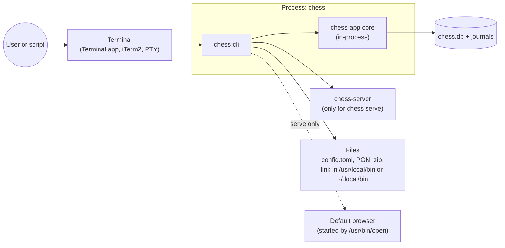
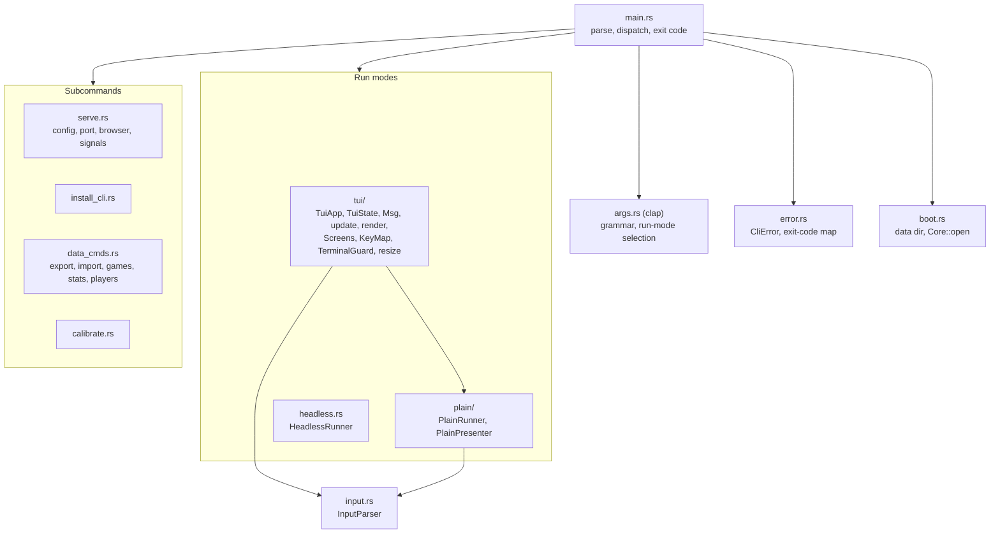
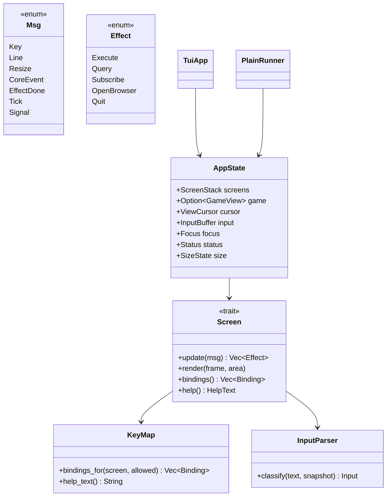
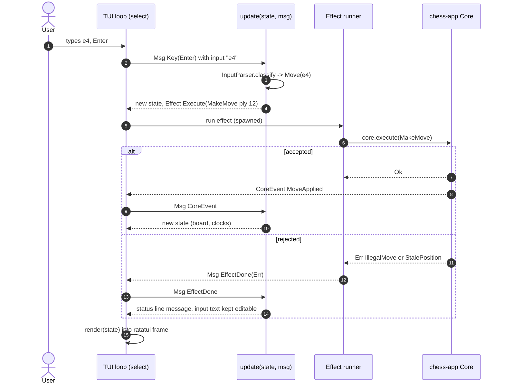
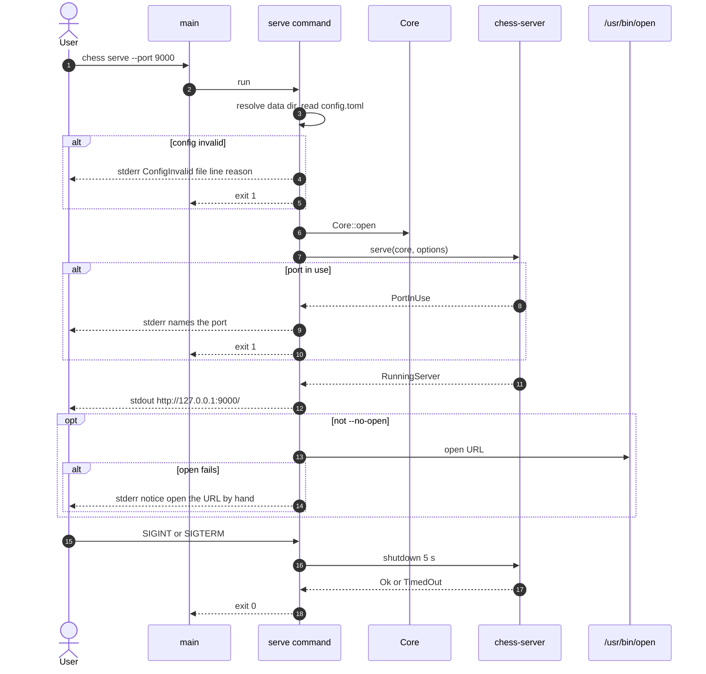
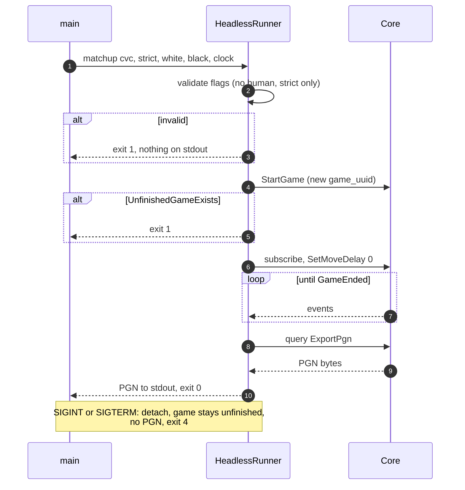
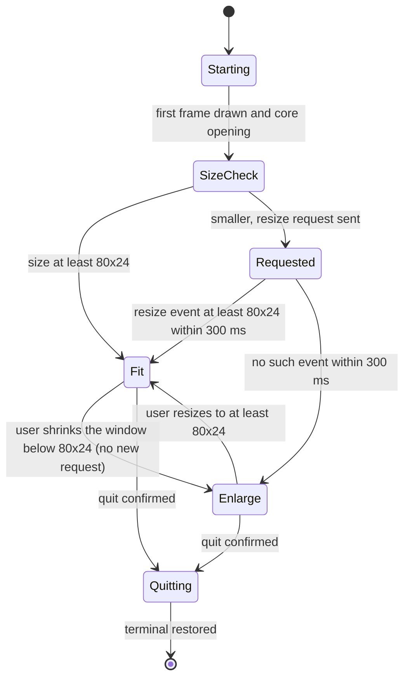

# SDD-chess-cli: Software Design Description for `chess-cli` (the `chess` binary)

| Field | Value |
|---|---|
| Document | docs/design/SDD-chess-cli.md |
| Version | 0.1 DRAFT |
| Date | 2026-10-30 |
| Status | **DRAFT.** Not reviewed. Not approved. No code exists yet |
| Owner | Software engineer role (Claude), for Brian Prascher |
| Approver | **Pending.** Gate G0 for this document (documents only). The implementation is G1 (System-architect agent, desk review) while it stays inside this crate with the §3.2 edges and §5.7 contracts unchanged. Command names and exit codes become a scripting contract after release (D-36); changing them then is G3 (SWE-001 §3) |
| Gate record | G0, status DRAFT. `GATE-1nn` is assigned when the record is filed (SWE-001 ASM-S5). Not filed here |
| Allocation name (architecture §2.2) | `CLI front-end` |
| Crate / path | `crates/chess-cli`, binary `chess` (architecture §3.1) |
| Runs in | Process: `chess` and Process: `chess serve` |
| Languages | Rust 1.99.1, edition 2024 |
| Sibling SDDs | [chess-server](SDD-chess-server.md), [chess-app](SDD-chess-app.md), [chess-domain](SDD-chess-domain.md) (`BoardGrid`), [chess-rules](SDD-chess-rules.md) (SAN parsing), [chess-store](SDD-chess-store.md), [chess-engine](SDD-chess-engine.md), [ui](SDD-ui.md), [desktop-tauri](SDD-desktop-tauri.md) |

Evidence tags per `swe-governance` §6. `[OBS architecture.md §n]` = read in this session. `[UNV]` = not verified (no code, toolchain or network used). `ESTIMATE` = no measurement.

---

## 1. Introduction

### 1.1 Purpose and scope

`chess-cli` builds the `chess` executable. It is the front-end block `CLI front-end`: it parses the command line, creates the shared core in-process, and drives it in one of three run modes (full-screen TUI, plain line mode, headless), or runs a subcommand (`serve`, `install-cli`, `export`, `import`, `games`, `stats`, `players`, `calibrate`). It renders snapshots and sends intents. It holds no rules: legality, policy, clocks and ratings are the core's (architecture §1 principle 1).

In scope: argument grammar, run-mode selection (D-19), the TUI (state, update, render, key map, terminal hygiene, resize), plain mode, headless mode and exit codes (D-36), `serve` lifecycle (config, port, browser, signals), `install-cli`, data commands, `calibrate` entry.

Out of scope: protocol, services and error mapping (chess-app); the HTTP and WebSocket server (chess-server); the `BoardGrid` renderer (chess-domain); SAN matching (chess-rules); the GUI.

### 1.2 Allocated requirements, functions and decisions

| Kind | IDs | Source |
|---|---|---|
| Primary requirements | CLI-1, CLI-2 (rendering), CLI-3, CLI-4, CLI-5, PLAT-6 (`install-cli`), PLAT-4 (`serve` command side) | [OBS architecture.md §10.1 rows CLI-1..CLI-5, PLAT-4, PLAT-6] |
| Supporting requirements | PLAT-1, UI-2, UI-3 (CLI styles), UI-4 (plain mode), UI-9 (help from `KeyMap`), UI-12 (Ctrl-C dialog), NFR-1 (CLI start under 1 s), NFR-5, NFR-8, NFR-9, PLY-2 and PLY-3 (profile chooser), GAME-1, GAME-2, GAME-3, GAME-4 (screens), ENG-5 (`movenow`, F2), IF-1 and IF-2 and DAT-2 (data commands), RISK-2 (`--data-dir`) | [OBS architecture.md §3.3, §10.1] |
| Functions | **F-7.1.1** Render TUI screens; **F-7.1.2** Accept typed moves and commands; **F-7.1.3** Plain mode; **F-7.1.4** Scripted headless game; **F-7.1.5** Safeguard terminal state; **F-7.3.1** statistics and charts, **F-7.3.2** help, **F-7.3.3** error messages, **F-7.3.4** profile, setup and settings screens (the CLI realisation of each); **F-2.5.6** Rewind (CLI part); **F-8.2** Start local web server (config, port precedence, URL, browser); **F-8.11** Link command onto PATH; **F-3.9** calibrate (the subcommand code; the nightly job is `CI checks`) | [OBS functional_decomp.md lines 103, 178-195, 210, 219; architecture §2.1 note] |
| Decisions | D-6 (ratatui, Elm style), D-8, D-18 (install layout), D-19 (mode selection), D-24 (config), D-36 (grammar, exit codes, serve lifecycle), D-37 (CLI Elo chart), D-14 and D-27 (resume), D-33 (in-play rules) | [OBS architecture.md §11] |
| Risks / assumptions | R-6 (TUI vs screen readers, terminal state), R-7 (glyph widths), R-16 and ASM-4 (resize), ASM-5 (macOS facts for `install-cli`) | [OBS architecture.md §12, §14] |
| Use cases | UC-1 (install, the CLI part), UC-4 (the CLI part), UC-22 to UC-25 (data commands), UC-27 (headless) | [OBS use_cases/README.md] |

### 1.3 Inputs read

architecture.md §1, §2, §2.1 (calibration note), §2.2, §3, §4.3 to §4.8, §5.1 to §5.7, §6.1 (all), §7.1, §8, §8.2, §9, §10.1, §11, §12, §14. functional_decomp.md F-7.1, F-7.3, F-8.x rows. requirements.md CLI-1 to CLI-5, PLAT-4, PLAT-6, GAME-1, GAME-2, UI-1, UI-3, UI-4, UI-9, UI-12, NFR-1. test-strategy.md. SWE-001.

### 1.4 Conventions

`DD-CLI-n` entities, `IFP-CLI-n` / `IFR-CLI-n` interfaces, `UT-CLI-nn` / `CT-CLI-nn` / `E2E-CLI-nn` planned tests, `UF-CLI-n` upstream findings (section 13), `ASM-CLI-n`, `IA-CLI-n` (assumption about another block's interface, section 6.3), `RAT-CLI-n` rationale.

---

## 2. Viewpoint selection

| Viewpoint | Used? | Where | Reason if omitted |
|---|---|---|---|
| Context | Yes | 3.1 | |
| Composition | Yes | 3.2, 4 | |
| Logical | Yes | 3.3 | |
| Dependency | Yes | 3.4 | |
| Information | Omitted | | Persistent data belongs to chess-store. The CLI owns two small files only: the PGN or zip it writes on request, and the symlink from `install-cli`. Both are specified under DD-CLI-9 and DD-CLI-11 |
| Patterns use | Yes | 3.5 | |
| Interface | Yes | 6 | |
| Structure | Yes | 3.2 | |
| Interaction | Yes | 3.6 | |
| State dynamics | Yes | 3.7 | |
| Algorithm | Yes | 3.8 | |
| Resource | Yes | 8 | |

---

## 3. Viewpoints

### 3.1 Context

**Concern:** what the CLI talks to.



### 3.2 Composition and structure

**Concern:** modules, layering, and which entity owns which concern.



(The last arrow means the plain presenter and the TUI share the same `AppState` and `update`; see DD-CLI-3.)

| Entity | Type | Purpose | Traces |
|---|---|---|---|
| DD-CLI-1 `args` | module | Command grammar and the D-19 run-mode rule | CLI-4, D-19, D-36 |
| DD-CLI-2 `boot` + `error` | modules | Data-directory resolution call, `Core::open`, error to exit-code mapping | CLI-5, D-36, NFR-1 |
| DD-CLI-3 `App` (state, `Msg`, `update`, effects) | module, pure | Front-end-neutral Elm core shared by TUI and plain mode | D-6, CLI-1, NFR-8 |
| DD-CLI-4 TUI renderer and `Screen`s | module | ratatui widgets, `BoardWidget`, screens | CLI-1, CLI-2, UI-3, F-7.1.1 |
| DD-CLI-5 `InputParser` and `KeyMap` | module | Text to command or move; key bindings and generated help | CLI-3, CLI-4, UI-9, F-7.1.2 |
| DD-CLI-6 `TerminalGuard`, resize, signals | module | Terminal hygiene and the 80x24 rule | CLI-1, R-6, R-16, F-7.1.5 |
| DD-CLI-7 `PlainRunner` and `PlainPresenter` | module | Line-oriented mode | CLI-1, UI-4, F-7.1.3 |
| DD-CLI-8 `HeadlessRunner` | module | Scripted c-c game, PGN on stdout, exit status | CLI-4, CLI-5, F-7.1.4, UC-27 |
| DD-CLI-9 `serve` command | module | Config, port, bind via chess-server, URL, browser, signals | PLAT-4, F-8.2, F-8.12 (caller) |
| DD-CLI-10 Data commands | module | `games`, `export`, `import`, `stats`, `players` | IF-1, IF-2, DAT-2, UC-22..25 |
| DD-CLI-11 `install_cli` | module | Link `chess` onto `PATH` and remove it | PLAT-6, F-8.11 |
| DD-CLI-12 `calibrate` | module | Dev subcommand entry and data-dir guard | F-3.9, ENG-2, R-17 |

### 3.3 Logical viewpoint (key types)

**Concern:** the main types, matching the names in architecture §3.3 [OBS]: `TuiApp`, `Screen`, `BoardWidget`, `InputLine`, `KeyMap`, `PlainRunner`, `InputParser`.



### 3.4 Dependency viewpoint

Allowed workspace edges [OBS architecture.md §3.2]: `chess-cli -> chess-server` and `chess-cli -> chess-app`. There is **no** edge to `chess-domain`, `chess-rules`, `chess-engine` or `chess-store`. Third-party edges named in §3.2: `ratatui` + `crossterm` (`cli -.-> tui`) and `toml` (`cli -.-> tomlLib`). Versions: `ratatui` 0.30.2, `crossterm` 0.29.0, `toml` 1.1.8, `tokio` 1.54.1, `tracing` 0.1.44, `thiserror` 2.0.21 [OBS §3.4].

| Need | How it is met | Note |
|---|---|---|
| `BoardGrid`, `BoardStyle` (chess-domain) and typed-move matching (chess-rules) | through **re-exports from `chess-app`** | The §3.2 graph has no cli -> domain or cli -> rules edge. Re-exporting keeps the edges; adding edges is G2. UF-CLI-1 |
| Command-line parsing | `clap` | Named in §3.3 but not in §3.4 baseline table: UF-CLI-9 |
| Signals | `tokio::signal::unix` for receiving; `signal-hook` for `low_level::raise` and default-handler emulation on Ctrl-Z | `signal-hook` is named in the §6.1 event-loop diagram and absent from §3.4: UF-CLI-9 |
| Opening the browser | `std::process::Command` on `/usr/bin/open` (macOS) | No `open` crate. Path absolute so `PATH` cannot redirect it (CERT ENV-intent). The file exists on this Mac [RAN `ls -l /usr/bin/open` -> present, 2026-10-30] |
| `futures` stream for crossterm `EventStream` | `crossterm` feature `event-stream` plus `futures-util` | feature name `[UNV]` |
| UUID for `StartGame{game_uuid}` | a chess-app helper | CLI must not add a `uuid` dependency: IA-CLI-5 |

Code policy: `#![forbid(unsafe_code)]` in this crate `[UNV: depends on whether `signal-hook::low_level::raise` is a safe function; believed so]`. If any `unsafe` proves necessary it needs a `// SAFETY:` comment and a note here (SWE-001 §6).

### 3.5 Patterns use

| Pattern | Where | Why | Misuse tell |
|---|---|---|---|
| Elm architecture (model, update, view) | DD-CLI-3 | D-6; `update` unit-testable without a terminal | `update` calling I/O or awaiting |
| Command/effect objects | `Effect` | I/O is requested, performed by the shell, results return as `Msg` | A screen awaiting a core future |
| Strategy (two views over one model) | TUI `render`, plain `PlainPresenter` | One behaviour for both modes, one test set | Plain mode with its own copy of game logic |
| RAII guard | `TerminalGuard` | Restore on every exit path | Manual restore calls in many places |
| Table-driven bindings | `KeyMap` | Help generated from the same table, drift impossible (UI-9) | A binding added outside the table |
| Functional core, imperative shell | whole crate | architecture §1 principle 2 | |

### 3.6 Interaction (sequences)

**Concern:** the three flows that cross a boundary: a typed move in the TUI, `chess serve` start and stop, and a headless run.







### 3.7 State dynamics

**Concern:** terminal-size handling (CLI-1, R-16) and the TUI's top-level phases.



Rules: the resize request is sent at start and again only after the terminal was at least 80x24 and has become smaller on a resize event **that follows a size we changed ourselves**; it is never repeated while in `Enlarge`, so the TUI does not fight a user who shrinks the window on purpose (architecture §6.1 point 3 [OBS]). "Within 300 ms" is the architecture's `ESTIMATE`; CLI-1 allows 1 s (EST).

### 3.8 Algorithm viewpoint

**A1. Run-mode selection (D-19, ordered).** Input: argv, `isatty(stdin)`, `isatty(stdout)`.

1. `--headless`, or top-level setup flags (`--matchup`, `--white`, `--black`, `--clock`, `--mode`) with **no subcommand** -> Headless.
2. `--plain`, or stdin or stdout not a terminal -> Plain.
3. Otherwise TUI. `chess play [setup flags]` opens the TUI pre-filled (and Plain if rule 2 applies).

Headless then validates: matchup must be `cvc` (or absent with two computer names), mode must be Strict (absent means Strict), both `--white` and `--black` given, no name that resolves to a human Player. Violations: exit 1, nothing on stdout, message on stderr [OBS §6.1, CLI-4 (a) to (e)]. A human name is detected after `ListPlayers` by `kind == human`.

**A2. Config and port resolution for `serve` (PLAT-4, D-24).**

```
config_path = --config | $CHESS_CONFIG | <data_dir>/config.toml     (flag over env over default; order of the first two is ASM-CLI-2)
if config_path is the default and does not exist  -> defaults
if config_path is explicit and cannot be read     -> ConfigInvalid (exit 1)
parse TOML. error -> ConfigInvalid{file, line, reason}  (line from the parser's span)
server.port: integer in 1..=65535 else ConfigInvalid
unknown keys -> warning on stderr, parsing continues
port = --port | server.port | 8765
--port is validated as 1..=65535 by clap (value parser). 0 is a usage error.
```

Never a silent fallback to a default on error [OBS PLAT-4]. The CLI does not write `config.toml` (UF-CLI-8).

**A3. Exit-code map (CLI-5, D-36).** 0 result reached or command succeeded; 1 usage or setup error; 2 engine unavailable; 3 store error; 4 stopped by a signal. Mapping of `AppError.code` (the §5.5 catalogue):

| Catalogue code | Exit |
|---|---|
| `ValidationFailed`, `UnfinishedGameExists`, `NotFound`, `ConfigInvalid`, `ParseError`, `Denied`, `ImportConflicts` (non-interactive), `Busy`, `GameLeased` | 1 |
| `EngineUnavailable` | 2 |
| `StoreUnavailable`, `StoreBusy`, `StoreCorrupt`, `StoreMissing`, `SchemaTooNew`, `BackupFailed`, `JournalWriteFailed`, `JournalUnreadable`, version-refusal | 3 |
| signal (SIGINT, SIGTERM, SIGHUP) | 4 |
| `Internal{id}` | 3, with the id printed (ASM-CLI-4) |

CLI-5 defines the codes for the headless run only. Applying them to every subcommand is this design's reading (UF-CLI-6).

**A4. Typed-input classification (CLI-3, CLI-4).** `InputParser::classify(text, snapshot)`:

1. trim; empty -> `Empty`.
2. if the first token equals a command word in the table (`help resign draw undo movenow analyze back forward live save flip moves history quit`) and the rest is empty or valid arguments -> `Command`.
3. otherwise ask the move matcher (IA-CLI-4) with the snapshot's legal moves: exactly one match -> `Move`; none -> `Error(helpful message)`; several -> `Error(ambiguous, lists candidates)`.
4. `abort` in a human game is not a command word, so it falls to step 3 and is rejected as neither a command nor a move [OBS CLI-4 verification].

A command word cannot collide with SAN: the words `back`, `flip`, `live`, `moves`, `save`, `quit`, `draw`, `undo`, `help`, `resign`, `history`, `analyze`, `movenow`, `forward` begin with a letter that can start SAN, but none of them is a legal SAN string (SAN pieces are uppercase; file letters a to h followed by a rank digit). `back` and `bishop` collisions: step 2 takes the command word first only when the whole token equals it; `b4` is never a command. Unit test UT-CLI-05 enumerates every command word against the SAN grammar.

**A5. Key routing (CLI-4).** A key event is looked up in `KeyMap` first; a printable character always goes to the input line. Bindings are only keys that cannot begin a move: Left/Right (rewind), End (live), PgUp/PgDn, F1 (help), F2 (move now), Tab, Esc, Ctrl-C, Ctrl-Z. The Watch screen has no input line and uses plain keys (Space, `s`, `+`/`-`, `a`) [OBS §6.1]. A binding that the mode policy disallows (not in `allowed_actions`) is shown unavailable and its key explains why instead of acting.

---

## 4. Design entities

### DD-CLI-1 `args` (clap grammar)
- Traces: CLI-4, CLI-5, D-19, D-36, PLAT-4, PLAT-6.
- Global option: `--data-dir <path>`. Run-mode flags: `--plain`, `--headless`, `--no-color`. Setup flags at top level and on `play`: `--matchup`, `--mode`, `--white`, `--black`, `--clock`; `play` also `--player <name>`. These names appear in architecture §6.1 and CLI-4 [OBS]. Other setup fields of GAME-1 (colour, start position) need flags that the architecture does not name (UF-CLI-5).
- Subcommands: `play`, `serve [--port <n>] [--no-open] [--config <path>]`, `install-cli [--remove]`, `stats [player]`, `players`, `games`, `export game <game> [--output <file>]`, `export data --output <file.zip>`, `import pgn <file> [--on-duplicate skip|keep]`, `import data <file.zip> [--yes]`, `calibrate` (hidden from `--help`, RAT-CLI-6). Bare `chess export` and `chess import` print the four forms and exit 1 [OBS §5.7].
- `--help` and `install-cli` run before any runtime or core exists, so they never open the store or start the engine [OBS §6.1].
- Failure behaviour: clap usage errors map to exit 1 (clap's default usage exit is 2, which would collide with "engine unavailable", so the default is overridden: `Command::try_get_matches` and mapped by `main`). Messages on stderr.
- Verification: UT-CLI-01 (grammar table), CT-CLI-01 (usage errors).

### DD-CLI-2 `boot` and `error`
- Traces: NFR-1, CLI-5, D-36, RISK-2.
- `boot::open_core(flags)`: resolve the data directory with the **chess-app helper** (IA-CLI-1) in the order `--data-dir`, `CHESS_DATA_DIR`, default `~/Library/Application Support/Chess/` [OBS §7.1]; call `Core::open`. The CLI does not create directories itself (the core creates it `0700` with the roster).
- `CliError` wraps `AppError`, `ConfigInvalid`, `Usage`, `Io`, `Signal`. `thiserror`. One `exit_code(&CliError) -> u8` function holds table A3 and is unit-tested exhaustively over the catalogue codes.
- Output discipline: only PGN or requested data goes to stdout; every message goes to stderr [OBS CLI-5].
- Startup budget (NFR-1, CLI under 1 s): `main` draws the first TUI frame (a "starting" screen) **before** `Core::open` completes; `Core::open` runs as an effect; the engine starts lazily and never during start-up [OBS §6.1, §4.7].
- Failure behaviour: every `Core::open` error ends with its catalogue message on stderr and the A3 exit code. Recovery flows that need a running core (`StoreMissing`, `StoreCorrupt`) are not offered by the CLI in v1 design unless the core opens in a recovery state (UF-CLI-3).

### DD-CLI-3 `App`: state, messages, `update`, effects
- Traces: D-6, CLI-1, NFR-8, GAME-3, F-7.1.1..F-7.1.3.
- `AppState` is plain data. `Msg` carries every input: key, line, resize, core event, effect result, tick, signal. `update(&mut AppState, Msg) -> Vec<Effect>` does no I/O, no clock reads (time arrives in `Tick` and event payloads) and no `await`. `Effect` values are executed by the shell, which spawns them and returns results as `Msg::EffectDone` [OBS §4.8 "Effects are spawned, and results come back as Msgs"].
- Game view state: the last `GameSnapshot`, a `ViewCursor` (live or ply n) for rewind, and local clocks. Rewind is client-side only: Left/Right/End and `back`/`forward`/`live` move the cursor, input to the game is disabled while rewound, and a `MoveApplied` that arrives while rewound sets the "live position has changed" badge (GAME-3, [OBS §6.1]).
- Clocks: on `ClockSync` or any event carrying clocks the state stores `{white_ms, black_ms, running_side}` and the monotonic `Instant` of receipt; `Tick` (10 Hz) recomputes the display. The core alone decides flag falls; the display clamps at 0:00 [OBS §4.2].
- Controls offered come from `snapshot.allowed_actions`, never recomputed.
- Concurrency: one task owns `AppState`. No lock.
- Verification: UT-CLI-02..04 (update with synthetic `Msg`, no terminal), snapshot tests of render at 80x24 and larger.

### DD-CLI-4 TUI renderer and screens
- Traces: CLI-1, CLI-2, UI-3, UI-2, UI-5, F-7.1.1, F-7.3.1, D-37.
- `render(&AppState, &mut Frame)` is pure. It draws into ratatui's `TestBackend` in tests at fixed sizes [OBS §9].
- `BoardWidget` maps a `BoardGrid` (glyph, shade, highlight per square, from chess-domain via re-export) to ratatui styles. Fixed three-column cell per square with padding (R-7). Styles `BoardStyle`: plain ASCII, Unicode glyphs, ANSI colour, light/dark squares. `NO_COLOR` (set and non-empty) or `--no-color` emits no colour escape, and highlights then use reverse video or markers (colour independence, §8.3 [OBS]). The ASCII style switches panel borders to an ASCII border set.
- Screens (one `Screen` implementation each, §6.1 diagram [OBS]): ProfileChooser, Register, Home, NewGame, Play, Watch, Resume, Result dialog, PostGameAnalysis, LiveAnalysis overlay, Statistics, ComputerPlayers, GameHistory, ImportExport, Settings, Players, Help, Confirm dialog, EnlargeMessage. Forms use focusable fields with Tab/Shift-Tab and Enter.
- Fields the policy disallows are not offered (GAME-1). The Settings screen lists no board, piece or colour theme (UI-1 verification).
- Elo chart (D-37): ratatui `Chart` with a Braille marker plus a table of the latest points. In ASCII style (or no Unicode) a small pure renderer draws `*` and `.` on a character grid. The pure renderer lives in this crate unless chess-domain provides it (UF-CLI-7).
- Empty and partial states: "no games yet", "—" averages, baseline point on the chart, "evaluating…" with "n of N plies evaluated" from `GetGameAnalysis` and `AnalysisProgress` [OBS §6.1].
- Layout: the 80x24 layout of §6.1 [OBS]. Minimum size is fixed at 80x24 and every screen is designed to fit.
- Verification: snapshot tests per screen, per style, per orientation; E2E-CLI via PTY.

### DD-CLI-5 `InputParser` and `KeyMap`
- Traces: CLI-3, CLI-4, UI-9, ENG-5, F-7.1.2.
- `InputParser`: algorithm A4. Move matching is delegated (IA-CLI-4) to the chess-rules matcher through chess-app, so CLI-3's rules (either-case files, optional `+ # x`, `0-0`, the Q44 bishop/b-file rule) have one implementation that the GUI's matcher is tested against.
- `KeyMap`: a static table of `Binding{ key, screen_scope, action, availability(allowed_actions) }`. Help text (F1, `help`) is generated from it. Tests: UT-CLI-06 every `KeyMap` entry appears in help (UI-9); UT-CLI-07 no binding consumes a character that can begin SAN or coordinate notation (CLI-4); F1 and F2 are bound.
- `movenow`: command word and F2 both produce `Effect::Execute(CancelEngine)`; offered only when `allowed_actions` contains it (an h-c game in `EngineThinking`) [OBS §4.4]. On a Mac laptop F-keys may need Fn, so the word always works.
- `save`: sends a round trip that goes through the session actor (so it sees every earlier command), checks the last move is durable, and prints "Game saved" with the stored move count. It changes nothing [OBS §6.1]. Which protocol call carries it is not defined (UF-CLI-4).
- `resign`: the core returns `ConfirmationRequired`; the UI shows the dialog (in h-h first asks which side) and resends with `confirmed: true`. The same for abort (Watch, key `a`), archive, reset, apply import, restore backup. The CLI never skips the prompt and the core refuses it without `confirmed` [OBS §5.5].
- Verification: UT-CLI-05..08.

### DD-CLI-6 `TerminalGuard`, resize and signals
- Traces: CLI-1, F-7.1.5, R-6, R-16, ASM-4, UI-12 (Ctrl-C).
- `TerminalGuard::enter()` enables raw mode, the alternate screen and hides nothing else; `Drop` leaves the alternate screen, disables raw mode, shows the cursor and, if the TUI changed the window size, restores it. No mouse capture is ever enabled, so terminal text selection and copy keep working [OBS §6.1].
- Panic hook: `std::panic::set_hook` restores the terminal first, then runs the previous hook so the panic text prints on a sane screen.
- Resize (A: state diagram 3.7): the original size is read with `crossterm::terminal::size()` (the window-size ioctl, characters). The request is `CSI 8 ; 24 ; 80 t` written to the terminal. Restore sends `CSI 8 ; rows ; cols t` with the saved size, only if a resize we requested took effect. **This differs from the architecture text**, which records the original size with `CSI 18 t` [OBS §6.1]. The reply to `CSI 18 t` arrives in-band on stdin, where `crossterm` does not parse it; the ioctl gives the same number without parsing a reply. RAT-CLI-3. The request is written only when stdout is a TTY, and not inside tmux or screen (detected by `TMUX` or `STY` in the environment, or `TERM` starting with `screen`), where the architecture expects it to be ignored; there the enlarge message appears directly.
- Signals: SIGINT arrives as a **key** in raw mode (ISIG is off) and opens the Ctrl-C confirmation dialog, which is the TUI's own dialog widget (UI-12) [OBS §5.5, §6.1]. SIGTERM and SIGHUP (CLI-1 requires the terminal restored on both, and the architecture's loop diagram lists only SIGTSTP/SIGCONT: UF-CLI-2) are received through `tokio::signal::unix`, produce `Msg::Signal`, and the shell then detaches the game (it stays unfinished, resumable), restores the terminal and exits 4. SIGTSTP is raised on Ctrl-Z: restore the terminal, `signal_hook::low_level::raise(SIGTSTP)` (the process stops), and on SIGCONT re-enter raw mode and redraw.
- Quitting (`quit` command or confirmed Ctrl-C): detach the game (suspend; not a resignation, GAME-4), restore terminal, exit 0.
- `reset` advice for a terminal left bad after SIGKILL is in the help text (UI-9, CLI-1).
- Verification: E2E-CLI-03..07 (PTY): terminal restored after quit, confirmed Ctrl-C, injected panic, SIGTERM, SIGHUP; unconfirmed Ctrl-C leaves the game running; below-80x24 paths; original size restored.

### DD-CLI-7 `PlainRunner` and `PlainPresenter`
- Traces: CLI-1, UI-4, F-7.1.3, R-6, D-19.
- Same `AppState` and `update` as the TUI (DD-CLI-3). The `PlainPresenter` replaces `render`: after each update it appends to stdout only what changed: the board (from `BoardGrid`, text lines), the last move, clocks, the status or error line, and the prompt. Input is one line at a time, read with an async line reader and delivered as `Msg::Line` to the same `InputParser`.
- Clock lines: printed with each move and as warnings at fixed thresholds (60 s and 10 s, `ESTIMATE` examples from the architecture), never per tick [OBS §6.1].
- Opponent moves are printed as they arrive, even while the user is typing.
- Non-game screens (profile chooser, setup, statistics, ...) are shown as numbered lists with a prompt. This is the CLI's own reading: the architecture says plain mode serves screen readers and pipes but describes only the game transcript (UF-CLI-10).
- Scripted human play: `chess play --plain --player <name> [setup flags] < moves.txt` [OBS §6.1]. Stdin end of file with the game unfinished is treated as `quit`: the game is suspended, exit 0 (ASM-CLI-3). When the game reaches a result, the transcript ends with the result line and the game's PGN, then exit 0 (ASM-CLI-3, UF-CLI-10).
- `NO_COLOR` is honoured: plain mode never emits colour unless explicitly given an ANSI style.
- Verification: transcript tests via PTY and via pipe (`E2E-CLI-08`, `E2E-CLI-09`).

### DD-CLI-8 `HeadlessRunner`
- Traces: CLI-4, CLI-5, F-7.1.4, UC-27, RISK-2, D-36.
- Steps: validate (A1); `open_core` with `--data-dir`; resolve the two computer names via `ListPlayers`; `StartGame{game_uuid, GameSetup}` (new uuid from IA-CLI-5, Strict, clock from `--clock`); subscribe; `SetMoveDelay{0}` to run at engine speed (ASM-CLI-5); wait for `GameEnded`; query `ExportPgn`; write PGN to stdout; exit 0.
- Errors: a human named, mode not Strict, or matchup not `cvc` -> exit 1, nothing on stdout. `UnfinishedGameExists` for a chosen computer -> exit 1 and no resume offer (D-27). `EngineUnavailable` -> exit 2 (the game is left resumable by the core, §4.7). Store errors -> exit 3.
- Signals: SIGINT or SIGTERM detaches the in-process subscription; the core suspends the game (D-14), nothing is printed to stdout, exit 4. The game is stored and rated like any c-c game, and an interrupted one can be resumed as a watched game [OBS CLI-4 (f)].
- Verification: E2E-CLI-10..14.

### DD-CLI-9 `serve` command
- Traces: PLAT-4, F-8.2, UC-4, D-8, D-24, D-36; calls F-7.4.3, F-8.12 of chess-server.
- Algorithm A2 and the sequence in 3.6. After a successful bind it prints exactly one line to stdout: `http://127.0.0.1:<port>/`. All notices go to stderr.
- Port in use: exit 1, message names the port. If `PROCESS_HEARTBEAT` shows a live `chess serve` entry the message adds "another chess serve appears to be running (pid N)" and does not claim its URL (UF-SRV-7 in [SDD-chess-server](SDD-chess-server.md)); reading `PROCESS_HEARTBEAT` is a core query (IA-CLI-6).
- Browser: unless `--no-open`, spawn `/usr/bin/open <url>` with stdin/stdout/stderr null and wait at most 5 s (`ESTIMATE`). Failure or a non-zero status prints "could not open the browser, open <url> by hand" on stderr and does **not** change the exit status or stop the server [OBS PLAT-4].
- Stop: SIGINT or SIGTERM via `tokio::signal::unix`, no confirmation. `RunningServer::shutdown(5 s)`, then exit 0 even on timeout (a warning is printed) [OBS §6.1, §4.8].
- Not in `serve`: Host/Origin, CSP, framing (chess-server).
- Verification: E2E-CLI-15..20: invalid TOML, port 70000, port in use, open failure (forced launcher failure), SIGINT and SIGTERM stop with exit 0 and a resumable game, second server on the same port.

### DD-CLI-10 Data commands
- Traces: IF-1, IF-2, IF-3 (review), DAT-2, UC-22..UC-25, UI-12, D-34, D-36.
- `chess games`: `ListGames{filter}`; prints a table whose first column is the number `export game` accepts. The architecture does not define the number (UF-CLI-4); the design uses the store's game id as it appears in the query result.
- `chess export game <game> [--output <file>]`: `<game>` is a UUID or that number. `ExportPgn` returns bytes; to stdout when `--output` is absent, otherwise written by DD-CLI-10a below.
- `chess export data --output <file.zip>`: `ExportData`, then DD-CLI-10a. `--output` is required.
- **DD-CLI-10a safe file write:** write to a new temporary file in the target's directory created with `create_new` and mode `0600`, `fsync`, then `rename` over the target. A target that is a directory is refused. The temporary file is removed on failure. (CERT FIO intent: no check-then-open race, no partial file at the final name.)
- `chess import pgn <file> [--on-duplicate skip|keep]`: read the file (bounded read, up to the 10 MB limit of TBD-25 plus one byte, so an oversize file is rejected without reading it all), then `ImportPgn`. With the option, the choice applies to every duplicate. Without it: on a terminal, ask per duplicate with Skip as default and an "apply to all" answer; off a terminal, Skip (ASM-CLI-6). Output: counts imported, skipped, failed, and each `ParseError` with game index, line and column.
- `chess import data <file.zip> [--yes]`: `PreviewDataImport`; print the conflicts; for each conflict ask Replace or Keep both. `--yes` answers only the final UI-12 confirmation. If there are conflicts and stdin is not a terminal, exit 1 listing them: never choose Replace without a human (ASM-CLI-6, UF-CLI-6).
- `chess stats [player]`, `chess players`: open the screen on a TTY, print tables in plain mode. A name is matched case-sensitively with `ListPlayers` (names are unique, PLY-6); not found exits 1.
- Exit codes per A3. `Busy` (another process live) exits 1 with the message "close the other entry points".
- Verification: CT-CLI-04..12 (against a core with in-memory store and FakeEngine), round trip with `chess-rules` (RULE-6, RULE-7).

### DD-CLI-11 `install_cli`
- Traces: PLAT-6, F-8.11, D-18, ASM-5, UC-1.
- Steps:
  1. `exe = std::env::current_exe()?.canonicalize()`. It must lie inside a `Chess.app/Contents/MacOS/` directory and its file name must be `chess`; otherwise exit 1 with "run chess install-cli from the copy inside Chess.app" (no link to a development build, whose later removal the ownership rule below could not recognise). Tests use a copy under a temporary `Test/Chess.app/Contents/MacOS/chess`.
  2. Candidate directories in order: `/usr/local/bin` if it exists, else `~/.local/bin` (created if absent). If creating the link in `/usr/local/bin` fails with a permission error, fall back to `~/.local/bin`. **Writability is tested by trying, not by `access()`** (no check-then-use race, CERT FIO45 intent).
  3. Existing entry at `<dir>/chess` (read with `symlink_metadata`): none -> create. A symlink whose target path contains a `Chess.app/Contents/MacOS/chess` component pair (a link we made earlier) -> replace atomically (create `.chess.install-cli.<pid>` as a symlink, `rename` over). Anything else, including a regular file or a foreign symlink -> refuse, change nothing, exit 1.
  4. Print the link path. If the directory is not on `PATH`, print the exact line to add to the shell profile (`export PATH="<dir>:$PATH"`).
  5. On any failure: message stating why, nothing changed, "the CLI still runs by its full path <exe>" (NFR-9).
- `--remove`: in both directories, remove a link only if it is a symlink whose target is a `Chess.app/Contents/MacOS/chess` path. Never touches the bundle or the data directory. Reports each action.
- Runs before the core exists; never touches the data directory [OBS §8.2].
- Test seam: the two directories are parameters of the pure function `plan(dirs, exe, env_path) -> Plan` so unit tests need no real `/usr/local/bin`. A test-only environment variable to redirect them in PTY tests would be a new interface (UF-CLI-5).
- Verification: UT-CLI-09 (plan table), CT-CLI-13 (twice, over a regular file, foreign symlink, absent or read-only primary directory, `--remove`), manual M on a clean macOS 26 Mac for ASM-5 facts.

### DD-CLI-12 `calibrate`
- Traces: ENG-2, F-3.9, R-17, RISK-2; not reachable through the protocol [OBS §2.1 note, §4.5].
- Behaviour here: parse; refuse to run when the resolved data directory equals the default after canonicalisation (R-17: "calibrate refuses to run on the default data dir"); open the core on the given directory; hand the options to a chess-app calibration entry (IA-CLI-7) and print its report. The match logic, SPRT and reporting belong to chess-app and chess-engine. `EnginePurpose::Calibration` is built only inside that entry, never in this crate.
- Exit: 1 on the refusal, 2/3 as A3.
- Verification: CT-CLI-14 (refusal on the default directory), nightly job (`CI checks`, not designed here).

---

## 5. Information viewpoint

Omitted as a viewpoint (section 2). Files the crate writes: the exported PGN or zip (DD-CLI-10a, mode `0600`), and the symlink (DD-CLI-11). The log and config belong to chess-app and the user. The CLI never writes `config.toml` (UF-CLI-8).

---

## 6. Interface viewpoint

### 6.1 Provided interfaces

**IFP-CLI-1 Command line** (the scripting contract after release, D-36) [OBS architecture.md §5.7 "CLI data commands", §6.1]:

| Form | Effect | Output | Exit |
|---|---|---|---|
| `chess` | profile chooser, then Home (TUI; plain if not a TTY) | terminal | 0 / A3 |
| `chess play [--player N] [setup flags]` | game pre-filled | terminal | 0 / A3 |
| `chess --matchup cvc --mode strict --white W --black B --clock 5+0 [--no-color] [--data-dir D]` | headless game | PGN on stdout | 0, 1, 2, 3, 4 |
| `chess serve [--port n] [--no-open] [--config f]` | web server | URL on stdout | 0, 1, 3 |
| `chess install-cli [--remove]` | link on PATH | messages on stderr, link path on stdout | 0, 1 |
| `chess games` | list with numbers | table on stdout | 0 / A3 |
| `chess export game <game> [--output f]` | PGN | stdout or file | 0 / A3 |
| `chess export data --output f.zip` | archive | file | 0 / A3 |
| `chess import pgn <file> [--on-duplicate skip\|keep]` | import | report on stdout | 0 / A3 |
| `chess import data <file.zip> [--yes]` | preview, confirm, import | report | 0 / A3 |
| `chess stats [player]`, `chess players` | screen or tables | terminal / stdout | 0 / A3 |
| `chess calibrate` (hidden) | dev | report | 0 / A3 |
| global `--data-dir <path>` | overrides `CHESS_DATA_DIR` | | |

Environment read: `CHESS_DATA_DIR`, `CHESS_CONFIG`, `NO_COLOR`, `TERM`, `TMUX`, `STY`, `HOME`, `PATH` (only to tell the user whether the link directory is on it), `CHESS_STOCKFISH` (read by chess-engine, not here). In-game commands and keys: A4, A5, DD-CLI-5.

### 6.2 Required interfaces

| ID | From | What | §5.7 row |
|---|---|---|---|
| IFR-CLI-1 | chess-app | In-process protocol: `core.execute(cmd)`, `core.query(q)`, `core.subscribe(game_id)` | Protocol; CLI transport "In-process ... No serialization" [OBS §5.2] |
| IFR-CLI-2 | chess-app (re-export of chess-domain) | `BoardGrid`, `BoardStyle` | BoardGrid renderer |
| IFR-CLI-3 | chess-server | `serve`, `RunningServer` | [SDD-chess-server](SDD-chess-server.md) IFP-SRV-3 |
| IFR-CLI-4 | OS | terminal (crossterm), signals, `/usr/bin/open`, filesystem for `install-cli` and file writes | |

### 6.3 Interface assumptions about chess-app (to be reconciled with [SDD-chess-app](SDD-chess-app.md))

| ID | Assumption | If wrong |
|---|---|---|
| IA-CLI-1 | `chess_app` offers `resolve_data_dir(flag: Option<PathBuf>) -> PathBuf` usable before `Core::open`, and `Core::open(CoreConfig)` takes the resolved path. The Tauri shell needs the same function and has no dependency on chess-cli | Data-dir logic would sit in chess-cli and the shell could not reach it without a new edge (UF-CLI-1) |
| IA-CLI-2 | `ListPlayers`, `ListGames` return enough to resolve names and to print the `games` table (id/number, date, players, result, status, mode) | UF-CLI-4 |
| IA-CLI-3 | `Core::detach_all()` or equivalent so the CLI can suspend on quit and on signals; in-process `subscribe` drop also detaches (D-14) | Quit would rely on dropping every stream |
| IA-CLI-4 | A pure move matcher implementing CLI-3 and Q44, re-exported by chess-app from chess-rules. **Provider shape (consistency review XC-11; SDD-chess-rules IFP-RUL-3 is authoritative):** `Position::parse_move(&self, text, ParseMode::Typed) -> Result<Move, MoveParseError>` (errors `Empty`, `TooLong`, `LowercasePiece`, `Syntax`, `PromotionRequired`, `Ambiguous` with candidate SAN, `NoMatch` with a reason). It takes a `Position`, not a legal-move list, so the CLI must hold a `Position` built from the snapshot FEN (see XC-9, XC-12). The earlier sketch `resolve_typed_move(text, legal_moves)` is superseded | The CLI would carry its own copy and the GUI another |
| IA-CLI-5 | A helper for a fresh `game_uuid` (the `uuid` crate is not in §3.4) | Add a CLI dependency |
| IA-CLI-6 | A query for live entry points (`PROCESS_HEARTBEAT` kinds) for the `serve` port-in-use hint | Hint omitted |
| IA-CLI-7 | A calibration entry point in chess-app behind a cargo feature or a doc-hidden path | `calibrate` cannot work without an edge cli -> engine (UF-CLI-1) |

---

## 7. Error handling (mapped to §5.5)

Messages shown are the catalogue's `message`, never formatted from internals (NFR-9, §5.5 [OBS]). The TUI shows them in the status line with the input text kept (CLI-3); plain mode prints them; headless and subcommands print them on stderr with the exit code of A3.

| Code | CLI behaviour |
|---|---|
| `ConfirmationRequired{action, voids}` | Confirm dialog (TUI), a `y/N` prompt (plain), refusal without `--yes` where a script gave none; resend with `confirmed: true` |
| `UnfinishedGameExists` | Setup offers Resume, Resign (human games) or Abort (c-c), each confirmed. Headless: exit 1 |
| `JournalWriteFailed` | Status line shows cause; the move was not made; clock keeps running |
| `StoreMissing` / `StoreCorrupt` | exit 3 with the message and next step (UF-CLI-3) |
| `ImportConflicts` | per A3 / DD-CLI-10 |
| `IllegalMove`, `StalePosition` | status line; text editable; refresh from snapshot |
| `Denied`, `NothingToTakeBack` | status line; the key or command is shown unavailable |
| `ValidationFailed` | highlight field, show rule (Register, setup) |
| `ParseError` | list per game with index, line, column; other games still import |
| `NotFound`, `GameLeased`, `Busy` | message; `GameLeased` offers read-only view where the screen has one |
| `LeaseLost` (event) | drop to read-only and explain |
| `EngineUnavailable` | Retry / Leave dialog (ENG-1); headless exit 2 |
| `StoreBusy`, `StoreUnavailable`, `SchemaTooNew`, `BackupFailed` | message; exit 3; `BackupFailed` offers Retry or Exit on a TTY |
| `ProtocolMismatch` | not applicable in process |
| `ConfigInvalid` | stderr, exit 1 |
| `JournalUnreadable{recovered_moves}` | status line states the count; `VoidUnreadableGame` offer dialog is its own confirmation (UI-12 amendment [OBS requirements]) |
| `Internal{id}` | generic message with the id; exit 3 where fatal |

Panics: the terminal hook restores the screen, then the process aborts through the normal panic path (exit 101, the Rust default); this is not one of the five documented codes (ASM-CLI-4).

---

## 8. Resource and concurrency viewpoint

**Concern:** threads and tasks, and what must never block (§4.8 [OBS]).

| Context | Runs | Must not |
|---|---|---|
| tokio multi-thread runtime (created by `main` after argument parsing, except `--help`, `install-cli`) | the TUI `select!` loop, effect tasks, signal tasks, core | block |
| TUI loop | one `tokio::select!` over crossterm `EventStream`, a merged core-event channel, a 100 ms interval, signal streams, and the effect-result channel | await a core future inline; read stdin in a thread |
| Effect tasks | `core.execute`, `core.query`, file reads and writes for data commands (`spawn_blocking` for file I/O) | touch `AppState` |
| Store thread, engine processes | inside the core | be reached from here |

- No lock is held across `.await`. `AppState` has one owner.
- Redraw policy: after each processed `Msg` batch; at most one draw per 16 ms (`ESTIMATE`) so a burst of core events does not flood the terminal. A key press is drawn in the same loop turn, which serves NFR-8 (100 ms feedback) [OBS requirements NFR-8].
- Memory: one snapshot plus plies of the open game; the move list for a long game is hundreds of lines at most `ESTIMATE`. Data commands read files with a bound (10 MB for PGN); the zip import path is streamed to the core, not held twice, as far as the core's interface allows (UF-CLI-6).
- Tick: 10 Hz [OBS §6.1], only repaints the clock and spinner cells when a clock is running or the engine is thinking.
- File descriptors: stdin, stdout, stderr, the terminal, signal streams.
- Latency budget to start: first frame before `Core::open` (DD-CLI-2).

---

## 9. Verification mapping

IDs are planned. Nothing has been written or run. Levels per architecture §9 [OBS].

| ID | Level | Case | Requirements |
|---|---|---|---|
| UT-CLI-01 | Unit | grammar table: every form of IFP-CLI-1; D-19 mode rule table (headless, plain, TUI) | CLI-4, D-19 |
| UT-CLI-02..04 | Unit | `update` with synthetic `Msg`: typed move, rejected move keeps text, rewind cursor and badge, clocks, `movenow` availability, confirmation flow | CLI-1, CLI-3, GAME-3, ENG-5 |
| UT-CLI-05 | Unit | every command word against the SAN grammar: no collision; `abort` rejected | CLI-3, CLI-4 |
| UT-CLI-06 | Unit | help text lists every `KeyMap` entry | UI-9 |
| UT-CLI-07 | Unit | no binding consumes a character that can start SAN or coordinate notation; F1, F2 bound | CLI-4 |
| UT-CLI-08 | Unit | `exit_code` over every catalogue code | CLI-5 |
| UT-CLI-09 | Unit | `install_cli::plan` table | PLAT-6 |
| UT-CLI-10 | Unit | config parsing: valid, TOML error line number, port 0, 70000, string port, unknown key warning, explicit missing file | PLAT-4 |
| UT-CLI-11 | Unit | render snapshots (`insta` on `TestBackend`) for each screen at 80x24 and 120x40, each `BoardStyle`, both orientations, check, promotion, rewound badge, result, Elo chart Braille and ASCII | CLI-1, CLI-2, UI-3, UI-2 |
| UT-CLI-12 | Unit | `NO_COLOR` and `--no-color`: no colour escapes in output | UI-4 |
| FZ-CLI-1 | Fuzz | arbitrary input lines never panic `InputParser`; arbitrary argv never panics `args` | CLI-3, test-strategy fuzz |
| CT-CLI-01 | Component | usage errors give exit 1, nothing on stdout | CLI-5 |
| CT-CLI-04..12 | Component (in-process core, FakeEngine, temp store) | data commands: games numbering, export/import round trip, duplicate options, `--yes`, conflicts off a TTY, bad zip, oversize PGN | DAT-2, IF-1, IF-2 |
| CT-CLI-13 | Component | `install-cli` twice, over a regular file, foreign symlink, absent/read-only primary, `--remove` (temp dirs) | PLAT-6 |
| CT-CLI-14 | Component | `calibrate` refuses the default directory | R-17 |
| E2E-CLI-01, 02 | CLI E2E (`expectrl` + `vt100`) | scenario files through the TUI; screens fit 80x24; Settings lists no GUI themes | PLAT-1, CLI-1, UI-1 |
| E2E-CLI-03..07 | CLI E2E | terminal restored after quit, confirmed Ctrl-C, injected panic, SIGTERM, SIGHUP; unconfirmed Ctrl-C keeps playing; below-80x24 with honoured and ignored resize; original size restored; Ctrl-Z/fg | CLI-1, R-6, R-16 |
| E2E-CLI-08, 09 | CLI E2E | plain mode via PTY and via pipe: board and prompt after each move; scripted human game | CLI-1, UI-4, PLAT-1 |
| E2E-CLI-10..14 | CLI E2E | headless: PGN equals stored result, exit 0; human named or computer busy exit 1 with empty stdout; `--data-dir` isolation vs default store change; SIGTERM exit 4 with unfinished game | CLI-4, CLI-5, RISK-2 |
| E2E-CLI-15..20 | CLI E2E | serve: TOML error, port 70000, port busy, browser failure, SIGINT and SIGTERM exit 0 and resume | PLAT-4 |
| M-CLI-1 | Manual | resize behaviour in Terminal.app and iTerm2; VoiceOver on plain mode; `install-cli` walkthrough on a clean macOS 26 Mac | CLI-1, UI-4, PLAT-6, ASM-4, ASM-5 |
| NF-CLI-1 | Non-functional | startup to first screen under 1 s warm, median of 10 | NFR-1 |

Coverage: the 90 % line target in the test-strategy quality gates applies to rules, Elo, clock, policy and parser modules [OBS SWE-001 §1]. In this crate `InputParser` is a parser and takes that target; the other modules do not have a stated figure.

---

## 10. Traceability

| Requirement | Design entities | Tests |
|---|---|---|
| CLI-1 (TUI, 80x24, hygiene, plain by TTY) | DD-CLI-3, 4, 6, 7 | UT-CLI-02, 11, E2E-CLI-01..09 |
| CLI-2 (coordinates) | DD-CLI-4 (`BoardWidget` over `BoardGrid`) | UT-CLI-11 |
| CLI-3 (typed moves) | DD-CLI-5, A4 | UT-CLI-02, 05, FZ-CLI-1 |
| CLI-4 (commands, keys, scripted runs, `--data-dir`) | DD-CLI-1, 5, 8, A1, A5 | UT-CLI-01, 05..07, E2E-CLI-10..14 |
| CLI-5 (headless output, exit codes 0 to 4) | DD-CLI-2, 8, A3 | UT-CLI-08, E2E-CLI-10..14 |
| PLAT-4 (serve command side) | DD-CLI-9, A2 | UT-CLI-10, E2E-CLI-15..20 |
| PLAT-6 (`install-cli`) | DD-CLI-11 | UT-CLI-09, CT-CLI-13, M-CLI-1 |
| PLAT-1 | DD-CLI-7 (scripted human play), DD-CLI-8 | E2E-CLI-08..10 |
| UI-2, UI-5 (stats, Elo chart D-37) | DD-CLI-4 | UT-CLI-11 |
| UI-3 (CLI styles) | DD-CLI-4 | UT-CLI-11, 12 |
| UI-4 (plain mode, NO_COLOR) | DD-CLI-7 | UT-CLI-12, E2E-CLI-08, 09, M-CLI-1 |
| UI-9 (help from KeyMap) | DD-CLI-5 | UT-CLI-06 |
| UI-12 (Ctrl-C dialog; core refuses unconfirmed) | DD-CLI-5, DD-CLI-6 | E2E-CLI-03..07 |
| ENG-5 (`movenow`, F2) | DD-CLI-5 | UT-CLI-02, 07 |
| NFR-1 | DD-CLI-2 | NF-CLI-1 |
| NFR-8 | DD-CLI-3, section 8 | UT-CLI-02; latency test in chess-app |
| NFR-9 | section 7 | E2E-CLI for each listed error path |
| IF-1, IF-2, DAT-2 (CLI forms) | DD-CLI-10 | CT-CLI-04..12 |
| RISK-2 | DD-CLI-1 (`--data-dir`), DD-CLI-8, DD-CLI-12 | E2E-CLI-12, CT-CLI-14 |
| F-7.1.1..F-7.1.5, F-7.3.1..F-7.3.4, F-8.2, F-8.11 | as above | as above |

No design entity lacks a driver. DD-CLI-12 is dev tooling with a recorded driver in §10.2 of the architecture [OBS].

---

## 11. Design rationale

| ID | Decision | Alternatives rejected |
|---|---|---|
| RAT-CLI-1 | One Elm `AppState` and `update` for TUI and plain mode; two views | Separate plain implementation (two behaviours to test and keep consistent) |
| RAT-CLI-2 | Effects are values; `update` is pure | Awaiting inside screens (would block the loop, violates §4.8) |
| RAT-CLI-3 | Original terminal size from the window-size ioctl, not `CSI 18 t` | Parse the in-band reply (not supported by crossterm's event parser `[UNV]`) |
| RAT-CLI-4 | clap usage errors remapped to exit 1 | clap's default usage exit would collide with code 2 "engine unavailable" |
| RAT-CLI-5 | Move matching delegated to chess-rules via chess-app | A CLI-local parser (duplicate of Q44 logic) |
| RAT-CLI-6 | `calibrate` is compiled in but hidden from `--help` | Cargo feature to exclude it from release (two build shapes; the architecture says "dev subcommand" and runs it in CI from the same binary) |
| RAT-CLI-7 | `install-cli` refuses to run outside `Chess.app` | Link to any path (a later `--remove` could not tell what it made) |
| RAT-CLI-8 | Safe file write by temp file and rename | Write in place (partial file on failure) |
| RAT-CLI-9 | Open the browser with absolute `/usr/bin/open` | Search `PATH` (hijackable) or add an `open` crate (dependency for one call) |

ADR requests to the System Architect: none by this document. Items needing a decision are UF-CLI-1 (edges) and UF-CLI-5 (new flags or env var), both listed below.

---

## 12. Risks, assumptions, not analysed

| ID | Item |
|---|---|
| ASM-CLI-1 | `ratatui` 0.30.2 and `crossterm` 0.29.0 API names used in this document are from memory, not read from their documentation `[UNV]` |
| ASM-CLI-2 | `--config` is read before `CHESS_CONFIG`, as for `--data-dir` (architecture states both exist, not the order) |
| ASM-CLI-3 | Plain mode: stdin end of file suspends the game and exits 0; a finished game prints result and PGN and exits 0. CLI-5 specifies only the headless run |
| ASM-CLI-4 | Fatal `Internal{id}` exits 3; a panic exits 101 |
| ASM-CLI-5 | `SetMoveDelay{0}` is accepted in a c-c game so the headless run is not paced at the 1 s default (GAME-2) |
| ASM-CLI-6 | Non-interactive imports: duplicates default to Skip; archive conflicts are never auto-resolved |
| ASM-CLI-7 | Terminal.app and iTerm2 honour `CSI 8 ; 24 ; 80 t` (ASM-4 upstream) |
| RSK-CLI-1 | Scope of plain mode beyond the game transcript is under-specified (UF-CLI-10) |
| RSK-CLI-2 | Glyph width differences across fonts (R-7); mitigated by fixed three-column squares and the ASCII style |
| RSK-CLI-3 | `crossterm` EventStream and tokio signal interplay on SIGCONT redraw is untested `[UNV]` |

**Not analysed:** Linux or Windows terminals (platform is macOS), terminals other than Terminal.app and iTerm2 (PLAT-2), accessibility with a real screen reader (M-CLI-1 is planned), Intel Macs (no hardware; deferred per CR-7.6), performance of rendering on a slow terminal.

---

## 13. Open issues and upstream findings

| ID | Finding | Evidence | Assumed meanwhile | Gate if changed |
|---|---|---|---|---|
| UF-CLI-1 | **Dependency edges versus what the CLI needs.** The CLI needs `BoardGrid`/`BoardStyle` (chess-domain), a typed-move matcher (chess-rules), data-directory resolution before the core exists, a calibration entry, and a fresh `game_uuid`. §3.2 gives chess-cli only the edges to chess-server and chess-app, and `src-tauri` only to chess-app | architecture.md §3.2, §3.3, §6.1 | chess-app re-exports and offers helpers (IA-CLI-1, 4, 5, 7). Please state this in the chess-app design. If re-exports are refused, edges must be added (G2) | G1 (re-exports) / G2 (edges) |
| UF-CLI-2 | CLI-1 requires the terminal restored on SIGTERM and SIGHUP. The §6.1 event-loop diagram shows only SIGTSTP/SIGCONT. The exit status for these in TUI and plain mode is not stated (only the headless exit 4) | requirements.md CLI-1; architecture.md §6.1 | Restore, detach, exit 4 | G0 text |
| UF-CLI-3 | Open failures (`StoreMissing`, `StoreCorrupt`, `SchemaTooNew`, `BackupFailed`, version refusal) have client flows in §5.5 (choose fresh store or import, restore, retry) but `CreateFreshStore`, `RestoreBackup` and `ImportData` are core commands, so the core must open in a recovery state for the CLI and GUI to run them. The architecture does not say how `Core::open` behaves | architecture.md §5.1, §5.5, §7.1 | CLI exits 3 with the message | G1 (chess-app) |
| UF-CLI-4 | `chess games` numbers and `save`: the number `export game` accepts is not defined (store id? ordinal?), and `ListGames` result fields are not listed. The protocol has no `Save` command; `save` needs "a round trip through the game's session actor" | architecture.md §5.1, §6.1, §5.7 | the store's game id; a no-op command or query that the actor answers. Both are chess-app decisions | G1 |
| UF-CLI-5 | Setup flags for fields GAME-1 collects but §6.1 does not name (colour White/Black/random, start position FEN, clock presets and the meaning of `5+0`: minutes plus seconds increment?). A test-only environment variable to redirect the `install-cli` target directories would be an undocumented interface | requirements.md GAME-1, CLI-4; architecture.md §6.1, §8.2 | `--clock <minutes>+<increment seconds>` is the reading used in the play-screen example "5+0" `[ASM]`; no other flags added | G1/G2 (public names after release, D-36) |
| UF-CLI-6 | CLI-5 defines exit codes for the headless run only. The mapping of catalogue codes to exit codes for the other subcommands, and the non-interactive rules for `import data` with conflicts and `import pgn` duplicates, are not specified (`--yes` answers the confirmation, not per-conflict choices) | requirements.md CLI-5, IF-2, DAT-2; architecture.md §5.7 | A3; ASM-CLI-6 | G1, SE to confirm |
| UF-CLI-7 | The ASCII-grid Elo renderer (D-37) is "a small pure renderer" without an owner. chess-domain already has the terminal-independent `BoardGrid` | architecture.md §6.1 D-37 | lives in chess-cli | G1 |
| UF-CLI-8 | `config.toml` is "created only when the user saves a setting", but no UI-1 setting writes it (`server.port` has no screen). Nothing creates or rewrites the file; "unknown keys are kept" has no writer to keep them | architecture.md §8.2; requirements.md UI-1 | Hand-edited file; CLI never writes | G0 text |
| UF-CLI-9 | `clap` and `signal-hook` are named in architecture (§3.3, §6.1) but absent from the §3.4 baseline version table | architecture.md §3.3, §3.4, §6.1 | Added and pinned by lock file; to be recorded in the SBOM | G1 |
| UF-CLI-10 | Plain mode is specified for the game transcript only. Profile chooser, setup, statistics, import/export, settings, Players and Computer Players in plain mode are implied by "accessible path" (UI-4) but not described | architecture.md §6.1, §8.3; requirements.md CLI-1, UI-4 | Numbered menus (DD-CLI-7). The final output of a scripted plain game (result, PGN) is also undefined | SE to confirm scope |

---

## 13a. Reconciliation with SDD-chess-app v0.1

Read at 2026-10-30 after this draft: IFP-APP-01 to 05, DD-APP-03, UF-APP-04, 08, 09. Where it speaks, it governs.

| Item here | SDD-chess-app says | Effect |
|---|---|---|
| IFR-CLI-1 `core.execute` etc. | `Core::session(Trust::InProcess) -> FrontEndSession`; the active Player is session state | The CLI creates one session. Use `session.execute`, `query`, `subscribe`, `subscribe_global` |
| IA-CLI-3 (detach on quit and signals) | `Core::shutdown(deadline)` (IFP-APP-05) | Quit, SIGTERM and SIGHUP call `core.shutdown` after restoring the terminal; replaces the vague `detach_all` |
| IA-CLI-7 (calibration entry) | `Core::open_for_calibration(cfg)` refuses the default data directory (IFP-APP-04) | **Answered.** DD-CLI-12 keeps its own guard as defence in depth; both refuse |
| DD-CLI-10 file handling | `FileRef::Path` is honoured for `Trust::InProcess` sessions; the core writes and reads archive files at the path (IFR-APP-06) | `import pgn`, `import data`, `export data` pass the path to the core instead of reading bytes in the CLI. The CLI-side bounded read and DD-CLI-10a remain only for `export game --output` if the core returns PGN bytes. Size limits (TBD-25) are the core's |
| UF-CLI-3 (open failures) | Ready or RecoveryMode (DD-APP-01) | The TUI and plain mode can offer the recovery flows when the core is in recovery mode. `chess serve` may serve in recovery mode (see [SDD-chess-server](SDD-chess-server.md) section 12a). A non-recoverable `OpenError` still exits 3 |
| IA-CLI-5 (game uuid) | `StartGame{game_uuid}` is idempotent by uuid; no helper named | Still open |
| IA-CLI-1, IA-CLI-4, IFR-CLI-2 | No data-directory resolver, no `BoardGrid` re-export and no typed-move matcher are named in SDD-chess-app. UF-APP-01 asks the architect about a `chess-rules` re-export through `chess-domain` | **UF-CLI-1 stands**, and now has a sibling finding to settle together |
| `ListGames` | Assigned to `StatsService` (ASM-APP-12) | UF-CLI-4 narrows to: the game number shown by `chess games` |

New finding: **UF-CLI-11** `Core::open(cfg, seams)` needs production `Seams` that the CLI cannot build under the §3.2 edges. See UF-SRV-12 in [SDD-chess-server](SDD-chess-server.md).


## 14. Review and approval record

| Item | Status |
|---|---|
| Engineer self-check against guardrails | Done for this draft |
| Reviewer pass | **Not done** |
| System Architect desk review | **Pending** |
| Systems Engineer review (UF-CLI-2, 5, 6, 10) | **Pending** |
| Human approval | **Pending**; none claimed |
| Mermaid | validated, 7 of 7 blocks parsed, 2026-10-30 |
