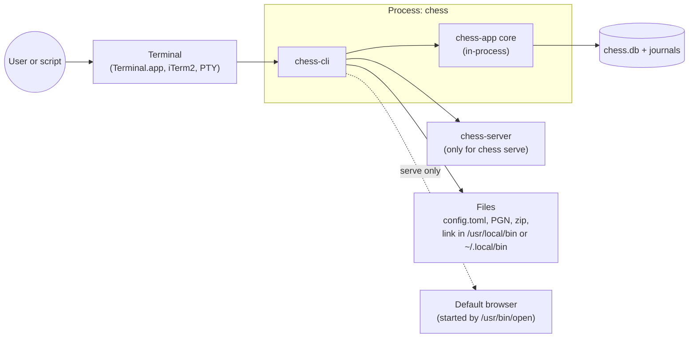
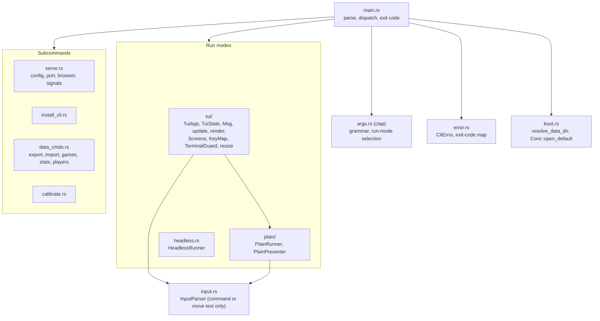
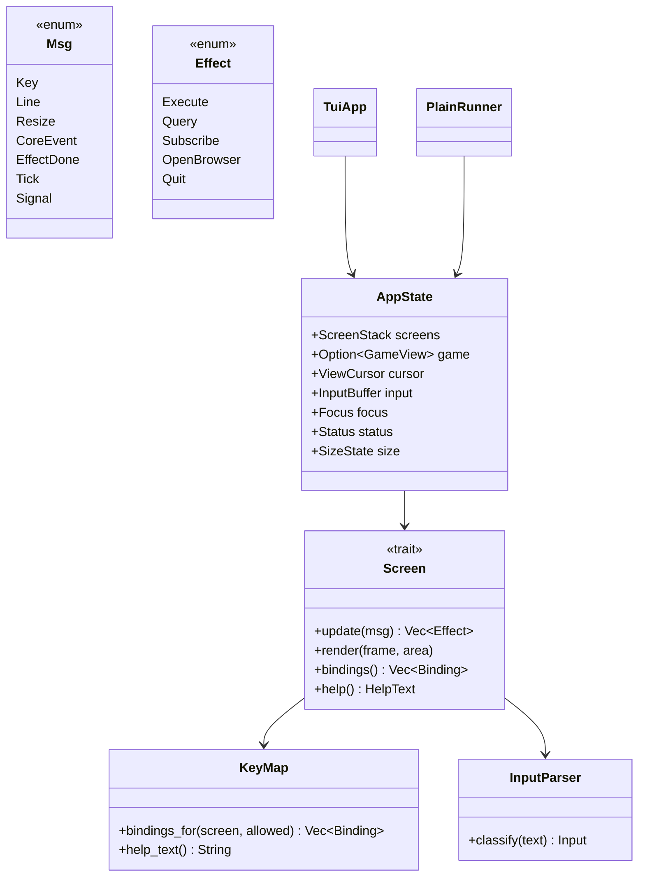
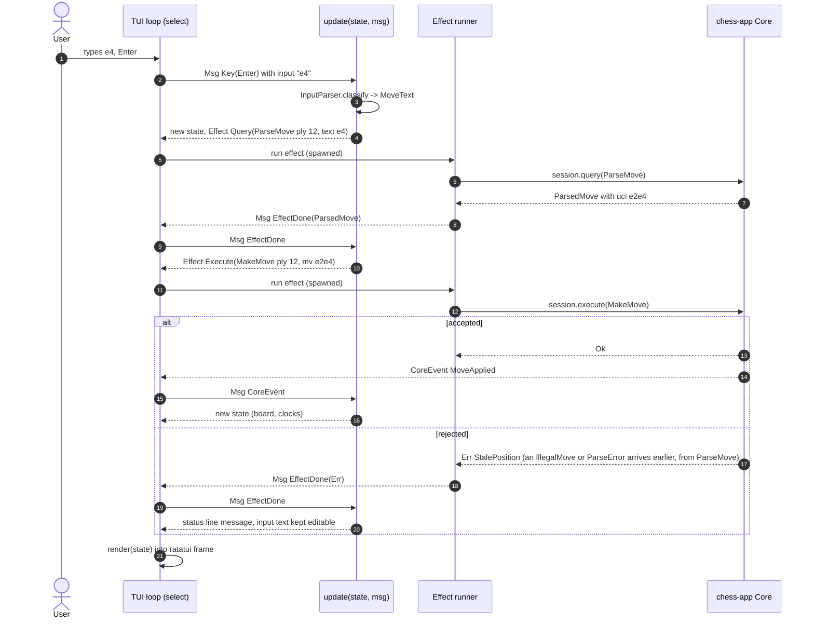
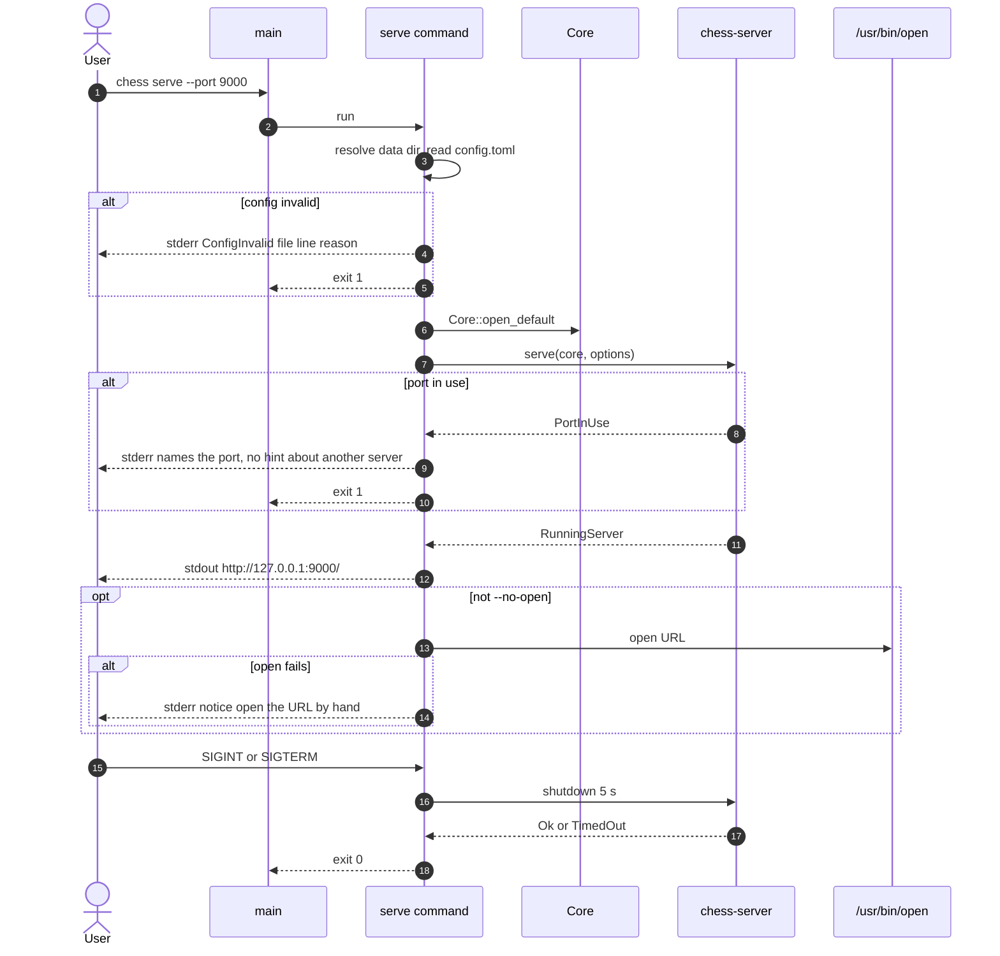
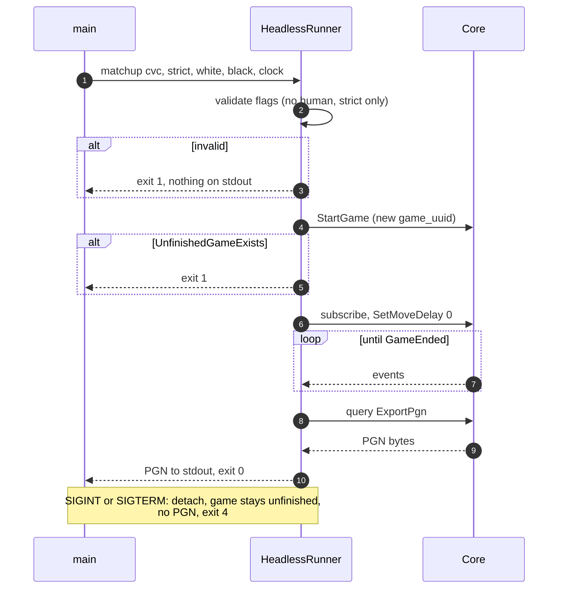
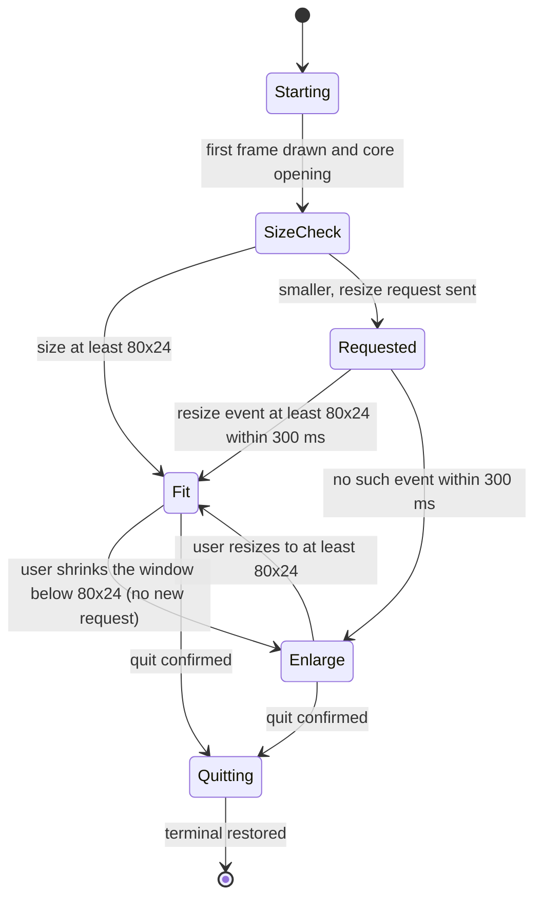

# SDD-chess-cli: Software Design Description for `chess-cli` (the `chess` binary)

| Field | Value |
|---|---|
| Document | docs/design/SDD-chess-cli.md |
| Version | **1.0 BASELINED** (2026-11-05; supersedes 0.4.5 DRAFT) (0.4.4 DRAFT, 0.4.3 DRAFT and 0.4.2 DRAFT of 2026-11-05 and 0.4.1 DRAFT and 0.4 DRAFT of 2026-11-04, 0.3.1 DRAFT of 2026-11-01 superseded; 0.2 DRAFT and 0.1 DRAFT were 2026-10-31 and 2026-10-30) |
| Date | 2026-11-05 (v0.4.1: 2026-11-04) |
| Status | **BASELINED v1.0** (2026-11-05; was DRAFT v0.4.5, 2026-11-05; v0.4 carries architecture Amendment 8 and Addenda D and E into this crate, see section 13c). Baselined at v1.0 by Brian Prascher (G2), 2026-11-05, with G1 desk reviews as recorded in the Gate record; conditions open per the 1.0 change-log row. No code exists yet. v0.2 applied the architect's triage rulings that Brian Prascher approved on 2026-10-31; v0.3 aligns to architecture Addendum A (D-51 to D-58) and D-59; v0.3.1 aligns to addendum B and C (D-60 to D-62, agreed 2026-11-01) (see section 13c). Exit status of TUI and plain-mode signals and of non-headless subcommands is **open** (TBD-36) |
| Owner | Software engineer role (Claude), for Brian Prascher |
| Approver | **Baselined at v1.0 by Brian Prascher (G2), 2026-11-05 (tracker chess-a0r.1.53, decision recorded); G1 desk reviews as recorded in the Gate record; open conditions are listed in the 1.0 row of the change log. No other approval is claimed.** *Earlier status, kept as history and superseded by the preceding sentence:* **Pending.** Gate G0 for this document (documents only). The implementation is G1 (System-architect agent, desk review) while it stays inside this crate with the §3.2 edges and §5.7 contracts unchanged. Command names and exit codes become a scripting contract after release (D-36); changing them then is G3 (SWE-001 §3). The decisions this version implements were approved by Brian Prascher on 2026-10-31 (triage section 5, requirements CR-9.1); that approval does not approve this document |
| Gate record | **1.0 BASELINE, 2026-11-05: G2 acceptance by Brian Prascher, chess-a0r.1.53 (OQ-APP-015 option B, D-89; baseline v1.0 of the eight readiness-checked SDDs in docs/engineering/readiness-step2-3.md, verdict READY-WITH-CONDITIONS; conditions open as listed in the 1.0 change-log row; residual risk FIND-R23-015, lightly reviewed text, accepted by Brian). The fix-pass text applied after the G1 limited re-review (docs/design/SDD-G1-rereview-2026-11-05.md) was not independently re-reviewed.** *Earlier record, kept as history:* G0 for the document, status DRAFT. **Version 0.4 is G1 (text)**: it designs the front-end behaviour of decisions already made (D-71, D-80, D-82) and corrects text that contradicted them. It carries one G3 decision **already ruled by Brian Prascher** (exit class 3 for `DurabilityUnsupported`, accepted 2026-11-04, beads chess-a0r.1.30) and decides nothing at G2 or G3 itself. D-78, DAT-3 and time totals are not touched. The gate record is filed by the gate register (SWE-001 ASM-S5); no gate ID is written here (XC-30). Not filed here **Versions 0.4.4 and 0.4.5 are G1 (text)**: 0.4.4 applies architecture D-89 (Addendum G) to DD-CLI-014; 0.4.5 applies the G1 desk re-review findings of `SDD-G1-rereview-2026-11-05.md` (work order CR-4 T-B reopen 1). The re-review is a recommendation, not an approval; the text of 0.4.5 has had no independent review. Rulings applied in these versions: D-89 and D-80, D-82 as before |
| Allocation name (architecture §2.2) | `CLI front-end` |
| Crate / path | `crates/chess-cli`, binary `chess` (architecture §3.1) |
| Runs in | Process: `chess` and Process: `chess serve` |
| Languages | Rust 1.99.1, edition 2024 |
| Sibling SDDs | [chess-server](SDD-chess-server.md), [chess-app](SDD-chess-app.md), [chess-domain](SDD-chess-domain.md) (`BoardGrid`), [chess-rules](SDD-chess-rules.md) (the only typed-move parser, reached through `Query::ParseMove`), [chess-store](SDD-chess-store.md), [chess-engine](SDD-chess-engine.md), [ui](SDD-ui.md), [desktop-tauri](SDD-desktop-tauri.md) |

Evidence tags per `swe-governance` §6. `[OBS architecture.md §n]` = read in this session. `[UNV]` = not verified (no code, toolchain or network used). `ESTIMATE` = no measurement.

---

## 1. Introduction

### 1.1 Purpose and scope

`chess-cli` builds the `chess` executable. It is the front-end block `CLI front-end`: it parses the command line, creates the shared core in-process, and drives it in one of three run modes (full-screen TUI, plain line mode, headless), or runs a subcommand (`serve`, `install-cli`, `export`, `import`, `games`, `stats`, `players`, `calibrate`). It renders snapshots and sends intents. It holds no rules: legality, policy, clocks and ratings are the core's (architecture §1 principle 1).

In scope: argument grammar, run-mode selection (D-19), the TUI (state, update, render, key map, terminal hygiene, resize), plain mode, headless mode and exit codes (D-36), `serve` lifecycle (config, port, browser, signals), `install-cli`, data commands, `calibrate` entry.

Out of scope: protocol, services and error mapping (chess-app); the HTTP and WebSocket server (chess-server); the `BoardGrid` renderer (chess-domain, reached through the curated `chess-app` re-exports); typed-move parsing (chess-rules, reached through `Query::ParseMove`; this crate has no matcher and no `Position`, D-45); the GUI.

The CLI is a front-end of the facade rule (decision 1, TR-1, D-38): its only workspace dependencies are `chess-app` and `chess-server`.

### 1.2 Allocated requirements, functions and decisions

| Kind | IDs | Source |
|---|---|---|
| Primary requirements | CLI-1, CLI-2 (rendering), CLI-3, CLI-4, CLI-5, PLAT-6 (`install-cli`), PLAT-4 (`chess-cli serve -> chess-server`; this SDD owns the command half, [SDD-chess-server](SDD-chess-server.md) the bind and stop half) | [OBS architecture.md §10.1 rows CLI-1..CLI-5, PLAT-4, PLAT-6] |
| Supporting requirements (wording per XC-29 and architecture 10.1 Amd 7: the component named in 10.1 is primary, any other claim is supporting) | PLAT-1, UI-2, UI-3 (CLI styles), UI-4 (plain mode), UI-9 (help from `KeyMap`), UI-12 (Ctrl-C dialog), NFR-1 (CLI start under 1 s), NFR-5, NFR-8, NFR-9, PLY-2 and PLY-3 (profile chooser), GAME-1, GAME-2, GAME-3, GAME-4 (screens), ENG-5 (`movenow`, F2), IF-1 and IF-2 and DAT-2 (data commands), RISK-2 (`--data-dir`) | [OBS architecture.md §3.3, §10.1] |
| Functions | **F-7.1.1** Render TUI screens; **F-7.1.2** Accept typed moves and commands; **F-7.1.3** Plain mode; **F-7.1.4** Scripted headless game; **F-7.1.5** Safeguard terminal state; **F-7.3.1** statistics and charts, **F-7.3.2** help, **F-7.3.3** error messages, **F-7.3.4** profile, setup and settings screens (the CLI realisation of each); **F-2.5.6** Rewind (CLI part); **F-8.1** Launch entry point (the launches of `chess` and `chess serve`, which are one binary; the desktop launch is claimed by [SDD-desktop-tauri](SDD-desktop-tauri.md); CR-9.7); **F-8.2** Start local web server, the CLI half (flags, configuration read and its errors, port precedence, URL, browser open, signal handling, exit status; the server half is in chess-server; CR-9.7, Q-SE-16); **F-8.11** Link command onto PATH; **F-3.9** calibrate (the subcommand code; the nightly job is `CI checks`) | [OBS functional_decomp.md lines 103, 178-195, 210, 219; architecture §2.1 note] |
| Decisions | D-6 (ratatui, Elm style), D-8, D-18 (install layout), D-19 (mode selection), D-24 (config), D-36 (grammar, exit codes, serve lifecycle), D-37 (CLI Elo chart), D-14 and D-27 (resume), D-33 (in-play rules), **Amendment 7:** D-38 (facade and edge rule), D-39 (temp-dir store in tests), D-45 (typed moves by query), D-48 (sessions, recovery mode), D-49 (files by path for the CLI), D-50 (wire value types), **Addendum A:** D-51 and D-52 (`ParseMove` errors, `ParsedMove`), D-55 (`ExportedFile`, `ExportWriteFailed`), D-56 (profile switch), D-57 (calibration owner), D-59 (ECO import question, accepted) | [OBS architecture.md §11] |
| Risks / assumptions | R-6 (TUI vs screen readers, terminal state), R-7 (glyph widths), R-16 and ASM-4 (resize), ASM-5 (macOS facts for `install-cli`) | [OBS architecture.md §12, §14] |
| Use cases | UC-1 (install, the CLI part), UC-4 (the CLI part), UC-22 to UC-25 (data commands), UC-27 (headless) | [OBS use_cases/README.md] |

### 1.3 Inputs read

SDD-architect-triage.md section 2 (TR-1, TR-2, TR-8) and section 5; SDD-SE-desk-answers.md Q-SE-12 to Q-SE-17, Q-SE-23, Q-SE-25; requirements.md Amendment 7 (CR-9.1, CR-9.5, CR-9.6); architecture.md (amended 2026-10-31) §1, §2, §2.1 (calibration note), §2.2, §3, §4.3 to §4.8, §5.1 to §5.7, §6.1 (all), §7.1, §8, §8.2, §9, §10.1, §11, §12, §14. functional_decomp.md F-7.1, F-7.3, F-8.x rows. requirements.md CLI-1 to CLI-5, PLAT-4, PLAT-6, GAME-1, GAME-2, UI-1, UI-3, UI-4, UI-9, UI-12, NFR-1. test-strategy.md. SWE-001.

### 1.4 Conventions

`DD-CLI-n` entities, `IFP-CLI-n` / `IFR-CLI-n` interfaces, `UT-CLI-nn` / `CT-CLI-nn` / `E2E-CLI-nn` planned tests, `UF-CLI-n` upstream findings (section 13), `ASM-CLI-n`, `IA-CLI-n` (assumption about another block's interface, section 6.3), `RAT-CLI-n` rationale, `OQ-CLI-n` open questions. ID format (XC-30): IDs issued in v0.1 are unchanged; IDs added from v0.2 use three digits (`UF-CLI-012`, `UT-CLI-013`).

---

## 2. Viewpoint selection

| Viewpoint | Used? | Where | Reason if omitted |
|---|---|---|---|
| Context | Yes | 3.1 | |
| Composition | Yes | 3.2, 4 | |
| Logical | Yes | 3.3 | |
| Dependency | Yes | 3.4 | |
| Information | Omitted | | Persistent data belongs to chess-store. The CLI owns two small files only: the PGN or zip it writes on request, and the symlink from `install-cli`. Both are specified under DD-CLI-9 and DD-CLI-11 |
| Patterns use | Yes | 3.5 | |
| Interface | Yes | 6 | |
| Structure | Yes | 3.2 | |
| Interaction | Yes | 3.6 | |
| State dynamics | Yes | 3.7 | |
| Algorithm | Yes | 3.8 | |
| Resource | Yes | 8 | |

---

## 3. Viewpoints

### 3.1 Context

**Concern:** what the CLI talks to.



### 3.2 Composition and structure

**Concern:** modules, layering, and which entity owns which concern.



(The last arrow means the plain presenter and the TUI share the same `AppState` and `update`; see DD-CLI-3.)

| Entity | Type | Purpose | Traces |
|---|---|---|---|
| DD-CLI-1 `args` | module | Command grammar and the D-19 run-mode rule | CLI-4, D-19, D-36 |
| DD-CLI-2 `boot` + `error` | modules | Data-directory resolution call, `Core::open_default`, error to exit-code mapping (headless fixed, others placeholder) | CLI-5, D-36, NFR-1 |
| DD-CLI-3 `App` (state, `Msg`, `update`, effects) | module, pure | Front-end-neutral Elm core shared by TUI and plain mode | D-6, CLI-1, NFR-8 |
| DD-CLI-4 TUI renderer and `Screen`s | module | ratatui widgets, `BoardWidget`, screens | CLI-1, CLI-2, UI-3, F-7.1.1 |
| DD-CLI-5 `InputParser` and `KeyMap` | module | Text to command or move; key bindings and generated help | CLI-3, CLI-4, UI-9, F-7.1.2 |
| DD-CLI-6 `TerminalGuard`, resize, signals | module | Terminal hygiene and the 80x24 rule | CLI-1, R-6, R-16, F-7.1.5 |
| DD-CLI-7 `PlainRunner` and `PlainPresenter` | module | Line-oriented mode | CLI-1, UI-4, F-7.1.3 |
| DD-CLI-8 `HeadlessRunner` | module | Scripted c-c game, PGN on stdout, exit status | CLI-4, CLI-5, F-7.1.4, UC-27 |
| DD-CLI-9 `serve` command | module | Config, port, bind via chess-server, URL, browser, signals | PLAT-4, F-8.2, F-8.12 (caller) |
| DD-CLI-10 Data commands | module | `games`, `export`, `import`, `stats`, `players` | IF-1, IF-2, DAT-2, UC-22..25 |
| DD-CLI-11 `install_cli` | module | Link `chess` onto `PATH` and remove it | PLAT-6, F-8.11 |
| DD-CLI-12 `calibrate` | module | Dev subcommand entry and data-dir guard; calls the app calibration run (D-57) | F-3.9, ENG-2, R-17 |
| DD-CLI-013 ECO mismatch prompt | module + `Screen` | The ECO question of an import: TUI screen, plain-mode prompt, `--eco` option, non-interactive refusal (D-59) | IF-2, DAT-3, UI-4, UI-12 |

### 3.3 Logical viewpoint (key types)

**Concern:** the main types, matching the names in architecture §3.3 [OBS]: `TuiApp`, `Screen`, `BoardWidget`, `InputLine`, `KeyMap`, `PlainRunner`, `InputParser`.



### 3.4 Dependency viewpoint

Allowed workspace edges [OBS architecture.md 3.2, Amendment 7]: `chess-cli -> chess-server` and `chess-cli -> chess-app`, and nothing else (decision 1, TR-1, D-38). There is **no** edge to `chess-domain`, `chess-rules`, `chess-engine` or `chess-store` (ED-2, ED-3, ED-5, ED-6, ED-7 rejected). Third-party edges named in 3.2: `ratatui` + `crossterm` and `toml`, and `clap` (D-21). Versions from architecture 3.4: `ratatui` 0.30.2, `crossterm` 0.29.0, `toml` 1.1.8, `tokio` 1.54.1, `tracing` 0.1.44, `thiserror` 2.0.21 [OBS]. `clap` and `futures-util` are admitted in principle with **no version stated; lookup pending `[UNV]`** (TR-10, D-47).

| Need | How it is met | Note |
|---|---|---|
| `BoardGrid`, `BoardStyle`, `BoardView`, `Cell`, `Shade`, `Highlight`, `Orientation` | named `pub use` items of `chess-app` (the curated list, no glob re-exports; architecture 3.2 item 3, FIND-JR-005); `BoardGrid::from_fen(fen, &BoardView, style, orientation)`, so no `Position` | TR-1 items 3 and 6; the list is checked by FF-1 |
| Calibration run | `chess_app::calibration` (the run function, `CalibrationPlan`, `CalibrationReport`; names proposed in architecture 3.2 item 3, D-57) on a `Core` from `Core::open_for_calibration`; `chess calibrate` only calls it | D-57 |
| Test `Core` | `chess-app` feature `test-support`: `Seams`, `Core::open`, the `FakeEngine` factory and a temp-directory `Core` helper (architecture 3.2 items 3 and 4) | dev-dependency feature, no new edge; UF-CLI-013 |
| Typed moves | `Query::ParseMove` through the session; no matcher here | TR-8, D-45 |
| Data directory | `chess_app::resolve_data_dir(flag, env)`; production wiring by `Core::open_default` | TR-1 item 5 |
| `game_uuid` | `chess_app::new_game_uuid()`; no `uuid` dependency here | TR-1 item 5 |
| Command and wire value types | the curated list of `chess-app` (`GameSetup`, `Mode`, `Matchup`, `ClockSpec`, `Category`, `Preferences`, `GameId`, `PlayerId`; IFP-APP-06) | UF-CLI-012 (resolved) |
| Command-line parsing | `clap` | admitted in principle, D-21 |
| Signals | `tokio::signal::unix` for SIGINT, SIGTERM, SIGHUP, SIGCONT. `signal-hook` is **not used** (rejected). Raising SIGTSTP on Ctrl-Z is **pending the architecture's file-lock spike (OQ-14, review row D-7)**: the standard library if enough, a safe wrapper crate only if not, `libc` last with one documented `unsafe` module (architecture 3.4 and the §6.1 loop diagram, `tokio::signal::unix`). Until the spike reports, this design assumes nothing about the mechanism | UF-CLI-9 |
| Opening the browser | `std::process::Command` on `/usr/bin/open` (macOS) | No `open` crate. Path absolute so `PATH` cannot redirect it (CERT ENV-intent). The file exists on this Mac [RAN `ls -l /usr/bin/open` -> present, 2026-10-30] |
| `futures` stream for crossterm `EventStream` | `crossterm` feature `event-stream` plus `futures-util` | feature name `[UNV]`; `futures-util` admitted in principle (review row D-17) |

Code policy: `#![forbid(unsafe_code)]` in this crate, unless the SIGTSTP spike shows that one documented `unsafe` module is needed. If any `unsafe` proves necessary it needs a `// SAFETY:` comment and a note here (SWE-001 §6).

### 3.5 Patterns use

| Pattern | Where | Why | Misuse tell |
|---|---|---|---|
| Elm architecture (model, update, view) | DD-CLI-3 | D-6; `update` unit-testable without a terminal | `update` calling I/O or awaiting |
| Command/effect objects | `Effect` | I/O is requested, performed by the shell, results return as `Msg` | A screen awaiting a core future |
| Strategy (two views over one model) | TUI `render`, plain `PlainPresenter` | One behaviour for both modes, one test set | Plain mode with its own copy of game logic |
| RAII guard | `TerminalGuard` | Restore on every exit path | Manual restore calls in many places |
| Table-driven bindings | `KeyMap` | Help generated from the same table, drift impossible (UI-9) | A binding added outside the table |
| Functional core, imperative shell | whole crate | architecture §1 principle 2 | |

### 3.6 Interaction (sequences)

**Concern:** the three flows that cross a boundary: a typed move in the TUI, `chess serve` start and stop, and a headless run.







### 3.7 State dynamics

**Concern:** terminal-size handling (CLI-1, R-16) and the TUI's top-level phases.



Rules: the resize request is sent at start and again only after the terminal was at least 80x24 and has become smaller on a resize event **that follows a size we changed ourselves**; it is never repeated while in `Enlarge`, so the TUI does not fight a user who shrinks the window on purpose (architecture §6.1 point 3 [OBS]). "Within 300 ms" is the architecture's `ESTIMATE`; CLI-1 allows 1 s (EST).

### 3.8 Algorithm viewpoint

**A1. Run-mode selection (D-19, ordered).** Input: argv, `isatty(stdin)`, `isatty(stdout)`.

1. `--headless`, or top-level setup flags (`--matchup`, `--white`, `--black`, `--clock`, `--mode`) with **no subcommand** -> Headless.
2. `--plain`, or stdin or stdout not a terminal -> Plain.
3. Otherwise TUI. `chess play [setup flags]` opens the TUI pre-filled (and Plain if rule 2 applies).

Headless then validates: matchup must be `cvc` (or absent with two computer names), mode must be Strict (absent means Strict), both `--white` and `--black` given, no name that resolves to a human Player. Violations: exit 1, nothing on stdout, message on stderr [OBS §6.1, CLI-4 (a) to (e)]. No setup flag is added beyond CLI-4, CLI-1 and PLAT-4 (TBD-36). A human name is detected after `ListPlayers` by `kind == human`.

**A2. Config and port resolution for `serve` (PLAT-4, D-24).**

```
config_path = --config | $CHESS_CONFIG | <data_dir>/config.toml     (flag over env over default; order of the first two is ASM-CLI-2)
if config_path is the default and does not exist  -> defaults
if config_path is explicit and cannot be read     -> ConfigInvalid (exit 1)
parse TOML. error -> ConfigInvalid{file, line, reason}  (line from the parser's span)
server.port: integer in 1..=65535 else ConfigInvalid
unknown keys -> warning on stderr, parsing continues
port = --port | server.port | 8765
--port is validated as 1..=65535 by clap (value parser). 0 is a usage error.
```

Never a silent fallback to a default on error [OBS PLAT-4]. `config.toml` is hand-edited and read-only: nothing in the CLI or the core writes it (Q-SE-15, AMD-9, UF-CLI-8); its keys and errors are documented under NFR-5.

**A3. Exit-code map (CLI-5, D-36).** Two parts with different status.

*Fixed (headless runs, CLI-5, TBD-21 closed).* 0 result reached; 1 usage or setup error; 2 engine unavailable; 3 store error; 4 stopped by a signal. `chess serve` exits 0 on SIGINT or SIGTERM and 1 on a bind or configuration error (PLAT-4, D-36).

*Open (TBD-36, deferred by Brian Prascher 2026-10-31, CR-9.6).* The exit status of the TUI and plain mode on SIGTERM and SIGHUP, the exit status of the non-headless subcommands (`install-cli`, `games`, `export`, `import`, `stats`, `players`, `calibrate`) and any setup flag beyond CLI-4, CLI-1 and PLAT-4 are **not decided**. The SE proposal (Q-SE-17: signal stop exits 4, subcommands reuse 0, 1, 2, 3, no new flags) is not adopted. (`DurabilityUnsupported` is the one exception: class 3 in every run form, below.) This design uses it as a **placeholder, `ESTIMATE`**: it is not written into help text or README, no test asserts it, and no code is added or changed in meaning. Tests of those paths assert the visible effect (terminal restored, game suspended, nothing written to stdout) and not the number.

**`DurabilityUnsupported` (D-71; Addendum E).** Exit **class 3** (store error) is **accepted by Brian Prascher, 2026-11-04 (G3, public exit classes; beads chess-a0r.1.30)**. No new code number is added. In a headless run and in `chess serve` the value is fixed (CLI-5, PLAT-4). Brian's ruling of 2026-11-04 is that **exit class 3 applies for this one code in every run form: headless, `chess serve`, the TUI, plain mode and the other subcommands** (RR-S-4; it is confirmed there, not a placeholder). It is a decision about this code only. **TBD-36 is not narrowed**: it still covers the exit status of signal stops in the TUI and plain mode, the classes of the other catalogue codes on the non-headless paths and any setup flag beyond CLI-4. There is no option, flag or environment variable that overrides the refusal (a new flag would be public surface, G3).

Mapping of the catalogue code (architecture 5.5) to the placeholder class, used by `exit_code` for headless runs (fixed) and, until TBD-36 closes, for everything else (placeholder), with one exception: `DurabilityUnsupported` is class 3 in every run form (Brian, 2026-11-04):

The table lists **every code of the architecture 5.5 catalogue** (FIND-JR-016), including `ParseError` of both kinds, `MalformedFrame` and `ExportWriteFailed` (Addendum A). UT-CLI-08 asserts that every catalogue code has a row.

| Catalogue code | Class |
|---|---|
| `ValidationFailed`, `UnfinishedGameExists`, `NotFound`, `ConfigInvalid`, `ParseError{kind: Pgn\|Fen}`, `ParseError{kind: move}`, `IllegalMove`, `StalePosition`, `NothingToTakeBack`, `PlayerHasUnfinishedGames`, `ConfirmationRequired` (refused without `--yes` or a human), `Denied`, `ImportConflicts` (non-interactive; for an `eco_mismatch` without `--eco` the exit is 1 with the list, OQ-ECO-1, D-59), `Busy`, `GameLeased`, `ExportWriteFailed` | 1 |
| `EngineUnavailable` | 2 |
| `StoreUnavailable`, `StoreBusy`, `StoreCorrupt`, `StoreMissing`, `SchemaTooNew`, `DurabilityUnsupported` (D-71; class 3 accepted by Brian, 2026-11-04, in every run form, not a placeholder), `BackupFailed`, `OtherVersionRunning`, `ImportInvariantFailed`, `JournalWriteFailed`, `JournalUnreadable`, version-refusal | 3 |
| `MalformedFrame`, `ProtocolMismatch` | not reachable in process (no socket); if one ever appears it is an `Internal` class 3 |
| `LeaseLost` (an event, not a returned error) | no exit class; the screen drops to read-only (section 7) |
| signal (SIGINT, SIGTERM, SIGHUP) | 4 (fixed for headless; placeholder for TUI and plain mode) |
| `Internal{id}` | 3, with the id printed (ASM-CLI-4) |

The classes of `ExportWriteFailed`, `IllegalMove`, `StalePosition`, `NothingToTakeBack`, `PlayerHasUnfinishedGames` and `ConfirmationRequired` are placeholders under TBD-36 (no headless run reaches them). TBD-36 stays open for signals, the non-headless subcommands and setup flags.

**A4. Typed-input classification (CLI-3, CLI-4; D-45).** `InputParser::classify(text)` decides only command or move text:

1. trim; empty -> `Empty`.
2. if the first token equals a command word in the table (`help resign draw undo movenow analyze back forward live save flip moves history quit`) and the rest is empty or valid arguments -> `Command`.
3. otherwise the text is a move candidate -> `MoveText`. `update` emits `Effect::Query(ParseMove{game_id, ply, text})` with the live ply, on Enter only (not per keystroke; the typed characters are echoed locally, Q-SE-6). The reply returns as `Msg::EffectDone`:
   - `ParsedMove{uci, san}` (D-52; no `Move` object on the wire) -> `Effect::Execute(MakeMove{game_id, ply, mv: uci})`;
   - `IllegalMove{reason}` -> the `message` and `reason` in the status line, text kept editable; nothing is sent;
   - `ParseError{kind: move, reason, ...}` (D-51) -> the `message` (an English sentence built by the core from `reason`) and, by `reason`: `ambiguous`: the `candidates` listed (canonical SAN of each match) with "type one of these"; `promotion_required`: the `choices` strings listed as given; `lowercase_piece`: "did you mean <suggestion>?" with the `suggestion` text as given; `empty`, `too_long`, `syntax`: the message only. The text stays editable and nothing is sent. The CLI does not interpret `choices`, `candidates` or `suggestion`; it prints them (one mapping, made once in `chess-app`, so the GUI shows the same text);
   - `StalePosition{live_ply}` -> refresh from the snapshot, text kept.
4. `abort` in a human game is not a command word, so it falls to step 3 and is rejected as neither a command nor a move [OBS CLI-4 verification].

There is **no matcher, no SAN grammar and no `Position` in this crate**. `chess-rules` is the only parser (TR-8, D-45): the either-case files, the optional `+ # x`, `0-0` and the Q44 bishop/b-file rule live there and in the query. A command word cannot collide with a move because step 2 takes the command word first only when the whole token equals it, and `b4` is never a command. Test UT-CLI-05 enumerates every command word, asks the real parser through the query over a set of positions, and fails if any command word is accepted as a move (it runs as a component test, since the parser is not in this crate).

**A5. Key routing (CLI-4).** A key event is looked up in `KeyMap` first; a printable character always goes to the input line. Bindings are only keys that cannot begin a move: Left/Right (rewind), End (live), PgUp/PgDn, F1 (help), F2 (move now), Tab, Esc, Ctrl-C, Ctrl-Z. The Watch screen has no input line and uses plain keys (Space, `s`, `+`/`-`, `a`) [OBS §6.1]. A binding that the mode policy disallows (not in `allowed_actions`) is shown unavailable and its key explains why instead of acting.

---

## 4. Design entities

### DD-CLI-1 `args` (clap grammar)
- Traces: CLI-4, CLI-5, D-19, D-36, PLAT-4, PLAT-6.
- Global option: `--data-dir <path>`. Run-mode flags: `--plain`, `--headless`, `--no-color`. Setup flags at top level and on `play`: `--matchup`, `--mode`, `--white`, `--black`, `--clock`; `play` also `--player <name>`. These names appear in architecture §6.1 and CLI-4 [OBS]. `--clock 5+0` is **minutes plus seconds** (Q-SE-25, XC-23), parsed to `ClockSpec::from_minutes_plus_seconds(m, s)`; the help text says so (UI-9, NFR-5). Other setup fields of GAME-1 (colour, start position) would need flags that the architecture does not name; none is added (TBD-36, UF-CLI-5).
- Subcommands: `play`, `serve [--port <n>] [--no-open] [--config <path>]`, `install-cli [--remove]`, `stats [player]`, `players`, `games`, `export game <game> [--output <file>]`, `export data --output <file.zip>`, `import pgn <file> [--on-duplicate skip|keep] [--eco keep-pgn|keep-table]`, `import data <file.zip> [--yes] [--eco keep-pgn|keep-table]` (`--eco`: D-59, DD-CLI-013), `calibrate` (hidden from `--help`, RAT-CLI-6). Bare `chess export` and `chess import` print the four forms and exit 1 [OBS §5.7].
- `--help` and `install-cli` run before any runtime or core exists, so they never open the store or start the engine [OBS §6.1].
- Failure behaviour: clap usage errors map to exit 1 (clap's default usage exit is 2, which would collide with "engine unavailable", so the default is overridden: `Command::try_get_matches` and mapped by `main`). Messages on stderr.
- Verification: UT-CLI-01 (grammar table), CT-CLI-01 (usage errors).

### DD-CLI-2 `boot` and `error`
- Traces: NFR-1, CLI-5, D-36, RISK-2.
- `boot::open_core(flags)`: resolve the data directory with `chess_app::resolve_data_dir(flag, env)` (IA-CLI-1), which returns a `DataDirChoice` (path and source) in the order `--data-dir`, `CHESS_DATA_DIR`, default `~/Library/Application Support/Chess/` [OBS §7.1]; call `Core::open_default(CoreConfig)`, which builds the production engine factory, system clock and random source inside `chess-app` (TR-1). The CLI builds no seams and does not create directories itself (the core creates it `0700` with the roster). `Core::build_info()` supplies the version text for `--version`.
- `CliError` wraps `ProtocolError`, `ConfigInvalid`, `Usage`, `Io`, `Signal`. `thiserror`. One `exit_code(&CliError) -> u8` function holds table A3 and is unit-tested exhaustively over the catalogue codes; the headless values are fixed, the rest are the TBD-36 placeholder.
- Output discipline: only PGN or requested data goes to stdout; every message goes to stderr [OBS CLI-5].
- Startup budget (NFR-1, CLI under 1 s): `main` draws the first TUI frame (a "starting" screen) **before** `Core::open_default` completes; `Core::open_default` runs as an effect; the engine starts lazily and never during start-up [OBS §6.1, §4.7].
- Failure behaviour: `Core::open_default` yields a `Core` that is Ready or in recovery mode (UR-31). In recovery mode (`StoreMissing`, `StoreCorrupt`) the TUI and plain mode offer the recovery flows (`CreateFreshStore`, `RestoreBackup`, `ApplyDataImport`) and headless prints the message and ends with the store-error class. `SchemaTooNew`, `BackupFailed`, `DurabilityUnsupported`, `OtherVersionRunning` and a version refusal return no `Core`: the catalogue message goes to stderr; on a terminal `BackupFailed` offers Retry (call `open` again) or Exit. The exit class is A3.
- **`DurabilityUnsupported{path, errno}` (D-71, architecture 5.5 and 7.1; Addendum E).** The store found that the data directory is on a volume where `fcntl(F_FULLFSYNC)` fails (`ENOTSUP` or `ENOTTY`) and refused it before writing anything, so a move could be lost in a power cut and NFR-2 cannot be promised. The CLI restores the terminal first if the TUI had started (the alternate screen would hide the text), prints to stderr, and exits **3** (A3). It never offers "continue anyway", never retries, and has no flag to override. The text has three parts: the **path** (from the code's `path` field, printed with non-printable characters escaped), the **reason** ("this folder is on a volume that cannot guarantee that a move survives a power loss", architecture 7.1) and the **way out** (choose another folder with `--data-dir <folder>` or the `CHESS_DATA_DIR` environment variable, then start Chess again). The `errno` is not shown as text (it goes to the diagnostic log with identifiers only, NFR-10); the store's `Display` carries the category only, so the path comes from the field, not from a formatted error string (store 3.11.5, NFR-9). The wording is this design's proposal, like the other messages; the three parts are required, the sentences are not. Verification: UT-CLI-08 (row exists, class 3), UT-CLI-017, E2E-CLI-22.

### DD-CLI-3 `App`: state, messages, `update`, effects
- Traces: D-6, CLI-1, NFR-8, GAME-3, F-7.1.1..F-7.1.3.
- `AppState` is plain data. `Msg` carries every input: key, line, resize, core event, effect result, tick, signal. `update(&mut AppState, Msg) -> Vec<Effect>` does no I/O, no clock reads (time arrives in `Tick` and event payloads) and no `await`. `Effect` values are executed by the shell, which spawns them and returns results as `Msg::EffectDone` [OBS §4.8 "Effects are spawned, and results come back as Msgs"].
- Game view state: the last `GameSnapshot` (it carries `legal_moves` as `[{uci, san}]` for the current ply and `allowed_actions` as a list of action kinds, XC-21), a `ViewCursor` (live or ply n) for rewind, and local clocks. Rewind is client-side only: Left/Right/End and `back`/`forward`/`live` move the cursor, input to the game is disabled while rewound, and a `MoveApplied` that arrives while rewound sets the "live position has changed" badge (GAME-3, [OBS §6.1]).
- Clocks: on `ClockSync` or any event carrying clocks the state stores `{white_ms, black_ms, running_side}` and the monotonic `Instant` of receipt; `Tick` (10 Hz) recomputes the display. The core alone decides flag falls; the display clamps at 0:00 [OBS §4.2].
- Controls offered come from `snapshot.allowed_actions`, never recomputed.
- Concurrency: one task owns `AppState`. No lock.
- Verification: UT-CLI-02..04 (update with synthetic `Msg`, no terminal), snapshot tests of render at 80x24 and larger.

### DD-CLI-4 TUI renderer and screens
- Traces: CLI-1, CLI-2, UI-3, UI-2, UI-5, F-7.1.1, F-7.3.1, D-37.
- `render(&AppState, &mut Frame)` is pure. It draws into ratatui's `TestBackend` in tests at fixed sizes [OBS §9].
- `BoardWidget` maps a `BoardGrid` (glyph, `Shade` and `Highlight` per `Cell`, from chess-domain via the curated `chess-app` re-exports) to ratatui styles. The grid is built with `BoardGrid::from_fen(fen, &BoardView, style, orientation)` from the snapshot's FEN, the `Orientation` and a `BoardView` whose `last_move` is UCI text, so the CLI needs no `Position` (TR-1 item 6, XC-12). Fixed three-column cell per square with padding (R-7). The style names are the domain's: `BoardStyle::Plain`, `Unicode`, `Ansi`, `NoColor` (CLI-2 text such as "light/dark squares" is a property of `Ansi`, not a fifth style). `NO_COLOR` (set and non-empty) or `--no-color` selects `NoColor` and emits no colour escape, and highlights then use reverse video or markers (colour independence, §8.3 [OBS]). The ASCII style switches panel borders to an ASCII border set.
- Screens (one `Screen` implementation each, §6.1 diagram [OBS]): ProfileChooser, Register, Home, NewGame, Play, Watch, Resume, Result dialog, EcoMismatch, PostGameAnalysis, LiveAnalysis overlay, Statistics, ComputerPlayers, GameHistory, ImportExport, Settings, Players, Help, Confirm dialog, EnlargeMessage. Forms use focusable fields with Tab/Shift-Tab and Enter.
- Profile switch (PLY-2, D-56): the ProfileChooser is reachable from Home only; the core refuses `SelectProfile` with `Denied{state_not_allowed, details.game_ids}` while the CLI's session has a game open, and the screen shows the message with the open games and offers to leave them (`DetachGame{game_id}`, then repeat). Plain mode prints the same message and asks `leave the game(s)? [y/N]`. `[INF]`: the architecture fixes the reply, not the screen.
- Fields the policy disallows are not offered (GAME-1). The Settings screen lists no board, piece or colour theme (UI-1 verification).
- Elo chart (D-37): ratatui `Chart` with a Braille marker plus a table of the latest points. In ASCII style (or no Unicode) a small pure renderer draws `*` and `.` on a character grid. **This crate owns the renderer** (UR-25, Q-SE-23, UF-CLI-7): the domain exports series data only (`rating_series`), reached through `StatsService` queries. The GUI chart is separate (UI-2).
- Empty and partial states: "no games yet", "—" averages, baseline point on the chart, "evaluating…" with "n of N plies evaluated" from `GetGameAnalysis` and `AnalysisProgress` [OBS §6.1].
- Layout: the 80x24 layout of §6.1 [OBS]. Minimum size is fixed at 80x24 and every screen is designed to fit.
- Verification: snapshot tests per screen, per style, per orientation; E2E-CLI via PTY.

### DD-CLI-5 `InputParser` and `KeyMap`
- Traces: CLI-3, CLI-4, UI-9, ENG-5, F-7.1.2.
- `InputParser`: algorithm A4. It separates command words from move text and nothing more. Move text is parsed by `Query::ParseMove` (IA-CLI-4, D-45), so CLI-3's rules (either-case files, optional `+ # x`, `0-0`, the Q44 bishop/b-file rule) have one implementation, in `chess-rules`, which the GUI reaches the same way. There is no CLI matcher and no TypeScript matcher.
- `KeyMap`: a static table of `Binding{ key, screen_scope, action, availability(allowed_actions) }`. Help text (F1, `help`) is generated from it. Tests: UT-CLI-06 every `KeyMap` entry appears in help (UI-9); UT-CLI-07 no binding consumes a character that can begin SAN or coordinate notation (CLI-4); F1 and F2 are bound.
- `movenow`: command word and F2 both produce `Effect::Execute(CancelEngine)`; offered only when `allowed_actions` contains it (an h-c game in `EngineThinking`) [OBS §4.4]. On a Mac laptop F-keys may need Fn, so the word always works.
- `save`: sends a round trip that goes through the session actor (so it sees every earlier command), checks the last move is durable, and prints "Game saved" with the stored move count. It changes nothing [OBS §6.1]. Which protocol call carries it is not defined (UF-CLI-4, OPEN).
- `resign`: the core returns `ConfirmationRequired`; the UI shows the dialog (in h-h first asks which side) and resends with `confirmed: true`. The same for abort (Watch, key `a`), archive, reset, apply import, restore backup. The CLI never skips the prompt and the core refuses it without `confirmed` [OBS §5.5].
- Verification: UT-CLI-05..08.

### DD-CLI-6 `TerminalGuard`, resize and signals
- Traces: CLI-1, F-7.1.5, R-6, R-16, ASM-4, UI-12 (Ctrl-C).
- `TerminalGuard::enter()` enables raw mode, the alternate screen and hides nothing else; `Drop` leaves the alternate screen, disables raw mode, shows the cursor and, if the TUI changed the window size, restores it. No mouse capture is ever enabled, so terminal text selection and copy keep working [OBS §6.1].
- Panic hook: `std::panic::set_hook` restores the terminal first, then runs the previous hook so the panic text prints on a sane screen.
- Resize (A: state diagram 3.7): the original size is read with `crossterm::terminal::size()` (the window-size ioctl, characters). The request is `CSI 8 ; 24 ; 80 t` written to the terminal. Restore sends `CSI 8 ; rows ; cols t` with the saved size, only if a resize we requested took effect. **This differs from the architecture text**, which records the original size with `CSI 18 t` [OBS §6.1]. The reply to `CSI 18 t` arrives in-band on stdin, where `crossterm` does not parse it; the ioctl gives the same number without parsing a reply. RAT-CLI-3. The request is written only when stdout is a TTY, and not inside tmux or screen (detected by `TMUX` or `STY` in the environment, or `TERM` starting with `screen`), where the architecture expects it to be ignored; there the enlarge message appears directly.
- Signals: SIGINT arrives as a **key** in raw mode (ISIG is off) and opens the Ctrl-C confirmation dialog, which is the TUI's own dialog widget (UI-12) [OBS §5.5, §6.1]. SIGTERM and SIGHUP (CLI-1 requires the terminal restored on both, and the architecture's loop diagram lists only SIGTSTP/SIGCONT: UF-CLI-2) are received through `tokio::signal::unix`, produce `Msg::Signal`, and the shell then restores the terminal and calls `Core::shutdown(deadline)`, which suspends the game (it stays unfinished, resumable). The **exit status of this path is open (TBD-36)**; the placeholder is 4, `ESTIMATE`, not a documented status. SIGTSTP is raised on Ctrl-Z: restore the terminal, raise SIGTSTP with the mechanism that the architecture's file-lock spike selects (OQ-14, review row D-7; pending; `signal-hook` is gone), the process stops, and on SIGCONT (received through `tokio::signal`) re-enter raw mode and redraw.
- Quitting (`quit` command or confirmed Ctrl-C): restore the terminal, `Core::shutdown(deadline)` (suspends the game; not a resignation, GAME-4), exit 0. **In a degraded session (D-80, DD-CLI-014) `Shutdown` is accepted and appends nothing**: no `Suspend` and no `Clock` record is written, so the game is left as an interrupted one and the next resume recovers it (D-58). The same holds for SIGTERM and SIGHUP. The exit status stays as above (TBD-36).
- `reset` advice for a terminal left bad after SIGKILL is in the help text (UI-9, CLI-1).
- Verification: E2E-CLI-03..07 (PTY): terminal restored after quit, confirmed Ctrl-C, injected panic, SIGTERM, SIGHUP (these assert the restored terminal and the suspended game, not the exit number, TBD-36); unconfirmed Ctrl-C leaves the game running; below-80x24 paths; original size restored.

### DD-CLI-7 `PlainRunner` and `PlainPresenter`
- Traces: CLI-1, UI-4, F-7.1.3, R-6, D-19.
- Same `AppState` and `update` as the TUI (DD-CLI-3). The `PlainPresenter` replaces `render`: after each update it appends to stdout only what changed: the board (from `BoardGrid`, text lines), the last move, clocks, the status or error line, and the prompt. Input is one line at a time, read with an async line reader and delivered as `Msg::Line` to the same `InputParser`.
- Clock lines: printed with each move and as warnings at fixed thresholds (60 s and 10 s, `ESTIMATE` examples from the architecture), never per tick [OBS §6.1].
- Opponent moves are printed as they arrive, even while the user is typing.
- Non-game screens (profile chooser, setup, statistics, ...) are shown as numbered lists with a prompt. Scope is settled: plain mode carries every interactive flow, as the use cases' channel lines say (CR-9.6 note, UF-CLI-10).
- Scripted human play: `chess play --plain --player <name> [setup flags] < moves.txt` [OBS §6.1]. Stdin end of file with the game unfinished is treated as `quit`: the game is suspended, exit 0 (ASM-CLI-3; the exit status is TBD-36). When the game reaches a result, the transcript ends with the result line and the game's PGN, then exit 0 (ASM-CLI-3, UF-CLI-10).
- `NO_COLOR` is honoured: plain mode never emits colour unless explicitly given an ANSI style.
- Verification: transcript tests via PTY and via pipe (`E2E-CLI-08`, `E2E-CLI-09`).

### DD-CLI-8 `HeadlessRunner`
- Traces: CLI-4, CLI-5, F-7.1.4, UC-27, RISK-2, D-36.
- Steps: validate (A1); `open_core` with `--data-dir`; resolve the two computer names via `ListPlayers`; `StartGame{game_uuid, GameSetup}` (new uuid from `new_game_uuid()`, Strict, clock from `--clock` as minutes plus seconds through `ClockSpec::from_minutes_plus_seconds`); subscribe; `SetMoveDelay{0}` to run at engine speed (ASM-CLI-5); wait for `GameEnded`; query `ExportPgn`; write PGN to stdout; exit 0. The wire command is unchanged by OQ-26 (Brian, 2026-11-04, option A; D-84): `NewGame` is the store's struct, built inside `chess-app`, not a protocol type; **the front-end sends `StartGame{game_uuid, GameSetup}` with no start stamp and never mints one**, and the app's single start stamp becomes `GAME.started_at` and the `Start` record's `wall_ms`. No generated `ts-rs` type changes `[INF: from architecture 5.1 and the D-84 row; the architect's final §5 text had not landed when this was written]`.
- Errors: a human named, mode not Strict, or matchup not `cvc` -> exit 1, nothing on stdout. `UnfinishedGameExists` for a chosen computer -> exit 1 and no resume offer (D-27). `EngineUnavailable` -> exit 2 (the game is left resumable by the core, §4.7). Store errors -> exit 3.
- Signals: SIGINT or SIGTERM detaches the in-process subscription; the core suspends the game (D-14), nothing is printed to stdout, exit 4. The game is stored and rated like any c-c game, and an interrupted one can be resumed as a watched game [OBS CLI-4 (f)].
- Verification: E2E-CLI-10..14.

### DD-CLI-9 `serve` command
- Traces: PLAT-4, F-8.2, UC-4, D-8, D-24, D-36; calls F-7.4.3, F-8.12 of chess-server.
- Algorithm A2 and the sequence in 3.6. The core comes from `Core::open_default`. After a successful bind it prints exactly one line to stdout: `http://127.0.0.1:<port>/`. All notices go to stderr.
- Port in use: exit 1, message names the port that was asked for. There is no hint about another `chess serve`, no pid and no URL: no requirement asks for a port hint and the store has no port column (Q-SE-14, XC-27; UF-SRV-7 in [SDD-chess-server](SDD-chess-server.md)). A later hint would be a new requirement and a G3 column.
- Browser: unless `--no-open`, spawn `/usr/bin/open <url>` with stdin/stdout/stderr null and wait at most 5 s (`ESTIMATE`). Failure or a non-zero status prints "could not open the browser, open <url> by hand" on stderr and does **not** change the exit status or stop the server [OBS PLAT-4].
- Stop: SIGINT or SIGTERM via `tokio::signal::unix`, no confirmation. `RunningServer::shutdown(5 s)`, then exit 0 even on timeout (a warning is printed) [OBS §6.1, §4.8].
- Not in `serve`: Host/Origin, CSP, framing (chess-server).
- Verification: E2E-CLI-15..20: invalid TOML, port 70000, port in use (message names the port, no hint), open failure (forced launcher failure), SIGINT and SIGTERM stop with exit 0 and a resumable game, second server on the same port.

### DD-CLI-10 Data commands
- Traces: IF-1, IF-2, IF-3 (review), DAT-2, UC-22..UC-25, UI-12, D-34, D-36.
- `chess games`: `ListGames{filter}`; prints a table whose first column is the number `export game` accepts. The architecture does not define the number (UF-CLI-4, OPEN); the design uses the game id as it appears in the query result.
- `chess export game <game> [--output <file>]`: `<game>` is a UUID or that number. Without `--output` the core returns `ExportedFile{name, media_type, content: Bytes{base64}}` and the CLI writes the decoded bytes to stdout. With `--output` the path goes to the core as `FileRef::Path` and the core writes the file (temporary file and rename) and returns `content: Saved{path}` (D-55); a failed write is `ExportWriteFailed{cause}` with `cause` in `folder_missing`, `permission_denied`, `disk_full`, `io_error`, no partial file at the final name, and the CLI prints the message (cause and next step). That `ExportPgn` accepts an output `FileRef::Path` is `[INF]` from D-55 and 5.2 (OQ-CLI-004).
- `chess export data --output <file.zip>`: `ExportData` with the path as `FileRef::Path` (honoured for an in-process session only, decision 9); the core writes a temporary file and renames it, and returns `Saved{path}` or `ExportWriteFailed{cause}`. `--output` is required. The export is never size-limited.
- **DD-CLI-10a safe file write. SUPERSEDED by D-55 (kept so the ID is not reused):** the core writes every file the CLI asks for by path, so the CLI writes no export file itself. The rule below is now the contract of `ImportExportService`, and the CLI keeps it only for any file it might write in future (none today). Original text: write to a new temporary file in the target's directory created with `create_new` and mode `0600`, `fsync`, then `rename` over the target. A target that is a directory is refused. The temporary file is removed on failure. (CERT FIO intent: no check-then-open race, no partial file at the final name.)
- `chess import pgn <file> [--on-duplicate skip|keep] [--eco keep-pgn|keep-table]`: pass the path (`FileRef::Path`) in `ImportPgn`, with `eco` set from `--eco` when given (below, DD-CLI-013); the core applies the PGN limit of 10 MB (TBD-25, `ESTIMATE`) and rejects a larger file without reading it all. With the option, the choice applies to every duplicate. Without it: on a terminal, ask per duplicate with Skip as default and an "apply to all" answer; off a terminal, Skip (ASM-CLI-6). Output: counts imported, skipped, failed, `eco_kept_pgn` and `eco_kept_table`, and each `ParseError` with game index, line and column.
- `chess import data <file.zip> [--yes] [--eco keep-pgn|keep-table]`: pass the path in `PreviewDataImport`; the CLI imports by path and has **no archive size limit** (decision 9, TBD-35 applies to the browser and desktop front-ends only); print the conflicts; for each conflict ask Replace or Keep both. `--yes` answers only the final UI-12 confirmation. If there are conflicts and stdin is not a terminal, exit 1 listing them: never choose Replace without a human (ASM-CLI-6, UF-CLI-6). The ECO question of an archive follows DD-CLI-013 and is asked only for games whose ECO comes from PGN tags; `ApplyDataImport{plan, confirmed}` carries the `eco` answers. `--yes` does not answer the ECO question.
- `chess stats [player]`, `chess players`: open the screen on a TTY, print tables in plain mode. A name is matched case-sensitively with `ListPlayers` (names are unique, PLY-6); not found exits 1.
- Exit codes per A3 (placeholder, TBD-36). `Busy` (another process live) exits 1 with the message "close the other entry points".
- Verification: CT-CLI-04..12 (against a core with a temp-dir store and the `FakeEngine` factory, TR-2; the test core comes from `chess-app` behind `test-support`, architecture 3.2 items 3 and 4), export and import round trip through the core (RULE-6, RULE-7); a large archive imports by path (decision 9).

### DD-CLI-013 ECO mismatch prompt (D-59, CR-9.12, CR-9.13)
- Traces: IF-2, DAT-3, UI-4, UI-12 (not a confirmation), NFR-9, CLI-4. Accepted design: architecture 5.8, D-59, with OQ-ECO-1 to 3 decided (per game and "apply to all remaining" when interactive; an explicit `keep_pgn` or `keep_table` when non-interactive, else exit 1 with the list; the stored name is empty when the PGN's ECO is kept; the choice is not remembered in v1).
- **Flow, PGN.** `ImportPgn{file, on_duplicate, eco?}` returns `ImportConflicts{import_id, list}` with `eco_mismatch` entries `{game_index, white, black, tag_eco, table_eco, table_name, ply, moves_san}` (`moves_san`: SAN of the moves up to the matched position, additive, Brian's ruling 2026-11-01; `tag_name` is dropped because the name is empty when the file's code is kept) when a mismatch has no answer in `eco`. Nothing is written. The CLI collects the answers, then sends `ResolveImport{import_id, eco: EcoResolutions{default, per_game}}` and prints the report with `eco_kept_pgn` and `eco_kept_table`. Cancel sends `CancelImport{import_id}` and writes nothing. `NotFound{entity: import}` (held state expired) prints "the import was interrupted, run the command again" and exits with the class of `NotFound` (placeholder).
- **Flow, archive (stateless, FIND-JR3-004).** `PreviewDataImport` returns `ImportConflicts{list}` with **no `import_id`**, including `eco_mismatch` entries. The CLI collects the answers and sends them in `ApplyDataImport{plan, confirmed, eco}`; the core re-reads the archive by path. There is no `ResolveImport` and no `CancelImport` for an archive: cancelling means not sending `ApplyDataImport`, and nothing was written. The archive preview is one list that can hold conflicts and `eco_mismatch` entries together (D-62); the CLI asks for each kind it finds. A PGN reply holds one kind: duplicates are answered first, with no `import_id`, then the ECO question follows (D-62).
- **Interactive** means stdin is a terminal and `--eco` is absent (Brian's ruling 2026-11-01: plain mode **asks** when stdin is a terminal; FIND-JR3-002).
  - *TUI (stdout also a terminal, not `--plain`):* an `EcoMismatch` screen, **one mismatch per screen** at 80x24: game number of total, the players, the file's code and name, the table's code and name, "table matched at ply n" and the moves (`moves_san`). Plain keys (the screen has no input line, like Watch): `1` marks keep the file's code, `2` marks keep the table's code, `n` and `p` next and previous game, `a` applies the choice marked on this screen to every game not yet answered (refused with a status message if nothing is marked), `Esc` cancels the import (no confirmation: nothing has been written). After the last game a summary screen lists the choices; Enter sends `ResolveImport` (a PGN) or continues to `ApplyDataImport` (an archive), Esc cancels. The screen also shows the moves from `moves_san` (wrapped to the screen width). The bindings are in the `KeyMap` for this screen scope, so help (F1) lists them (UT-CLI-06).
  - *Plain mode (stdin a terminal, stdout not, or `--plain`):* the same question for each game, **written to standard error** and read from standard input one line at a time: the same facts, then `[1] keep file's code  [2] keep table's code  [a] same for all remaining  [p] previous  [q] cancel`. End of file on stdin cancels the import (exit 1, nothing written): the CLI never chooses for a missing human. Standard output carries only the final report.
  - Both views show the moves as text from `moves_san` (OQ-CLI-005 closed).
- **Non-interactive** (stdin not a terminal, so scripts, headless and CI): no prompt is possible. With `--eco keep-pgn|keep-table` the CLI maps the value to the protocol value `keep_pgn` or `keep_table` and sends `eco: {default: <value>}` in the first call, and no question arises. Without it, a mismatch makes the CLI cancel (`CancelImport` for a PGN, nothing sent for an archive), print the list of mismatching games (index, players, both codes) on standard error, write nothing and **exit 1**. There is no silent default (OQ-ECO-1). `--eco` is a public scripting contract (G3 after release, D-36); its spelling `keep-pgn|keep-table` is decided (Brian Prascher, 2026-11-01; OQ-CLI-003 closed).
- A file with no mismatch behaves exactly as before: no question, no extra round trip. `--eco` without a mismatch is accepted and ignored.
- Verification: UT-CLI-015 (answer reducer), UT-CLI-016 (render snapshots of the screen at 80x24 and 120x40), CT-CLI-017, CT-CLI-018, E2E-CLI-21.

### DD-CLI-11 `install_cli`
- Traces: PLAT-6, F-8.11, D-18, ASM-5, UC-1.
- Steps:
  1. `exe = std::env::current_exe()?.canonicalize()`. It must lie inside a `Chess.app/Contents/MacOS/` directory and its file name must be `chess`; otherwise exit 1 with "run chess install-cli from the copy inside Chess.app" (no link to a development build, whose later removal the ownership rule below could not recognise). Tests use a copy under a temporary `Test/Chess.app/Contents/MacOS/chess`.
  2. Candidate directories in order: `/usr/local/bin` if it exists, else `~/.local/bin` (created if absent). If creating the link in `/usr/local/bin` fails with a permission error, fall back to `~/.local/bin`. **Writability is tested by trying, not by `access()`** (no check-then-use race, CERT FIO45 intent).
  3. Existing entry at `<dir>/chess` (read with `symlink_metadata`): none -> create. A symlink whose target path contains a `Chess.app/Contents/MacOS/chess` component pair (a link we made earlier) -> replace atomically (create `.chess.install-cli.<pid>` as a symlink, `rename` over). Anything else, including a regular file or a foreign symlink -> refuse, change nothing, exit 1.
  4. Print the link path. If the directory is not on `PATH`, print the exact line to add to the shell profile (`export PATH="<dir>:$PATH"`).
  5. On any failure: message stating why, nothing changed, "the CLI still runs by its full path <exe>" (NFR-9).
- `--remove`: in both directories, remove a link only if it is a symlink whose target is a `Chess.app/Contents/MacOS/chess` path. Never touches the bundle or the data directory. Reports each action.
- Runs before the core exists; never touches the data directory [OBS §8.2].
- Test seam: the two directories are parameters of the pure function `plan(dirs, exe, env_path) -> Plan` so unit tests need no real `/usr/local/bin`. A test-only environment variable to redirect them in PTY tests would be a new interface and is not added (UF-CLI-5, TBD-36).
- Verification: UT-CLI-09 (plan table), CT-CLI-13 (twice, over a regular file, foreign symlink, absent or read-only primary directory, `--remove`), manual M on a clean macOS 26 Mac for ASM-5 facts.

### DD-CLI-12 `calibrate`
- Traces: ENG-2, F-3.9, R-17, RISK-2; not reachable through the protocol [OBS §2.1 note, §4.5].
- Behaviour here (D-57): parse; refuse to run when the resolved data directory equals the default after canonicalisation (R-17: "calibrate refuses to run on the default data dir"); open the core on the given directory with `Core::open_for_calibration(cfg)`; **only call** the `chess-app` calibration run (`chess_app::calibration`: the run function with a `CalibrationPlan`, returning a `CalibrationReport`; names proposed in architecture 3.2 item 3) and print the report. The matches, the SPRT and the report belong to `chess-app` (D-57, FIND-JR-017 settled); this crate holds no match logic. `EnginePurpose::Calibration` is built only inside `chess-app`, never in this crate.
- Exit: 1 on the refusal, 2/3 as A3.
- Verification: CT-CLI-14 (refusal on the default directory), CT-CLI-019 (the subcommand passes its options to a stub of the app run and prints the returned report; the stub is a test double behind `test-support`), the scheduled (nightly) calibrate job (`CI checks`, not designed here).

### DD-CLI-014 Save-failure notice: `JournalWriteFailed` and the degraded game (D-65 part 2, D-80, D-82; findings F-05, F-09, JR5-003)
- Traces: NFR-2, NFR-9, GAME-3, GAME-4, D-27, D-30, D-58, D-65, D-80, D-82; architecture 5.5 (`JournalWriteFailed` row, Addendum E). **Replaces** the old text "the move was not made; clock keeps running" for every `JournalWriteFailed`, which was wrong for a degraded session. No new protocol field, code or command is used (a field to tell the two cases apart would be G2 and is not proposed).
- **State.** `AppState` keeps `save_fault` per open game: `None`, `Failed(cause)` or `Degraded(cause)`. *Rule applied 2026-11-05 for architecture D-89 (Brian Prascher's ruling, beads chess-a0r.1.53) and desk review FND-G1-006; it does not depend on the order in which the reply to a command and the broadcast snapshot arrive.* When a command is sent, the state keeps `board_at_command` (ply, draw offer and state of the newest snapshot). A reply `JournalWriteFailed{cause}` is recorded as a pending failure `{cause, board_at_command}`; it sets `Failed(cause)` at once. The pending failure and the newest snapshot are **evaluated each time either one arrives**, in either order, and the state becomes `Degraded(cause)` when **any** of these holds: (a) the previous reply for this game was also `JournalWriteFailed` with no successful command between; (b) the newest snapshot differs from `board_at_command` in ply, draw offer or state although the command failed (the core adopted a durable prefix, D-65 part 2); (c) **a snapshot of this game has the degraded signature**: the game state is in progress, `allowed_actions` holds no kind except `Rewind` (the reduced list of the app SDD, ALG-APP-01 step 5a item 6), and, for a timed game, `running_side` is null. Test (c) needs no command and no pending failure: every entry into `JournalDegraded` publishes such a snapshot to the current subscribers (D-89), also after an engine move or a flag fall that has no replying front-end, and a late-subscribe or lag snapshot of a degraded session carries it too. `Degraded` is left only by a successful command, by leaving the game, by a new session, **or by `GameEnded` for this game** (FND-RR2-01, 0.4.5). When the terminal re-check journals the missing `Ended`, the session finalizes, leaves the degraded state and publishes `GameEnded` after the entry snapshot, with no second snapshot (architecture D-89 item 1; app SDD ALG-APP-01 step 5a items 2 and 3, step 5b). On `GameEnded` the state becomes `None`, and the degraded dialog or status line, if drawn for the entry snapshot, is withdrawn and replaced by the normal end-of-game screen; the text "This game cannot be saved from this session" is not shown after it, because the result is journaled. An ended game is not "in progress", so it cannot match signature (c) and a later snapshot does not re-enter `Degraded` `[INF]`. `GameEnded` of another game changes nothing. A pending failure ends at the next command sent or a successful reply. A successful command sets `None`. `[INF]` The signature (c) is read from the app SDD's rule for `allowed_actions`, which is a proposal still open for the architect (OQ-APP-016); if that rule changes, this test changes with it. The poisoned single-record step (D-82 (iv)) is now caught by (c) when its snapshot arrives; the earlier note that it "looks like `Failed` until the next command" is withdrawn. The core is the only authority and the CLI computes no chess.
- **`Failed` (one failed append).** Status line: "Move not saved: <cause>. You can try the move again." The input text is kept. The game is unchanged. **No statement about the clock**, because `Failed` cannot be told from a poisoned writer; the clock display behaves as before.
- **`Degraded` (the game cannot be saved from this session).** The CLI does **not** revert the board and does not show the pre-step position: the board shows the newest snapshot, which holds the adopted durable prefix (the move or offer that did reach the journal). The CLI sends no move-making command while `Degraded` (the core would answer each with `JournalWriteFailed` and change nothing, D-80); queries, rewind keys, help and the leave action work. The countdown of the local clock display stops at the value shown at that moment and the notice says that **no clock is running**. The degraded snapshot of D-89 carries the held clock values and `running_side` null; the display takes those values and stays stopped. **While `Degraded`, no later snapshot restarts the countdown**: a snapshot is applied to the clock display as held values with no running side, and a snapshot that names a running side does not start it (FND-G1-005; the core holds the clocks, D-80). The notice is drawn when the state becomes `Degraded` from **either** the reply or a snapshot, so it appears also for an engine move or flag fall. TUI: a dialog and then a persistent status line. Text, in this order: (1) "This game cannot be saved from this session: <cause>." (2) "No clock is running and no more moves can be made here." (3) "To leave: choose Leave the game. Then resume the game from the Home list; you can also resign it there (computer-against-computer games: abort)." (4) For a timed game: "When you resume, the clocks go back to their last saved values. Resuming may lose up to one turn of clock time; it is not required to keep it (a degraded Leave writes no clock record, D-80; D-78)." (5) "A move that was reported as not saved can still appear when you resume; check the board." (D-82 (i); the resume message already reports recovered moves.) The dialog's action **Leave the game** sends `DetachGame{game_id}` and shows Home. Esc closes the dialog and leaves the read-only board and the status line "Not saved. Leave the game to continue." Plain mode prints the same five parts to stderr, then asks `leave the game? [y/N]` (the style of the profile-switch prompt, DD-CLI-4); `y` sends `DetachGame` and shows the Home list; end of input is `quit` (DD-CLI-6, nothing is appended).
- **The way out, as the player takes it.** `DetachGame` releases the journal lock and appends nothing (D-80). The Home list (`ListUnfinishedGames`) still shows the game. **Resume** calls `ResumeGame`; **Resign** (abort for computer-against-computer) goes through the held session (`open_held`, which accepts `Resign`, `Abort` and `Detach`) with the usual confirmation (UI-12). Both first write the recovery `Suspend{cause: recovered}`.
- **If the journal volume is still unwritable at the resume (F-09 (a)).** `ResumeGame` or the held `Resign` or `Abort` returns `JournalWriteFailed{cause}` and the game stays unfinished with its journal intact (D-80, UT-APP-34). The screen must say, in plain words and naming the volume problem: "This game could not be opened for changes because the data folder cannot be written: <cause>. Its moves are safe. Until the folder works again you cannot resume it, resign it or abort it, and, as long as it is unfinished, <player> cannot start another <mode> game (one unfinished game per Player, D-27). Fix the problem with the folder (free space, make it writable, reconnect the volume) and try again. The only other way out is to reset <player> (D-30): that voids this game, discards this Player's history and the game then counts for neither player." The reset is offered only through its own confirmation (UI-12), which already names each game and its moves. `[UNV]` Whether a reset can complete on a volume that cannot be written is not stated by the architecture and is not claimed here.
- **Not designed here (open notes).** (1) *RESOLVED 2026-11-05 (OQ-CLI-007, OQ-APP-015):* on entering `JournalDegraded` the session publishes one `GameSnapshot` to the current subscribers (architecture D-89, Brian Prascher's ruling, beads chess-a0r.1.53; app SDD ALG-APP-01 step 5a). The notice relies on it, `[UNV]` until the code exists; the snapshot's `running_side` field is not yet confirmed in the app SDD (OQ-APP-016). (2) Whether the front-end can be told the two cases apart by the core is G2 and is not proposed.
- **Open, Minor, tracked (0.4.5; not redesigned here).** (3) *FND-RR2-06:* rule (b) is not bounded. It does not say which snapshot is compared or when a pending failure expires, so after a plain `Failed` a later unrelated change of the board (a flag fall, a `GameEnded`, an engine answer to a draw offer) could be read as an adopted prefix and give a wrong `Degraded`. To be bounded, with the case "`Failed`, then an unrelated state change, stays `Failed`" added to UT-CLI-017, before the reducer is coded. (4) *FND-RR2-04, FND-RR2-05:* the signature (c) rests on an invariant of the domain table with no test that owns it, and on OQ-APP-016 (b) (the app SDD row names the contract case to be allocated); this page offers no live analysis while `Degraded` (the list is `[Rewind]` or empty).
- Verification: UT-CLI-017 (the `save_fault` reducer, below), UT-CLI-018 (notice text parts and the resume-failure text), CT-CLI-021, E2E-CLI-22, E2E-CLI-23.

---

## 5. Information viewpoint

Omitted as a viewpoint (section 2). Files the crate writes: the exported PGN or zip (DD-CLI-10a, mode `0600`), and the symlink (DD-CLI-11). The log and config belong to chess-app and the user. The CLI never writes `config.toml` (UF-CLI-8).

---

## 6. Interface viewpoint

### 6.1 Provided interfaces

**IFP-CLI-1 Command line** (the scripting contract after release, D-36) [OBS architecture.md §5.7 "CLI data commands", §6.1]:

| Form | Effect | Output | Exit |
|---|---|---|---|
| `chess` | profile chooser, then Home (TUI; plain if not a TTY) | terminal | 0 / A3 |
| `chess play [--player N] [setup flags]` | game pre-filled | terminal | 0 / A3 |
| `chess --matchup cvc --mode strict --white W --black B --clock 5+0 [--no-color] [--data-dir D]` | headless game | PGN on stdout | 0, 1, 2, 3, 4 |
| `chess serve [--port n] [--no-open] [--config f]` | web server | URL on stdout | 0, 1, 3 |
| `chess install-cli [--remove]` | link on PATH | messages on stderr, link path on stdout | 0, 1 |
| `chess games` | list with numbers | table on stdout | 0 / A3 |
| `chess export game <game> [--output f]` | PGN | stdout or file | 0 / A3 |
| `chess export data --output f.zip` | archive | file | 0 / A3 |
| `chess import pgn <file> [--on-duplicate skip\|keep] [--eco keep-pgn\|keep-table]` | import; asks the ECO question when it is interactive (DD-CLI-013) | report on stdout; questions and mismatch list on stderr | 0 / A3; 1 with the list when non-interactive and a mismatch has no `--eco` |
| `chess import data <file.zip> [--yes] [--eco keep-pgn\|keep-table]` | preview, confirm, import | report | 0 / A3 |
| `chess stats [player]`, `chess players` | screen or tables | terminal / stdout | 0 / A3 |
| `chess calibrate` (hidden) | dev | report | 0 / A3 |
| global `--data-dir <path>` | overrides `CHESS_DATA_DIR` | | |

Environment read: `CHESS_DATA_DIR`, `CHESS_CONFIG`, `NO_COLOR`, `TERM`, `TMUX`, `STY`, `HOME`, `PATH` (only to tell the user whether the link directory is on it), `CHESS_STOCKFISH` (read by chess-engine, not here). In-game commands and keys: A4, A5, DD-CLI-5. Exit codes: headless runs 0 to 4 are fixed (CLI-5, TBD-21); `serve` is fixed by PLAT-4; for every other form the "0 / A3" entries are the TBD-36 placeholder (`ESTIMATE`, open).

### 6.2 Required interfaces

| ID | From | What | §5.7 row |
|---|---|---|---|
| IFR-CLI-1 | chess-app | In-process protocol through one `FrontEndSession` with `Trust::InProcess`: `execute`, `query`, `subscribe`, `subscribe_global`; `Core::shutdown(deadline)` | Protocol; CLI transport "In-process ... No serialization" [OBS §5.2] |
| IFR-CLI-2 | chess-app (curated `pub use`) | `BoardGrid` (`BoardGrid::from_fen(fen, &BoardView, style, orientation)`), `BoardStyle` (`Plain`, `Unicode`, `Ansi`, `NoColor`), `BoardView` (`last_move` as UCI text), `Cell`, `Shade`, `Highlight`, `Orientation` | BoardGrid renderer; architecture 3.2 item 3 |
| IFR-CLI-3 | chess-server | `serve`, `RunningServer` | [SDD-chess-server](SDD-chess-server.md) IFP-SRV-3 |
| IFR-CLI-4 | OS | terminal (crossterm), signals (`tokio::signal`), `/usr/bin/open`, filesystem for `install-cli` and file writes | |
| IFR-CLI-5 | chess-app | Start-up and helpers: `Core::open_default(CoreConfig)`, `Core::open_for_calibration` and the calibration run (`chess_app::calibration`, D-57), `chess_app::resolve_data_dir(flag, env)`, `Core::build_info()`, `chess_app::new_game_uuid()` | Architecture 3.2 item 4 |
| IFR-CLI-6 | chess-app (protocol types) | `GameId`, `PlayerId`, `GameSetup`, `Mode`, `Matchup`, `ClockSpec` (with `from_minutes_plus_seconds`), `Category`, `Preferences`; `Query::ParseMove`; `ImportPgn` with `eco`, `ResolveImport`, `CancelImport`, `EcoResolutions` (D-59) | Architecture 3.2 item 6, 5.1, 5.8; IFP-APP-06 |

### 6.3 Interface assumptions about chess-app (to be reconciled with [SDD-chess-app](SDD-chess-app.md) v0.2)

IA-CLI-1 to IA-CLI-7 of v0.1 are settled by the approved rulings. IDs are kept (XC-30), with their status.

| ID | v0.1 assumption | Status |
|---|---|---|
| IA-CLI-1 | `resolve_data_dir` usable before `Core::open` | **RESOLVED**: TR-1 item 5. `chess_app::resolve_data_dir(flag: Option<&Path>, env: &dyn Fn(&str) -> Option<String>) -> Result<DataDirChoice, ConfigError>`, a thin wrapper over the store's resolver. `DataDirChoice` holds the path and its source. `DataDir` itself is not re-exported |
| IA-CLI-2 | `ListPlayers`, `ListGames` return enough to print the tables | Unchanged; UF-CLI-4 |
| IA-CLI-3 | A way to suspend on quit and on signals | **RESOLVED**: IFP-APP-05 `Core::shutdown(deadline)` |
| IA-CLI-4 | A pure move matcher from `chess-rules` re-exported by `chess-app` | **REPLACED** (TR-8, D-45): no matcher and no `Position` in the CLI. `Query::ParseMove{game_id, ply, text} -> ParsedMove{uci, san} \| IllegalMove{reason} \| ParseError{kind: move, reason, ...}`, with `StalePosition{live_ply}` when the game is live and `ply` is not (D-45, D-51, D-52). The review edit E-11 text ("it needs a `Position`") is wrong and is removed |
| IA-CLI-5 | A helper for `game_uuid` | **RESOLVED**: TR-1 item 5, `chess_app::new_game_uuid() -> GameId` |
| IA-CLI-6 | A query for live entry points for the `serve` hint | **DROPPED**: Q-SE-14, XC-27. No port hint, no query, no store column |
| IA-CLI-7 | A calibration entry point in `chess-app` | **RESOLVED**: IFP-APP-04 `Core::open_for_calibration(cfg)` for the handle and **D-57** for the run: `chess-app` owns the matches, the SPRT and the report, and `chess calibrate` only calls them (FIND-JR-017) |
| IA-CLI-8 | (new) `ParseMove` is answered in process without a socket, so a query on Enter costs no network round trip; the key press itself is echoed locally (NFR-8, Q-SE-6) | Assumption, FF-6 measures the web case |

---

## 7. Error handling (mapped to §5.5)

Messages shown are the catalogue's `message`, never formatted from internals (NFR-9, §5.5 [OBS]). The TUI shows them in the status line with the input text kept (CLI-3); plain mode prints them; headless and subcommands print them on stderr with the exit code of A3.

| Code | CLI behaviour |
|---|---|
| `ConfirmationRequired{action, voids}` | Confirm dialog (TUI), a `y/N` prompt (plain), refusal without `--yes` where a script gave none; resend with `confirmed: true` |
| `UnfinishedGameExists` | Setup offers Resume, Resign (human games) or Abort (c-c), each confirmed. Headless: exit 1 |
| `JournalWriteFailed{cause}` | Not "the board reverts, clock keeps running" (F-05, JR5-003): DD-CLI-014. After one failed append (`Failed`): status line with the cause, "you can try the move again", game unchanged, no statement about the clock. If the code repeats, or follows a multi-record step whose first records are durable, or the writer is poisoned (D-82): the game is `Degraded` (D-80): "this game cannot be saved from this session", no clock is running, the board holds the adopted durable prefix and never reverts, the way out is Leave the game (`DetachGame`) and then resume, resign or abort from the Home list. Returned by `ResumeGame` or a held `Resign`/`Abort`: the volume text of DD-CLI-014 (F-09). Headless and subcommands: stderr text, class 3 (A3) |
| `DurabilityUnsupported{path, errno}` | no `Core` (D-71): restore the terminal, stderr: path, reason, way out (`--data-dir` or `CHESS_DATA_DIR`), no "continue anyway"; exit class **3** (accepted by Brian, 2026-11-04, G3). DD-CLI-2 |
| `StoreMissing` / `StoreCorrupt` | `Core` in recovery mode: recovery flows in the TUI and plain mode; headless prints the message and ends with the store-error class (UF-CLI-3, UR-31) |
| `OtherVersionRunning{version, kind}` | no `Core`; message names the version and front-end kind and says to quit it first; Retry calls `open` again (store-error class, placeholder outside headless) |
| `ImportInvariantFailed{check}` | message names the check; nothing was written (placeholder class 3) |
| `ImportConflicts{import_id, list}` (PGN) / `ImportConflicts{list}` (archive, no `import_id`) | duplicates per A3 / DD-CLI-10; `eco_mismatch` entries per DD-CLI-013 |
| `IllegalMove`, `StalePosition` | status line; text editable; refresh from snapshot |
| `ParseError{kind: move, reason, ...}` | status line with the message and the reason's extra fields (A4); text editable |
| `ExportWriteFailed{cause}` | message with cause and next step on stderr; nothing saved (DD-CLI-10) |
| `MalformedFrame` | not reachable in process (no socket) |
| `Denied`, `NothingToTakeBack` | status line; the key or command is shown unavailable. `Denied{archived_player}` can occur when another front-end archives a Player between listing and starting: refresh the list and say so. `Denied{state_not_allowed, details.game_ids}` on `SelectProfile`: DD-CLI-4 (D-56) |
| `ValidationFailed` | highlight field, show rule (Register, setup) |
| `ParseError` (PGN or FEN import) | list per game with index, line, column; other games still import |
| `ValidationFailed{field: file, reason: too_large}` | message with the limit (PGN 10 MB, TBD-25); the CLI never meets the archive limit because it imports by path |
| `ValidationFailed{field: from_ply, reason: no_move_after_position}` | message that a variation needs a move to branch from; the branch stays playable (decision 13, CR-9.4) |
| `ParseMove` results (`IllegalMove`, `ParseError{kind: move}`, `StalePosition`) | status line as in A4; text kept editable |
| `NotFound`, `GameLeased`, `Busy` | message (`NotFound{entity: import}`: DD-CLI-013); `GameLeased` offers read-only view where the screen has one |
| `LeaseLost` (event) | drop to read-only and explain |
| `EngineUnavailable` | Retry / Leave dialog (ENG-1); headless exit 2 |
| `StoreBusy`, `StoreUnavailable`, `SchemaTooNew`, `BackupFailed` | message; store-error class; `BackupFailed` offers Retry or Exit on a TTY |
| `ProtocolMismatch` | not applicable in process |
| `ConfigInvalid` | stderr, exit 1 |
| `JournalUnreadable{game_id, recovered_moves}` | an error only when nothing is readable; the `VoidUnreadableGame` offer dialog is its own confirmation (UI-12 amendment). With partial damage `ResumeGame` succeeds and its reply carries `recovered_moves`; the status line states the count and play continues (AMD-14, UR-36) |
| `Internal{id}` | generic message with the id; exit 3 where fatal |

Panics: the terminal hook restores the screen, then the process aborts through the normal panic path (exit 101, the Rust default); this is not one of the five documented codes (ASM-CLI-4).

---

## 8. Resource and concurrency viewpoint

**Concern:** threads and tasks, and what must never block (§4.8 [OBS]).

| Context | Runs | Must not |
|---|---|---|
| tokio multi-thread runtime (created by `main` after argument parsing, except `--help`, `install-cli`) | the TUI `select!` loop, effect tasks, signal tasks, core | block |
| TUI loop | one `tokio::select!` over crossterm `EventStream`, a merged core-event channel, a 100 ms interval, signal streams, and the effect-result channel | await a core future inline; read stdin in a thread |
| Effect tasks | `session.execute`, `session.query` (including `ParseMove`), file writes for `export game --output` (`spawn_blocking` for file I/O) | touch `AppState` |
| Store thread, engine processes | inside the core | be reached from here |

- No lock is held across `.await`. `AppState` has one owner.
- Redraw policy: after each processed `Msg` batch; at most one draw per 16 ms (`ESTIMATE`) so a burst of core events does not flood the terminal. A key press is drawn in the same loop turn, which serves NFR-8 (100 ms feedback) [OBS requirements NFR-8].
- Memory: one snapshot plus plies of the open game; the move list for a long game is hundreds of lines at most `ESTIMATE`. Data commands pass file paths to the core (`FileRef::Path`), so the CLI holds no file contents except a single exported PGN returned as bytes; the core applies the PGN limit and streams archives.
- Tick: 10 Hz [OBS §6.1], only repaints the clock and spinner cells when a clock is running or the engine is thinking.
- File descriptors: stdin, stdout, stderr, the terminal, signal streams.
- Latency budget to start: first frame before `Core::open_default` completes (DD-CLI-2).

---

## 9. Verification mapping

IDs are planned. Nothing has been written or run. Levels per architecture §9 [OBS].

| ID | Level | Case | Requirements |
|---|---|---|---|
| UT-CLI-01 | Unit | grammar table: every form of IFP-CLI-1; D-19 mode rule table (headless, plain, TUI) | CLI-4, D-19 |
| UT-CLI-02..04 | Unit | `update` with synthetic `Msg`: typed move, rejected move keeps text, rewind cursor and badge, clocks, `movenow` availability, confirmation flow | CLI-1, CLI-3, GAME-3, ENG-5 |
| UT-CLI-05 | Component (needs the parser behind `ParseMove`) | every command word is classified as a command and none is accepted as a move over a set of positions; `abort` is rejected as neither | CLI-3, CLI-4 |
| UT-CLI-06 | Unit | help text lists every `KeyMap` entry | UI-9 |
| UT-CLI-07 | Unit | no binding consumes a character that can start SAN or coordinate notation; F1, F2 bound | CLI-4 |
| UT-CLI-08 | Unit | `exit_code` over every code of the architecture 5.5 catalogue, **including `DurabilityUnsupported` (class 3, accepted by Brian 2026-11-04)** (a test fails if a code has no row, FIND-JR-016; the catalogue list is the amended 5.5 list); headless values asserted as fixed, other paths marked placeholder (TBD-36) | CLI-5 |
| UT-CLI-017 | Unit | `save_fault` reducer (DD-CLI-014): one `JournalWriteFailed` gives `Failed`; a second without a success gives `Degraded`; a failure after which the snapshot ply or state changed gives `Degraded` at once; a success resets to `None`; in `Degraded` no move-making command becomes an effect (queries, rewind and `DetachGame` do); the local clock display stops and does not restart without a new snapshot. **Added 2026-11-05 (D-89, FND-G1-006):** (i) the same event pair in both orders (reply then snapshot, snapshot then reply) gives the same final state; (ii) a snapshot with the degraded signature and no command in flight gives `Degraded` (engine move or flag fall, late subscribe, lag); (iii) a poisoned single-record step (reply, then a snapshot with an unchanged board and the signature) gives `Degraded` with no second command; (iv) a snapshot of a normal paused or draw-offered timed game (running side null, other actions listed) does not give `Degraded`; (v) while `Degraded`, a later snapshot naming a running side does not restart the countdown, and a snapshot with held values and no running side shows those values stopped; (vi) the notice is drawn once, from whichever of reply or snapshot arrives first; **added 2026-11-05 (FND-RR2-01):** (vii) a snapshot with the signature followed by `GameEnded` for the game (the `Move` + `Ended` case of UT-APP-28 in which the `Ended` append fails and the terminal re-check journals it) gives `None` and the normal ended state, withdraws the notice, and no string "cannot be saved" is shown after `GameEnded`; the same pair in one batch gives the same result; `GameEnded` of another game leaves `Degraded` unchanged | NFR-2, D-80, D-82 |
| UT-CLI-018 | Unit | text parts: the `Failed` line has the cause and no clock statement; the `Degraded` text has the five parts of DD-CLI-014 in order and never contains "clock keeps running" or "board reverts"; the unwritable-volume resume text names the folder problem, the unfinished-game slot (D-27), the reset way out (D-30) and "counts for neither player"; the `DurabilityUnsupported` text has the path, the reason and `--data-dir` or `CHESS_DATA_DIR` and no "continue" | NFR-9, D-71, D-80 |
| UT-CLI-015 | Unit | ECO answer reducer: `1`, `2`, `n`, `p`, `a` (refused with nothing marked), cancel; the `EcoResolutions` produced (`default`, `per_game`); the summary lists the choices | IF-2, DAT-3 |
| UT-CLI-016 | Unit | render snapshots of the `EcoMismatch` screen and its summary at 80x24 and 120x40, `NoColor` and `Ansi` | CLI-1, UI-3 |
| UT-CLI-09 | Unit | `install_cli::plan` table | PLAT-6 |
| UT-CLI-10 | Unit | config parsing: valid, TOML error line number, port 0, 70000, string port, unknown key warning, explicit missing file | PLAT-4 |
| UT-CLI-11 | Unit | render snapshots (`insta` on `TestBackend`) for each screen at 80x24 and 120x40, each `BoardStyle`, both orientations, check, promotion, rewound badge, result, Elo chart Braille and ASCII | CLI-1, CLI-2, UI-3, UI-2 |
| UT-CLI-12 | Unit | `NO_COLOR` and `--no-color`: no colour escapes in output | UI-4 |
| UT-CLI-013 | Unit | `--clock 5+0`, `3+2`, `15+10` parse to minutes plus seconds (300 s, 180 s + 2 s, ...); malformed values are a usage error; help text states the unit | CLI-4, RULE-4 |
| UT-CLI-014 | Unit | Elo chart renderer: Braille and ASCII output for empty, one-point, and long series; baseline point | UI-2, UI-5 |
| CT-CLI-015 | Component | typed-move flow through `Query::ParseMove` (D-45, D-51, D-52): legal gives `ParsedMove{uci, san}` then `MakeMove`; `IllegalMove{reason}`; `ParseError{kind: move}` for each reason: `ambiguous` lists the `candidates`, `promotion_required` lists the `choices`, `lowercase_piece` shows the `suggestion`, `empty`, `too_long`, `syntax` show the message; stale (`StalePosition{live_ply}`); no CLI-side matcher exists | CLI-3, Q44 |
| CT-CLI-017 | Component (core over the `FakeEngine` factory, temp-dir store) | D-59: `import pgn` of a file with mismatches: interactive TUI and plain answers (including `a` and cancel) give the expected stored `eco` and empty name for `keep_pgn` and the table's code and name for `keep_table`; cancel and stdin EOF write nothing; `--eco keep-pgn` and `--eco keep-table` skip the question and are mapped to `keep_pgn` and `keep_table`; `moves_san` is shown on both views; an archive preview carries no `import_id` and the answers travel in `ApplyDataImport` (no `CancelImport` is sent for it); a file without mismatch asks nothing | IF-2, DAT-3 |
| CT-CLI-018 | Component | D-59 non-interactive: stdin not a terminal, a mismatch and no `--eco` gives exit 1, the list on stderr, empty stdout and nothing written; `import data` asks only for games whose ECO comes from PGN tags and `--yes` does not answer it | IF-2, DAT-3 |
| CT-CLI-019 | Component | `chess calibrate` only calls the app calibration run (stub) and prints its report (D-57) | F-3.9 |
| CT-CLI-020 | Component | export by path (D-55): `export game --output` and `export data --output` return `Saved{path}`; an unwritable folder, a missing folder and a full volume give `ExportWriteFailed` with the matching `cause` and no partial file | IF-1, DAT-2 |
| CT-CLI-016 | Component | no run of any subcommand creates or changes `config.toml` in the data directory | PLAT-4, Q-SE-15 |
| FZ-CLI-1 | Property (`proptest`, random input; ID kept, the `FZ` prefix is historical) | arbitrary input lines never panic `InputParser`; arbitrary argv never panics `args`. **Accepted loss (D-76):** no coverage-guided fuzzing, no nightly toolchain | CLI-3, test-strategy row "Property" (D-76, JR5-007, m-7) |
| CT-CLI-01 | Component | usage errors give exit 1, nothing on stdout | CLI-5 |
| CT-CLI-021 | Component (in-process core, temp store, `FaultPlan`) | D-80 through the CLI: an injected failure of the second append of a multi-record step gives `Degraded`, the board shows the adopted prefix (not the pre-step position), `DetachGame` then `ResumeGame` succeeds and the journal ends with `Suspend{recovered}`; an injected persistent write failure at the resume gives the volume text and leaves the journal unchanged; `ENOTSUP` injected at open gives the `DurabilityUnsupported` text and no `Core` | NFR-2, D-71, D-80 |
| CT-CLI-04..12 | Component (in-process core, FakeEngine, temp store) | data commands: games numbering, export/import round trip, duplicate options, `--yes`, conflicts off a TTY, bad zip, oversize PGN | DAT-2, IF-1, IF-2 |
| CT-CLI-13 | Component | `install-cli` twice, over a regular file, foreign symlink, absent/read-only primary, `--remove` (temp dirs) | PLAT-6 |
| CT-CLI-14 | Component | `calibrate` refuses the default directory | R-17 |
| E2E-CLI-01, 02 | CLI E2E (`expectrl` + `vt100`) | scenario files through the TUI; screens fit 80x24; Settings lists no GUI themes | PLAT-1, CLI-1, UI-1 |
| E2E-CLI-03..07 | CLI E2E | terminal restored after quit, confirmed Ctrl-C, injected panic, SIGTERM, SIGHUP (exit number not asserted, TBD-36); unconfirmed Ctrl-C keeps playing; below-80x24 with honoured and ignored resize; original size restored; Ctrl-Z/fg | CLI-1, R-6, R-16 |
| E2E-CLI-08, 09 | CLI E2E | plain mode via PTY and via pipe: board and prompt after each move; scripted human game | CLI-1, UI-4, PLAT-1 |
| E2E-CLI-10..14 | CLI E2E | headless (exit codes 0 to 4 fixed by CLI-5): PGN equals stored result, exit 0; human named or computer busy exit 1 with empty stdout; `--data-dir` isolation vs default store change; SIGTERM exit 4 with unfinished game | CLI-4, CLI-5, RISK-2 |
| E2E-CLI-22 | CLI E2E | `DurabilityUnsupported` through the binary (the store's open probe forced to `ENOTSUP` by the test build): headless play, `chess serve` and the TUI each print path, reason and way out on stderr with the terminal restored, print nothing on stdout, create no file in the directory, and exit 3 (fixed for headless and `serve`; confirmed for the TUI, plain mode and the other subcommands by Brian's ruling of 2026-11-04 for this code; this test does not assert any other TBD-36 path) | CLI-5, D-71 |
| E2E-CLI-23 | CLI E2E (PTY and pipe) | the degraded game in plain mode and the TUI at 80x24: the five-part notice, `y` at the prompt returns to Home, the Home list shows the game, a resume restores the last saved clocks (the game may lose up to one turn of clock time on resume, D-78; the test asserts the text of notice part 4 and that the game resumes, and does not assert an exact loss), and no `Suspend` or `Clock` record was written by the degraded Leave | D-80, F-09 |
| E2E-CLI-21 | CLI E2E (PTY) | the `EcoMismatch` screen at 80x24: keys `1`, `2`, `n`, `p`, `a`, `Esc`; summary then Resolve; plain-mode prompts on stderr via PTY and via pipe (EOF cancels, `--eco` answers) | IF-2, DAT-3, UI-4 |
| E2E-CLI-15..20 | CLI E2E | serve: TOML error, port 70000, port busy, browser failure, SIGINT and SIGTERM exit 0 and resume | PLAT-4 |
| M-CLI-1 | Manual | resize behaviour in Terminal.app and iTerm2; VoiceOver on plain mode; `install-cli` walkthrough on a clean macOS 26 Mac | CLI-1, UI-4, PLAT-6, ASM-4, ASM-5 |
| NF-CLI-1 | Non-functional | startup to first screen under 1 s warm, median of 10 | NFR-1 |

Coverage: the 90 % line target in the test-strategy quality gates applies to rules, Elo, clock, policy and parser modules [OBS SWE-001 §1]. In this crate `InputParser` is a parser and takes that target; the other modules do not have a stated figure.

---

## 10. Traceability

| Requirement | Design entities | Tests |
|---|---|---|
| CLI-1 (TUI, 80x24, hygiene, plain by TTY) | DD-CLI-3, 4, 6, 7 | UT-CLI-02, 11, E2E-CLI-01..09 |
| CLI-2 (coordinates) | DD-CLI-4 (`BoardWidget` over `BoardGrid`) | UT-CLI-11 |
| CLI-3 (typed moves, via `Query::ParseMove`) | DD-CLI-5, A4 | UT-CLI-02, 05, CT-CLI-015, FZ-CLI-1 |
| CLI-4 (commands, keys, scripted runs, `--data-dir`) | DD-CLI-1, 5, 8, A1, A5 | UT-CLI-01, 05..07, E2E-CLI-10..14 |
| CLI-5 (headless output, exit codes 0 to 4; other forms open, TBD-36) | DD-CLI-2, 8, A3 | UT-CLI-08, E2E-CLI-10..14, E2E-CLI-22 |
| NFR-2 (no completed move lost; user-visible save failure) | DD-CLI-014, DD-CLI-2 | UT-CLI-017, UT-CLI-018, CT-CLI-021, E2E-CLI-22, E2E-CLI-23 |
| PLAT-4 (primary: `chess-cli serve`; bind and stop half in chess-server) | DD-CLI-9, A2 | UT-CLI-10, E2E-CLI-15..20 |
| PLAT-6 (`install-cli`) | DD-CLI-11 | UT-CLI-09, CT-CLI-13, M-CLI-1 |
| PLAT-1 | DD-CLI-7 (scripted human play), DD-CLI-8 | E2E-CLI-08..10 |
| UI-2, UI-5 (stats, Elo chart D-37; renderer owned here, UR-25) | DD-CLI-4 | UT-CLI-11, UT-CLI-014 |
| UI-3 (CLI styles) | DD-CLI-4 | UT-CLI-11, 12 |
| UI-4 (plain mode, NO_COLOR) | DD-CLI-7 | UT-CLI-12, E2E-CLI-08, 09, M-CLI-1 |
| UI-9 (help from KeyMap) | DD-CLI-5 | UT-CLI-06 |
| UI-12 (Ctrl-C dialog; core refuses unconfirmed) | DD-CLI-5, DD-CLI-6 | E2E-CLI-03..07 |
| ENG-5 (`movenow`, F2) | DD-CLI-5 | UT-CLI-02, 07 |
| NFR-1 | DD-CLI-2 | NF-CLI-1 |
| NFR-8 | DD-CLI-3, section 8 | UT-CLI-02; latency test in chess-app |
| NFR-9 | section 7 | Exit row per catalogue code: UT-CLI-08 (asserts `exit_code` rows only; it asserts no message). Message per code: **no case in this SDD asserts that every protocol error code has a message (gap, FND-G1-008)**; a unit case over the catalogue is to be allocated at step 1. Degraded-notice and durability text: UT-CLI-017 (state reducer), UT-CLI-018 (text parts), E2E-CLI-22 (`DurabilityUnsupported` through the binary), E2E-CLI-23 (degraded game in plain mode and the TUI). Error paths through the binary: E2E-CLI-10..14, E2E-CLI-15..20 `[INF: existing cases chosen by their text; FIND-R23-013]` |
| IF-1, IF-2, DAT-2 (CLI forms) | DD-CLI-10 | CT-CLI-04..12 |
| RISK-2 | DD-CLI-1 (`--data-dir`), DD-CLI-8, DD-CLI-12 | E2E-CLI-12, CT-CLI-14 |
| F-7.1.1..F-7.1.5, F-7.3.1..F-7.3.4, F-8.2, F-8.11 | as above | as above |

No design entity lacks a driver. DD-CLI-12 is dev tooling with a recorded driver in §10.2 of the architecture [OBS].

---

## 11. Design rationale

| ID | Decision | Alternatives rejected |
|---|---|---|
| RAT-CLI-1 | One Elm `AppState` and `update` for TUI and plain mode; two views | Separate plain implementation (two behaviours to test and keep consistent) |
| RAT-CLI-2 | Effects are values; `update` is pure | Awaiting inside screens (would block the loop, violates §4.8) |
| RAT-CLI-3 | Original terminal size from the window-size ioctl, not `CSI 18 t` | Parse the in-band reply (not supported by crossterm's event parser `[UNV]`) |
| RAT-CLI-4 | clap usage errors remapped to exit 1 | clap's default usage exit would collide with code 2 "engine unavailable" |
| RAT-CLI-5 | Move parsing delegated to `chess-rules` through `Query::ParseMove` (D-45) | A CLI-local parser or matcher (duplicate of Q44 logic); re-exporting a `Position` to the CLI |
| RAT-CLI-6 | `calibrate` is compiled in but hidden from `--help` | Cargo feature to exclude it from release (two build shapes; the architecture says "dev subcommand" and runs it in CI from the same binary) |
| RAT-CLI-7 | `install-cli` refuses to run outside `Chess.app` | Link to any path (a later `--remove` could not tell what it made) |
| RAT-CLI-8 | Safe file write by temp file and rename | Write in place (partial file on failure) |
| RAT-CLI-9 | Open the browser with absolute `/usr/bin/open` | Search `PATH` (hijackable) or add an `open` crate (dependency for one call) |
| RAT-CLI-10 | The CLI owns the Elo chart renderer (UR-25) | Renderer in `chess-domain` (a pure crate that would carry terminal drawing code) |
| RAT-CLI-11 | Signal exit status and non-headless exit codes stay open as placeholders until the user decides TBD-36 | Writing the SE proposal into help text now (public CLI surface, G3) |
| RAT-CLI-12 | Files by path for the CLI (`FileRef::Path`, in-process only) | Reading files in the CLI and sending bytes (a second size limit, double memory) |

ADR requests to the System Architect: none by this document; D-38, D-45, D-48 and D-49 already record the decisions this version implements. The only decision still needed from the user is TBD-36 (OQ-CLI-002).

---

## 12. Risks, assumptions, not analysed

| ID | Item |
|---|---|
| ASM-CLI-1 | `ratatui` 0.30.2 and `crossterm` 0.29.0 API names used in this document are from memory, not read from their documentation `[UNV]` |
| ASM-CLI-2 | `--config` is read before `CHESS_CONFIG`, as for `--data-dir` (architecture states both exist, not the order) |
| ASM-CLI-3 | Plain mode: stdin end of file suspends the game and exits 0; a finished game prints result and PGN and exits 0. CLI-5 specifies only the headless run; these exit values are part of TBD-36 (open, `ESTIMATE`) |
| ASM-CLI-4 | Fatal `Internal{id}` exits 3; a panic exits 101 |
| ASM-CLI-5 | `SetMoveDelay{0}` is accepted in a c-c game so the headless run is not paced at the 1 s default (GAME-2) |
| ASM-CLI-6 | Non-interactive imports: duplicates default to Skip; archive conflicts are never auto-resolved |
| ASM-CLI-7 | Terminal.app and iTerm2 honour `CSI 8 ; 24 ; 80 t` (ASM-4 upstream) |
| ASM-CLI-8 | `ParseMove` answered in process costs well under the NFR-8 budget, and the typed character is echoed before the query (Q-SE-6). Not measured `[UNV]` |
| RSK-CLI-1 | Scope of plain mode beyond the game transcript is under-specified (UF-CLI-10) |
| RSK-CLI-2 | Glyph width differences across fonts (R-7); mitigated by fixed three-column squares and the ASCII style |
| RSK-CLI-3 | `crossterm` EventStream and tokio signal interplay on SIGCONT redraw is untested `[UNV]` |

**Not analysed:** Linux or Windows terminals (platform is macOS), terminals other than Terminal.app and iTerm2 (PLAT-2), accessibility with a real screen reader (M-CLI-1 is planned), Intel Macs (no hardware; deferred per CR-7.6), performance of rendering on a slow terminal.

---

## 13. Open issues and upstream findings

Status key. **RESOLVED** means a ruling that Brian Prascher approved on 2026-10-31 ([SDD-architect-triage](SDD-architect-triage.md) section 5, requirements Amendment 7 / CR-9) or a desk answer he confirmed ([SDD-SE-desk-answers](SDD-SE-desk-answers.md)) settles the finding and this document follows it. **OPEN** means no approved ruling covers it. **DEFERRED** means the user deferred it (TBD-36). ID format (XC-30): IDs issued in v0.1 are kept; new IDs use three digits (`UF-CLI-012` on). The prefix family (`UF-` or `FIND-`) is the architect's call (OQ-CLI-001).

| ID | Finding (short) | Status and ruling | Where applied |
|---|---|---|---|
| UF-CLI-1 | Edges versus what the CLI needs (`BoardGrid`, matcher, data dir, calibration, uuid) | **RESOLVED**: decision 1 (TR-1, D-38; XC-9 to XC-12). The CLI depends on `chess-app` (and `chess-server`) only. ED-2, ED-3, ED-5, ED-6, ED-7 rejected. Needs are met by `Core::open_default`, `resolve_data_dir`, `build_info`, `new_game_uuid`, the curated `pub use` list, `Query::ParseMove` and `Core::open_for_calibration` | 3.4, 6.2, 6.3 |
| UF-CLI-2 | SIGTERM and SIGHUP in the TUI and plain mode | Terminal restore is required by CLI-1 and is designed (DD-CLI-6). **Exit status DEFERRED**: TBD-36 (CR-9.6, Q-SE-17 deferred). `ESTIMATE` placeholder exit 4, not documented as stable | A3, DD-CLI-6 |
| UF-CLI-3 | Open failures and recovery flows need a core in a recovery state | **RESOLVED**: decision 10 (UR-31). A missing or corrupt store gives a `Core` in recovery mode that accepts only `CreateFreshStore`, `RestoreBackup`, `ApplyDataImport`; `SchemaTooNew`, `BackupFailed` and a version refusal return no `Core`, and "retry" means calling `open` again. *Amendment 8 (D-71):* `DurabilityUnsupported` is a fifth refusal of this kind, exit class 3 | DD-CLI-2, section 7 |
| UF-CLI-4 | Number shown by `chess games`; protocol call behind `save` | **OPEN** (no approved ruling). Assumed: the store game id as returned by `ListGames`; `save` is a round trip through the session actor. Both are `chess-app` decisions | DD-CLI-5, DD-CLI-10 |
| UF-CLI-5 | Setup flags beyond CLI-4; unit of `--clock`; test-only variable for `install-cli` | Clock unit **RESOLVED**: Q-SE-25 (confirmed), XC-23: `5+0` is minutes plus seconds, converted by `ClockSpec::from_minutes_plus_seconds`; PGN `TimeControl` is seconds. Extra setup flags **DEFERRED**: TBD-36. No flag and no variable is added | DD-CLI-1, DD-CLI-8, DD-CLI-11 |
| UF-CLI-6 | Exit codes for subcommands; non-interactive import rules | Exit status **DEFERRED**: TBD-36 (`ESTIMATE` placeholder in A3). The rule "never choose Replace without a human" is design (ASM-CLI-6), SE to confirm | A3, DD-CLI-10 |
| UF-CLI-7 | Owner of the ASCII Elo chart renderer | **RESOLVED**: UR-25 (Q-SE-23 confirmed): `chess-cli` owns the renderer; the domain exports series data only | DD-CLI-4 |
| UF-CLI-8 | Nothing writes `config.toml` | **RESOLVED**: Q-SE-15, AMD-9: hand-edited and read-only in v1 | A2, section 5 |
| UF-CLI-9 | `clap` and `signal-hook` missing from 3.4 | **RESOLVED**: TR-10, D-47. `clap` admitted (review row D-21; its omission was an architecture defect); `signal-hook` is gone, `tokio::signal::unix` receives signals. **Pending:** raising SIGTSTP waits for the architecture's file-lock spike (OQ-14, review row D-7). No version stated, lookups pending `[UNV]` | 3.4, DD-CLI-6 |
| UF-CLI-10 | Plain mode beyond the game transcript | Scope **RESOLVED**: CR-9.6 note (plain mode already carries every interactive flow, per the use cases' channel lines). The exit status at end of input and on signals stays **DEFERRED** (TBD-36); the final output of a scripted plain game stays ASM-CLI-3 | DD-CLI-7 |
| UF-CLI-11 | Production `Seams` cannot be built under the edges | **RESOLVED**: decision 1 (`Core::open_default`) | DD-CLI-2 |

## 13a. Rulings applied in v0.2

| Ruling | Effect on this document |
|---|---|
| TR-1, decision 1 (D-38) | Edges: `chess-app` and `chess-server` only. `Core::open_default(CoreConfig)`, `chess_app::resolve_data_dir(flag, env) -> DataDirChoice`, `Core::build_info()`, `chess_app::new_game_uuid()`; `BoardGrid::from_fen`, `BoardStyle` names (`Plain`, `Unicode`, `Ansi`, `NoColor`) and `BoardView` from the curated list |
| TR-2, decision 2 (D-39) | Test text "in-memory store" becomes "temp-dir store" (DD-CLI-10, CT-CLI-04 to 12) |
| TR-8, decision 5 (D-45) | The CLI has no move matcher and no `Position`. Typed moves go through `Query::ParseMove` (A4). Review edit E-11 is corrected a second time: IA-CLI-4 is replaced |
| TR-11, decision 8 (D-50) | The value types in commands (`GameSetup`, `Mode`, `Matchup`, `ClockSpec`, `Category`, `Preferences`) are reached through `chess-app` (IFP-APP-06; UF-CLI-012 resolved) |
| XC-19, decision 10 (D-48) | The CLI uses one `FrontEndSession` with `Trust::InProcess` (`execute`, `query`, `subscribe`, `subscribe_global`) and `Core::shutdown(deadline)`; no `core.execute` form remains |
| Decision 9 (D-49) | Files go by path (`FileRef::Path`, in-process only); the CLI has no archive size limit; the PGN limit stays 10 MB (TBD-25, applied by the core) |
| XC-23, Q-SE-25 | `--clock 5+0` is minutes plus seconds via `ClockSpec::from_minutes_plus_seconds` |
| UR-25, Q-SE-23 | The CLI owns the character-cell Elo chart renderer |
| Q-SE-14, XC-27 | No port hint in the port-in-use message |
| Q-SE-15, AMD-9 | `config.toml` is hand-edited and read-only |
| TBD-36, CR-9.6 | Exit status of signals in TUI and plain mode, exit status of non-headless subcommands, and extra setup flags are **open**; placeholders are `ESTIMATE` |
| XC-29, CR-9.7 | F-8.1 claimed for the `chess` and `chess serve` launches; F-8.2 is the CLI half; "primary" and "supporting" follow architecture 10.1 |
| XC-30 | New IDs have three digits; nothing renumbered; no gate IDs |

## 13b. New findings and open questions

| ID | Item | Owner and gate |
|---|---|---|
| UF-CLI-012 | **RESOLVED** by SDD-chess-app v0.2 IFP-APP-06 (read 2026-10-31): `GameId`, `PlayerId`, `GameSetup`, `Mode`, `Matchup`, `ClockSpec`, `Category` and `Preferences` are on the curated list with the CLI as a consumer, and `BoardGrid`, `BoardStyle`, `BoardView` and the cell types are listed for `chess-cli`. `ClockSpec::from_minutes_plus_seconds` is an inherent method of the re-exported type (XC-23; the domain SDD provides it) | none |
| UF-CLI-013 | CLI component tests need a test `Core` (temp-dir store, `FakeEngine`) without an edge to `chess-engine` or `chess-store`. **RESOLVED** by architecture 3.2 items 3 and 4 (Addendum A, FIND-JR-006): the `FakeEngine` factory and a temp-directory `Core` helper exist behind the `chess-app` feature `test-support`. Exact names are fixed in the app design (IFP-APP-06), which its owner still has to update. Same closure as UF-SRV-013 in [SDD-chess-server](SDD-chess-server.md) | none here |
| UF-CLI-014 | `Query::ParseMove` must return the rules error set intact enough for CLI-3 and CLI-4 messages. **RESOLVED** by **D-51 and D-52**: `ParsedMove{uci, san}`; `IllegalMove{reason}` for text that names no legal move (rules `NoMatch`); `ParseError{kind: move, reason, ...}` with `reason` `empty`, `too_long`, `syntax`, `lowercase_piece` (`suggestion`), `promotion_required` (`choices`), `ambiguous` (`candidates`); `StalePosition{live_ply}`. Applied in A4 and CT-CLI-015 | none |
| OQ-CLI-003 | **CLOSED (2026-11-01, Brian Prascher):** `--eco keep-pgn|keep-table` (hyphenated); the CLI maps it to the protocol values `keep_pgn` and `keep_table`. The earlier note that architecture 5.8 wrote `keep-pgn` was wrong (FIND-JR3-001) | none |
| OQ-CLI-004 | Whether `ExportPgn` accepts an output `FileRef::Path` (assumed from D-55 and 5.2, `[INF]`), so the core writes `export game --output` | `chess-app` owner, G1 |
| OQ-CLI-005 | **CLOSED (2026-11-01, Brian Prascher):** the `eco_mismatch` entry gains `moves_san` (additive) and drops `tag_name?`; the screens show the moves. The field name follows the ruling unless architecture 5.8 names it otherwise (architecture 5.8 now names `moves_san`, D-60) | `chess-app` owner, system architect, G1 |
| OQ-CLI-006 | **CLOSED (2026-11-01, D-62, OQ-23):** a PGN `ImportConflicts` reply holds one kind of entry (duplicates first, then ECO); an archive preview lists both together. The CLI handles each kind it finds | none |
| OQ-CLI-001 | Findings prefix family (`UF-` or `FIND-`), XC-30 | System architect, G0 |
| OQ-CLI-007 | **RESOLVED 2026-11-05.** (v0.4, F-09) Does the adopted-prefix step publish a snapshot for the `Degraded` board? Answered by architecture **D-89** (Brian Prascher's ruling of 2026-11-05, beads chess-a0r.1.53; OQ-APP-015): one `GameSnapshot` to the current subscribers on every entry into `JournalDegraded`. DD-CLI-014 applies it (order-independent rule, FND-G1-006; notice from the snapshot, FND-G1-007 (b); clock not restarted, FND-G1-005). Not this SDD's decision. Residue: OQ-APP-016 | Architect (D-89) | G1 |
| OQ-CLI-002 | TBD-36: exit status of TUI and plain-mode signal stops and of non-headless subcommands; extra setup flags. The SE proposal (signal stop exits 4, subcommands reuse 0 to 3, no new flags) is not adopted | Brian Prascher (public CLI surface, G3), before step 5 |

## 13c. Change log

| Version | Date | Change |
|---|---|---|
| 0.1 DRAFT | 2026-10-30 | First draft; reconciliation 13a against SDD-chess-app v0.1; review edit E-11 on IA-CLI-4 |
| 0.2 DRAFT | 2026-10-31 | Applied the approved triage rulings and desk answers listed in 13a. Removed the CLI matcher and the `Position` need; replaced IA-CLI-1 to 7 (6.3); rewrote A3 and A4; all findings UF-CLI-1 to 11 given a status; added 13b. Exit codes for TUI and plain-mode signals and for non-headless subcommands marked open (TBD-36). No code exists; nothing verified by running |
| 0.3 DRAFT | 2026-11-01 | Aligned to architecture Addendum A and D-59 (accepted): `ParseError{kind: move}` and `ParsedMove{uci, san}` handling (D-51, D-52; UF-CLI-014 closed); `Cell`, `Shade`, `Highlight`, `Orientation` on the curated list (FIND-JR-005); `FakeEngine` factory behind `test-support` (UF-CLI-013 closed); D-55 export by path with `ExportWriteFailed` (DD-CLI-10a superseded); D-56 profile switch screen; D-57 `chess calibrate` only calls the app run (IA-CLI-7, FIND-JR-017); exit-code table lists every catalogue code (FIND-JR-016; TBD-36 still open); signals via `tokio::signal::unix`, SIGTSTP pending OQ-14; new DD-CLI-013 ECO mismatch prompt with `--eco` option, TUI screen, plain prompts and non-interactive exit 1 (D-59); tests UT-CLI-015, 016, CT-CLI-017 to 020, E2E-CLI-21; OQ-CLI-003 to 005. Mermaid unchanged. No code exists; nothing verified by running |
| 0.3.1 DRAFT | 2026-11-01 | Brian's rulings: plain mode asks the ECO question when stdin is a terminal (FIND-JR3-002); `--eco keep-pgn|keep-table` (OQ-CLI-003 closed, FIND-JR3-001); `eco_mismatch` entry gains `moves_san`, drops `tag_name` (OQ-CLI-005 closed, FIND-JR3-005); archive imports are stateless: no `import_id`, no `CancelImport`, answers in `ApplyDataImport` (FIND-JR3-004); OQ-CLI-006; status line fixed (FIND-JR3-012). Closed later the same day by D-60, D-61 and D-62 (architecture addendum B and C): OQ-CLI-006 closed, wording about architecture being updated removed, Status row and version label updated (FIND-JR4-003 to -005) |
| 0.4 DRAFT | 2026-11-04 | G1 (text); work order chess-a0r.1.32 (CR-3 task T-B, baseline B3). Aligned to architecture Amendment 8 and Addenda D and E (D-71, D-76, D-80, D-82). **JR5-001 (chess-a0r.1.28):** `DurabilityUnsupported` row in A3 (**exit class 3, accepted by Brian, G3, 2026-11-04**) and section 7, user text in DD-CLI-2 (path, reason, way out, no "continue anyway"), UT-CLI-08 now holds, new UT-CLI-017, 018, CT-CLI-021, E2E-CLI-22. **F-05, JR5-003:** "the move was not made; clock keeps running" replaced for every `JournalWriteFailed` (section 7 and the new DD-CLI-014): the board adopts the durable prefix and never reverts, the degraded game says it cannot be saved from this session and that no clock is running. **F-09:** the player-visible consequence of D-80 and D-82 designed in DD-CLI-014 (Leave, resume, resign or abort from the Home list, an unwritable volume, the clock after a degraded Leave, a move that appears after the resume); DD-CLI-6 states that a degraded `Shutdown` appends nothing; E2E-CLI-23. **JR5-007, m-7:** FZ-CLI-1 relabelled "Property (`proptest`)" with its ID kept (D-76); line "nightly job" now reads "scheduled (nightly)". **JR5-006:** version, date, status and gate rows brought into line. New open item OQ-CLI-007. **Not touched:** D-78, DAT-3, time totals, OQ-26 to OQ-28, TBD-36. No Mermaid change. Not reviewed, not approved; nothing was run `[UNV]` |
| 0.4.1 DRAFT | 2026-11-04 | G1 (text); work order chess-a0r.1.42 (CR-3 task T-D3). **RR-S-4:** A3, the A3 table and E2E-CLI-22 now agree: exit class 3 for `DurabilityUnsupported` is confirmed in headless, `serve`, the TUI, plain mode and the other subcommands (Brian, 2026-11-04); TBD-36 is not narrowed (signals in the TUI and plain mode, other codes on non-headless paths, setup flags stay open). **OQ-26 (Brian, option A, D-84):** `StartGame` text in the headless steps states that the front-end sends no start stamp. **D-78 (Brian, option A, ratified 2026-11-04):** notice part 4 and E2E-CLI-23 say a resumed game "may lose up to one turn of clock time; it is not required to keep it", not an exact loss. **OQ-27:** no import, export or PGN text in this SDD names `SetUp` or `FEN`; nothing to change. Not reviewed, not approved; nothing was run `[UNV]`. No Mermaid change. architecture.md was not yet updated by the architect when this was written (derived from Brian's rulings of 2026-11-04 and the architecture text of Addendum E); re-check against the architect's final §5 / D-84 text. |
| 0.4.2 DRAFT | 2026-11-05 | **G0** for the wording items; **G1 (text; needs the later architect desk review, not self-approved)** for the OQ-CLI-007 pointer (chess-a0r.1.38, chess-a0r.1.44). **FIND-R23-010:** architecture D-80 and the event list do not settle whether the adopted-prefix step publishes a snapshot; OQ-CLI-007 and the open note in DD-CLI-014 now point to OQ-APP-015 (architect decision); no answer assumed. **FIND-R23-013:** NFR-9 trace row names UT-CLI-08 and E2E-CLI-10..14, 15..20, 22 (existing cases); NFR-1 already names NF-CLI-1, unchanged. **FIND-R23-007:** the change-log order is noted below the table, not changed. No ID renumbered. Not approved, not desk-reviewed |
| 0.4.3 DRAFT | 2026-11-05 | **G0** (trace wording; no decision changed; chess-a0r.1.44, "G1 desk review fixes", fix cycle 1). **FND-G1-008:** the NFR-9 trace row says UT-CLI-08 asserts exit rows only, records the gap that no case checks a message per code, and lists the degraded-notice cases UT-CLI-017, UT-CLI-018, E2E-CLI-22 and E2E-CLI-23. **FND-G1-006 and OQ-CLI-007 are not touched** (they wait for the OQ-APP-015 ruling). No ID renumbered. Not approved |
| 0.4.4 DRAFT | 2026-11-05 | **G1 (text, inside the front-end SDD; no desk review yet, not self-approved).** Work order CR-4 T-B (chess-a0r.1.54.2). Applies architecture **D-89** (Addendum G; Brian Prascher's ruling of 2026-11-05, beads chess-a0r.1.53) as text. **DD-CLI-014:** the `Degraded` rule is order-independent (FND-G1-006: pending failure recorded, evaluated when either the reply or a snapshot arrives, compared with the board at the command); the notice is drawn from a snapshot with the degraded signature as well as from the reply (FND-G1-007 (b)); a stopped local clock is not restarted by a later snapshot (FND-G1-005); the poisoned single-record note is withdrawn. **OQ-CLI-007 RESOLVED** (pointer to D-89 and chess-a0r.1.53, not presented as this SDD's decision). **Tests:** UT-CLI-017 extended; no ID added or renumbered. The signature test relies on the app SDD's `allowed_actions` rule (OQ-APP-016, open) and on `running_side` being in the snapshot clocks (`[INF]`, `[UNV]`). Nothing compiled or run. No Mermaid edited. Not approved |
| 0.4.5 DRAFT | 2026-11-05 | **G1 (text, inside the front-end SDD).** Work order CR-4 T-B reopen 1 (chess-a0r.1.54.2), applying `SDD-G1-rereview-2026-11-05.md`. **FND-RR2-01 (Major):** DD-CLI-014 adds `GameEnded` for the game as a way out of `Degraded` (D-89 item 1, ALG-APP-01 step 5b), withdraws the notice and shows the normal result; UT-CLI-017 case (vii). **FND-RR2-04 and FND-RR2-06:** one open Minor note each in DD-CLI-014 "Not designed here" (3), (4); not redesigned. **FND-RR2-05:** the open note records that no live analysis is offered while `Degraded`. **FND-RR2-09:** Version, Status and Gate record rows brought to 0.4.5 and D-89. Nothing compiled or run `[UNV]`. No Mermaid edited. No ID renumbered. G1 (text); **not desk-reviewed by an independent reviewer after this fix**; not self-approved; no label changed to 1.0. |
| 1.0 BASELINED | 2026-11-05 | **Baselined by Brian Prascher (G2), tracker chess-a0r.1.53 (ruling of 2026-11-05 accepting the PM recommendations).** Label change only: no design content changed from 0.4.5 DRAFT. Basis: readiness-step2-3.md (READY-WITH-CONDITIONS), the OQ-APP-015 cycle (D-89, option B; SDD-G1-rereview-2026-11-05.md, APPROVE WITH CONDITIONS, fix pass applied). Residual risks accepted by Brian: FIND-R23-015 (lightly reviewed text); fix-pass text after the limited re-review not independently re-reviewed; OQ-APP-016(b) open, Minor. Open conditions: chess-ddu (OQ-APP-016(b), FND-RR2-04 and FND-RR2-06; owner software-engineer with an architect desk review; before the CLI and UI reducers are coded); chess-bix (architecture 11.4.15 fact 8 and D-89 untimed-game alignment; owner architect; with the next architecture amendment, before app code); chess-2bb (XC-DOM-A8-5; owner software-engineer; at step-1 domain code); chess-e64 (TBR-4, NFR-2 full-sync refusal case; systems-engineer proposes, Brian reviews; before store code chess-a0r.3.6); chess-out (OQ-17 part 1, final G2 acceptance by Brian of docs/engineering/dependency-lookup-step1.md v0.2; before the first Cargo.toml entry, chess-a0r.2.2); chess-ckq (OQ-14 spike scope and GATE-101+ records; owner software-engineer; first store code and each block's first code task); TBD-36 (CLI signal and subcommand exit status; Brian, G3; chess-a0r.3.16, before CLI code). The rules SDD (0.3.5 DRAFT) is not part of this baseline. No other approval is claimed |

*Note (FIND-R23-007, 2026-11-05; resolved at the 1.0 baseline, mechanically):* the change-log rows were re-sorted into version order; no row text was changed. Read by version number; row 1.0 is last.

## 14. Review and approval record

| Item | Status |
|---|---|
| Baseline v1.0 (2026-11-05) | **Baselined by Brian Prascher (G2), 2026-11-05, tracker chess-a0r.1.53.** The rows below record the state at the last 0.4.x revision and are kept as history. Where they say Pending, Not done or Not reviewed, the baseline decision and the Gate record in the header apply; the open conditions are in the 1.0 change-log row. No independent review of the final fix-pass text was held (accepted residual risk FIND-R23-015) |
| Engineer self-check against guardrails | Done for v0.2: no dependency version added; library API names stay `[UNV]`; no result claimed |
| Reviewer pass | **Not done** |
| System Architect desk review | **Pending** |
| Systems Engineer review | **Pending** for UF-CLI-6 (non-interactive rules) |
| Human approval | **Pending**; none claimed for this document. TBD-36 is the user's open decision |
| Mermaid | `[RAN node ~/.claude/skills/architecture-governance/scripts/validate-mermaid.mjs docs/design/SDD-chess-cli.md]` -> 7 of 7 blocks parsed OK, 2026-11-01 (after the v0.3 edits). A parse pass proves syntax, not readability |
