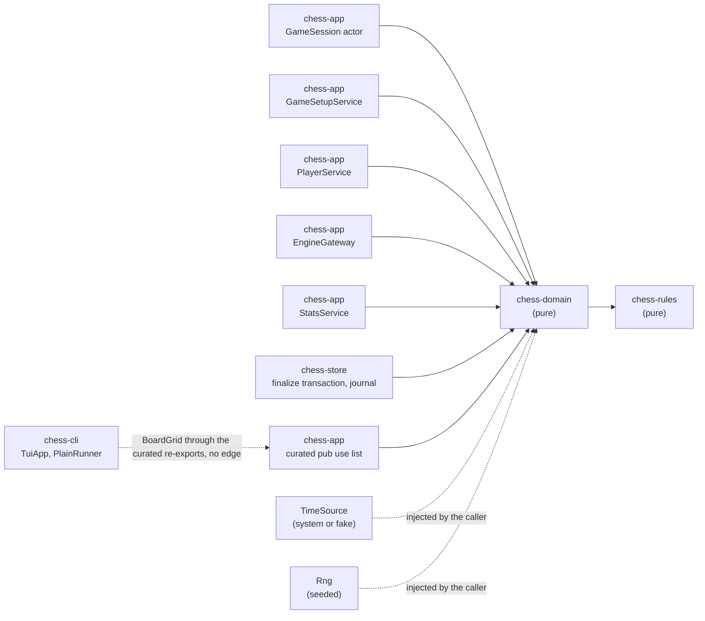
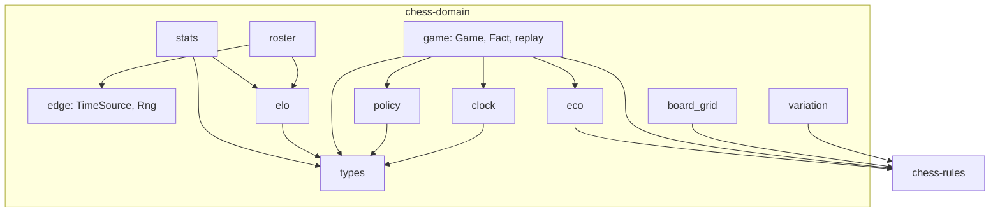
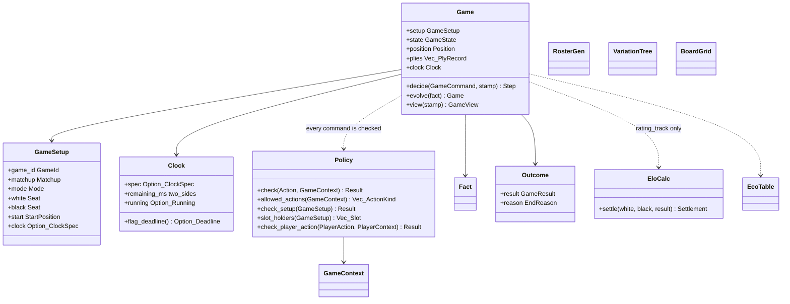
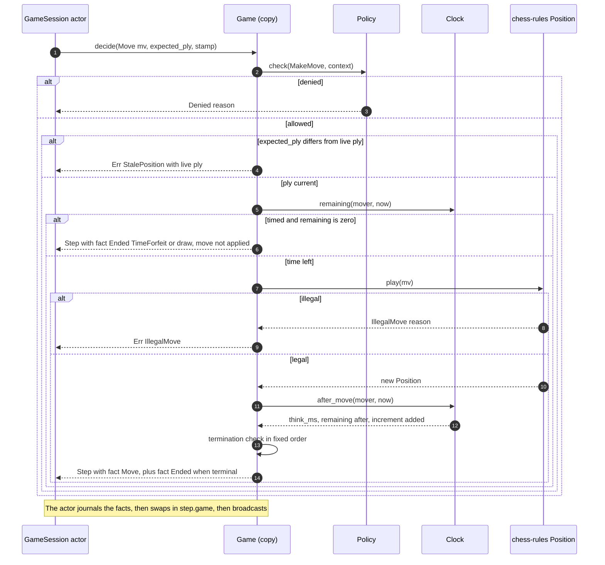
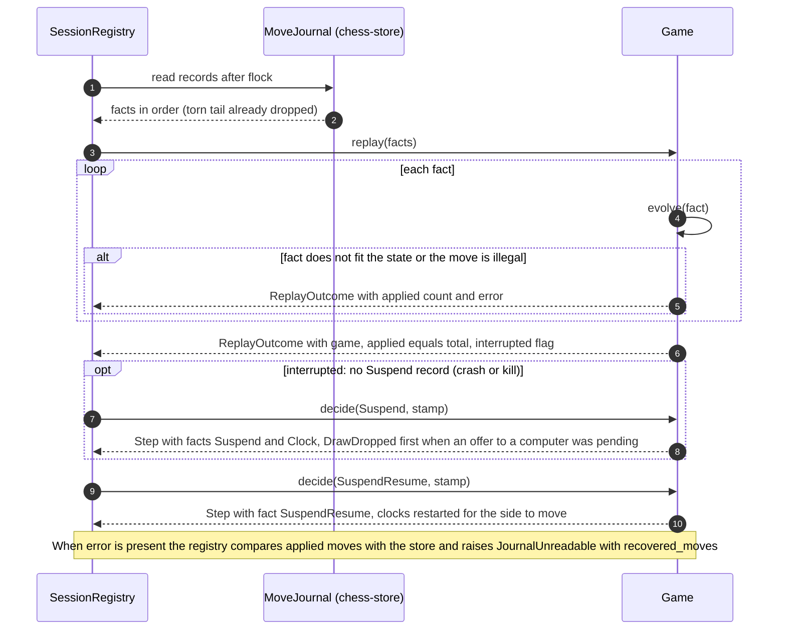
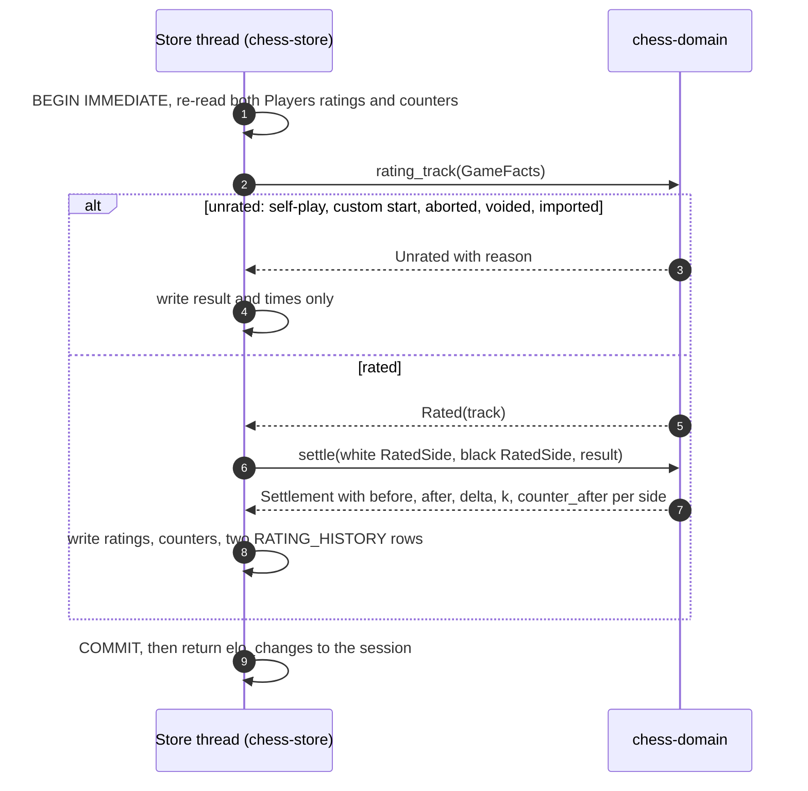
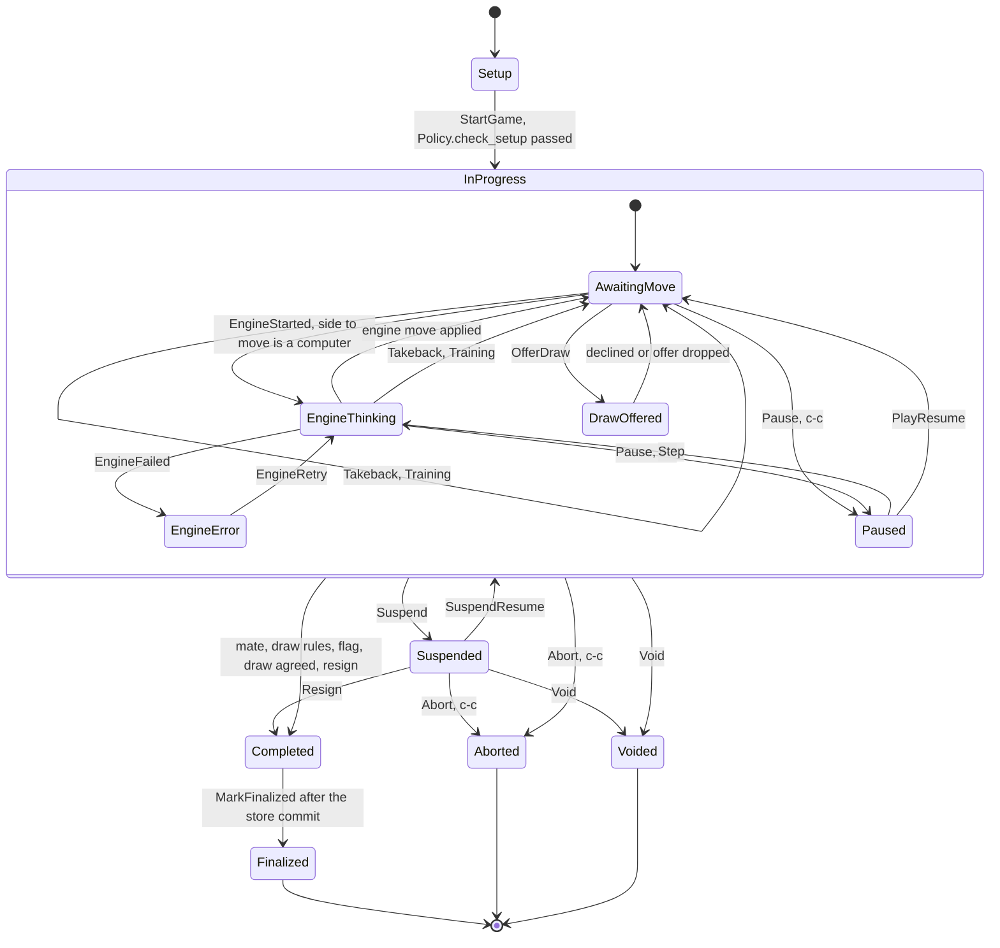
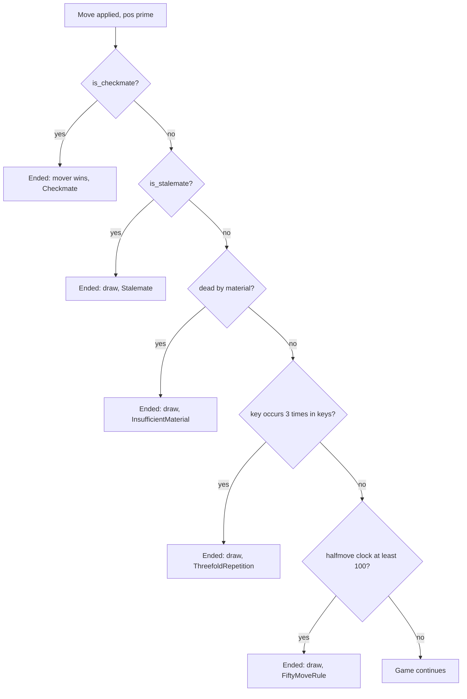

# SDD-chess-domain: Software Design Description for the `chess-domain` crate (Policy and Game domain)

| Field | Value |
|---|---|
| Document | docs/design/SDD-chess-domain.md |
| Version | **0.3.1 DRAFT** |
| Date | 2026-10-31 (v0.1: 2026-10-30) |
| Style | IEEE 1016-style (viewpoints and design entities). No conformance to a numbered edition is claimed |
| Owner | Software engineer role (Claude), for Brian Prascher |
| Approver | **Pending.** Design-only work (documents, no code) is gate **G0** (SWE-001 §3), so no approval is needed to hold this draft. The rulings applied in v0.2 were approved by Brian Prascher on 2026-10-31 (SDD-architect-triage section 5, decisions 1 to 13; requirements Amendment 7, CR-9.1); this revision applies them as text and adds no new decision. Implementation inside the crate with the §3.2 edges and §5.7 contracts unchanged is G1 (system-architect agent, desk review). Items in section 10 that remain open and touch an edge, a dependency, a journal record kind or a protocol are G2 (Brian Prascher). No approval of this SDD itself is claimed |
| Status | DRAFT v0.3. Nothing is implemented, built or run. Rust signatures are design-level sketches, not compiled code `[UNV]` |
| Blocks (architecture §2.2 names) | `chess-app core :: Policy` and `chess-app core :: Game domain` (crate `chess-domain`, pure): `Game`, state machine, `Clock`, `EloCalc`, `RosterGen`, `VariationTree`, `EcoTable`, `BoardGrid`, stats aggregation |
| Upstream baselines read | architecture.md v1.0 amendment 7 (D-38 to D-50, §3.2, §5.7, §7.6, FF-1 to FF-8); functional_decomp.md v1.0; requirements.md v1.0 Amendment 7 (CR-9); test-strategy.md 1.0 Amendment 6; SWE-001 v1.1; [SDD-architect-triage](SDD-architect-triage.md) (approved 2026-10-31); [SDD-SE-desk-answers](SDD-SE-desk-answers.md) (resolved 2026-10-31) |
| Sibling SDDs | [SDD-chess-rules](SDD-chess-rules.md), [SDD-chess-store](SDD-chess-store.md), [SDD-chess-engine](SDD-chess-engine.md), [SDD-chess-app](SDD-chess-app.md), [SDD-chess-server](SDD-chess-server.md), [SDD-chess-cli](SDD-chess-cli.md), [SDD-ui](SDD-ui.md), [SDD-desktop-tauri](SDD-desktop-tauri.md) |

Evidence tags follow `swe-governance` §6: `[OBS file:line]` read in this session, `[INF]` inferred, `[UNV]` not verified, `ESTIMATE` a design value without a measurement. There is no SRS in the repository (SWE-001 "Upstream artifacts"), so the trace runs from requirement and function IDs of the upstream documents straight to design entities `DD-DOM-nnn`. Line numbers in `[OBS architecture.md:n]` refer to the amendment 6 text read for v0.1 and may have shifted in amendment 7 `[UNV]`; re-anchor them at the next full read.

### Change log

| Version | Date | Change |
|---|---|---|
| 0.1 DRAFT | 2026-10-30 | First draft. Edit E-10 of the consistency review (journal DTO wording in 3.4) was applied by the reviewer. |
| 0.2 DRAFT | 2026-10-31 | G0 text edits implementing approved decisions only. **TR-3** (D-40): `GameId` and `PlayerId` are UUID newtypes defined here; integer ids never appear. **TR-4** (D-41): the implicit-resume fallback is removed; `Fact` maps 1:1 to journal record kinds (table in 3.11.1) with `DrawDropped`, `PlayResume`, `SuspendResume`. **TR-6** (D-43): `Personality` with `error_permille: u16` is the stored and identity type (DD-DOM-020); no `engine -> domain` edge. **TR-7** (D-44): this crate owns the counting predicate and arithmetic; SQL views are gone. **TR-9** (D-46): `RosterGen` takes a plain `UciEloRange`; the engine constant is not named here and no numeric range is written. **TR-11** (D-50): feature `ts` on the six wire value types; `Command` is `GameCommand`. **TR-12**: `SplitMix64` duplicated in the engine with shared vectors (FF-8); `error_pick_seed` is here; `TimeSource` and `Rng` traits here, implementations in `chess-app`. **TR-1** (D-38): `BoardGrid::from_fen`, `BoardView.last_move` as UCI text, `BoardStyle` names; no `cli -> domain` edge. **XC-14**: ECO per move, app reads `view().eco`. **XC-17**: this crate owns `slot_holders`, `check_player_action` and the `WhatIf` precondition; `archived_player` added. **XC-23**: `ClockSpec::from_minutes_plus_seconds`. **XC-24, decision 13**: `VariationTree` consumer is the PGN mapping; saving from the final position is refused. **UR-25**: the Elo chart renderer is the CLI's. **UR-26/Q-SE-22, Q-SE-4/5/25**: interpretations recorded. **XC-29**: scope wording. **XC-30**: IDs written `PREFIX-nnn`, none renumbered (one- and two-digit forms zero-padded to three digits); new IDs added at the end of each family. Interface-card IDs (`IFP-`, `IFR-`) keep their single-digit form because architecture §5.7 and the triage cite them (for example IFP-RUL-5). FIND-DOM-001 to FIND-DOM-012 marked RESOLVED where a ruling settled them (section 10). |
| 0.3 DRAFT | 2026-10-31 | G0 text edits applying the joint-review rulings ([SDD-v0.2-joint-review](SDD-v0.2-joint-review.md) section 7; requirements CR-9.8 to CR-9.12; architecture amendment 7 addendum A, D-41, D-46, D-50, D-51, D-52, D-58). No new decision. **FIND-JR-003, FIND-JR-004:** the `Fact` table (3.11.1) is rewritten to the architecture §7.6 table, which is authoritative: every payload field the record has is a `Fact` field (`DrawDropped{by, cause}`, `Start` gains `white_kind`, `black_kind`, `custom_start`, `Clock` carries `running_side`); the variant names `Ended` and `Aborted` stay, and the table names the journal kinds `GameEnd` and `Abort`; the `Voided` field is `reset_player`. **FIND-JR-002 (domain part), D-58, OQ-DOM-007 closed:** `Game::decide` is the only emitter of `DrawDropped`; crash recovery is `decide(Suspend)` then `decide(SuspendResume)`. **FIND-JR-008, D-46, OQ-DOM-006 closed:** `first_k_after(category, stored: &[u32])` takes every stored `roster_index`; the store computes nothing (the name `next_roster_index` is dropped). **CR-9.11:** the "standard start only" restriction on `EcoTable::observe` and `eco_for_import` is removed. **CR-9.8, CR-9.11, OQ-DOM-005 closed** as far as they go; **CR-9.12, CR-9.13, D-59 (ACCEPTED; OQ-ECO-1 to OQ-ECO-3 decided):** `eco_for_import` is replaced by an outcome type `EcoImportOutcome` (agree, mismatch, tag only, table only, neither) and a resolve step (IFP-DOM-6, 3.11.9; G1 for this design as architecture §5.8 states); new tests UT-DOM-071, 112, 113. OQ-DOM-009 records the remaining points. **FIND-JR-005, OQ-DOM-008 closed:** `Orientation` is in the curated list (architecture §3.2, §5.7). **FIND-JR-010:** the "`RngFactory`" wording is removed (no such type exists). **OQ-DOM-004** narrowed (D-50). Finding prefixes are unchanged (CR-9.9). |
| 0.3 DRAFT (addendum) | 2026-11-01 | G0. User rulings of 2026-11-01 and [SDD-v0.3-joint-review](SDD-v0.3-joint-review.md). **FIND-JR3-006:** ECO tag normalisation (`normalize_eco_tag`; A00 to E99; malformed counts as no tag; stored code normalised; name empty when the PGN's ECO is kept) and ply-0 lookup of a custom start; OQ-DOM-009 RESOLVED. **FIND-JR3-005 (domain part):** `Mismatch` needs no tag name. **FIND-JR3-007:** IFP-DOM-6 prints only `classify_import`, `resolve`, `EcoChoice`; `eco_for_import` is retired. **FIND-JR3-008:** the CR-9.11 ECO test is renamed UT-DOM-114 (UT-DOM-111 stays the `Personality` test). **FIND-JR3-013:** `FIND-RUL-1` cited as `FIND-RUL-001`. |
| 0.3.1 DRAFT | 2026-11-01 | G0. Applies architecture addendum B and C: `normalize_eco_tag`, ply-0 lookup and `classify_import`/`resolve` already follow D-60; no domain change from D-62. Version label unified. Cites D-60 (ECO import refinements), D-61 (`EngineFactory` owned by `chess-app`) and D-62 (PGN duplicates and the ECO question stay two steps; OQ-23 closed). Nothing is approved; no code exists |

---

## 1 Introduction

### 1.1 Purpose

`chess-domain` is the **pure decision core** of the application. It decides what each mode and state allows (`Policy`), what happens to a game when a move, offer, pause, suspend, resignation or flag arrives (`Game`), how clocks run (`Clock`), how ratings change (`EloCalc`), which computer Players exist (`RosterGen`), which opening a game is in (`EcoTable`), how an analysis branch is kept (`VariationTree`), how the board is drawn for a terminal (`BoardGrid`) and how finished games add up (stats aggregation). It does no I/O: time and randomness come in through traits, persistence is somebody else's job, and every function is deterministic. This is architecture principle 2 (functional core, imperative shell) and what makes the unit-test levels of test-strategy feasible `[OBS architecture.md:99, 355]`.

### 1.2 Scope

In scope (architecture §3.3 row `chess-domain`, §4.3, §4.4, §4.6, §7.2 notes) `[OBS architecture.md:355]`: the game state machine; `Policy` as one table; `Clock`; Elo calculator with K 40 to 32, no clamp and the unrated cases; class bands; seeded roster and personality generator; variation tree; stats aggregation; ECO classification of a move sequence; the terminal-independent `BoardGrid` renderer (built by `BoardGrid::from_fen`, TR-1.6); the identity newtypes `GameId` and `PlayerId` (UUID, TR-3); the stored `Personality` (TR-6); the `TimeSource` and `Rng` traits and `error_pick_seed` (TR-12); the counting predicate and arithmetic of statistics (TR-7); the feature-gated wire derives on six value types (TR-11).

Out of scope (owned elsewhere): move legality, SAN, FEN, PGN ([SDD-chess-rules](SDD-chess-rules.md)); the actor, the engine gateway, services and the protocol DTOs ([SDD-chess-app](SDD-chess-app.md)); the journal file format, SQL and transactions ([SDD-chess-store](SDD-chess-store.md)); UCI, `SearchLimits` and the clock-derived search budget ([SDD-chess-engine](SDD-chess-engine.md)); the TUI widgets that map `BoardGrid` to `ratatui` styles and the Elo chart renderers ([SDD-chess-cli](SDD-chess-cli.md)).

### 1.3 Allocation: functions, requirements, decisions

| Kind | IDs | Role of this block |
|---|---|---|
| Functions allocated by name `[OBS functional_decomp.md:90,92,94,133,134,136,138]` | **F-2.2.4** Detect game termination; **F-2.3.1** Decide allowed actions (`Policy`); **F-2.4.1** Run game clocks; **F-4.1** Decide rating eligibility; **F-4.2** Compute Elo update; **F-4.4** Derive computer category label; **F-4.6** Classify opening | Primary |
| Functions supported (allocated to another block, decided or computed here) | F-1.1 (starting ratings from category), F-1.6 (roster generation), F-1.8.3 (view window), F-2.1.1 and F-2.1.2 (setup rules, slot holders), F-2.2.3 (the apply decision), F-2.4.2 (flag result), F-2.4.3 (freeze and restore clocks), F-2.5.1 to F-2.5.5 (takeback, draw offer, resign, pause/step, abort), F-2.6.1, F-2.6.2, F-2.6.4, F-2.6.5, F-2.6.6 (suspend, resume by replay, void, finalise inputs, per-game data), F-3.3 (policy check for the gateway), F-4.5 (aggregation), F-5.2 and F-5.3 (what-if tree), F-7.1.1 and F-7.3.1 (board grid and stats inputs for the CLI) | Supporting |
| Requirements, primary | PLY-5, RULE-2, RULE-3, RULE-4, ELO-1, ELO-2, PLY-4 (category label, roster), ENG-2 (parameter generation), ANA-2 (variation tree, co-primary with `AnalysisService`), CLI-2 (board orientation and labels; rendering by `chess-cli` is the other half), UI-3 (CLI styles) `[OBS architecture.md:1528,1534-1536,1548-1549,1527,1542,1556,1559,1552]` | |
| Requirements, supporting | PLY-1, PLY-2, PLY-7, GAME-1, GAME-2, GAME-3, GAME-4, RULE-1, RULE-5, RULE-8, ENG-4, ENG-5, ANA-1, DAT-3 (time accounting, ECO), UI-2, UI-5, CLI-1, NFR-2, NFR-3 | |
| Decisions | D-13 (actor owns the `Game`), D-14, D-15, D-20, D-26, D-27, D-28, D-30, D-33, D-34, D-35, D-37 (information only); D-38 (`BoardGrid::from_fen`), D-40 (UUID ids), D-41 (journal contract), D-43 (`Personality`), D-44 (statistics), D-46 (roster and pinned range), D-47 (`uuid`), D-50 (wire derives) | |
| Risks | R-2, R-7, R-15, R-17, R-18, R-20 | |

### 1.4 Definitions

| Term | Meaning |
|---|---|
| Fact | A domain event that is also one journal record kind (section 3.11.1). The `Game` is the fold of its facts |
| `decide` / `evolve` | The two halves of a transition: `decide` checks the command and produces facts; `evolve` applies one fact |
| Stamp | `{ mono: MonoMs, wall: WallMs }`, one reading of the injected `TimeSource` |
| Seat | A Player on one side: `{ player: PlayerId, kind: Human or Computer }`; `PlayerId` is a UUID newtype (TR-3) |
| `GameId`, `PlayerId` | UUID newtypes defined in this crate (TR-3, D-40). Integer row keys of the store never appear here |
| `GameCommand` | The input of `Game::decide` (renamed from `Command`, TR-11), distinct from `protocol::Command` |
| Slot holder | A Player that occupies an `UNFINISHED_SLOT` in a game (D-27) |
| Track | The rating scale of a game: `Strict` or `Training` (D-28) |
| h–h, h–c, c–c | Matchups: human–human, human–computer, computer–computer |

### 1.5 Conventions

Rust edition 2024, `rust-version = "1.99"` `[OBS architecture.md:373]`. Crate attributes: `#![forbid(unsafe_code)]`; compiler and `clippy` warnings are errors; `unwrap`, `expect`, `panic!`, unchecked indexing, arithmetic that can overflow and narrowing `as` casts are denied outside tests unless a written reason is attached (SWE-001 §6, CERT-informed; **no CERT conformance claim**). Time is `u64` milliseconds. Local ID prefixes are written `PREFIX-nnn` (XC-30): `FIND-DOM-nnn`, `OQ-DOM-nnn`, `ASM-DOM-nnn`, `ADR-REQ-DOM-nnn`, `RSK-DOM-nnn`, `FM-DOM-nnn`, `DR-DOM-nnn`. A finding that a ruling settled is marked RESOLVED with the ruling id and is kept, not deleted.

---

## 2 Design overview

### 2.1 Viewpoints included and omitted

| # | Viewpoint | Included | Where |
|---|---|---|---|
| 1 | Context | yes | 3.1 |
| 2 | Composition | yes | 3.2 |
| 3 | Logical | yes | 3.3 (key types only) |
| 4 | Dependency | yes | 3.4 |
| 5 | Information | yes, reduced | 3.5. The crate stores nothing. It defines value shapes that other blocks persist |
| 6 | Patterns use | yes | 3.6 |
| 7 | Interface | yes | 3.7 (cards `IFP-DOM-n`, `IFR-DOM-n`) |
| 8 | Structure | folded into 3.2 and 3.8 | Module layering is short enough to share a section |
| 9 | Interaction | yes | 3.9 |
| 10 | State dynamics | yes | 3.10 (the §4.3 state machine as implemented) |
| 11 | Algorithm | yes | 3.11 |
| 12 | Resource | yes | 3.12 |

### 2.2 Design constraints taken from upstream

| Constraint | Source | Effect |
|---|---|---|
| Pure: data in, data out; `TimeSource` and `Rng` injected | Principle 2; §5.7 row `TimeSource, Rng` `[OBS architecture.md:99,839]` | No `std::time`, `rand`, `std::fs`, `std::env` in the crate. The traits are defined here; implementations are in `chess-app` (TR-12) |
| No edge to or from `chess-engine` | §3.2 as amended, D-43 | The engine receives an `EnginePersonality` (converted in `chess-app`) and a plain `u64` seed; this crate never names an engine type |
| The actor owns the `Game` and applies a command to a **copy**, journals it, then swaps in the new state | §4.8 "Ordering and durability" `[OBS architecture.md:636]` | `Game` methods take `&self` and return a new `Game` plus facts |
| `Policy::check(action, &GameContext) -> Result<(), Denied>` is the single source of truth, table-tested | §4.4 `[OBS architecture.md:561]` | DD-DOM-004 |
| Every `GameSnapshot` carries `allowed_actions` computed from the table | §4.4 `[OBS architecture.md:585]` | `allowed_actions()` and `Game::view` |
| The journal wins; replay must be idempotent | §7.6, R-15 | One reducer for live and replay (DD-DOM-010) |
| Ratings are whole integers; update `R + round(K(S − E))`, half away from zero, `f64` | ELO-1, §7.2 `[OBS requirements.md:664-666]` | DD-DOM-011 |
| Coverage at least 90 % line for rules, Elo, clock, policy and parser modules; mutation testing on Elo and Policy | test-strategy "Quality gates" | Section 7 |

---

## 3 Viewpoint sections

### 3.1 Context viewpoint

**Concern:** who calls this crate and what it needs from outside.



Solid arrows into `chess-domain` are edges of §3.2 as amended (`app -> domain`, `store -> domain`, `domain -> rules`). The CLI renders `BoardGrid` through the curated `pub use` list of `chess-app` (§5.7 row `BoardGrid` renderer, D-38); it has no edge to this crate (FIND-DOM-006 (i) RESOLVED, TR-1). `chess-engine` has no edge to or from this crate.

### 3.2 Composition viewpoint

**Concern:** the parts and what each is for.

| Module | Design entities | Purpose |
|---|---|---|
| `types` | DD-DOM-001 | `GameId`, `PlayerId` (UUID newtypes), `Side`-based enums, `Mode`, `Matchup`, `PlayerKind`, `Category`, `Track`, `GameResult`, `Outcome`, `EndReason`, time newtypes |
| `edge` | DD-DOM-002 | `TimeSource`, `Rng` traits, `SplitMix64`, `error_pick_seed`, fakes (feature `test-support`) |
| `clock` | DD-DOM-003 | `Clock`, `ClockSpec`, `ClockSync` |
| `policy` | DD-DOM-004, 005 | `Policy`, `Action`, `GameContext`, `Denied`, setup validation, slot holders, colour assignment |
| `game` | DD-DOM-006 to 010 | `Game`, `GameState`, `Fact`, `decide`/`evolve`, termination, in-play rules, replay |
| `elo` | DD-DOM-011, 012 | `EloCalc`, `Category` bands, rating eligibility |
| `roster` | DD-DOM-013, 014, 020 | `RosterGen`, `UciEloRange`, `Personality`, name generator |
| `eco` | DD-DOM-015 | `EcoTable` (deepest named position) |
| `variation` | DD-DOM-016 | `VariationTree` |
| `board_grid` | DD-DOM-017 | `BoardGrid::from_fen`, `BoardView`, `BoardStyle`, `Orientation`, text rendering |
| `stats` | DD-DOM-018 | Counting predicate, aggregation, rating series, history check |
| `error` | DD-DOM-019 | `thiserror` enums |



### 3.3 Logical viewpoint

**Concern:** the static types a consumer sees (key types only).



`Settlement`, `PlyRecord`, `Personality`, `PlayerStats` and `BoardStyle` are described in section 4.

### 3.4 Dependency viewpoint

**Concern:** what the crate depends on and who depends on it.

| Direction | Item | Allowed by §3.2 | Note |
|---|---|---|---|
| out | `chess-rules` | yes `[OBS architecture.md:316]` | `Position`, `Move`, `Fen`, `PositionKey`, `PgnNode`, `Termination`. Re-exports nothing (TR-1.3) |
| out | `serde` 1.0.229 (derive) | admitted in §3.4 (D-47, review row D-3) | `GameSetup`, `Fact`, `Outcome`, `Personality`, `ClockSpec` are received in protocol commands. **They are not written to the journal in this form:** the journal uses the store's own DTOs, and `JournalCodec` in `chess-app` converts between `Fact` and the record (TR-4, D-41). Use `deny_unknown_fields` on externally supplied shapes (SWE-001 §6 row SEC/SER) |
| out (optional) | `ts-rs`, feature `ts` (version in the §3.4 baseline), enabled by `chess-app` | D-50 | Derives the TypeScript type for exactly `GameSetup`, `Mode`, `Matchup`, `ClockSpec`, `Category` and `Preferences`. A derive macro adds no I/O, so the crate stays pure. No exposed `i64` or `u64` field can exceed 2^53 (timestamps in milliseconds are fine). `Preferences` has no definition in this SDD yet (OQ-DOM-004: ownership is the domain's by D-50; the field list is open) |
| out | **`uuid` with the `v5` feature** | admitted in principle (D-47, review row D-5); version and feature set `[UNV]`, looked up before it enters §3.4 | `GameId(Uuid)`, `PlayerId(Uuid)` and the UUIDv5 roster identities (D-34, D-46). FIND-DOM-003 RESOLVED in principle |
| out | `thiserror` 2.0.21 | yes, architecture §8 | |
| in | `chess-app` (`GameSession`, `GameSetupService`, `PlayerService`, `EngineGateway`, `StatsService`, `JournalCodec`), `chess-store` (finalize, journal replay) | yes | |
| in (none) | `chess-cli` (`BoardGrid`) | no edge, by rule (TR-1.1) | Reached through the curated `chess-app` re-exports: `BoardGrid`, `BoardStyle`, `BoardView`, `Cell`, `Shade`, `Highlight`, `Orientation` (3.8) |
| none | `chess-engine` | no edge in either direction (D-43, TR-12) | FIND-DOM-005 RESOLVED |

`chess-engine` has no edge to `chess-domain` `[OBS architecture.md:314]`, so it cannot use the `Rng` trait defined here. The error pick receives a plain `u64` seed computed by `error_pick_seed` (3.7, IFP-DOM-10), and the engine keeps its own `SplitMix64` copy with shared test vectors (FF-8). No `tokio`, `rusqlite`, `tracing`, `rand` or clock crate may appear in this crate's dependency tree; a CI `cargo tree` assertion can check it `[UNV: not written]`.

### 3.5 Information viewpoint

**Concern:** what data shapes this crate defines for others to persist, and how they map to the data model.

The crate owns no table. It defines the in-memory and wire shapes below. Column names are from §7.2 `[OBS architecture.md:1100-1200]`.

| Domain shape | Persisted as | Stable text / encoding defined here |
|---|---|---|
| `GameSetup` | `GAME` header columns (`matchup`, `mode`, `start_fen`, `clock_spec`; the store writes its internal integer row keys for the two Players) and the journal `Start` record, which carries `white_uuid` and `black_uuid`; `GameSetup` converts to it by field copy (TR-3) | `Matchup`: `hh`, `hc`, `cc`; `Mode`: `training`, `strict`; `clock_spec`: `base+inc` in seconds |
| `GameId`, `PlayerId` | journal, protocol, export | UUID text; the store's integer row keys never cross its API (D-40) |
| `GameStatus` | `GAME.status` | `in_progress`, `completed`, `aborted`, `voided`, `imported` (the last is store-only) |
| `GameResult` | `GAME.result` | `1-0`, `0-1`, `1/2-1/2`; null for aborted and voided |
| `EndReason` | `GAME.termination` | see the table below (SE interpretation Q-SE-5, confirmed; FIND-DOM-007 RESOLVED) |
| `Fact` | exactly one journal record kind each (§7.6, D-41), converted by `JournalCodec` in `chess-app` | Journal framing and CRC belong to the store; the domain fixes the fields and the 1:1 table (3.11.1) |
| `Clock` checkpoint | `GAME.white_clock_ms`, `GAME.black_clock_ms`, journal `Clock` | whole milliseconds, remaining time |
| `PlyRecord` | `MOVE` row | `san`, `uci`, `fen_after`, `think_ms`, clock columns, `played_at` |
| `Rating`, `Track`, `Category` | `PLAYER.strict_elo`, `training_elo`, `*_rated_games`, `RATING_HISTORY` | whole `i32`; `track`: `strict`, `training`; category names Beginner, Novice, Intermediate, Master, Grand Master |
| `Personality` | `COMPUTER_PROFILE` | `error_permille: u16`, stored as `INTEGER`; the UNIQUE index compares integers, never floats (TR-6, D-43; FIND-DOM-012 RESOLVED) |
| `EcoMatch` | `GAME.eco`, `GAME.opening_name` | code and name strings from the table; none while a game has reached no named position, for any start (DAT-3, CR-9.11) |

`EndReason` strings (confirmed as SE interpretation Q-SE-5, CR-9.2; they travel in `games.json` and are part of format version 1, to be frozen before the first release; the upstream names only "voided by reset", "voided: unreadable", "resignation", "aborted" and "draw agreed" `[OBS architecture.md:1115, requirements.md:601,433]`):

| `EndReason` | `GAME.termination` | PGN `Termination` (via `pgn_termination()`) |
|---|---|---|
| `Checkmate` | `checkmate` | `normal` |
| `Stalemate` | `stalemate` | `normal` |
| `InsufficientMaterial` | `insufficient material` | `normal` |
| `ThreefoldRepetition` | `threefold repetition` | `normal` |
| `FiftyMoveRule` | `fifty-move rule` | `normal` |
| `TimeForfeit` (loss on the clock) | `time forfeit` | `time forfeit` |
| `TimeoutOpponentCannotMate` (draw on the clock) | `time forfeit, opponent cannot mate` | `normal` |
| `Resignation` | `resignation` | `normal` |
| `DrawAgreed` | `draw agreed` | `normal` |
| `Aborted` | `aborted` | `abandoned` |
| `VoidedByReset` | `voided by reset` | `abandoned` |
| `VoidedUnreadable` | `voided: unreadable` | `abandoned` |
| (unfinished) | null | none |

### 3.6 Patterns-use viewpoint

| Pattern | Where | Why | Misuse tell |
|---|---|---|---|
| Event sourcing with one reducer | `Game::decide` produces facts, `Game::evolve` applies one fact; live play and journal replay both call `evolve` | RULE-5 and R-15: a replayed game must equal the live game; replay must be idempotent | A second code path that changes `Game` without a fact |
| Decision table | `Policy` | One source of truth for "what is allowed"; table-driven tests over the product (§4.4) | An `if mode == Strict` outside `policy` |
| State pattern as an enum | `GameState` | The set of states is closed and mirrors §4.3 | A boolean flag that duplicates a state |
| Value objects, copy on command | `Game: Clone`, methods take `&self` | §4.8: apply to a copy, journal, then swap | Mutating methods on a shared `Game` |
| Dependency injection of edges | `TimeSource`, `Rng` traits, `Stamp` arguments | Determinism, fake time in tests (test-strategy "Determinism") | `Instant::now()` in a domain function |
| Seeded deterministic stream | `RosterGen` over `SplitMix64` | Same seed, same roster, forever (PLY-4, ENG-2) | `rand::thread_rng()` anywhere |
| Arena with stable ids | `VariationTree` | Cheap branch, delete and navigation without borrow cycles | `Rc<RefCell<..>>` nodes |
| Newtype for validated data | `GameId`, `PlayerId`, `Rating`, `RosterSeed`, `MoveDelay`, `ClockSpec` | Illegal values unrepresentable | A raw `i32` rating passed around |

### 3.7 Interface viewpoint

**Concern:** what the crate provides to its callers, what it needs, parameters, units and errors. Provided cards implement the §5.7 rows `TimeSource, Rng` and `BoardGrid` renderer, and the §4.3/§4.4 behaviour `[OBS architecture.md:839,843]`. Rust signatures are sketches `[UNV]`.

#### IFP-DOM-1 Policy (F-2.3.1, PLY-5)

| Operation | Parameters | Returns | Errors |
|---|---|---|---|
| `Policy::check(Action, &GameContext)` | an action with payload (`Resign{side}`, `OfferDraw{by}`, `MakeMove{by, actor}`, ...), the context | `Result<(), Denied>` | `Denied { reason: DeniedReason }` |
| `Policy::allowed_actions(&GameContext)` | context | `Vec<ActionKind>` in fixed declaration order (stable snapshots) | none |
| `Policy::check_setup(&GameSetup)` | setup | `Result<(), SetupError>` | `SetupError { field, reason }` |
| `Policy::slot_holders(&GameSetup)` | setup | `Vec<(PlayerId, Mode)>` per D-27 | none |
| `Policy::check_player_action(PlayerAction, &PlayerContext)` | `Rename`, `Archive`, `Reset`, `UseAsSide`; kind, active flag, archived flag | `Result<(), Denied>` | `computer_player`, `active_player`, `archived_player` (FIND-DOM-008 RESOLVED) |
| `assign_colors(ColorChoice, &mut dyn Rng)` | White, Black or Random | which seat plays White | none |

`DeniedReason` strings (snake case, additive per §5.5 "new codes may be added"): `strict_mode`, `training_untimed`, `not_human_turn`, `state_not_allowed`, `game_over`, `voided`, `draw_not_own_turn`, `draw_engine_busy`, `draw_offer_pending`, `draw_repeat_blocked`, `draw_not_available`, `computer_player`, `active_player`, `archived_player`. The five `draw_*`, `computer_player`, `active_player`, `archived_player` (additive, architecture §4.4 and §5.5, AMD-14) and `voided` come from the catalogue; the others are internal. The triage proposal `game_open` is **not** added: archiving a Player with an unfinished game already has its own code, `PlayerHasUnfinishedGames`, raised by the app from the store.

**Ownership (XC-17, AMD-14, Q-SE-3).** `Policy::slot_holders` and `Policy::check_player_action` are the only implementations; `chess-app` calls them and maps the result, and keeps no second slot table. The app's gateway actions `ComputerMove` and `ComputerDrawDecision` are not domain actions: they map to `MakeMove{actor: Engine}` and `RespondDraw{by, actor: Engine}`. The `WhatIf` precondition is the domain's (3.11.5): Training in progress **with a human to move**, or any finished game. `GameSetupService` calls `check_player_action(UseAsSide)` for each seat, because another front-end can archive a Player between listing and starting.

#### IFP-DOM-2 Game

| Operation | Parameters | Returns | Errors |
|---|---|---|---|
| `Game::new(GameSetup, Stamp)` | validated at the call | `Step` (state `AwaitingMove`, fact `Start`) | `SetupError` |
| `Game::decide(GameCommand, Stamp)` | one of `Move{mv, expected_ply, actor}`, `Takeback`, `OfferDraw{by}`, `RespondDraw{accept}`, `DropDrawOffer`, `Resign{side}`, `Flag`, `Pause`, `PlayResume`, `Step`, `Suspend`, `SuspendResume`, `Abort`, `Void{reason}`, `EngineStarted`, `EngineFailed`, `EngineRetry`, `Checkpoint`, `MarkFinalized` | `Step { game: Game, facts: Vec<Fact>, ended: Option<Outcome> }` | `GameError` (section 5) |
| `Game::evolve(Fact)` | one fact | `Result<Game, ReplayError>` | `ReplayError` |
| `Game::replay(impl IntoIterator<Item = Fact>)` | facts in journal order | `ReplayOutcome { game: Option<Game>, applied: usize, interrupted: bool, error: Option<ReplayError> }`; `interrupted` is true when the facts end in a non-terminal state that is not `Suspended` (a crash or kill, 3.9.2) | never panics |
| `Game::view(Stamp)` | | `GameView { state, ply, turn, plies, clocks: ClockSync, allowed_actions, outcome, eco }` | none |

`GameCommand` is the renamed `Command` (TR-11, D-50): `protocol::Command` in `chess-app` is a different type. `Fact` and `Outcome` (domain), `Event` (protocol) and `JournalRecord` (store) are four distinct vocabularies.

Units: milliseconds (`u64`), plies (`u32`). `ClockSync = { white_ms, black_ms, running_side: Option<Side>, as_of: WallMs }` `[OBS architecture.md:477]`.

#### IFP-DOM-3 Clock

`Clock::new(Option<ClockSpec>)`, `start(side, now)`, `stop(now)`, `after_move(mover, now) -> MoveTiming { think_ms, remaining_after }`, `remaining(side, now)`, `flag_deadline(now) -> Option<(Side, MonoMs)>`, `sync(now, wall) -> ClockSync`, `checkpoint(now) -> ClockValues`, `restore(ClockValues)`. All arithmetic saturates at zero; no operation panics. `ClockSpec::from_minutes_plus_seconds(minutes, seconds)` builds a spec from the preset and CLI shorthand (`5+0` is five minutes plus zero seconds of increment, SE answer Q-SE-25, confirmed); `ClockSpec::from_seconds(base, increment)` builds it from a PGN `TimeControl` value (seconds). Both validate against the limits of 3.11.6. The app uses this `Clock` and its flag-on-zero rule and keeps no clock struct of its own (XC-23). The GUI and TUI custom clock ask for minutes and seconds explicitly rather than reuse the `+` shorthand.

#### IFP-DOM-4 EloCalc (F-4.1, F-4.2, F-4.4)

| Operation | Parameters | Returns | Errors |
|---|---|---|---|
| `expected_score(ra: i32, rb: i32)` | integer ratings | `f64` in (0, 1) | none |
| `k_factor(rated_games_on_track_before: u32)` | counter before this game | `i32`: 40 if fewer than 30, else 32 | none |
| `settle(white: RatedSide, black: RatedSide, result: GameResult)` | rating and counter of each side on the game's track | `Settlement { white: SideUpdate, black: SideUpdate }` with `before`, `after`, `delta`, `k`, `counter_after` | `EloError::RatingOverflow` |
| `rating_track(&GameFacts)` | status, mode, self-play, custom start | `Rated(Track)` or `Unrated(reason)` | none |
| `Category::from_rating(i32)`, `Category::baseline()` | | band, or baseline 400, 600, 1200, 2200, 2500 | none |

Called by the finalize transaction on the store thread (architecture §5.4: `DB->>P: EloCalc(current ratings, K, rated flag)` `[OBS architecture.md:770]`), which is why `chess-store` depends on `chess-domain`.

#### IFP-DOM-5 RosterGen (PLY-4, ENG-2)

| Operation | Parameters | Returns | Errors |
|---|---|---|---|
| `RosterGen::new(RosterSeed, UciEloRange)` | seed; the pinned `UCI_Elo` range as a plain value `UciEloRange { min, max }`, passed by `chess-app` from `chess_engine::PINNED_UCI_ELO_RANGE` | generator | none |
| `default_roster()` | | 25 `ComputerPlayerSpec`, 5 per category, indices 0 to 24 | `RosterError` |
| `generate(category, first_k: u32, count: u8, taken: &dyn Fn(&str) -> bool)` | count 1 to 25; `first_k` from `first_k_after` over the stored indexes (3.11.8) | `Vec<ComputerPlayerSpec>` | `CountOutOfRange`, `ParameterSpaceExhausted` |
| `first_k_after(category, stored: &[u32])` | every stored `roster_index` of every class, as the store returns them (`StoreApi::roster_indexes() -> Vec<u32>`, architecture §4.6, D-46) | `u32`, the first free *k* of the category: 0 when no stored index belongs to the category, otherwise one more than the largest *k* among the stored indices of the category (`5*k + c` belongs to class ordinal `c`) | none |

`ComputerPlayerSpec { uuid, roster_seed, roster_index, category, name, personality, strict_elo_start, training_elo_start }`. The range is passed as data. This crate does not read the engine and does not name the engine constant; the roster is therefore independent of the binary found at run time (TR-9, D-46). **No numeric range is written in this document**: it is unknown until the Stockfish 19 build is run (ASM-3) `[UNV]`.

#### IFP-DOM-6 EcoTable (F-4.6, DAT-3)

`EcoTable::observe(current: Option<EcoMatch>, key: &PositionKey, ply: u32) -> Option<EcoMatch>`; `EcoTable::classify(keys: &[PositionKey]) -> Option<EcoMatch>` (full recompute; **`keys[0]` is the start position, ply 0**, so the start of a custom start is looked up too, 3.11.9); `normalize_eco_tag(tag: &str) -> Option<EcoCode>`; `classify_import(tag: Option<&str>, classified: Option<EcoMatch>) -> EcoImportOutcome`; `resolve(&EcoImportOutcome, Option<EcoChoice>) -> Result<EcoFields, EcoUnanswered>` with `EcoChoice` = `KeepPgn | KeepTable` and `EcoFields { code: Option<String>, name: Option<String> }`. These are the only ECO import names; the earlier `eco_for_import` is retired (FIND-JR3-007).

**Timing (XC-14).** `Game` observes the ECO match at ply 0 (`Game::new`) and after every move of **every** game, whatever its start, and recomputes after a takeback (the recompute includes ply 0); the app reads `Game::view().eco` at finalize and does not classify again. *CR-9.11 (user ruling 2026-10-31):* the earlier "standard start only" restriction is removed. A custom start that is itself a named position, or later reaches one, is classified by it (code and name from the table; user ruling 2026-11-01 on ply 0), and a FEN equal to the standard start position is a standard start for ECO. ECO classification therefore does not read `custom_start`. (The `custom_start` flag still decides rating and statistics eligibility; this edit does not change that.) A custom start that is not and never reaches a named position has no code and no name. **Import classification (CR-9.8, CR-9.11, CR-9.12, CR-9.13; architecture §5.8, D-59 ACCEPTED).** `normalize_eco_tag`, `classify_import` and `resolve` (signatures in the line above; there is no `custom_start` parameter: classification is by position for every start) are pure. `classified` is `EcoTable::classify` over the keys of the imported game, and `EcoImportOutcome` is one of:

| Variant | Meaning | Stored by `resolve` (no choice needed unless stated) |
|---|---|---|
| `Agree{code, name}` | the normalised tag equals the table's code | the code (equal in both) and the table's name |
| `Mismatch{tag_code, table: EcoMatch}` | both exist and the codes differ (`tag_code` is the normalised code) | **needs a choice** (below) |
| `TagOnly{tag_code}` | a well-formed tag, and the table finds nothing for the game | the normalised code, empty name (CR-9.8, DAT-3) |
| `TableOnly{table: EcoMatch}` | no tag **or a malformed tag**, the table finds a match | code and name from the table |
| `Neither` | no tag or a malformed tag, and no match | no code, no name |

`resolve(outcome: &EcoImportOutcome, choice: Option<EcoChoice>) -> Result<EcoFields, EcoUnanswered>` with `EcoChoice` = `KeepPgn` or `KeepTable`. For `Mismatch`: `KeepPgn` gives the normalised tag code and an **empty name** (OQ-ECO-2, decided in D-59 and CR-9.13); `KeepTable` gives the table's code and name and discards the file's code; `None` returns `EcoUnanswered` (the caller must ask; this crate asks nothing and writes nothing). For every other variant `choice` is ignored. `EcoFields { code: Option<String>, name: Option<String> }`. **Tag normalisation (user ruling 2026-11-01; closes OQ-DOM-009 (a) and (b)).** `normalize_eco_tag` trims ASCII whitespace and upper-cases ASCII letters; the result is a code only if it matches `^[A-E][0-9]{2}$` (A00 to E99). **A malformed tag counts as no tag** (so the game is `TableOnly` or `Neither`). The comparison with the table, the `Agree` / `Mismatch` decision and the stored code all use the normalised code, so `c60` and ` C60 ` store `C60`. The domain needs no tag name: `Mismatch` carries codes only (any tag name shown to the player is not a domain concern). The domain never remembers a choice (not remembered in v1, OQ-ECO-3), and the answer never changes the duplicate hash (D-42). `chess-app` builds the interactive flow, the `ImportConflicts` entries and `ResolveImport`; none of that is here.

#### IFP-DOM-7 VariationTree (ANA-2, F-5.2, F-5.3)

`new(root: Position, root_ply: u32)`, `play(at: NodeId, mv: Move) -> Result<NodeId, TreeError>`, `parent`, `first_child`, `children`, `position(node)`, `line_to(node) -> Vec<Move>`, `delete(node)`, `to_pgn_nodes() -> Vec<PgnNode>`, `to_pgn_text() -> String`, `from_pgn_text(root, root_ply, text)`, `saved_line(node, game_plies: u32) -> Result<SavedLine { anchor_ply, text }, TreeError>`.

**Consumer (XC-24).** The tree is kept for the PGN mapping: `ImportExportService` and `AnalysisService` use `to_pgn_nodes`, `to_pgn_text`, `from_pgn_text` and `saved_line` to write saved variations (RULE-6 export, IF-1) and read imported ones (IF-2). The client holds the live tree for the UI (D-11). **One saved line is one stored variation with its anchor ply and the store's `created_at`; no Player is recorded (Q-SE-9, decision 13).** `saved_line` returns `TreeError::AtFinalPosition` when the branch starts after the last ply of the game, because it is then a variation of no move (CR-9.4); the app turns that into a refusal message (NFR-9).

#### IFP-DOM-8 BoardGrid (CLI-1, CLI-2, UI-3) `[OBS architecture.md:843]`

`BoardGrid::from_fen(fen: &str, view: &BoardView, style: BoardStyle, orientation: Orientation) -> Result<BoardGrid, BoardError>` (TR-1.6, D-38) where `BoardView { last_move: Option<String>, rewound: bool }` and `last_move` is **UCI text** (`e2e4`); `Orientation` is `White` or `Black` (the side drawn at the bottom); `BoardStyle` is `Plain`, `Unicode`, `Ansi`, `NoColor`. `from_fen` validates the FEN with `chess_rules::Fen::parse` and the move text with `Move::from_uci`, so **no front-end needs a `Position` or a rules type** (XC-12). `BoardGrid { rows: [[Cell; 8]; 8], top_labels, bottom_labels, left_labels, right_labels }` with `Cell { glyph: char, shade: Shade, highlight: Highlight }`; `render_text(&BoardGrid, &BoardStyle) -> Vec<String>`. The position-based `render(&Position, ...)` stays crate-internal. `Orientation` replaces the rules `Side` in the public signature so that the CLI needs no rules type (OQ-DOM-008).

#### IFP-DOM-9 Stats (UI-2, UI-5, F-4.5)

`aggregate(rows: &[StatsRow], window: Option<WallMs>) -> PlayerStats`; `rating_series(points: &[RatingPoint], track, window) -> Vec<RatingPoint>`; `check_history(points, track) -> Result<(), HistoryError>`; `counts_in_aggregates(&StatsRow) -> bool`. This crate owns the **predicate** (completed, not self-play, not a custom start, inside the reset window) and the **empty-state rule** (CR-4.15). The store returns rows filtered only by structural keys; `aggregate` applies the predicate itself (TR-7, D-44; FIND-DOM-002 RESOLVED). The Elo chart renderer is not here: the domain exports series data only, and the character-cell chart and sparkline belong to `chess-cli` (UR-25, Q-SE-23; FIND-DOM-011 RESOLVED).

#### IFP-DOM-10 Edge traits (§5.7 row `TimeSource, Rng`)

`trait TimeSource: Send + Sync { fn mono(&self) -> MonoMs; fn wall(&self) -> WallMs }` (monotonic for clocks, wall only for timestamps `[OBS architecture.md:839]`); `trait Rng { fn next_u64(&mut self) -> u64; fn below(&mut self, n: u64) -> u64 }`; `SplitMix64` implements `Rng`. The **traits live here and the implementations (system clock, OS random source) live in `chess-app`** (TR-12; architecture §5.7 "edges"). `FakeTimeSource` and `ScriptedRng` live behind feature `test-support`.

`error_pick_seed(game_id: GameId, ply: u32) -> u64` is **one function in this crate** (it owns `SplitMix64` and `GameId`). `chess-app` calls it and passes the value to the engine as `SearchRequest.seed`; `ComputerMove{game, player}` carries no seed: the app builds it at the gateway step and puts it in `SearchRequest.seed` (architecture §4.6, §5.7; FIND-JR-010). `SplitMix64` is also implemented in `chess-engine` (about ten lines, no `engine -> domain` edge). Both copies use the same published constants and the same test-vector file, kept identical in each crate's `tests/` and compared by a CI diff (FF-8). No vector value is written in this document.

#### Required interfaces

| ID | Provider | Used for | Failure handling |
|---|---|---|---|
| IFR-DOM-1 | `chess-rules` ([IFP-RUL-1 to 6](SDD-chess-rules.md)) | positions, SAN, keys, PGN nodes, ECO lookup | `IllegalMove` becomes `GameError::IllegalMove`; a rules error during replay becomes `ReplayError::Illegal` |
| IFR-DOM-2 | the caller's `TimeSource` | `Stamp` values | Not applicable (infallible). A non-monotonic reading is treated as zero elapsed time (saturating subtraction) |
| IFR-DOM-3 | the caller's `Rng` | colour draw, roster stream | Not applicable |

### 3.8 Structure viewpoint (module layering)

Lowest layer first: `types` and `edge`; then `clock`, `elo`; then `policy`; then `eco`, `variation`, `board_grid`; then `game` (uses `clock`, `policy`, `eco`, `rules`); then `roster` (uses `edge`, `elo`) and `stats` (uses `elo`, `types`). No module imports one above it. `lib.rs` is the only place with `pub use`, and it re-exports nothing from `chess-rules` (TR-1.3). The items that front-ends reach through the curated `chess-app` list are `BoardGrid`, `BoardStyle`, `BoardView`, `Cell`, `Shade`, `Highlight` and `Orientation` (TR-1.4); the app SDD owns the list and FF-1 checks it. Nothing in `elo`, `roster`, `stats`, `board_grid` or `variation` imports `game`, so they can be tested and used (by `chess-store` for `elo`) without it.

### 3.9 Interaction viewpoint

#### 3.9.1 Apply a move, including termination, the flag and rejections (F-2.2.3, F-2.2.4, RULE-4)

**Question:** what does `Game` decide for one move command, in which order, and what do the failure paths return?



#### 3.9.2 Resume by replay (RULE-5, NFR-2, F-2.6.2)

**Question:** how is a game rebuilt from its journal, and what is reported when the journal stops making sense?



#### 3.9.3 Finalize ratings on the store thread (F-2.6.5, F-4.1, F-4.2)

**Question:** which domain calls does the finalize transaction make, and who owns the data?



### 3.10 State-dynamics viewpoint

**Concern:** behaviour by state: the §4.3 machine as implemented by `GameState`.



Transition table (every row traces to §4.3 `[OBS architecture.md:481-557]`, §4.4 and D-33):

| # | From | Command (fact) | Guard (Policy reason on failure) | To | Clock effect |
|---|---|---|---|---|---|
| T1 | Setup | `Game::new` (`Start`) | `check_setup` ok, start position not terminal (FIND-DOM-009) | AwaitingMove | If timed, White's clock starts (ASM-DOM-001) |
| T2 | AwaitingMove | `EngineStarted` (none, transient) | side to move is a computer | EngineThinking | running |
| T3 | EngineThinking | `Move` by `Actor::Engine` | ply current, legal | AwaitingMove, or Paused when `stepping` | switch, add increment |
| T4 | EngineThinking | `EngineFailed` (none) | | EngineError | **keeps running** (D-15, ENG-4) |
| T5 | EngineError | `EngineRetry` (none) | | EngineThinking | running |
| T6 | AwaitingMove | `Move` by `Actor::Human` | human to move, ply current, legal | AwaitingMove | switch, add increment |
| T7 | AwaitingMove or EngineThinking or EngineError | `Takeback` | Training, h–c (`strict_mode`); something to undo (`NothingToTakeBack`) | AwaitingMove | none (Training is untimed) |
| T8 | AwaitingMove | `OfferDraw` (`DrawOffer`, then `Clock`) | the five draw rules (3.11.4) | DrawOffered | **all stop** |
| T9 | DrawOffered | `RespondDraw{accept=false}` (`DrawDeclined`), or `DropDrawOffer` (`DrawDropped`) | | AwaitingMove | restart, same side to move; `offer_blocked_for = offerer` on decline |
| T10 | DrawOffered | `RespondDraw{accept=true}` (`Ended DrawAgreed`) | | Completed | stop |
| T11 | AwaitingMove or EngineThinking | `Pause` (`Pause`, `Clock`) | c–c only (`state_not_allowed`) | Paused | all stop; a search in progress is cancelled by the session |
| T12 | Paused | `Step` | c–c | EngineThinking with `stepping = true` | runs for the one move (ASM-DOM-002) |
| T13 | Paused | `PlayResume` (`PlayResume`) | | AwaitingMove | restart |
| T14 | InProgress | `Suspend` (`DrawDropped` first when an offer to a computer is pending, then `Suspend`, `Clock`) | | Suspended | stop; resume target recorded when the fact is applied (3.11.4) |
| T15 | Suspended | `SuspendResume` (`SuspendResume`) | state is `Suspended` (no implicit resume, 3.11.1) | the recorded sub-state | restart if it runs |
| T16 | InProgress, Suspended | terminal move, `Flag`, `Resign` (`Ended`) | Resign: human side, not c–c | Completed | stop |
| T17 | InProgress, Suspended | `Abort` (`Aborted`) | c–c only | Aborted | stop |
| T18 | InProgress, Suspended | `Void` (`Voided`) | reason `Reset` needs h–h or h–c; `Unreadable` any | Voided | stop |
| T19 | Completed | `MarkFinalized` | the store transaction committed | Finalized | none |

`Finalized` is entered only after the store commit (§4.3: "one transaction: result + times + W/L/D, Elo ..."), so the pure crate offers the transition but does not perform the finalisation.

### 3.11 Algorithm viewpoint

#### 3.11.1 Facts, the single reducer, and replay (DD-DOM-010)

`Fact` is the vocabulary of state changes, owned by this crate. **One `Fact` maps to exactly one journal record kind** (architecture §7.6, D-41, TR-4). The format belongs to `chess-store`; the conversion is `JournalCodec` in `chess-app` (`fact_to_record`, `record_to_fact`, the `Start` assembler, and the `GameEnd`, `Abort` and `Voided` assemblers). `fen_after` and `wall_ms` of a journal `Move` come from the post-state and the `Stamp` that `Game::decide` returns, so the domain `Fact::Move` does not change.

**The table below follows architecture §7.6 (addendum A, rulings 1 and 2), which is authoritative over this table (FIND-JR-003, FIND-JR-004, CR-9.10).** Column 3 lists the `Fact` fields; each is written into the record, so no record field that `record_to_fact` needs is missing from the `Fact`. Column 4 lists the payload fields that the codec adds from the `RecordCtx` or an assembler; `record_to_fact` ignores them, and the domain neither knows nor produces them. Variant names are the domain's (`Ended`, `Aborted`); the journal kinds are `GameEnd` and `Abort`. `Outcome` is also a domain type: `Ended` holds one, and the table says `Ended{outcome}` to keep the two apart.

| `Fact` | Journal record | Fields in the domain (written to the record) | Added by the codec (not in the `Fact`) |
|---|---|---|---|
| `Start{setup, started_at}` | `Start` | `setup: GameSetup`, from which the record takes `game` (= `setup.game_id`), `white`, `black` (the two `Seat` players), `white_kind`, `black_kind` (`human` or `computer`), `matchup`, `mode`, `custom_start` (bool), `start_fen`, `clock_spec` (null when untimed); and `started_at: WallMs` | `rated`, `self_play` (the `Start` assembler) |
| `Move{ply, mv, think_ms, clocks_after, played_at}` | `Move` | `ply`, `mv` (written as `uci`), `think_ms`, `clocks_after: Option<ClockValues>` (written as `white_ms`, `black_ms`, both null when untimed). `played_at` is the record's `wall_ms` | `san`, `fen_after` (from the `RecordCtx`; replay recomputes the SAN and compares it, so SAN is never trusted) |
| `Takeback{to_ply}` | `Takeback` | `to_ply`. The protocol `Takeback{ply}` is only a stale-command guard (Q-SE-2); the core derives the target (3.11.4) | none |
| `Clock{clocks, running}` | `Clock` | `clocks: Option<ClockValues>` (written as `white_ms`, `black_ms`), `running: Option<Side>` (written as `running_side`; null when stopped). Both are none for an untimed game | none |
| `DrawOffer{by}`, `DrawDeclined{by}` | `DrawOffer`, `DrawDeclined` | `by: Side` | none |
| `DrawDropped{by, cause}` | `DrawDropped` | `by: Side` (the side whose offer was dropped) and `cause: DropCause`, which is `EngineFailure` or `Suspend` (written as `engine_failure`, `suspend`) | none |
| `Pause`, `PlayResume`, `Suspend`, `SuspendResume` | `Pause`, `Resume`, `Suspend`, `SuspendResume` | none: the payload is `{}`. The clocks at that instant are in the `Clock` fact that follows (T11, T14); the change time is the record's `wall_ms`. `PlayResume` keeps the store's name `Resume` | none |
| `Ended{outcome}` | `GameEnd` | `outcome: Outcome{result, reason}`, written as the stable strings of 3.5. Resignation is not a separate field: the resigning side is the loser of `result` when `reason` is resignation | `ended_at`, `eco`, `opening_name`, `analysis_used`, `content_hash` (the `FinalizeInputs` from `assemble_game_end`; `content_hash` is `"sha256:"` + hex, computed by the app, D-42) |
| `Aborted` | `Abort` | none | `ended_at`, `content_hash` |
| `Voided{reason, reset_player}` | `Voided` | `reason: VoidReason`, `reset_player: Option<PlayerId>` (a UUID, or null) | `content_hash` |

`DropCause` is a new domain enum (`EngineFailure`, `Suspend`); the cause is carried for the audit trail and the engine-unavailable message and has no replay consumer, so replay checks `by` against the pending offerer and does not trust it (architecture §7.6 flag 3). The `content_hash` of the three terminal records is computed by `chess-app` before the store transaction because neither the store nor this crate has the canonical form (D-42); this crate never sees it. A domain-side test asserts that the variant list equals this table and that each variant's field names equal column 3; the round-trip property `record_to_fact(fact_to_record(f)) == f` for every variant lives in `chess-app` (FF-3).

**Replay has one interpretation; there are no implicit rules (TR-4).** The v0.1 fallback "any non-terminal fact after `Suspend` resumes the game" is **removed**.
- After `Suspend`, the only accepted facts are `SuspendResume`, `Clock` (a checkpoint, which never changes the state), and the terminal facts `Ended`, `Aborted`, `Voided` that T16 to T18 allow from `Suspended`. Any other fact is `ReplayError::NotResumed`.
- A `Move` in `Paused` is a stepped move (c–c Step, T12 then T3). It is stated here once; there is no `Step` kind.
- The drop of a draw offer to a computer is always an explicit `DrawDropped` fact. **`Game::decide` is the only emitter of `DrawDropped`** (D-58): it emits it for an engine failure (`cause = EngineFailure`) and before `Suspend` when `decide(Suspend)` finds an offer to a computer pending (`cause = Suspend`). Neither the app nor replay creates or infers one; the app only journals the facts that `decide` returns.
- A journal that ends in a non-terminal state other than `Suspended` is an interrupted game (crash or kill). `replay` reports `interrupted = true` and does nothing else. **Crash recovery (D-58, OQ-DOM-007 CLOSED):** on resume the session issues `decide(Suspend)` and then `decide(SuspendResume)` and journals the facts each returns (3.9.2), so the journal records the interruption explicitly. The startup scan applies records and never appends (architecture §7.6); only a session that holds the lock appends. The app SDD follows this (FIND-JR-002).

**Single reducer.** `decide(cmd, stamp)` does all checks (Policy, ply, legality, clocks) and returns `Vec<Fact>`. `evolve(fact)` is the only code that changes `Game`, and it never reads a clock: facts carry `think_ms`, `clocks_after` and wall times, so live play and replay run the same code. `decide` then applies its facts with `evolve` to build the returned `step.game`. Property: for any command script, `replay(facts_of(script))` equals the live `Game` field by field, and `replay` of the same facts twice equals itself (idempotent, R-15).

**Replay errors.** `replay` stops at the first fact that does not fit (wrong state, wrong ply, illegal move, SAN mismatch, a second `Start`, a fact after `Suspend` that is not `SuspendResume`) and returns the game built so far, the number of facts applied and the error. The caller turns that into `JournalUnreadable{recovered_moves}` (§5.5). The clock after replay is restored from the last `Move.clocks_after` or `Clock` fact; the running side is `None` until `SuspendResume` (or `PlayResume`) restarts it.

#### 3.11.2 Termination after a move (F-2.2.4, RULE-1, RULE-2)

After `play`, with `pos'` the new position and `keys` the repetition keys of all positions since the start (take back removes the last entries):



The order is: checkmate, stalemate, dead position, threefold, fifty-move. Only the first (checkmate over the fifty-move count) is stated upstream (RULE-1 interpretation `[OBS requirements.md:413]`: the checkmate stands); the rest is a design choice for when several conditions hold on the same move (FIND-DOM-006). The fifty-move rule counts plies: 100 halfmoves. Threefold counts occurrences of one `PositionKey` including the start position. These are the automatic draws that deviate from FIDE Art. 9.2 and 9.3 on purpose (RULE-1 (b)).

**Flag.** `Flag` is accepted only if `Clock::remaining(running_side, now) == 0`. The loser is the flagged side unless `!position.can_side_checkmate(opponent)`, then the game is drawn (`TimeoutOpponentCannotMate`, RULE-4). A `Move` command that arrives when the mover's remaining time is already zero does **not** apply the move: it produces the flag result instead. This makes the result independent of whether the flag timer or the move message reached the actor first (§4.2 says commands are handled one at a time, the timer is one more message).

#### 3.11.3 Clock arithmetic (DD-DOM-003)

State: `remaining_ms[White, Black]` (only when timed), `turn_elapsed_ms` (time charged to the side to move in this turn so far, summed over running intervals), `running: Option<{side, since: MonoMs}>`.

- `stop(now)`: `delta = now.saturating_sub(since)`; `turn_elapsed += delta`; if timed, `remaining[side] = remaining[side].saturating_sub(delta)`; `running = None`.
- `start(side, now)`: `running = Some({side, since: now})`.
- `remaining(side, now)`: the stored value minus the running delta if `side` is the running side.
- `after_move(mover, now)`: `stop(now)`; `think_ms = turn_elapsed`; if timed, `remaining[mover] += increment` (Fischer: added after the move is completed, FIDE Art. 6.4 `[UNV: not re-read]`, ASM-DOM-003); `turn_elapsed = 0`; `start(opponent, now)`.
- Flag check **before** the increment: time is expired when `think_ms >= remaining_before_move`.
- `flag_deadline(now)`: `(running side, now + remaining)` for the one timer the actor arms (§4.2).
- `pause` (pause, draw offer, suspend) calls `stop(now)`, which keeps `turn_elapsed`, so a pause never charges time and the next `think_ms` includes only running time (DAT-3: "excludes time the app was closed/paused").
- `restore(ClockValues)` after a crash or resume sets `remaining` from the checkpoint; for a timed game `turn_elapsed` is rebuilt as `remaining_at_start_of_turn − checkpoint_remaining`, where the start-of-turn value is `clocks_after` of the previous move plus nothing (the increment is already in it). At most one checkpoint interval (1 s) of thinking is lost (RULE-5, Q54).
- Untimed games (`spec = None`) keep `turn_elapsed` only, so `think_ms` exists for DAT-3 without any limit.

Invariant: for a timed game, `remaining_at_turn_start − turn_elapsed = remaining_now` at every stop. Property-tested.

#### 3.11.4 In-play rules (D-33, §4.4)

- **Takeback.** `floor` = index of the human's first turn: 0 if the human is to move in the start position, else 1. In `AwaitingMove` (the human to move at index *n*): target = *n − 2*; in `EngineThinking` or `EngineError` (computer to move at index *n*, human's move at *n − 1*): target = *n − 1*. If `target < floor` the command fails with `NothingToTakeBack`. Otherwise plies, keys and the ECO state are truncated to `target`, the fact `Takeback{to_ply: target}` is produced, and the state is `AwaitingMove`. The game stays rated (Training); `offer_blocked_for` is cleared. A takeback in `EngineError` is not shown in §4.3 and is treated like `EngineThinking` (FIND-DOM-006).
- **Draw offer.** Order of checks, each with its reason: (1) c–c or the offerer is a computer: `draw_not_available`; (2) state `DrawOffered`: `draw_offer_pending`; (3) state `EngineThinking` or `EngineError`: `draw_engine_busy`; (4) any other state but `AwaitingMove`: `state_not_allowed`; (5) offerer is not the side to move: `draw_not_own_turn`; (6) `offer_blocked_for == Some(offerer)`: `draw_repeat_blocked`. On accept: `Ended { DrawAgreed }`. On decline: `offer_blocked_for = Some(offerer)`, cleared when that side completes a move. An engine failure, or a suspend while the offer is to a computer, drops it: `decide` emits an explicit `DrawDropped` fact (before `Suspend`); an offer to a human survives a suspend.
- **Pause, step, delay** (c–c, Strict). `MoveDelay` is a newtype 0 to 10 000 ms in 500 ms steps, default 1000 ms (TBD-5, ESTIMATE) validated here; the delay itself is session state.
- **Resign.** Allowed in every `InProgress` sub-state and in `Suspended`, for a human side, not c–c. The resigning side loses (`Resignation`). A self-play resignation ends the game; `rating_track` makes it unrated.
- **Abort and void.** `Abort`: c–c only. `Void(Reset)`: h–h or h–c only (only humans are reset). `Void(Unreadable)`: any matchup. Neither produces a result.
- **Suspend target.** Applying the `Suspend` fact records the sub-state to return to (replay derives it from the state the fact finds, so no extra field is needed): `AwaitingMove` (also from `EngineThinking` and `EngineError`: the search is lost, the session asks the engine again), `Paused`, `DrawOffered` when the offer is to a human, `AwaitingMove` when the offer was to a computer (offer dropped, clocks restart).
- **Rewind** is client view state and never reaches `Game` (§4.2). `Policy` lists `Rewind` as allowed for h–c and h–h games in progress so that `allowed_actions` is complete.

#### 3.11.5 Policy decision table (DD-DOM-004)

Verdicts for the context fields `mode` (T = Training, S = Strict), `matchup`, `state` and the side kinds. "✓" allowed; otherwise the `DeniedReason`. `[OBS architecture.md:563-577]`.

| Action | Rule | Reason on failure |
|---|---|---|
| `Takeback` | T, h–c, state AwaitingMove, EngineThinking or EngineError | `strict_mode` (S); `state_not_allowed` otherwise |
| `LiveAnalysis` | T, state AwaitingMove, human to move (test-strategy: "human's turn only") | `strict_mode` (S, in progress); `state_not_allowed` |
| `WhatIf` | T in progress and human to move; or any game that is Completed, Finalized, Aborted or Voided (the "human to move" part is the domain's precondition, XC-17) | `strict_mode` (S in progress) |
| `PostGameAnalysis` | Completed, Finalized, Aborted, Voided | `state_not_allowed` while in progress |
| `Rewind` | h–h or h–c, InProgress | `state_not_allowed` for c–c |
| `SelectClock` | S only | `training_untimed` |
| `OfferDraw{by}` | 3.11.4 rules; T: to the computer; S: h–h and h–c | the five `draw_*` reasons |
| `RespondDraw{by, actor}` | state DrawOffered; the offeree answers (a human by command, a computer by the engine path) | `state_not_allowed` |
| `Pause`, `PlayResume`, `Step`, `SetMoveDelay` | c–c only; Pause in AwaitingMove or EngineThinking; PlayResume and Step in Paused | `state_not_allowed` |
| `Resign{side}` | not c–c; `side` is human; InProgress (any sub-state) or Suspended | `state_not_allowed` |
| `Abort` | c–c only; InProgress or Suspended | `state_not_allowed` |
| `CancelEngine` | h–c, state EngineThinking, either mode | `state_not_allowed` |
| `RetryEngine` | state EngineError | `state_not_allowed` |
| `MakeMove{by, actor}` | Human: AwaitingMove, `by` is the human side to move. Engine: EngineThinking, side to move is a computer | `not_human_turn`, `state_not_allowed` |
| Any action on a Voided game | except `PostGameAnalysis` and `WhatIf` | `voided` |
| `check_player_action`: `Rename`, `Archive`, `Reset` of a computer | refused (PLY-4) | `computer_player` |
| `check_player_action`: `Archive` of the Player this front-end session has selected | refused (PLY-4) | `active_player` |
| `check_player_action`: `UseAsSide` for an archived Player | refused; the core validates it although lists hide archived Players (race between front-ends) | `archived_player` |
| Any action on a Completed, Finalized or Aborted game | except analysis | `game_over` |

`allowed_actions` is the list of `ActionKind` for which `check` succeeds for at least one actor, in the fixed declaration order. A test asserts `allowed_actions` and `check` can never disagree.

#### 3.11.6 Slot holders (D-27) and setup validation (GAME-1, PLY-5)

`slot_holders(setup)`: h–h: each human, or one slot for self-play; h–c: the human only (the computer's slot is neither used nor checked); c–c: each computer, or one for self-play; the slot's mode is `setup.mode` `[OBS architecture.md:573,1210-1213]`.

`check_setup(setup)` fails with `SetupError{field, reason}` for: Training and not h–c (`mode`, `training_requires_human_vs_computer`); a clock with Training (`clock`, `training_untimed`); seat kinds that do not match the matchup (`players`, `players_wrong_kind`); an invalid custom clock (`clock`, `clock_invalid`); a start FEN that is already checkmate or stalemate (`start_fen`, `start_position_terminal`; rejected for a new game, accepted for opening an analysis, Q-SE-5 confirmed; FIND-DOM-009 RESOLVED). Self-play is derived, not chosen. Whether a chosen Player already holds a slot is **not** decided here (it needs the store); `slot_holders` only names the slots, and the app asks the store.

`ClockSpec`: presets `1+0`, `3+2`, `5+0`, `10+5`, `15+10`, `30+0` (minutes plus seconds, RULE-4) and a custom pair of whole seconds; the whole-second restriction keeps `TimeControl` representable in PGN `seconds+increment`. The custom limits are the engineering estimate TBD-34 (CR-9.2, Q-SE-4): base 1 s to 24 h, increment 0 to 1 h, whole seconds. Not measured; a limit-check test confirms the edges. Units: a preset or `--clock` value `m+s` is minutes plus seconds of increment (Q-SE-25); `ClockSpec::from_minutes_plus_seconds` does the conversion, and PGN `TimeControl` seconds map directly through `ClockSpec::from_seconds` (XC-23).

#### 3.11.7 Elo (DD-DOM-011)

For each side independently, using the ratings from **before** the game:

```
E_A = 1 / (1 + 10^((R_B - R_A) / 400))        (f64)
S   = 1.0 win, 0.5 draw, 0.0 loss               (a resignation is a loss)
K   = 40 if rated_games_on_track_before < 30 else 32
delta_A = round_half_away_from_zero(K * (S_A - E_A))     (f64::round)
after_A = checked_add(R_A, delta_A)
counter_after_A = counter_before_A + 1  (saturating)
```
`[OBS requirements.md:664-668]`. Game 30 uses K = 40 (29 rated games before it) and game 31 uses K = 32. Each track has its own counter; the other track is never read or changed. There is no clamp. `|delta| <= K` because `S − E` lies in [−1, 1], so the narrowing cast to `i32` is range-checked first and carries a written suppression reason. Where both Ks are equal the two deltas are exactly opposite: a tie `K(S−E) = n + ½` would need `E` rational with a denominator dividing `2K`, which happens only at equal ratings with an even `K`, where `K(S−E)` is an integer `[INF]`; the property test checks it.

`rating_track(facts)`: `Unrated` if self-play, custom start, status Imported, Aborted or Voided, or not Completed; otherwise `Rated(Track::from(mode))`. Takeback does not change it.

Bands (ELO-1) `[OBS requirements.md:677]`: below 600 Beginner; 600 to 1199 Novice; 1200 to 2199 Intermediate; 2200 to 2499 Master; 2500 and above Grand Master. A computer's label is `Category::from_rating(strict_elo)`; its Training rating never reaches this function (F-4.4, Q79).

Numerical risk: `f64::powf` may differ in the last bit between platforms; that moves the result only if `K(S−E)` is within about 1e-12 of a half-integer, which the argument above excludes. Exact-integer known-value tests (ELO-1 table) pin the behaviour on every platform that is run.

#### 3.11.8 RosterGen (DD-DOM-013, DD-DOM-014)

- **Index space.** `roster_index = 5·k + class_ordinal` (Beginner 0, Novice 1, Intermediate 2, Master 3, Grand Master 4), where *k* counts Players of that class in the seed's sequence. The default roster is *k* = 0 to 4 for each class, which is indices 0 to 24 (five per class, PLY-4). A "generate more" request for a class takes the next *k* values. **The store knows nothing of the interleaving** (architecture §4.6, D-46, addendum A ruling 3, Brian's option C): `StoreApi::roster_indexes() -> Vec<u32>` returns every stored `roster_index`, `PlayerService` passes the whole list to `first_k_after(category, &stored)`, which returns 0 when no stored index belongs to the class and otherwise one more than the largest *k* among the stored indices of the class (an index `5*k + c` belongs to class ordinal `c`, so *k* = `(index − c) / 5`), and then calls `generate(category, first_k, count, taken)`. The read and the insert are two store calls; `UNIQUE(roster_seed, roster_index)` is the arbiter and the app repeats the sequence once on `RosterIndexTaken` (TR-9, UR-49). The name `next_roster_index` is dropped (OQ-DOM-006 CLOSED). The earlier reading "highest stored index plus one" is not used. A change to the interleaving touches this crate only. This makes `roster_index` identify the class as well, so two installs that generated different classes cannot give the same `(seed, index)` to different Players (FIND-DOM-004).
- **Stream.** `SplitMix64` seeded by a fixed mixing of `(roster_seed, roster_index, attempt)`. All draws use one fixed order: skill level, depth limit, movetime, `uci_elo`, error rate, error MultiPV. A bounded draw uses the multiply-shift method on 128-bit arithmetic (no modulo bias to reason about). The first outputs for seed 0 are pinned by a golden test, because any change after release changes every future roster. `SplitMix64` is duplicated in `chess-engine` (error pick) with the same constants and a shared test-vector file (FF-8).
- **Class bounds** are a data table `ClassBounds` (min and max of each parameter per class). **The numbers are not specified upstream and come from calibration** (ENG-2, R-2, `chess calibrate`); this SDD gives the rules only: bounds are data, not code; for each class `min <= max`; baselines increase strictly (400 < 600 < 1200 < 2200 < 2500). Until calibration, the table holds `ESTIMATE` placeholders marked as such.
- **`uci_elo`.** `Some(v)` only if the class baseline lies inside the `UciEloRange` given to `RosterGen::new`; then `v` is drawn inside the class band intersected with that range. Otherwise `None`, and the class uses the low-skill method (ENG-2, CR-3 amendment). A range that contains no class baseline makes every `uci_elo` `None`. The range is the **pinned constant of the bundled engine** (`chess_engine::PINNED_UCI_ELO_RANGE`, set from the engine build step and checked against the real binary by EI-EN-002, FF-7); `chess-app` passes it as a plain value. The roster never depends on the binary found at run time, so two machines (or an engine bump) generate the same Players from the same seed and index (D-34, D-46), and the first-launch roster does not wait for the engine. **The value is not written in this document.**
- **Uniqueness (ENG-2: no two computer Players share a parameter set).** `personality_at(seed, index)` draws attempt 0, 1, 2, ... until the set differs from the sets of **all lower indices** (recomputed from the seed, not read from the store). More than 64 attempts for one index -> `ParameterSpaceExhausted`. Equality is integer equality on `error_permille`, never a float comparison (TR-6). Because the rule uses only indices below, the personality at an index depends on `(seed, index, range)` alone, not on what the store holds, so two installs agree. A defensive check against the sets already in the store returns an error if a stored set is repeated (only possible after a generator change).
- **Identity.** `uuid = UUIDv5(ROSTER_NAMESPACE, "chess-roster/v1/{seed}/{index}")`, with decimal ASCII numbers (scheme accepted in principle, D-46; pools, bounds and the default seed stay editable until the first release and are permanent afterwards). `ROSTER_NAMESPACE` is one fixed UUID that must be generated once and frozen; its value is not invented in this document (FIND-DOM-004). After a release this derivation cannot change without a migration (D-34).
- **Names.** For an index, the candidate sequence is: eight pseudo-random "given name + family name" pairs from two fixed ASCII pools (duplicates removed), then, without end, the first candidate with an ordinal suffix (`II`, `III`, `IV`, ... then decimal). The chosen name is the first candidate for which `taken(name)` is false, where `taken` is case-sensitive and covers every Player, active or archived (PLY-6, PLY-4). The sequence is infinite, so a request cannot fail on a name. Pool content is original project text (no licence question for NFR-6); a unit test checks every pool entry satisfies the PLY-6 rules (non-empty, at most 128 grapheme clusters, NFC, no control character).
- **Counts.** `count` outside 1 to 25 -> `CountOutOfRange` (TBD-31).
- **Starting ratings.** Both `strict_elo_start` and `training_elo_start` equal `Category::baseline()` (ELO-1, Q41).

#### 3.11.9 ECO classification (DD-DOM-015)

`observe(current, key, ply)`: if `rules::eco::lookup(key)` is `Some(entry)` return `Some(EcoMatch{ code, name, ply })` (deeper replaces shallower), else return `current`. So after the last move of a game the stored match is the **deepest named position reached**, and a transposition reaches the same position and therefore the same entry (DAT-3, CR-8) `[OBS requirements.md:608]`. `Game` applies it at ply 0 and after every move of every game, whatever the start: *CR-9.11 (user ruling 2026-10-31)* removes the earlier "standard start only" rule, and the user ruling of 2026-11-01 says the start position of a custom start is itself looked up, so a custom FEN that is a named position is classified with `EcoMatch.ply = 0`, and a FEN equal to the standard start position is a standard start for ECO (which the table does not name, so it gives no match at ply 0). A custom start that is not and never reaches a named position has no code and no name. After a takeback it recomputes over the remaining keys, ply 0 included; the app reads `view().eco` at finalize (XC-14). `normalize_eco_tag`, `classify_import` and `resolve` (IFP-DOM-6) give: agree, code and table name; tag only, normalised code and empty name (CR-9.8); table only (no tag or a malformed one), both from the table; mismatch, the player's choice (CR-9.12): keep the PGN's ECO (normalised code, empty name) or keep the position classification (table code and name). D-59 fixes the protocol in architecture §5.8; this crate holds no state and asks nothing.

#### 3.11.10 VariationTree (DD-DOM-016)

An arena of nodes; `NodeId(u32)` is an index and is never reused (a deleted node becomes a tombstone), so ids held by a UI stay valid. Each node stores the `Move`, its parent, its children in creation order (the first child is the "main" continuation) and the resulting `Position`. `play(at, mv)` returns the existing child when the same move was already played there (no duplicates), else checks legality through `chess-rules` and appends. `delete(node)` removes the node and its subtree (never the root). `line_to(node)` walks up to the root. Limit: `MAX_NODES` (4096, `ESTIMATE`) -> `TreeError::Full`. `to_pgn_nodes` gives the tree as `PgnNode`s with nested variations; `to_pgn_text` writes them through `chess-rules::format_line`. Saving a branch that starts after the **last** ply of a game is **refused** (decision 13, CR-9.4; FIND-DOM-006 (h) RESOLVED): it is a variation of no move, and PGN has no place for it. `saved_line` returns `TreeError::AtFinalPosition` and the app shows a message (NFR-9); the branch can still be played and discarded. One saved line is one stored variation with its anchor ply and `created_at`, and no `player_id` (Q-SE-9).

#### 3.11.11 Stats aggregation (DD-DOM-018, UI-2, UI-5)

Input row (one per game, from the store's row query, filtered only by structural keys: the viewed Player, the side, the reset window `started_at >= reset_at` and a `LIMIT`): `StatsRow { status, self_play, custom_start, mode, color, result_for_viewed: Win|Loss|Draw, started_at, plies, active_ms, opponent: { player, kind, category_now } }`. **This crate owns the counting predicate** (TR-7, D-44): `counts_in_aggregates(&StatsRow)` is true when `status` is completed, the game is not self-play, not a custom start, and `started_at` is inside the reset window. `aggregate` applies it to every row, so the store applies no counting filter and the SQL views `player_stats` and `head_to_head` are dropped; `games_for_history` stays a row query. `StatsService` calls the store, then this crate, and maps to DTOs; it adds no filter and no arithmetic. The cost is more rows per query on a local single-user store; FF-5 measures `player_stats` on a 10 000-game fixture against the NFR budget (unmeasured `[UNV]`), and a SQL fast path may be added only behind a differential test against these functions. `aggregate(rows, window)`:

- `window = Some(reset_at)` only for the Player's **own** view: drop rows with `started_at < reset_at` (D-26, Q76). An opponent's view passes `None`, so it keeps every game against the reset Player.
- W/L/D totals; by colour; by mode (Training and Strict separately); by opponent; by opponent category (the computer's current label, FIND-DOM-006 on the filter boundary).
- Average length in moves = mean of `(plies + 1) / 2` (full moves, ⌈plies/2⌉) and average time = mean of `active_ms` (UI-2, Q73). A mean with no games is `None`, never 0 or NaN; the front-end shows "—" (CR-4.15).
- Output ordering is deterministic (opponents sorted by id) so snapshot tests are stable.

`rating_series(points, track, window)` returns the points of one track ordered by `(at, id)`, from the reset point on when `window` is set. `check_history` verifies, per track: each row's `rating_before` equals the previous row's `rating_after`, the first row (null game) has `before == after`, and `final == initial + Σ(after − before)` (ELO-1 integration check). Voided, aborted, unfinished and imported games never appear because their rows are not selected.

#### 3.11.12 BoardGrid (DD-DOM-017)

`BoardGrid::from_fen` parses the FEN and the UCI `last_move` text, then maps each square to a `Cell` for the chosen orientation (`Orientation::White` at the bottom puts rank 1 last; `Black` flips ranks and files). `glyph` comes from the `BoardStyle`:

| Style | Glyphs | Colour | Shade and highlight conveyed by |
|---|---|---|---|
| `Plain` (ASCII) | letters `KQRBNP` for White, `kqrbnp` for Black, `.` or space for empty | none | characters (for example `[ ]` around the last-move squares) |
| `Unicode` | U+2654 to U+2659 White, U+265A to U+265F Black `[INF: Unicode chess symbols block]` | none | characters |
| `Ansi` | Unicode glyphs | basic SGR colour codes for square shade and highlight | colour |
| `NoColor` | Unicode glyphs | none, no escape bytes | characters |

The style names are `Plain`, `Unicode`, `Ansi`, `NoColor`; the CLI's prose names ("plain ASCII, Unicode glyphs, ANSI colour") follow them (XC-12).

Labels: files `A` to `H` upper case and ranks `1` to `8` on all four sides of the board panel (CLI-2 `[OBS requirements.md:906-909]`), flipped with the orientation. Each square is rendered 3 columns wide (padding on both sides) so a wide or narrow glyph does not move the next square (R-7). `Highlight` flags: `LastMoveFrom`, `LastMoveTo`, `Check` (the king of the side to move when in check), `Rewound`. `render_text` returns lines; it writes an ESC byte only for the `Ansi` style, so `NO_COLOR` (read by the CLI, not here) maps to `NoColor` and the UI-4 check "no colour escape sequences" holds by construction.

### 3.12 Resource viewpoint

| Resource | Design | Provenance |
|---|---|---|
| Memory per `Game` | O(plies): per ply a `PlyRecord` (SAN, FEN text up to about 100 bytes, numbers), a `PositionKey` and a `Move`; a few hundred bytes per ply | `[INF]`; measure in step 1 |
| Cost of copy-per-command | One `Game` clone per command (architecture §4.8 requires apply-to-a-copy). With a few hundred plies this is on the order of tens of microseconds `ESTIMATE` | Measure with the NFR-8 latency test; if it matters, keep plies in an `Arc`ed persistent vector (two-way) |
| `MAX_PLIES` | 10 000 plies as a guard that returns `GameError::TooLong` (should be unreachable: the fifty-move and repetition rules end games earlier) | `ESTIMATE` |
| `MAX_NODES` | 4096 per `VariationTree` | `ESTIMATE` |
| Roster generation | 64 attempts per index at most; for N up to 25 plus the default 25, quadratic comparison of parameter sets over fewer than a few hundred entries | `[INF]` |
| Time | No wall-clock use inside the crate; `Stamp` values arrive as arguments | |
| Stack | No recursion over game length. `VariationTree` walks are iterative. `to_pgn_nodes` recurses over tree depth, bounded by `MAX_NODES` | CERT-informed |
| Concurrency resources | None. No locks, channels or threads (section 6) | |

---

## 4 Design entities

`Code:` is empty until implementation. "Failure behaviour" is stated for every entity that parses, allocates a growing structure, or can reject input.

### DD-DOM-001 Shared value types
- Type: module `types` | Traces to: PLY-1, PLY-5, ELO-2, GAME-4 | Function: supports F-2.1.1, F-4.1
- Purpose: `GameId(Uuid)`, `PlayerId(Uuid)`, `Mode`, `Matchup`, `PlayerKind`, `Seat`, `Category`, `Track`, `GameResult`, `Outcome`, `EndReason`, `VoidReason`, `GameStatus`, `MonoMs(u64)`, `WallMs(i64)`, `Stamp`, `ClockValues`. Stable text forms in 3.5.
- Failure behaviour: `FromStr` for the stored forms returns a typed error; no panic.
- Rationale: newtypes keep milliseconds, plies and ratings from being swapped. `GameId` and `PlayerId` are UUID newtypes (TR-3, D-40); the store keeps integer ids as internal row keys that never cross its API, the journal, the protocol or an export, because a restore can reuse integer ids. The crate already needs `uuid` for the roster identity, so the policy adds no dependency. `GameSetup`, `Mode`, `Matchup`, `ClockSpec`, `Category` and `Preferences` derive `ts_rs::TS` behind feature `ts` (D-50, OQ-DOM-004). Alternative rejected: keep `PlayerId(i64)` and map at the boundary (needs a mapping entity).
- Verification: UT-DOM-001 | Code: (pending)

### DD-DOM-002 Edge traits
- Type: traits and `SplitMix64` | Traces to: architecture §5.7 row `TimeSource, Rng`, test-strategy "Determinism" | Function: supports F-2.4.1, F-1.6
- Purpose: IFP-DOM-10. `SplitMix64` is a small, fully specified generator (about twenty lines) so the stream is stable for ever. Also `error_pick_seed(GameId, ply) -> u64`, the one function that derives the engine's error-pick seed (TR-12).
- Rationale: the roster must be reproducible after a release (UUIDs are derived from it, D-34). The `rand` crate documents that its standard generator may change between versions `[UNV: not re-read]`, and a dependency is avoided. A published ChaCha-based generator would also be stable; own code was chosen to keep the pure crate small.
- Verification: UT-DOM-002 (golden outputs, `below` bounds), UT-DOM-101, UT-DOM-102 | Code: (pending)

### DD-DOM-003 Clock
- Type: struct | Traces to: RULE-4, RULE-5, GAME-2, ENG-4 (D-15), DAT-3 | Function: F-2.4.1; supports F-2.4.2, F-2.4.3
- Purpose: 3.11.3. Always present; `spec = None` means untimed.
- Failure behaviour: saturating arithmetic; a backwards `MonoMs` gives zero elapsed.
- Rationale: one type for timed and untimed games gives every move a `think_ms` (DAT-3) without a second timer. Time arrives as arguments so tests need no fake clock object. Alternative rejected: the `Clock` owning a `&dyn TimeSource` (hidden input, harder to test and to replay).
- Verification: UT-DOM-010 to 014 | Code: (pending)

### DD-DOM-004 Policy
- Type: functions and enums | Traces to: PLY-5, ANA-1, RULE-2, RULE-3, GAME-2, ENG-5 | Function: F-2.3.1; supports F-3.3
- Purpose: 3.11.5.
- Failure behaviour: total over the product of its inputs; unknown combinations return `Denied`, never panic.
- Rationale: the table form lets a test enumerate the full product of mode × matchup × state × side kinds and lets `cargo-mutants` find untested rows (test-strategy principle 5). `Game::decide` calls `Policy::check` itself, so no caller can bypass it (the gateway and services call the same function).
- Verification: UT-DOM-020 to 024 | Code: (pending)

### DD-DOM-005 Setup validation, slot holders, colours
- Type: functions | Traces to: GAME-1, GAME-4, PLY-1, PLY-5, RULE-8, D-27 | Function: supports F-2.1.1, F-2.1.2
- Purpose: 3.11.6.
- Failure behaviour: `SetupError{field, reason}` which `chess-app` maps to `ValidationFailed` (section 5).
- Rationale: computing slot holders here keeps D-27 in one place; `GameSetupService` and `StartGame`'s transaction both use it. Alternative rejected: slot rules inside the service (the architecture warns that a service-level check is racy across processes, the store enforces the key, but the *rule* of who holds a slot is still logic).
- Verification: UT-DOM-025, 026 | Code: (pending)

### DD-DOM-006 Game aggregate
- Type: struct | Traces to: GAME-1 to GAME-4, RULE-1 to RULE-5, NFR-2, NFR-3, D-13, D-33 | Function: F-2.2.4; supports F-2.2.3, F-2.5.x, F-2.6.x
- Purpose: the value held by one `GameSession`: setup, state, current `Position`, `plies: Vec<PlyRecord>`, repetition keys, `Clock`, `pending_offer`, `offer_blocked_for`, `stepping`, resume target, `outcome`, ECO match.
- Processing: `decide`/`evolve` (3.11.1); `view` builds the snapshot fields (`allowed_actions` from `Policy`).
- Failure behaviour: every command returns `Result`; a rejected command returns the error and **no** state change (the actor still holds the old `Game`).
- Concurrency: `Send`, not shared; the session actor owns it (D-13).
- Rationale: event sourcing with one reducer is what makes "the journal wins" and idempotent replay checkable by a property test (R-15). Alternative rejected: in-place mutation with a separate "apply journal" function (two code paths drift).
- Verification: UT-DOM-030 to 046 | Code: (pending)

### DD-DOM-007 Game state machine
- Type: enum `GameState` and the transition table of 3.10 | Traces to: architecture §4.3, GAME-2, GAME-4, D-14, D-15, D-30 | Function: supports F-2.5.x, F-2.6.1, F-2.6.4
- Failure behaviour: a command in a state that does not allow it -> `Denied` (from `Policy`) or `GameError::InvalidTransition` for internal inconsistencies.
- Rationale: the sub-states of `InProgress` are explicit because `Policy` rows depend on them (draw reasons, `CancelEngine`). Alternative rejected: derive state from flags.
- Verification: UT-DOM-030 (one test per row T1 to T19) | Code: (pending)

### DD-DOM-008 Termination detection
- Type: function inside `game` | Traces to: RULE-1, RULE-2, RULE-4 | Function: F-2.2.4
- Purpose: 3.11.2.
- Rationale: history-based detection needs the move history `Game` holds; the position questions come from `chess-rules` (FIND-RUL-001). Order in 3.11.2.
- Verification: UT-DOM-031 to 035 | Code: (pending)

### DD-DOM-009 In-play action rules
- Type: functions inside `game` | Traces to: RULE-2, RULE-3, GAME-2, ENG-4, ENG-5, D-33, R-20 | Function: F-2.5.1 to F-2.5.5
- Purpose: 3.11.4.
- Rationale: R-20 (an unanswered h–h offer stops both clocks without limit) is accepted upstream, so no time-out is added here.
- Verification: UT-DOM-036 to 041 | Code: (pending)

### DD-DOM-010 Facts and replay
- Type: enum `Fact`, `ReplayOutcome`, `ReplayError` | Traces to: RULE-5, NFR-2, D-23, R-15 | Function: F-2.6.2, supports F-6.3
- Purpose: 3.11.1. The `Fact` vocabulary, 1:1 with the journal record kinds through `JournalCodec` (FIND-DOM-001 RESOLVED, D-41); replay without implicit rules.
- Failure behaviour: `replay` never panics and reports `applied`.
- Verification: UT-DOM-042 to 044, UT-DOM-105, UT-DOM-108, CT-DOM-001 | Code: (pending)

### DD-DOM-011 EloCalc and rating eligibility
- Type: functions | Traces to: ELO-1, ELO-2, RULE-8 | Function: F-4.1, F-4.2
- Purpose: 3.11.7, IFP-DOM-4.
- Failure behaviour: `EloError::RatingOverflow` on `i32` overflow (not reachable in practice); inputs are integers so no NaN path exists.
- Rationale: integer ratings and `f64` for `E` follow ELO-1 exactly, including "round the change, not the rating". The narrowing cast carries a written suppression reason (SWE-001 ASM-S2).
- Verification: UT-DOM-050 to 058 (mutation-tested) | Code: (pending)

### DD-DOM-012 Category bands
- Type: `Category` | Traces to: ELO-1 (bands), PLY-2, PLY-4 (Q79) | Function: F-4.4
- Rationale: one function for the label so a Training rating cannot reach it (the signature takes the Strict rating by name).
- Verification: UT-DOM-059 (boundary values 599/600, 1199/1200, 2199/2200, 2499/2500, negative, above 2500) | Code: (pending)

### DD-DOM-013 RosterGen
- Type: struct | Traces to: PLY-4, ENG-2, R-2, R-17, D-34 | Function: supports F-1.6
- Purpose: 3.11.8.
- Failure behaviour: `RosterError::{CountOutOfRange, ParameterSpaceExhausted, BoundsInvalid}`.
- Rationale: determinism from `(seed, index, range)` alone, where the range is the pinned constant passed as a plain value (D-46); interleaved index space (FIND-DOM-004).
- Verification: UT-DOM-060 to 066, UT-DOM-109 | Code: (pending)

### DD-DOM-014 Name generator
- Type: functions and static pools | Traces to: PLY-4, PLY-6 | Function: supports F-1.6
- Failure behaviour: none (infinite candidate sequence).
- Verification: UT-DOM-067 | Code: (pending)

### DD-DOM-015 EcoTable
- Type: functions | Traces to: DAT-3, D-20, F-4.6 | Function: F-4.6
- Purpose: 3.11.9. Table data comes from [SDD-chess-rules](SDD-chess-rules.md) (DD-RUL-013).
- Verification: UT-DOM-070 to 072, UT-DOM-112 to 114 | Code: (pending)

### DD-DOM-016 VariationTree
- Type: struct | Traces to: ANA-2 | Function: F-5.2, F-5.3
- Purpose: 3.11.10.
- Failure behaviour: `TreeError::{IllegalMove, Full, NotFound, DeleteRoot}`.
- Verification: UT-DOM-073 to 076 | Code: (pending)

### DD-DOM-017 BoardGrid
- Type: struct and functions | Traces to: CLI-1, CLI-2, UI-3, R-7 | Function: supports F-7.1.1
- Purpose: 3.11.12. Public entry point `BoardGrid::from_fen` (TR-1.6).
- Failure behaviour: `BoardError` for an invalid FEN or an invalid `last_move` text; no panic.
- Rationale: one snapshot suite covers the TUI and plain mode (§6.1 `[OBS architecture.md:876]`). The `Cell` has exactly `{glyph, shade, highlight}` as §5.7 states.
- Verification: UT-DOM-080 to 084 (`insta` snapshots), UT-DOM-104 | Code: (pending)

### DD-DOM-018 Stats aggregation
- Type: functions | Traces to: UI-2, UI-5, PLY-7 (view window), ELO-1 (history check), DAT-3 | Function: F-4.5 (computation), supports F-1.8.3, F-7.3.1
- Purpose: 3.11.11.
- Rationale: a pure fold over rows is testable without a database and gives the empty-state rule one home; settled by TR-7: the domain owns the predicate and the arithmetic, and the SQL views are dropped (D-44; FIND-DOM-002 RESOLVED).
- Verification: UT-DOM-090 to 096 | Code: (pending)

### DD-DOM-019 Error types
- Type: `thiserror` enums: `GameError`, `SetupError`, `Denied`, `ReplayError`, `EloError`, `RosterError`, `TreeError`, `HistoryError`, `BoardError` | Traces to: NFR-9, architecture §8 | Function: all
- Rationale: typed errors mapped to §5.5 in `chess-app` (section 5). Messages are English, carry no names or move lists (NFR-10 log rule) and no paths.
- Verification: UT-DOM-100 | Code: (pending)

### DD-DOM-020 Personality
- Type: struct | Traces to: ENG-2, PLY-4, D-43 | Function: supports F-1.6
- Purpose: the **stored and identity** type of a computer Player's engine parameters: `skill_level: u8`, `depth_limit: u32`, `movetime_ms: u32`, `uci_elo: Option<u32>`, `error_permille: u16` (0 to 1000), `error_multipv: u8` (TR-6).
- Dependencies: none. The engine's own `EnginePersonality` (`error_rate: f64 = permille / 1000.0`) is converted by `personality_to_engine` in `chess-app`; there is no `engine -> domain` edge.
- Failure behaviour: constructors reject `error_permille` above 1000 and `error_multipv` 0 or 1 when `error_permille` is above 0; no panic.
- Rationale: an integer makes the ENG-2 uniqueness check and the store's UNIQUE index compare integers, never floats, and the value is "byte-identical after any number of games". Alternatives rejected: one shared type with an `engine -> domain` edge (D-43); `f64` in the stored type.
- Verification: UT-DOM-062, UT-DOM-111 | Code: (pending)

---

## 5 Error handling, mapped to the architecture catalogue (§5.5)

`chess-app` maps domain errors to protocol codes `[OBS architecture.md:789]`. Nothing from this crate carries internal text.

| Domain error | Where it arises | §5.5 code | Client behaviour (upstream) |
|---|---|---|---|
| `Denied { reason }` | `Policy::check`, `Game::decide` | `Denied{reason}` | Should not happen for a correct client; show the reason |
| `GameError::StalePosition { live_ply }` | `decide(Move)` | `StalePosition{live_ply}` | Refresh from the snapshot |
| `GameError::IllegalMove(reason)` | `decide(Move)` | `IllegalMove{reason}` | Show reason, revert the piece |
| `GameError::NothingToTakeBack` | `decide(Takeback)` | `NothingToTakeBack` | Show "Nothing to take back" |
| `SetupError { field, reason }` | `Policy::check_setup`, `Game::new` | `ValidationFailed{field, reason}` | Highlight the field |
| `GameError::FlagNotFallen` | `decide(Flag)` | none (internal race result; the session ignores it) | Not shown |
| `ReplayError` (including `NotResumed`) with `applied` | `Game::replay` | `JournalUnreadable{game_id, recovered_moves}` (by `SessionRegistry` after comparing with the store) | Report the count, or offer `VoidUnreadableGame` |
| `RosterError::CountOutOfRange` | `RosterGen::generate` | `ValidationFailed{field: count, reason}` | Highlight the field |
| `RosterError::ParameterSpaceExhausted`, `EloError::RatingOverflow`, `GameError::TooLong`, `GameError::InvalidTransition` | internal invariants | `Internal{id}` | Generic message with the id |
| `TreeError` | `VariationTree` | `IllegalMove{reason}` for `IllegalMove`; `ValidationFailed` for `Full` and for `AtFinalPosition` (message: a branch from the final position cannot be saved, CR-9.4) | Show the message; the branch can be discarded |
| `BoardError` | `BoardGrid::from_fen` | `Internal{id}` (a front-end passes the snapshot's own FEN and move text, so a failure is a defect) | Generic message with the id |
| `HistoryError` | `check_history` | none (integration check; a test failure or a log entry) | |

`UnfinishedGameExists`, `PlayerHasUnfinishedGames`, `ConfirmationRequired` and the store codes are **not** raised here: they need the store or the confirmation mechanism.

Failure modes owned by this crate, with the control and the test that injects them:

| FM | Failure | Effect | Control | Test |
|---|---|---|---|---|
| FM-DOM-001 | Live game and replayed game diverge | A resumed game differs from the played one (RULE-5) | One reducer; replay equality property | UT-DOM-042 |
| FM-DOM-002 | Flag timer and move message race | Move accepted after expiry, or flag declared with time left | Flag decided from the clock at command time | UT-DOM-013 |
| FM-DOM-003 | Wrong K or wrong track counter | Wrong ratings for ever | Known-value table, per-track counters, mutation testing | UT-DOM-050 to 058 |
| FM-DOM-004 | Training rating changes a computer's label | Wrong opponent category (Q79) | `Category::from_rating` takes the Strict rating; test | UT-DOM-059 |
| FM-DOM-005 | Policy row missing for a new state/action pair | Control shown but rejected, or hidden but allowed | Full-product test, `allowed_actions`/`check` agreement | UT-DOM-020 to 024 |
| FM-DOM-006 | Roster stream or its inputs change after release | Computer UUIDs and parameters change | Golden output test; version tag `v1` in the UUID name; the `UCI_Elo` range is a pinned plain value, never a run-time reading (D-46) | UT-DOM-060, UT-DOM-063 |
| FM-DOM-007 | A takeback leaves stale keys or ECO state | False repetition draw, wrong opening | Truncate keys and recompute ECO; test | UT-DOM-038 |
| FM-DOM-008 | Hostile or corrupt facts in a replay | Panic or illegal state (NFR-3) | Typed errors, no indexing without checks; fuzz | FZ-DOM-001 |
| FM-DOM-009 | Window boundary applied to the wrong Player's view | An opponent loses games against a reset Player (Q76) | `window` only for the own view; seeded test | UT-DOM-093 |
| FM-DOM-010 | `Fact` variants and journal record kinds diverge, or replay depends on an implicit rule | A resumed game differs from the played one (RULE-5) | 1:1 table, no implicit rule, `NotResumed` error; round-trip property FF-3 in `chess-app` | UT-DOM-105, UT-DOM-108 |
| FM-DOM-011 | The two `SplitMix64` copies diverge | Error picks differ between replays (TR-12) | Shared test-vector file, CI diff (FF-8) | UT-DOM-102 |

---

## 6 Concurrency (architecture §4.8)

`chess-domain` has no execution context of its own in the §4.8 table: no thread, task, lock, channel or global mutable state. Its code runs inside the context of its caller:

| Caller context (§4.8) | Domain calls made there | Rule |
|---|---|---|
| `GameSession` actor (tokio task, one per live game) | `Game::decide`, `evolve`, `view`, `Clock`, `Policy` | The actor owns the `Game`; commands are handled one at a time. Calls take microseconds, so they run inline and never `await` |
| Store thread | `rating_track`, `settle`, `Game::replay` (journal recovery), `check_history` | No `await`; no engine or UI call |
| Tokio workers (`PlayerService`, `StatsService`, `GameSetupService`) | `RosterGen`, `aggregate`, `check_setup`, `slot_holders` | Quadratic loops are bounded (3.12); `aggregate` over a long history is O(rows) and may be run with `spawn_blocking` if the row count is large |
| TUI loop | `BoardGrid::from_fen`, `render_text`, `Policy::allowed_actions` | Pure and fast; called from `render` and `update` |

All public types are `Send + Sync` except values holding `&mut dyn Rng` (call-scoped). `TimeSource` requires `Send + Sync`. The ECO table and name pools are immutable statics. Because `Game` is a plain value, "apply to a copy, journal, swap" (§4.8) needs no lock. No lock ordering applies. Determinism: no hidden input, so a result depends only on arguments, which is what makes replay and the property tests meaningful.

---

## 7 Verification mapping (test-strategy.md, architecture §9)

Levels: Unit (`cargo test`), Property (`proptest`), Snapshot (`insta`), Mutation (`cargo-mutants`), Fuzz (`cargo-fuzz`), Contract (`tests/`, public API only). Targets: at least 90 % line coverage for Elo, clock, policy and parser modules; mutation testing on **Elo and mode policy** `[OBS test-strategy.md "Quality gates"]`. This SDD also recommends mutation runs on `clock` and the termination order, as a cheap strength check. All figures are **not available**: nothing has been run.

| ID | Level | What | Oracle | Requirement |
|---|---|---|---|---|
| UT-DOM-001 | Unit | Stable text forms of `Mode`, `Matchup`, `Track`, `GameStatus`, `EndReason` round trip | table | DAT-3 |
| UT-DOM-002 | Unit | `SplitMix64` golden outputs from the shared vector file; `below(n)` stays in range for n = 1, 2, 2^63 | fixed vectors | PLY-4 |
| UT-DOM-010 | Unit | Clock with fake time: start, stop, switch, increment added after the move, pause and resume do not charge time | scripted `Stamp`s `[OBS requirements.md:461]` | RULE-4 |
| UT-DOM-011 | Unit | Flag deadline value and re-arm after each move; zero never goes negative | table | RULE-4 |
| UT-DOM-012 | Property | `remaining_at_turn_start − turn_elapsed = remaining_now` at every stop | `proptest` | RULE-4 |
| UT-DOM-013 | Unit | A move arriving after expiry yields the flag result and does not apply the move; flag with a bare-king opponent gives a draw | fixtures | RULE-4 |
| UT-DOM-014 | Unit | Untimed game still reports `think_ms`; `restore` from a checkpoint loses at most the checkpoint interval | table | RULE-5, DAT-3 |
| UT-DOM-020 | Unit | **Policy full product:** every action × mode × matchup × state × side kinds against the 3.11.5 table, generated from the table, not hand-listed | table-driven | PLY-5, test-strategy principle 5 |
| UT-DOM-021 | Unit | `allowed_actions` equals the set of actions for which `check` succeeds, for every context | enumerate | PLY-5 |
| UT-DOM-022 | Unit | Strict: no `LiveAnalysis`, no `WhatIf` in progress, no `Takeback`; both allowed after the game ends (`WhatIf`) | table | ANA-1, PLY-5 |
| UT-DOM-023 | Unit | The five draw reasons, in the check order of 3.11.4 | table | RULE-2 |
| UT-DOM-024 | Unit | `CancelEngine` only in `EngineThinking` of an h–c game, both modes; voided and finished games deny everything but analysis | table | ENG-5, D-30 |
| UT-DOM-025 | Unit | `check_setup`: Training with h–h or c–c rejected; clock with Training rejected; wrong seat kinds; custom clock limits; terminal start FEN | table `[OBS requirements.md:342-348]` | GAME-1, PLY-1, PLY-5 |
| UT-DOM-026 | Unit | `slot_holders` for h–h (two humans, self-play), h–c, c–c (two computers, self-play) | table `[OBS requirements.md:368]` | GAME-4, D-27 |
| UT-DOM-030 | Unit | One test per transition T1 to T19 of 3.10, plus every disallowed pair returns `Denied` | table | architecture §4.3 |
| UT-DOM-031 | Unit | Each termination reason from fixtures: checkmate, stalemate, insufficient material, threefold (including by transposition), fifty-move | FEN + move lists | RULE-1, RULE-2 |
| UT-DOM-032 | Unit | The move that completes the fifty-move count and gives mate ends as checkmate; a blocked-pawn position is **not** drawn | FEN | RULE-1 `[OBS requirements.md:416-417]` |
| UT-DOM-033 | Unit | Precedence when several conditions hold on one move | constructed positions | FIND-DOM-006 |
| UT-DOM-034 | Unit | `Move` with a stale `expected_ply` returns `StalePosition{live_ply}` and changes nothing; illegal move returns `IllegalMove` and changes nothing | script | GAME-3, NFR-3 |
| UT-DOM-035 | Property | Random legal playouts never reach an illegal state; every ended game has exactly one `Ended` fact | `proptest` | NFR-3 |
| UT-DOM-036 | Unit | Takeback bounds: human White (earliest = start), human Black (earliest = after the computer's first move; the next takeback is `NothingToTakeBack`), custom FEN, during a search (one move), after the reply (two moves) | scripts `[OBS requirements.md:445-453]` | RULE-3 |
| UT-DOM-037 | Unit | Takeback removes the moves from `plies`; the fact `Takeback{to_ply}` replays to the same state | script | RULE-3 |
| UT-DOM-038 | Unit | After a takeback the repetition keys and the ECO match equal those of a game that never played the moves | compare | FM-DOM-007 |
| UT-DOM-039 | Unit | Draw offer: refused on the opponent's turn, during a search and during a pending offer; both clocks stop; decline restarts the same side; repeat offer blocked until the offerer moves; acceptance gives `DrawAgreed`; engine failure drops the offer | script `[OBS requirements.md:437-443]` | RULE-2 |
| UT-DOM-040 | Unit | Pause, step (exactly one move, back to Paused), resume, abort in c–c; none in other matchups | script | GAME-2 |
| UT-DOM-041 | Unit | Resign: loss for the resigning side, h–h either side, self-play resign, refused in c–c; abort refused in human games; `Void(Reset)` refused in c–c | script | RULE-2, GAME-4 |
| UT-DOM-042 | Property | `replay(facts)` equals the live game for random command scripts; replay twice is equal | `proptest` | RULE-5, R-15 |
| UT-DOM-043 | Unit | Suspend and resume: clocks frozen, offer to a human survives, offer to a computer is dropped, `EngineThinking` resumes as `AwaitingMove` | script | D-14, architecture §4.3 note |
| UT-DOM-044 | Unit | `replay` stops at a bad fact and reports `applied` and the error (wrong ply, illegal move, SAN mismatch, second `Start`, a fact after `Suspend` that is not `SuspendResume`) | corrupt fact lists | DAT-7, §5.5 `JournalUnreadable` |
| UT-DOM-045 | Unit | EngineError keeps the side to move's clock running | script | ENG-4, D-15 |
| UT-DOM-046 | Unit | `view` returns `allowed_actions`, per-ply FEN/SAN and `ClockSync` consistent with the state | table | architecture §5.1 |
| UT-DOM-050 | Unit | `expected_score` equal ratings 0.5; +200 gives 0.7597469266; +400 gives 0.9090909091; the two scores sum to 1 within 1e-9 | hand values `[OBS requirements.md:683]` | ELO-1 |
| UT-DOM-051 | Unit | **Exact integer deltas**, no tolerance: 1200 v 1200 K 32 win +16/−16, draw 0/0, loss −16/+16; K 40 for A and 32 for B, A wins +20/−16; 1400 v 1200 K 32: win +8/−8, draw −8/+8, loss −24/+24 | ELO-1 table | ELO-1 |
| UT-DOM-052 | Unit | `round_half_away` directly: 0.5→1, −0.5→−1, 1.5→2, −1.5→−2, 2.4→2, −2.6→−3 | ELO-1 table | ELO-1 |
| UT-DOM-053 | Unit | K switches after exactly 30 rated games on a track (game 30 uses 40, game 31 uses 32); the two tracks are independent (31 Strict and 0 Training gives K 32 Strict and 40 Training) | table | ELO-1 (Q78) |
| UT-DOM-054 | Property | `abs(delta) <= K`; delta has the sign of `S − E` or is 0; equal Ks give exactly opposite deltas; ratings stay integers | `proptest` | ELO-1 |
| UT-DOM-055 | Unit | `rating_track`: Training game gives Training, Strict gives Strict; unrated for self-play, custom start, imported, aborted c–c, voided; a resignation is rated as a loss; takeback does not change it | table | ELO-2 |
| UT-DOM-056 | Unit | No clamping: rating above 2500 and below the start value | table | ELO-1 |
| UT-DOM-057 | Unit | A Training game changes only Training inputs; the Strict `RatedSide` is never read | spy type | ELO-2 |
| UT-DOM-058 | Mutation | `cargo-mutants` on `elo` and `policy` with zero surviving mutants as the target; survivors are reported, not hidden | tool output (not available) | quality gate |
| UT-DOM-059 | Unit | Category bands at 599/600, 1199/1200, 2199/2200, 2499/2500; baselines strictly increasing; a Training change cannot alter a label | table | ELO-1, PLY-4 |
| UT-DOM-060 | Unit | Roster determinism: same seed gives byte-identical 25 `ComputerPlayerSpec`s; golden file for the default seed | golden | PLY-4, ENG-2 |
| UT-DOM-061 | Unit | UUID stable and derived from `(seed, index)`; different indices differ; the name string format is pinned | golden | D-34 |
| UT-DOM-062 | Unit | Parameters inside class bounds; no two sets identical across 25 default plus 100 generated; bounds data valid | table | ENG-2 |
| UT-DOM-063 | Unit | `uci_elo` is `Some` only for classes whose baseline lies in the passed `UciEloRange`, and then lies inside it; a range that contains no class baseline gives all `None`. Test ranges are chosen relative to the class baselines, never the engine's real range | table | ENG-2 (CR-3), D-46 |
| UT-DOM-064 | Unit | Starting ratings on both tracks equal the class baseline | table | ELO-1, PLY-4 |
| UT-DOM-065 | Unit | `generate` counts 1, 5, 25 succeed, 0 and 26 are rejected; indices continue from `first_k` | table | PLY-4 (TBD-31) |
| UT-DOM-066 | Unit | A taken name (human named like the next candidate, archived Player) is skipped; the suffix sequence never ends | fixture | PLY-4 `[OBS requirements.md:262]` |
| UT-DOM-067 | Unit | Every pool name passes the PLY-6 rules | enumerate | PLY-6 |
| UT-DOM-070 | Unit | ECO: a known opening gives its code and name; deepest named position wins; a transposition gives the same result as the direct order; an unnamed game gives `None` | list `[OBS requirements.md:608]` | DAT-3 |
| UT-DOM-071 | Unit | Imported PGN with an `ECO` tag that agrees with the table keeps the tag code and takes the name from the table; without a tag both come from the table; tag present and the table finds nothing keeps the tag code with an empty name (CR-9.8). `classify_import` returns the right variant for each of the five cases (agree, mismatch, tag only, table only, neither), including lowercase and padded tags (`c60`, ` C60 ` normalise to `C60`) and malformed tags (`XYZ`, `F00`, `A0`, empty), which count as no tag | table | DAT-3, CR-9.8, CR-9.12 |
| UT-DOM-112 | Unit | `resolve`: mismatch with `KeepPgn` gives the file's code and an empty name; with `KeepTable` gives the table's code and name; with no choice returns `EcoUnanswered`; `KeepPgn` on a lowercase tag stores the upper-case code; every non-mismatch variant ignores the choice and gives the values of the IFP-DOM-6 table | table | DAT-3, CR-9.12, CR-9.13 |
| UT-DOM-113 | Property | For any tag and classification, `resolve` never panics; the result code is always the normalised tag's or the table's, never a third value, and is always `A00` to `E99`; `KeepTable` on a mismatch equals `TableOnly` | `proptest` | DAT-3, CR-9.12 |
| UT-DOM-114 | Unit | CR-9.11: a custom-start game that transposes into a named position gets that position's code and name; a custom FEN that is itself a named position is classified at ply 0 and stays classified after a takeback to ply 0; a custom start with no named position gets none; a game whose start FEN equals the standard start position is classified exactly as the same game without a custom start | table | DAT-3, CR-9.11 |
| UT-DOM-072 | Unit | ECO works with networking disabled (no I/O in the crate, shown by the dependency check) | CI | PLAT-3 |
| UT-DOM-073 | Unit | `VariationTree`: add, navigate back and forward, branch again, delete a subtree, same move twice reuses the node, ids stay valid after delete | table | ANA-2 `[OBS requirements.md:855]` |
| UT-DOM-074 | Unit | Illegal what-if move rejected; the original game is untouched (value semantics) | table | ANA-2 |
| UT-DOM-075 | Unit | `to_pgn_text` then `from_pgn_text` gives the same tree; the text is valid PGN variation text | round trip with [SDD-chess-rules](SDD-chess-rules.md) UT-RUL-022 | ANA-2 |
| UT-DOM-076 | Unit | `MAX_NODES` returns `Full` | table | resource |
| UT-DOM-080 | Snapshot | `BoardGrid` text for each style (Plain, Unicode, Ansi, NoColor) in both orientations, with last move, check and rewound highlights | `insta` | CLI-2, UI-3 |
| UT-DOM-081 | Unit | Labels A to H and 1 to 8 on all four sides, flipped with the orientation | table | CLI-2 |
| UT-DOM-082 | Unit | `NoColor` and `Plain` output contains no ESC byte; `Ansi` does | scan | UI-4 (CLI `NO_COLOR`) |
| UT-DOM-083 | Unit | Every rendered square is exactly 3 columns in every style | scan | R-7 |
| UT-DOM-084 | Unit | Grid for the start position matches the standard layout for both orientations | table | CLI-2 |
| UT-DOM-090 | Unit | Aggregates on seeded rows equal hand-computed totals: W/L/D, by colour, by mode, by opponent and category, average length in moves and time | seeded rows (test-strategy "Reference data") | UI-2, UI-5 |
| UT-DOM-091 | Unit | Self-play, custom-start, aborted, voided, unfinished and imported games are not counted (`aggregate` applies `counts_in_aggregates` itself; rows are not pre-filtered by the store) | table | UI-2, D-44 |
| UT-DOM-092 | Unit | Empty state: counts 0, means `None`, series has the baseline point | table | UI-2 (CR-4.15) |
| UT-DOM-093 | Unit | Reset window: the reset Player's own view drops older games; the opponent's view (window `None`) keeps them | seeded rows | PLY-7, Q76 |
| UT-DOM-094 | Unit | `check_history` accepts a valid series with a reset point and rejects a gap or a wrong sum | table | ELO-1 |
| UT-DOM-095 | Unit | Average length uses full moves (⌈plies/2⌉): 1 ply gives 1, 2 plies 1, 3 plies 2 | table | UI-2 |
| UT-DOM-096 | Unit | Output order is deterministic | repeat | |
| UT-DOM-100 | Unit | Every error variant renders a non-empty message with no name, move list or path | enumerate | NFR-9, NFR-10 |
| UT-DOM-101 | Unit | `error_pick_seed(game_id, ply)` is deterministic, differs for different `(game_id, ply)` pairs, and is a single function (no second derivation in the app) | golden values from the first implementation | TR-12 |
| UT-DOM-102 | Unit | The `SplitMix64` vector file in this crate is byte-identical to the engine's (CI diff) | file compare | FF-8 |
| UT-DOM-103 | Unit | `ClockSpec::from_minutes_plus_seconds` and `from_seconds`: presets, `5+0` is 300 s base, PGN `TimeControl` seconds map directly, limit edges of TBD-34 | table | RULE-4, XC-23 |
| UT-DOM-104 | Unit | `BoardGrid::from_fen`: invalid FEN and invalid `last_move` text return `BoardError`; a valid UCI `last_move` sets the two highlights; no rules type appears in the public signature | table | CLI-2, XC-12 |
| UT-DOM-105 | Unit | Replay of `Suspend` then a `Move` without `SuspendResume` is `NotResumed`; an interrupted journal reports `interrupted`; `decide(Suspend)` with an offer to a computer pending emits `DrawDropped{by, cause = Suspend}` before `Suspend`, and `decide(EngineFailed)` with an offer pending emits `DrawDropped{cause = EngineFailure}`; `decide(Suspend)` then `decide(SuspendResume)` on an interrupted replay yields a game equal to the one played (D-58); no other command emits `DrawDropped` | corrupt and crash fact lists | D-41, RULE-5 |
| UT-DOM-106 | Unit | `check_player_action`: computer rename, archive and reset give `computer_player`; archiving the selected Player gives `active_player`; `UseAsSide` for an archived Player gives `archived_player`; no `game_open` reason exists | table | PLY-4, XC-17 |
| UT-DOM-107 | Unit | `saved_line` returns the anchor ply and text for a branch from a position before the last ply and `TreeError::AtFinalPosition` after the last ply | table | ANA-2, CR-9.4 |
| UT-DOM-108 | Unit | Every `Fact` variant is listed in the 1:1 table; the count of record kinds equals the architecture §7.6 list plus the two new kinds | exhaustive match | D-41 |
| UT-DOM-109 | Unit | `first_k_after(category, &stored)`: an empty slice gives 0; a slice with no index of the class gives 0; a slice mixing several classes gives one more than the largest *k* of the requested class only; an unsorted slice gives the same result; indices stay in the class | table | PLY-4, D-46 |
| UT-DOM-110 | Unit | `Orientation` and `BoardStyle` names are exactly `White`/`Black` and `Plain`/`Unicode`/`Ansi`/`NoColor` | table | XC-12 |
| UT-DOM-111 | Unit | `Personality`: `error_permille` above 1000 rejected; equality is integer equality; every value 0 to 1000 round-trips through the `f64` conversion that `chess-app` performs (the exactness test itself lives in `chess-app`) | table | ENG-2, D-43 |
| FZ-DOM-001 | Fuzz | `Game::replay` on arbitrary fact sequences: no panic, `applied` ≤ length, any returned game passes its own invariants | `cargo-fuzz` | NFR-3, FM-DOM-008 |
| CT-DOM-001 | Contract | The `Fact` variants equal the 1:1 table of 3.11.1 (exhaustive match in a test); the JSON shape of the six `ts` types is stable (snapshot) and unknown fields are rejected on `GameSetup`; the store round trip (FF-3) is in `chess-app` | `insta` | RULE-5, D-50 |
| CT-DOM-002 | Contract | Consumers build against the public API only: `chess-store` calls `settle`, `chess-app` calls `Game` and `Policy` | workspace build | §3.2 |
| CT-DOM-003 | Contract | Dependency tree has no `tokio`, `rusqlite`, `rand` or time crate | `cargo tree` | principle 2 |
| CI-DOM-001 | CI | Lint with warnings as errors; `cargo-deny`; no `unsafe` | | SWE-001 §6 |

Not run: every test above. No code exists. Test names will carry requirement IDs (test-strategy principle 4).

---

## 8 Requirement-to-design traceability

| Requirement / function | Design entities | Verification |
|---|---|---|
| PLY-5 modes; F-2.3.1 | DD-DOM-004 | UT-DOM-020 to 024 |
| PLY-1, GAME-1; F-2.1.1 | DD-DOM-005 | UT-DOM-025 |
| GAME-4, D-27 (slots); F-2.1.2 | DD-DOM-005, 006, 007 | UT-DOM-026, 041 |
| GAME-2 pause, step, abort | DD-DOM-007, 009 | UT-DOM-040 |
| GAME-3 stale ply (rewind is client-side) | DD-DOM-006 | UT-DOM-034 |
| RULE-1, RULE-2 termination; F-2.2.4 | DD-DOM-008 | UT-DOM-031 to 035 |
| RULE-2 draw offer, resign | DD-DOM-009 | UT-DOM-023, 039, 041 |
| RULE-3 takeback | DD-DOM-009 | UT-DOM-036 to 038 |
| RULE-4 clocks; F-2.4.1, F-2.4.2 | DD-DOM-003, 008 | UT-DOM-010 to 014 |
| RULE-5 resume (replay), NFR-2 | DD-DOM-006, 010 | UT-DOM-042 to 044, CT-DOM-001, FZ-DOM-001 |
| RULE-8 custom start unrated | DD-DOM-011 | UT-DOM-055 |
| ENG-4 / D-15 clock keeps running in EngineError | DD-DOM-007 | UT-DOM-045 |
| ENG-5 CancelEngine policy | DD-DOM-004 | UT-DOM-024 |
| ANA-1 no analysis in Strict play | DD-DOM-004 | UT-DOM-022 |
| ELO-1; F-4.2 | DD-DOM-011 | UT-DOM-050 to 058, 094 |
| ELO-2; F-4.1 | DD-DOM-011 | UT-DOM-055, 057 |
| PLY-4 label and roster; F-4.4, F-1.6 | DD-DOM-012, 013, 014 | UT-DOM-059 to 067 |
| ENG-2 parameter bounds and uniqueness | DD-DOM-013 | UT-DOM-062, 063 |
| PLY-2 starting rating from category | DD-DOM-012, 013 | UT-DOM-064 |
| DAT-3 time accounting, ECO; F-4.6 | DD-DOM-003, 006, 015 | UT-DOM-014, 070 to 072 |
| ANA-2 variations; F-5.2, F-5.3 | DD-DOM-016 | UT-DOM-073 to 076 |
| CLI-2 coordinates, UI-3 CLI styles, CLI-1 board panel | DD-DOM-017 | UT-DOM-080 to 084 |
| UI-2, UI-5 statistics; F-4.5 | DD-DOM-018 | UT-DOM-090 to 096 |
| PLY-7 reset view window, void | DD-DOM-007 (T18), 018 | UT-DOM-041, 093 |
| NFR-3 no illegal state | DD-DOM-006, 008 | UT-DOM-034, 035, FZ-DOM-001 |
| NFR-9 messages | DD-DOM-019 | UT-DOM-100 |
| TR-3 identity, TR-6 `Personality`, TR-12 seed (D-40, D-43, D-46) | DD-DOM-001, 002, 020 | UT-DOM-101, 102, 111 |

Reverse check (design without a driver): `MAX_PLIES`, `MAX_NODES` and the attempt cap are CERT-informed resource bounds; the `Fact` additions `DrawDropped` and `SuspendResume` are driven by RULE-2 (offer dropped) and D-14 (suspend/resume) and are decided by D-41 (FIND-DOM-001 RESOLVED); `Policy::check_player_action` is driven by the catalogue reasons `computer_player`, `active_player` and `archived_player` and by PLY-4 (FIND-DOM-008 RESOLVED); `first_k_after` is driven by D-46. No orphan entity.

---

## 9 Design decisions and rationale

| ID | Decision | Alternatives rejected | Why | Door |
|---|---|---|---|---|
| DR-DOM-001 | `Game` is an event-sourced value: `decide` produces facts, `evolve` is the only mutator | Mutating methods plus a separate journal-apply function | One code path for live and replay; makes R-15 a property test | Two-way |
| DR-DOM-002 | `Game::decide` calls `Policy::check` itself | Callers check, then call `Game` | A front-end or service cannot bypass the table (principle 1, §4.4) | Two-way |
| DR-DOM-003 | Time passed as `Stamp` arguments; `TimeSource` is only the trait callers use to produce it | `Clock` owning a time source | No hidden input; replay needs none | Two-way |
| DR-DOM-004 | One `Clock` type for timed and untimed games | Separate timers | Every move gets `think_ms` (DAT-3) | Two-way |
| DR-DOM-005 | A move after expiry becomes the flag result | Apply the move, then flag | Result independent of message order | Two-way |
| DR-DOM-006 | Exact integer Elo with `f64` `E`, rounding the change | Fixed-point integer `E` table | Matches ELO-1 text and its test vectors exactly | Two-way (code) |
| DR-DOM-007 | Interleaved roster index `5·k + class` | Global counter per request | Cross-install identity (FIND-DOM-004) | **One-way once released (D-34)** |
| DR-DOM-008 | Parameter uniqueness checked against lower indices recomputed from the seed | Check against the store | Two installs agree; no store dependency in a pure crate | One-way once released |
| DR-DOM-009 | Own `SplitMix64`, duplicated in the engine with shared vectors | `rand` or `rand_chacha`; a shared crate; an `engine -> domain` edge | Stability, no dependency, no new edge (TR-12, D-31 rejected) | One-way once released |
| DR-DOM-010 | Stats as a pure fold over rows; the domain owns the predicate | SQL views; SQL plus a duplicate domain function | Testable without a database; one home for predicate and empty-state rule (D-44, FIND-DOM-002 RESOLVED) | Two-way |
| DR-DOM-011 | `BoardGrid` cells carry a resolved `glyph` per style | Cells carry pieces only | §5.7 says `{glyph, shade, highlight}` | Two-way |
| DR-DOM-012 | End-reason order: checkmate, stalemate, dead position, threefold, fifty-move | Any other order | Only the first rule is upstream; the rest is confirmed as SE interpretation Q-SE-4 and tested | Two-way |
| DR-DOM-013 | `GameId` and `PlayerId` are UUID newtypes | Integer ids with a mapping entity | One identity policy outside the store (D-40) | Two-way now, one-way at release |
| DR-DOM-014 | One `Fact`, one journal record kind; no implicit replay rule | Implicit-resume fallback | Replay has one interpretation (D-41) | One-way at release |
| DR-DOM-015 | Stored `Personality` with integer `error_permille` | `f64`; an `engine -> domain` edge | Integer identity, no float equality (D-43) | Two-way |
| DR-DOM-016 | `BoardGrid::from_fen` with UCI-text `last_move` and an own `Orientation` | `render(&Position, ...)` exposed to front-ends | No front-end needs a `Position` or a rules type (D-38) | Two-way |
| DR-DOM-017 | `TimeSource` and `Rng` traits here, implementations in `chess-app`; `error_pick_seed` here | Traits in the app; seed derived by the session | The domain owns the generator and `GameId` (TR-12) | Two-way |
| DR-DOM-018 | Feature-gated `ts-rs` derive on six value types | Mirror the types in the app | One wire definition (D-50) | Two-way |

**ADR requests (v0.1) are closed.** ADR-REQ-DOM-001 (`uuid` dependency and roster identity) is decided by D-40, D-46 and D-47; ADR-REQ-DOM-002 (journal record kinds) by D-41. Both were approved by Brian Prascher on 2026-10-31. No new ADR request arises from v0.2.

---

## 10 Open issues / upstream findings

Findings from v0.1, with the ruling that settled them. A RESOLVED finding is kept for traceability.

| ID | Finding (summary) | Status | Ruling and what changed here |
|---|---|---|---|
| FIND-DOM-001 | Journal record kinds missing for the state machine (`DrawDropped`, `SuspendResume`, stepped move in `Paused`) | **RESOLVED** (TR-4, D-41, XC-1) | Both kinds added; `PlayResume` maps to the store's `Resume`; the implicit-resume fallback is removed; 1:1 table in 3.11.1 |
| FIND-DOM-002 | Where statistics aggregation lives | **RESOLVED** (TR-7, D-44, XC-13) | The domain owns predicate and arithmetic; the store returns rows; SQL views dropped; `StatsService` is thin |
| FIND-DOM-003 | New dependency `uuid` (v5) | **RESOLVED in principle** (D-47, review row D-5) | Admitted; version, features, licence and CVE lookup still pending `[UNV]` |
| FIND-DOM-004 | Roster identity under-specified | **RESOLVED in principle** (TR-9, D-46, UR-12) | Interleaved index `5*k + class`; UUIDv5 over `chess-roster/v1/{seed}/{index}`; `StoreApi::roster_indexes()` in the store and `first_k_after` over the full list in this crate (addendum A, ruling 3). The `ROSTER_NAMESPACE` UUID, the default seed, pools and bounds are **not invented here**: they stay editable until the first release, then permanent (D-34) |
| FIND-DOM-005 | `TimeSource` and `Rng` placement; the engine cannot name the trait | **RESOLVED** (TR-12, XC-15, UR-13) | Traits here, implementations in `chess-app`, `error_pick_seed` here, plain `u64` seed to the engine, shared vectors (FF-8) |
| FIND-DOM-006 | Behaviour the requirements leave open, (a) to (i) | **RESOLVED** (a to g: Q-SE-4 confirmed, CR-9.2, TBD-34; h: decision 13, CR-9.4; i: TR-1) | (a) custom limits are TBD-34 (ESTIMATE); (b) White's clock runs from game start; (c) Fischer increment; (d) Step runs the clock for that one move; (e) end-reason order as in 3.11.2; (f) takeback in `EngineError` allowed; (g) reset boundary `started_at >=` the reset time, store creation time; (h) saving from the final position is refused; (i) the `cli -> domain` question is closed by the facade rule |
| FIND-DOM-007 | `GAME.termination` strings | **RESOLVED** (Q-SE-5 confirmed) | The table in 3.5 stands; the strings are part of format version 1 and are frozen before the first release |
| FIND-DOM-008 | Policy scope: `computer_player`, `active_player` | **RESOLVED** (XC-17, UR-23, AMD-14, Q-SE-3) | `check_player_action` stays here; `archived_player` is added; `game_open` is not (own code `PlayerHasUnfinishedGames`) |
| FIND-DOM-009 | Custom FEN that is already mate or stalemate | **RESOLVED** (Q-SE-5 confirmed) | Rejected for a new game, accepted for analysis |
| FIND-DOM-010 | Owner of the clock-derived engine budget | **RESOLVED** (UR-14, Q-SE-10) | The engine owns the formula (engine DD-EN-009); the intent is an upper limit, never a target |
| FIND-DOM-011 | Owner of the Elo chart renderer | **RESOLVED** (UR-25, Q-SE-23) | `chess-cli`; this crate exports series data only |
| FIND-DOM-012 | `error_rate` and `uci_elo` representation | **RESOLVED** (TR-6, D-43) | `error_permille: u16` stored as `INTEGER`; engine keeps `f64`; one conversion in `chess-app` |
| FIND-DOM-013 | `Finalized` is a store event | Informational, unchanged | None |

Open items for other owners (none blocks drafting):

| ID | Item | Owner |
|---|---|---|
| OQ-DOM-004 | `Preferences` and `ts-rs` ownership. *What the architecture decides:* §3.2 item 6 and D-50 (AGREED 2026-10-31) list `Preferences` among the domain value types that derive `ts-rs` behind feature `ts`, and reject mirroring the six types in the app. So the type is a domain value type, and the derive sits in this crate. *Still open:* this SDD defines no `Preferences` type and no field list; the field list (UI-1 settings) is in the app design (`update_preferences`). Owner: app owner and SE to give the field list and defaults, then this SDD adds the entity. Not a G2 question (no edge, no protocol change) | app owner |
| OQ-DOM-009 | **RESOLVED** by the user rulings of 2026-11-01 (Brian Prascher): (a) the tag is trimmed and upper-cased and valid only as A00 to E99, a malformed tag counts as no tag, the stored code is the normalised code and the name is empty when the PGN's ECO is kept; (b) the domain needs no tag name; (c) ply 0 of a custom start is looked up. Applied in IFP-DOM-6, 3.11.9, UT-DOM-071, 112 to 114. OQ-ECO-1 to OQ-ECO-3 were decided earlier. Closed |

Closed in v0.3 (kept for traceability):

| ID | Item | Status |
|---|---|---|
| OQ-DOM-005 | An imported custom start that carries an `ECO` tag | **RESOLVED** by CR-9.8 (file's code kept, empty name while the table finds nothing) and CR-9.11 (a custom start that reaches a named position is classified; the restriction is removed from `observe` and `eco_for_import`). The tag-versus-table disagreement that remained is CR-9.12, applied through D-59 (IFP-DOM-6); residual points in OQ-DOM-009 |
| OQ-DOM-006 | `next_roster_index` versus `first_k_after` | **RESOLVED** by addendum A ruling 3 and D-46: the store returns every stored index; `first_k_after` takes the slice (3.11.8) |
| OQ-DOM-007 | Recovery of an interrupted game | **RESOLVED** by D-58: `decide(Suspend)` then `decide(SuspendResume)`; `Game::decide` is the only emitter of `DrawDropped` (3.11.1). The app SDD follows (FIND-JR-002) |
| OQ-DOM-008 | `Orientation` in the curated `chess-app` list | **RESOLVED** by architecture §3.2 and §5.7 (addendum A; FIND-JR-005): `Orientation` joins the curated list. This SDD already names it (3.4) |

---

## 11 Risks, assumptions, questions, not analyzed

### 11.1 Assumptions

| ID | Assumption | Validation | Impact if wrong |
|---|---|---|---|
| ASM-DOM-001 | White's clock starts when the game starts | Confirmed as SE interpretation Q-SE-4 (CR-9.2); FIDE article not checked `[UNV]` | One line in `Game::new` |
| ASM-DOM-002 | During a c–c `Step`, the stepping side's clock runs for that one move | Confirmed, Q-SE-4 | One line in T12 |
| ASM-DOM-003 | The increment is added after the move is completed (Fischer), after the flag check | Confirmed, Q-SE-4; FIDE Laws Art. 6.4 to be read `[UNV]` | Clock arithmetic |
| ASM-DOM-004 | `i32` is enough for ratings | Ratings are small; overflow returns an error | None |
| ASM-DOM-005 | The upstream `Position` type is cheap to clone | Measure in step 1 | Use `Arc` for history |
| ASM-DOM-006 | An opponent's category label for stats is the label **now**, not at game time | SE | Row shape |
| ASM-DOM-007 | An interrupted game (journal ends without `Suspend`) is resumed by `decide(Suspend)` then `decide(SuspendResume)`, written to the journal | **Settled by D-58** (architecture addendum A, ruling 6, G1; OQ-DOM-007 closed). Retained as a traceability row | A different explicit recovery command is needed |

### 11.2 Open questions

| ID | Question | Closing step |
|---|---|---|
| OQ-DOM-001 | Which exact set of draw-offer sub-states does the session need to expose through `GameView` (offerer, offeree, pending-for-computer)? | With [SDD-chess-app](SDD-chess-app.md) |
| OQ-DOM-002 | Should `Rewind` be in `allowed_actions` at all, since it never reaches the core? (§4.4 lists it in the table, so it is included) | SA |
| OQ-DOM-003 | Full tree or single line when a what-if branch is saved (`VARIATION.pgn` is one text per row) | **RESOLVED** (Q-SE-9, CR-9.4): one row is one saved line with its anchor ply; nested imported variations are stored as separate lines |

### 11.3 Risks

| ID | Risk | Mitigation |
|---|---|---|
| RSK-DOM-001 | Roster stream or UUID scheme changes after release | Golden tests, `v1` in the name string, one-way door recorded (DR-DOM-007 to 9) |
| RSK-DOM-002 | Class bounds not calibrated, so categories overlap | Bounds are data; calibration before release (R-2); uniqueness rule independent of the numbers |
| RSK-DOM-003 | Copy-per-command cost grows with long games | Measure; persistent vector is a two-way change |
| RSK-DOM-004 | Cross-platform `powf` differences | Exact-integer vectors on each platform that is run; the argument in 3.11.7 |
| RSK-DOM-005 | Unspecified rules (FIND-DOM-006) decided differently by the SE | Each default is isolated in one function |

### 11.4 Not analyzed or not run

- Nothing was built, run or measured. No test, coverage, mutation or benchmark figure exists.
- The `uuid`, `serde` and `thiserror` crates were not looked up (no network use); their behaviour is `[UNV]`.
- The FIDE Laws were not re-read (RULE-1/RULE-4 cite their own source checks); Art. 6.4 on increments is `[UNV]`.
- Sibling SDDs were not re-read for v0.2 (revised in parallel). Consumer expectations come from the amended architecture §5.7, §4.1, §7.6 and §10.1 and from the triage rulings. The `Fact` table (3.11.1), `Settlement` (IFP-DOM-4) and the `BoardGrid` curated list must still be checked against the app and store SDDs at their v0.2.
- The use-case files were not read in full; the architecture, requirements and functional decomposition were used as the authoritative sources for behaviour.

---

## 12 Review and approval record

| Item | Status |
|---|---|
| Author self-check against `swe-governance` guardrails | Done (no upstream symbol cited as fact without evidence; unverified items marked `[UNV]`) |
| Reviewer pass (separate stance) | **Not done.** Required before implementation (G1 and above) |
| System-architect desk review (G1 for in-crate implementation) | **PENDING.** Not requested yet |
| Approval of FIND-DOM-001, 003, 004, 005 (G2, G3 for the journal kinds) | **APPROVED by Brian Prascher, 2026-10-31** (triage decisions 3, 4, 7, 8; requirements CR-9.1; architecture D-40, D-41, D-46, D-50) |
| Systems engineer review of FIND-DOM-006, 007, 009 | Interpretations confirmed by Brian Prascher (CR-9.2); formal SE review of the SDD **PENDING** |
| Mermaid validation | See the delivery message: the validator was re-run on this file for v0.2. A parse pass proves syntax, not readability |
