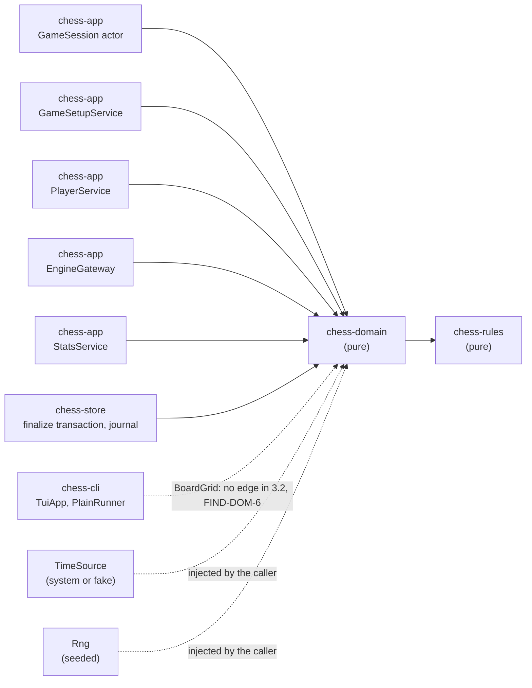
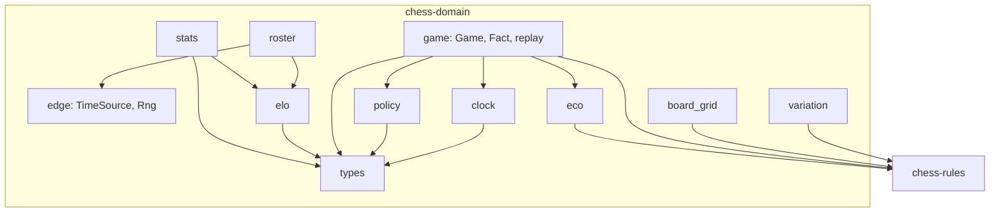
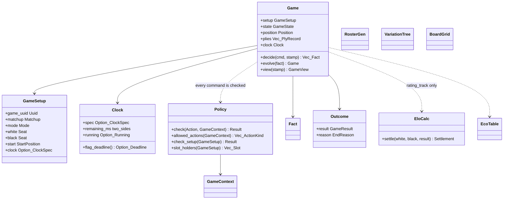
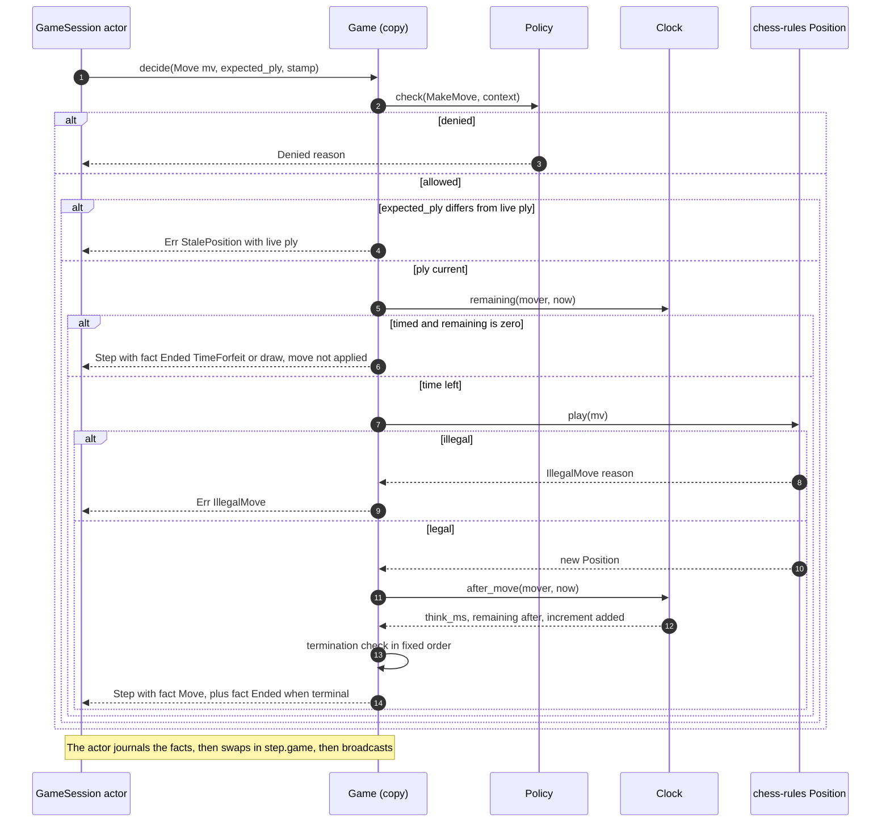
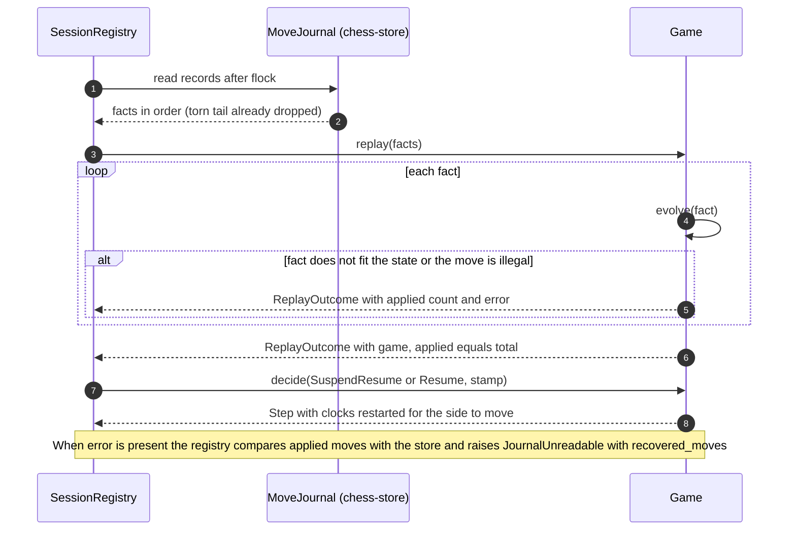
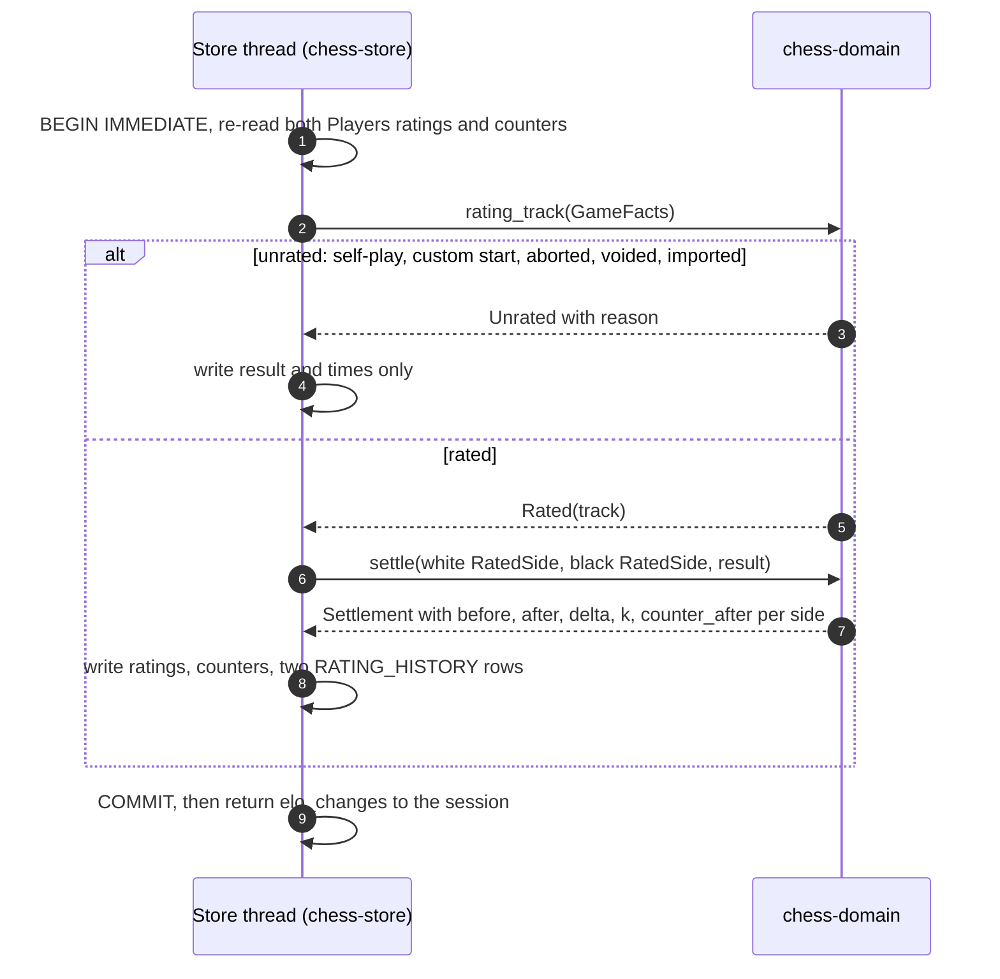
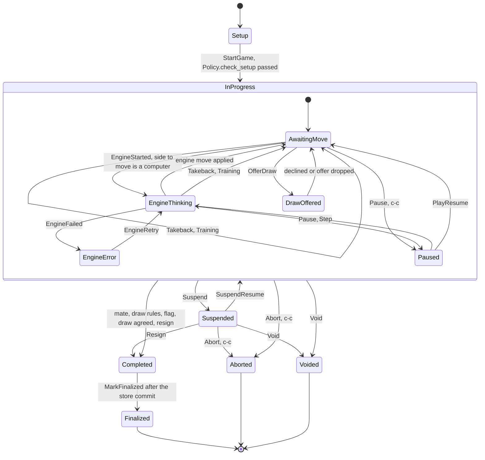
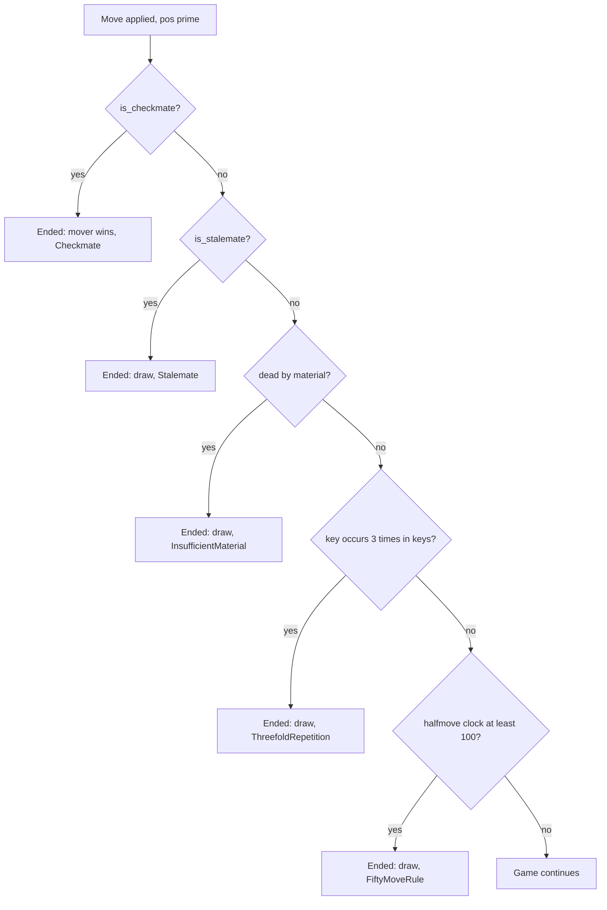

# SDD-chess-domain: Software Design Description for the `chess-domain` crate (Policy and Game domain)

| Field | Value |
|---|---|
| Document | docs/design/SDD-chess-domain.md |
| Version | 0.1 DRAFT |
| Date | 2026-10-30 |
| Style | IEEE 1016-style (viewpoints and design entities). No conformance to a numbered edition is claimed |
| Owner | Software engineer role (Claude), for Brian Prascher |
| Approver | **Pending.** Design-only work (documents, no code) is gate **G0** (SWE-001 §3), so no approval is needed to hold this draft. Implementation inside the crate with the §3.2 edges and §5.7 contracts unchanged is G1 (system-architect agent, desk review). Items in section 10 that touch an edge, a dependency, a journal record kind or a protocol are G2 (Brian Prascher). No approval is claimed here |
| Status | DRAFT. Nothing is implemented, built or run. Rust signatures are design-level sketches, not compiled code `[UNV]` |
| Blocks (architecture §2.2 names) | `chess-app core :: Policy` and `chess-app core :: Game domain` (crate `chess-domain`, pure): `Game`, state machine, `Clock`, `EloCalc`, `RosterGen`, `VariationTree`, `EcoTable`, `BoardGrid`, stats aggregation |
| Upstream baselines read | architecture.md v1.0 amendment 6; functional_decomp.md v1.0; requirements.md v1.0 Amendment 6; test-strategy.md 1.0 Amendment 6; SWE-001 v1.1 |
| Sibling SDDs | [SDD-chess-rules](SDD-chess-rules.md), [SDD-chess-store](SDD-chess-store.md), [SDD-chess-engine](SDD-chess-engine.md), [SDD-chess-app](SDD-chess-app.md), [SDD-chess-server](SDD-chess-server.md), [SDD-chess-cli](SDD-chess-cli.md), [SDD-ui](SDD-ui.md), [SDD-desktop-tauri](SDD-desktop-tauri.md) |

Evidence tags follow `swe-governance` §6: `[OBS file:line]` read in this session, `[INF]` inferred, `[UNV]` not verified, `ESTIMATE` a design value without a measurement. There is no SRS in the repository (SWE-001 "Upstream artifacts"), so the trace runs from requirement and function IDs of the upstream documents straight to design entities `DD-DOM-nnn`.

---

## 1 Introduction

### 1.1 Purpose

`chess-domain` is the **pure decision core** of the application. It decides what each mode and state allows (`Policy`), what happens to a game when a move, offer, pause, suspend, resignation or flag arrives (`Game`), how clocks run (`Clock`), how ratings change (`EloCalc`), which computer Players exist (`RosterGen`), which opening a game is in (`EcoTable`), how an analysis branch is kept (`VariationTree`), how the board is drawn for a terminal (`BoardGrid`) and how finished games add up (stats aggregation). It does no I/O: time and randomness come in through traits, persistence is somebody else's job, and every function is deterministic. This is architecture principle 2 (functional core, imperative shell) and what makes the unit-test levels of test-strategy feasible `[OBS architecture.md:99, 355]`.

### 1.2 Scope

In scope (architecture §3.3 row `chess-domain`, §4.3, §4.4, §4.6, §7.2 notes) `[OBS architecture.md:355]`: the game state machine; `Policy` as one table; `Clock`; Elo calculator with K 40 to 32, no clamp and the unrated cases; class bands; seeded roster and personality generator; variation tree; stats aggregation; ECO classification of a move sequence; the terminal-independent `BoardGrid` renderer.

Out of scope (owned elsewhere): move legality, SAN, FEN, PGN ([SDD-chess-rules](SDD-chess-rules.md)); the actor, the engine gateway, services and the protocol DTOs ([SDD-chess-app](SDD-chess-app.md)); the journal file format, SQL and transactions ([SDD-chess-store](SDD-chess-store.md)); UCI, `SearchLimits` and the clock-derived search budget ([SDD-chess-engine](SDD-chess-engine.md)); the TUI widgets that map `BoardGrid` to `ratatui` styles and the Elo chart renderers ([SDD-chess-cli](SDD-chess-cli.md)).

### 1.3 Allocation: functions, requirements, decisions

| Kind | IDs | Role of this block |
|---|---|---|
| Functions allocated by name `[OBS functional_decomp.md:90,92,94,133,134,136,138]` | **F-2.2.4** Detect game termination; **F-2.3.1** Decide allowed actions (`Policy`); **F-2.4.1** Run game clocks; **F-4.1** Decide rating eligibility; **F-4.2** Compute Elo update; **F-4.4** Derive computer category label; **F-4.6** Classify opening | Primary |
| Functions supported (allocated to another block, decided or computed here) | F-1.1 (starting ratings from category), F-1.6 (roster generation), F-1.8.3 (view window), F-2.1.1 and F-2.1.2 (setup rules, slot holders), F-2.2.3 (the apply decision), F-2.4.2 (flag result), F-2.4.3 (freeze and restore clocks), F-2.5.1 to F-2.5.5 (takeback, draw offer, resign, pause/step, abort), F-2.6.1, F-2.6.2, F-2.6.4, F-2.6.5, F-2.6.6 (suspend, resume by replay, void, finalise inputs, per-game data), F-3.3 (policy check for the gateway), F-4.5 (aggregation), F-5.2 and F-5.3 (what-if tree), F-7.1.1 and F-7.3.1 (board grid and stats inputs for the CLI) | Supporting |
| Requirements, primary | PLY-5, RULE-2, RULE-3, RULE-4, ELO-1, ELO-2, PLY-4 (category label, roster), ENG-2 (parameter generation), ANA-2 (variation tree), CLI-2 (board orientation and labels), UI-3 (CLI styles) `[OBS architecture.md:1528,1534-1536,1548-1549,1527,1542,1556,1559,1552]` | |
| Requirements, supporting | PLY-1, PLY-2, PLY-7, GAME-1, GAME-2, GAME-3, GAME-4, RULE-1, RULE-5, RULE-8, ENG-4, ENG-5, ANA-1, DAT-3 (time accounting, ECO), UI-2, UI-5, CLI-1, NFR-2, NFR-3 | |
| Decisions | D-13 (actor owns the `Game`), D-14, D-15, D-20, D-26, D-27, D-28, D-30, D-33, D-34, D-35, D-37 (information only) | |
| Risks | R-2, R-7, R-15, R-17, R-18, R-20 | |

### 1.4 Definitions

| Term | Meaning |
|---|---|
| Fact | A domain event that is also one journal record kind (section 3.11.1). The `Game` is the fold of its facts |
| `decide` / `evolve` | The two halves of a transition: `decide` checks the command and produces facts; `evolve` applies one fact |
| Stamp | `{ mono: MonoMs, wall: WallMs }`, one reading of the injected `TimeSource` |
| Seat | A Player on one side: `{ player: PlayerId, kind: Human or Computer }` |
| Slot holder | A Player that occupies an `UNFINISHED_SLOT` in a game (D-27) |
| Track | The rating scale of a game: `Strict` or `Training` (D-28) |
| h–h, h–c, c–c | Matchups: human–human, human–computer, computer–computer |

### 1.5 Conventions

Rust edition 2024, `rust-version = "1.99"` `[OBS architecture.md:373]`. Crate attributes: `#![forbid(unsafe_code)]`; compiler and `clippy` warnings are errors; `unwrap`, `expect`, `panic!`, unchecked indexing, arithmetic that can overflow and narrowing `as` casts are denied outside tests unless a written reason is attached (SWE-001 §6, CERT-informed; **no CERT conformance claim**). Time is `u64` milliseconds. Local ID prefixes: `FIND-DOM-n`, `OQ-DOM-n`, `ASM-DOM-n`, `ADR-REQ-DOM-n`.

---

## 2 Design overview

### 2.1 Viewpoints included and omitted

| # | Viewpoint | Included | Where |
|---|---|---|---|
| 1 | Context | yes | 3.1 |
| 2 | Composition | yes | 3.2 |
| 3 | Logical | yes | 3.3 (key types only) |
| 4 | Dependency | yes | 3.4 |
| 5 | Information | yes, reduced | 3.5. The crate stores nothing. It defines value shapes that other blocks persist |
| 6 | Patterns use | yes | 3.6 |
| 7 | Interface | yes | 3.7 (cards `IFP-DOM-n`, `IFR-DOM-n`) |
| 8 | Structure | folded into 3.2 and 3.8 | Module layering is short enough to share a section |
| 9 | Interaction | yes | 3.9 |
| 10 | State dynamics | yes | 3.10 (the §4.3 state machine as implemented) |
| 11 | Algorithm | yes | 3.11 |
| 12 | Resource | yes | 3.12 |

### 2.2 Design constraints taken from upstream

| Constraint | Source | Effect |
|---|---|---|
| Pure: data in, data out; `TimeSource` and `Rng` injected | Principle 2; §5.7 row `TimeSource, Rng` `[OBS architecture.md:99,839]` | No `std::time`, `rand`, `std::fs`, `std::env` in the crate |
| The actor owns the `Game` and applies a command to a **copy**, journals it, then swaps in the new state | §4.8 "Ordering and durability" `[OBS architecture.md:636]` | `Game` methods take `&self` and return a new `Game` plus facts |
| `Policy::check(action, &GameContext) -> Result<(), Denied>` is the single source of truth, table-tested | §4.4 `[OBS architecture.md:561]` | DD-DOM-004 |
| Every `GameSnapshot` carries `allowed_actions` computed from the table | §4.4 `[OBS architecture.md:585]` | `allowed_actions()` and `Game::view` |
| The journal wins; replay must be idempotent | §7.6, R-15 | One reducer for live and replay (DD-DOM-010) |
| Ratings are whole integers; update `R + round(K(S − E))`, half away from zero, `f64` | ELO-1, §7.2 `[OBS requirements.md:664-666]` | DD-DOM-011 |
| Coverage at least 90 % line for rules, Elo, clock, policy and parser modules; mutation testing on Elo and Policy | test-strategy "Quality gates" | Section 7 |

---

## 3 Viewpoint sections

### 3.1 Context viewpoint

**Concern:** who calls this crate and what it needs from outside.



Solid arrows into `chess-domain` are edges of §3.2 (`app -> domain`, `store -> domain`) `[OBS architecture.md:312,315]`. The `chess-cli -> chess-domain` use of `BoardGrid` is named in §5.7 (row `BoardGrid` renderer: "`chess-domain` -> TUI `BoardWidget`, `PlainRunner`") but has no direct edge in §3.2, which shows `cli -> server` and `cli -> app` only (FIND-DOM-6).

### 3.2 Composition viewpoint

**Concern:** the parts and what each is for.

| Module | Design entities | Purpose |
|---|---|---|
| `types` | DD-DOM-001 | Ids, `Side`-based enums, `Mode`, `Matchup`, `PlayerKind`, `Category`, `Track`, `GameResult`, `Outcome`, `EndReason`, time newtypes |
| `edge` | DD-DOM-002 | `TimeSource`, `Rng` traits, `SplitMix64`, fakes (feature `test-support`) |
| `clock` | DD-DOM-003 | `Clock`, `ClockSpec`, `ClockSync` |
| `policy` | DD-DOM-004, 005 | `Policy`, `Action`, `GameContext`, `Denied`, setup validation, slot holders, colour assignment |
| `game` | DD-DOM-006 to 010 | `Game`, `GameState`, `Fact`, `decide`/`evolve`, termination, in-play rules, replay |
| `elo` | DD-DOM-011, 012 | `EloCalc`, `Category` bands, rating eligibility |
| `roster` | DD-DOM-013, 014 | `RosterGen`, `Personality`, name generator |
| `eco` | DD-DOM-015 | `EcoTable` (deepest named position) |
| `variation` | DD-DOM-016 | `VariationTree` |
| `board_grid` | DD-DOM-017 | `BoardGrid`, `BoardStyle`, text rendering |
| `stats` | DD-DOM-018 | Aggregation, rating series, history check |
| `error` | DD-DOM-019 | `thiserror` enums |



### 3.3 Logical viewpoint

**Concern:** the static types a consumer sees (key types only).



`Settlement`, `PlyRecord`, `Personality`, `PlayerStats` and `BoardStyle` are described in section 4.

### 3.4 Dependency viewpoint

**Concern:** what the crate depends on and who depends on it.

| Direction | Item | Allowed by §3.2 | Note |
|---|---|---|---|
| out | `chess-rules` | yes `[OBS architecture.md:316]` | `Position`, `Move`, `PositionKey`, `PgnNode`, `Termination` |
| out | `serde` 1.0.229 (derive) | listed in §3.4 baseline, not drawn in §3.2 | `GameSetup`, `Fact`, `Outcome`, `Personality`, `ClockSpec` are received in protocol commands. **They are not written to the journal in this form:** SDD-chess-store 3.11.1 defines journal-owned DTOs and says the conversion lives in `chess-app` (consistency review XC-2). Use `deny_unknown_fields` on externally supplied shapes (SWE-001 §6 row SEC/SER) |
| out | `thiserror` 2.0.21 | yes, architecture §8 | |
| out | **`uuid` with the `v5` feature** | **not in §3.4 or §3.2** | Needed for the `Uuid` type and the UUIDv5 roster identities (D-34). FIND-DOM-3, ADR-REQ-DOM-1 |
| in | `chess-app` (`GameSession`, `GameSetupService`, `PlayerService`, `EngineGateway`, `StatsService`), `chess-store` (finalize, journal replay) | yes | |
| in (needed) | `chess-cli` (`BoardGrid`) | **no edge in §3.2** | FIND-DOM-6 |

`chess-engine` has no edge to `chess-domain` `[OBS architecture.md:314]`, so it cannot use the `Rng` trait defined here (FIND-DOM-5). No `tokio`, `rusqlite`, `tracing`, `rand` or clock crate may appear in this crate's dependency tree; a CI `cargo tree` assertion can check it `[UNV: not written]`.

### 3.5 Information viewpoint

**Concern:** what data shapes this crate defines for others to persist, and how they map to the data model.

The crate owns no table. It defines the in-memory and wire shapes below. Column names are from §7.2 `[OBS architecture.md:1100-1200]`.

| Domain shape | Persisted as | Stable text / encoding defined here |
|---|---|---|
| `GameSetup` | `GAME` header columns (`matchup`, `mode`, `start_fen`, `clock_spec`, `white_id`, `black_id`) and the journal `Start{setup}` record | `Matchup`: `hh`, `hc`, `cc`; `Mode`: `training`, `strict`; `clock_spec`: `base+inc` in seconds |
| `GameStatus` | `GAME.status` | `in_progress`, `completed`, `aborted`, `voided`, `imported` (the last is store-only) |
| `GameResult` | `GAME.result` | `1-0`, `0-1`, `1/2-1/2`; null for aborted and voided |
| `EndReason` | `GAME.termination` | see the table below (proposal, FIND-DOM-7) |
| `Fact` | one journal record each (§7.6 kinds) | Journal framing and CRC belong to the store; the domain fixes the fields (3.11.1) |
| `Clock` checkpoint | `GAME.white_clock_ms`, `GAME.black_clock_ms`, journal `Clock` | whole milliseconds, remaining time |
| `PlyRecord` | `MOVE` row | `san`, `uci`, `fen_after`, `think_ms`, clock columns, `played_at` |
| `Rating`, `Track`, `Category` | `PLAYER.strict_elo`, `training_elo`, `*_rated_games`, `RATING_HISTORY` | whole `i32`; `track`: `strict`, `training`; category names Beginner, Novice, Intermediate, Master, Grand Master |
| `Personality` | `COMPUTER_PROFILE` | `error_rate` held as permille `u16` (the store may write permille/1000 as `real`, FIND-DOM-12) |
| `EcoMatch` | `GAME.eco`, `GAME.opening_name` | code and name strings from the table |

`EndReason` strings (proposal; the upstream names only "voided by reset", "voided: unreadable", "resignation", "aborted" and "draw agreed" `[OBS architecture.md:1115, requirements.md:601,433]`):

| `EndReason` | `GAME.termination` | PGN `Termination` (via `pgn_termination()`) |
|---|---|---|
| `Checkmate` | `checkmate` | `normal` |
| `Stalemate` | `stalemate` | `normal` |
| `InsufficientMaterial` | `insufficient material` | `normal` |
| `ThreefoldRepetition` | `threefold repetition` | `normal` |
| `FiftyMoveRule` | `fifty-move rule` | `normal` |
| `TimeForfeit` (loss on the clock) | `time forfeit` | `time forfeit` |
| `TimeoutOpponentCannotMate` (draw on the clock) | `time forfeit, opponent cannot mate` | `normal` |
| `Resignation` | `resignation` | `normal` |
| `DrawAgreed` | `draw agreed` | `normal` |
| `Aborted` | `aborted` | `abandoned` |
| `VoidedByReset` | `voided by reset` | `abandoned` |
| `VoidedUnreadable` | `voided: unreadable` | `abandoned` |
| (unfinished) | null | none |

### 3.6 Patterns-use viewpoint

| Pattern | Where | Why | Misuse tell |
|---|---|---|---|
| Event sourcing with one reducer | `Game::decide` produces facts, `Game::evolve` applies one fact; live play and journal replay both call `evolve` | RULE-5 and R-15: a replayed game must equal the live game; replay must be idempotent | A second code path that changes `Game` without a fact |
| Decision table | `Policy` | One source of truth for "what is allowed"; table-driven tests over the product (§4.4) | An `if mode == Strict` outside `policy` |
| State pattern as an enum | `GameState` | The set of states is closed and mirrors §4.3 | A boolean flag that duplicates a state |
| Value objects, copy on command | `Game: Clone`, methods take `&self` | §4.8: apply to a copy, journal, then swap | Mutating methods on a shared `Game` |
| Dependency injection of edges | `TimeSource`, `Rng` traits, `Stamp` arguments | Determinism, fake time in tests (test-strategy "Determinism") | `Instant::now()` in a domain function |
| Seeded deterministic stream | `RosterGen` over `SplitMix64` | Same seed, same roster, forever (PLY-4, ENG-2) | `rand::thread_rng()` anywhere |
| Arena with stable ids | `VariationTree` | Cheap branch, delete and navigation without borrow cycles | `Rc<RefCell<..>>` nodes |
| Newtype for validated data | `Rating`, `RosterSeed`, `MoveDelay`, `ClockSpec` | Illegal values unrepresentable | A raw `i32` rating passed around |

### 3.7 Interface viewpoint

**Concern:** what the crate provides to its callers, what it needs, parameters, units and errors. Provided cards implement the §5.7 rows `TimeSource, Rng` and `BoardGrid` renderer, and the §4.3/§4.4 behaviour `[OBS architecture.md:839,843]`. Rust signatures are sketches `[UNV]`.

#### IFP-DOM-1 Policy (F-2.3.1, PLY-5)

| Operation | Parameters | Returns | Errors |
|---|---|---|---|
| `Policy::check(Action, &GameContext)` | an action with payload (`Resign{side}`, `OfferDraw{by}`, `MakeMove{by, actor}`, ...), the context | `Result<(), Denied>` | `Denied { reason: DeniedReason }` |
| `Policy::allowed_actions(&GameContext)` | context | `Vec<ActionKind>` in fixed declaration order (stable snapshots) | none |
| `Policy::check_setup(&GameSetup)` | setup | `Result<(), SetupError>` | `SetupError { field, reason }` |
| `Policy::slot_holders(&GameSetup)` | setup | `Vec<(PlayerId, Mode)>` per D-27 | none |
| `Policy::check_player_action(PlayerAction, &PlayerContext)` | `Rename`, `Archive`, `Reset`; kind, active flag | `Result<(), Denied>` | `computer_player`, `active_player` (FIND-DOM-8) |
| `assign_colors(ColorChoice, &mut dyn Rng)` | White, Black or Random | which seat plays White | none |

`DeniedReason` strings (snake case, additive per §5.5 "new codes may be added"): `strict_mode`, `training_untimed`, `not_human_turn`, `state_not_allowed`, `game_over`, `voided`, `draw_not_own_turn`, `draw_engine_busy`, `draw_offer_pending`, `draw_repeat_blocked`, `draw_not_available`, `computer_player`, `active_player`. The five `draw_*`, `computer_player`, `active_player` and `voided` come from the catalogue `[OBS architecture.md:581,800]`; the others are proposals.

#### IFP-DOM-2 Game

| Operation | Parameters | Returns | Errors |
|---|---|---|---|
| `Game::new(GameSetup, Stamp)` | validated at the call | `Step` (state `AwaitingMove`, fact `Start`) | `SetupError` |
| `Game::decide(Command, Stamp)` | one of `Move{mv, expected_ply, actor}`, `Takeback`, `OfferDraw{by}`, `RespondDraw{accept}`, `DropDrawOffer`, `Resign{side}`, `Flag`, `Pause`, `PlayResume`, `Step`, `Suspend`, `SuspendResume`, `Abort`, `Void{reason}`, `EngineStarted`, `EngineFailed`, `EngineRetry`, `Checkpoint`, `MarkFinalized` | `Step { game: Game, facts: Vec<Fact>, ended: Option<Outcome> }` | `GameError` (section 5) |
| `Game::evolve(Fact)` | one fact | `Result<Game, ReplayError>` | `ReplayError` |
| `Game::replay(impl IntoIterator<Item = Fact>)` | facts in journal order | `ReplayOutcome { game: Option<Game>, applied: usize, error: Option<ReplayError> }` | never panics |
| `Game::view(Stamp)` | | `GameView { state, ply, turn, plies, clocks: ClockSync, allowed_actions, outcome, eco }` | none |

Units: milliseconds (`u64`), plies (`u32`). `ClockSync = { white_ms, black_ms, running_side: Option<Side>, as_of: WallMs }` `[OBS architecture.md:477]`.

#### IFP-DOM-3 Clock

`Clock::new(Option<ClockSpec>)`, `start(side, now)`, `stop(now)`, `after_move(mover, now) -> MoveTiming { think_ms, remaining_after }`, `remaining(side, now)`, `flag_deadline(now) -> Option<(Side, MonoMs)>`, `sync(now, wall) -> ClockSync`, `checkpoint(now) -> ClockValues`, `restore(ClockValues)`. All arithmetic saturates at zero; no operation panics.

#### IFP-DOM-4 EloCalc (F-4.1, F-4.2, F-4.4)

| Operation | Parameters | Returns | Errors |
|---|---|---|---|
| `expected_score(ra: i32, rb: i32)` | integer ratings | `f64` in (0, 1) | none |
| `k_factor(rated_games_on_track_before: u32)` | counter before this game | `i32`: 40 if fewer than 30, else 32 | none |
| `settle(white: RatedSide, black: RatedSide, result: GameResult)` | rating and counter of each side on the game's track | `Settlement { white: SideUpdate, black: SideUpdate }` with `before`, `after`, `delta`, `k`, `counter_after` | `EloError::RatingOverflow` |
| `rating_track(&GameFacts)` | status, mode, self-play, custom start | `Rated(Track)` or `Unrated(reason)` | none |
| `Category::from_rating(i32)`, `Category::baseline()` | | band, or baseline 400, 600, 1200, 2200, 2500 | none |

Called by the finalize transaction on the store thread (architecture §5.4: `DB->>P: EloCalc(current ratings, K, rated flag)` `[OBS architecture.md:770]`), which is why `chess-store` depends on `chess-domain`.

#### IFP-DOM-5 RosterGen (PLY-4, ENG-2)

| Operation | Parameters | Returns | Errors |
|---|---|---|---|
| `RosterGen::new(RosterSeed, Option<UciEloRange>)` | seed; the `UCI_Elo` min/max read from the engine `uci` reply, or `None` | generator | none |
| `default_roster()` | | 25 `ComputerPlayerSpec`, 5 per category, indices 0 to 24 | `RosterError` |
| `generate(category, first_k: u32, count: u8, taken: &dyn Fn(&str) -> bool)` | count 1 to 25 | `Vec<ComputerPlayerSpec>` | `CountOutOfRange`, `ParameterSpaceExhausted` |

`ComputerPlayerSpec { uuid, roster_seed, roster_index, category, name, personality, strict_elo_start, training_elo_start }`. The range is passed as data, never hard-coded `[OBS architecture.md:609]`.

#### IFP-DOM-6 EcoTable (F-4.6, DAT-3)

`EcoTable::observe(current: Option<EcoMatch>, key: &PositionKey, ply: u32) -> Option<EcoMatch>`; `EcoTable::classify(keys: &[PositionKey]) -> Option<EcoMatch>` (full recompute); `eco_for_import(tag: Option<&str>, classified: Option<EcoMatch>) -> EcoFields { code: Option<String>, name: Option<String> }`.

#### IFP-DOM-7 VariationTree (ANA-2, F-5.2, F-5.3)

`new(root: Position, root_ply: u32)`, `play(at: NodeId, mv: Move) -> Result<NodeId, TreeError>`, `parent`, `first_child`, `children`, `position(node)`, `line_to(node) -> Vec<Move>`, `delete(node)`, `to_pgn_nodes() -> Vec<PgnNode>`, `to_pgn_text() -> String`, `from_pgn_text(root, root_ply, text)`.

#### IFP-DOM-8 BoardGrid (CLI-1, CLI-2, UI-3) `[OBS architecture.md:843]`

`BoardGrid::render(&Position, &BoardView) -> BoardGrid` where `BoardView { orientation: Side, last_move: Option<Move>, rewound: bool, style: BoardStyle }`; `BoardGrid { rows: [[Cell; 8]; 8], top_labels, bottom_labels, left_labels, right_labels }` with `Cell { glyph: char, shade: Shade, highlight: Highlight }`; `render_text(&BoardGrid, &BoardStyle) -> Vec<String>`.

#### IFP-DOM-9 Stats (UI-2, UI-5, F-4.5)

`aggregate(rows: &[StatsRow], window: Option<WallMs>) -> PlayerStats`; `rating_series(points: &[RatingPoint], track, window) -> Vec<RatingPoint>`; `check_history(points, track) -> Result<(), HistoryError>`; `counts_in_aggregates(&GameFacts) -> bool`.

#### IFP-DOM-10 Edge traits (§5.7 row `TimeSource, Rng`)

`trait TimeSource: Send + Sync { fn mono(&self) -> MonoMs; fn wall(&self) -> WallMs }` (monotonic for clocks, wall only for timestamps `[OBS architecture.md:839]`); `trait Rng { fn next_u64(&mut self) -> u64; fn below(&mut self, n: u64) -> u64 }`; `SplitMix64` implements `Rng`. `FakeTimeSource` and `ScriptedRng` live behind feature `test-support`.

#### Required interfaces

| ID | Provider | Used for | Failure handling |
|---|---|---|---|
| IFR-DOM-1 | `chess-rules` ([IFP-RUL-1 to 6](SDD-chess-rules.md)) | positions, SAN, keys, PGN nodes, ECO lookup | `IllegalMove` becomes `GameError::IllegalMove`; a rules error during replay becomes `ReplayError::Illegal` |
| IFR-DOM-2 | the caller's `TimeSource` | `Stamp` values | Not applicable (infallible). A non-monotonic reading is treated as zero elapsed time (saturating subtraction) |
| IFR-DOM-3 | the caller's `Rng` | colour draw, roster stream | Not applicable |

### 3.8 Structure viewpoint (module layering)

Lowest layer first: `types` and `edge`; then `clock`, `elo`; then `policy`; then `eco`, `variation`, `board_grid`; then `game` (uses `clock`, `policy`, `eco`, `rules`); then `roster` (uses `edge`, `elo`) and `stats` (uses `elo`, `types`). No module imports one above it. `lib.rs` is the only place with `pub use`. Nothing in `elo`, `roster`, `stats`, `board_grid` or `variation` imports `game`, so they can be tested and used (by `chess-store` for `elo`) without it.

### 3.9 Interaction viewpoint

#### 3.9.1 Apply a move, including termination, the flag and rejections (F-2.2.3, F-2.2.4, RULE-4)

**Question:** what does `Game` decide for one move command, in which order, and what do the failure paths return?



#### 3.9.2 Resume by replay (RULE-5, NFR-2, F-2.6.2)

**Question:** how is a game rebuilt from its journal, and what is reported when the journal stops making sense?



#### 3.9.3 Finalize ratings on the store thread (F-2.6.5, F-4.1, F-4.2)

**Question:** which domain calls does the finalize transaction make, and who owns the data?



### 3.10 State-dynamics viewpoint

**Concern:** behaviour by state: the §4.3 machine as implemented by `GameState`.



Transition table (every row traces to §4.3 `[OBS architecture.md:481-557]`, §4.4 and D-33):

| # | From | Command (fact) | Guard (Policy reason on failure) | To | Clock effect |
|---|---|---|---|---|---|
| T1 | Setup | `Game::new` (`Start`) | `check_setup` ok, start position not terminal (FIND-DOM-9) | AwaitingMove | If timed, White's clock starts (ASM-DOM-1) |
| T2 | AwaitingMove | `EngineStarted` (none, transient) | side to move is a computer | EngineThinking | running |
| T3 | EngineThinking | `Move` by `Actor::Engine` | ply current, legal | AwaitingMove, or Paused when `stepping` | switch, add increment |
| T4 | EngineThinking | `EngineFailed` (none) | | EngineError | **keeps running** (D-15, ENG-4) |
| T5 | EngineError | `EngineRetry` (none) | | EngineThinking | running |
| T6 | AwaitingMove | `Move` by `Actor::Human` | human to move, ply current, legal | AwaitingMove | switch, add increment |
| T7 | AwaitingMove or EngineThinking or EngineError | `Takeback` | Training, h–c (`strict_mode`); something to undo (`NothingToTakeBack`) | AwaitingMove | none (Training is untimed) |
| T8 | AwaitingMove | `OfferDraw` (`DrawOffered`, then `Clock`) | the five draw rules (3.11.4) | DrawOffered | **all stop** |
| T9 | DrawOffered | `RespondDraw{accept=false}` (`DrawDeclined`), or `DropDrawOffer` (`DrawDropped`) | | AwaitingMove | restart, same side to move; `offer_blocked_for = offerer` on decline |
| T10 | DrawOffered | `RespondDraw{accept=true}` (`Ended DrawAgreed`) | | Completed | stop |
| T11 | AwaitingMove or EngineThinking | `Pause` (`Pause`, `Clock`) | c–c only (`state_not_allowed`) | Paused | all stop; a search in progress is cancelled by the session |
| T12 | Paused | `Step` | c–c | EngineThinking with `stepping = true` | runs for the one move (ASM-DOM-2) |
| T13 | Paused | `PlayResume` (`PlayResume`) | | AwaitingMove | restart |
| T14 | InProgress | `Suspend` (`Suspend`, `Clock`) | | Suspended | stop; resume target recorded (3.11.5) |
| T15 | Suspended | `SuspendResume` | | the recorded sub-state | restart if it runs |
| T16 | InProgress, Suspended | terminal move, `Flag`, `Resign` (`Ended`) | Resign: human side, not c–c | Completed | stop |
| T17 | InProgress, Suspended | `Abort` (`Aborted`) | c–c only | Aborted | stop |
| T18 | InProgress, Suspended | `Void` (`Voided`) | reason `Reset` needs h–h or h–c; `Unreadable` any | Voided | stop |
| T19 | Completed | `MarkFinalized` | the store transaction committed | Finalized | none |

`Finalized` is entered only after the store commit (§4.3: "one transaction: result + times + W/L/D, Elo ..."), so the pure crate offers the transition but does not perform the finalisation.

### 3.11 Algorithm viewpoint

#### 3.11.1 Facts, the single reducer, and replay (DD-DOM-010)

`Fact` has one variant per journal record kind of §7.6 `[OBS architecture.md:1322-1326]`, with the fields the reducer needs:

| `Fact` | Journal kind | Fields |
|---|---|---|
| `Start` | `Start{setup}` | `setup: GameSetup`, `started_at: WallMs` |
| `Move` | `Move{ply, uci, san, think_ms, clocks_after}` | `ply`, `mv: Move`, `think_ms`, `clocks_after: Option<ClockValues>`, `played_at: WallMs` (SAN is recomputed and checked, not trusted) |
| `Takeback` | `Takeback{to_ply}` | `to_ply` |
| `Clock` | `Clock{white_ms, black_ms, running_side}` | `ClockValues`, `running: Option<Side>` |
| `DrawOffered`, `DrawDeclined` | `DrawOffer`, `DrawDeclined` | `by: Side` |
| `Pause`, `PlayResume` | `Pause`, `Resume` | |
| `Suspend` | `Suspend` | |
| `Ended` | `GameEnd{result, reason}` | `Outcome` (resignation carries the side) |
| `Aborted` | `Abort` | |
| `Voided` | `Voided{reason, reset_player_id?}` | `VoidReason`, `Option<PlayerId>` |

Not in the §7.6 list but needed by the machine (FIND-DOM-1): `DrawDropped` (an offer to a computer is dropped by an engine failure or a suspend; without a record, replay would stay in `DrawOffered`); `SuspendResume` (replay needs to know that the game ran again after a `Suspend`; an alternative is the implicit rule that any non-terminal fact after `Suspend` resumes it, which this crate implements as a fallback); and the rule that a `Move` fact in state `Paused` is a stepped move (there is no `Step` kind).

**Single reducer.** `decide(cmd, stamp)` does all checks (Policy, ply, legality, clocks) and returns `Vec<Fact>`. `evolve(fact)` is the only code that changes `Game`, and it never reads a clock: facts carry `think_ms`, `clocks_after` and wall times, so live play and replay run the same code. `decide` then applies its facts with `evolve` to build the returned `step.game`. Property: for any command script, `replay(facts_of(script))` equals the live `Game` field by field, and `replay` of the same facts twice equals itself (idempotent, R-15).

**Replay errors.** `replay` stops at the first fact that does not fit (wrong state, wrong ply, illegal move, SAN mismatch, a second `Start`) and returns the game built so far, the number of facts applied and the error. The caller turns that into `JournalUnreadable{recovered_moves}` (§5.5). The clock after replay is restored from the last `Move.clocks_after` or `Clock` fact; the running side is `None` until `SuspendResume` (or a resume command) restarts it.

#### 3.11.2 Termination after a move (F-2.2.4, RULE-1, RULE-2)

After `play`, with `pos'` the new position and `keys` the repetition keys of all positions since the start (take back removes the last entries):



The order is: checkmate, stalemate, dead position, threefold, fifty-move. Only the first (checkmate over the fifty-move count) is stated upstream (RULE-1 interpretation `[OBS requirements.md:413]`: the checkmate stands); the rest is a design choice for when several conditions hold on the same move (FIND-DOM-6). The fifty-move rule counts plies: 100 halfmoves. Threefold counts occurrences of one `PositionKey` including the start position. These are the automatic draws that deviate from FIDE Art. 9.2 and 9.3 on purpose (RULE-1 (b)).

**Flag.** `Flag` is accepted only if `Clock::remaining(running_side, now) == 0`. The loser is the flagged side unless `!position.can_side_checkmate(opponent)`, then the game is drawn (`TimeoutOpponentCannotMate`, RULE-4). A `Move` command that arrives when the mover's remaining time is already zero does **not** apply the move: it produces the flag result instead. This makes the result independent of whether the flag timer or the move message reached the actor first (§4.2 says commands are handled one at a time, the timer is one more message).

#### 3.11.3 Clock arithmetic (DD-DOM-003)

State: `remaining_ms[White, Black]` (only when timed), `turn_elapsed_ms` (time charged to the side to move in this turn so far, summed over running intervals), `running: Option<{side, since: MonoMs}>`.

- `stop(now)`: `delta = now.saturating_sub(since)`; `turn_elapsed += delta`; if timed, `remaining[side] = remaining[side].saturating_sub(delta)`; `running = None`.
- `start(side, now)`: `running = Some({side, since: now})`.
- `remaining(side, now)`: the stored value minus the running delta if `side` is the running side.
- `after_move(mover, now)`: `stop(now)`; `think_ms = turn_elapsed`; if timed, `remaining[mover] += increment` (Fischer: added after the move is completed, FIDE Art. 6.4 `[UNV: not re-read]`, ASM-DOM-3); `turn_elapsed = 0`; `start(opponent, now)`.
- Flag check **before** the increment: time is expired when `think_ms >= remaining_before_move`.
- `flag_deadline(now)`: `(running side, now + remaining)` for the one timer the actor arms (§4.2).
- `pause` (pause, draw offer, suspend) calls `stop(now)`, which keeps `turn_elapsed`, so a pause never charges time and the next `think_ms` includes only running time (DAT-3: "excludes time the app was closed/paused").
- `restore(ClockValues)` after a crash or resume sets `remaining` from the checkpoint; for a timed game `turn_elapsed` is rebuilt as `remaining_at_start_of_turn − checkpoint_remaining`, where the start-of-turn value is `clocks_after` of the previous move plus nothing (the increment is already in it). At most one checkpoint interval (1 s) of thinking is lost (RULE-5, Q54).
- Untimed games (`spec = None`) keep `turn_elapsed` only, so `think_ms` exists for DAT-3 without any limit.

Invariant: for a timed game, `remaining_at_turn_start − turn_elapsed = remaining_now` at every stop. Property-tested.

#### 3.11.4 In-play rules (D-33, §4.4)

- **Takeback.** `floor` = index of the human's first turn: 0 if the human is to move in the start position, else 1. In `AwaitingMove` (the human to move at index *n*): target = *n − 2*; in `EngineThinking` or `EngineError` (computer to move at index *n*, human's move at *n − 1*): target = *n − 1*. If `target < floor` the command fails with `NothingToTakeBack`. Otherwise plies, keys and the ECO state are truncated to `target`, the fact `Takeback{to_ply: target}` is produced, and the state is `AwaitingMove`. The game stays rated (Training); `offer_blocked_for` is cleared. A takeback in `EngineError` is not shown in §4.3 and is treated like `EngineThinking` (FIND-DOM-6).
- **Draw offer.** Order of checks, each with its reason: (1) c–c or the offerer is a computer: `draw_not_available`; (2) state `DrawOffered`: `draw_offer_pending`; (3) state `EngineThinking` or `EngineError`: `draw_engine_busy`; (4) any other state but `AwaitingMove`: `state_not_allowed`; (5) offerer is not the side to move: `draw_not_own_turn`; (6) `offer_blocked_for == Some(offerer)`: `draw_repeat_blocked`. On accept: `Ended { DrawAgreed }`. On decline: `offer_blocked_for = Some(offerer)`, cleared when that side completes a move. An engine failure or a suspend while the offer is to a computer drops it (`DrawDropped`); an offer to a human survives a suspend.
- **Pause, step, delay** (c–c, Strict). `MoveDelay` is a newtype 0 to 10 000 ms in 500 ms steps, default 1000 ms (TBD-5, ESTIMATE) validated here; the delay itself is session state.
- **Resign.** Allowed in every `InProgress` sub-state and in `Suspended`, for a human side, not c–c. The resigning side loses (`Resignation`). A self-play resignation ends the game; `rating_track` makes it unrated.
- **Abort and void.** `Abort`: c–c only. `Void(Reset)`: h–h or h–c only (only humans are reset). `Void(Unreadable)`: any matchup. Neither produces a result.
- **Suspend target.** `Suspend` records the sub-state to return to: `AwaitingMove` (also from `EngineThinking` and `EngineError`: the search is lost, the session asks the engine again), `Paused`, `DrawOffered` when the offer is to a human, `AwaitingMove` when the offer was to a computer (offer dropped, clocks restart).
- **Rewind** is client view state and never reaches `Game` (§4.2). `Policy` lists `Rewind` as allowed for h–c and h–h games in progress so that `allowed_actions` is complete.

#### 3.11.5 Policy decision table (DD-DOM-004)

Verdicts for the context fields `mode` (T = Training, S = Strict), `matchup`, `state` and the side kinds. "✓" allowed; otherwise the `DeniedReason`. `[OBS architecture.md:563-577]`.

| Action | Rule | Reason on failure |
|---|---|---|
| `Takeback` | T, h–c, state AwaitingMove, EngineThinking or EngineError | `strict_mode` (S); `state_not_allowed` otherwise |
| `LiveAnalysis` | T, state AwaitingMove, human to move (test-strategy: "human's turn only") | `strict_mode` (S, in progress); `state_not_allowed` |
| `WhatIf` | T in progress and human to move; or any game that is Completed, Finalized, Aborted or Voided | `strict_mode` (S in progress) |
| `PostGameAnalysis` | Completed, Finalized, Aborted, Voided | `state_not_allowed` while in progress |
| `Rewind` | h–h or h–c, InProgress | `state_not_allowed` for c–c |
| `SelectClock` | S only | `training_untimed` |
| `OfferDraw{by}` | 3.11.4 rules; T: to the computer; S: h–h and h–c | the five `draw_*` reasons |
| `RespondDraw{by, actor}` | state DrawOffered; the offeree answers (a human by command, a computer by the engine path) | `state_not_allowed` |
| `Pause`, `PlayResume`, `Step`, `SetMoveDelay` | c–c only; Pause in AwaitingMove or EngineThinking; PlayResume and Step in Paused | `state_not_allowed` |
| `Resign{side}` | not c–c; `side` is human; InProgress (any sub-state) or Suspended | `state_not_allowed` |
| `Abort` | c–c only; InProgress or Suspended | `state_not_allowed` |
| `CancelEngine` | h–c, state EngineThinking, either mode | `state_not_allowed` |
| `RetryEngine` | state EngineError | `state_not_allowed` |
| `MakeMove{by, actor}` | Human: AwaitingMove, `by` is the human side to move. Engine: EngineThinking, side to move is a computer | `not_human_turn`, `state_not_allowed` |
| Any action on a Voided game | except `PostGameAnalysis` and `WhatIf` | `voided` |
| Any action on a Completed, Finalized or Aborted game | except analysis | `game_over` |

`allowed_actions` is the list of `ActionKind` for which `check` succeeds for at least one actor, in the fixed declaration order. A test asserts `allowed_actions` and `check` can never disagree.

#### 3.11.6 Slot holders (D-27) and setup validation (GAME-1, PLY-5)

`slot_holders(setup)`: h–h: each human, or one slot for self-play; h–c: the human only (the computer's slot is neither used nor checked); c–c: each computer, or one for self-play; the slot's mode is `setup.mode` `[OBS architecture.md:573,1210-1213]`.

`check_setup(setup)` fails with `SetupError{field, reason}` for: Training and not h–c (`mode`, `training_requires_human_vs_computer`); a clock with Training (`clock`, `training_untimed`); seat kinds that do not match the matchup (`players`, `players_wrong_kind`); an invalid custom clock (`clock`, `clock_invalid`); a start FEN that is already checkmate or stalemate (`start_fen`, `start_position_terminal`, FIND-DOM-9). Self-play is derived, not chosen. Whether a chosen Player already holds a slot is **not** decided here (it needs the store).

`ClockSpec`: presets `1+0`, `3+2`, `5+0`, `10+5`, `15+10`, `30+0` (minutes plus seconds, RULE-4) and a custom pair of whole seconds; the whole-second restriction keeps `TimeControl` representable in PGN `seconds+increment`. Custom limits are **not specified upstream**; this design proposes base 1 s to 24 h and increment 0 to 1 h as `ESTIMATE`s (FIND-DOM-6).

#### 3.11.7 Elo (DD-DOM-011)

For each side independently, using the ratings from **before** the game:

```
E_A = 1 / (1 + 10^((R_B - R_A) / 400))        (f64)
S   = 1.0 win, 0.5 draw, 0.0 loss               (a resignation is a loss)
K   = 40 if rated_games_on_track_before < 30 else 32
delta_A = round_half_away_from_zero(K * (S_A - E_A))     (f64::round)
after_A = checked_add(R_A, delta_A)
counter_after_A = counter_before_A + 1  (saturating)
```
`[OBS requirements.md:664-668]`. Game 30 uses K = 40 (29 rated games before it) and game 31 uses K = 32. Each track has its own counter; the other track is never read or changed. There is no clamp. `|delta| <= K` because `S − E` lies in [−1, 1], so the narrowing cast to `i32` is range-checked first and carries a written suppression reason. Where both Ks are equal the two deltas are exactly opposite: a tie `K(S−E) = n + ½` would need `E` rational with a denominator dividing `2K`, which happens only at equal ratings with an even `K`, where `K(S−E)` is an integer `[INF]`; the property test checks it.

`rating_track(facts)`: `Unrated` if self-play, custom start, status Imported, Aborted or Voided, or not Completed; otherwise `Rated(Track::from(mode))`. Takeback does not change it.

Bands (ELO-1) `[OBS requirements.md:677]`: below 600 Beginner; 600 to 1199 Novice; 1200 to 2199 Intermediate; 2200 to 2499 Master; 2500 and above Grand Master. A computer's label is `Category::from_rating(strict_elo)`; its Training rating never reaches this function (F-4.4, Q79).

Numerical risk: `f64::powf` may differ in the last bit between platforms; that moves the result only if `K(S−E)` is within about 1e-12 of a half-integer, which the argument above excludes. Exact-integer known-value tests (ELO-1 table) pin the behaviour on every platform that is run.

#### 3.11.8 RosterGen (DD-DOM-013, DD-DOM-014)

- **Index space.** `roster_index = 5·k + class_ordinal` (Beginner 0, Novice 1, Intermediate 2, Master 3, Grand Master 4), where *k* counts Players of that class in the seed's sequence. The default roster is *k* = 0 to 4 for each class, which is indices 0 to 24 (five per class, PLY-4). A "generate more" request for a class takes the next *k* values. This makes `roster_index` identify the class as well, so two installs that generated different classes cannot give the same `(seed, index)` to different Players (FIND-DOM-4).
- **Stream.** `SplitMix64` seeded by a fixed mixing of `(roster_seed, roster_index, attempt)`. All draws use one fixed order: skill level, depth limit, movetime, `uci_elo`, error rate, error MultiPV. A bounded draw uses the multiply-shift method on 128-bit arithmetic (no modulo bias to reason about). The first outputs for seed 0 are pinned by a golden test, because any change after release changes every future roster.
- **Class bounds** are a data table `ClassBounds` (min and max of each parameter per class). **The numbers are not specified upstream and come from calibration** (ENG-2, R-2, `chess calibrate`); this SDD gives the rules only: bounds are data, not code; for each class `min <= max`; baselines increase strictly (400 < 600 < 1200 < 2200 < 2500). Until calibration, the table holds `ESTIMATE` placeholders marked as such.
- **`uci_elo`.** `Some(v)` only if the class baseline lies inside the engine's reported `[min, max]`; then `v` is drawn inside the class band intersected with that range. Otherwise `None`, and the class uses the low-skill method (ENG-2, CR-3 amendment). Passing `None` for the range makes every `uci_elo` `None`.
- **Uniqueness (ENG-2: no two computer Players share a parameter set).** `personality_at(seed, index)` draws attempt 0, 1, 2, ... until the set differs from the sets of **all lower indices** (recomputed from the seed, not read from the store). More than 64 attempts for one index -> `ParameterSpaceExhausted`. Because the rule uses only indices below, the personality at an index depends on `(seed, index, range)` alone, not on what the store holds, so two installs agree. A defensive check against the sets already in the store returns an error if a stored set is repeated (only possible after a generator change).
- **Identity.** `uuid = UUIDv5(ROSTER_NAMESPACE, "chess-roster/v1/{seed}/{index}")`, with decimal ASCII numbers. `ROSTER_NAMESPACE` is one fixed UUID that must be generated once and frozen; its value is not invented in this document (FIND-DOM-4). After a release this derivation cannot change without a migration (D-34).
- **Names.** For an index, the candidate sequence is: eight pseudo-random "given name + family name" pairs from two fixed ASCII pools (duplicates removed), then, without end, the first candidate with an ordinal suffix (`II`, `III`, `IV`, ... then decimal). The chosen name is the first candidate for which `taken(name)` is false, where `taken` is case-sensitive and covers every Player, active or archived (PLY-6, PLY-4). The sequence is infinite, so a request cannot fail on a name. Pool content is original project text (no licence question for NFR-6); a unit test checks every pool entry satisfies the PLY-6 rules (non-empty, at most 128 grapheme clusters, NFC, no control character).
- **Counts.** `count` outside 1 to 25 -> `CountOutOfRange` (TBD-31).
- **Starting ratings.** Both `strict_elo_start` and `training_elo_start` equal `Category::baseline()` (ELO-1, Q41).

#### 3.11.9 ECO classification (DD-DOM-015)

`observe(current, key, ply)`: if `rules::eco::lookup(key)` is `Some(entry)` return `Some(EcoMatch{ code, name, ply })` (deeper replaces shallower), else return `current`. So after the last move of a game the stored match is the **deepest named position reached**, and a transposition reaches the same position and therefore the same entry (DAT-3, CR-8) `[OBS requirements.md:608]`. `Game` applies it after every move for a standard-start game only, because a custom start has no ECO code and no name; after a takeback it recomputes over the remaining keys. `eco_for_import` keeps a file's `ECO` tag code and takes the name from the table, or takes both from the table when there is no tag.

#### 3.11.10 VariationTree (DD-DOM-016)

An arena of nodes; `NodeId(u32)` is an index and is never reused (a deleted node becomes a tombstone), so ids held by a UI stay valid. Each node stores the `Move`, its parent, its children in creation order (the first child is the "main" continuation) and the resulting `Position`. `play(at, mv)` returns the existing child when the same move was already played there (no duplicates), else checks legality through `chess-rules` and appends. `delete(node)` removes the node and its subtree (never the root). `line_to(node)` walks up to the root. Limit: `MAX_NODES` (4096, `ESTIMATE`) -> `TreeError::Full`. `to_pgn_nodes` gives the tree as `PgnNode`s with nested variations; `to_pgn_text` writes them through `chess-rules::format_line`. Saving a branch started after the **last** ply of a game cannot be a PGN "variation" of any move; how it is exported is open (FIND-DOM-6).

#### 3.11.11 Stats aggregation (DD-DOM-018, UI-2, UI-5)

Input row (one per game, produced by the store query from the viewed Player's side): `StatsRow { mode, color, result_for_viewed: Win|Loss|Draw, started_at, plies, active_ms, opponent: { player, kind, category_now } }`. The caller selects rows where `status = 'completed' AND self_play = 0 AND start_fen IS NULL` (§7.2 note `[OBS architecture.md:1207]`); `counts_in_aggregates(&GameFacts)` implements the same predicate for tests (FIND-DOM-2). `aggregate(rows, window)`:

- `window = Some(reset_at)` only for the Player's **own** view: drop rows with `started_at < reset_at` (D-26, Q76). An opponent's view passes `None`, so it keeps every game against the reset Player.
- W/L/D totals; by colour; by mode (Training and Strict separately); by opponent; by opponent category (the computer's current label, FIND-DOM-6 on the filter boundary).
- Average length in moves = mean of `(plies + 1) / 2` (full moves, ⌈plies/2⌉) and average time = mean of `active_ms` (UI-2, Q73). A mean with no games is `None`, never 0 or NaN; the front-end shows "—" (CR-4.15).
- Output ordering is deterministic (opponents sorted by id) so snapshot tests are stable.

`rating_series(points, track, window)` returns the points of one track ordered by `(at, id)`, from the reset point on when `window` is set. `check_history` verifies, per track: each row's `rating_before` equals the previous row's `rating_after`, the first row (null game) has `before == after`, and `final == initial + Σ(after − before)` (ELO-1 integration check). Voided, aborted, unfinished and imported games never appear because their rows are not selected.

#### 3.11.12 BoardGrid (DD-DOM-017)

`render` maps each square to a `Cell` for the chosen orientation (`Side::White` at the bottom puts rank 1 last; `Black` flips ranks and files). `glyph` comes from the `BoardStyle`:

| Style | Glyphs | Colour | Shade and highlight conveyed by |
|---|---|---|---|
| `Plain` (ASCII) | letters `KQRBNP` for White, `kqrbnp` for Black, `.` or space for empty | none | characters (for example `[ ]` around the last-move squares) |
| `Unicode` | U+2654 to U+2659 White, U+265A to U+265F Black `[INF: Unicode chess symbols block]` | none | characters |
| `Ansi` | Unicode glyphs | basic SGR colour codes for square shade and highlight | colour |
| `NoColor` | Unicode glyphs | none, no escape bytes | characters |

Labels: files `A` to `H` upper case and ranks `1` to `8` on all four sides of the board panel (CLI-2 `[OBS requirements.md:906-909]`), flipped with the orientation. Each square is rendered 3 columns wide (padding on both sides) so a wide or narrow glyph does not move the next square (R-7). `Highlight` flags: `LastMoveFrom`, `LastMoveTo`, `Check` (the king of the side to move when in check), `Rewound`. `render_text` returns lines; it writes an ESC byte only for the `Ansi` style, so `NO_COLOR` (read by the CLI, not here) maps to `NoColor` and the UI-4 check "no colour escape sequences" holds by construction.

### 3.12 Resource viewpoint

| Resource | Design | Provenance |
|---|---|---|
| Memory per `Game` | O(plies): per ply a `PlyRecord` (SAN, FEN text up to about 100 bytes, numbers), a `PositionKey` and a `Move`; a few hundred bytes per ply | `[INF]`; measure in step 1 |
| Cost of copy-per-command | One `Game` clone per command (architecture §4.8 requires apply-to-a-copy). With a few hundred plies this is on the order of tens of microseconds `ESTIMATE` | Measure with the NFR-8 latency test; if it matters, keep plies in an `Arc`ed persistent vector (two-way) |
| `MAX_PLIES` | 10 000 plies as a guard that returns `GameError::TooLong` (should be unreachable: the fifty-move and repetition rules end games earlier) | `ESTIMATE` |
| `MAX_NODES` | 4096 per `VariationTree` | `ESTIMATE` |
| Roster generation | 64 attempts per index at most; for N up to 25 plus the default 25, quadratic comparison of parameter sets over fewer than a few hundred entries | `[INF]` |
| Time | No wall-clock use inside the crate; `Stamp` values arrive as arguments | |
| Stack | No recursion over game length. `VariationTree` walks are iterative. `to_pgn_nodes` recurses over tree depth, bounded by `MAX_NODES` | CERT-informed |
| Concurrency resources | None. No locks, channels or threads (section 6) | |

---

## 4 Design entities

`Code:` is empty until implementation. "Failure behaviour" is stated for every entity that parses, allocates a growing structure, or can reject input.

### DD-DOM-001 Shared value types
- Type: module `types` | Traces to: PLY-1, PLY-5, ELO-2, GAME-4 | Function: supports F-2.1.1, F-4.1
- Purpose: `PlayerId(i64)`, `Mode`, `Matchup`, `PlayerKind`, `Seat`, `Category`, `Track`, `GameResult`, `Outcome`, `EndReason`, `VoidReason`, `GameStatus`, `MonoMs(u64)`, `WallMs(i64)`, `Stamp`, `ClockValues`. Stable text forms in 3.5.
- Failure behaviour: `FromStr` for the stored forms returns a typed error; no panic.
- Rationale: newtypes keep milliseconds, plies and ratings from being swapped. `PlayerId` mirrors the `PLAYER.id` integer key; `Uuid` appears only where the architecture uses it (`game_uuid`, roster identity).
- Verification: UT-DOM-001 | Code: (pending)

### DD-DOM-002 Edge traits
- Type: traits and `SplitMix64` | Traces to: architecture §5.7 row `TimeSource, Rng`, test-strategy "Determinism" | Function: supports F-2.4.1, F-1.6
- Purpose: IFP-DOM-10. `SplitMix64` is a small, fully specified generator (about twenty lines) so the stream is stable for ever.
- Rationale: the roster must be reproducible after a release (UUIDs are derived from it, D-34). The `rand` crate documents that its standard generator may change between versions `[UNV: not re-read]`, and a dependency is avoided. A published ChaCha-based generator would also be stable; own code was chosen to keep the pure crate small.
- Verification: UT-DOM-002 (golden outputs, `below` bounds) | Code: (pending)

### DD-DOM-003 Clock
- Type: struct | Traces to: RULE-4, RULE-5, GAME-2, ENG-4 (D-15), DAT-3 | Function: F-2.4.1; supports F-2.4.2, F-2.4.3
- Purpose: 3.11.3. Always present; `spec = None` means untimed.
- Failure behaviour: saturating arithmetic; a backwards `MonoMs` gives zero elapsed.
- Rationale: one type for timed and untimed games gives every move a `think_ms` (DAT-3) without a second timer. Time arrives as arguments so tests need no fake clock object. Alternative rejected: the `Clock` owning a `&dyn TimeSource` (hidden input, harder to test and to replay).
- Verification: UT-DOM-010 to 014 | Code: (pending)

### DD-DOM-004 Policy
- Type: functions and enums | Traces to: PLY-5, ANA-1, RULE-2, RULE-3, GAME-2, ENG-5 | Function: F-2.3.1; supports F-3.3
- Purpose: 3.11.5.
- Failure behaviour: total over the product of its inputs; unknown combinations return `Denied`, never panic.
- Rationale: the table form lets a test enumerate the full product of mode × matchup × state × side kinds and lets `cargo-mutants` find untested rows (test-strategy principle 5). `Game::decide` calls `Policy::check` itself, so no caller can bypass it (the gateway and services call the same function).
- Verification: UT-DOM-020 to 024 | Code: (pending)

### DD-DOM-005 Setup validation, slot holders, colours
- Type: functions | Traces to: GAME-1, GAME-4, PLY-1, PLY-5, RULE-8, D-27 | Function: supports F-2.1.1, F-2.1.2
- Purpose: 3.11.6.
- Failure behaviour: `SetupError{field, reason}` which `chess-app` maps to `ValidationFailed` (section 5).
- Rationale: computing slot holders here keeps D-27 in one place; `GameSetupService` and `StartGame`'s transaction both use it. Alternative rejected: slot rules inside the service (the architecture warns that a service-level check is racy across processes, the store enforces the key, but the *rule* of who holds a slot is still logic).
- Verification: UT-DOM-025, 026 | Code: (pending)

### DD-DOM-006 Game aggregate
- Type: struct | Traces to: GAME-1 to GAME-4, RULE-1 to RULE-5, NFR-2, NFR-3, D-13, D-33 | Function: F-2.2.4; supports F-2.2.3, F-2.5.x, F-2.6.x
- Purpose: the value held by one `GameSession`: setup, state, current `Position`, `plies: Vec<PlyRecord>`, repetition keys, `Clock`, `pending_offer`, `offer_blocked_for`, `stepping`, resume target, `outcome`, ECO match.
- Processing: `decide`/`evolve` (3.11.1); `view` builds the snapshot fields (`allowed_actions` from `Policy`).
- Failure behaviour: every command returns `Result`; a rejected command returns the error and **no** state change (the actor still holds the old `Game`).
- Concurrency: `Send`, not shared; the session actor owns it (D-13).
- Rationale: event sourcing with one reducer is what makes "the journal wins" and idempotent replay checkable by a property test (R-15). Alternative rejected: in-place mutation with a separate "apply journal" function (two code paths drift).
- Verification: UT-DOM-030 to 046 | Code: (pending)

### DD-DOM-007 Game state machine
- Type: enum `GameState` and the transition table of 3.10 | Traces to: architecture §4.3, GAME-2, GAME-4, D-14, D-15, D-30 | Function: supports F-2.5.x, F-2.6.1, F-2.6.4
- Failure behaviour: a command in a state that does not allow it -> `Denied` (from `Policy`) or `GameError::InvalidTransition` for internal inconsistencies.
- Rationale: the sub-states of `InProgress` are explicit because `Policy` rows depend on them (draw reasons, `CancelEngine`). Alternative rejected: derive state from flags.
- Verification: UT-DOM-030 (one test per row T1 to T19) | Code: (pending)

### DD-DOM-008 Termination detection
- Type: function inside `game` | Traces to: RULE-1, RULE-2, RULE-4 | Function: F-2.2.4
- Purpose: 3.11.2.
- Rationale: history-based detection needs the move history `Game` holds; the position questions come from `chess-rules` (FIND-RUL-1). Order in 3.11.2.
- Verification: UT-DOM-031 to 035 | Code: (pending)

### DD-DOM-009 In-play action rules
- Type: functions inside `game` | Traces to: RULE-2, RULE-3, GAME-2, ENG-4, ENG-5, D-33, R-20 | Function: F-2.5.1 to F-2.5.5
- Purpose: 3.11.4.
- Rationale: R-20 (an unanswered h–h offer stops both clocks without limit) is accepted upstream, so no time-out is added here.
- Verification: UT-DOM-036 to 041 | Code: (pending)

### DD-DOM-010 Facts and replay
- Type: enum `Fact`, `ReplayOutcome`, `ReplayError` | Traces to: RULE-5, NFR-2, D-23, R-15 | Function: F-2.6.2, supports F-6.3
- Purpose: 3.11.1. The contract with `MoveJournal` (FIND-DOM-1).
- Failure behaviour: `replay` never panics and reports `applied`.
- Verification: UT-DOM-042 to 044, CT-DOM-001 | Code: (pending)

### DD-DOM-011 EloCalc and rating eligibility
- Type: functions | Traces to: ELO-1, ELO-2, RULE-8 | Function: F-4.1, F-4.2
- Purpose: 3.11.7, IFP-DOM-4.
- Failure behaviour: `EloError::RatingOverflow` on `i32` overflow (not reachable in practice); inputs are integers so no NaN path exists.
- Rationale: integer ratings and `f64` for `E` follow ELO-1 exactly, including "round the change, not the rating". The narrowing cast carries a written suppression reason (SWE-001 ASM-S2).
- Verification: UT-DOM-050 to 058 (mutation-tested) | Code: (pending)

### DD-DOM-012 Category bands
- Type: `Category` | Traces to: ELO-1 (bands), PLY-2, PLY-4 (Q79) | Function: F-4.4
- Rationale: one function for the label so a Training rating cannot reach it (the signature takes the Strict rating by name).
- Verification: UT-DOM-059 (boundary values 599/600, 1199/1200, 2199/2200, 2499/2500, negative, above 2500) | Code: (pending)

### DD-DOM-013 RosterGen
- Type: struct | Traces to: PLY-4, ENG-2, R-2, R-17, D-34 | Function: supports F-1.6
- Purpose: 3.11.8.
- Failure behaviour: `RosterError::{CountOutOfRange, ParameterSpaceExhausted, BoundsInvalid}`.
- Rationale: determinism from `(seed, index, range)` alone; interleaved index space (FIND-DOM-4).
- Verification: UT-DOM-060 to 066 | Code: (pending)

### DD-DOM-014 Name generator
- Type: functions and static pools | Traces to: PLY-4, PLY-6 | Function: supports F-1.6
- Failure behaviour: none (infinite candidate sequence).
- Verification: UT-DOM-067 | Code: (pending)

### DD-DOM-015 EcoTable
- Type: functions | Traces to: DAT-3, D-20, F-4.6 | Function: F-4.6
- Purpose: 3.11.9. Table data comes from [SDD-chess-rules](SDD-chess-rules.md) (DD-RUL-013).
- Verification: UT-DOM-070 to 072 | Code: (pending)

### DD-DOM-016 VariationTree
- Type: struct | Traces to: ANA-2 | Function: F-5.2, F-5.3
- Purpose: 3.11.10.
- Failure behaviour: `TreeError::{IllegalMove, Full, NotFound, DeleteRoot}`.
- Verification: UT-DOM-073 to 076 | Code: (pending)

### DD-DOM-017 BoardGrid
- Type: struct and functions | Traces to: CLI-1, CLI-2, UI-3, R-7 | Function: supports F-7.1.1
- Purpose: 3.11.12.
- Failure behaviour: total.
- Rationale: one snapshot suite covers the TUI and plain mode (§6.1 `[OBS architecture.md:876]`). The `Cell` has exactly `{glyph, shade, highlight}` as §5.7 states.
- Verification: UT-DOM-080 to 084 (`insta` snapshots) | Code: (pending)

### DD-DOM-018 Stats aggregation
- Type: functions | Traces to: UI-2, UI-5, PLY-7 (view window), ELO-1 (history check), DAT-3 | Function: F-4.5 (computation), supports F-1.8.3, F-7.3.1
- Purpose: 3.11.11.
- Rationale: a pure fold over rows is testable without a database and gives the empty-state rule one home; the open question is whether the architecture wants SQL views instead (FIND-DOM-2).
- Verification: UT-DOM-090 to 096 | Code: (pending)

### DD-DOM-019 Error types
- Type: `thiserror` enums: `GameError`, `SetupError`, `Denied`, `ReplayError`, `EloError`, `RosterError`, `TreeError`, `HistoryError` | Traces to: NFR-9, architecture §8 | Function: all
- Rationale: typed errors mapped to §5.5 in `chess-app` (section 5). Messages are English, carry no names or move lists (NFR-10 log rule) and no paths.
- Verification: UT-DOM-100 | Code: (pending)

---

## 5 Error handling, mapped to the architecture catalogue (§5.5)

`chess-app` maps domain errors to protocol codes `[OBS architecture.md:789]`. Nothing from this crate carries internal text.

| Domain error | Where it arises | §5.5 code | Client behaviour (upstream) |
|---|---|---|---|
| `Denied { reason }` | `Policy::check`, `Game::decide` | `Denied{reason}` | Should not happen for a correct client; show the reason |
| `GameError::StalePosition { live_ply }` | `decide(Move)` | `StalePosition{live_ply}` | Refresh from the snapshot |
| `GameError::IllegalMove(reason)` | `decide(Move)` | `IllegalMove{reason}` | Show reason, revert the piece |
| `GameError::NothingToTakeBack` | `decide(Takeback)` | `NothingToTakeBack` | Show "Nothing to take back" |
| `SetupError { field, reason }` | `Policy::check_setup`, `Game::new` | `ValidationFailed{field, reason}` | Highlight the field |
| `GameError::FlagNotFallen` | `decide(Flag)` | none (internal race result; the session ignores it) | Not shown |
| `ReplayError` with `applied` | `Game::replay` | `JournalUnreadable{game_id, recovered_moves}` (by `SessionRegistry` after comparing with the store) | Report the count, or offer `VoidUnreadableGame` |
| `RosterError::CountOutOfRange` | `RosterGen::generate` | `ValidationFailed{field: count, reason}` | Highlight the field |
| `RosterError::ParameterSpaceExhausted`, `EloError::RatingOverflow`, `GameError::TooLong`, `GameError::InvalidTransition` | internal invariants | `Internal{id}` | Generic message with the id |
| `TreeError` | `VariationTree` | `IllegalMove{reason}` for `IllegalMove`; `ValidationFailed` for `Full` | |
| `HistoryError` | `check_history` | none (integration check; a test failure or a log entry) | |

`UnfinishedGameExists`, `PlayerHasUnfinishedGames`, `ConfirmationRequired` and the store codes are **not** raised here: they need the store or the confirmation mechanism.

Failure modes owned by this crate, with the control and the test that injects them:

| FM | Failure | Effect | Control | Test |
|---|---|---|---|---|
| FM-DOM-1 | Live game and replayed game diverge | A resumed game differs from the played one (RULE-5) | One reducer; replay equality property | UT-DOM-042 |
| FM-DOM-2 | Flag timer and move message race | Move accepted after expiry, or flag declared with time left | Flag decided from the clock at command time | UT-DOM-013 |
| FM-DOM-3 | Wrong K or wrong track counter | Wrong ratings for ever | Known-value table, per-track counters, mutation testing | UT-DOM-050 to 058 |
| FM-DOM-4 | Training rating changes a computer's label | Wrong opponent category (Q79) | `Category::from_rating` takes the Strict rating; test | UT-DOM-059 |
| FM-DOM-5 | Policy row missing for a new state/action pair | Control shown but rejected, or hidden but allowed | Full-product test, `allowed_actions`/`check` agreement | UT-DOM-020 to 024 |
| FM-DOM-6 | Roster stream changes after release | Computer UUIDs and parameters change | Golden output test; version tag `v1` in the UUID name | UT-DOM-060 |
| FM-DOM-7 | A takeback leaves stale keys or ECO state | False repetition draw, wrong opening | Truncate keys and recompute ECO; test | UT-DOM-038 |
| FM-DOM-8 | Hostile or corrupt facts in a replay | Panic or illegal state (NFR-3) | Typed errors, no indexing without checks; fuzz | FZ-DOM-001 |
| FM-DOM-9 | Window boundary applied to the wrong Player's view | An opponent loses games against a reset Player (Q76) | `window` only for the own view; seeded test | UT-DOM-093 |

---

## 6 Concurrency (architecture §4.8)

`chess-domain` has no execution context of its own in the §4.8 table: no thread, task, lock, channel or global mutable state. Its code runs inside the context of its caller:

| Caller context (§4.8) | Domain calls made there | Rule |
|---|---|---|
| `GameSession` actor (tokio task, one per live game) | `Game::decide`, `evolve`, `view`, `Clock`, `Policy` | The actor owns the `Game`; commands are handled one at a time. Calls take microseconds, so they run inline and never `await` |
| Store thread | `rating_track`, `settle`, `Game::replay` (journal recovery), `check_history` | No `await`; no engine or UI call |
| Tokio workers (`PlayerService`, `StatsService`, `GameSetupService`) | `RosterGen`, `aggregate`, `check_setup`, `slot_holders` | Quadratic loops are bounded (3.12); `aggregate` over a long history is O(rows) and may be run with `spawn_blocking` if the row count is large |
| TUI loop | `BoardGrid::render`, `render_text`, `Policy::allowed_actions` | Pure and fast; called from `render` and `update` |

All public types are `Send + Sync` except values holding `&mut dyn Rng` (call-scoped). `TimeSource` requires `Send + Sync`. The ECO table and name pools are immutable statics. Because `Game` is a plain value, "apply to a copy, journal, swap" (§4.8) needs no lock. No lock ordering applies. Determinism: no hidden input, so a result depends only on arguments, which is what makes replay and the property tests meaningful.

---

## 7 Verification mapping (test-strategy.md, architecture §9)

Levels: Unit (`cargo test`), Property (`proptest`), Snapshot (`insta`), Mutation (`cargo-mutants`), Fuzz (`cargo-fuzz`), Contract (`tests/`, public API only). Targets: at least 90 % line coverage for Elo, clock, policy and parser modules; mutation testing on **Elo and mode policy** `[OBS test-strategy.md "Quality gates"]`. This SDD also recommends mutation runs on `clock` and the termination order, as a cheap strength check. All figures are **not available**: nothing has been run.

| ID | Level | What | Oracle | Requirement |
|---|---|---|---|---|
| UT-DOM-001 | Unit | Stable text forms of `Mode`, `Matchup`, `Track`, `GameStatus`, `EndReason` round trip | table | DAT-3 |
| UT-DOM-002 | Unit | `SplitMix64` golden outputs; `below(n)` stays in range for n = 1, 2, 2^63 | fixed vectors | PLY-4 |
| UT-DOM-010 | Unit | Clock with fake time: start, stop, switch, increment added after the move, pause and resume do not charge time | scripted `Stamp`s `[OBS requirements.md:461]` | RULE-4 |
| UT-DOM-011 | Unit | Flag deadline value and re-arm after each move; zero never goes negative | table | RULE-4 |
| UT-DOM-012 | Property | `remaining_at_turn_start − turn_elapsed = remaining_now` at every stop | `proptest` | RULE-4 |
| UT-DOM-013 | Unit | A move arriving after expiry yields the flag result and does not apply the move; flag with a bare-king opponent gives a draw | fixtures | RULE-4 |
| UT-DOM-014 | Unit | Untimed game still reports `think_ms`; `restore` from a checkpoint loses at most the checkpoint interval | table | RULE-5, DAT-3 |
| UT-DOM-020 | Unit | **Policy full product:** every action × mode × matchup × state × side kinds against the 3.11.5 table, generated from the table, not hand-listed | table-driven | PLY-5, test-strategy principle 5 |
| UT-DOM-021 | Unit | `allowed_actions` equals the set of actions for which `check` succeeds, for every context | enumerate | PLY-5 |
| UT-DOM-022 | Unit | Strict: no `LiveAnalysis`, no `WhatIf` in progress, no `Takeback`; both allowed after the game ends (`WhatIf`) | table | ANA-1, PLY-5 |
| UT-DOM-023 | Unit | The five draw reasons, in the check order of 3.11.4 | table | RULE-2 |
| UT-DOM-024 | Unit | `CancelEngine` only in `EngineThinking` of an h–c game, both modes; voided and finished games deny everything but analysis | table | ENG-5, D-30 |
| UT-DOM-025 | Unit | `check_setup`: Training with h–h or c–c rejected; clock with Training rejected; wrong seat kinds; custom clock limits; terminal start FEN | table `[OBS requirements.md:342-348]` | GAME-1, PLY-1, PLY-5 |
| UT-DOM-026 | Unit | `slot_holders` for h–h (two humans, self-play), h–c, c–c (two computers, self-play) | table `[OBS requirements.md:368]` | GAME-4, D-27 |
| UT-DOM-030 | Unit | One test per transition T1 to T19 of 3.10, plus every disallowed pair returns `Denied` | table | architecture §4.3 |
| UT-DOM-031 | Unit | Each termination reason from fixtures: checkmate, stalemate, insufficient material, threefold (including by transposition), fifty-move | FEN + move lists | RULE-1, RULE-2 |
| UT-DOM-032 | Unit | The move that completes the fifty-move count and gives mate ends as checkmate; a blocked-pawn position is **not** drawn | FEN | RULE-1 `[OBS requirements.md:416-417]` |
| UT-DOM-033 | Unit | Precedence when several conditions hold on one move | constructed positions | FIND-DOM-6 |
| UT-DOM-034 | Unit | `Move` with a stale `expected_ply` returns `StalePosition{live_ply}` and changes nothing; illegal move returns `IllegalMove` and changes nothing | script | GAME-3, NFR-3 |
| UT-DOM-035 | Property | Random legal playouts never reach an illegal state; every ended game has exactly one `Ended` fact | `proptest` | NFR-3 |
| UT-DOM-036 | Unit | Takeback bounds: human White (earliest = start), human Black (earliest = after the computer's first move; the next takeback is `NothingToTakeBack`), custom FEN, during a search (one move), after the reply (two moves) | scripts `[OBS requirements.md:445-453]` | RULE-3 |
| UT-DOM-037 | Unit | Takeback removes the moves from `plies`; the fact `Takeback{to_ply}` replays to the same state | script | RULE-3 |
| UT-DOM-038 | Unit | After a takeback the repetition keys and the ECO match equal those of a game that never played the moves | compare | FM-DOM-7 |
| UT-DOM-039 | Unit | Draw offer: refused on the opponent's turn, during a search and during a pending offer; both clocks stop; decline restarts the same side; repeat offer blocked until the offerer moves; acceptance gives `DrawAgreed`; engine failure drops the offer | script `[OBS requirements.md:437-443]` | RULE-2 |
| UT-DOM-040 | Unit | Pause, step (exactly one move, back to Paused), resume, abort in c–c; none in other matchups | script | GAME-2 |
| UT-DOM-041 | Unit | Resign: loss for the resigning side, h–h either side, self-play resign, refused in c–c; abort refused in human games; `Void(Reset)` refused in c–c | script | RULE-2, GAME-4 |
| UT-DOM-042 | Property | `replay(facts)` equals the live game for random command scripts; replay twice is equal | `proptest` | RULE-5, R-15 |
| UT-DOM-043 | Unit | Suspend and resume: clocks frozen, offer to a human survives, offer to a computer is dropped, `EngineThinking` resumes as `AwaitingMove` | script | D-14, architecture §4.3 note |
| UT-DOM-044 | Unit | `replay` stops at a bad fact and reports `applied` and the error (wrong ply, illegal move, SAN mismatch, second `Start`) | corrupt fact lists | DAT-7, §5.5 `JournalUnreadable` |
| UT-DOM-045 | Unit | EngineError keeps the side to move's clock running | script | ENG-4, D-15 |
| UT-DOM-046 | Unit | `view` returns `allowed_actions`, per-ply FEN/SAN and `ClockSync` consistent with the state | table | architecture §5.1 |
| UT-DOM-050 | Unit | `expected_score` equal ratings 0.5; +200 gives 0.7597469266; +400 gives 0.9090909091; the two scores sum to 1 within 1e-9 | hand values `[OBS requirements.md:683]` | ELO-1 |
| UT-DOM-051 | Unit | **Exact integer deltas**, no tolerance: 1200 v 1200 K 32 win +16/−16, draw 0/0, loss −16/+16; K 40 for A and 32 for B, A wins +20/−16; 1400 v 1200 K 32: win +8/−8, draw −8/+8, loss −24/+24 | ELO-1 table | ELO-1 |
| UT-DOM-052 | Unit | `round_half_away` directly: 0.5→1, −0.5→−1, 1.5→2, −1.5→−2, 2.4→2, −2.6→−3 | ELO-1 table | ELO-1 |
| UT-DOM-053 | Unit | K switches after exactly 30 rated games on a track (game 30 uses 40, game 31 uses 32); the two tracks are independent (31 Strict and 0 Training gives K 32 Strict and 40 Training) | table | ELO-1 (Q78) |
| UT-DOM-054 | Property | `abs(delta) <= K`; delta has the sign of `S − E` or is 0; equal Ks give exactly opposite deltas; ratings stay integers | `proptest` | ELO-1 |
| UT-DOM-055 | Unit | `rating_track`: Training game gives Training, Strict gives Strict; unrated for self-play, custom start, imported, aborted c–c, voided; a resignation is rated as a loss; takeback does not change it | table | ELO-2 |
| UT-DOM-056 | Unit | No clamping: rating above 2500 and below the start value | table | ELO-1 |
| UT-DOM-057 | Unit | A Training game changes only Training inputs; the Strict `RatedSide` is never read | spy type | ELO-2 |
| UT-DOM-058 | Mutation | `cargo-mutants` on `elo` and `policy` with zero surviving mutants as the target; survivors are reported, not hidden | tool output (not available) | quality gate |
| UT-DOM-059 | Unit | Category bands at 599/600, 1199/1200, 2199/2200, 2499/2500; baselines strictly increasing; a Training change cannot alter a label | table | ELO-1, PLY-4 |
| UT-DOM-060 | Unit | Roster determinism: same seed gives byte-identical 25 `ComputerPlayerSpec`s; golden file for the default seed | golden | PLY-4, ENG-2 |
| UT-DOM-061 | Unit | UUID stable and derived from `(seed, index)`; different indices differ; the name string format is pinned | golden | D-34 |
| UT-DOM-062 | Unit | Parameters inside class bounds; no two sets identical across 25 default plus 100 generated; bounds data valid | table | ENG-2 |
| UT-DOM-063 | Unit | `uci_elo` is `Some` only for classes whose baseline lies in the passed range, and then lies inside it; `None` range gives all `None` | table | ENG-2 (CR-3) |
| UT-DOM-064 | Unit | Starting ratings on both tracks equal the class baseline | table | ELO-1, PLY-4 |
| UT-DOM-065 | Unit | `generate` counts 1, 5, 25 succeed, 0 and 26 are rejected; indices continue from `first_k` | table | PLY-4 (TBD-31) |
| UT-DOM-066 | Unit | A taken name (human named like the next candidate, archived Player) is skipped; the suffix sequence never ends | fixture | PLY-4 `[OBS requirements.md:262]` |
| UT-DOM-067 | Unit | Every pool name passes the PLY-6 rules | enumerate | PLY-6 |
| UT-DOM-070 | Unit | ECO: a known opening gives its code and name; deepest named position wins; a transposition gives the same result as the direct order; an unnamed game gives `None` | list `[OBS requirements.md:608]` | DAT-3 |
| UT-DOM-071 | Unit | Custom start gives no ECO; imported PGN with an `ECO` tag keeps the tag code and takes the name from the table; without a tag both come from the table | table | DAT-3 |
| UT-DOM-072 | Unit | ECO works with networking disabled (no I/O in the crate, shown by the dependency check) | CI | PLAT-3 |
| UT-DOM-073 | Unit | `VariationTree`: add, navigate back and forward, branch again, delete a subtree, same move twice reuses the node, ids stay valid after delete | table | ANA-2 `[OBS requirements.md:855]` |
| UT-DOM-074 | Unit | Illegal what-if move rejected; the original game is untouched (value semantics) | table | ANA-2 |
| UT-DOM-075 | Unit | `to_pgn_text` then `from_pgn_text` gives the same tree; the text is valid PGN variation text | round trip with [SDD-chess-rules](SDD-chess-rules.md) UT-RUL-022 | ANA-2 |
| UT-DOM-076 | Unit | `MAX_NODES` returns `Full` | table | resource |
| UT-DOM-080 | Snapshot | `BoardGrid` text for each style (Plain, Unicode, Ansi, NoColor) in both orientations, with last move, check and rewound highlights | `insta` | CLI-2, UI-3 |
| UT-DOM-081 | Unit | Labels A to H and 1 to 8 on all four sides, flipped with the orientation | table | CLI-2 |
| UT-DOM-082 | Unit | `NoColor` and `Plain` output contains no ESC byte; `Ansi` does | scan | UI-4 (CLI `NO_COLOR`) |
| UT-DOM-083 | Unit | Every rendered square is exactly 3 columns in every style | scan | R-7 |
| UT-DOM-084 | Unit | Grid for the start position matches the standard layout for both orientations | table | CLI-2 |
| UT-DOM-090 | Unit | Aggregates on seeded rows equal hand-computed totals: W/L/D, by colour, by mode, by opponent and category, average length in moves and time | seeded rows (test-strategy "Reference data") | UI-2, UI-5 |
| UT-DOM-091 | Unit | Self-play, custom-start, aborted, voided, unfinished and imported games are not counted (`counts_in_aggregates` equals the SQL predicate list) | table | UI-2 |
| UT-DOM-092 | Unit | Empty state: counts 0, means `None`, series has the baseline point | table | UI-2 (CR-4.15) |
| UT-DOM-093 | Unit | Reset window: the reset Player's own view drops older games; the opponent's view (window `None`) keeps them | seeded rows | PLY-7, Q76 |
| UT-DOM-094 | Unit | `check_history` accepts a valid series with a reset point and rejects a gap or a wrong sum | table | ELO-1 |
| UT-DOM-095 | Unit | Average length uses full moves (⌈plies/2⌉): 1 ply gives 1, 2 plies 1, 3 plies 2 | table | UI-2 |
| UT-DOM-096 | Unit | Output order is deterministic | repeat | |
| UT-DOM-100 | Unit | Every error variant renders a non-empty message with no name, move list or path | enumerate | NFR-9, NFR-10 |
| FZ-DOM-001 | Fuzz | `Game::replay` on arbitrary fact sequences: no panic, `applied` ≤ length, any returned game passes its own invariants | `cargo-fuzz` | NFR-3, FM-DOM-8 |
| CT-DOM-001 | Contract | The `Fact` serde shape is stable (snapshot of the JSON form; unknown fields rejected on `GameSetup`); agreed with [SDD-chess-store](SDD-chess-store.md) | `insta` | RULE-5 |
| CT-DOM-002 | Contract | Consumers build against the public API only: `chess-store` calls `settle`, `chess-app` calls `Game` and `Policy` | workspace build | §3.2 |
| CT-DOM-003 | Contract | Dependency tree has no `tokio`, `rusqlite`, `rand` or time crate | `cargo tree` | principle 2 |
| CI-DOM-001 | CI | Lint with warnings as errors; `cargo-deny`; no `unsafe` | | SWE-001 §6 |

Not run: every test above. No code exists. Test names will carry requirement IDs (test-strategy principle 4).

---

## 8 Requirement-to-design traceability

| Requirement / function | Design entities | Verification |
|---|---|---|
| PLY-5 modes; F-2.3.1 | DD-DOM-004 | UT-DOM-020 to 024 |
| PLY-1, GAME-1; F-2.1.1 | DD-DOM-005 | UT-DOM-025 |
| GAME-4, D-27 (slots); F-2.1.2 | DD-DOM-005, 006, 007 | UT-DOM-026, 041 |
| GAME-2 pause, step, abort | DD-DOM-007, 009 | UT-DOM-040 |
| GAME-3 stale ply (rewind is client-side) | DD-DOM-006 | UT-DOM-034 |
| RULE-1, RULE-2 termination; F-2.2.4 | DD-DOM-008 | UT-DOM-031 to 035 |
| RULE-2 draw offer, resign | DD-DOM-009 | UT-DOM-023, 039, 041 |
| RULE-3 takeback | DD-DOM-009 | UT-DOM-036 to 038 |
| RULE-4 clocks; F-2.4.1, F-2.4.2 | DD-DOM-003, 008 | UT-DOM-010 to 014 |
| RULE-5 resume (replay), NFR-2 | DD-DOM-006, 010 | UT-DOM-042 to 044, CT-DOM-001, FZ-DOM-001 |
| RULE-8 custom start unrated | DD-DOM-011 | UT-DOM-055 |
| ENG-4 / D-15 clock keeps running in EngineError | DD-DOM-007 | UT-DOM-045 |
| ENG-5 CancelEngine policy | DD-DOM-004 | UT-DOM-024 |
| ANA-1 no analysis in Strict play | DD-DOM-004 | UT-DOM-022 |
| ELO-1; F-4.2 | DD-DOM-011 | UT-DOM-050 to 058, 094 |
| ELO-2; F-4.1 | DD-DOM-011 | UT-DOM-055, 057 |
| PLY-4 label and roster; F-4.4, F-1.6 | DD-DOM-012, 013, 014 | UT-DOM-059 to 067 |
| ENG-2 parameter bounds and uniqueness | DD-DOM-013 | UT-DOM-062, 063 |
| PLY-2 starting rating from category | DD-DOM-012, 013 | UT-DOM-064 |
| DAT-3 time accounting, ECO; F-4.6 | DD-DOM-003, 006, 015 | UT-DOM-014, 070 to 072 |
| ANA-2 variations; F-5.2, F-5.3 | DD-DOM-016 | UT-DOM-073 to 076 |
| CLI-2 coordinates, UI-3 CLI styles, CLI-1 board panel | DD-DOM-017 | UT-DOM-080 to 084 |
| UI-2, UI-5 statistics; F-4.5 | DD-DOM-018 | UT-DOM-090 to 096 |
| PLY-7 reset view window, void | DD-DOM-007 (T18), 018 | UT-DOM-041, 093 |
| NFR-3 no illegal state | DD-DOM-006, 008 | UT-DOM-034, 035, FZ-DOM-001 |
| NFR-9 messages | DD-DOM-019 | UT-DOM-100 |

Reverse check (design without a driver): `MAX_PLIES`, `MAX_NODES` and the attempt cap are CERT-informed resource bounds; the `Fact` additions `DrawDropped` and `SuspendResume` are driven by RULE-2 (offer dropped) and D-14 (suspend/resume) and are raised as FIND-DOM-1; `Policy::check_player_action` is driven by the catalogue reasons `computer_player` and `active_player` and by PLY-4 (FIND-DOM-8). No orphan entity.

---

## 9 Design decisions and rationale

| ID | Decision | Alternatives rejected | Why | Door |
|---|---|---|---|---|
| DR-DOM-1 | `Game` is an event-sourced value: `decide` produces facts, `evolve` is the only mutator | Mutating methods plus a separate journal-apply function | One code path for live and replay; makes R-15 a property test | Two-way |
| DR-DOM-2 | `Game::decide` calls `Policy::check` itself | Callers check, then call `Game` | A front-end or service cannot bypass the table (principle 1, §4.4) | Two-way |
| DR-DOM-3 | Time passed as `Stamp` arguments; `TimeSource` is only the trait callers use to produce it | `Clock` owning a time source | No hidden input; replay needs none | Two-way |
| DR-DOM-4 | One `Clock` type for timed and untimed games | Separate timers | Every move gets `think_ms` (DAT-3) | Two-way |
| DR-DOM-5 | A move after expiry becomes the flag result | Apply the move, then flag | Result independent of message order | Two-way |
| DR-DOM-6 | Exact integer Elo with `f64` `E`, rounding the change | Fixed-point integer `E` table | Matches ELO-1 text and its test vectors exactly | Two-way (code) |
| DR-DOM-7 | Interleaved roster index `5·k + class` | Global counter per request | Cross-install identity (FIND-DOM-4) | **One-way once released (D-34)** |
| DR-DOM-8 | Parameter uniqueness checked against lower indices recomputed from the seed | Check against the store | Two installs agree; no store dependency in a pure crate | One-way once released |
| DR-DOM-9 | Own `SplitMix64` | `rand` or `rand_chacha` | Stability and no dependency | One-way once released |
| DR-DOM-10 | Stats as a pure fold over rows | SQL views only | Testable without a database; empty-state rule in one place (open: FIND-DOM-2) | Two-way |
| DR-DOM-11 | `BoardGrid` cells carry a resolved `glyph` per style | Cells carry pieces only | §5.7 says `{glyph, shade, highlight}` | Two-way |
| DR-DOM-12 | End-reason order: checkmate, stalemate, dead position, threefold, fifty-move | Any other order | Only the first rule is upstream; the rest is stated and tested (FIND-DOM-6) | Two-way |

**ADR requests to the System Architect** (this SDD does not edit the architecture): ADR-REQ-DOM-1, add `uuid` (feature `v5`) to the baseline versions (§3.4) and to `chess-domain`'s dependencies, and fix the roster identity scheme (FIND-DOM-3, FIND-DOM-4); ADR-REQ-DOM-2, the journal record kinds the machine needs (FIND-DOM-1). Both are G2.

---

## 10 Open issues / upstream findings

For the system architect (SA) and systems engineer (SE). The first five should be answered before implementation.

| ID | Finding | Source | Proposed handling | Owner |
|---|---|---|---|---|
| FIND-DOM-1 | **Journal record kinds are missing for the state machine.** §7.6 lists `DrawOffer`/`DrawDeclined`, `Pause`/`Resume`, `Suspend`, `GameEnd`, `Abort`, `Voided` `[OBS architecture.md:1322-1326]`. Replay also needs: an explicit **drop of a draw offer** (engine failure, or a suspend while an offer to a computer is pending), an explicit **resume after `Suspend`**, and a rule that a `Move` in `Paused` is a stepped move (no `Step` kind). Without them, replay can stay in `DrawOffered` or start running at the wrong time. | architecture §7.6 vs §4.3 | Add `DrawDropped` and `SuspendResume` kinds (this crate also implements the implicit-resume fallback). Needs agreement with [SDD-chess-store](SDD-chess-store.md) (journal owner). Journal format is part of the data model: G2 | SA |
| FIND-DOM-2 | **Where is statistics aggregation?** §3.3 puts "stats aggregation" in `chess-domain` `[OBS architecture.md:355]`, while §4.1/§2.2 define `StatsService` in `chess-app` and §7.2 says "Stats are SQL queries/views" `[OBS architecture.md:1207]`. Two implementations of the filter predicate would drift. | architecture §3.3, §4.1, §7.2 | This SDD: SQL only selects rows (status, self-play, custom start, window), the pure fold sums them; an integration test compares both predicate lists. SA to confirm | SA |
| FIND-DOM-3 | **New third-party dependency: `uuid`** (UUIDv5 and the `Uuid` type), not in §3.4 or §3.2. Also `serde` and `thiserror` are used by this crate though §3.2 draws only a subset. The `uuid` crate was not looked up here (`[UNV]`: existence, version, licence, features) | architecture §3.2, §3.4, D-34 | ADR request to add `uuid` with `v5` to the baseline and SBOM. Alternative: a hand-written SHA-1 UUIDv5 (not recommended) | SA, Brian Prascher (new dependency edge, G2) |
| FIND-DOM-4 | **Roster identity is under-specified and has a cross-install hole.** D-34 derives the UUID from `(roster_seed, roster_index)` and says generation is per request and per category `[OBS architecture.md:608]`. If `roster_index` is a plain counter, two installs that generated different categories get the same UUID for different Players. Also unspecified: the default seed value, the UUID namespace, the exact name string, the name pools and the class-bound numbers. All but the bounds become permanent at release (D-34 "one-way once a release exists"). | architecture §4.6, D-34 | This SDD proposes the interleaved index `5·k + class`, the name string `chess-roster/v1/{seed}/{index}`, a namespace UUID generated once, the default seed chosen at implementation and recorded in the decision log, and bounds as calibrated data (R-2). Needs the user's or SA's confirmation before the first release | SA, Brian Prascher |
| FIND-DOM-5 | **`TimeSource` / `Rng` placement.** §5.7 lists them as edges consumed by `chess-domain` and `GameSession` `[OBS architecture.md:839]`, and §4.6 says the engine's random-error move uses an RNG seeded from `(game_id, ply)`, but `chess-engine` has no edge to `chess-domain` `[OBS architecture.md:314]` and cannot name the trait. | architecture §3.2, §4.6, §5.7 | Pass the engine a plain `u64` seed (derived by `GameSession` with `SplitMix64`) instead of a trait object. Confirm with [SDD-chess-engine](SDD-chess-engine.md) | SA |
| FIND-DOM-6 | **Behaviour the requirements and architecture leave open** (each has a working default here; the SE should decide): (a) **Custom clock limits** (RULE-4 gives presets and "custom" only): proposed base 1 s to 24 h, increment 0 to 1 h, whole seconds. (b) **Who starts first on the clock**: proposed White's clock runs from game start, Black's from White's first move. (c) **Increment rule**: Fischer, added after the move (ASM-DOM-3). (d) **Clock during a c–c Step**: proposed running for the one move (ASM-DOM-2). (e) **Precedence of coincident end reasons** other than checkmate over the fifty-move count. (f) **Takeback in `EngineError`** (not in §4.3): treated as `EngineThinking`. (g) **Reset view boundary**: proposed `started_at >= reset_at`. (h) **Saving a what-if branch that starts after the last ply**: PGN has no variation of a non-existent move; how is it exported (ANA-2, IF-1)? (i) The consumers that need `BoardGrid` (`chess-cli`) and `chess-rules` have **no §3.2 edge** to this crate. | requirements RULE-2/RULE-4/ANA-2, architecture §3.2, §4.3 | Answer in the requirements or architecture; the defaults here change in one place each | SE (a to h), SA (i) |
| FIND-DOM-7 | **`GAME.termination` values** are only partly specified (voided strings and "resignation", "draw agreed", "aborted" appear; the draw and mate reasons do not). 3.5 proposes the strings and the mapping to PGN `Termination`. | architecture §7.2 | SA/SE to accept or replace | SE |
| FIND-DOM-8 | **Policy scope.** The §5.5 `Denied` reasons `computer_player` (rename, archive, reset of a computer) and `active_player` (archive the selected Player) are raised by `Policy` "via services" but §4.4 defines `Policy` for game actions only. This SDD adds `check_player_action` so the rule sits in the pure crate. | architecture §4.4, §5.5 | SA to accept the addition (additive, G1) or move the check into `PlayerService` | SA |
| FIND-DOM-9 | **A custom FEN that is already checkmate or stalemate.** IF-3 only requires legality; such a game ends before the first move. This SDD rejects it at setup (`start_position_terminal`). | requirements IF-3, GAME-1 | SE to accept | SE |
| FIND-DOM-10 | **Owner of the clock-derived engine budget.** §4.6 and ENG-3 use "a clock-derived budget" in `SearchLimits`, but no document gives the formula or its owner (RULE-4 verification needs "no longer than its clock-derived budget"). `Clock` exposes `remaining` and the increment as raw inputs only. | architecture §4.6, requirements RULE-4, ENG-3 | Assign to `chess-engine` and specify the formula in its SDD | SA |
| FIND-DOM-11 | **Owner of the ASCII/Braille Elo chart renderer and sparkline** (D-37: "a small pure renderer") is not named. §3.3 does not list it under `chess-domain`. | architecture D-37, §6.1 | Proposed owner `chess-cli` (presentation). Not designed here | SA |
| FIND-DOM-12 | **Representation of `error_rate` and `uci_elo`** in `COMPUTER_PROFILE`: the table says `real` and `int`. This crate holds `error_rate` as permille `u16` so that equality, uniqueness and "byte-identical after any number of games" are exact. | architecture §7.2 | The store may write permille/1000 as `real`; confirm with [SDD-chess-store](SDD-chess-store.md) | SA |
| FIND-DOM-13 | **`Finalized` is a store event.** The pure crate offers `MarkFinalized` but cannot perform finalisation; `GAME.status` has no `finalized` value (it is `completed`). Informational. | architecture §4.3 vs §7.2 | None | — |

---

## 11 Risks, assumptions, questions, not analyzed

### 11.1 Assumptions

| ID | Assumption | Validation | Impact if wrong |
|---|---|---|---|
| ASM-DOM-1 | White's clock starts when the game starts | SE answer to FIND-DOM-6 (b) | One line in `Game::new` |
| ASM-DOM-2 | During a c–c `Step`, the stepping side's clock runs for that one move | SE | One line in T12 |
| ASM-DOM-3 | The increment is added after the move is completed (Fischer), after the flag check | SE; FIDE Laws Art. 6.4 to be read | Clock arithmetic |
| ASM-DOM-4 | `i32` is enough for ratings | Ratings are small; overflow returns an error | None |
| ASM-DOM-5 | The upstream `Position` type is cheap to clone | Measure in step 1 | Use `Arc` for history |
| ASM-DOM-6 | An opponent's category label for stats is the label **now**, not at game time | SE | Row shape |

### 11.2 Open questions

| ID | Question | Closing step |
|---|---|---|
| OQ-DOM-1 | Which exact set of draw-offer sub-states does the session need to expose through `GameView` (offerer, offeree, pending-for-computer)? | With [SDD-chess-app](SDD-chess-app.md) |
| OQ-DOM-2 | Should `Rewind` be in `allowed_actions` at all, since it never reaches the core? (§4.4 lists it in the table, so it is included) | SA |
| OQ-DOM-3 | Full tree or single line when a what-if branch is saved (`VARIATION.pgn` is one text per row) | With SE (ANA-2) |

### 11.3 Risks

| ID | Risk | Mitigation |
|---|---|---|
| RSK-DOM-1 | Roster stream or UUID scheme changes after release | Golden tests, `v1` in the name string, one-way door recorded (DR-DOM-7 to 9) |
| RSK-DOM-2 | Class bounds not calibrated, so categories overlap | Bounds are data; calibration before release (R-2); uniqueness rule independent of the numbers |
| RSK-DOM-3 | Copy-per-command cost grows with long games | Measure; persistent vector is a two-way change |
| RSK-DOM-4 | Cross-platform `powf` differences | Exact-integer vectors on each platform that is run; the argument in 3.11.7 |
| RSK-DOM-5 | Unspecified rules (FIND-DOM-6) decided differently by the SE | Each default is isolated in one function |

### 11.4 Not analyzed or not run

- Nothing was built, run or measured. No test, coverage, mutation or benchmark figure exists.
- The `uuid`, `serde` and `thiserror` crates were not looked up (no network use); their behaviour is `[UNV]`.
- The FIDE Laws were not re-read (RULE-1/RULE-4 cite their own source checks); Art. 6.4 on increments is `[UNV]`.
- Sibling SDDs (`chess-store`, `chess-app`, `chess-engine`, `chess-cli`) were not read; they are written in parallel. Consumer expectations come from architecture §5.7, §4.1 and §10.1. The `Fact` contract (3.11.1) and the `Settlement` contract (IFP-DOM-4) must be reconciled with them.
- The use-case files were not read in full; the architecture, requirements and functional decomposition were used as the authoritative sources for behaviour.

---

## 12 Review and approval record

| Item | Status |
|---|---|
| Author self-check against `swe-governance` guardrails | Done (no upstream symbol cited as fact without evidence; unverified items marked `[UNV]`) |
| Reviewer pass (separate stance) | **Not done.** Required before implementation (G1 and above) |
| System-architect desk review (G1 for in-crate implementation) | **PENDING.** Not requested yet |
| Approval of FIND-DOM-1, 3, 4, 5 (G2) | **PENDING** (Brian Prascher) |
| Systems engineer review of FIND-DOM-6, 7, 9 | **PENDING** |
| Mermaid validation | All diagrams parsed by `swe-governance/scripts/validate-mermaid.mjs` on 2026-10-30 `[RAN]`, see the delivery message for the count. A parse pass proves syntax, not readability |
