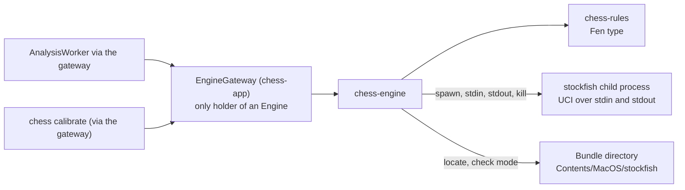
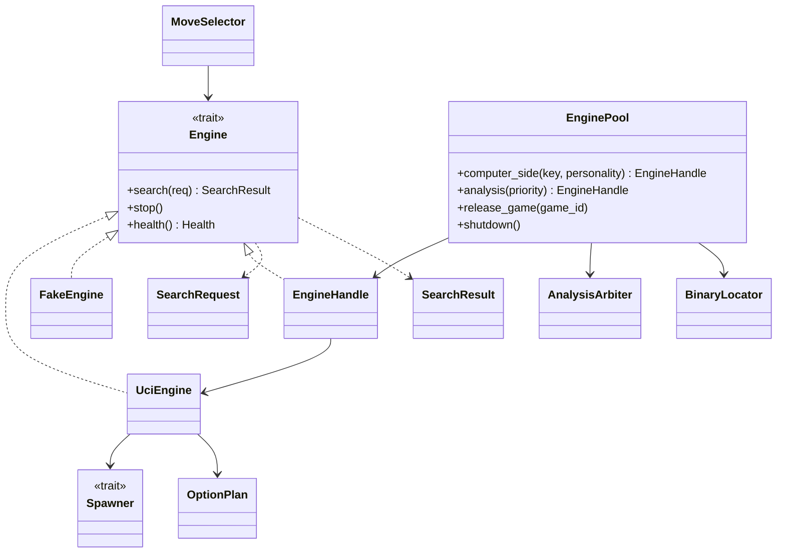
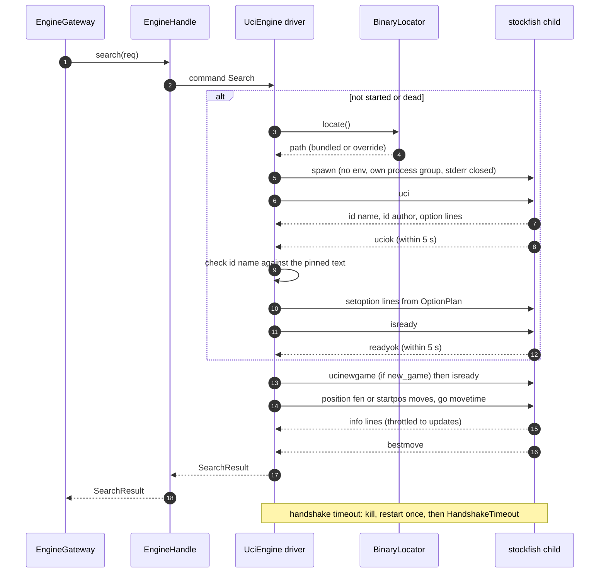
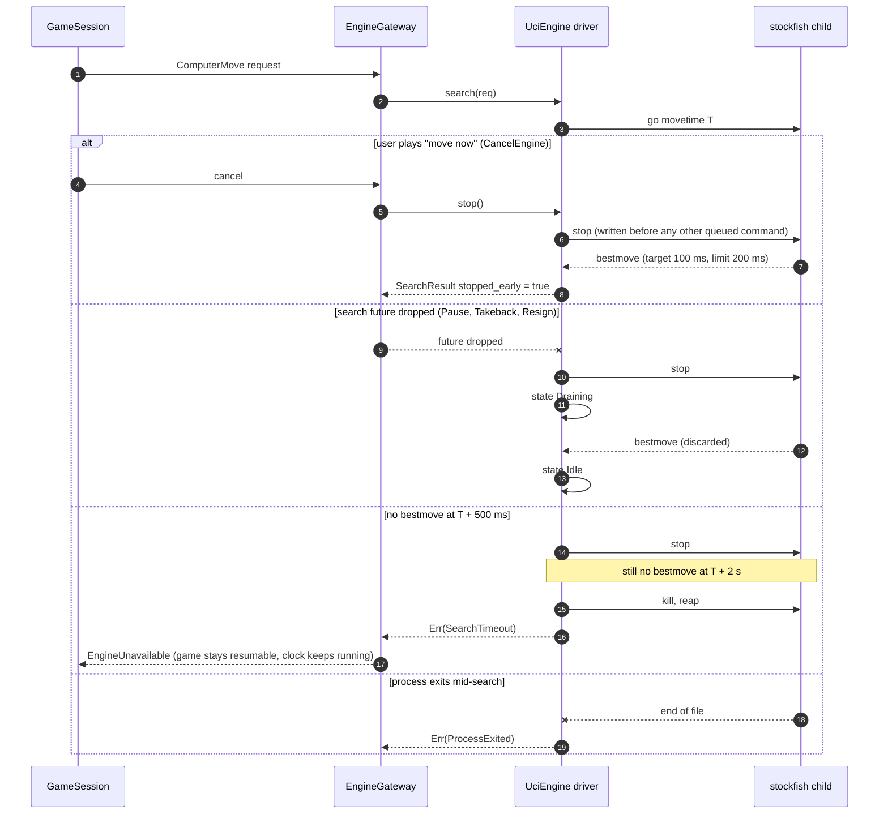
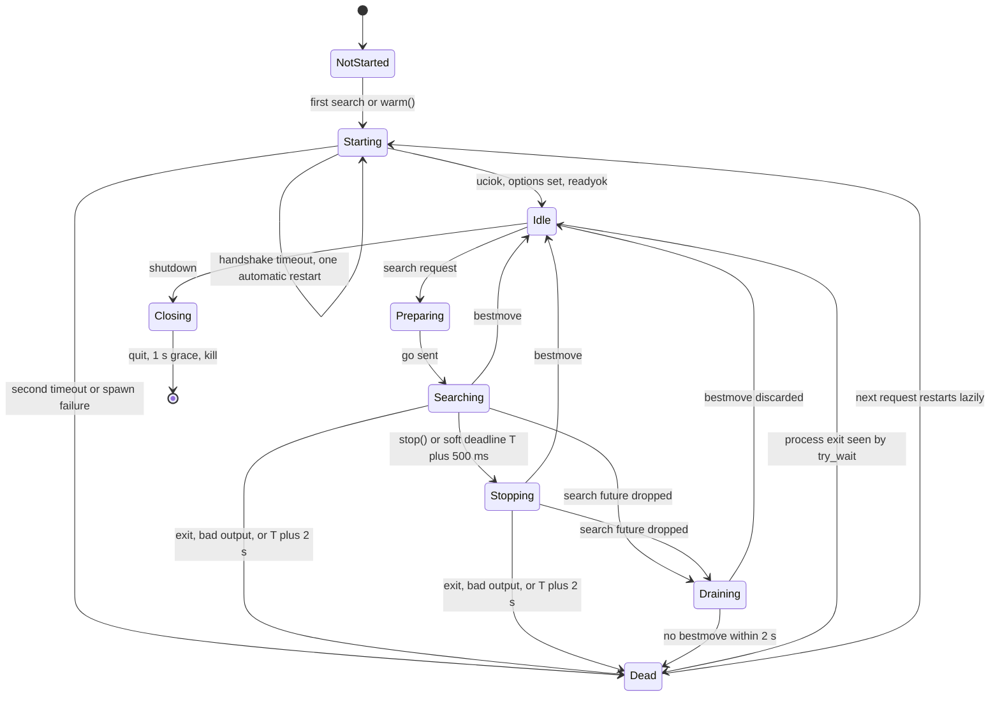

# SDD-chess-engine: Software Design Description of the `chess-engine` crate

| Field | Value |
|---|---|
| Document | docs/design/SDD-chess-engine.md |
| Version / status | **1.0 BASELINED** (2026-11-05; supersedes 0.3.4 DRAFT) |
| Date | 2026-11-05 (v0.3.3: 2026-11-04; v0.3.1: 2026-11-01; v0.1: 2026-10-30) |
| Standard basis | IEEE 1016-style (no conformance claim; `implementation-design-1016` skill) |
| Owner | Software engineer role (Claude), for Brian Prascher |
| Approver | **Baselined at v1.0 by Brian Prascher (G2), 2026-11-05 (tracker chess-a0r.1.53, decision recorded); G1 desk reviews as recorded in the Gate record; open conditions are listed in the 1.0 row of the change log. No other approval is claimed.** *Earlier status, kept as history and superseded by the preceding sentence:* PENDING for this SDD. The rulings applied in v0.2 were approved by Brian Prascher on 2026-10-31 (SDD-architect-triage section 5, decisions 1 to 13; requirements Amendment 7, CR-9.1); this revision applies them as text and adds no new decision. Nothing else in this document is approved. |
| Gate | **1.0 BASELINE, 2026-11-05: G2 acceptance by Brian Prascher, chess-a0r.1.53 (OQ-APP-015 option B, D-89; baseline v1.0 of the eight readiness-checked SDDs in docs/engineering/readiness-step2-3.md, verdict READY-WITH-CONDITIONS; conditions open as listed in the 1.0 change-log row; residual risk FIND-R23-015, lightly reviewed text, accepted by Brian). The fix-pass text applied after the G1 limited re-review (docs/design/SDD-G1-rereview-2026-11-05.md) was not independently re-reviewed.** *Earlier record, kept as history:* Drafting this document is documents-only: **G0**, no approver (SWE-001 §3). No gate record is created here; the coordinator assigns gate records (SWE-001 ASM-S5). Implementing the design is G1 unless an item in section 9 applies. |
| Engineering profile | [SWE-001](../engineering/SWE-001-engagement-profile.md): Rust 1.99.1 / edition 2024, CERT-informed practice with no conformance claim, warnings are errors |
| Crate / allocation name | `crates/chess-engine`; architecture §2.2 block `chess-app core :: chess-engine`. It drives the supporting block `stockfish` (`third_party/stockfish/` build output, F-3.2) |
| Sibling SDDs | [chess-rules](SDD-chess-rules.md), [chess-domain](SDD-chess-domain.md), [chess-store](SDD-chess-store.md), [chess-app](SDD-chess-app.md), [chess-server](SDD-chess-server.md), [chess-cli](SDD-chess-cli.md), [ui](SDD-ui.md), [desktop-tauri](SDD-desktop-tauri.md) |
| Upstream baselines read | architecture.md v1.0 through Amendment 8 and Addenda A to F (read for this crate: D-38 to D-50, §3.2, §4.6, §4.7, §5.7, FF-1 to FF-8, D-76; none of D-63 to D-73, D-78 to D-88 touches this crate, as checked for 0.3.3 against the 2026-11-04 rulings); requirements.md v1.0 Amendment 8 with extensions 1 and 2 (CR-9 to CR-12); [SDD-architect-triage](SDD-architect-triage.md) (approved 2026-10-31); [SDD-SE-desk-answers](SDD-SE-desk-answers.md) (resolved 2026-10-31) |
| Evidence tags | `[OBS file §]` read in this session; `[RAN]` executed; `[INF]` inferred; `[ASM-EN-n]` assumed; `[UNV]` unverified |

### Change log

| Version | Date | Change |
|---|---|---|
| 0.1 DRAFT | 2026-10-30 | First draft. |
| 0.2 DRAFT | 2026-10-31 | G0 text edits implementing approved decisions only. **TR-6** (D-43): `EnginePersonality` (`error_rate: f64`) stays the engine's type, converted by `personality_to_engine` in `chess-app`; no `engine -> domain` edge; FIND-EN-001 RESOLVED. **TR-9** (D-46, FF-7): new public constant `PINNED_UCI_ELO_RANGE` (DD-EN-015), compared with the real handshake by EI-EN-002; the handshake range no longer feeds roster generation and `OptionPlan` clamps `UCI_Elo` for the search only; **no numeric range is written here**. **TR-12** (FF-8): `SearchRequest.seed` is the error-pick seed computed by `chess_domain::error_pick_seed`; `SplitMix64` stays duplicated with a shared test-vector file. **UR-39** (AMD-12): preemption lanes, `Threads` and `Hash` placeholders set before the first calibration run. **UR-40** (AMD-3): `updates`, `lines` and `SearchPosition::Moves` are documented in architecture §5.7. **XC-18, Q-SE-12**: in-flight failure reported, retry is the next request (confirmed). **XC-26**: `Fen::as_str`/`Display` and `Move::from_uci` from the rules SDD. **UR-14, Q-SE-10**: the budget cap is applied last. **UR-15**: scores are normalised to White's point of view by `chess-app`. **UR-37**: "sidecar" means a bundled helper binary only. **XC-29**: ENG-5 is supporting here (primary block `GameSession`). **XC-30**: IDs written `PREFIX-nnn`, none renumbered (one- and two-digit forms zero-padded to three digits; `R-EN-` followed by a number becomes `DR-EN-nnn` like the rationale rows of the other SDDs; the triage cites `R-EN-1`, now DR-EN-001, and architecture 4.6 and FF-7 cite `EI-EN-02`, now EI-EN-002). Interface-card IDs (`IFP-EN-nn`, `IFR-EN-nn`) keep their form. |
| 0.3 DRAFT | 2026-10-31 | G0 text edits applying the joint-review rulings (SDD-v0.2-joint-review section 7; architecture amendment 7 addendum A, D-46, D-57; requirements CR-9.9, CR-9.10). No new decision. **CR-9.9 (FIND-JR-011):** the zero-padding of v0.2 (`R-EN-n` to `DR-EN-nnn`, `EI-EN-02` to `EI-EN-002`) is an accepted one-time exception; the engine keeps the `FIND-EN-` prefix. **OQ-EN-003 closed:** architecture §4.6 and FF-7 now cite `EI-EN-002`, so the test ID matches in both documents. **FIND-JR-009 (engine part):** the conversion of `EloRange` to the domain `UciEloRange` is done once in `chess-app` (this crate has no edge to the domain); the "every stored `uci_elo` inside the range" test is a `chess-app` test (3.10.12). **FIND-JR-006 (engine part):** the `test-support` feature is the one that `chess-app`'s own `test-support` enables, so a front-end builds a `Core` over `FakeEngine` with no edge to this crate (3.10.11; architecture §5.7). **D-57:** `chess-app` owns the calibration run; this crate supplies the primitives only (`EnginePurpose::Calibration` requests). **OQ-EN-002** narrowed against architecture §4.6 (still open, no value or crate version written). |
| 0.3 DRAFT (addendum) | 2026-11-01 | G0. [SDD-v0.3-joint-review](SDD-v0.3-joint-review.md). **FIND-JR3-003:** no engine change. `EngineFactory` is a `chess-app` trait (`seams.rs`); the app writes the production factory and the fake factory over this crate's concrete public API (the `UciEngine` spawn path with `EngineConfig`, and the `FakeEngine` constructor behind `test-support`). This SDD never implied that `chess-engine` supplies a factory; the app SDD's phrase "production implementations come from `chess-engine`" is read as "are built from this crate's constructors" and is the app owner's to reword. This crate has no edge to `chess-app`. **FIND-JR3-013:** `CT-EN-001..021` is a range whose members 007 to 009, 018 and 019 are not defined; the DD-EN-004 trace row cites only defined IDs where the table is next re-read `[INF]`. |
| 0.3.1 DRAFT | 2026-11-01 | G0. Applies architecture addendum B and C: D-61 confirmed (this crate supplies constructors, `chess-app` owns `EngineFactory`); no engine change. Version label unified. Cites D-60 (ECO import refinements), D-61 (`EngineFactory` owned by `chess-app`) and D-62 (PGN duplicates and the ECO question stay two steps; OQ-23 closed). Nothing is approved; no code exists |
| 0.3.2 DRAFT | 2026-11-04 | G0 (text). **L5 / D-76:** `cargo-fuzz` 0.13.2 removed from the test-only crate row (not admitted, it needs a nightly compiler; no nightly toolchain, ever); `FZ-EN-001` keeps its ID and becomes a `proptest` random-input property test; the accepted loss is stated; the "fuzz" wording of 3.4, 6 and 8 follows. No Amendment 8 stored-format item touches this crate. Not approved, not desk-reviewed |
| 0.3.3 DRAFT | 2026-11-04 | G0 (text); work order chess-a0r.1.42 (CR-3 task T-D3). Upstream-baseline line updated from amendment 7 to amendment 8 with addenda A to E, because it lagged architecture.md. Checked against Brian's rulings of 2026-11-04 (OQ-26 `NewGame.started_at`, OQ-27 canonical form, exit class 3, D-78) and the RR-S and RR-A findings: none reaches this crate (no stamp, resume, journal, exit code or PGN text here); no design change. RR-S-3 (an NFR-3 case count for `FZ-EN-001`) is **not** set here: see the report to the coordinator. Not reviewed, not approved; nothing was run `[UNV]`. No Mermaid change. |
| 0.3.4 DRAFT | 2026-11-05 | **G0** (wording only; chess-a0r.1.38, chess-a0r.1.44). **FIND-R23-007:** "Upstream baselines read" row refreshed (addenda A to F; requirements Amendment 8 with extensions 1 and 2). No design change; the claim that D-63 to D-88 do not touch this crate is the one made in 0.3.3 and is not re-checked here. No ID renumbered. Not approved, not desk-reviewed |
| 1.0 BASELINED | 2026-11-05 | **Baselined by Brian Prascher (G2), tracker chess-a0r.1.53 (ruling of 2026-11-05 accepting the PM recommendations).** Label change only: no design content changed from 0.3.4 DRAFT. Basis: readiness-step2-3.md (READY-WITH-CONDITIONS), the OQ-APP-015 cycle (D-89, option B; SDD-G1-rereview-2026-11-05.md, APPROVE WITH CONDITIONS, fix pass applied). Residual risks accepted by Brian: FIND-R23-015 (lightly reviewed text); fix-pass text after the limited re-review not independently re-reviewed; OQ-APP-016(b) open, Minor. Open conditions: chess-ddu (OQ-APP-016(b), FND-RR2-04 and FND-RR2-06; owner software-engineer with an architect desk review; before the CLI and UI reducers are coded); chess-bix (architecture 11.4.15 fact 8 and D-89 untimed-game alignment; owner architect; with the next architecture amendment, before app code); chess-2bb (XC-DOM-A8-5; owner software-engineer; at step-1 domain code); chess-e64 (TBR-4, NFR-2 full-sync refusal case; systems-engineer proposes, Brian reviews; before store code chess-a0r.3.6); chess-out (OQ-17 part 1, final G2 acceptance by Brian of docs/engineering/dependency-lookup-step1.md v0.2; before the first Cargo.toml entry, chess-a0r.2.2); chess-ckq (OQ-14 spike scope and GATE-101+ records; owner software-engineer; first store code and each block's first code task); TBD-36 (CLI signal and subcommand exit status; Brian, G3; chess-a0r.3.16, before CLI code). The rules SDD (0.3.5 DRAFT) is not part of this baseline. No other approval is claimed |

## 1 Introduction

### 1.1 Purpose and scope

This SDD designs the crate that talks to Stockfish: the `Engine` trait, the UCI driver over a child process's standard input and output, the process pool, the translation of a computer Player's parameters into UCI options and search limits, the seeded "random error" move choice, binary discovery, a deterministic fake engine for tests, and the pinned `UCI_Elo` range constant of the bundled engine (DD-EN-015).

The crate **does not** decide whether a request is allowed (that is `EngineGateway` and `Policy`), does not check that a move is legal (`EngineGateway` with `chess-rules`, architecture §4.5), does not decide when to cancel a search (`GameSession`), and does not generate Players (`RosterGen`, `chess-domain`). Strict-mode integrity (ANA-1) is therefore **not** enforced here; this crate only guarantees that nothing outside `chess-app` is meant to hold an `Engine` (architecture §5.7).

### 1.2 Allocated requirements and functions

Allocation: architecture §10.1 rows ENG-1, ENG-2 (UCI options), ENG-3 (`SearchLimits`), ENG-4, ENG-5 (UCI `stop`), IF-4 `[OBS architecture.md §10.1 lines for ENG-1..5, IF-4]`. Requirement text read in requirements.md (ENG-1..ENG-5, IF-4, NFR-1, NFR-3, NFR-8).

| Requirement | Role of this crate | Primary DD |
|---|---|---|
| ENG-1 open-source engine, UCI, start and answer `uci`/`isready`, failure surfaces and game stays recoverable | UCI driver, failure detection, typed errors | DD-EN-004, 005, 013 |
| ENG-2 difficulty levels: parameters (`Skill Level`, depth, movetime, `UCI_Elo` only inside the reported range, random error) | Option plan and move selector; the handshake range is read for the search clamp and for the CI check; the roster uses the pinned constant | DD-EN-008, 009, 015 |
| ENG-3 think time ≤ configured maximum | `SearchLimits` minimum rule; hard deadline | DD-EN-002, 009 |
| ENG-4 engine failure handling (5 s readiness, 2 s after the limit) | Handshake and search timers, kill, restart | DD-EN-004, 014 |
| ENG-5 cancel: best move so far within 200 ms | `stop()` writes UCI `stop` first. Supporting: architecture 10.1 names `GameSession` as the primary block (XC-29) | DD-EN-001, 004 |
| IF-4 one pinned Stockfish 19, bundled, UCI | Binary discovery, `id name` pin check | DD-EN-006, 004 |
| NFR-1 start-up (CLI ≤ 1 s) | Nothing spawns until needed; optional `warm()` | DD-EN-007 |
| NFR-3 never an illegal state | Output is syntactic only; malformed output is a failure, legality is the gateway's | DD-EN-002, 003 |
| NFR-8 responsiveness | No blocking call on a runtime worker; update throttling | DD-EN-004 |
| PLAT-3, NFR-4 offline, no network | No networking code; the child gets no environment | DD-EN-005 |
| PLY-4 parameters fixed after creation | Personality is input data, never mutated | DD-EN-002 |
| UI-1 max think time of the active profile | Input to the minimum rule | DD-EN-009 |

| Function | Name | Where |
|---|---|---|
| F-3.1 | Manage engine processes (locate, lazy start, health-check, kill and restart on timeout) | DD-EN-004, 006, 007 |
| F-3.4 | Select computer move (personality, seeded error, minimum of three limits) | DD-EN-008, 009 |
| F-3.2 | Search position (allocated to the `stockfish` block; this crate is its client) | DD-EN-004 |

`[OBS functional_decomp.md F-3 table; two functions are allocated to chess-engine]`

### 1.3 Decisions and risks

D-9 (pinned Stockfish 19, `sf_19`), D-13 (no blocking on runtime workers), D-15 (the clock keeps running during engine failure), D-18 (bundled lookup, never `PATH`, `CHESS_STOCKFISH` for dev and tests only), D-33 (`movenow` stops a search and plays the best so far), D-43 (`Personality` representation), D-46 (pinned `UCI_Elo` range), D-47 (dependency admission), FF-7 and FF-8 (fitness functions on the range constant and the shared `SplitMix64` vectors). Risks: R-12 (several processes compete for CPU), R-14 (slower Macs), R-2 (low-strength calibration), R-17 (calibration must not touch real ratings).

### 1.4 Definitions

*Instance*: one Stockfish child process with its driver task. *Search*: one `go` ... `bestmove` exchange. *STM*: side to move. *Draining*: discarding output until the `bestmove` of an abandoned search arrives.

## 2 Design overview

### 2.1 Readiness basis

Upstream is baselined. No separate readiness report was produced. The findings in section 7 are the readiness input to the System Architect and Systems Engineer. FIND-EN-001 (who owns `Personality`) is decided: D-43 keeps `EnginePersonality` here and adds no `engine -> domain` edge, so the crate manifest has no workspace dependency but `chess-rules`.

### 2.2 Viewpoints

| # | Viewpoint | Included | Section |
|---|---|---|---|
| 1 | Context | yes | 3.1 |
| 2 | Composition | yes | 3.2 |
| 3 | Logical | yes | 3.3 |
| 4 | Dependency | yes | 3.4 |
| 5 | Information | **omitted as a persistent-data viewpoint**: the crate stores nothing. In-memory data types are in 3.3 and the wire format in 3.11 | n/a |
| 6 | Patterns use | yes | 3.5 |
| 7 | Interface | yes | 3.6 |
| 8 | Structure | yes | 3.7 |
| 9 | Interaction | yes | 3.8 |
| 10 | State dynamics | yes | 3.9 |
| 11 | Algorithm | yes | 3.10 |
| 12 | Resource | yes | 3.11 |

### 2.3 Conventions

`DD-EN-nnn` design entities; `IFP-EN-nn` / `IFR-EN-nn` interfaces; `UT-EN-nnn` / `CT-EN-nnn` / `EI-EN-nnn` tests; `FIND-EN-nnn` upstream findings; `ASM-EN-nnn` assumptions; `DR-EN-nnn` design rationale; `OQ-EN-nnn` open questions (written `PREFIX-nnn`, XC-30). A finding that a ruling settled is marked RESOLVED with the ruling id and is kept, not deleted. Numbers that no requirement or decision fixes are `ESTIMATE`. UCI protocol facts below are the author's recall of the UCI specification and Stockfish behaviour; no Stockfish binary was run `[UNV]`. They are verified by the first run of the engine build script (ASM-3) and by the engine integration tests.

## 3 Viewpoints

### 3.1 Context viewpoint

**Concern:** who calls this crate and what does it touch outside the process?



No network, no data directory, no database. The child process has no environment variables and a closed standard error (3.10.5).

### 3.2 Composition viewpoint

**Concern:** what are the parts and what is each for?

| DD | Part | Purpose | Traces to |
|---|---|---|---|
| DD-EN-001 | `Engine` trait and handles | The contract `EngineGateway` uses: `search`, `stop`, `health` | §5.7, ENG-5 |
| DD-EN-002 | Request and result types | `SearchRequest`, `SearchLimits`, `SearchResult`, `PvLine`, `Score`, `UciMove`, `EnginePersonality`, `Health` | §5.7, ENG-2, ENG-3 |
| DD-EN-003 | `uci` protocol module | Pure parser and formatter of UCI lines; option table | ENG-1, NFR-3 |
| DD-EN-004 | `UciEngine` | Driver actor for one child process: handshake, options, search, stop, deadlines, drain, restart | ENG-1, ENG-4, ENG-5, F-3.1 |
| DD-EN-005 | `Spawner` | Process launch (real `tokio::process`, scripted in tests) | ENG-1, PLAT-3 |
| DD-EN-006 | `BinaryLocator` | Finds the bundled engine; override for tests; never `PATH` | IF-4, D-18 |
| DD-EN-007 | `EnginePool` | Instances per computer side, shared analysis instance, lifecycle | §4.7, R-12 |
| DD-EN-008 | `OptionPlan` | Personality and config to `setoption` list, checked against the handshake | ENG-2 |
| DD-EN-009 | `MoveSelector` and `SearchLimits` rules | Minimum of three limits, clock budget, seeded error choice | ENG-2, ENG-3, F-3.4 |
| DD-EN-010 | `AnalysisArbiter` | Priority between interactive and background analysis on the shared instance | §4.7 |
| DD-EN-011 | `FakeEngine` | In-process deterministic engine implementing `Engine` | test-strategy principle 2 |
| DD-EN-012 | `fake-uci` binary | Test executable speaking UCI with `FakeEngine` logic, selected by `CHESS_STOCKFISH` | test-strategy, §8.2 |
| DD-EN-013 | `EngineError` | Typed failures and mapping to `EngineUnavailable{cause}` | §5.5, ENG-4 |
| DD-EN-014 | `EngineConfig` | Timeouts, threads, hash, caps; all overridable in tests | §4.8 |
| DD-EN-015 | `PINNED_UCI_ELO_RANGE` | The `UCI_Elo` range of the bundled engine as a constant; roster generation uses it instead of the handshake | D-46, FF-7, ENG-2 |

### 3.3 Logical viewpoint

**Concern:** key types and how they relate.



Key types (names are design proposals; those in architecture §3.3 are kept: `Engine`, `UciEngine`, `EnginePool`, `SearchLimits`, `FakeEngine`; `Personality` is renamed to `EnginePersonality`, D-43):

```rust
pub struct UciMove(/* 4 or 5 ASCII chars, syntax-checked: file rank file rank [qrbn] */);
pub enum Score { Cp(i32), Mate(i32) }              // side-to-move point of view, as UCI reports it
pub struct PvLine { pub multipv: u8, pub score: Score, pub depth: u32, pub pv: Vec<UciMove> }
pub struct SearchResult {
    pub best: UciMove, pub pv: Vec<UciMove>, pub score: Score, pub depth: u32,   // §5.7
    pub lines: Vec<PvLine>,        // all MultiPV lines of the last completed depth (additive)
    pub stopped_early: bool, pub elapsed: Duration,
}
pub struct SearchLimits { pub movetime: Duration, pub depth: Option<u32>, pub nodes: Option<u64> }
pub enum SearchPosition { Fen(Fen), Moves { start: Option<Fen>, moves: Vec<UciMove> } }
pub struct SearchRequest {
    pub position: SearchPosition, pub limits: SearchLimits, pub multipv: u8,
    pub new_game: bool,
    pub seed: u64,                 // error-pick seed from chess_domain::error_pick_seed; consumed by MoveSelector, ignored by UciEngine::search (UCI has no seed)
    pub updates: Option<mpsc::Sender<SearchInfo>>,
}
pub struct EnginePersonality {            // fields of architecture §4.6 Personality; the stored type has error_permille: u16
    pub skill_level: u8, pub depth_limit: u32, pub movetime_ms: u32,
    pub uci_elo: Option<u32>, pub error_rate: f64 /* = permille / 1000.0, set by personality_to_engine in chess-app */, pub error_multipv: u8,
}
pub struct EloRange { pub min: u32, pub max: u32 }
pub const PINNED_UCI_ELO_RANGE: EloRange = /* value from the Stockfish 19 build step, ASM-3: not written in this document */;
pub enum Health { NotStarted, Ready, Searching, Dead }
```

`movetime` is **mandatory** in `SearchLimits`: every request has a wall-clock bound, which the failure rules of ENG-4 need (a limit to measure "2 s after the limit" from). Depth and node limits are additional caps. This is a small restriction on the architecture's open `SearchLimits` and costs nothing: all uses in §4.8 are time-bounded.

### 3.4 Dependency viewpoint

**Concern:** what depends on what?

Crate edges, exactly as architecture §3.2: `chess-app → chess-engine`, `chess-engine → chess-rules` `[OBS architecture.md §3.2]`. The crate has **no edge** to `chess-domain`, `chess-store`, the server or any front-end. `chess-domain` has no edge to this crate either; FIND-EN-001 is RESOLVED by D-43 (two separate personality types and one conversion in `chess-app`). The domain's `error_pick_seed` and the app's `personality_to_engine` are the only bridges, and both live outside this crate.

| Dependency | Use | Version source |
|---|---|---|
| `chess-rules` | `Fen` (validated position text) as the position type; `Fen::as_str` and `Display` are provided by the rules SDD (XC-26, IFP-RUL-4) `[ASM-EN-001: confirmed in the design, not yet in code]` | workspace |
| `tokio` (features `process`, `io-util`, `sync`, `time`, `rt`, `macros`) | child process, async pipes, timers, channels; feature sets per crate are admitted in §3.4 (D-8, D-47) | 1.54.1 `[OBS architecture.md §3.4]` |
| `thiserror`, `tracing` | errors, log events | 2.0.21, 0.1.44 `[OBS §3.4]` |
| Test only: `proptest`, `insta` | parser properties and random-input tests (stable toolchain), snapshots | 1.12.0, 1.49.0 `[OBS §3.4]`. `cargo-fuzz` 0.13.2 is **not admitted** (it needs a nightly compiler; no nightly toolchain, ever; D-76, architecture §11.4.9) |

No other crate is needed: the seeded generator is a ten-line SplitMix64 in the crate (no `rand`; the same published constants and a shared test-vector file as `chess-domain`, FF-8), and line splitting is a small bounded reader (no `tokio-util`). `tokio` appears under `chess-app` only in §3.2 (FIND-EN-010, RESOLVED by D-47: feature sets are listed per crate). `#![forbid(unsafe_code)]` applies to the whole crate; process groups use the safe `std::os::unix::process::CommandExt::process_group` `[UNV: exists in the pinned toolchain; stable since Rust 1.64 from recall]`.

### 3.5 Patterns-use viewpoint

**Concern:** which recognised solutions are used and what shows misuse?

| Pattern | Where | Why | Misuse tell |
|---|---|---|---|
| Actor per child process | DD-EN-004 | One task owns stdin and stdout, so UCI ordering cannot be violated by concurrent callers | A second task writes to the same stdin |
| Command channel plus oneshot reply | DD-EN-004 | `search` and `stop` are safe to call concurrently (`&self`) | `Mutex<ChildStdin>` appears |
| Drop-as-cancel with drain | DD-EN-004 | A dropped `search` future stops the search and leaves the process reusable (cancel safety) | A search that leaves the next `go` racing a stale `bestmove` |
| Port and adapter (`Spawner`) | DD-EN-005 | The real driver is tested against a scripted process, with paused time | Tests of the driver that need a real binary for timeout logic |
| Priority arbiter | DD-EN-010 | One instance serves two kinds of work | Background work never yields |
| Pure functions at the edges (`parse_line`, `OptionPlan`, `select`) | DD-EN-003, 008, 009 | Most logic is testable by random-input property tests without a process | A parser that holds a handle to the child |
| Null object (`FakeEngine`) | DD-EN-011 | Deterministic flows for UI and core tests | The fake knows about the test that uses it |

### 3.6 Interface viewpoint

**Concern:** what is offered, what is needed, and how does it fail?

#### 3.6.1 Provided

| ID | Interface | Consumer | Contract |
|---|---|---|---|
| IFP-EN-01 | `Engine` trait: `search`, `stop`, `health` | `EngineGateway` | Architecture §5.7 as amended (AMD-3): "Async, cancellable. `search(SearchRequest) -> SearchResult{best, pv, lines, score, depth}`, `stop()`, `health()`. `SearchRequest{position, limits, multipv, new_game, seed, updates}`. Only the gateway holds a handle." `[OBS]` |
| IFP-EN-02 | `EnginePool` | `EngineGateway` | `computer_side`, `analysis(priority)`, `release_game`, `shutdown` |
| IFP-EN-03 | `MoveSelector::select_move` and `SearchLimits::for_move`, `clock_budget` | `EngineGateway` / `GameSession` | Pure planning plus one call to an `Engine` |
| IFP-EN-04 | `BinaryLocator::locate` | `Core` start-up | Path and provenance, or `BinaryMissing` |
| IFP-EN-05 | `FakeEngine`, `fake-uci` | tests in all crates, E2E runners | 3.10.7 |

Semantics fixed by this design:

- **`search`** returns when the engine sends `bestmove`. If `stop()` was called, or the soft deadline fired, the result has `stopped_early = true` and still carries the best move found so far. The future is **cancel-safe**: dropping it stops the search and drains (3.10.3), and the instance is ready again when the next call begins. A dropped search never returns a result.
- **`stop()`** returns immediately after queueing UCI `stop` ahead of any other pending command; it has no result. Calling it with no search running does nothing.
- **`health()`** answers from the driver's state without a round trip; `Ready` after a successful `isready`, `Dead` when the process exited or was killed.
- `SearchRequest.updates` receives throttled `SearchInfo` (depth, multipv, score, pv) with `try_send`; a full channel drops the update. It feeds `AnalysisProgress` and Training live analysis (§4.8 "streamed, refined until the user leaves"). `updates`, `lines` and `SearchPosition::Moves` are now documented in §5.7 (AMD-3, UR-40; FIND-EN-007 RESOLVED). `SearchPosition::Moves{start, moves}` carries the game history, so the engine sees repetitions and the fifty-move count (FIND-EN-006 RESOLVED); the gateway chooses between `Fen` and `Moves`.
- **`SearchResult.best` is a `UciMove`, a syntactic move, not a legal `Move`.** Legality is checked by the gateway with `chess-rules` (§4.5). This lets `FakeEngine` return an illegal move to test that path.
- `Score` is from the side to move's point of view, as UCI sends it. **`chess-app` normalises it to White's point of view** before it stores or shows an evaluation (decision 12, UR-15, CR-9.3; FIND-EN-009 RESOLVED). The engine does no normalisation and never stores.

#### 3.6.2 Required

| ID | Interface | Relied on | If it fails |
|---|---|---|---|
| IFR-EN-01 | Stockfish 19 over UCI (stdin/stdout lines) | Commands `uci`, `isready`, `ucinewgame`, `setoption`, `position`, `go`, `stop`, `quit`; replies `id`, `option`, `uciok`, `readyok`, `info`, `bestmove`; exits when stdin reaches end of file `[UNV: all from recall; confirmed at ASM-3 and by CT-EN-020]` | Typed `EngineError` (3.6.3) |
| IFR-EN-02 | Operating system process API through `tokio::process` | Spawn, pipes, kill, reap, process group | `SpawnFailed` |
| IFR-EN-03 | `chess_rules::Fen` | A validated position text | compile-time |
| IFR-EN-04 | `tokio` time | Timers; paused clock in tests | n/a |
| IFR-EN-05 | Bundled file `<exe dir>/stockfish` (provided by `packaging/`, F-8.6, F-8.7) | Executable, universal, `id name` Stockfish 19 | `BinaryMissing`, `NotExecutable`, `WrongVersion` |

#### 3.6.3 Failure taxonomy (DD-EN-013) and mapping to architecture §5.5

`EngineError` is a `thiserror` enum. `Display` shows the category only and never a path, command line or engine output (SWE-001 §6 ERR row; NFR-10: no move lists in logs). Details go to `tracing` with the instance id.

| `EngineError` | Cause | `EngineUnavailable{cause}` (§5.5) | Retried by |
|---|---|---|---|
| `BinaryMissing` / `NotExecutable` / `InvalidOverride` | locator checks fail | `binary_missing` | user `RetryEngine` |
| `SpawnFailed` | OS refused to start the process | `spawn_failed` | `RetryEngine` |
| `HandshakeTimeout` | no `uciok` or `readyok` within 5 s, after one automatic restart | `handshake_timeout` | `RetryEngine` |
| `WrongVersion{found}` | bundled binary's `id name` does not contain the pinned text | `wrong_version` | none (packaging defect) |
| `ProcessExited{status}` | child exited or its pipe closed | `crashed` | `RetryEngine` restarts |
| `SearchTimeout` | no `bestmove` by limit + 2 s, process killed | `timeout` | `RetryEngine` |
| `BadOutput` | unparsable `bestmove`, line over the cap, `bestmove (none)` | `bad_output` | `RetryEngine` |
| `Preempted{partial}` | background analysis yielded to an interactive request | not an engine failure | the worker retries the ply |
| `InvalidPersonality{..}` | an option the plan needs is not advertised, or `Skill Level` is outside the advertised range (a `uci_elo` outside the handshake range is clamped for the search, not rejected, 3.10.7) | **`Internal{id}`**, a defect, not an engine outage | none |
| `InvalidRequest` | e.g. `multipv` 0 or above the cap | `Internal{id}` | none |

The `cause` strings are additive catalogue entries (UR-36, AMD-14; FIND-EN-011 RESOLVED in principle). Illegal moves are detected by the gateway, not here (architecture §4.5, §4.7).

### 3.7 Structure viewpoint

**Concern:** how is the crate organised?

```
crates/chess-engine/
  Cargo.toml                 # features: test-support (FakeEngine, scripted Spawner); fake-uci-bin
  src/
    lib.rs                   # #![forbid(unsafe_code)]
    engine.rs                # DD-EN-001 trait, Health
    types.rs                 # DD-EN-002
    uci/{parse,format,options}.rs     # DD-EN-003 (pure)
    driver.rs                # DD-EN-004 UciEngine, state machine, deadlines
    spawn.rs                 # DD-EN-005
    locate.rs                # DD-EN-006
    pool.rs  arbiter.rs      # DD-EN-007, 010
    plan.rs                  # DD-EN-008
    select.rs                # DD-EN-009 (limits, budget, SplitMix64, error pick)
    error.rs  config.rs      # DD-EN-013, 014
    fake.rs                  # DD-EN-011 (test-support)
  src/bin/fake_uci.rs        # DD-EN-012 (required-features = ["fake-uci-bin"]; never packaged)
  tests/                     # integration (scripted), engine integration (--features stockfish-tests)
```

Layering: `uci/*`, `plan.rs` and `select.rs` are pure and know nothing about tokio. Only `driver.rs` touches the process.

### 3.8 Interaction viewpoint

**Concern:** how do the parts collaborate, including failures?

#### 3.8.1 Lazy start and handshake (SEQ-EN-001)



#### 3.8.2 Cancel, drop and failure (SEQ-EN-002)



### 3.9 State-dynamics viewpoint

**Concern:** in which states can an instance be, and what moves it?



Guards: a new `go` is sent only from `Idle`. `Dead → Starting` is an automatic, transparent restart only for a request that arrives while the instance is `Dead` or `NotStarted`; a search that fails in flight is **reported**, not retried (3.10.4).

### 3.10 Algorithm viewpoint

**Concern:** the non-trivial procedures and their invariants.

#### 3.10.1 UCI parsing and formatting (DD-EN-003)

`parse_line(&str) -> UciMessage` is a pure, total function: unknown or malformed input becomes `Unknown(String)` or `Malformed`, never a panic. Recognised: `id name|author`, `option name N type T [default D] [min a] [max b] [var v]*`, `uciok`, `readyok`, `bestmove M [ponder P]`, and `info` with the tokens `depth seldepth multipv score(cp|mate x [lowerbound|upperbound]) nodes nps hashfull tbhits time pv ...`; `info string ...` is ignored. Tokens are matched by keyword, not by position, so extra tokens do not break parsing. A score with a bound flag is not used as a final line. `bestmove (none)` and `bestmove 0000` become `NoMove`. Lines are read with a bounded reader (64 KiB cap `ESTIMATE`); a longer line is `BadOutput`.

Commands are produced only by `format_*` functions that accept typed arguments: no command is built by string concatenation of caller text, and a `setoption` value is checked against the option's type and range from the handshake (CERT-informed: input validation, SWE-001 §6 IDS row). No `UciMove` or `Fen` can contain a newline.

#### 3.10.2 Driver loop (DD-EN-004)

One task per instance. State: `{state, child, stdin, line_reader, applied_options, current: Option<Pending>}`.

```
loop select! (biased, in this order):
  1. command channel:
       Stop        -> if Searching: write "stop" now; state = Stopping
       Search(req, reply) -> if state != Idle: reply Err(Busy-internal); else run prepare/go
       Health, Shutdown ...
  2. reply.closed() of the current search (future dropped) -> write "stop" (if Searching); state = Draining
  3. stdout line -> parse_line:
       info  -> update lines[multipv]; maybe emit throttled SearchInfo
       bestmove -> if Searching/Stopping: validate syntax, reply Ok(result); state = Idle
                   if Draining: discard; state = Idle
       other -> ignore (readyok outside prepare is ignored)
       EOF or read error -> state = Dead; reply Err(ProcessExited)
  4. deadline timers: soft (T + 500 ms): write "stop" once; hard (T + 2 s): kill, reply Err(SearchTimeout)
```

Commands are polled first so that `stop` reaches the pipe before the next line is parsed, which keeps `stop → bestmove` as short as the engine allows (ENG-5 design target 100 ms, limit 200 ms, both `ESTIMATE` from the architecture).

#### 3.10.3 Cancel safety and drain

The search reply channel is a `oneshot`. When its receiver is dropped the driver detects it (step 2) and sends `stop`, enters `Draining`, and does not accept a new `go` until the abandoned `bestmove` arrives (2 s bound; otherwise `Dead`). Because UCI has no search identifiers, a stale `bestmove` could otherwise be taken for the next search's answer. `isready` cannot be used as a barrier: Stockfish may answer it during a search `[UNV: from recall]`.

#### 3.10.4 Failure and restart policy

- Between searches, before every request the driver calls `try_wait`; if the child exited it is restarted transparently, **once**, as part of `Starting` (architecture §4.7 "restarted transparently").
- A failure **during** a search (exit, bad output, timeout) is returned to the caller and the instance becomes `Dead`. The next request restarts it. `RetryEngine` is exactly that next request (F-3.7, §4.3 `EngineError → EngineThinking`). No search is silently repeated: the clock keeps running (D-15), and the caller decides. This is the SE interpretation Q-SE-12, confirmed (CR-9.2); the SE rewords F-3.7 "restart once" accordingly (CR-9.7). The app's DD-APP-10 and 4.9 follow this text (XC-18, FIND-EN-012 RESOLVED).
- `Starting` retries once on handshake timeout (§4.8 "Kill and restart once, then `EngineUnavailable`").
- Every kill is followed by `wait` so no zombie remains.

#### 3.10.5 Process launch and hygiene (DD-EN-005)

`Command::new(path)` with no arguments, `env_clear()`, current directory = the binary's directory, stdin and stdout piped, **stderr to null** (a full unread pipe could deadlock the engine; engine text can contain positions and must not reach the log), `kill_on_drop(true)`, and its **own process group**, so a Ctrl-C in the terminal reaches `chess` and not Stockfish and the shutdown stays orderly. If `chess` is killed without cleanup, the child's stdin reaches end of file and Stockfish is expected to quit `[UNV: IFR-EN-01, test CT-EN-020]`. The Stockfish process holds no descriptor of the store: this crate does not open files, and the store opens its descriptors close-on-exec ([chess-store §3.11.6](SDD-chess-store.md)).

#### 3.10.6 Binary discovery (DD-EN-006)

```
locate():
  if env CHESS_STOCKFISH is set and non-empty:
        path = it; require absolute (else InvalidOverride); source = Override   -- dev and tests only (D-18)
  else:
        exe = std::env::current_exe().canonicalize()       -- follows the install-cli symlink
        path = exe.parent()/"stockfish"; source = Bundled
  require: exists, regular file, owner-executable, not group- or world-writable
  never read PATH; never download
```

`Bundled` binaries must report an `id name` containing the pinned text (`Stockfish 19` `[UNV: exact text, TBC-7]`); `Override` binaries skip that check so the fake can run. The override means a user can point the app at another binary; the architecture accepts this for dev and tests (§8.2) and the check above is the only guard (FIND-EN-010 notes the residual risk).

#### 3.10.7 Option plan (DD-EN-008)

`OptionPlan::for(personality | analysis_config, advertised: &UciOptions) -> Vec<SetOption>`:

- `Threads`, `Hash` from `EngineConfig` (fixed per kind). The values are the placeholders of architecture §4.7 (AMD-12, UR-39): computer 1 thread and 16 MB, analysis 2 threads and 64 MB (`ESTIMATE`), to be fixed before the first calibration run and recorded with each run (FIND-EN-004 RESOLVED as placeholders).
- If `uci_elo = Some(e)`: require the engine advertises `UCI_Elo` (not advertised: `InvalidPersonality`). Read `min` and `max` from the `option name UCI_Elo type spin default .. min .. max ..` line, never hard-code them in the plan. Send `UCI_LimitStrength = true` and `UCI_Elo = clamp(e, min, max)`: **the clamp is for the search only and never changes the stored value** (D-46; architecture §4.6 says `EngineGateway` clamps, and the gateway asks for it through the plan, so the mechanism sits next to the option table). When the value was clamped, or when the handshake range differs from `PINNED_UCI_ELO_RANGE`, the plan reports it in `PlanReport { clamped, differs_from_pinned }` and the gateway logs an installation defect (OQ-EN-002).
- If `uci_elo = None`: `UCI_LimitStrength = false` (when advertised), `Skill Level = skill_level` checked against the advertised `min`/`max`.
- `MultiPV` is set per search from the request, only when it changes.
- Only options advertised by the engine are sent. The instance remembers the applied map and sends the difference, then `isready`.

The handshake result `EngineInfo{id_name, uci_elo_range: Option<(u32,u32)>, options}` is exposed for the clamp report above, for EI-EN-002 and for diagnostics. It is **not** used to generate Players: `chess-app` passes `PINNED_UCI_ELO_RANGE` to `RosterGen` and to `chess calibrate` (D-46, architecture §4.6), so the first-launch roster does not wait for the engine.

#### 3.10.8 Search limits and the move selector (DD-EN-009)

`SearchLimits::for_move(personality, max_think, clock_budget)`: `movetime = min(personality.movetime_ms, max_think?, clock_budget?)`, `depth = personality.depth_limit`. The result never exceeds any of the three, which is ENG-3 and "it can only shorten a limit, never lengthen it" (§4.6). The request is sent as `go movetime T [depth D]`: time limits, not wtime/btime, for clocked games (R-12).

`clock_budget(remaining, increment, ply) -> Duration`: `min(remaining / 2, max(50 ms, remaining / 30 + 3·increment / 4))` `ESTIMATE`, with **the cap applied last** so that with under 100 ms remaining the 50 ms floor never exceeds half the remaining time (SE desk answer Q-SE-10). This crate owns the formula (UR-14, FIND-EN-005 RESOLVED). The intent, confirmed by the SE, is that the budget is an upper limit and never a target: the computer must not lose on time in the RULE-4 test. The constants are design values checked by that test.

`select_move(engine, MoveRequest{search: SearchRequest (its `seed` is the error-pick seed), personality: EnginePersonality}) -> MoveChoice{ mv: UciMove, kind: Best | Error, result }`:

```
draws = SplitMix64(seed)                       -- seed = chess_domain::error_pick_seed(game_id, ply), computed by chess-app and carried in SearchRequest.seed (TR-12); this crate never sees a GameId
u = draws.next_f64()
if personality.error_rate > 0 and personality.error_multipv >= 2 and u < personality.error_rate:
      r = engine.search(req with multipv = error_multipv)
      if r.lines.len() >= 2:
            i = 1 + draws.next_u64() % (r.lines.len() - 1);   mv = r.lines[i].pv[0];  kind = Error
      else: mv = r.best; kind = Best                         -- one legal move, or stopped very early
else: r = engine.search(req with multipv = 1); mv = r.best; kind = Best
```

The same seed gives the same roll and the same pick (reproducible replays, §4.6); the engine's own output is not deterministic with more than one thread, which is why tests use `Threads=1` and a fixed depth (architecture §8 Determinism). The legality check of `mv` is the gateway's.

#### 3.10.9 Analysis arbiter (DD-EN-010)

The shared analysis instance serves two **lanes** (architecture §4.7, AMD-12). `Interactive` requests (Training live analysis, what-if, post-game on demand) are served first-in first-out among themselves; a newer live-analysis request replaces an older one by dropping its future. A `Background` request (per-move evaluation, 200 ms per ply) runs only when no interactive request is waiting; when one arrives, the arbiter calls `stop()` and the background caller gets `Err(Preempted{partial})`, then retries the ply later. The architecture's "Low (`nice`)" cannot be implemented on a shared instance (a process cannot raise its own priority again without privilege), so priority is scheduling by preemption lanes, not operating-system priority (UR-39; FIND-EN-003 RESOLVED).

#### 3.10.10 Pool (DD-EN-007)

`computer_side(key = (game_id, side), personality)` creates an instance on first use and returns a handle; self-play gets two keys and so two processes with identical options (architecture §4.7). `warm()` on a handle starts the process and runs the handshake ahead of the first search, so `GameSession` can call it when a game starts and hide the start-up while the human thinks. `release_game(game_id)` shuts down that game's instances (game end, suspend, void, detach). `analysis(priority)` returns a handle onto the single analysis instance behind the arbiter. `shutdown()` sends `quit`, waits up to 1 s `ESTIMATE`, then kills; the web server's 5 s stop budget (§4.8) leaves room for this. Nothing is started by `EnginePool::new`, which keeps CLI start-up under the first-frame rule (§6.1 Startup, NFR-1).

#### 3.10.11 Fakes (DD-EN-011, DD-EN-012)

`FakeEngine` implements `Engine` in process. Behaviours (set per instance or as a script of replies): `FirstLegalMove` (via a move list supplied by the test), `Fixed(UciMove)`, `Scripted(Vec<Reply>)`, and injected faults `Crash`, `Hang` (answers only after `stop`), `Timeout`, `IllegalMove(UciMove)`, `Garbage`, `BinaryMissing`, plus latency. It records every call, so tests of the gateway can assert "no call was made" (the ANA-1 spy sits in the gateway; this is the underlying record). `fake-uci` is a small executable that reads UCI lines and answers with the same logic, so the **real** `UciEngine`, `Spawner`, pool and timers are exercised end to end, and the CLI and GUI end-to-end suites select it with `CHESS_STOCKFISH=<path>` (architecture §8.2 "dev and tests only"). It is built only with `--features fake-uci-bin` and is not part of `Chess.app` (packaging check, F-8.6). **Reaching the fake from a front-end crate (FIND-JR-006, architecture §5.7 "Test support").** `FakeEngine` is compiled with this crate's Cargo feature `test-support`. `chess-app` has its own feature `test-support`, which enables this one and offers `Core::open(cfg, Seams)`, a `FakeEngine` factory and a temp-directory-store helper. The tests of `chess-cli`, `chess-server` and `src-tauri` therefore build a `Core` over a `FakeEngine` through `chess-app` only, with no edge to `chess-engine`. Neither feature is compiled into a release build. The factory itself is a `chess-app` item (its design is the app SDD's); this crate only guarantees the feature and the `FakeEngine` constructor it needs.

#### 3.10.12 Pinned `UCI_Elo` range (DD-EN-015)

`chess_engine::PINNED_UCI_ELO_RANGE` is a constant of the bundled engine, set from the engine build step (ASM-3). It exists so that a permanent computer Player depends on the pin and not on the binary found at run time: two machines, or an engine bump, would otherwise generate different Players from the same seed and index and break D-34 (TR-9, D-46).
- **Value.** Unknown until the Stockfish 19 build is run (ASM-3). **No number is written in this document or in any other until then** `[UNV]`. The source file that declares the constant is the first deliverable that carries the value.
- **Check.** The engine integration test EI-EN-002 compares the constant with the `min` and `max` of the `option name UCI_Elo type spin ...` line in the real binary's `uci` handshake and fails CI on a mismatch, so a change of the engine pin without a change of the constant cannot merge (FF-7). The same test asserts that every stored `COMPUTER_PROFILE.uci_elo` lies inside the range (the stored-value half is run from `chess-app`).
- **Type bridge (FIND-JR-009).** `EloRange` is this crate's type; `RosterGen::new` takes the domain's `UciEloRange { min, max }`. There is no edge between the two crates, so `chess-app` converts once (a `From`-style conversion) and carries the unit test; this crate names neither the domain type nor the conversion.
- **Use.** `chess-app` passes the constant (after the conversion above) to `RosterGen` and to the calibration run it owns (`chess_app::calibration`, D-57; the `chess calibrate` subcommand only calls it). This crate does not use it to build requests; `OptionPlan` uses the live handshake range for the search clamp (3.10.7).
- **If an engine bump changes the range.** CI fails, the constant is edited, and calibration is re-run before release (architecture §4.6).

### 3.11 Resource viewpoint

**Concern:** processes, memory, threads, channels, time.

| Resource | Rule | Value and source |
|---|---|---|
| Child processes | one per computer side, one shared analysis instance, per app process | architecture §4.7; up to three typical, nine across three app processes (R-12) |
| Threads per instance | `Threads` option fixed per kind | computer: 1; analysis: 2. **`ESTIMATE`**, placeholders of architecture §4.7 (AMD-12), fixed before the first calibration run |
| Hash per instance | fixed per kind | computer: 16 MB; analysis: 64 MB. **`ESTIMATE`**, same status |
| Memory ceiling | accounting hook `hash_in_use_mb()`; no ceiling enforced | Should (CR-7.4, architecture §4.8) |
| Driver tasks | one tokio task per instance; no blocking calls | D-13 |
| Pipes | stdin writes are tiny; stdout read line by line, line cap 64 KiB | `ESTIMATE` (mine) |
| `updates` channel | capacity 16, `try_send`, latest info per multipv index, at most one update per 100 ms | `ESTIMATE` (mine) |
| Timeouts | handshake 5 s (`uciok`, `readyok` each); soft stop at limit + 500 ms; hard kill at limit + 2 s; cancel design target 100 ms, limit 200 ms; shutdown grace 1 s | architecture §4.8, ENG-4, ENG-5 (all `ESTIMATE` there); shutdown grace is mine |
| Config | every timeout and size is in `EngineConfig` so tests shrink them (architecture §4.8 "Tests set them through config") | DD-EN-014 |
| Time in tests | `tokio::time::pause` with the scripted `Spawner` | no real sleeps in timeout tests |
| Start-up | no process at start; handshake expected well under 1 s on the baseline Mac | architecture §4.8; ASM-2 |

### 3.12 Design rationale

| ID | Decision | Alternatives rejected | Cost / risk |
|---|---|---|---|
| DR-EN-001 | `EnginePersonality` is defined in this crate, converted from the domain `Personality` (`error_permille: u16`) by `personality_to_engine` in `chess-app`; **accepted by D-43** | Define `Personality` in `chess-domain` and add an edge `engine → domain` (G2, Q4); define it here and make `domain` depend on `engine` (breaks purity) | One conversion function in `chess-app` (FIND-EN-001) |
| DR-EN-002 | The child is started by `tokio::process` from the path next to the executable, for the desktop app too | Starting it through Tauri's shell plugin as a sidecar (a second launch path, a Tauri capability, and a different way to read stdout) | Architecture §2 says "Tauri starts it as a sidecar"; "sidecar" means a bundled helper binary only and the core spawns it (UR-37, accepted; FIND-EN-002 RESOLVED; OQ-11 still applies to the bundle layout) |
| DR-EN-003 | Syntactic `UciMove` result | Return a legal `Move` (then the fake cannot test the illegal path, and the crate needs more of `chess-rules`) | Gateway converts |
| DR-EN-004 | Drop-as-cancel with drain | Separate `cancel(id)` calls (UCI has no search ids) | Needs the 2 s drain bound |
| DR-EN-005 | `movetime` mandatory | Optional time with depth-only searches (no basis for ENG-4's "2 s after the limit") | Fixtures use a generous `movetime` with a depth cap |
| DR-EN-006 | Own SplitMix64, duplicated from `chess-domain` with shared test vectors | `rand` crate (new dependency, API drift, stream stability between versions would change replays; rejected, D-31); an `engine -> domain` edge | About ten lines to test, plus a CI diff of the vector file (FF-8) |
| DR-EN-007 | Preemption lanes on a shared analysis instance (AMD-12) | A second, `nice`d instance (more processes and memory in a three-process machine, R-12) | Preempted work is redone |
| DR-EN-008 | A `fake-uci` executable in addition to `FakeEngine` | In-process fake only (end-to-end suites could not use it; the driver and pool would be untested by them) | One more test binary, excluded from packaging |

## 4 Design entities

All entities: Rust 1.99.1 edition 2024, `#![forbid(unsafe_code)]`, no `unwrap`/`expect` outside tests, `thiserror`, warnings are errors; no network code.

| DD | Interface (see) | Failure behaviour | Concurrency | Resources | Verification | Code |
|---|---|---|---|---|---|---|
| DD-EN-001 `Engine` | 3.6.1 | `Result<_, EngineError>`; `stop` and `health` cannot fail | `&self` methods; safe to call `stop` while `search` pends | none | CT-EN-001..006 | `src/engine.rs` (not yet written) |
| DD-EN-002 types | 3.3 | constructors validate (`UciMove::parse`, `multipv` range, `movetime > 0`) | plain data | none | UT-EN-001..006 | `src/types.rs` |
| DD-EN-003 `uci` | 3.10.1 | total functions, no panics | pure | none | UT-EN-010..019, FZ-EN-001 (`proptest`) | `src/uci/*.rs` |
| DD-EN-004 `UciEngine` | 3.8, 3.9, 3.10.2..4 | every error in 3.6.3; process always reaped | one task; command channel; `oneshot` replies | one child, one task | CT-EN-001..021 | `src/driver.rs` |
| DD-EN-005 `Spawner` | `spawn(path) -> Process{stdin, stdout, kill, wait}` | `SpawnFailed` | n/a | process group, null stderr | CT-EN-010, 020 | `src/spawn.rs` |
| DD-EN-006 `BinaryLocator` | 3.10.6 | typed errors, no path in `Display` | pure + `metadata` | none | UT-EN-040..046 | `src/locate.rs` |
| DD-EN-007 `EnginePool` | 3.10.10 | a failed instance does not affect another | `Mutex<HashMap>` held only to look up or insert, never across `.await` | up to N children | CT-EN-030..034 | `src/pool.rs` |
| DD-EN-008 `OptionPlan` | 3.10.7 | `InvalidPersonality` | pure | none | UT-EN-020..027 | `src/plan.rs` |
| DD-EN-009 selector | 3.10.8 | propagates `EngineError` | pure + one `search` | none | UT-EN-030..039 | `src/select.rs` |
| DD-EN-010 `AnalysisArbiter` | 3.10.9 | `Preempted` | async mutex-free queue (two `mpsc` classes) | none | CT-EN-040..042 | `src/arbiter.rs` |
| DD-EN-011 `FakeEngine` | 3.10.11 | scripted faults | thread-safe call log | none | CT-EN-050 | `src/fake.rs` |
| DD-EN-012 `fake-uci` | UCI on stdio | exits on end of file | single thread | none | CT-EN-051 | `src/bin/fake_uci.rs` |
| DD-EN-013 `EngineError` | 3.6.3 | n/a | n/a | none | UT-EN-060, CT-EN-060 | `src/error.rs` |
| DD-EN-014 `EngineConfig` | defaults of 3.11, overridable | validation of ranges | immutable after build | none | UT-EN-050 | `src/config.rs` |
| DD-EN-015 `PINNED_UCI_ELO_RANGE` | 3.10.12 | CI fails if it differs from the handshake (EI-EN-002) | constant | none | EI-EN-002, UT-EN-061 | `src/pinned.rs` (not yet written) |

## 5 Traceability: requirement to design to verification

| Requirement | DD | Tests | Notes |
|---|---|---|---|
| ENG-1 | DD-EN-003, 004, 005, 006 | CT-EN-001, 010, 011, 020; EI-EN-001 | handshake, legal `bestmove` from standard positions (EI = engine integration) |
| ENG-2 (options, range) | DD-EN-008, 009, 015 | UT-EN-020..027, UT-EN-061, EI-EN-002 | the "every stored `uci_elo` inside the range" test is in `chess-app` using `PINNED_UCI_ELO_RANGE`; EI-EN-002 compares the constant with the real handshake (FF-7) |
| ENG-3 | DD-EN-002, 009 | UT-EN-030..034, EI-EN-004 | measured latency on the baseline Mac |
| ENG-4 | DD-EN-004, 013, 014 | CT-EN-012..016 | crash, hang, missing; retry restarts |
| ENG-5 (supporting; primary `GameSession`) | DD-EN-001, 004 | CT-EN-003, EI-EN-005 | ≤ 200 ms `ESTIMATE` (TBD-12) |
| IF-4 | DD-EN-006 | UT-EN-044, CT-EN-017, EI-EN-001 | pinned `id name`; `lipo` check belongs to packaging |
| NFR-1 | DD-EN-007 | CT-EN-030 | no spawn at construction; `warm()` |
| NFR-3 | DD-EN-002, 003 | UT-EN-010..019, random-input property test FZ-EN-001 (D-76) | malformed output is a failure |
| NFR-8 | DD-EN-004 | CT-EN-004 | stop while searching; no blocking |
| PLAT-3 / NFR-4 | DD-EN-005 | CT-EN-020; offline engine test in packaging | empty environment, no sockets |
| PLY-4 | DD-EN-002 | UT-EN-035 | personality is never mutated |
| UI-1 | DD-EN-009 | UT-EN-031 | min rule |
| Orphan check | every DD traces to a requirement or decision; DD-EN-011/012 trace to test-strategy principle 2 and architecture §8.2 | | |

## 6 Verification mapping

No test has been written or run `[UNV]`. Levels per test-strategy and architecture §9: unit and property (random-input `proptest` tests on stable Rust; there is no coverage-guided fuzzer and no nightly toolchain, D-76), scripted-process integration with paused time, engine integration with the real binary (`--features stockfish-tests`), and platform runs (Intel best effort, CR-7.6).

| ID | Level | Purpose |
|---|---|---|
| UT-EN-001..006 | unit | `UciMove` syntax, `SearchLimits` constructors, request validation |
| UT-EN-010..019 | unit / property | parse tables for `id`, `option` (spin, check, combo, button, string), `info` with bounds and `string`, `bestmove` variants; `parse(format(x))` round trips; arbitrary bytes never panic |
| FZ-EN-001 | property (`proptest`, random input; ID kept, the `FZ` prefix is historical) | `proptest` on `parse_line` and the bounded reader: arbitrary bytes and arbitrary lines never panic, `Ok` results are well-formed, memory is bounded, the reader terminates. **Accepted loss (D-76):** no coverage-guided fuzzing |
| UT-EN-020..027 | unit | option plan: `UCI_Elo` inside the range, outside the range (clamped for the search, stored value untouched, `PlanReport` set), absent option, `Skill Level` bounds, difference-only sending |
| UT-EN-030..039 | unit | minimum of three limits; clock budget vectors (including the cap applied last with under 100 ms remaining); SplitMix64 vectors from the shared file (FF-8); same seed same pick; error pick never chooses line 0; one-line result falls back to best |
| UT-EN-040..046 | unit | locator: override absolute only, relative rejected, `PATH` never read (a fake `PATH` containing a decoy), mode checks, symlinked executable resolved |
| UT-EN-050, 060 | unit | config validation; no `Display` contains a path |
| CT-EN-001..006 | component (scripted process, paused time) | handshake order; search; `stop` before queued commands; drop-then-drain; no `go` before drain ends; concurrent `stop` |
| CT-EN-010..017 | component | spawn failure; handshake timeout then one restart then error; crash mid-search; hang until soft stop then hard kill at +2 s; garbage output; line over cap; wrong `id name` for a bundled path |
| CT-EN-020 | component (real child `fake-uci`) | `kill -9` of the parent leaves no child; process group; no zombies after kill `[UNV: end-of-file exit of Stockfish itself is checked in EI-EN-006]` |
| CT-EN-021 | component | `RetryEngine` path: dead instance restarted by the next request |
| CT-EN-030..034 | component | no spawn at pool creation; `warm()`; self-play gets two processes; `release_game`; `shutdown` bound |
| CT-EN-040..042 | component | preemption, no starvation of background work after interactive work ends, newer live analysis replaces older |
| CT-EN-050..051 | component | `FakeEngine` fault modes; `fake-uci` through the real driver |
| CT-EN-060 | component | every `EngineError` maps to a documented cause |
| UT-EN-061 | unit | `PINNED_UCI_ELO_RANGE` has `min <= max` and is not derived from any handshake value; the roster path of the app never calls `EngineInfo` | review plus compile check |
| UT-EN-062 | unit | The `SplitMix64` vector file is byte-identical to the one in `chess-domain` (CI diff) | file compare (FF-8) |
| EI-EN-001 to EI-EN-006 | engine integration (`--features stockfish-tests`) | real Stockfish 19: handshake and `id name`; **`PINNED_UCI_ELO_RANGE` equals the `min` and `max` of the real `UCI_Elo` option and CI fails on a mismatch (EI-EN-002, FF-7)**; legal moves on fixtures; mate-in-1/2/3 with `Threads=1` and fixed depth; cancel latency; end-of-file exit; crash recovery. Run on the development Mac; the Intel slice is "not run: hardware unavailable" (CR-7.6) |

Coverage target for `uci/*`, `plan.rs`, `select.rs`, `locate.rs`: at least 90 % line coverage (the test-strategy gate lists rules, Elo, clock, policy and parser modules; the UCI parser is a parser). The driver is covered by scripted tests, not by percentage.

## 7 Open issues / upstream findings

Findings from v0.1, with the ruling that settled them. A RESOLVED finding is kept for traceability.

| ID | Sev | Finding (summary) | Status | Ruling and what changed here |
|---|---|---|---|---|
| FIND-EN-001 | Major | `Personality` has no home that respects the dependency graph | **RESOLVED** (TR-6, D-43; ED-4 not needed) | The domain `Personality` (`error_permille`) is the stored type; `EnginePersonality` stays here; one conversion in `chess-app`; no `engine -> domain` edge |
| FIND-EN-002 | Minor | "Sidecar" wording versus the core owning the UCI driver | **RESOLVED** (UR-37, AMD-9) | "Sidecar" means a bundled helper binary only; this crate spawns `<exe dir>/stockfish` |
| FIND-EN-003 | Minor | "Low (`nice`)" cannot be implemented on a shared instance | **RESOLVED** (UR-39, AMD-12) | Preemption lanes, not `nice` |
| FIND-EN-004 | Minor | No `Threads` and `Hash` values | **RESOLVED as placeholders** (UR-39, AMD-12) | Computer 1 thread and 16 MB, analysis 2 threads and 64 MB (`ESTIMATE`); set before the first calibration run |
| FIND-EN-005 | Minor | No formula for the clock-derived budget | **RESOLVED** (UR-14, Q-SE-10) | This crate owns the formula; constants are `ESTIMATE`; the cap is applied last |
| FIND-EN-006 | Minor | `position fen` hides repetitions and the fifty-move count | **RESOLVED** (UR-40, AMD-3) | `SearchPosition::Moves` is part of §5.7; the gateway chooses |
| FIND-EN-007 | Minor | §5.7 had no streamed updates or all MultiPV lines | **RESOLVED** (UR-40, AMD-3) | `updates` and `lines` documented in §5.7 |
| FIND-EN-008 | Minor | A legal-move type cannot represent an illegal engine move | **RESOLVED** (XC-26) | Syntactic `UciMove`; the gateway converts with `Move::from_uci` (rules) |
| FIND-EN-009 | Minor | `MOVE_EVAL` point of view | **RESOLVED** (decision 12, UR-15, CR-9.3) | The engine reports the side to move's score; `chess-app` normalises to White's point of view |
| FIND-EN-010 | Minor | `tokio` only under `chess-app` in §3.2; `CHESS_STOCKFISH` runs any executable | **RESOLVED in part** (D-47); residual accepted (D-18) | Tokio feature sets are listed per crate; the bundled-path `id name` check stays the only guard for the override |
| FIND-EN-011 | Minor | `EngineUnavailable{cause}` has no list | **RESOLVED in principle** (UR-36) | Cause strings are additive catalogue entries |
| FIND-EN-012 | Minor | "Restart transparently" versus "restart once" | **RESOLVED** (XC-18, UR-41, Q-SE-12 confirmed) | An in-flight failure is reported; `RetryEngine` is the next request; the SE rewords F-3.7 (CR-9.7) |

Open items for other owners (none blocks drafting):

| ID | Item | Owner |
|---|---|---|
| OQ-EN-001 | The value of `PINNED_UCI_ELO_RANGE` is unknown until the Stockfish 19 build is run (ASM-3). It is written first in the source file that declares it, never earlier in a document | engine build step owner |
| OQ-EN-002 | Where the `UCI_Elo` clamp runs. *What architecture §4.6 says (addendum A text, read):* "At run time `EngineGateway` also clamps `UCI_Elo` into the handshake range for the search only, never for the stored value, and logs a mismatch with the constant as an installation defect." It names the actor (the gateway in `chess-app`) and the effect; it does not say which crate holds the arithmetic. This SDD puts `clamp(e, min, max)` in `OptionPlan` (next to the option table, with `PlanReport`), and the gateway requests the plan and logs the report. The two readings give the same observable behaviour. *Not closed:* the architecture does not rule that the arithmetic may sit in this crate, so the placement stays open for the app owner and the SA desk review (G1). If the architecture is read strictly, the clamp moves to the gateway, which reads `EngineInfo.uci_elo_range`, and `OptionPlan` sends the value it is given | app owner, SA desk review (G1) |
| OQ-EN-003 | **RESOLVED** (CR-9.9; architecture addendum A, FF-7 and §4.6 now cite `EI-EN-002`). Closed |

## 8 Assumptions and not analyzed

| ID | Assumption | Validation |
|---|---|---|
| ASM-EN-001 | `chess_rules::Fen` exists and converts to text | Rules SDD v0.2 provides `Fen::as_str` and `Display` (IFP-RUL-4, UT-RUL-027); confirm when the rules code exists |
| ASM-EN-002 | Stockfish 19 follows the UCI behaviour recalled in 3.10 (answers `isready` during a search, quits on end of file, `UCI_Elo` and `Skill Level` options exist, `id name` contains "Stockfish 19") | The first run of the engine build script (ASM-3, TBC-7, TBC-8) and EI-EN-001 to EI-EN-006 |
| ASM-EN-003 | `process_group` and `kill_on_drop` behave as recalled on the pinned toolchain and macOS | CT-EN-020 |
| ASM-EN-004 | The numbers marked `ESTIMATE` in 3.11 are acceptable placeholders | Measure at implementation step 2 (ASM-2) |

**Not run:** no build, test or scan, because no code exists; only the Mermaid validator was run. **Not analyzed:** the Stockfish 19 source and documentation (no network use, no download); the use cases beyond the names of UC-14, UC-15 and UC-19; behaviour on Intel (no hardware, CR-7.6); the final API of sibling SDDs (written in parallel).

## 9 Gate impact of the design content (for the approver)

| Item | Tier when implemented | Reason | Approver |
|---|---|---|---|
| Implementing the crate with the §3.2 edges and §5.7 contract unchanged, including `updates`, `lines`, `SearchPosition` and `seed` (documented in §5.7, AMD-3) | G1 | One existing component; the interface additions are approved text (D-38 to D-50 package, AMD-3) | System-architect agent (desk review) |
| A new edge `engine → domain` (FIND-EN-001 alternative) | G2 | Q4. **Rejected** by D-43; listed only so that nobody adds it as a shortcut | Brian Prascher |
| Launching Stockfish through Tauri instead (FIND-EN-002) | G2 | Process model, second crate (Q1, Q6). Rejected by UR-37 | Brian Prascher |
| A second analysis instance (alternative in DR-EN-007) | G2 | Process model (Q6) | Brian Prascher |

## 10 Review and approval record

**Baseline v1.0 (2026-11-05): baselined by Brian Prascher (G2), 2026-11-05, tracker chess-a0r.1.53.** The paragraphs below record the state at the last 0.3.x revision and are kept as history. Where they say not performed or pending, the baseline decision and the Gate row in the header apply; the open conditions are in the 1.0 change-log row. No independent review of the final fix-pass text was held (accepted residual risk FIND-R23-015).

Reviewer pass: **not performed.** Engineer stance only. A Reviewer pass is required before an approval request.

Approval record: the v0.2 rulings (D-43, D-46, FF-7, FF-8, AMD-3, AMD-12) were approved by Brian Prascher on 2026-10-31 (triage decisions 1 to 13; CR-9.1). This SDD itself: none. Status PENDING.

Mermaid: `node validate-mermaid.mjs docs/design/SDD-chess-engine.md` from the `swe-governance` skill `[RAN 2026-10-30 -> 5 block(s) checked, 0 failed]` for v0.1; re-run for v0.2, see the delivery message. A parse pass proves syntax, not readability.
