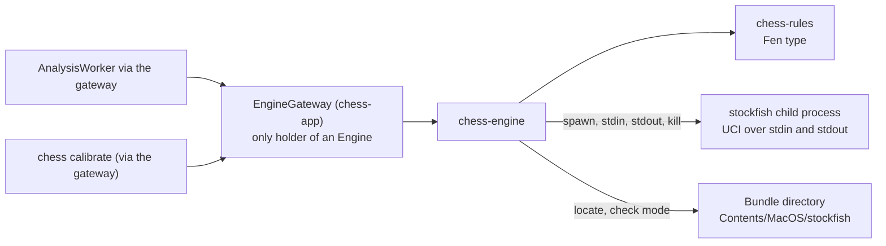
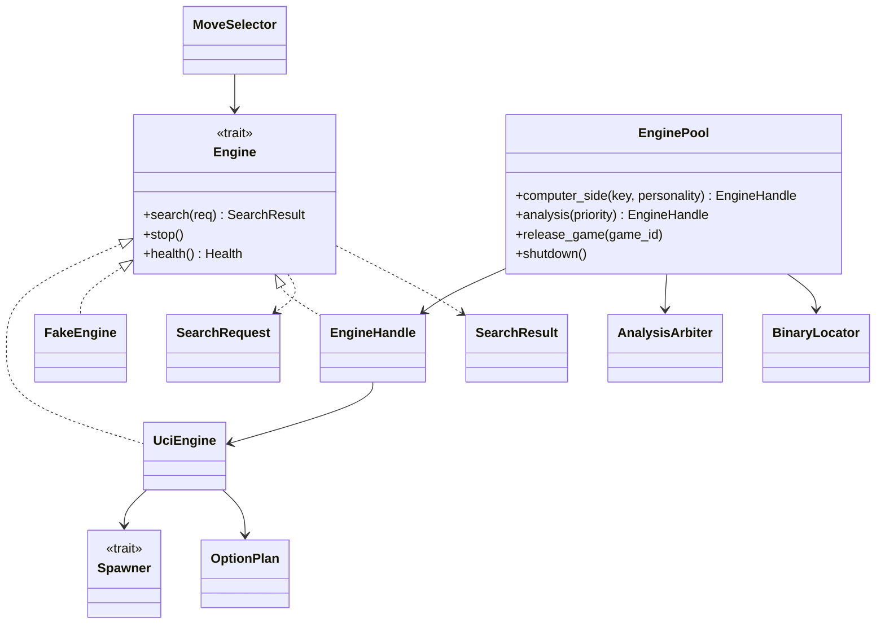
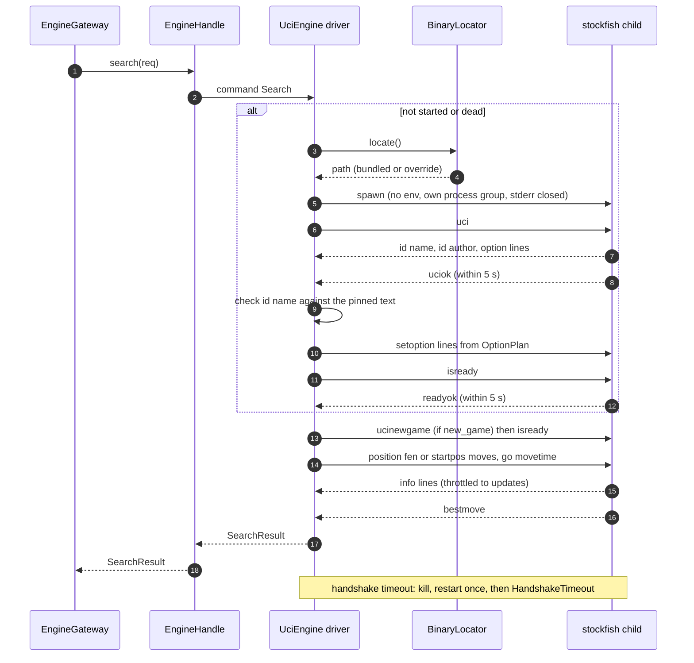
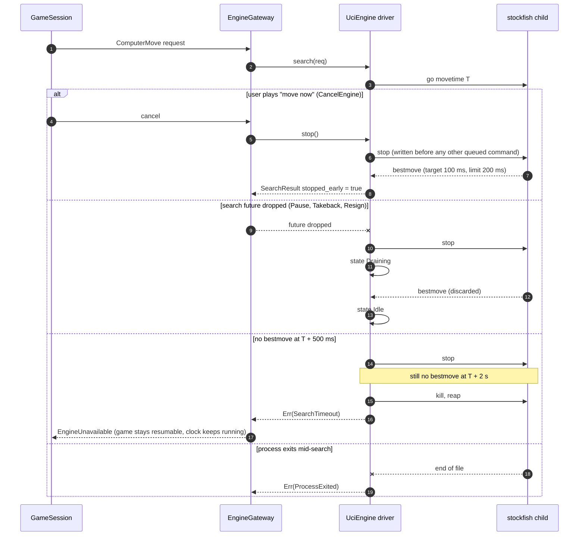
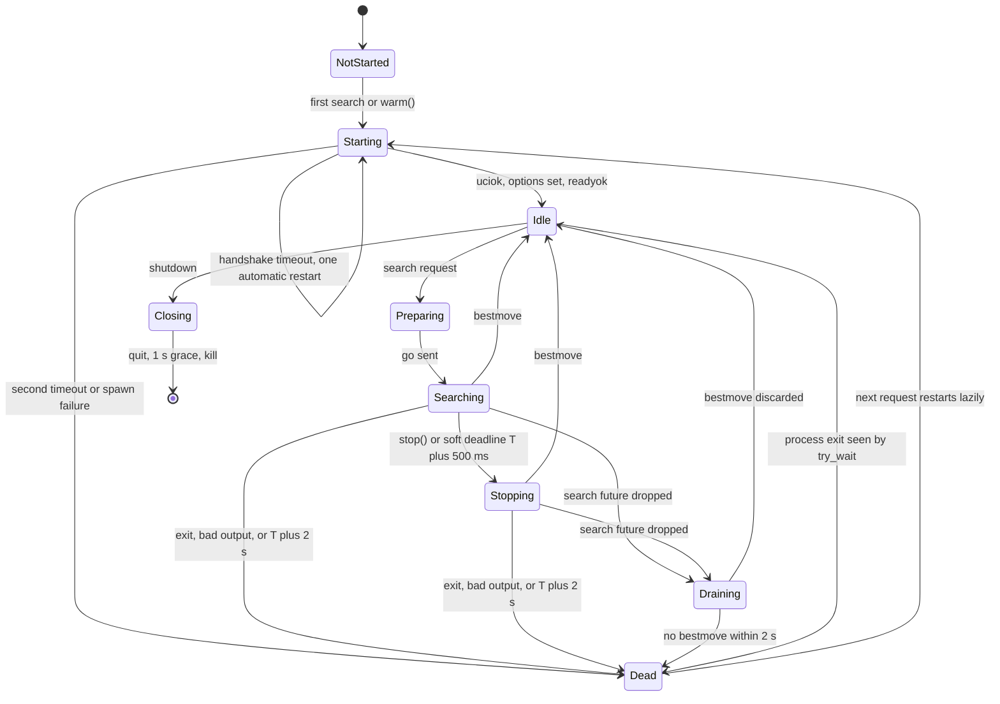

# SDD-chess-engine: Software Design Description of the `chess-engine` crate

| Field | Value |
|---|---|
| Document | docs/design/SDD-chess-engine.md |
| Version / status | 0.1 DRAFT |
| Date | 2026-10-30 |
| Standard basis | IEEE 1016-style (no conformance claim; `implementation-design-1016` skill) |
| Owner | Software engineer role (Claude), for Brian Prascher |
| Approver | PENDING. Nothing in this document is approved. |
| Gate | Drafting this document is documents-only: **G0**, no approver (SWE-001 §3). No `GATE-` file was created here (gate numbers GATE-101 onward are assigned by the coordinator, SWE-001 ASM-S5). Implementing the design is G1 unless an item in section 9 applies. |
| Engineering profile | [SWE-001](../engineering/SWE-001-engagement-profile.md): Rust 1.99.1 / edition 2024, CERT-informed practice with no conformance claim, warnings are errors |
| Crate / allocation name | `crates/chess-engine`; architecture §2.2 block `chess-app core :: chess-engine`. It drives the supporting block `stockfish` (`third_party/stockfish/` build output, F-3.2) |
| Sibling SDDs | [chess-rules](SDD-chess-rules.md), [chess-domain](SDD-chess-domain.md), [chess-store](SDD-chess-store.md), [chess-app](SDD-chess-app.md), [chess-server](SDD-chess-server.md), [chess-cli](SDD-chess-cli.md), [ui](SDD-ui.md), [desktop-tauri](SDD-desktop-tauri.md) |
| Evidence tags | `[OBS file §]` read in this session; `[RAN]` executed; `[INF]` inferred; `[ASM-EN-n]` assumed; `[UNV]` unverified |

## 1 Introduction

### 1.1 Purpose and scope

This SDD designs the crate that talks to Stockfish: the `Engine` trait, the UCI driver over a child process's standard input and output, the process pool, the translation of a computer Player's parameters into UCI options and search limits, the seeded "random error" move choice, binary discovery, and a deterministic fake engine for tests.

The crate **does not** decide whether a request is allowed (that is `EngineGateway` and `Policy`), does not check that a move is legal (`EngineGateway` with `chess-rules`, architecture §4.5), does not decide when to cancel a search (`GameSession`), and does not generate Players (`RosterGen`, `chess-domain`). Strict-mode integrity (ANA-1) is therefore **not** enforced here; this crate only guarantees that nothing outside `chess-app` is meant to hold an `Engine` (architecture §5.7).

### 1.2 Allocated requirements and functions

Allocation: architecture §10.1 rows ENG-1, ENG-2 (UCI options), ENG-3 (`SearchLimits`), ENG-4, ENG-5 (UCI `stop`), IF-4 `[OBS architecture.md §10.1 lines for ENG-1..5, IF-4]`. Requirement text read in requirements.md (ENG-1..ENG-5, IF-4, NFR-1, NFR-3, NFR-8).

| Requirement | Role of this crate | Primary DD |
|---|---|---|
| ENG-1 open-source engine, UCI, start and answer `uci`/`isready`, failure surfaces and game stays recoverable | UCI driver, failure detection, typed errors | DD-EN-004, 005, 013 |
| ENG-2 difficulty levels: parameters (`Skill Level`, depth, movetime, `UCI_Elo` only inside the reported range, random error) | Option plan and move selector; range read from the handshake | DD-EN-008, 009 |
| ENG-3 think time ≤ configured maximum | `SearchLimits` minimum rule; hard deadline | DD-EN-002, 009 |
| ENG-4 engine failure handling (5 s readiness, 2 s after the limit) | Handshake and search timers, kill, restart | DD-EN-004, 014 |
| ENG-5 cancel: best move so far within 200 ms | `stop()` writes UCI `stop` first | DD-EN-001, 004 |
| IF-4 one pinned Stockfish 19, bundled, UCI | Binary discovery, `id name` pin check | DD-EN-006, 004 |
| NFR-1 start-up (CLI ≤ 1 s) | Nothing spawns until needed; optional `warm()` | DD-EN-007 |
| NFR-3 never an illegal state | Output is syntactic only; malformed output is a failure, legality is the gateway's | DD-EN-002, 003 |
| NFR-8 responsiveness | No blocking call on a runtime worker; update throttling | DD-EN-004 |
| PLAT-3, NFR-4 offline, no network | No networking code; the child gets no environment | DD-EN-005 |
| PLY-4 parameters fixed after creation | Personality is input data, never mutated | DD-EN-002 |
| UI-1 max think time of the active profile | Input to the minimum rule | DD-EN-009 |

| Function | Name | Where |
|---|---|---|
| F-3.1 | Manage engine processes (locate, lazy start, health-check, kill and restart on timeout) | DD-EN-004, 006, 007 |
| F-3.4 | Select computer move (personality, seeded error, minimum of three limits) | DD-EN-008, 009 |
| F-3.2 | Search position (allocated to the `stockfish` block; this crate is its client) | DD-EN-004 |

`[OBS functional_decomp.md F-3 table; two functions are allocated to chess-engine]`

### 1.3 Decisions and risks

D-9 (pinned Stockfish 19, `sf_19`), D-13 (no blocking on runtime workers), D-15 (the clock keeps running during engine failure), D-18 (bundled lookup, never `PATH`, `CHESS_STOCKFISH` for dev and tests only), D-33 (`movenow` stops a search and plays the best so far). Risks: R-12 (several processes compete for CPU), R-14 (slower Macs), R-2 (low-strength calibration), R-17 (calibration must not touch real ratings).

### 1.4 Definitions

*Instance*: one Stockfish child process with its driver task. *Search*: one `go` ... `bestmove` exchange. *STM*: side to move. *Draining*: discarding output until the `bestmove` of an abandoned search arrives.

## 2 Design overview

### 2.1 Readiness basis

Upstream is baselined. No separate readiness report was produced. The findings in section 7 are the readiness input to the System Architect and Systems Engineer. FIND-EN-01 (who owns `Personality`) should be answered before the crate manifest is written, because it decides a dependency edge.

### 2.2 Viewpoints

| # | Viewpoint | Included | Section |
|---|---|---|---|
| 1 | Context | yes | 3.1 |
| 2 | Composition | yes | 3.2 |
| 3 | Logical | yes | 3.3 |
| 4 | Dependency | yes | 3.4 |
| 5 | Information | **omitted as a persistent-data viewpoint**: the crate stores nothing. In-memory data types are in 3.3 and the wire format in 3.11 | n/a |
| 6 | Patterns use | yes | 3.5 |
| 7 | Interface | yes | 3.6 |
| 8 | Structure | yes | 3.7 |
| 9 | Interaction | yes | 3.8 |
| 10 | State dynamics | yes | 3.9 |
| 11 | Algorithm | yes | 3.10 |
| 12 | Resource | yes | 3.11 |

### 2.3 Conventions

`DD-EN-nnn` design entities; `IFP-EN-nn` / `IFR-EN-nn` interfaces; `UT-EN-nnn` / `CT-EN-nnn` tests; `FIND-EN-nn` upstream findings; `ASM-EN-n` assumptions. Numbers that no requirement or decision fixes are `ESTIMATE`. UCI protocol facts below are the author's recall of the UCI specification and Stockfish behaviour; no Stockfish binary was run `[UNV]`. They are verified by the first run of the engine build script (ASM-3) and by the engine integration tests.

## 3 Viewpoints

### 3.1 Context viewpoint

**Concern:** who calls this crate and what does it touch outside the process?



No network, no data directory, no database. The child process has no environment variables and a closed standard error (3.10.5).

### 3.2 Composition viewpoint

**Concern:** what are the parts and what is each for?

| DD | Part | Purpose | Traces to |
|---|---|---|---|
| DD-EN-001 | `Engine` trait and handles | The contract `EngineGateway` uses: `search`, `stop`, `health` | §5.7, ENG-5 |
| DD-EN-002 | Request and result types | `SearchRequest`, `SearchLimits`, `SearchResult`, `PvLine`, `Score`, `UciMove`, `EnginePersonality`, `Health` | §5.7, ENG-2, ENG-3 |
| DD-EN-003 | `uci` protocol module | Pure parser and formatter of UCI lines; option table | ENG-1, NFR-3 |
| DD-EN-004 | `UciEngine` | Driver actor for one child process: handshake, options, search, stop, deadlines, drain, restart | ENG-1, ENG-4, ENG-5, F-3.1 |
| DD-EN-005 | `Spawner` | Process launch (real `tokio::process`, scripted in tests) | ENG-1, PLAT-3 |
| DD-EN-006 | `BinaryLocator` | Finds the bundled engine; override for tests; never `PATH` | IF-4, D-18 |
| DD-EN-007 | `EnginePool` | Instances per computer side, shared analysis instance, lifecycle | §4.7, R-12 |
| DD-EN-008 | `OptionPlan` | Personality and config to `setoption` list, checked against the handshake | ENG-2 |
| DD-EN-009 | `MoveSelector` and `SearchLimits` rules | Minimum of three limits, clock budget, seeded error choice | ENG-2, ENG-3, F-3.4 |
| DD-EN-010 | `AnalysisArbiter` | Priority between interactive and background analysis on the shared instance | §4.7 |
| DD-EN-011 | `FakeEngine` | In-process deterministic engine implementing `Engine` | test-strategy principle 2 |
| DD-EN-012 | `fake-uci` binary | Test executable speaking UCI with `FakeEngine` logic, selected by `CHESS_STOCKFISH` | test-strategy, §8.2 |
| DD-EN-013 | `EngineError` | Typed failures and mapping to `EngineUnavailable{cause}` | §5.5, ENG-4 |
| DD-EN-014 | `EngineConfig` | Timeouts, threads, hash, caps; all overridable in tests | §4.8 |

### 3.3 Logical viewpoint

**Concern:** key types and how they relate.



Key types (names are design proposals; those in architecture §3.3 are kept: `Engine`, `UciEngine`, `EnginePool`, `SearchLimits`, `FakeEngine`; `Personality` is renamed, FIND-EN-01):

```rust
pub struct UciMove(/* 4 or 5 ASCII chars, syntax-checked: file rank file rank [qrbn] */);
pub enum Score { Cp(i32), Mate(i32) }              // side-to-move point of view, as UCI reports it
pub struct PvLine { pub multipv: u8, pub score: Score, pub depth: u32, pub pv: Vec<UciMove> }
pub struct SearchResult {
    pub best: UciMove, pub pv: Vec<UciMove>, pub score: Score, pub depth: u32,   // §5.7
    pub lines: Vec<PvLine>,        // all MultiPV lines of the last completed depth (additive)
    pub stopped_early: bool, pub elapsed: Duration,
}
pub struct SearchLimits { pub movetime: Duration, pub depth: Option<u32>, pub nodes: Option<u64> }
pub enum SearchPosition { Fen(Fen), Moves { start: Option<Fen>, moves: Vec<UciMove> } }
pub struct SearchRequest {
    pub position: SearchPosition, pub limits: SearchLimits, pub multipv: u8,
    pub new_game: bool, pub updates: Option<mpsc::Sender<SearchInfo>>,
}
pub struct EnginePersonality {            // fields of architecture §4.6 Personality
    pub skill_level: u8, pub depth_limit: u32, pub movetime_ms: u32,
    pub uci_elo: Option<u32>, pub error_rate: f64, pub error_multipv: u8,
}
pub enum Health { NotStarted, Ready, Searching, Dead }
```

`movetime` is **mandatory** in `SearchLimits`: every request has a wall-clock bound, which the failure rules of ENG-4 need (a limit to measure "2 s after the limit" from). Depth and node limits are additional caps. This is a small restriction on the architecture's open `SearchLimits` and costs nothing: all uses in §4.8 are time-bounded.

### 3.4 Dependency viewpoint

**Concern:** what depends on what?

Crate edges, exactly as architecture §3.2: `chess-app → chess-engine`, `chess-engine → chess-rules` `[OBS architecture.md §3.2]`. The crate has **no edge** to `chess-domain`, `chess-store`, the server or any front-end. `chess-domain` has no edge to this crate either, which causes FIND-EN-01.

| Dependency | Use | Version source |
|---|---|---|
| `chess-rules` | `Fen` (validated position text) as the position type `[ASM-EN-1: type name and `AsRef<str>`/`Display` to be reconciled with SDD-chess-rules]` | workspace |
| `tokio` (features `process`, `io-util`, `sync`, `time`, `rt`, `macros`) | child process, async pipes, timers, channels | 1.54.1 `[OBS architecture.md §3.4]` |
| `thiserror`, `tracing` | errors, log events | 2.0.21, 0.1.44 `[OBS §3.4]` |
| Test only: `proptest`, `cargo-fuzz`, `insta` | parser properties, fuzzing, snapshots | 1.12.0, 0.13.2, 1.49.0 `[OBS §3.4]` |

No other crate is needed: the seeded generator is a ten-line SplitMix64 in the crate (no `rand`), and line splitting is a small bounded reader (no `tokio-util`). `tokio` appears under `chess-app` only in §3.2 (FIND-EN-10). `#![forbid(unsafe_code)]` applies to the whole crate; process groups use the safe `std::os::unix::process::CommandExt::process_group` `[UNV: exists in the pinned toolchain; stable since Rust 1.64 from recall]`.

### 3.5 Patterns-use viewpoint

**Concern:** which recognised solutions are used and what shows misuse?

| Pattern | Where | Why | Misuse tell |
|---|---|---|---|
| Actor per child process | DD-EN-004 | One task owns stdin and stdout, so UCI ordering cannot be violated by concurrent callers | A second task writes to the same stdin |
| Command channel plus oneshot reply | DD-EN-004 | `search` and `stop` are safe to call concurrently (`&self`) | `Mutex<ChildStdin>` appears |
| Drop-as-cancel with drain | DD-EN-004 | A dropped `search` future stops the search and leaves the process reusable (cancel safety) | A search that leaves the next `go` racing a stale `bestmove` |
| Port and adapter (`Spawner`) | DD-EN-005 | The real driver is tested against a scripted process, with paused time | Tests of the driver that need a real binary for timeout logic |
| Priority arbiter | DD-EN-010 | One instance serves two kinds of work | Background work never yields |
| Pure functions at the edges (`parse_line`, `OptionPlan`, `select`) | DD-EN-003, 008, 009 | Most logic is testable and fuzzable without a process | A parser that holds a handle to the child |
| Null object (`FakeEngine`) | DD-EN-011 | Deterministic flows for UI and core tests | The fake knows about the test that uses it |

### 3.6 Interface viewpoint

**Concern:** what is offered, what is needed, and how does it fail?

#### 3.6.1 Provided

| ID | Interface | Consumer | Contract |
|---|---|---|---|
| IFP-EN-01 | `Engine` trait: `search`, `stop`, `health` | `EngineGateway` | Architecture §5.7: "Async, cancellable. `search(position, SearchLimits, multipv) → SearchResult{best, pv, score, depth}`, `stop()`, `health()`. Only the gateway holds an `Engine`." `[OBS]` |
| IFP-EN-02 | `EnginePool` | `EngineGateway` | `computer_side`, `analysis(priority)`, `release_game`, `shutdown` |
| IFP-EN-03 | `MoveSelector::select_move` and `SearchLimits::for_move`, `clock_budget` | `EngineGateway` / `GameSession` | Pure planning plus one call to an `Engine` |
| IFP-EN-04 | `BinaryLocator::locate` | `Core` start-up | Path and provenance, or `BinaryMissing` |
| IFP-EN-05 | `FakeEngine`, `fake-uci` | tests in all crates, E2E runners | 3.10.7 |

Semantics fixed by this design:

- **`search`** returns when the engine sends `bestmove`. If `stop()` was called, or the soft deadline fired, the result has `stopped_early = true` and still carries the best move found so far. The future is **cancel-safe**: dropping it stops the search and drains (3.10.3), and the instance is ready again when the next call begins. A dropped search never returns a result.
- **`stop()`** returns immediately after queueing UCI `stop` ahead of any other pending command; it has no result. Calling it with no search running does nothing.
- **`health()`** answers from the driver's state without a round trip; `Ready` after a successful `isready`, `Dead` when the process exited or was killed.
- `SearchRequest.updates` receives throttled `SearchInfo` (depth, multipv, score, pv) with `try_send`; a full channel drops the update. It feeds `AnalysisProgress` and Training live analysis (§4.8 "streamed, refined until the user leaves"). It is additive to §5.7 (FIND-EN-07).
- **`SearchResult.best` is a `UciMove`, a syntactic move, not a legal `Move`.** Legality is checked by the gateway with `chess-rules` (§4.5). This lets `FakeEngine` return an illegal move to test that path.
- `Score` is from the side to move's point of view, as UCI sends it. Callers that store evaluations normalise (FIND-EN-09).

#### 3.6.2 Required

| ID | Interface | Relied on | If it fails |
|---|---|---|---|
| IFR-EN-01 | Stockfish 19 over UCI (stdin/stdout lines) | Commands `uci`, `isready`, `ucinewgame`, `setoption`, `position`, `go`, `stop`, `quit`; replies `id`, `option`, `uciok`, `readyok`, `info`, `bestmove`; exits when stdin reaches end of file `[UNV: all from recall; confirmed at ASM-3 and by CT-EN-020]` | Typed `EngineError` (3.6.3) |
| IFR-EN-02 | Operating system process API through `tokio::process` | Spawn, pipes, kill, reap, process group | `SpawnFailed` |
| IFR-EN-03 | `chess_rules::Fen` | A validated position text | compile-time |
| IFR-EN-04 | `tokio` time | Timers; paused clock in tests | n/a |
| IFR-EN-05 | Bundled file `<exe dir>/stockfish` (provided by `packaging/`, F-8.6, F-8.7) | Executable, universal, `id name` Stockfish 19 | `BinaryMissing`, `NotExecutable`, `WrongVersion` |

#### 3.6.3 Failure taxonomy (DD-EN-013) and mapping to architecture §5.5

`EngineError` is a `thiserror` enum. `Display` shows the category only and never a path, command line or engine output (SWE-001 §6 ERR row; NFR-10: no move lists in logs). Details go to `tracing` with the instance id.

| `EngineError` | Cause | `EngineUnavailable{cause}` (§5.5) | Retried by |
|---|---|---|---|
| `BinaryMissing` / `NotExecutable` / `InvalidOverride` | locator checks fail | `binary_missing` | user `RetryEngine` |
| `SpawnFailed` | OS refused to start the process | `spawn_failed` | `RetryEngine` |
| `HandshakeTimeout` | no `uciok` or `readyok` within 5 s, after one automatic restart | `handshake_timeout` | `RetryEngine` |
| `WrongVersion{found}` | bundled binary's `id name` does not contain the pinned text | `wrong_version` | none (packaging defect) |
| `ProcessExited{status}` | child exited or its pipe closed | `crashed` | `RetryEngine` restarts |
| `SearchTimeout` | no `bestmove` by limit + 2 s, process killed | `timeout` | `RetryEngine` |
| `BadOutput` | unparsable `bestmove`, line over the cap, `bestmove (none)` | `bad_output` | `RetryEngine` |
| `Preempted{partial}` | background analysis yielded to an interactive request | not an engine failure | the worker retries the ply |
| `InvalidPersonality{..}` | `uci_elo` outside the reported range, option unsupported | **`Internal{id}`**, a defect, not an engine outage | none |
| `InvalidRequest` | e.g. `multipv` 0 or above the cap | `Internal{id}` | none |

The `cause` strings are proposed; the catalogue gives no list (FIND-EN-11). Illegal moves are detected by the gateway, not here (architecture §4.5, §4.7).

### 3.7 Structure viewpoint

**Concern:** how is the crate organised?

```
crates/chess-engine/
  Cargo.toml                 # features: test-support (FakeEngine, scripted Spawner); fake-uci-bin
  src/
    lib.rs                   # #![forbid(unsafe_code)]
    engine.rs                # DD-EN-001 trait, Health
    types.rs                 # DD-EN-002
    uci/{parse,format,options}.rs     # DD-EN-003 (pure)
    driver.rs                # DD-EN-004 UciEngine, state machine, deadlines
    spawn.rs                 # DD-EN-005
    locate.rs                # DD-EN-006
    pool.rs  arbiter.rs      # DD-EN-007, 010
    plan.rs                  # DD-EN-008
    select.rs                # DD-EN-009 (limits, budget, SplitMix64, error pick)
    error.rs  config.rs      # DD-EN-013, 014
    fake.rs                  # DD-EN-011 (test-support)
  src/bin/fake_uci.rs        # DD-EN-012 (required-features = ["fake-uci-bin"]; never packaged)
  tests/                     # integration (scripted), engine integration (--features stockfish-tests)
```

Layering: `uci/*`, `plan.rs` and `select.rs` are pure and know nothing about tokio. Only `driver.rs` touches the process.

### 3.8 Interaction viewpoint

**Concern:** how do the parts collaborate, including failures?

#### 3.8.1 Lazy start and handshake (SEQ-EN-01)



#### 3.8.2 Cancel, drop and failure (SEQ-EN-02)



### 3.9 State-dynamics viewpoint

**Concern:** in which states can an instance be, and what moves it?



Guards: a new `go` is sent only from `Idle`. `Dead → Starting` is an automatic, transparent restart only for a request that arrives while the instance is `Dead` or `NotStarted`; a search that fails in flight is **reported**, not retried (3.10.4).

### 3.10 Algorithm viewpoint

**Concern:** the non-trivial procedures and their invariants.

#### 3.10.1 UCI parsing and formatting (DD-EN-003)

`parse_line(&str) -> UciMessage` is a pure, total function: unknown or malformed input becomes `Unknown(String)` or `Malformed`, never a panic. Recognised: `id name|author`, `option name N type T [default D] [min a] [max b] [var v]*`, `uciok`, `readyok`, `bestmove M [ponder P]`, and `info` with the tokens `depth seldepth multipv score(cp|mate x [lowerbound|upperbound]) nodes nps hashfull tbhits time pv ...`; `info string ...` is ignored. Tokens are matched by keyword, not by position, so extra tokens do not break parsing. A score with a bound flag is not used as a final line. `bestmove (none)` and `bestmove 0000` become `NoMove`. Lines are read with a bounded reader (64 KiB cap `ESTIMATE`); a longer line is `BadOutput`.

Commands are produced only by `format_*` functions that accept typed arguments: no command is built by string concatenation of caller text, and a `setoption` value is checked against the option's type and range from the handshake (CERT-informed: input validation, SWE-001 §6 IDS row). No `UciMove` or `Fen` can contain a newline.

#### 3.10.2 Driver loop (DD-EN-004)

One task per instance. State: `{state, child, stdin, line_reader, applied_options, current: Option<Pending>}`.

```
loop select! (biased, in this order):
  1. command channel:
       Stop        -> if Searching: write "stop" now; state = Stopping
       Search(req, reply) -> if state != Idle: reply Err(Busy-internal); else run prepare/go
       Health, Shutdown ...
  2. reply.closed() of the current search (future dropped) -> write "stop" (if Searching); state = Draining
  3. stdout line -> parse_line:
       info  -> update lines[multipv]; maybe emit throttled SearchInfo
       bestmove -> if Searching/Stopping: validate syntax, reply Ok(result); state = Idle
                   if Draining: discard; state = Idle
       other -> ignore (readyok outside prepare is ignored)
       EOF or read error -> state = Dead; reply Err(ProcessExited)
  4. deadline timers: soft (T + 500 ms): write "stop" once; hard (T + 2 s): kill, reply Err(SearchTimeout)
```

Commands are polled first so that `stop` reaches the pipe before the next line is parsed, which keeps `stop → bestmove` as short as the engine allows (ENG-5 design target 100 ms, limit 200 ms, both `ESTIMATE` from the architecture).

#### 3.10.3 Cancel safety and drain

The search reply channel is a `oneshot`. When its receiver is dropped the driver detects it (step 2) and sends `stop`, enters `Draining`, and does not accept a new `go` until the abandoned `bestmove` arrives (2 s bound; otherwise `Dead`). Because UCI has no search identifiers, a stale `bestmove` could otherwise be taken for the next search's answer. `isready` cannot be used as a barrier: Stockfish may answer it during a search `[UNV: from recall]`.

#### 3.10.4 Failure and restart policy

- Between searches, before every request the driver calls `try_wait`; if the child exited it is restarted transparently, **once**, as part of `Starting` (architecture §4.7 "restarted transparently").
- A failure **during** a search (exit, bad output, timeout) is returned to the caller and the instance becomes `Dead`. The next request restarts it. `RetryEngine` is exactly that next request (F-3.7, §4.3 `EngineError → EngineThinking`). No search is silently repeated: the clock keeps running (D-15), and the caller decides.
- `Starting` retries once on handshake timeout (§4.8 "Kill and restart once, then `EngineUnavailable`").
- Every kill is followed by `wait` so no zombie remains.

#### 3.10.5 Process launch and hygiene (DD-EN-005)

`Command::new(path)` with no arguments, `env_clear()`, current directory = the binary's directory, stdin and stdout piped, **stderr to null** (a full unread pipe could deadlock the engine; engine text can contain positions and must not reach the log), `kill_on_drop(true)`, and its **own process group**, so a Ctrl-C in the terminal reaches `chess` and not Stockfish and the shutdown stays orderly. If `chess` is killed without cleanup, the child's stdin reaches end of file and Stockfish is expected to quit `[UNV: IFR-EN-01, test CT-EN-020]`. The Stockfish process holds no descriptor of the store: this crate does not open files, and the store opens its descriptors close-on-exec ([chess-store §3.11.6](SDD-chess-store.md)).

#### 3.10.6 Binary discovery (DD-EN-006)

```
locate():
  if env CHESS_STOCKFISH is set and non-empty:
        path = it; require absolute (else InvalidOverride); source = Override   -- dev and tests only (D-18)
  else:
        exe = std::env::current_exe().canonicalize()       -- follows the install-cli symlink
        path = exe.parent()/"stockfish"; source = Bundled
  require: exists, regular file, owner-executable, not group- or world-writable
  never read PATH; never download
```

`Bundled` binaries must report an `id name` containing the pinned text (`Stockfish 19` `[UNV: exact text, TBC-7]`); `Override` binaries skip that check so the fake can run. The override means a user can point the app at another binary; the architecture accepts this for dev and tests (§8.2) and the check above is the only guard (FIND-EN-10 notes the residual risk).

#### 3.10.7 Option plan (DD-EN-008)

`OptionPlan::for(personality | analysis_config, advertised: &UciOptions) -> Vec<SetOption>`:

- `Threads`, `Hash` from `EngineConfig` (fixed per kind; FIND-EN-04).
- If `uci_elo = Some(e)`: require the engine advertises `UCI_Elo` with `min ≤ e ≤ max` (values read from the `option name UCI_Elo type spin default .. min .. max ..` line, never hard-coded, architecture §4.6), then `UCI_LimitStrength = true`, `UCI_Elo = e`. Outside the range or not advertised: `InvalidPersonality`.
- If `uci_elo = None`: `UCI_LimitStrength = false` (when advertised), `Skill Level = skill_level` checked against the advertised `min`/`max`.
- `MultiPV` is set per search from the request, only when it changes.
- Only options advertised by the engine are sent. The instance remembers the applied map and sends the difference, then `isready`.

The handshake result `EngineInfo{id_name, uci_elo_range: Option<(u32,u32)>, options}` is exposed so `chess-app` can pass the `UCI_Elo` range to `RosterGen` and `chess calibrate` (architecture §4.6).

#### 3.10.8 Search limits and the move selector (DD-EN-009)

`SearchLimits::for_move(personality, max_think, clock_budget)`: `movetime = min(personality.movetime_ms, max_think?, clock_budget?)`, `depth = personality.depth_limit`. The result never exceeds any of the three, which is ENG-3 and "it can only shorten a limit, never lengthen it" (§4.6). The request is sent as `go movetime T [depth D]`: time limits, not wtime/btime, for clocked games (R-12).

`clock_budget(remaining, increment, ply) -> Duration`: `min(remaining / 30 + 3·increment / 4, remaining / 2)`, floored at 50 ms `ESTIMATE`. The architecture names "a clock-derived budget" and gives no formula (FIND-EN-05). The constants are placeholders for the Systems Engineer to confirm (test-strategy "computer budgets from remaining time").

`select_move(engine, MoveRequest{position, personality, limits, seed}) -> MoveChoice{ mv: UciMove, kind: Best | Error, result }`:

```
draws = SplitMix64(seed)                       -- seed = (game_id, ply) hash supplied by the caller
u = draws.next_f64()
if personality.error_rate > 0 and personality.error_multipv >= 2 and u < personality.error_rate:
      r = engine.search(req with multipv = error_multipv)
      if r.lines.len() >= 2:
            i = 1 + draws.next_u64() % (r.lines.len() - 1);   mv = r.lines[i].pv[0];  kind = Error
      else: mv = r.best; kind = Best                         -- one legal move, or stopped very early
else: r = engine.search(req with multipv = 1); mv = r.best; kind = Best
```

The same seed gives the same roll and the same pick (reproducible replays, §4.6); the engine's own output is not deterministic with more than one thread, which is why tests use `Threads=1` and a fixed depth (architecture §8 Determinism). The legality check of `mv` is the gateway's.

#### 3.10.9 Analysis arbiter (DD-EN-010)

The shared analysis instance serves two priorities. `Interactive` requests (Training live analysis, what-if, post-game on demand) are served first-in first-out among themselves; a newer live-analysis request replaces an older one by dropping its future. A `Background` request (per-move evaluation, 200 ms per ply) runs only when no interactive request is waiting; when one arrives, the arbiter calls `stop()` and the background caller gets `Err(Preempted{partial})`, then retries the ply later. The architecture's "Low (`nice`)" cannot be implemented on a shared instance (a process cannot raise its own priority again without privilege), so priority is scheduling, not operating-system priority (FIND-EN-03).

#### 3.10.10 Pool (DD-EN-007)

`computer_side(key = (game_id, side), personality)` creates an instance on first use and returns a handle; self-play gets two keys and so two processes with identical options (architecture §4.7). `warm()` on a handle starts the process and runs the handshake ahead of the first search, so `GameSession` can call it when a game starts and hide the start-up while the human thinks. `release_game(game_id)` shuts down that game's instances (game end, suspend, void, detach). `analysis(priority)` returns a handle onto the single analysis instance behind the arbiter. `shutdown()` sends `quit`, waits up to 1 s `ESTIMATE`, then kills; the web server's 5 s stop budget (§4.8) leaves room for this. Nothing is started by `EnginePool::new`, which keeps CLI start-up under the first-frame rule (§6.1 Startup, NFR-1).

#### 3.10.11 Fakes (DD-EN-011, DD-EN-012)

`FakeEngine` implements `Engine` in process. Behaviours (set per instance or as a script of replies): `FirstLegalMove` (via a move list supplied by the test), `Fixed(UciMove)`, `Scripted(Vec<Reply>)`, and injected faults `Crash`, `Hang` (answers only after `stop`), `Timeout`, `IllegalMove(UciMove)`, `Garbage`, `BinaryMissing`, plus latency. It records every call, so tests of the gateway can assert "no call was made" (the ANA-1 spy sits in the gateway; this is the underlying record). `fake-uci` is a small executable that reads UCI lines and answers with the same logic, so the **real** `UciEngine`, `Spawner`, pool and timers are exercised end to end, and the CLI and GUI end-to-end suites select it with `CHESS_STOCKFISH=<path>` (architecture §8.2 "dev and tests only"). It is built only with `--features fake-uci-bin` and is not part of `Chess.app` (packaging check, F-8.6).

### 3.11 Resource viewpoint

**Concern:** processes, memory, threads, channels, time.

| Resource | Rule | Value and source |
|---|---|---|
| Child processes | one per computer side, one shared analysis instance, per app process | architecture §4.7; up to three typical, nine across three app processes (R-12) |
| Threads per instance | `Threads` option fixed per kind | computer: 1; analysis: 2. **`ESTIMATE`, unspecified upstream (FIND-EN-04)** |
| Hash per instance | fixed per kind | computer: 16 MB; analysis: 64 MB. **`ESTIMATE`, FIND-EN-04** |
| Memory ceiling | accounting hook `hash_in_use_mb()`; no ceiling enforced | Should (CR-7.4, architecture §4.8) |
| Driver tasks | one tokio task per instance; no blocking calls | D-13 |
| Pipes | stdin writes are tiny; stdout read line by line, line cap 64 KiB | `ESTIMATE` (mine) |
| `updates` channel | capacity 16, `try_send`, latest info per multipv index, at most one update per 100 ms | `ESTIMATE` (mine) |
| Timeouts | handshake 5 s (`uciok`, `readyok` each); soft stop at limit + 500 ms; hard kill at limit + 2 s; cancel design target 100 ms, limit 200 ms; shutdown grace 1 s | architecture §4.8, ENG-4, ENG-5 (all `ESTIMATE` there); shutdown grace is mine |
| Config | every timeout and size is in `EngineConfig` so tests shrink them (architecture §4.8 "Tests set them through config") | DD-EN-014 |
| Time in tests | `tokio::time::pause` with the scripted `Spawner` | no real sleeps in timeout tests |
| Start-up | no process at start; handshake expected well under 1 s on the baseline Mac | architecture §4.8; ASM-2 |

### 3.12 Design rationale

| ID | Decision | Alternatives rejected | Cost / risk |
|---|---|---|---|
| R-EN-1 | `EnginePersonality` is defined in this crate, converted from the domain type by `chess-app` | Define `Personality` in `chess-domain` and add an edge `engine → domain` (G2, Q4); define it here and make `domain` depend on `engine` (breaks purity) | One conversion function in `chess-app` (FIND-EN-01) |
| R-EN-2 | The child is started by `tokio::process` from the path next to the executable, for the desktop app too | Starting it through Tauri's shell plugin as a sidecar (a second launch path, a Tauri capability, and a different way to read stdout) | Architecture §2 says "Tauri starts it as a sidecar"; this design treats the sidecar as a bundling mechanism only (FIND-EN-02, OQ-11) |
| R-EN-3 | Syntactic `UciMove` result | Return a legal `Move` (then the fake cannot test the illegal path, and the crate needs more of `chess-rules`) | Gateway converts |
| R-EN-4 | Drop-as-cancel with drain | Separate `cancel(id)` calls (UCI has no search ids) | Needs the 2 s drain bound |
| R-EN-5 | `movetime` mandatory | Optional time with depth-only searches (no basis for ENG-4's "2 s after the limit") | Fixtures use a generous `movetime` with a depth cap |
| R-EN-6 | Own SplitMix64 | `rand` crate (new dependency, API drift, stream stability between versions would change replays) | About ten lines to test |
| R-EN-7 | Scheduling priority on a shared analysis instance | A second, `nice`d instance (more processes and memory in a three-process machine, R-12) | Preempted work is redone |
| R-EN-8 | A `fake-uci` executable in addition to `FakeEngine` | In-process fake only (end-to-end suites could not use it; the driver and pool would be untested by them) | One more test binary, excluded from packaging |

## 4 Design entities

All entities: Rust 1.99.1 edition 2024, `#![forbid(unsafe_code)]`, no `unwrap`/`expect` outside tests, `thiserror`, warnings are errors; no network code.

| DD | Interface (see) | Failure behaviour | Concurrency | Resources | Verification | Code |
|---|---|---|---|---|---|---|
| DD-EN-001 `Engine` | 3.6.1 | `Result<_, EngineError>`; `stop` and `health` cannot fail | `&self` methods; safe to call `stop` while `search` pends | none | CT-EN-001..006 | `src/engine.rs` (not yet written) |
| DD-EN-002 types | 3.3 | constructors validate (`UciMove::parse`, `multipv` range, `movetime > 0`) | plain data | none | UT-EN-001..006 | `src/types.rs` |
| DD-EN-003 `uci` | 3.10.1 | total functions, no panics | pure | none | UT-EN-010..019, fuzz | `src/uci/*.rs` |
| DD-EN-004 `UciEngine` | 3.8, 3.9, 3.10.2..4 | every error in 3.6.3; process always reaped | one task; command channel; `oneshot` replies | one child, one task | CT-EN-001..021 | `src/driver.rs` |
| DD-EN-005 `Spawner` | `spawn(path) -> Process{stdin, stdout, kill, wait}` | `SpawnFailed` | n/a | process group, null stderr | CT-EN-010, 020 | `src/spawn.rs` |
| DD-EN-006 `BinaryLocator` | 3.10.6 | typed errors, no path in `Display` | pure + `metadata` | none | UT-EN-040..046 | `src/locate.rs` |
| DD-EN-007 `EnginePool` | 3.10.10 | a failed instance does not affect another | `Mutex<HashMap>` held only to look up or insert, never across `.await` | up to N children | CT-EN-030..034 | `src/pool.rs` |
| DD-EN-008 `OptionPlan` | 3.10.7 | `InvalidPersonality` | pure | none | UT-EN-020..027 | `src/plan.rs` |
| DD-EN-009 selector | 3.10.8 | propagates `EngineError` | pure + one `search` | none | UT-EN-030..039 | `src/select.rs` |
| DD-EN-010 `AnalysisArbiter` | 3.10.9 | `Preempted` | async mutex-free queue (two `mpsc` classes) | none | CT-EN-040..042 | `src/arbiter.rs` |
| DD-EN-011 `FakeEngine` | 3.10.11 | scripted faults | thread-safe call log | none | CT-EN-050 | `src/fake.rs` |
| DD-EN-012 `fake-uci` | UCI on stdio | exits on end of file | single thread | none | CT-EN-051 | `src/bin/fake_uci.rs` |
| DD-EN-013 `EngineError` | 3.6.3 | n/a | n/a | none | UT-EN-060, CT-EN-060 | `src/error.rs` |
| DD-EN-014 `EngineConfig` | defaults of 3.11, overridable | validation of ranges | immutable after build | none | UT-EN-050 | `src/config.rs` |

## 5 Traceability: requirement to design to verification

| Requirement | DD | Tests | Notes |
|---|---|---|---|
| ENG-1 | DD-EN-003, 004, 005, 006 | CT-EN-001, 010, 011, 020; EI-EN-01 | handshake, legal `bestmove` from standard positions (EI = engine integration) |
| ENG-2 (options, range) | DD-EN-008, 009 | UT-EN-020..027, EI-EN-02 | the "every stored `uci_elo` inside the reported range" test is in `chess-app` using `EngineInfo` |
| ENG-3 | DD-EN-002, 009 | UT-EN-030..034, EI-EN-04 | measured latency on the baseline Mac |
| ENG-4 | DD-EN-004, 013, 014 | CT-EN-012..016 | crash, hang, missing; retry restarts |
| ENG-5 | DD-EN-001, 004 | CT-EN-003, EI-EN-05 | ≤ 200 ms `ESTIMATE` (TBD-12) |
| IF-4 | DD-EN-006 | UT-EN-044, CT-EN-017, EI-EN-01 | pinned `id name`; `lipo` check belongs to packaging |
| NFR-1 | DD-EN-007 | CT-EN-030 | no spawn at construction; `warm()` |
| NFR-3 | DD-EN-002, 003 | UT-EN-010..019, fuzz FZ-EN-01 | malformed output is a failure |
| NFR-8 | DD-EN-004 | CT-EN-004 | stop while searching; no blocking |
| PLAT-3 / NFR-4 | DD-EN-005 | CT-EN-020; offline engine test in packaging | empty environment, no sockets |
| PLY-4 | DD-EN-002 | UT-EN-035 | personality is never mutated |
| UI-1 | DD-EN-009 | UT-EN-031 | min rule |
| Orphan check | every DD traces to a requirement or decision; DD-EN-011/012 trace to test-strategy principle 2 and architecture §8.2 | | |

## 6 Verification mapping

No test has been written or run `[UNV]`. Levels per test-strategy and architecture §9: unit and property/fuzz, scripted-process integration with paused time, engine integration with the real binary (`--features stockfish-tests`), and platform runs (Intel best effort, CR-7.6).

| ID | Level | Purpose |
|---|---|---|
| UT-EN-001..006 | unit | `UciMove` syntax, `SearchLimits` constructors, request validation |
| UT-EN-010..019 | unit / property | parse tables for `id`, `option` (spin, check, combo, button, string), `info` with bounds and `string`, `bestmove` variants; `parse(format(x))` round trips; arbitrary bytes never panic |
| FZ-EN-01 | fuzz | `cargo-fuzz` on `parse_line` and the bounded reader |
| UT-EN-020..027 | unit | option plan: `UCI_Elo` inside and outside the range, absent option, `Skill Level` bounds, difference-only sending |
| UT-EN-030..039 | unit | minimum of three limits; clock budget vectors; SplitMix64 vectors; same seed same pick; error pick never chooses line 0; one-line result falls back to best |
| UT-EN-040..046 | unit | locator: override absolute only, relative rejected, `PATH` never read (a fake `PATH` containing a decoy), mode checks, symlinked executable resolved |
| UT-EN-050, 060 | unit | config validation; no `Display` contains a path |
| CT-EN-001..006 | component (scripted process, paused time) | handshake order; search; `stop` before queued commands; drop-then-drain; no `go` before drain ends; concurrent `stop` |
| CT-EN-010..017 | component | spawn failure; handshake timeout then one restart then error; crash mid-search; hang until soft stop then hard kill at +2 s; garbage output; line over cap; wrong `id name` for a bundled path |
| CT-EN-020 | component (real child `fake-uci`) | `kill -9` of the parent leaves no child; process group; no zombies after kill `[UNV: end-of-file exit of Stockfish itself is checked in EI-EN-06]` |
| CT-EN-021 | component | `RetryEngine` path: dead instance restarted by the next request |
| CT-EN-030..034 | component | no spawn at pool creation; `warm()`; self-play gets two processes; `release_game`; `shutdown` bound |
| CT-EN-040..042 | component | preemption, no starvation of background work after interactive work ends, newer live analysis replaces older |
| CT-EN-050..051 | component | `FakeEngine` fault modes; `fake-uci` through the real driver |
| CT-EN-060 | component | every `EngineError` maps to a documented cause |
| EI-EN-01..06 | engine integration (`--features stockfish-tests`) | real Stockfish 19: handshake and `id name`; `UCI_Elo` range exposed; legal moves on fixtures; mate-in-1/2/3 with `Threads=1` and fixed depth; cancel latency; end-of-file exit; crash recovery. Run on the development Mac; the Intel slice is "not run: hardware unavailable" (CR-7.6) |

Coverage target for `uci/*`, `plan.rs`, `select.rs`, `locate.rs`: at least 90 % line coverage (the test-strategy gate lists rules, Elo, clock, policy and parser modules; the UCI parser is a parser). The driver is covered by scripted tests, not by percentage.

## 7 Open issues / upstream findings (for the System Architect and Systems Engineer)

No upstream document was modified.

| ID | Sev | Finding | Evidence | Proposed resolution / owner |
|---|---|---|---|---|
| FIND-EN-01 | Major | `Personality` has no home that respects the dependency graph. §4.6 has pure `RosterGen` in `chess-domain` produce it, §10.1 ENG-2 allocates it to `chess-domain`, and §3.3 lists it as a key type of `chess-engine`. But `chess-domain` cannot depend on `chess-engine` (purity, §3.2) and `chess-engine` has no edge to `chess-domain`. | architecture §3.2, §3.3, §4.6, §10.1 | This SDD defines `EnginePersonality` in the engine and has `chess-app` convert (R-EN-1). Alternative: a new edge `engine → domain` (G2). SA / Brian Prascher. |
| FIND-EN-02 | Minor | §2 and §6.3 say Tauri starts Stockfish "as a sidecar", but the core owns the UCI driver. Starting through Tauri's shell plugin would need a second spawn path. | architecture §2 key points, §6.3, OQ-11 | Treat the sidecar as bundling only; `chess-engine` launches `<exe dir>/stockfish` directly (R-EN-2). SA to confirm; OQ-11 (sidecar naming) still applies to the bundle layout. |
| FIND-EN-03 | Minor | §4.7 gives background analysis "Low (`nice`)" on the same instance as interactive analysis. An OS priority cannot be lowered per request and raised back without privilege. | architecture §4.7 | Scheduling priority via preemption (3.10.9, R-EN-7). SA to restate. |
| FIND-EN-04 | Minor | No value is given for `Threads` and `Hash` of computer and analysis instances, yet calibration depends on them ("recorded with each calibration run") and R-12 on CPU use. | architecture §4.6, §4.7, R-12 | Placeholders in 3.11: computer 1 thread, 16 MB; analysis 2 threads, 64 MB (`ESTIMATE`). Set before the first calibration run. SA / core developer. |
| FIND-EN-05 | Minor | The "clock-derived budget" in the minimum rule has no formula. | architecture §4.6; test-strategy "Clocks"; ENG-3 | Placeholder formula in 3.10.8. SE to specify or delegate. |
| FIND-EN-06 | Minor | §5.3 sends `position fen ...` only. The engine then cannot see repetitions or the fifty-move count from the game history, which matters for play and for the "eval ≤ 0" draw decision. | architecture §5.3, §4.4 | `SearchPosition::Moves{start, moves}` is supported; the gateway chooses. SA. |
| FIND-EN-07 | Minor | §5.7 gives `Engine` three methods and a result of `{best, pv, score, depth}`. Training live analysis ("streamed") and MultiPV (analysis 3 lines, error pick) need streamed updates and all lines. | architecture §5.7, §4.8, §4.6 | Additive: `updates` channel and `lines` field (3.6.1). SA. |
| FIND-EN-08 | Minor | A legal-move type cannot represent an illegal engine move, but §4.5 requires the gateway to detect one. | architecture §4.5, §4.7 | Result carries a syntactic `UciMove` (R-EN-3). Recorded for SDD-chess-app and SDD-chess-rules (`Move::from_uci`). |
| FIND-EN-09 | Minor | `MOVE_EVAL.cp` and `mate` do not state a point of view; UCI reports the side to move's. | architecture §7.2 | Engine reports side to move; the caller normalises (propose White's). Same as FIND-ST-12. SA. |
| FIND-EN-10 | Minor | `tokio` appears only under `chess-app` in §3.2, and `CHESS_STOCKFISH` lets any executable be run in place of the pinned engine (accepted for dev and tests, D-18). | architecture §3.2, §8.2 | Record `tokio` as a dependency of this crate; keep the bundled-path `id name` check (3.10.6). SA. |
| FIND-EN-11 | Minor | `EngineUnavailable{cause}` has no list of causes. | architecture §5.5 | Proposed cause strings in 3.6.3. SA. |
| FIND-EN-12 | Minor | §4.7 says engines are "restarted transparently" while F-3.7 says "restart once"; neither says whether a failed search is repeated. | architecture §4.7; functional_decomp F-3.7 | 3.10.4: transparent restart before a request; a failure in flight is reported, not repeated. SE / SA to confirm. |

## 8 Assumptions and not analyzed

| ID | Assumption | Validation |
|---|---|---|
| ASM-EN-1 | `chess_rules::Fen` exists and converts to text | Reconcile with SDD-chess-rules |
| ASM-EN-2 | Stockfish 19 follows the UCI behaviour recalled in 3.10 (answers `isready` during a search, quits on end of file, `UCI_Elo` and `Skill Level` options exist, `id name` contains "Stockfish 19") | The first run of the engine build script (ASM-3, TBC-7, TBC-8) and EI-EN-01..06 |
| ASM-EN-3 | `process_group` and `kill_on_drop` behave as recalled on the pinned toolchain and macOS | CT-EN-020 |
| ASM-EN-4 | The numbers marked `ESTIMATE` in 3.11 are acceptable placeholders | Measure at implementation step 2 (ASM-2) |

**Not run:** no build, test or scan, because no code exists; only the Mermaid validator was run. **Not analyzed:** the Stockfish 19 source and documentation (no network use, no download); the use cases beyond the names of UC-14, UC-15 and UC-19; behaviour on Intel (no hardware, CR-7.6); the final API of sibling SDDs (written in parallel).

## 9 Gate impact of the design content (for the approver)

| Item | Tier when implemented | Reason | Approver |
|---|---|---|---|
| Implementing the crate with the §3.2 edges and §5.7 contract unchanged, including the additive `updates`, `lines` and `SearchPosition` | G1 | One existing component; additive fields of an interface are still a change to a provided interface (Q2), so confirm with the SA | System-architect agent (desk review) |
| Resolving FIND-EN-01 by a new edge `engine → domain` | G2 | Q4 | Brian Prascher |
| Launching Stockfish through Tauri instead (FIND-EN-02) | G2 | Process model, second crate (Q1, Q6) | Brian Prascher |
| A second analysis instance (alternative in R-EN-7) | G2 | Process model (Q6) | Brian Prascher |

## 10 Review and approval record

Reviewer pass: **not performed.** Engineer stance only. A Reviewer pass is required before an approval request.

Approval record: none. Status PENDING.

Mermaid: `node validate-mermaid.mjs docs/design/SDD-chess-engine.md` from the `swe-governance` skill `[RAN 2026-10-30 -> 5 block(s) checked, 0 failed]`. A parse pass proves syntax, not readability.
