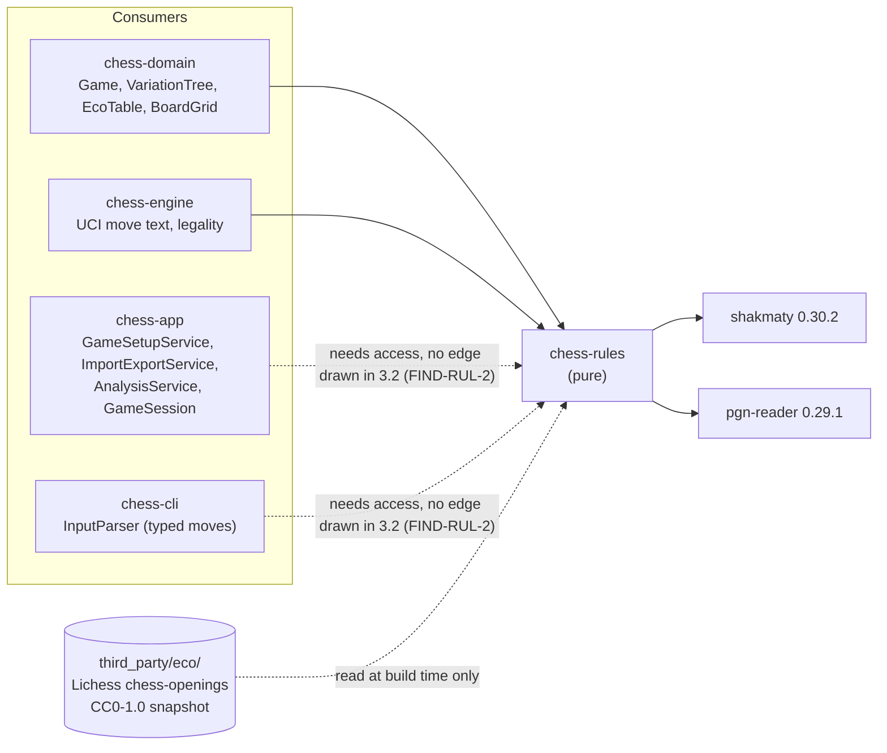
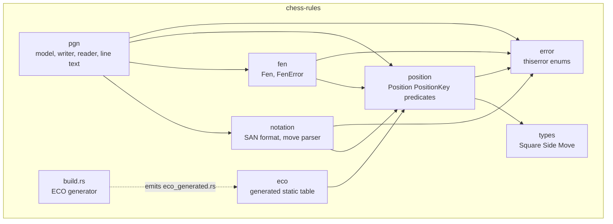
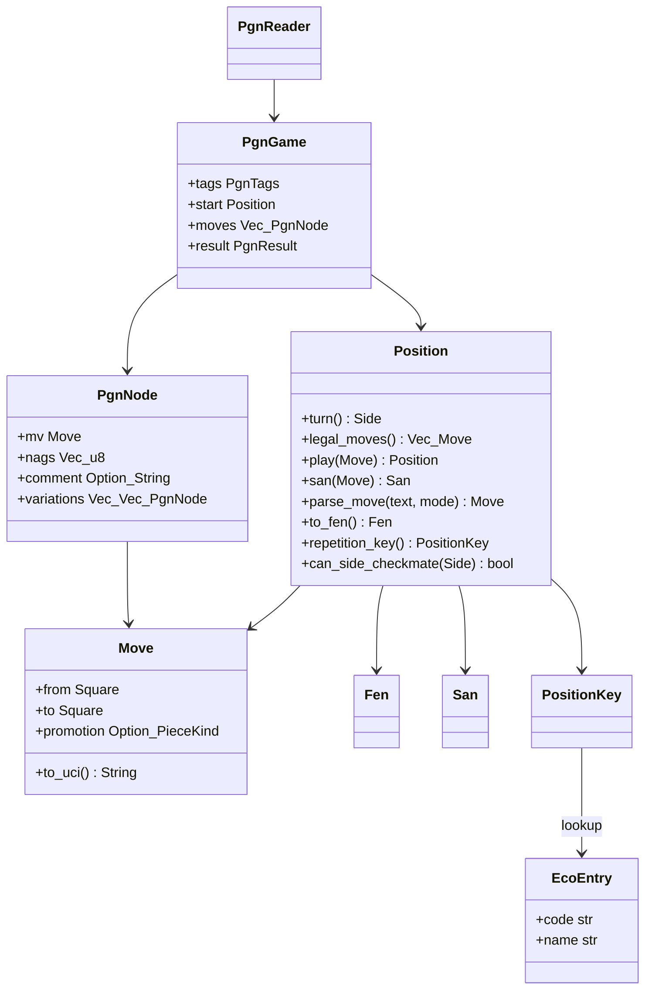
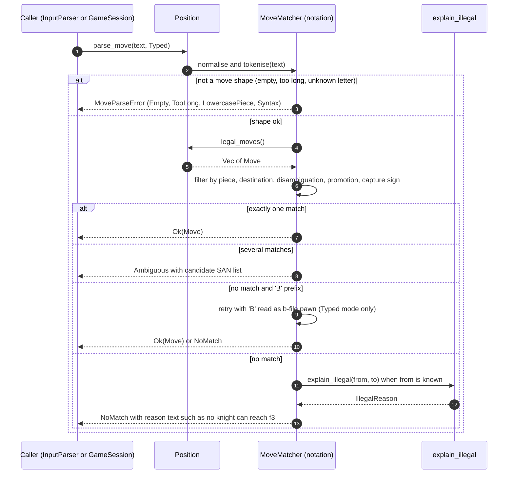
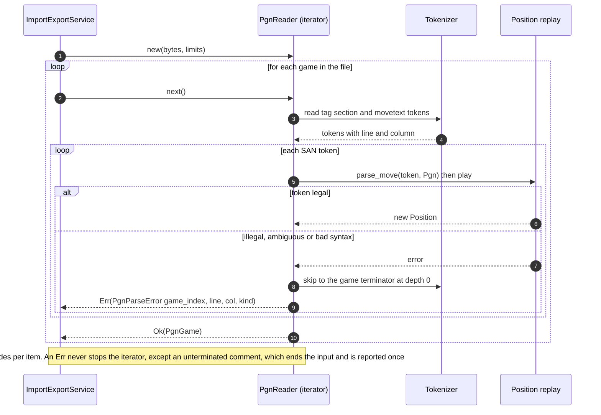
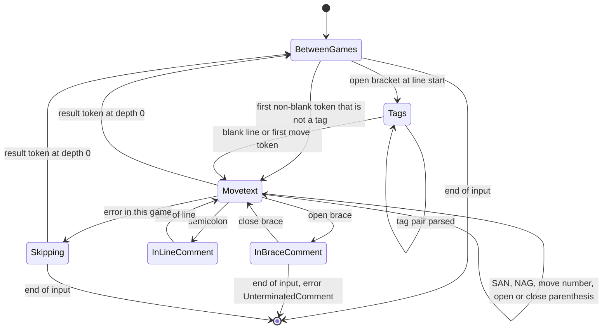
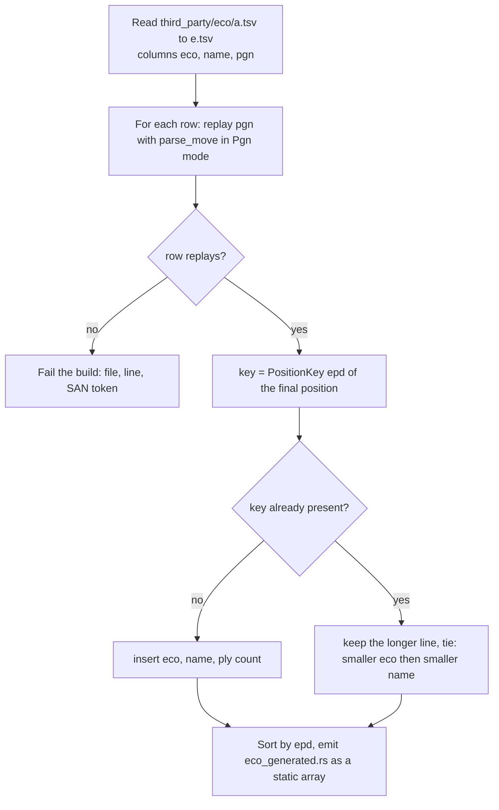

# SDD-chess-rules: Software Design Description for the `chess-rules` crate

| Field | Value |
|---|---|
| Document | docs/design/SDD-chess-rules.md |
| Version | 0.1 DRAFT |
| Date | 2026-10-30 |
| Style | IEEE 1016-style (viewpoints and design entities). No conformance to a numbered edition is claimed |
| Owner | Software engineer role (Claude), for Brian Prascher |
| Approver | **Pending.** Design-only work (documents, no code) is gate **G0** (SWE-001 §3), so no approval is needed to hold this draft. Implementation inside the crate, with the §3.2 edges and §5.7 contracts unchanged, is G1 (system-architect agent, desk review). Items in section 10 that touch an edge, a dependency or a protocol are G2 (Brian Prascher). No approval is claimed here |
| Status | DRAFT. Nothing is implemented, built or run. Every Rust signature below is a design-level sketch, not compiled code `[UNV]` |
| Block (architecture §2.2 name) | `chess-app core :: chess-rules` (crate `chess-rules`, pure) |
| Upstream baselines read | architecture.md v1.0 amendment 6; functional_decomp.md v1.0; requirements.md v1.0 Amendment 6; test-strategy.md 1.0 Amendment 6; SWE-001 v1.1 |
| Sibling SDDs | [SDD-chess-domain](SDD-chess-domain.md), [SDD-chess-store](SDD-chess-store.md), [SDD-chess-engine](SDD-chess-engine.md), [SDD-chess-app](SDD-chess-app.md), [SDD-chess-server](SDD-chess-server.md), [SDD-chess-cli](SDD-chess-cli.md), [SDD-ui](SDD-ui.md), [SDD-desktop-tauri](SDD-desktop-tauri.md) |

Evidence tags follow `swe-governance` §6. `[OBS architecture.md:354]` means "read in this session at that line". `[INF]` is inferred, `[UNV]` is not verified here, `ESTIMATE` is a design value without a measurement. There is no SRS in this repository (SWE-001 row "Upstream artifacts"), so the trace goes from requirement IDs of `requirements.md` and function IDs of `functional_decomp.md` straight to design entities (`DD-RUL-nnn`), not through `SWR-` IDs.

---

## 1 Introduction

### 1.1 Purpose

`chess-rules` is the **pure rules library** of the Chess application. It answers "what is a legal move here", "how is a move written and read", "is this FEN legal" and "what PGN text is this game", and it carries the ECO opening data. It performs no I/O at run time, holds no clock and no random source, and has no knowledge of players, modes or ratings. Everything above it (`chess-domain`, `chess-engine`, and through them `chess-app`) gets one definition of the rules, so that "the same scripted game in all three front-ends gives identical PGN" (PLAT-1, architecture principle 1) holds `[OBS architecture.md:98]`.

### 1.2 Scope

In scope (architecture §3.3, row `chess-rules`) `[OBS architecture.md:354]`:

- Positions, legal move generation, check, checkmate, stalemate, and the **position-level** inputs to draw detection (halfmove clock, a repetition key, a material test).
- SAN and coordinate move parsing (lenient, for typed input) and canonical SAN formatting.
- FEN parsing, validation and formatting.
- PGN reading (import format) and writing (export format), including variations, comments and NAGs.
- The ECO table: a build step that turns the pinned Lichess `chess-openings` snapshot into a static, position-keyed table (D-20) `[OBS architecture.md:1729]`.
- Wrapping `shakmaty` 0.30.2 and `pgn-reader` 0.29.1 (D-3, baseline versions §3.4 `[OBS architecture.md:376]`), so that a change of upstream API is absorbed inside this crate.

Out of scope (owned elsewhere): history-based termination (threefold, fifty-move with the checkmate precedence), clocks and flag results (`chess-domain::Game`, [SDD-chess-domain](SDD-chess-domain.md)); Seven-Tag-Roster **content** (which Event/Site/Date a game gets), the `Termination` choice per game status, `content_hash` hashing, duplicate detection, the 10 MB limit and the archive layout (`ImportExportService`, [SDD-chess-app](SDD-chess-app.md)); UCI process handling (`chess-engine`, [SDD-chess-engine](SDD-chess-engine.md)); the CLI `InputParser` word/command layer (`chess-cli`, [SDD-chess-cli](SDD-chess-cli.md)).

### 1.3 Allocation: requirements, functions, decisions

| Kind | IDs | Role of this block |
|---|---|---|
| Functions (allocated by name `chess-app core :: chess-rules`) `[OBS functional_decomp.md:84,87,88]` | **F-2.1.3** Parse start position; **F-2.2.1** Generate legal moves; **F-2.2.2** Parse move notation | Primary |
| Functions supported (allocated to another block, realised partly here) | F-2.2.4 Detect game termination (allocated to `Game domain`: this crate supplies the position predicates, see FIND-RUL-1); F-6.10 Export game as PGN, F-6.11 Import PGN games, F-6.12 Export all data (`games.pgn`) (allocated to `ImportExportService`: this crate is the reader and writer); F-5.2/F-5.3 What-if branch and saved variation (line text); F-4.6 Classify opening (table data) | Supporting |
| Requirements, primary | RULE-1 (legal moves, castling, en passant, promotion, check, mate, stalemate), RULE-6 (PGN export, writer), RULE-7 (PGN import, reader), RULE-8 and IF-3 (FEN), CLI-3 (typed notation), IF-1 (export format), IF-2 (import format) | `[OBS architecture.md:1533,1538-1540,1559,1599]` |
| Requirements, supporting | NFR-3 (no illegal state: the legality oracle), RULE-2 and RULE-4 (position predicates used by `Game`), GUI-2 (c) (same bishop rule for typed input in the GUI), ANA-2 (variations round-trip as PGN), DAT-3 and NFR-6 (ECO table and its licence record), PLAT-1 (deterministic bytes), D-11 (`LegalMoves{fen}`) | |
| Decisions | D-3 (wrap `shakmaty` + `pgn-reader`), D-11, D-20 (ECO source and build step), D-29/D-34 (archive and duplicate rules, as they constrain the writer) | |
| Risks | R-15 (replay equality depends on the SAN and move identity defined here); NFR-3 fuzz | |

### 1.4 Definitions

| Term | Meaning here |
|---|---|
| Ply | One half-move. Position index *n* is the position after *n* plies |
| UCI move | `e2e4`, `e7e8q`. Castling is the king's two-square move (`e1g1`), as in standard UCI `[INF: standard UCI]` |
| SAN | Standard algebraic notation, canonical form with `+`/`#` |
| Typed mode / PGN mode | The two parse modes of DD-RUL-006: lenient (CLI-3) and strict (PGN import) |
| Repetition key | An exact, hashable identity of a position for repetition (DD-RUL-003) |
| EPD key | The first four FEN fields (placement, side, castling, legal en-passant target), the ECO lookup key |
| Dead by material | Neither side can checkmate by any legal sequence because of the material left (RULE-1 (c)) |

### 1.5 Conventions

- Rust edition 2024, `rust-version = "1.99"` `[OBS architecture.md:373]`. Crate attributes: `#![forbid(unsafe_code)]`; compiler and `clippy` warnings are errors (SWE-001 ASM-S1/S2); `unwrap`, `expect`, `panic!`, unchecked indexing and `as` narrowing casts are denied outside tests (CERT-informed, SWE-001 §6). **No CERT conformance is claimed.**
- `serde` is **not** used in this crate: every wire form of a rules value is a string (UCI move, FEN, PGN text), see section 3.7.
- Open item IDs are local: `FIND-RUL-n`, `OQ-RUL-n`, `ASM-RUL-n`, `ADR-REQ-RUL-n`.

---

## 2 Design overview

### 2.1 Viewpoints included and omitted

| # | Viewpoint | Included | Reason / where |
|---|---|---|---|
| 1 | Context | yes | 3.1 |
| 2 | Composition | yes | 3.2 |
| 3 | Logical | yes | 3.3 (key types only) |
| 4 | Dependency | yes | 3.4 |
| 5 | Information | yes, reduced | 3.5. The crate stores nothing. It defines three text formats and one static table |
| 6 | Patterns use | yes | 3.6 |
| 7 | Interface | yes | 3.7 (cards `IFP-RUL-n`, `IFR-RUL-n`) |
| 8 | Structure | yes | 3.8 (module layering) |
| 9 | Interaction | yes | 3.9 (two sequences with failure paths) |
| 10 | State dynamics | yes, reduced | 3.10. The crate has no run-time state machine. The PGN reader's tokenizer is a state machine and is shown |
| 11 | Algorithm | yes | 3.11 |
| 12 | Resource | yes | 3.12 |

### 2.2 Design constraints taken from upstream

| Constraint | Source | Effect |
|---|---|---|
| Pure: no I/O, no clock, no RNG | Architecture principle 2 `[OBS architecture.md:99]` | No `std::fs`, `std::time`, threads or globals. The one file read (ECO TSV) happens at **build** time |
| Wraps `shakmaty` and `pgn-reader` (GPL-3.0) | D-3, D-10 | Own types at the public boundary; upstream types never leak (rationale in 9) |
| Rules edition: FIDE Laws effective 1 January 2023 | RULE-1 `[OBS requirements.md:401]` | Fixtures cite it; deviations: automatic threefold and fifty-move draws (made by `Game`), dead position by material only |
| UTF-8 export, Latin-1 import fallback | IF-1, IF-2 | DD-RUL-010, DD-RUL-011 |
| Deterministic bytes from every front-end | PLAT-1, IF-1 | The writer is one function, no locale, no hash-order iteration |
| Coverage at least 90 % line for rules and parser modules; fuzzing; perft | test-strategy "Quality gates", §9 `[OBS test-strategy.md]` | Section 7 |

---

## 3 Viewpoint sections

### 3.1 Context viewpoint

**Concern:** who uses this crate, through which edges, and what crosses the boundary.

Solid arrows are the edges of architecture §3.2 `[OBS architecture.md:310-317]`. Dotted consumer arrows mark a contract in §5.7 or §10.1 that names a consumer with no direct edge in §3.2 (FIND-RUL-2).

External entities: the ECO snapshot (build-time input), the two upstream crates. No run-time external system exists. The `Internet` is not used at build time by this crate either (D-20: "Never fetched at run time or at build time").

### 3.2 Composition viewpoint

**Concern:** the parts of the crate and what each is for.

| Module | Design entities | Purpose |
|---|---|---|
| `types` | DD-RUL-001 | `Square`, `File`, `Rank`, `Side`, `PieceKind`, `Piece`, `Move` |
| `position` | DD-RUL-002, 003, 004, 007 | `Position`, legal moves, play, keys, predicates, illegal-move explanation |
| `notation` | DD-RUL-005, 006 | SAN format, move-text parser (two modes) |
| `fen` | DD-RUL-008 | `Fen` parse and format, `FenError` |
| `pgn` | DD-RUL-009, 010, 011, 012 | Model, writer, reader, line text |
| `eco` (generated) | DD-RUL-013 | Static table and lookup; `build.rs` generator |
| `error` | DD-RUL-014 | `thiserror` enums |
| `testing` (feature `test-support`) | DD-RUL-015 | `perft`, fixture helpers |

### 3.3 Logical viewpoint

**Concern:** the static types a consumer sees. Key types only; field details are in section 4.

The architecture lists the key types `Position`, `Move`, `San`, `Fen`, `PgnGame` `[OBS architecture.md:354]`; all five exist here with the same names.

### 3.4 Dependency viewpoint

**Concern:** what this crate depends on, what depends on it, and the allowed direction.

| Direction | Item | Kind | Allowed by §3.2 | Note |
|---|---|---|---|---|
| out | `shakmaty` 0.30.2 | third party, runtime | yes `[OBS architecture.md:337]` | Pre-1.0: pin the minor version `[OBS architecture.md:376]` |
| out | `pgn-reader` 0.29.1 | third party, runtime | yes (D-3; the §3.2 box says "shakmaty + pgn-reader") | API shape not verified, OQ-RUL-1 |
| out | `thiserror` 2.0.21 | third party | yes, architecture §8 (error handling) and §3.4 | |
| out (build) | `third_party/eco/*.tsv` | data file | yes, D-20 | CI verifies the recorded SHA-256, not `build.rs` (avoids a hash dependency) |
| in | `chess-domain`, `chess-engine` | workspace | yes `[OBS architecture.md:314,316]` | |
| in (needed) | `chess-app`, `chess-cli` | workspace | **no edge in §3.2** | FIND-RUL-2 |

Rules that keep the crate pure: no dependency on any other workspace crate; no `tokio`, `serde`, `rusqlite`, `tracing`; no use of `std::time`, `std::fs`, `std::env` or `rand` at run time. A CI check (a `cargo tree` assertion in `ci/`) can enforce the first rule `[UNV: not written]`.

### 3.5 Information viewpoint

**Concern:** what data the crate defines, owns or reads, and in what form.

The crate **persists nothing** and owns no database table. It defines the textual forms other blocks persist or exchange:

| Form | Defined by | Used in | Owner of storage |
|---|---|---|---|
| UCI move string (`e2e4`, `e7e8q`) | `Move::to_uci` / `Move::from_uci` | `MOVE.uci`, protocol `MakeMove.mv`, engine I/O | store, protocol |
| Canonical SAN | `Position::san` | `MOVE.san`, PGN movetext | store |
| FEN (six fields) | `Fen` | `GAME.start_fen`, `MOVE.fen_after`, PGN `FEN` tag | store |
| PGN text | `write_pgn` / `PgnReader` | export, `games.pgn` in the archive, `VARIATION.pgn` | app, store |
| ECO entry (`code`, `name`) | generated table | `GAME.eco`, `GAME.opening_name` | store (via `Game`) |

Static data: the ECO table is the only data the crate carries. Source: the Lichess `chess-openings` dataset, five TSV files with columns `eco`, `name`, `pgn`, CC0-1.0, snapshot in `third_party/eco/`, its commit and SHA-256 recorded there at the start of step 1 `[OBS architecture.md:1729]`. The licence and provenance are an NFR-6 audit item; this crate adds no other asset.

### 3.6 Patterns-use viewpoint

| Pattern | Where | Why | Misuse tell |
|---|---|---|---|
| Adapter / anti-corruption layer | `Position`, `Move`, `Fen`, `PgnGame` over `shakmaty` and `pgn-reader` | D-3 escape route ("own implementation behind the `chess-rules` API" `[OBS architecture.md:1834]`); pre-1.0 upstreams | An upstream type appears in a public signature |
| Immutable value objects | `Position::play` returns a new `Position` | Functional core (principle 2); `Game` clones per command (architecture §4.8) | A `&mut self` method on `Position` |
| Parse, don't validate | `Fen`, `San` newtypes; `Position::from_fen` | Illegal positions never exist as values | A `String` passed where a `Fen` is required |
| Strategy (mode flag) | `ParseMode::{Typed, Pgn}` | One matcher, two policies (lenient typed input, strict import) | A third copy of the matcher |
| Build-time code generation | `build.rs` for ECO | Keeps the data source and the lookup in sync, no run-time parsing | Hand-edited generated file |
| Iterator / streaming | `PgnReader` | "One bad game never aborts the rest" `[OBS architecture.md:840]`; lets the caller yield between games (section 6) | Collecting a 10 MB file into one `Vec` before any game is checked |

### 3.7 Interface viewpoint

**Concern:** the services this crate provides and requires, with parameters, units and errors.

Interface cards follow `interface-extraction` conventions. The first four implement the §5.7 rows "PGN/FEN I/O" and "Engine/Position helpers" `[OBS architecture.md:840,842]`.

#### IFP-RUL-1 Position and move services

| Operation | Parameters | Returns | Errors |
|---|---|---|---|
| `Position::standard()` | none | the start position | none |
| `Position::legal_moves(&self)` | none | `Vec<Move>` (at most 218 entries `[INF: known chess maximum, UNV]`), generation order unspecified | none |
| `Position::is_legal(&self, Move)` | a move | `bool` | none |
| `Position::play(&self, Move)` | a move | new `Position` | `IllegalMove { reason: IllegalReason }` |
| `Position::san(&self, Move)` | a legal move | `San` (canonical, with `+`/`#`) | `IllegalMove` |
| `Position::turn / piece_at / fullmove_number / halfmove_clock` | | values | none |
| `Move::to_uci(&self)`, `Move::from_uci(&str)` | UCI text, lowercase | `String` / `Move` | `MoveParseError::BadUci` |
| `Position::to_fen(&self)` | | `Fen` | none |

Contract: `play` never changes `self`; `legal_moves` and `play` agree (`play(m).is_ok()` iff `m` is in `legal_moves()`); castling is always `king from -> king to` two squares, never "king takes rook". Units: none. Thread safety: all types are `Send + Sync` (section 6).

#### IFP-RUL-2 Position predicates (inputs to `Game` termination)

| Operation | Returns | Meaning |
|---|---|---|
| `is_check`, `is_checkmate`, `is_stalemate` | `bool` | Standard definitions on the current position |
| `halfmove_clock` | `u32` | Plies since the last capture or pawn move |
| `repetition_key` | `PositionKey` (`Eq + Hash + Clone`) | FIDE "same position": pieces, side to move, castling rights, en passant target only if a legal en-passant capture exists |
| `can_side_checkmate(Side)` | `bool` | `false` only if no legal sequence lets that side deliver mate, judged by material alone (RULE-1 (c), RULE-4) |
| `is_dead_by_material` | `bool` | `!can_side_checkmate(White) && !can_side_checkmate(Black)` |

#### IFP-RUL-3 Notation services

| Operation | Parameters | Returns | Errors |
|---|---|---|---|
| `Position::parse_move(&self, text, ParseMode)` | text of at most 16 bytes (`MAX_MOVE_TEXT`), mode | `Move` | `MoveParseError` (section 5) |
| `Position::explain_illegal(&self, from, to, promotion)` | squares | `IllegalReason` | none |

#### IFP-RUL-4 FEN services (IF-3)

| Operation | Parameters | Returns | Errors |
|---|---|---|---|
| `Fen::parse(&str)` | exactly six space-separated fields, at most 128 bytes (derivation in 3.11.6) | `Fen` (validated, normalised) | `FenError` naming the field or the illegal-position reason |
| `Position::from_fen(&Fen)` | | `Position` | none (already validated) |

#### IFP-RUL-5 PGN services (IF-1, IF-2, RULE-6, RULE-7)

| Operation | Parameters | Returns | Errors |
|---|---|---|---|
| `write_pgn(&PgnGame)` | a game model | `String` (UTF-8), deterministic | `PgnWriteError` |
| `write_pgn_many(&[PgnGame])` | games | `String`, games separated by one blank line | `PgnWriteError` (first failure, with the game index) |
| `PgnReader::new(&[u8], PgnLimits)` | bytes (caller enforces the file-size limit, TBD-25), `max_variation_depth` | iterator of `Result<PgnGame, PgnParseError>` | per game: `PgnParseError { game_index, line, col, kind }` |
| `format_line(&Position, &[PgnNode])` / `parse_line(&Position, &str)` | start position and nodes (with nested variations) / movetext | `String` / `Vec<PgnNode>` | `PgnWriteError` / `PgnParseError` |
| `canonical_form(&PgnGame, TagFilter)` | tag filter | `Vec<u8>`: tags and mainline SAN only, no comments, variations or NAGs | none |

`canonical_form` is the input the caller hashes for `content_hash` (FIND-RUL-4).

#### IFP-RUL-6 ECO lookup (D-20)

| Operation | Parameters | Returns | Errors |
|---|---|---|---|
| `eco::lookup(&PositionKey)` | key | `Option<EcoEntry { code: &'static str, name: &'static str }>` | none |
| `eco::TABLE_LEN` | | `usize` | none |

#### Required interfaces

| ID | Provider | Used for | Failure handling |
|---|---|---|---|
| IFR-RUL-1 | `shakmaty` 0.30.2 | move generation, FEN, SAN, material test | Calls return `Result` or are total. A `PositionError` becomes a `FenError`. API drift is absorbed here (D-3) |
| IFR-RUL-2 | `pgn-reader` 0.29.1 | PGN tokenising (or a wrapped in-crate tokenizer, OQ-RUL-1) | Per-game error recovery as in 3.9.2 |
| IFR-RUL-3 | `third_party/eco/{a..e}.tsv` (build time) | ECO generation | A row that does not replay fails the build with file and line |

The names `shakmaty::Chess`, `Position` trait, `San`, `Uci`, `Fen`, `CastlingMode`, `EnPassantMode` and the `pgn_reader` visitor trait are recalled from earlier releases and **were not checked against 0.30.2/0.29.1 `[UNV]`**. This SDD therefore specifies behaviour, not upstream calls (OQ-RUL-1).

### 3.8 Structure viewpoint

**Concern:** how the crate is layered inside.

Layers, lowest first: `types` -> `position` (the only module that touches `shakmaty` board types) -> `notation`, `fen` -> `pgn`, `eco`. Only `position`, `fen` and `pgn` import upstream crates; `notation` sees upstream only through `Position`. A grep-based CI check ("`shakmaty` appears only in `position/`, `fen/`, `pgn/` and `build.rs`") makes the adapter boundary testable `[UNV: not written]`. Public re-exports are listed in one `lib.rs`; nothing else is `pub`.

### 3.9 Interaction viewpoint

#### 3.9.1 Typed move, including failure paths (CLI-3, GUI-2 (c), F-2.2.2)

**Question:** how does text typed by the user become a `Move`, and what does each failure return?

Nothing in this sequence changes a `Position`. The caller (`GameSession`) then calls `Game::apply_move`, which re-checks legality (defence in depth, NFR-3).

#### 3.9.2 PGN import with per-game recovery (RULE-7, IF-2, F-6.11)

**Question:** how does one malformed game leave the other games in the file importable?

### 3.10 State-dynamics viewpoint

**Concern:** behaviour by state. `chess-rules` has no run-time state machine: every function is a pure function of its arguments. The one automaton is the **PGN tokenizer** inside `PgnReader`.

| State | Entry | Exit | Notes |
|---|---|---|---|
| `BetweenGames` | start, or after a result token | `[` -> `Tags` | Whitespace and `%` escape lines are skipped |
| `Tags` | `[Name "value"]` per line | blank line or a move token | Value escapes `\"` and `\\` decoded; an unterminated value is an error for this game |
| `Movetext` | first move token | result token at variation depth 0 | Variation depth counted with a counter capped at `max_variation_depth` (ESTIMATE 64, section 3.12) |
| `Skipping` | an error in the current game | next result token at depth 0 outside a comment | Counts parentheses and braces so a result token inside a comment or variation does not end the skip |

### 3.11 Algorithm viewpoint

#### 3.11.1 Move matcher (DD-RUL-006)

Input: `Position pos`, `text`, `ParseMode mode`. Output: `Move` or `MoveParseError`. Steps:

1. Trim ASCII whitespace. Empty -> `Empty`. More than `MAX_MOVE_TEXT` (16) bytes -> `TooLong`. Non-ASCII byte -> `Syntax`.
2. Strip trailing annotation characters `+ # ! ?` (they are not validated; check and mate are consequences of the move, not part of its identity). In `Pgn` mode, a `!`/`?` suffix is returned to the reader as a NAG request instead of discarded.
3. **Castling:** `O-O`, `0-0`, `O-O-O`, `0-0-0` (zero or letter O; lower-case `o` is rejected, ASM-RUL-2). Select the legal king move that goes two squares toward the rook; none -> `NoMatch` with the reason from DD-RUL-007 (rights lost, path blocked, through check, out of check).
4. **Coordinate form** (`Typed` mode only): `^[a-hA-H][1-8][a-hA-H][1-8](=?[QRBNqrbn])?$`. File letters either case. A pawn reaching the last rank without a promotion letter -> `PromotionRequired { choices }`. Result must be in `legal_moves()`, else `NoMatch`.
5. **SAN form:** parse `[piece][from-file][from-rank][x]to-file to-rank[=?promotion]`.
   - Piece letters `K Q R B N` are accepted **only in upper case**. A first character `n k q r` (lower case, not a file letter) -> `LowercasePiece { suggestion }`.
   - File letters are accepted in either case, except the leading character rule below.
   - `x` is optional. If `x` is present the move must be a capture, else `NoMatch` (strict on a wrong `x`, tolerant of a missing one, ASM-RUL-3).
   - Promotion letter: `Q R B N` in either case after an optional `=`. Missing on a pawn move to the last rank -> `PromotionRequired`.
6. **Leading `b` / `B` rule (Q44, CLI-3)** `[OBS requirements.md:911-930]`: a leading lower-case `b` is always the b-file (pawn). A leading upper-case `B` is read as a bishop move if any legal bishop move matches; **otherwise (Typed mode only)** it is read as the b-file. In `Pgn` mode `B` is always a bishop and `b` always a file (no fallback), so an import cannot silently accept an illegal SAN.
7. **Match:** `candidates = legal_moves().filter(piece kind, destination, from-file, from-rank, promotion, capture flag)`. A pawn capture needs its origin file (`exd5`, or `ed5`); `xd5` alone is accepted if exactly one pawn can make it.
8. 0 candidates -> `NoMatch` with `explain_illegal` for the nearest geometric reading (3.11.2). 1 -> `Ok`. More than 1 -> `Ambiguous` with each candidate's canonical SAN.

Complexity: O(L) with L at most 218 legal moves, plus one `legal_moves` call. Invariant: a returned `Move` is always an element of `legal_moves()`.

#### 3.11.2 Illegal-move explanation (RULE-1: "rejected with a reason")

`explain_illegal(from, to, promotion)` classifies, in order, using `piece_at`, the side to move and a small attack test `[INF]`:

| Check (in order) | `IllegalReason` |
|---|---|
| no piece on `from` | `NoPiece` |
| piece belongs to the other side | `WrongTurn` |
| geometry impossible for that piece kind (ignoring check) | `CannotReach { piece }` ("no knight can reach f3") |
| path blocked by a piece | `Blocked` |
| destination holds an own piece | `OwnPieceOnTarget` |
| castling: rights lost / path occupied / king in check / crosses an attacked square | `CastlingRightsLost`, `CastlingBlocked`, `CastlingOutOfCheck`, `CastlingThroughCheck` |
| pawn to last rank without promotion | `PromotionRequired` |
| move is geometrically fine but leaves or puts the own king in check (pinned piece, moving into check, not answering a check) | `LeavesKingInCheck` (or `KingInCheck` when already in check and the move does not resolve it) |
| none of the above | `Other` (a defect indicator; logged by the caller, never shown as a rule) |

Messages are English (UI-11), produced by `Display`; the enum is the stable part (NFR-9).

#### 3.11.3 Dead position by material (`can_side_checkmate`)

Definition (RULE-1 (c), RULE-4): `can_side_checkmate(S)` is `false` iff no sequence of legal moves, by both players cooperating, ends with `S` giving checkmate, **judged by material only** (a blocked-pawn dead position is deliberately not detected, RULE-1 (c)). Reference classification (design rule, to be validated against FIDE Art. 5.2.2 and 6.9 and against `shakmaty`'s own test `[UNV]`):

1. `S` has any pawn, rook or queen: `true`.
2. `S` has exactly one knight and no other piece besides the king, and the opponent has only a king and possibly queens: `false`. `S` has two or more knights or a knight with any other piece: `true`.
3. `S` has only bishops: `false` iff all bishops on the board (both sides) stand on squares of one colour and there is no knight and no pawn on the board; otherwise `true`.
4. `S` has only a king: `false`.

Fixture table the implementation must satisfy (each row in both colours):

| Material | White can mate | Black can mate | Dead position |
|---|---|---|---|
| K v K | no | no | yes |
| K+B v K, K+N v K | no | no | yes |
| K+B v K+B, bishops on the same colour | no | no | yes |
| K+B v K+B, bishops on opposite colours | yes | yes | no |
| K+N v K+N | yes | yes | no |
| K+NN v K | yes | no | no |
| K+B+B (same colour) v K | no | no | yes |
| K+B+B (opposite colours) v K | yes | no | no |
| K+R v K, K+Q v K, K+P v K | yes | no | no |

Use: `Game` ends a game as "dead by material" when both are `false`; on a flag fall it awards a draw instead of a loss when the **opponent** of the flagged side cannot mate (RULE-4). If `shakmaty`'s own insufficient-material test passes this table, the crate uses it; if not, the in-crate classifier above is used (ASM-RUL-1).

#### 3.11.4 Repetition key and EPD key

`PositionKey` = (placement of 64 squares, side to move, castling rights as stored in the FEN-style rights set, en-passant target square **only if** a legal en-passant capture exists in the position). It is an exact structure, not a 64-bit hash: a hash collision would end a game as a false draw, which NFR-3 forbids; the memory cost is a few tens of bytes per ply. `PositionKey::to_epd()` renders the first four FEN fields from the same data, and is the ECO lookup key.

#### 3.11.5 FEN en-passant field on output

`Position::to_fen` writes the en-passant target **after every double pawn push**, whether or not a capture is possible (the FEN convention as the PGN standard describes it, **recalled, not re-read in this session `[UNV]`**), so `MOVE.fen_after` and the `FEN` tag are stable text. `PositionKey` uses the legal-capture rule above instead, because repetition is defined by possible moves. The choice is FIND-RUL-5 for the architect; either is a one-line change here.

#### 3.11.6 FEN parse

1. Reject more than 128 bytes (a legal six-field FEN needs at most 71 placement characters, 1 side, 4 castling, 2 en passant, 10 + 10 digits for two `u32` counters and 5 spaces = 103 `[INF]`).
2. Split on single ASCII spaces; the count must be exactly 6, else `FieldCount { found }` (upstream parsers accept fewer fields, so this check is ours).
3. Placement: 8 ranks, each summing to 8 squares; piece letters `pnbrqkPNBRQK`. Side `w`/`b`. Castling `-` or a subset of `KQkq` in that order. En passant `-` or a square on rank 3 (Black to move) or rank 6 (White to move). Halfmove `u32`. Fullmove `u32` at least 1. Each failure names its field.
4. Legality (IF-3 list `[OBS requirements.md:1062-1068]`): exactly one king per side (`MissingKing`, `TooManyKings`), no pawn on rank 1 or 8 (`PawnOnBackRank`), the side **not** to move is not in check (`OpponentInCheck`); other upstream position errors map to `IllegalPosition::Other(text)` (impossible castling rights, impossible en-passant square, impossible check).
5. Normalise (castling and en-passant fields as parsed, counters as numbers) and return `Fen`.

A FEN that is a checkmate or stalemate is **valid** here (it is a position); the game layer decides whether it may start a game (FIND-DOM-9).

#### 3.11.7 PGN writer (IF-1) `[OBS architecture.md:840, requirements.md:1026-1048]`

1. Validate: tag names `^[A-Z][A-Za-z0-9_]*$`; extras must not use the reserved names (the Seven Tag Roster names, `FEN`, `SetUp`, `TimeControl`, `Termination`).
2. Emit the Seven Tag Roster in the standard order: `Event`, `Site`, `Date`, `Round`, `White`, `Black`, `Result`. An unknown text value is `?`; `Round` defaults to `-`; `Date` is `YYYY.MM.DD` with `??` for unknown parts.
3. Emit the remaining tags in **ASCII order of the tag name**: the typed ones (`FEN`, `SetUp` when `start` is not the standard position; `TimeControl` as `seconds` or `seconds+increment`; `Termination` from the enum `Normal | TimeForfeit | Abandoned`) merged with the free-form extras (`BTreeMap`, byte order). One tag pair per line, one space between name and quoted value, `\"` and `\\` escaped, any control character in a value replaced by a space (deterministic, ASM-RUL-4). A blank line follows the tags.
4. Replay `start` along the mainline. For each node write the move number token: `N.` before a White move; `N...` before a Black move that is first in its sequence or that follows a comment or a variation. Then the canonical SAN, then NAGs as `$n`, then `{comment}`, then each variation as `( ... )` with `(` glued to its first token and `)` glued to its last.
5. Join tokens with a single space. A line break replaces the space whenever the next token would make the line 80 characters or longer, so every line is at most 79 characters `[INF from "shorter than 80"]`. A token longer than the line limit stands alone on its line.
6. The last token is the result string (`1-0`, `0-1`, `1/2-1/2`, `*`). The `Result` tag and this token come from the same field, so they cannot differ.
7. End with a single `\n`. `write_pgn_many` separates games with one blank line.

A move that is illegal in the replay -> `PgnWriteError::IllegalMove { variation_path, ply }`.

#### 3.11.8 PGN reader (IF-2)

Per game: read tags; if `SetUp "1"` and `FEN` are present, build the start position with the FEN rules (an illegal FEN fails this game with `BadFen`); replay each SAN token with `parse_move(token, Pgn)`; keep comments, NAGs, variations (a variation replays from the position **before** the move it follows); stop at the result token at depth 0. The movetext terminator is authoritative for `result`; if absent at end of input, use the `Result` tag, else `*`. Missing Seven Tag Roster tags are filled with `?` (hand-made files). Encoding: collect all tag values and comments of the game as bytes; decode the game as UTF-8 if every payload is valid UTF-8, else decode **the whole game** as Latin-1 (IF-2, per game); a leading UTF-8 byte-order mark is dropped. Line numbers count `\n`, `\r\n` and a lone `\r` as one line break each; columns count bytes from 1.

Error kinds: `IllegalSan`, `AmbiguousSan`, `BadSyntax`, `UnterminatedComment`, `UnbalancedVariation`, `VariationTooDeep`, `BadTag`, `BadFen(FenError)`. Each carries `game_index` (1-based), `line`, `col`.

#### 3.11.9 ECO generation (D-20)

Lookup is a binary search over the sorted `&'static [(&'static str, EcoEntry)]`. The tie rule for duplicate positions is a design choice (FIND-RUL-6): D-20 says "keys the table by position" but not what a duplicate position does. The build prints the row count and the number of duplicate positions so a reviewer sees them. The build reads only checked-in files (`cargo:rerun-if-changed=../../third_party/eco`) and opens no network connection (PLAT-3, D-20).

### 3.12 Resource viewpoint

| Resource | Design | Provenance |
|---|---|---|
| CPU | `legal_moves` and `play` are the hot path (perft, soak). The crate allocates one `Vec` per `legal_moves` call. No cache | `[INF]`; measure with the perft benchmark and the 1000-game soak, step 1 |
| Memory per `Position` | A small fixed-size value (tens to low hundreds of bytes) `[UNV: depends on the `shakmaty` type]` | measure |
| Memory per PGN import | The caller holds the file bytes (at most 10 MB, TBD-25 `ESTIMATE`). The reader holds one game at a time | `[OBS architecture.md:840]` |
| Stack | The reader is iterative with an explicit variation stack; the writer recurses over variations only up to `max_variation_depth` | CERT-informed: no unbounded recursion |
| `MAX_MOVE_TEXT` | 16 bytes. Longest legal SAN: `Qa1xb2#`-style is 7 characters; disambiguated promotion capture `exd8=Q+` is 7; `Nb1xd2+` 7; coordinate with promotion `e7e8=Q` is 6; 16 leaves room for whitespace and annotations `[INF]` | derived |
| `max_variation_depth` | default 64 | `ESTIMATE` (no real game nests deeper) |
| `MAX_FEN_LEN` | 128 bytes | derived in 3.11.6 |
| Time | No wall-clock use. PGN parse time for 10 MB is **not measured**; the caller treats a file import as blocking work (section 6) | measurement is a step-1 benchmark |
| Static data | ECO table in the binary, roughly the number of rows in the dataset times a few tens of bytes `[UNV: row count not read]` | measure at build |

---

## 4 Design entities

Each record: type, purpose, trace, function, dependencies, interface, data, resources, processing, concurrency, failure behaviour, rationale, verification, code. `Code:` is empty until implementation.

### DD-RUL-001 Core types
- Type: module `types` | Traces to: RULE-1, CLI-2 (squares), D-3 | Function: F-2.2.1
- Purpose: small, `Copy`, upstream-free value types: `Square(u8)` (0 to 63, a1 = 0, constructed only from a checked file and rank or from text), `File`, `Rank`, `Side`, `PieceKind`, `Piece { side, kind }`, `Move { from, to, promotion: Option<PieceKind> }`.
- Interface: `Square::new(File, Rank)`, `Square::from_algebraic(&str)`, `Display` lower case; `Move::to_uci`, `Move::from_uci` (lower case only, five characters when promoting).
- Failure behaviour: out-of-range input returns a typed error; no constructor panics, so indexing by `Square` cannot go out of range.
- Rationale: the engine boundary and the journal speak UCI, so `Move` is UCI-shaped. Castling as a two-square king move matches standard UCI. Alternative rejected: re-export the `shakmaty` move enum (leaks an unstable upstream type, breaks the D-3 escape route).
- Verification: UT-RUL-001, UT-RUL-002 | Code: (pending)

### DD-RUL-002 Position
- Type: struct wrapping the upstream position | Traces to: RULE-1, NFR-3, D-3, D-11 | Function: F-2.2.1, F-2.1.3
- Purpose: immutable position with legal move generation and `play`.
- Dependencies: `shakmaty` (IFR-RUL-1), DD-RUL-001.
- Processing: `legal_moves` converts upstream moves into `Move` (castling converted to the two-square form). `play(m)` looks `m` up in the converted list and applies the matching upstream move; absence -> `IllegalMove` with `explain_illegal`. `san(m)` formats through the upstream SAN writer after the same lookup.
- Concurrency: `Position: Clone + Send + Sync`, no interior mutability.
- Failure behaviour: total on valid input; the only error is `IllegalMove`.
- Rationale: matching by value (from, to, promotion) gives one definition of "the same move" for the GUI, the engine and the journal. Alternative rejected: trust upstream move identity (castling is encoded differently in upstream).
- Verification: UT-RUL-003 (perft), UT-RUL-004 (rule fixtures), UT-RUL-005 (property: play/legal agree) | Code: (pending)

### DD-RUL-003 PositionKey
- Type: struct | Traces to: RULE-1 (threefold), D-20 (EPD key) | Function: supports F-2.2.4, F-4.6
- Purpose: exact repetition identity and ECO key (3.11.4). `Eq + Hash + Clone`; `to_epd()`.
- Failure behaviour: total.
- Rationale: exact over hashed, see 3.11.4. Alternative rejected: the upstream Zobrist hash (64-bit, collision means a false draw).
- Verification: UT-RUL-006 (en passant counts only when capturable; castling rights differ -> keys differ) | Code: (pending)

### DD-RUL-004 Termination predicates
- Type: methods on `Position` | Traces to: RULE-1, RULE-2, RULE-4 | Function: supports F-2.2.4, F-2.4.2
- Purpose: `is_check`, `is_checkmate`, `is_stalemate`, `halfmove_clock`, `can_side_checkmate`, `is_dead_by_material` (3.11.3).
- Rationale: the crate answers questions about **one position**; counting repetitions and the precedence among end reasons need history and belong to `Game` (FIND-RUL-1).
- Verification: UT-RUL-007 (fixture table of 3.11.3, mate/stalemate fixtures, checkmate on the fifty-move-completing move is still `is_checkmate`) | Code: (pending)

### DD-RUL-005 SAN formatter
- Type: function | Traces to: CLI-3 (record kept in SAN), RULE-6, IF-1 | Function: supports F-6.10
- Purpose: canonical SAN: piece letter, minimal disambiguation (file, then rank, then both), `x`, destination, `=Q`, `+`/`#`, `O-O`, `O-O-O` with the letter O.
- Rationale: one SAN writer means "move list output equals SAN for the played game" (CLI-3) from every front-end.
- Verification: UT-RUL-008 (table), UT-RUL-009 (round trip `parse(san(m)) == m` in `Pgn` mode over random playouts) | Code: (pending)

### DD-RUL-006 Move-text parser
- Type: function with `ParseMode::{Typed, Pgn}` | Traces to: CLI-3, GUI-2 (c), RULE-7, F-2.2.2 | Function: F-2.2.2
- Purpose: 3.11.1.
- Failure behaviour: every input, including arbitrary bytes, returns `Ok` or a `MoveParseError`; no panic (fuzz target).
- Rationale: one matcher with a mode flag instead of two parsers; the lenient bishop fallback is the only behaviour that differs, and it is confined to `Typed`. Alternative rejected: delegate to the upstream SAN parser (it cannot give the lenient forms, the helpful messages, or the Q44 rule).
- Verification: UT-RUL-010 to UT-RUL-014, FZ-RUL-001 | Code: (pending)

### DD-RUL-007 Illegal-move explainer
- Type: function | Traces to: RULE-1 (rejection reason), NFR-9 | Function: F-2.2.2, F-2.2.3 (message source)
- Purpose: 3.11.2.
- Rationale: the CLI-3 and TUI examples want "Illegal: Nf3, no knight can reach f3" `[OBS architecture.md:899]`; computing the reason once in the rules crate keeps messages identical across front-ends.
- Verification: UT-RUL-015 (one fixture per reason) | Code: (pending)

### DD-RUL-008 FEN
- Type: newtype `Fen` and error enum | Traces to: RULE-8, IF-3 | Function: F-2.1.3
- Purpose: 3.11.6 and 3.11.5.
- Failure behaviour: `FenError { field, reason }` or `IllegalPosition(reason)`; each `Display` names the problem (IF-3).
- Rationale: a validated newtype stops an unchecked string reaching a `Game` (parse, don't validate).
- Verification: UT-RUL-016 (valid and invalid table, one row per IF-3 illegal case and one per field syntax error), FZ-RUL-002 | Code: (pending)

### DD-RUL-009 PGN model
- Type: structs `PgnGame`, `PgnTags`, `PgnNode`, `PgnDate`, `PgnResult`, `Termination`, `TimeControl` | Traces to: IF-1, IF-2, ANA-2 | Function: supports F-6.10, F-6.11, F-5.3
- Purpose: one in-memory form for both directions. Variation convention: `PgnNode::variations` holds alternatives to **that** node's move (standard PGN meaning).
- Rationale: typed Seven Tag Roster and typed standard-defined tags give compile-time order and escaping rules; the free-form extras (`BTreeMap`) carry the project tags (`BlackClass`, `EndStatus`, `GameUUID`, ...) without this crate knowing them.
- Verification: via UT-RUL-017 to UT-RUL-022 | Code: (pending)

### DD-RUL-010 PGN writer
- Type: functions | Traces to: IF-1, RULE-6, PLAT-1 | Function: supports F-6.10, F-6.12
- Purpose: 3.11.7. Deterministic: no locale, no map iteration other than a sorted map, no time.
- Failure behaviour: `PgnWriteError`; never partial output.
- Rationale: "the writer is one function in `chess-rules` so every front-end gets the same bytes" `[OBS architecture.md:840]`. Alternative rejected: let `ImportExportService` format tags (three front-ends could not diverge, but the rule would sit away from the SAN it depends on).
- Verification: UT-RUL-017 (golden file), UT-RUL-018 (round trip), UT-RUL-019 (escaping and non-Latin-1 names, IF-1) | Code: (pending)

### DD-RUL-011 PGN reader
- Type: iterator `PgnReader` | Traces to: IF-2, RULE-7 | Function: supports F-6.11
- Purpose: 3.10 and 3.11.8. Per-game recovery; bounded nesting; per-game Latin-1 fallback; positions reported as line and column.
- Failure behaviour: see 3.9.2. An error never panics and never ends the iterator, except `UnterminatedComment`.
- Rationale: streaming keeps memory bounded and lets the caller report counts imported, skipped and failed (IF-2). Whether the upstream `pgn-reader` can supply line and column is unknown (OQ-RUL-1); if it cannot, an in-crate tokenizer (about the size of the automaton in 3.10) replaces it behind the same API, which D-3's escape route allows.
- Verification: UT-RUL-020 (multi-game, variations, comments, NAGs, Latin-1 and UTF-8, malformed at a known line and column), UT-RUL-021 (recovery), FZ-RUL-003 | Code: (pending)

### DD-RUL-012 Line text
- Type: functions `format_line`, `parse_line` | Traces to: ANA-2, F-5.3 | Function: supports F-5.3
- Purpose: movetext for a branch starting at a given position, e.g. `1. d4 d5 2. c4`, for `VARIATION.pgn` `[OBS architecture.md:1168]`.
- Rationale: the saved-variation text must be valid PGN variation text (ANA-2 verification: "export of saved branch is valid PGN with variation"), so it uses the same writer rules.
- Verification: UT-RUL-022 | Code: (pending)

### DD-RUL-013 ECO generator and table
- Type: `build.rs` plus generated module | Traces to: DAT-3, D-20, NFR-6, PLAT-3 | Function: supports F-4.6
- Purpose: 3.11.9 and IFP-RUL-6.
- Failure behaviour: a malformed row fails the build (fail fast). Lookup is total.
- Rationale: D-20 puts the replay in a `chess-rules` build step `[OBS architecture.md:1729]`; the lookup sits here and the "deepest named position" rule sits in `chess-domain::EcoTable` ([SDD-chess-domain](SDD-chess-domain.md)), because that rule is about a game, not a position. Alternative rejected: parse TSV at start-up (run-time I/O and cost, against NFR-1).
- Verification: UT-RUL-023 (known openings by position, a transposition gives the same entry, an unnamed position gives none), CT-RUL-003 (build fails on a corrupted TSV copy), CI licence record (NFR-6) | Code: (pending)

### DD-RUL-014 Error types
- Type: `thiserror` enums: `IllegalMove`, `IllegalReason`, `MoveParseError`, `FenError`, `IllegalPosition`, `PgnParseError`, `PgnWriteError` | Traces to: NFR-9, architecture §8 | Function: all
- Rationale: typed errors per crate, mapped to the §5.5 catalogue in `chess-app` (section 5). `Display` is English and carries no path or internal text.
- Verification: UT-RUL-024 (every variant has a non-empty message that names the problem) | Code: (pending)

### DD-RUL-015 Test support
- Type: module behind feature `test-support` | Traces to: RULE-1 verification (perft), NFR-3 | Function: verification only
- Purpose: `perft(&Position, depth) -> u64` built on **our** `legal_moves` and `play` (so it tests the adapter conversions: castling, en passant, promotion), plus fixture loaders.
- Rationale: perft through the upstream API alone would not test the adapter.
- Verification: UT-RUL-003 | Code: (pending)

---

## 5 Error handling, mapped to the architecture catalogue (§5.5)

The crate returns typed errors only. `chess-app` maps them (architecture §5.5 "Rust crates use `thiserror` and are mapped to these codes in `chess-app`" `[OBS architecture.md:789]`). Nothing from this crate carries a path, SQL or other internal text.

| Rules error | Caller | §5.5 code | Message source / client behaviour |
|---|---|---|---|
| `MoveParseError::*`, `IllegalMove { reason }` from a typed or protocol move | `GameSession`, CLI | `IllegalMove{reason}` | `reason` is the `IllegalReason` code plus English text; CLI keeps the input editable (CLI-3), GUI reverts the piece |
| `FenError` / `IllegalPosition` for a game start position | `GameSetupService` | `ValidationFailed{field: start_fen, reason}` | Reason names the field or the illegal-position case (IF-3) |
| `FenError` for the Import FEN screen | `ImportExportService` | `ParseError{kind: Fen, game_index, line, col, reason}` | `line` is 1, `col` the byte offset of the failing field |
| `PgnParseError` | `ImportExportService` | `ParseError{kind: Pgn, game_index, line, col, reason}` | One bad game never aborts the others (IF-2) |
| `PgnWriteError` | `ImportExportService` | `Internal{id}` | An exportable stored game that cannot be written is a bug, not a user error |
| `Position::from_fen` on a stored `fen_after` that fails | any | `Internal{id}` | A stored value was validated when written, so a failure is a defect or damage |

Failure modes owned by this crate (`FM-RUL-n`) and the tests that inject them:

| FM | Failure | Effect without the control | Control | Test |
|---|---|---|---|---|
| FM-RUL-1 | Adapter converts a castling, en-passant or promotion move wrongly | Illegal move accepted, or legal move rejected (NFR-3) | Perft through our API; property test play/legal agreement | UT-RUL-003, UT-RUL-005 |
| FM-RUL-2 | Hash collision in repetition | False draw | Exact key | UT-RUL-006 |
| FM-RUL-3 | Lenient parser accepts an illegal SAN during import | Corrupt imported game | `Pgn` mode has no fallbacks; round-trip test | UT-RUL-011, UT-RUL-009 |
| FM-RUL-4 | Malformed or hostile PGN (deep nesting, huge comment, binary data) | Stack exhaustion, panic | Iterative reader, depth cap, fuzz | FZ-RUL-003 |
| FM-RUL-5 | Upstream API drift on a minor bump | Build break or silent behaviour change | Pinned minor version; perft and fixtures on every bump | CI |
| FM-RUL-6 | ECO source row does not replay | Wrong or missing opening | Build fails | CT-RUL-003 |
| FM-RUL-7 | Writer output differs between runs (nondeterminism) | PLAT-1 failure | Sorted maps, no locale | UT-RUL-017 |

---

## 6 Concurrency (architecture §4.8)

`chess-rules` is outside the execution contexts of the §4.8 table: it has no thread, task, lock, channel or global mutable state, and it never blocks on anything external. All public types are `Send + Sync` (checked by a compile-time assertion test with a generic bound, no extra crate). Static data (the ECO table) is a `static` immutable array, so it needs no lazy initialisation and no lock.

Rules for callers, so that "nothing slow ever runs on a UI thread" and no SQLite or engine wait sits on a runtime worker holds `[OBS architecture.md:625]`:

| Call | Cost class | Where a caller should run it |
|---|---|---|
| `legal_moves`, `play`, `san`, `parse_move`, `Fen::parse`, `repetition_key`, `eco::lookup` | microseconds `[INF]` | inline in the `GameSession` actor or the TUI loop |
| `write_pgn` for one game | well under a millisecond for ordinary games `[INF, UNV]` | inline |
| `PgnReader` over a file of up to 10 MB | **not measured**; treat as blocking | `spawn_blocking`, or pull games one at a time and `yield_now` between items. The iterator design allows both |
| `write_pgn_many` for the full-data archive | grows with the store | `spawn_blocking` |

No lock-ordering rules apply. Determinism: no use of `rand`, time or environment, so a result depends only on the arguments.

---

## 7 Verification mapping (test-strategy.md, architecture §9)

Levels used: Unit (`cargo test`), Property (`proptest`), Snapshot/golden (`insta` or byte-compare files), Fuzz (`cargo-fuzz`), Component/contract (`tests/` directory, public API only). Coverage target: at least 90 % line coverage for the rules and parser modules `[OBS test-strategy.md "Quality gates"]`; mutation testing is required for Elo and Policy only, but `cargo-mutants` on the parser and the material test is recommended as a cheap check of fixture strength. Coverage and mutation numbers are **not available**; nothing has been run.

| ID | Level | What | Fixture / oracle | Requirement |
|---|---|---|---|---|
| UT-RUL-001 | Unit | `Square` construction, algebraic text round trip, bounds | table | RULE-1 |
| UT-RUL-002 | Unit | `Move::to_uci` / `from_uci` incl. promotion and castling form; `from_uci` rejects upper case and wrong length | table | RULE-1 |
| UT-RUL-003 | Unit | Perft through our API to depth at least 4: start position, Kiwipete, positions 3 to 6 | published node counts from the Chess Programming Wiki (test-strategy "Reference data"); counts are not reproduced here `[UNV]` | RULE-1 |
| UT-RUL-004 | Unit | Special-rule fixtures: castling both sides and the blocked, through-check and out-of-check cases, en passant (incl. the pinned-pawn case), promotion to each piece, pins, stalemate, mate | FEN in, legal moves or result out | RULE-1 |
| UT-RUL-005 | Property | Random legal playouts: `play(m)` succeeds iff `m` is in `legal_moves()`; the position after `play` is valid; `to_fen`/`from_fen` round trip | `proptest` | NFR-3, RULE-1 |
| UT-RUL-006 | Unit | `PositionKey`: same position by transposition equal; en-passant target without a legal capture ignored; different castling rights differ; different side to move differ | pairs | RULE-1 |
| UT-RUL-007 | Unit | Termination predicates; the material table of 3.11.3 in both colours; the checkmate that completes the fifty-move count still `is_checkmate`; the blocked-pawn position is **not** dead | FEN table | RULE-1, RULE-2, RULE-4 |
| UT-RUL-008 | Unit | SAN formatting: all piece types, captures, castling, promotion, disambiguation by file, rank and both, check and mate suffix | table | CLI-3 |
| UT-RUL-009 | Property | `parse_move(san(m), Pgn) == m` for every legal move on random playouts | `proptest` | CLI-3, RULE-6 |
| UT-RUL-010 | Unit | Typed parser, valid forms: `e4`, `Nf3`, `exd5`, `ed5`, `O-O`, `0-0`, `0-0-0`, `e8=Q`, `e8Q`, `e2e4`, `E4`, `Nbd2`, `R1a3`, trailing `+ # x` optional | table `[OBS requirements.md:925]` | CLI-3 |
| UT-RUL-011 | Unit | Typed parser, invalid: garbage, ambiguous, illegal, off-board, lower-case piece letter, wrong `x`, missing promotion; messages non-empty and specific | table | CLI-3 |
| UT-RUL-012 | Unit | **Bishop rule:** where a bishop capture and a b-pawn capture on the same square are both legal, `bxc3` plays the pawn and `Bxc3` the bishop; where only the pawn capture is legal, `Bxc3` plays the pawn capture; in `Pgn` mode the same `Bxc3` is an error | positions with both captures | CLI-3, GUI-2 (c) `[OBS requirements.md:927]` |
| UT-RUL-013 | Unit | `Ambiguous` lists every candidate; `NoMatch` carries the nearest `IllegalReason` | table | CLI-3 |
| UT-RUL-014 | Unit | Coordinate promotion forms and `PromotionRequired` | table | CLI-3 |
| UT-RUL-015 | Unit | One fixture per `IllegalReason`: wrong turn, pinned piece, moving into check, not answering check, castling through check, castling out of check, castling after rights lost, blocked path, own piece on target | table | RULE-1 ("rejected with a reason") |
| UT-RUL-016 | Unit | FEN table: valid (incl. castling and en-passant fields) and invalid (each field syntax error, wrong field count, zero or two kings, pawn on rank 1 or 8, side not to move in check, bad castling for the placement) | table, IF-3 verification `[OBS requirements.md:1069]` | RULE-8, IF-3 |
| UT-RUL-017 | Golden | Writer byte-for-byte on fixture games: Seven Tag Roster first and in order, extras in ASCII order, `SetUp`/`FEN` for a custom start, `TimeControl`, escapes, `1.`/`1...` rules, lines under 80, final token equals `Result`, final newline | golden files; the same bytes from every caller | IF-1, RULE-6, PLAT-1 |
| UT-RUL-018 | Unit | Round trip `parse(write(g))` gives the same move list and tags for fixture games and for random playouts | `proptest` | RULE-6, RULE-7 |
| UT-RUL-019 | Unit | Player names with quotes, backslashes and non-Latin-1 text survive as UTF-8; a control character becomes a space | table | IF-1 |
| UT-RUL-020 | Unit | Reader fixtures: multi-game, variations, comments (brace and semicolon), NAGs, `0-0`, Latin-1 and UTF-8 files, BOM, CRLF, malformed at a known line and column, `SetUp`/`FEN` start, missing tags, missing terminator | fixture files `[OBS requirements.md:1060]` | IF-2, RULE-7 |
| UT-RUL-021 | Unit | Recovery: a bad game in the middle leaves the games before and after importable; errors carry 1-based game index, line, column | fixture | IF-2 |
| UT-RUL-022 | Unit | `format_line`/`parse_line` and a saved variation round trip inside a full game | table | ANA-2 |
| UT-RUL-023 | Unit | ECO: fixed openings give the expected code and name; a transposition gives the same entry as the direct order; an unnamed position gives `None` | fixture list | DAT-3 `[OBS requirements.md:608]` |
| UT-RUL-024 | Unit | Every error variant renders a non-empty message with no path or internal text | enumerate variants | NFR-9 |
| UT-RUL-025 | Unit | `Send + Sync` assertions for all public types | compile-time | architecture §4.8 |
| FZ-RUL-001 | Fuzz | `parse_move` on arbitrary bytes and positions: never panics, any `Ok` is a legal move | `cargo-fuzz` | CLI-3 ("never crashes on arbitrary input"), NFR-3 |
| FZ-RUL-002 | Fuzz | `Fen::parse` on arbitrary bytes: no panic; any `Ok` round-trips | `cargo-fuzz` | IF-3 |
| FZ-RUL-003 | Fuzz | `PgnReader` on arbitrary bytes: no panic, bounded memory, always terminates | `cargo-fuzz` | IF-2, FM-RUL-4 |
| CT-RUL-001 | Contract | Public API surface contains no `shakmaty` or `pgn_reader` type (a doc-test or `cargo public-api` style check `[UNV: tool not chosen]`) | | D-3 |
| CT-RUL-002 | Contract | The consumer view: `chess-domain` and `chess-engine` build against the public API only | workspace build | §3.2 |
| CT-RUL-003 | Contract | `build.rs` fails, with file and line, on a TSV copy containing an illegal SAN | temp copy | D-20 |
| CI-RUL-001 | CI | `cargo-deny` advisories and licences (`shakmaty` and `pgn-reader` are GPL-3.0, project is GPL-3.0-or-later), the recorded SHA-256 of each ECO TSV, `third_party/eco/` licence file present | | NFR-6, SWE-001 §5 |

Not run: every test above. No code exists. Test names will carry the requirement ID for the traceability matrix (test-strategy principle 4).

---

## 8 Requirement-to-design traceability

| Requirement / function | Design entities | Verification |
|---|---|---|
| RULE-1 Full FIDE rules (legal moves, castling, en passant, promotion, check, mate, stalemate); F-2.2.1 | DD-RUL-001, 002, 004, 007 | UT-RUL-003, 004, 005, 007, 015 |
| RULE-1 (b), (c) automatic threefold and fifty-move draws; dead position by material | DD-RUL-003, 004 (position inputs); the decision to end the game is in `chess-domain` | UT-RUL-006, 007 |
| RULE-2, RULE-4 position inputs (checkmate precedence, flag draw when the opponent cannot mate) | DD-RUL-004 | UT-RUL-007 |
| RULE-6 PGN export; IF-1 | DD-RUL-005, 009, 010 | UT-RUL-017, 018, 019 |
| RULE-7 PGN import; IF-2 | DD-RUL-006 (`Pgn` mode), 009, 011 | UT-RUL-009, 020, 021, FZ-RUL-003 |
| RULE-8 and IF-3 FEN; F-2.1.3 | DD-RUL-008 | UT-RUL-016, FZ-RUL-002 |
| CLI-3 typed notation (SAN, coordinate form, either-case files, `0-0`, bishop rule, helpful errors); F-2.2.2 | DD-RUL-005, 006, 007 | UT-RUL-008 to 015, FZ-RUL-001 |
| GUI-2 (c) same bishop rule for typed GUI input | DD-RUL-006 (needs FIND-RUL-3) | UT-RUL-012 |
| NFR-3 no illegal state | DD-RUL-002, 015 | UT-RUL-003, 005, FZ-RUL-001 |
| ANA-2 saved branch exports as PGN variation; F-5.3 | DD-RUL-009, 010, 012 | UT-RUL-022 |
| DAT-3 ECO code and name; NFR-6 table licence; PLAT-3 no network; D-20 | DD-RUL-003, 013 | UT-RUL-023, CT-RUL-003, CI-RUL-001 |
| PLAT-1 same bytes in all front-ends | DD-RUL-010 | UT-RUL-017 |
| D-11 `LegalMoves{fen}` | DD-RUL-002, 008 | UT-RUL-004 |
| D-3 wrap upstream | DD-RUL-001, 002, 014; section 3.6 | CT-RUL-001 |
| NFR-9 messages state what failed | DD-RUL-007, 014 | UT-RUL-015, 024 |

Reverse check (design without a driver): `MAX_MOVE_TEXT`, `max_variation_depth`, `MAX_FEN_LEN` are CERT-informed input bounds (SWE-001 §6 row IDS/STR); `canonical_form` is driven by IF-2 duplicate detection (FIND-RUL-4); `test-support` is driven by RULE-1 verification. No orphan entity.

---

## 9 Design decisions and rationale

| ID | Decision | Alternatives rejected | Why | Door |
|---|---|---|---|---|
| DR-RUL-1 | Own types at the public boundary; upstream types never public | Re-export `shakmaty` types | D-3's escape route needs an owned API; `shakmaty` and `pgn-reader` are pre-1.0 | Two-way |
| DR-RUL-2 | `Move` is UCI-shaped, castling as a two-square king move | Upstream "king takes rook" form | Engine and journal speak standard UCI; one definition of move identity | Two-way |
| DR-RUL-3 | Exact `PositionKey`, not a Zobrist hash | 64-bit hash | A collision would end a game as a false draw (NFR-3 spirit) | Two-way |
| DR-RUL-4 | Position predicates here, history-based termination in `Game` | All of F-2.2.4 in this crate | Repetition and the fifty-move precedence need the move history, and `Game` already holds it. §3.3 text puts "draw detection" in this crate, F-2.2.4 puts it in `Game domain` (FIND-RUL-1) | Two-way |
| DR-RUL-5 | One matcher, two modes | Two parsers | The only difference is leniency; sharing prevents drift | Two-way |
| DR-RUL-6 | Strict `x` handling: tolerate a missing `x`, reject a wrong one | Ignore `x` entirely | CLI-3 says "optional"; silently accepting `Nxf3` for a non-capture hides a typo | Two-way |
| DR-RUL-7 | FEN en-passant field after every double push on output | Only when capturable | Stable text; one-line change if FIND-RUL-5 decides otherwise | Two-way |
| DR-RUL-8 | ECO lookup data in this crate, "deepest named position" rule in `chess-domain` | Everything in one crate | D-20 names the build step in `chess-rules`; the rule is game-level | Two-way |
| DR-RUL-9 | Reader is a streaming iterator with per-game recovery | Parse whole file or fail whole file | IF-2: one bad game never aborts the rest | Two-way |
| DR-RUL-10 | No `serde` in this crate | Derive `Serialize` on all types | Every wire form is a string; fewer dependencies in the pure core | Two-way |

**ADR requests to the System Architect** (this SDD does not edit the architecture): ADR-REQ-RUL-1, the consumer edge or re-export for `chess-rules` (FIND-RUL-2); ADR-REQ-RUL-2, where typed GUI move text is parsed (FIND-RUL-3). Both reach beyond one component and are G2.

---

## 10 Open issues / upstream findings

For the system architect (SA) and systems engineer (SE). None blocks drafting; the first three should be answered before implementation.

| ID | Finding | Source | Proposed handling | Owner |
|---|---|---|---|---|
| FIND-RUL-1 | **Allocation of termination detection is split.** Functional decomposition allocates F-2.2.4 (checkmate, stalemate, threefold, fifty-move, insufficient material) to `Game domain` `[OBS functional_decomp.md:90]`, while architecture §3.3 lists "check/mate/stalemate, draw detection" under `chess-rules` `[OBS architecture.md:354]`. | architecture §3.3 vs functional_decomp F-2.2.4 | This SDD supplies position predicates here (DD-RUL-003/004) and the decision in `Game`. SA to confirm the wording of §3.3 or the allocation of F-2.2.4 | SA |
| FIND-RUL-2 | **Missing dependency edges for consumers of `chess-rules`.** §5.7 names `ImportExportService`, `GameSetupService` and `AnalysisService` (all `chess-app`) as consumers of the PGN/FEN functions `[OBS architecture.md:840]`, and §10.1 names `chess-cli::InputParser` as using `chess-rules` SAN parsing `[OBS architecture.md:1560]`. §3.2 has no `chess-app -> chess-rules` or `chess-cli -> chess-rules` edge `[OBS architecture.md:307-317]`. Rust needs a direct dependency (or a re-export) to name the types. | architecture §3.2 vs §5.7, §10.1 | Option A: add the two edges (the reachability already exists transitively, so no cycle). Option B: `chess-domain` does `pub use chess_rules` and `chess-app` / `chess-cli` reach it through that path (no new edge, one more public surface). Recommend A. A dependency-edge change is G2 | SA, then Brian Prascher |
| FIND-RUL-3 | **Where is typed move text parsed for the GUI?** GUI-2 (c) says the Q44 bishop rule applies to typed GUI input `[OBS requirements.md:927]`, the GUI "holds no rules" `[OBS architecture.md:362]`, and `MakeMove.mv` is shown as UCI (`"e2e4"`) `[OBS architecture.md:717]`. Two implementations (TypeScript and Rust) would break principle 1. | architecture §5.1, §3.3 | Let the core accept typed text in `MakeMove.mv` (parsed with `ParseMode::Typed`), or add a `ParseMove{fen, text}` query. Protocol change, G2 | SA |
| FIND-RUL-4 | **`content_hash` is under-specified.** §5.7 and §7.2 say a hash over "canonical tags + SAN movetext" is set for every game `[OBS architecture.md:1129]`, but give no algorithm, no list of tags that count (do `GameUUID`, `Mode`, `Rated` count? a re-imported own export carries them), and no hash dependency exists in §3.4. | architecture §5.7, §7.2, §3.4 | This crate offers `canonical_form(game, TagFilter)`; SA decides the tag set and the hash (a `sha2`-class crate needs a dependency decision) | SA |
| FIND-RUL-5 | **FEN en-passant field convention.** After a double pawn push, the field may be written always or only when a capture is legal. It changes `MOVE.fen_after`, the PGN `FEN` tag and the text sent to the engine, and so byte-identical output (PLAT-1). | architecture §5.7 (silent) | This SDD writes it always (DR-RUL-7), `[UNV]` against the PGN standard text. SA to confirm | SA |
| FIND-RUL-6 | **ECO build details unspecified.** D-20 does not say what happens when two rows reach the same position (transposition lines with different codes or names), the TSV file names, or where the SHA-256 is verified. | architecture D-20 | This SDD: keep the longer line, tie by smaller code then name; CI verifies the SHA-256 (3.11.9). SE/SA to confirm. Also: whether export writes `ECO`/`Opening` tags for classified played games is not stated (the custom tag list of §5.7 omits them); this SDD does not write them | SA |
| FIND-RUL-7 | **Import of a PGN `SetUp`/`FEN` game.** IF-2 lists `SetUp`/`FEN` as accepted content, RULE-7 says imports are review-only. Fine for this crate, but ECO classification for such a game is "none" (DAT-3: custom start has no ECO) `[OBS requirements.md:608]`; the importer must not classify it. | requirements DAT-3 | Noted for `ImportExportService` | SE (info) |
| FIND-RUL-8 | **TBD-25 still "Open (design)".** The reader takes the limit from the caller; the 10 MB value is an `ESTIMATE`. | requirements TBD register | Close when the importer is built (step 2) | SA |

---

## 11 Risks, assumptions, questions, not analyzed

### 11.1 Assumptions

| ID | Assumption | Validation | Impact if wrong |
|---|---|---|---|
| ASM-RUL-1 | `shakmaty`'s insufficient-material test matches the semantics of 3.11.3, or the in-crate classifier is used | Run the fixture table of 3.11.3 in step 1 | Wrong draw at flag fall or at the dead-position end |
| ASM-RUL-2 | Lower-case `o-o` is not accepted as castling | User may ask for it; a one-line change | None |
| ASM-RUL-3 | A wrong `x` is rejected and a missing `x` accepted | SE may prefer full tolerance | Message change |
| ASM-RUL-4 | A control character in a PGN tag value is written as a space | A review of PGN fidelity | Round trip of hand-made imported tags is not byte-exact |
| ASM-RUL-5 | The Lichess TSV columns are `eco`, `name`, `pgn` and `pgn` is SAN with move numbers | Read the snapshot at step 1 `[OBS architecture.md:1729]` | Generator change |

### 11.2 Open questions

| ID | Question | Closing step |
|---|---|---|
| OQ-RUL-1 | Do `shakmaty` 0.30.2 and `pgn-reader` 0.29.1 offer what 3.11.1 to 3.11.8 assume (castling mode in standard form, per-token position information, the insufficient-material test, FEN position errors)? Read the crate docs and run a 1-day spike before coding; if `pgn-reader` cannot give line and column, write the in-crate tokenizer | Step 1, first task |
| OQ-RUL-2 | Row count and size of the ECO table, and the largest `pgn` line | Step 1 |

### 11.3 Risks

| ID | Risk | Mitigation |
|---|---|---|
| RSK-RUL-1 | Pre-1.0 upstream churn (`shakmaty` 0.x, `pgn-reader` 0.x) | Pin minor versions, adapter boundary, perft on every bump (FM-RUL-5) |
| RSK-RUL-2 | The dead-position-by-material rule is subtle; an error shows only in rare endings | Fixture table, property test against a brute-force mate search on tiny material `[UNV: to be written]` |
| RSK-RUL-3 | Output-format drift from the PGN standard | Golden files checked once against the standard text (TBC-6 was closed on 2026-10-30), plus an independent PGN reader in inspection (IF-1 verification) |

### 11.4 Not analyzed or not run

- No upstream crate documentation was read (no network use in this task): every upstream call name is `[UNV]`.
- No code, build, test, coverage, mutation, scan or benchmark exists. All resource figures are `ESTIMATE` or `[INF]`.
- The FIDE Laws, the PGN standard and the WCAG material were not re-read; RULE-1 and IF-1 cite their own source checks (CR-2, CR-7.2), which this SDD relies on.
- `chess-store`, `chess-engine`, `chess-app` and `chess-cli` designs were not read (written in parallel); the consumer expectations above come from architecture §5.7 and §10.1 only.
- Mermaid: see section 12.

---

## 12 Review and approval record

| Item | Status |
|---|---|
| Author self-check against `swe-governance` guardrails | Done (no invented symbol cited as fact; upstream names marked `[UNV]`) |
| Reviewer pass (separate stance) | **Not done.** Required before implementation (G1 and above) |
| System-architect desk review (G1 for in-crate implementation) | **PENDING.** Not requested yet |
| Approval of FIND-RUL-2 and FIND-RUL-3 (G2) | **PENDING** (Brian Prascher) |
| Systems engineer review of RULE-1 reading (dead position by material, checkmate precedence) | **PENDING** |
| Mermaid validation | All diagrams parsed by `swe-governance/scripts/validate-mermaid.mjs` on 2026-10-30 `[RAN]`, see the delivery message for the count. A parse pass proves syntax, not readability |
