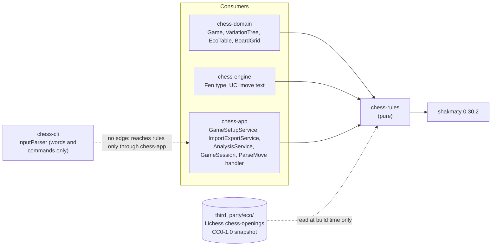
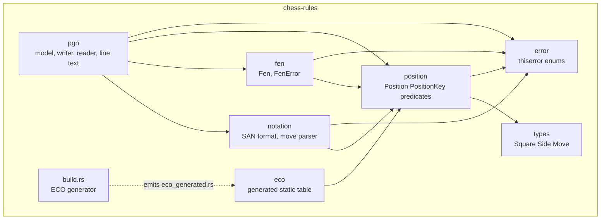
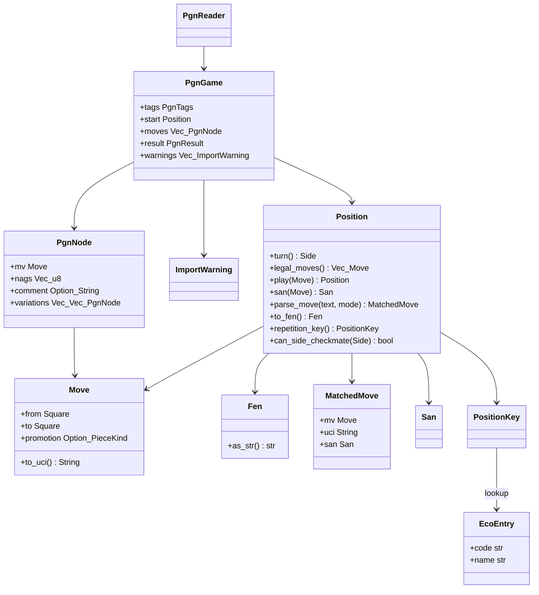
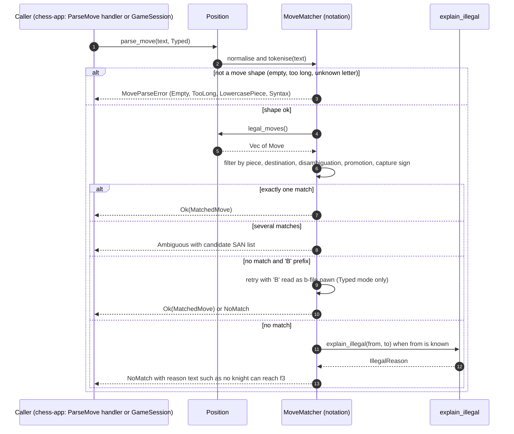
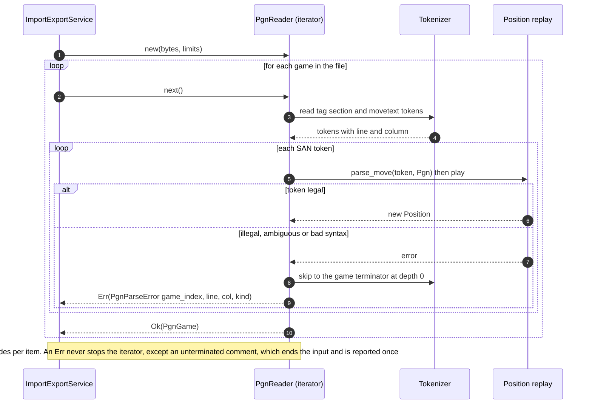
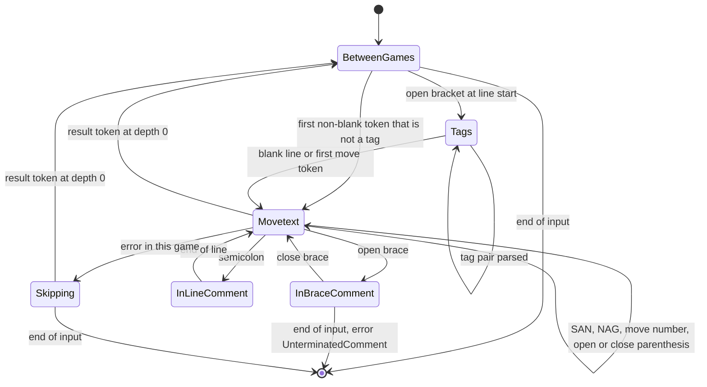
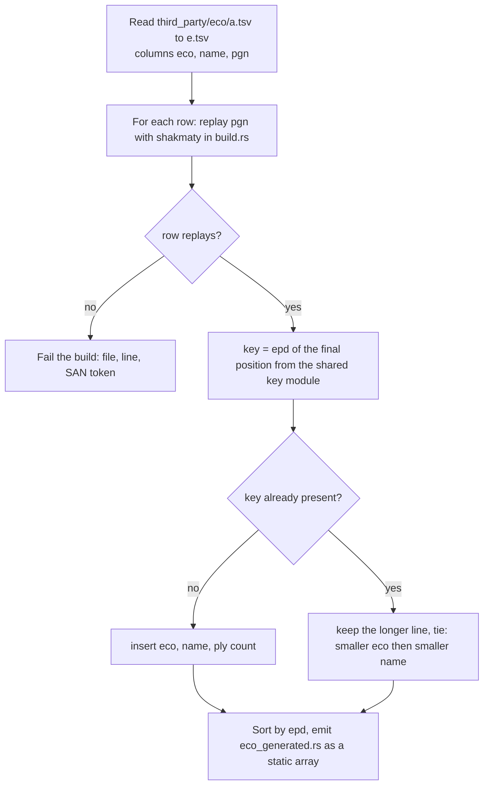

# SDD-chess-rules: Software Design Description for the `chess-rules` crate

| Field | Value |
|---|---|
| Document | docs/design/SDD-chess-rules.md |
| Version | **1.0.1 BASELINED** (amendment of 2026-11-09 to the 1.0 baseline of 2026-11-09; status stays BASELINED; 1.0 was a label change from 0.4 DRAFT) |
| Date | 2026-11-09 (v1.0.1, v1.0 and v0.4: 2026-11-09; v0.3.5: 2026-11-05; v0.3.3: 2026-11-04; v0.3.1: 2026-11-01; v0.1: 2026-10-30) |
| Style | IEEE 1016-style (viewpoints and design entities). No conformance to a numbered edition is claimed |
| Owner | Software engineer role (Claude), for Brian Prascher |
| Approver | **Baselined at v1.0 by Brian Prascher (G2, decision B4, 2026-11-09, tracker chess-4yc, via the G-3 pass with conditions, tracker chess-y7e; requirements Decision Log CR-16), after: (1) the reconciliation amendment 0.4 (2026-11-09, with the re-check addendum row); (2) the G1 desk review of the code ([desk-review-G1-step1.md](../engineering/desk-review-G1-step1.md), PASS WITH CONDITIONS); (3) the independent Reviewer re-check of the code ([review-step1-recheck.md](../engineering/review-step1-recheck.md), PASS WITH CONDITIONS; its code conditions CND-1 and CND-2 were fixed by the software engineer, see step1-rules-conditions-evidence.md "Recheck fixes", `[RAN]` by the author; no later Reviewer pass over those fixes is recorded `[UNV]`). The text of this SDD itself had NO independent Reviewer text review: the Reviewer re-check read only 3.11.7 and 3.11.10 of it and not the amendment drafts (review-step1-recheck.md section 7 `[OBS]`), and the 0.4 text had said that such a re-check was required before the baseline decision; no such review is recorded, and decision B4 as relayed names only the reconciliation amendment as the precondition. No approval other than Brian Prascher's baseline decision B4 is claimed; no Systems Engineer confirmation, no independent text review is claimed. Open conditions and questions remain at baseline: OQ-RUL-006 (per-payload or whole-game Latin-1 decoding: *closed by amendment 1.0.1, decided by Brian Prascher 2026-11-09, option B, per payload, architecture D-96; the amendment text is unreviewed*); OQ-RUL-007 (Systems Engineer confirmation of the IF-2 import-fidelity intent and of the `Bb4` / `B2d5` readings, with RF-14); OQ-RUL-008 (PGN Standard conformance of the accepted spellings, `[UNV]`); OQ-RUL-002 (ECO table byte size and largest line not recorded); re-check findings still open in its closure table: RC-04 / RF-07 (`BadField.detail` and `IllegalPosition::Other(String)` are still free text), RF-10 (memory amplification, accepted by desk review R9, now capped by RC-03), RC-06 / DF-04 (domain arena growth, the domain SDD's), RC-05 / CND-5 (the Systems Engineer's confirmation of the domain policy readings, the domain SDD's); Phase 1 conditions that still apply and are open in the tracker as of 2026-11-09: chess-2bb (XC-DOM-A8-5, recorded as resolved in this text and in the domain SDD; the bead is not closed), chess-ckq (a GATE-101+ record per block at the first code task of the other blocks), chess-y5j (SWE-001 upstream citations refresh), and chess-fwm (C-R2, this text; the bead is not closed by this edit). RSK-RUL-005 (the PGN grammar is now this crate's code) is carried in section 11.** *Status of the 0.4 text before the baseline, kept as history:* **No approval of this SDD is claimed. Status of 0.4: reconciled to the as-built code; the G1 desk review of the code is done; the SDD text awaits a Reviewer re-check; baselining at v1.0 is Brian Prascher's decision and is pending.** *Earlier status, kept as history:* **Pending.** Design-only work (documents, no code) is gate **G0** (SWE-001 §3), so no approval is needed to hold this draft. The rulings applied in v0.2 were approved by Brian Prascher on 2026-10-31 (SDD-architect-triage section 5, decisions 1 to 13; requirements Amendment 7, CR-9.1); this revision applies them as text and adds no new decision of its own. **Version 0.3.3 applies one decision made after that approval: Brian Prascher decided on 2026-11-04 (OQ-27, option A, G3; architecture Addendum F, requirements CR-12) that `canonical_form` omits `SetUp` and `FEN` when the `FEN` equals the standard start.** Implementation inside the crate, with the §3.2 edges and §5.7 contracts unchanged, is G1 (system-architect agent, desk review). Items in section 10 that remain open and touch an edge, a dependency or a protocol are G2 (Brian Prascher). **Version 0.4 (2026-11-09) is a reconciliation of the text to the as-built code (chess-fwm, C-R2; baseline B4) and applies decisions that Brian Prascher made on 2026-11-09 (G-3 passed with conditions; tracker chess-b9j, chess-9mm, chess-7m5, chess-4yc, chess-ebi, chess-0yz): B1 (`canonical_form` v1 frozen; illegal-tail marker; control-character collapse accepted), B4 (the in-crate PGN tokenizer is accepted as the D-3 escape route; `pgn-reader` is not a dependency; this SDD is to be baselined at v1.0 only after this reconciliation and a Reviewer re-check), B6 (the reader's warnings list). Gate: G1 (text, inside one crate). Status of this text at 0.4 (history, superseded by the 1.0 statement above): the G1 desk review of the *code* is done ([desk-review-G1-step1.md](../engineering/desk-review-G1-step1.md), PASS WITH CONDITIONS, 2026-11-09); the Reviewer re-check of this SDD text was PENDING; baselining at v1.0 was Brian Prascher's decision and was PENDING.** |
| Status | **BASELINED v1.0**, amended as **1.0.1** on 2026-11-09 (status stays BASELINED; the amendment is G1 text recording Brian Prascher's decision on per-payload Latin-1 and the pre-release `v1` rule, architecture D-96 and D-97; the text has had no Reviewer review and no approval beyond his decisions is claimed) (decision B4, see Approver). The code of this crate exists and was built and tested by its author (`[RAN]` figures are cited from the evidence files, not re-run for this edit); the Rust signatures in this text are the public API as built unless marked as a sketch. `Code:` paths are real (section 4) |
| Block (architecture §2.2 name) | `chess-app core :: chess-rules` (crate `chess-rules`, pure) |
| Upstream baselines read | architecture.md v1.0 through Amendment 8 and Addenda B to F (D-38 to D-88; D-68 and SF-03/SF-04 read for v0.3.4; the architecture's own revision label is not restated here `[UNV]`); functional_decomp.md v1.0; requirements.md v1.0 through Amendment 8 (CR-9 to CR-12); test-strategy.md 1.0 Amendment 6 `[UNV: not re-read for 0.3.4]`; SWE-001 v1.1.1; [SDD-architect-triage](SDD-architect-triage.md) (approved 2026-10-31); [SDD-SE-desk-answers](SDD-SE-desk-answers.md) (resolved 2026-10-31). **Read for 0.4 (2026-11-09):** the code of `crates/chess-rules` and the as-built evidence [step1-rules-A](../engineering/step1-rules-A-evidence.md), [B](../engineering/step1-rules-B-evidence.md), [rework](../engineering/step1-rules-rework-evidence.md), [conditions](../engineering/step1-rules-conditions-evidence.md); the Reviewer's [review-chess-rules-code](../engineering/review-chess-rules-code.md); the G1 desk review [desk-review-G1-step1](../engineering/desk-review-G1-step1.md) (drafts A-R1 to A-R5 and rulings R1 to R16); [ruling-test-helper-placement](../engineering/ruling-test-helper-placement.md); architecture Addendum H (D-90 to D-95) |
| Sibling SDDs | [SDD-chess-domain](SDD-chess-domain.md), [SDD-chess-store](SDD-chess-store.md), [SDD-chess-engine](SDD-chess-engine.md), [SDD-chess-app](SDD-chess-app.md), [SDD-chess-server](SDD-chess-server.md), [SDD-chess-cli](SDD-chess-cli.md), [SDD-ui](SDD-ui.md), [SDD-desktop-tauri](SDD-desktop-tauri.md) |

Evidence tags follow `swe-governance` §6. `[OBS architecture.md:354]` means "read in this session at that line". `[INF]` is inferred, `[UNV]` is not verified here, `ESTIMATE` is a design value without a measurement. There is no SRS in this repository (SWE-001 row "Upstream artifacts"), so the trace goes from requirement IDs of `requirements.md` and function IDs of `functional_decomp.md` straight to design entities (`DD-RUL-nnn`), not through `SWR-` IDs. Line numbers in `[OBS architecture.md:n]` refer to the amendment 6 text read for v0.1 and may have shifted in amendment 7 `[UNV]`; re-anchor them at the next full read.

### Change log

| Version | Date | Change |
|---|---|---|
| 0.1 DRAFT | 2026-10-30 | First draft. |
| 0.2 DRAFT | 2026-10-31 | G0 text edits implementing approved decisions only. **TR-1** (D-38): `chess-app -> chess-rules` edge exists, front-ends reach this crate only through `chess-app`, no re-export through `chess-domain` or `chess-store`; FIND-RUL-002 RESOLVED. **TR-5** (D-42, Q-SE-1): `canonical_form` has a fixed tag set and feeds `content_hash`; new DD-RUL-016; FIND-RUL-004 RESOLVED. **TR-8** (D-45): `Position::parse_move` is the sole typed-move parser and returns `MatchedMove`; FIND-RUL-003 RESOLVED. **XC-26**: `Fen::as_str` and `Display`; `Move::from_uci` is the `UciMove` bridge. **UR-26, Q-SE-22**: en-passant square always written on output; FIND-RUL-005 RESOLVED. **UR-27, Q-SE-7**: ECO tie rule confirmed, no ECO tags on export; FIND-RUL-006 RESOLVED. **UR-20, Q-SE-4**: wording of termination allocation; FIND-RUL-001 RESOLVED. **XC-14, Q-SE-24**: custom starts are not classified; FIND-RUL-007 RESOLVED. **XC-29**: RULE-6, RULE-7, RULE-8 and CLI-3 moved to "supporting". **XC-30**: IDs written as `PREFIX-nnn`; no number changed (the one- and two-digit forms are zero-padded to three digits); new IDs added at the end of each family. Interface-card IDs (`IFP-`, `IFR-`) keep their single-digit form because architecture §5.7 and the triage cite them (for example IFP-RUL-5). Dotted FIND-RUL-002 edges removed from the context diagram. |
| 0.3 DRAFT | 2026-10-31 | G0 text edits applying the joint-review rulings (SDD-v0.2-joint-review section 7; requirements CR-9.8 to CR-9.13; architecture amendment 7 addendum A, D-51, D-52, D-59). No new decision. **FIND-JR-007 (rules part), D-51, D-52:** the rules result type is renamed `MatchedMove{mv, uci, san}`; the wire type `ParsedMove{uci, san}` is the app's; the error mapping of section 5 follows D-51 (`ParseError{kind: move}` with `empty`, `too_long`, `syntax`, `lowercase_piece{suggestion}`, `promotion_required{choices}`, `ambiguous{candidates}`; `NoMatch` is `IllegalMove{reason}`); OQ-RUL-003 and ASM-RUL-006 closed. **CR-9.8, CR-9.11, CR-9.12, CR-9.13, D-59 (ACCEPTED):** the "custom starts are not classified" restriction (FIND-RUL-007, `eco_for_import`) is removed; this crate exposes the raw `ECO` tag (`PgnTags::eco_tag`) and `eco::lookup` stays position-based for every start; the outcome type lives in `chess-domain`; OQ-RUL-004 closed; new tests UT-RUL-029, UT-RUL-030. **CR-9.9:** IDs unchanged from v0.2 (the zero-padding was the accepted one-time exception; `FIND-DOM-9` citation corrected to `FIND-DOM-009`). |
| 0.3 DRAFT (addendum) | 2026-11-01 | G0. User rulings of 2026-11-01 and [SDD-v0.3-joint-review](SDD-v0.3-joint-review.md). `PgnTags::eco_tag` stays raw; normalisation (trim, upper-case, A00 to E99, malformed counts as no tag) is the domain's `normalize_eco_tag`. Ply-0 lookup of a custom start needs no rules change (`eco::lookup` is position-only); UT-RUL-030 now says so. **FIND-JR3-005 (rules part):** no `Opening` accessor is added: the domain needs no tag name, and the app, if the architecture keeps `tag_name?`, reads the free-form extras through the existing tags map (`[INF]`; the app owner and the SA decide the field). |
| 0.3.1 DRAFT | 2026-11-01 | G0. Applies architecture addendum B and C: no rules change. `PgnTags::eco_tag` stays raw; normalisation is the domain's (D-60). Version label unified. Cites D-60 (ECO import refinements), D-61 (`EngineFactory` owned by `chess-app`) and D-62 (PGN duplicates and the ECO question stay two steps; OQ-23 closed). Nothing is approved; no code exists |
| 0.3.2 DRAFT | 2026-11-04 | G0 (text). **D-75 / L2 / L3:** `shakmaty` is also a `[build-dependencies]` entry of `chess-rules` (same crate and version, no workspace edge); the ECO generator does **not** replay each line with `parse_move` (a build script cannot call the crate it builds) but with `shakmaty` directly; the key derivation (the EPD of a position) is written once in a module that both `build.rs` and `PositionKey::to_epd` include; `eco::lookup`, `PositionKey` and `EcoEntry` are the provided interface (IFP-RUL-6) and `build.rs` is listed under required interfaces (IFR-RUL-4); UT-RUL-023, UT-RUL-030 and CT-RUL-003 test through the public lookup. **F6:** the dependency-tree check is `cargo tree -e normal,build` (3.4). **L5 / D-76:** `FZ-RUL-001` to `FZ-RUL-003` keep their IDs; the level is now "Property (`proptest`, random input, stable)" and the tool is `proptest`; `cargo-fuzz` removed; the accepted loss is stated; the `FZ` prefix is historical. No Amendment 8 stored-format change touches this crate. No ID renumbered. Not approved, not desk-reviewed |
| 0.3.3 DRAFT | 2026-11-04 | G1 (text; the decision is Brian's, G3). **OQ-27, option A (Brian Prascher, 2026-11-04; architecture Addendum F, chess-a0r.1.41; requirements CR-12 item 3):** 3.11.10 step 2 (DD-RUL-016): `SetUp` and `FEN` are left out of `canonical_form` when the `FEN` equals the standard start in all six fields (private comparison, no new public item); `v1` of `content_hash` is defined with this rule; new **UT-RUL-031** (the test the requirements RULE-8 line left unnamed); UT-RUL-026 and CT-RUL-004 extended; the traceability row names RULE-8. Not done here: JR5-005 (the `canonical_form` version rule and the `Date` rule are the software engineer's, deferred). No ID renumbered. Not approved, not desk-reviewed. No Mermaid block edited |
| 0.3.4 DRAFT | 2026-11-05 | **G0** (wording and cross-references; no decision changed; chess-a0r.1.38, chess-a0r.1.44). **FIND-R23-001 / JR5-005:** 3.11.10 and section 3 (`canonical_form` interface note) now carry the `v1` version rule, the rule that a change to steps 1 to 5 is `v2`, and the `Date` rule, copied from architecture D-68 and SF-03/SF-04; the hash string is `sha256:v1:`. The 0.3.2 row's "No Amendment 8 stored-format change touches this crate" is superseded for `canonical_form` (history row left as written). **Drift guard (SF-02):** six-field list stated, UT-RUL-031 row (5) added, shared with UT-DOM-115. **FIND-R23-007:** "Upstream baselines read" row refreshed. No ID renumbered. Not approved, not desk-reviewed |
| 0.3.5 DRAFT | 2026-11-05 | **G0** (wording and test-design text; no decision changed; chess-a0r.1.44, "G1 desk review fixes", fix cycle 1). **FND-G1-002:** the Version rule no longer claims that UT-RUL-026 and UT-RUL-031 pin the bytes of `v1`; the guard gap is stated and recorded in the new OQ-RUL-005 (no golden-bytes case added: the fixed games and bytes are not given by D-68 or SF-03). **FND-G1-003:** UT-RUL-031 defines the seven-row drift-guard table once, names its proposed single source (one data file owned by `chess-rules`, inputs shared, expected results per crate), says UT-APP-29 uses a subset, and says rows (1) to (4) are not part of it. **FND-G1-001:** the en passant row (and a respelled castling field) expected results are marked pending XC-DOM-A8-5. **FND-G1-011:** OQ-RUL-005 allocated; "SWE-001 v1.1.1" cited. No ID renumbered. Not approved; the G1 desk review of 0.3.4 is `SDD-G1-desk-review-2026-11-05.md`
| 0.4 DRAFT | 2026-11-09 | **G1 (text, one crate).** Reconciliation of the text to the as-built step-1 code (chess-fwm = C-R2, baseline B4), applying the desk-review drafts **A-R1 to A-R5** updated to the code as it stands after the conditions work (C-R3 to C-R6), and Brian Prascher's decisions of 2026-11-09 (G-3 passed with conditions; architecture Addendum H, D-90 to D-95). **A-R1:** error and type shapes as built, including `SyntaxReason`, `TagReason`, `IllegalReason::NotAPromotion`, `PgnGame.warnings` and `ImportWarning` (new 3.13; IFP-RUL-3, IFP-RUL-5, DD-RUL-014). **A-R2 / B4 (D-93):** the in-crate tokenizer (`src/pgn/reader.rs`) replaces the `pgn-reader` wrapper in 1.2, 2.2, 3.1, 3.4, 3.6, IFR-RUL-2, DD-RUL-011, DR-RUL-001, CI-RUL-001; OQ-RUL-001 answered. **A-R3 / B1 (D-90):** `CANONICAL_FORM_VERSION = 1`, the illegal-tail marker `{illegal <ply> <uci> ...}`, the golden bytes of `v1` including a custom start, the accepted control-character collapse (3.11.10; OQ-RUL-005 answered; UT-RUL-026 extended, new UT-RUL-032). **A-R4:** depth ceiling 256 (`ESTIMATE`), stray result word, Ctrl-Z end of input, blank line then tag section, `explain_illegal` and `NotAPromotion`, `ParseMode::Pgn` accepted spellings, `e.p.` as an annotation, a Chess960-style back rank with castling `-` accepted (3.11.1, 3.11.2, 3.11.6, 3.11.8, 3.12). **A-R5 / B6 (D-95):** the lossy-import statement is replaced by the warnings list; whole-game Latin-1 stays and is an open question for Brian (OQ-RUL-006, bead chess-9o7). **Also:** ECO build as built (3.11.9, DD-RUL-013), `test-support` placement per [ruling-test-helper-placement](../engineering/ruling-test-helper-placement.md) (DD-RUL-015, DR-RUL-016), UT-RUL-031 (5) single source `crates/chess-rules/tests/data/fen_drift_guard.txt` and XC-DOM-A8-5 resolved (UT-RUL-031), `Code:` paths made real, OQ-RUL-001 and OQ-RUL-005 answered, ASM-RUL-001 and ASM-RUL-004 updated, new FM-RUL-009/010, RSK-RUL-004/005, ASM-RUL-007 to 009, OQ-RUL-006 to 008. **Not done here:** no baseline (Brian's decision after a Reviewer re-check); no code edited; the code's `ImportWarning` doc comment says between-game comments are not reported, which the tests contradict (3.11.8; reported to the software engineer). No ID renumbered. Not approved. Mermaid blocks edited: 3.1 and 3.3 (validated, see section 12) |
| 0.4 DRAFT (re-check addendum) | 2026-11-09 | **G1 (text).** Applies the conditions of the Reviewer's re-check [review-step1-recheck.md](../engineering/review-step1-recheck.md) (PASS WITH CONDITIONS; tracker chess-921) and the "Recheck fixes" of [step1-rules-conditions-evidence.md](../engineering/step1-rules-conditions-evidence.md). **RC-14 / CND-4:** the text was checked against the list of the re-check: the illegal-tail marker (3.11.10 step 6), `NotAPromotion` (3.11.2, 3.13), `SyntaxReason` and `TagReason` (3.13), `ImportWarning` and `PgnGame.warnings` (3.11.8, 3.13), `e.p.` (3.11.8 rule 6) and the blank-line rule of RF-03 (3.11.8 rule 2) are carried as built; the blank-line rule makes `[Event "A"]\n\n[White "x"]\n\n1. e4 *` an error, and a tag-only game at end of input is still an `Ok` empty game (RC-10). **RC-01:** `NotAPromotion` also for a castling move with a promotion letter (3.11.2, UT-RUL-035). **RC-03, RC-13:** warnings cap 256 and `WarningsTruncated` (3.11.8, 3.12, 3.13). **RC-09:** the marker invariant is about the movetext line (3.11.10). **RC-08, RC-09:** the two code comments reported in 0.4 are corrected in the code; the "out of date" notes are removed. Still open: CND-5 (the Systems Engineer's confirmation of the policy readings is the domain SDD's). No approval claimed; the Reviewer's re-check of this text is still PENDING |
| 1.0 BASELINED | 2026-11-09 | **Label change only; no design content changed.** Baselined by Brian Prascher (G2, decision B4, tracker chess-4yc, via the G-3 pass with conditions, tracker chess-y7e; Decision Log CR-16; recorded by the systems engineer, task chess-c1a) after the reconciliation amendment 0.4, the G1 desk review of the code and the Reviewer re-check of the code (both PASS WITH CONDITIONS). **The SDD text had no independent Reviewer text review.** Header cells (Version, Date, Approver, Status), this row, the section 12 rows (Reviewer pass, Decisions, Baseline) and the CR-16 reference were the only edits; open conditions and questions are listed in the Approver cell. From here a change to this SDD is an amendment (version 1.0.x) under SWE-001 and requirements CM; no approval beyond B4 is claimed |
| 1.0.1 BASELINED (amendment) | 2026-11-09 | **G1 (text, one crate; task chess-bmx, baseline B4; code by the software engineer, task chess-n3h).** Records Brian Prascher's decisions of 2026-11-09 (typed in the session, relayed by the coordinator; architecture Addendum I, **D-96 and D-97**; the Decision Log entry is the systems engineer's). **(1) Per-payload Latin-1 (OQ-RUL-006 closed, finding C-R5-F1 closed):** 3.11.8 *Encoding* is rewritten (each tag value and each comment is decoded on its own: valid UTF-8 kept, else that payload read as Latin-1; no other payload affected; the "mojibake in a mixed file" caveat and the SUSPECT characterization test are removed); the warnings table, the cap paragraph and the order line say that `Latin1Fallback` is recorded once per payload that fell back, in the order met, under the cap; 3.13, DD-RUL-011, UT-RUL-020, UT-RUL-033 follow; new **UT-RUL-036** (`tests/latin1_per_payload.rs`, 11 tests); FIND-RUL-010 and OQ-RUL-006 updated. **(2) Version rule (D-97):** a decided byte change to `canonical_form` before the first release stays `v1` (D-68 (d), ASM-6); each still needs Brian's decision; after the first release it is `v2`. `CANONICAL_FORM_VERSION` stays 1 and the golden bytes and the corpus digest `0xb679052c13383ab7` are unchanged (stored bytes change only for a game read from a file that mixes UTF-8 and non-UTF-8 payloads). No public signature, type or constant changed `[OBS evidence file]`. Figures are cited from [step1-rules-conditions-evidence.md](../engineering/step1-rules-conditions-evidence.md) ("Latin-1 per-payload"), not re-run for this edit. **Not done:** no independent Reviewer text review (not requested; still an open note); status stays BASELINED; no approval of the amendment text is claimed. No ID renumbered |

---

## 1 Introduction

### 1.1 Purpose

`chess-rules` is the **pure rules library** of the Chess application. It answers "what is a legal move here", "how is a move written and read", "is this FEN legal" and "what PGN text is this game", and it carries the ECO opening data. It performs no I/O at run time, holds no clock and no random source, and has no knowledge of players, modes or ratings. Everything above it (`chess-domain`, `chess-engine`, and through them `chess-app`) gets one definition of the rules, so that "the same scripted game in all three front-ends gives identical PGN" (PLAT-1, architecture principle 1) holds `[OBS architecture.md:98]`.

### 1.2 Scope

In scope (architecture §3.3, row `chess-rules`) `[OBS architecture.md:354]`:

- Positions, legal move generation, check, checkmate, stalemate, and the **position-level** inputs to draw detection (halfmove clock, a repetition key, a material test).
- SAN and coordinate move parsing (lenient, for typed input) and canonical SAN formatting. **`Position::parse_move` is the only typed-move parser in the system** (TR-8, D-45): no CLI or TypeScript matcher is written, and the GUI and CLI reach it through the protocol query `Query::ParseMove`.
- FEN parsing, validation and formatting, including `Fen::as_str` and `Display` (XC-26).
- PGN reading (import format) and writing (export format), including variations, comments and NAGs, and the `canonical_form` bytes from which `chess-app` computes `content_hash` (TR-5, D-42).
- The ECO table: a build step that turns the pinned Lichess `chess-openings` snapshot into a static, position-keyed table (D-20) `[OBS architecture.md:1729]`.
- Wrapping `shakmaty` 0.30.2 (D-3, baseline version §3.4 `[OBS architecture.md:376]`), so that a change of upstream API is absorbed inside this crate. *0.4 (B4, D-93):* the PGN tokenizer and reader are this crate's own code (`src/pgn/reader.rs`); `pgn-reader` is not a dependency (D-3's escape route). `shakmaty` is the only upstream chess crate.

Out of scope (owned elsewhere): history-based termination (threefold, fifty-move with the checkmate precedence), clocks and flag results (`chess-domain::Game`, [SDD-chess-domain](SDD-chess-domain.md)); Seven-Tag-Roster **content** (which Event/Site/Date a game gets), the `Termination` choice per game status, `content_hash` hashing, duplicate detection, the 10 MB limit and the archive layout (`ImportExportService`, [SDD-chess-app](SDD-chess-app.md)); UCI process handling (`chess-engine`, [SDD-chess-engine](SDD-chess-engine.md)); the CLI `InputParser` word/command layer (`chess-cli`, [SDD-chess-cli](SDD-chess-cli.md)); the `Query::ParseMove` handler (it resolves the position at `ply` and calls `parse_move`, [SDD-chess-app](SDD-chess-app.md)); the SHA-256 and the `"sha256:"` prefix of `content_hash` (one function in `ImportExportService`, D-42).

### 1.3 Allocation: requirements, functions, decisions

| Kind | IDs | Role of this block |
|---|---|---|
| Functions (allocated by name `chess-app core :: chess-rules`) `[OBS functional_decomp.md:84,87,88]` | **F-2.1.3** Parse start position; **F-2.2.1** Generate legal moves; **F-2.2.2** Parse move notation | Primary |
| Functions supported (allocated to another block, realised partly here) | F-2.2.4 Detect game termination (allocated to `Game domain`: this crate supplies the position predicates, see FIND-RUL-001); F-6.10 Export game as PGN, F-6.11 Import PGN games, F-6.12 Export all data (`games.pgn`) (allocated to `ImportExportService`: this crate is the reader and writer); F-5.2/F-5.3 What-if branch and saved variation (line text); F-4.6 Classify opening (table data) | Supporting |
| Requirements, primary | RULE-1 (legal moves, castling, en passant, promotion, check, mate, stalemate); IF-1 (export format), IF-2 (import format), IF-3 (FEN), co-primary with `ImportExportService` in architecture 10.1 | `[OBS architecture.md:1533,1538-1540,1559,1599]` |
| Requirements, supporting | RULE-6 (PGN export, the writer), RULE-7 (PGN import, the reader), RULE-8 (FEN start), CLI-3 (typed notation: this crate holds the only parser, D-45; `chess-cli::InputParser` and the protocol query are primary) (XC-29), NFR-3 (no illegal state: the legality oracle), RULE-2 and RULE-4 (position predicates used by `Game`), GUI-2 (c) (same bishop rule for typed input in the GUI), ANA-2 (variations round-trip as PGN), DAT-3 and NFR-6 (ECO table and its licence record), PLAT-1 (deterministic bytes), D-11 (`LegalMoves{fen}`) | |
| Decisions | D-3 (wrap `shakmaty`; the `pgn-reader` half was replaced by the in-crate tokenizer, D-93), D-11, D-20 (ECO source and build step; table and `eco::lookup` placed here by D-75), D-29/D-34 (archive and duplicate rules, as they constrain the writer), D-38 (edge rule), D-42 (`content_hash`), D-45 (`Query::ParseMove`, sole parser), D-47 (dependency admission), *0.4:* D-90 (`canonical_form` v1 frozen), D-93 (in-crate PGN tokenizer), D-95 (import warnings list), D-92 (journal ply base, consumer of `Position`/`Move` only, no rules change) | |
| Risks | R-15 (replay equality depends on the SAN and move identity defined here); NFR-3 random-input property tests (D-76) | |

### 1.4 Definitions

| Term | Meaning here |
|---|---|
| Ply | One half-move. Position index *n* is the position after *n* plies |
| UCI move | `e2e4`, `e7e8q`. Castling is the king's two-square move (`e1g1`), as in standard UCI `[INF: standard UCI]` |
| SAN | Standard algebraic notation, canonical form with `+`/`#` |
| Typed mode / PGN mode | The two parse modes of DD-RUL-006: lenient (CLI-3) and strict (PGN import) |
| Repetition key | An exact, hashable identity of a position for repetition (DD-RUL-003) |
| EPD key | The first four FEN fields (placement, side, castling, legal en-passant target), the ECO lookup key |
| Dead by material | Neither side can checkmate by any legal sequence because of the material left (RULE-1 (c)) |
| `MatchedMove` | Result of `parse_move`: the matched `Move`, its UCI text and its canonical SAN. Renamed from `ParsedMove` in v0.3 (D-52). It has no wire form (this crate has no `serde`). The protocol reply `ParsedMove{uci, san}` of `Query::ParseMove` is the app's own type, built from `uci` and `san` by `chess-app`; `mv` stays inside `chess-rules` and `chess-app` |
| Canonical form | The byte string of a game that `content_hash` is computed over (3.11.10) |

### 1.5 Conventions

- Rust edition 2024, `rust-version = "1.99"` `[OBS architecture.md:373]`. Crate attributes: `#![forbid(unsafe_code)]`; compiler and `clippy` warnings are errors (SWE-001 ASM-S1/S2); `unwrap`, `expect`, `panic!`, unchecked indexing and `as` narrowing casts are denied outside tests (CERT-informed, SWE-001 §6). **No CERT conformance is claimed.**
- `serde` is **not** used in this crate: every wire form of a rules value is a string (UCI move, FEN, PGN text), see section 3.7.
- Open item IDs are local and written `PREFIX-nnn` (XC-30): `FIND-RUL-nnn`, `OQ-RUL-nnn`, `ASM-RUL-nnn`, `ADR-REQ-RUL-nnn`, `RSK-RUL-nnn`, `FM-RUL-nnn`, `DR-RUL-nnn`. A finding that a ruling settled is marked RESOLVED with the ruling id and is kept, not deleted.

---

## 2 Design overview

### 2.1 Viewpoints included and omitted

| # | Viewpoint | Included | Reason / where |
|---|---|---|---|
| 1 | Context | yes | 3.1 |
| 2 | Composition | yes | 3.2 |
| 3 | Logical | yes | 3.3 (key types only) |
| 4 | Dependency | yes | 3.4 |
| 5 | Information | yes, reduced | 3.5. The crate stores nothing. It defines three text formats and one static table |
| 6 | Patterns use | yes | 3.6 |
| 7 | Interface | yes | 3.7 (cards `IFP-RUL-n`, `IFR-RUL-n`) |
| 8 | Structure | yes | 3.8 (module layering) |
| 9 | Interaction | yes | 3.9 (two sequences with failure paths) |
| 10 | State dynamics | yes, reduced | 3.10. The crate has no run-time state machine. The PGN reader's tokenizer is a state machine and is shown |
| 11 | Algorithm | yes | 3.11 |
| 12 | Resource | yes | 3.12 |

### 2.2 Design constraints taken from upstream

| Constraint | Source | Effect |
|---|---|---|
| Pure: no I/O, no clock, no RNG | Architecture principle 2 `[OBS architecture.md:99]` | No `std::fs`, `std::time`, threads or globals. The one file read (ECO TSV) happens at **build** time |
| Wraps `shakmaty` (GPL-3.0); the PGN reader is in-crate (0.4) | D-3, D-10, D-93 | Own types at the public boundary; upstream types never leak (rationale in 9) |
| Rules edition: FIDE Laws effective 1 January 2023 | RULE-1 `[OBS requirements.md:401]` | Fixtures cite it; deviations: automatic threefold and fifty-move draws (made by `Game`), dead position by material only |
| UTF-8 export, Latin-1 import fallback | IF-1, IF-2 | DD-RUL-010, DD-RUL-011 |
| Deterministic bytes from every front-end | PLAT-1, IF-1 | The writer is one function, no locale, no hash-order iteration |
| One typed-move parser, one canonical form | D-45, D-42 | `parse_move` and `canonical_form` have no second implementation in any crate or in `ui/` |
| Coverage at least 90 % line for rules and parser modules (`cargo-llvm-cov`, D-76); random-input property tests (`proptest`, stable, no fuzzer, D-76); perft | test-strategy "Quality gates", §9 `[OBS test-strategy.md]` | Section 7 |

---

## 3 Viewpoint sections

### 3.1 Context viewpoint

**Concern:** who uses this crate, through which edges, and what crosses the boundary.



Solid arrows are the edges of architecture §3.2 as amended (AMD-1, D-38): `domain -> rules`, `engine -> rules` and `app -> rules`. The last one was missing in v0.1 (FIND-RUL-002, now RESOLVED): §5.7 already named three `chess-app` services as consumers. The CLI, the server and the Tauri shell have **no** edge to this crate (TR-1.1): the CLI sends typed text to the core as `Query::ParseMove` and receives `MatchedMove`. `chess-domain` and `chess-store` re-export nothing from this crate (TR-1.3). What a front-end may use from below `chess-app` is the curated, named `pub use` list in the `chess-app` SDD (TR-1.4; none of the items is a type of this crate).

External entities: the ECO snapshot (build-time input) and the one upstream crate, `shakmaty` (0.4: `pgn-reader` is not used, D-93). No run-time external system exists. The `Internet` is not used at build time by this crate either (D-20: "Never fetched at run time or at build time").

### 3.2 Composition viewpoint

**Concern:** the parts of the crate and what each is for.

| Module | Design entities | Purpose |
|---|---|---|
| `types` | DD-RUL-001 | `Square`, `File`, `Rank`, `Side`, `PieceKind`, `Piece`, `Move` |
| `position` | DD-RUL-002, 003, 004, 007 | `Position`, legal moves, play, keys, predicates, illegal-move explanation |
| `notation` | DD-RUL-005, 006 | SAN format, move-text parser (two modes) |
| `fen` | DD-RUL-008 | `Fen` parse and format, `FenError` |
| `pgn` (`pgn/mod.rs`, `pgn/reader.rs`) | DD-RUL-009, 010, 011, 012, 016 | Model, writer, `canonical_form`, the in-crate tokenizer and reader, line text |
| `eco` (generated), `key_derive` | DD-RUL-013 | Static table and lookup; `build.rs` with `build/eco_gen.rs`; `src/key_derive.rs`, the EPD derivation shared by `build.rs` and `PositionKey::to_epd` |
| `error` | DD-RUL-014 | `thiserror` enums |
| `testing` (feature `test-support`, also `cfg(test)`) | DD-RUL-015 | `perft` and test helpers (public only with the feature) |



### 3.3 Logical viewpoint

**Concern:** the static types a consumer sees. Key types only; field details are in section 4.



The architecture lists the key types `Position`, `Move`, `San`, `Fen`, `PgnGame` `[OBS architecture.md:354]`; all five exist here with the same names `[OBS crates/chess-rules/src/lib.rs]`. The full as-built type and error shapes are in 3.13.

### 3.4 Dependency viewpoint

**Concern:** what this crate depends on, what depends on it, and the allowed direction.

| Direction | Item | Kind | Allowed by §3.2 | Note |
|---|---|---|---|---|
| out | `shakmaty` 0.30.2 | third party, runtime | yes `[OBS architecture.md:337]` | Pre-1.0: pin the minor version `[OBS architecture.md:376]` |
| ~~out~~ | ~~`pgn-reader` 0.29.1~~ | **not a dependency (0.4, B4, D-93)** | n/a | Replaced by the in-crate tokenizer (`src/pgn/reader.rs`). The architecture §3.2 box, §3.3 row, §5.7 row and §3.4 table still name `pgn-reader`; Addendum H corrects them by note. OQ-RUL-001 answered `[OBS step1-rules-B-evidence.md section 2]` |
| out | `thiserror` 2.0.21 | third party | yes, architecture §8 (error handling) and §3.4 | `[OBS Cargo.toml]` |
| out (build) | `shakmaty` 0.30.2 in `[build-dependencies]` | third party, build time | yes: the same crate and version as the runtime dependency (D-3, D-75); no workspace crate and no edge in §3.2 | A build script cannot call the crate it builds, so the ECO generator uses `shakmaty` directly (3.11.9). It is the only build dependency `[OBS dependency-lookup-step1.md F7]` |
| out (build) | `third_party/eco/*.tsv` | data file | yes, D-20 | CI verifies the recorded SHA-256, not `build.rs` (avoids a hash dependency) |
| in | `chess-domain`, `chess-engine` | workspace | yes `[OBS architecture.md:314,316]` | |
| in | `chess-app` | workspace | yes: edge added by AMD-1 (D-38) | FIND-RUL-002 RESOLVED (TR-1) |
| in (none) | `chess-cli`, `chess-server`, `src-tauri` | workspace | no edge, by rule (TR-1.1) | They reach this crate only through `chess-app` |

Rules that keep the crate pure: no dependency on any other workspace crate; no `tokio`, `serde`, `rusqlite`, `tracing`; no use of `std::time`, `std::fs`, `std::env` or `rand` at run time. *As built (desk review 2026-11-09):* `cargo tree -p chess-rules -e normal,build --offline` shows `shakmaty` 0.30.2 and `thiserror` 2.0.21 with their transitive crates and `shakmaty` as the one build dependency; `node ci/check-crate-edges.mjs` reports no workspace edge for this crate; `std::fs` and `std::env` appear only in `build.rs` and `build/eco_gen.rs` `[RAN desk-review-G1-step1.md section 2]`. `proptest` 1.12.0 is a dev-dependency only. The edge check is the CI enforcement of the first rule; a `cargo tree` assertion for the other rules is `[UNV: not written]`; the edge kinds are named because dev-dependencies (`proptest` brings `rand`) would otherwise show up in plain `cargo tree` `[RAN dependency-lookup-step1.md E11]`, and `-e normal,build` also covers the `shakmaty` build-dependency.

### 3.5 Information viewpoint

**Concern:** what data the crate defines, owns or reads, and in what form.

The crate **persists nothing** and owns no database table. It defines the textual forms other blocks persist or exchange:

| Form | Defined by | Used in | Owner of storage |
|---|---|---|---|
| UCI move string (`e2e4`, `e7e8q`) | `Move::to_uci` / `Move::from_uci` | `MOVE.uci`, protocol `MakeMove.mv`, engine I/O | store, protocol |
| Canonical SAN | `Position::san` | `MOVE.san`, PGN movetext | store |
| FEN (six fields) | `Fen` | `GAME.start_fen`, `MOVE.fen_after`, PGN `FEN` tag | store |
| PGN text | `write_pgn` / `PgnReader` | export, `games.pgn` in the archive, `VARIATION.pgn` | app, store |
| Canonical form (bytes) | `canonical_form` (3.11.10) | input of `content_hash`; the form itself is never stored | app computes and stores the hash only |
| ECO entry (`code`, `name`) | generated table | `GAME.eco`, `GAME.opening_name` | store (via `Game`) |

Static data: the ECO table is the only data the crate carries. Source: the Lichess `chess-openings` dataset, five TSV files with columns `eco`, `name`, `pgn`, CC0-1.0, snapshot in `third_party/eco/`, its commit and SHA-256 recorded there at the start of step 1 `[OBS architecture.md:1729]`. The licence and provenance are an NFR-6 audit item; this crate adds no other asset.

### 3.6 Patterns-use viewpoint

| Pattern | Where | Why | Misuse tell |
|---|---|---|---|
| Adapter / anti-corruption layer | `Position`, `Move`, `Fen`, `PgnGame` over `shakmaty` (the PGN grammar is in-crate) | D-3 escape route ("own implementation behind the `chess-rules` API" `[OBS architecture.md:1834]`); pre-1.0 upstream | An upstream type appears in a public signature |
| Immutable value objects | `Position::play` returns a new `Position` | Functional core (principle 2); `Game` clones per command (architecture §4.8) | A `&mut self` method on `Position` |
| Parse, don't validate | `Fen`, `San` newtypes; `Position::from_fen` | Illegal positions never exist as values | A `String` passed where a `Fen` is required |
| Strategy (mode flag) | `ParseMode::{Typed, Pgn}` | One matcher, two policies (lenient typed input, strict import) | A third copy of the matcher |
| Build-time code generation | `build.rs` for ECO | Keeps the data source and the lookup in sync, no run-time parsing | Hand-edited generated file |
| Iterator / streaming | `PgnReader` | "One bad game never aborts the rest" `[OBS architecture.md:840]`; lets the caller yield between games (section 6) | Collecting a 10 MB file into one `Vec` before any game is checked |

### 3.7 Interface viewpoint

**Concern:** the services this crate provides and requires, with parameters, units and errors.

Interface cards follow `interface-extraction` conventions. The first four implement the §5.7 rows "PGN/FEN I/O" and "Engine/Position helpers" `[OBS architecture.md:840,842]`.

#### IFP-RUL-1 Position and move services

| Operation | Parameters | Returns | Errors |
|---|---|---|---|
| `Position::standard()` | none | the start position | none |
| `Position::legal_moves(&self)` | none | `Vec<Move>` (at most 218 entries `[INF: known chess maximum, UNV]`), generation order unspecified | none |
| `Position::is_legal(&self, Move)` | a move | `bool` | none |
| `Position::play(&self, Move)` | a move | new `Position` | `IllegalMove { reason: IllegalReason }` |
| `Position::san(&self, Move)` | a legal move | `San` (canonical, with `+`/`#`) | `IllegalMove` |
| `Position::turn / piece_at / fullmove_number / halfmove_clock` | | values | none |
| `Move::to_uci(&self)`, `Move::from_uci(&str)` | UCI text, lowercase | `String` / `Move` | `MoveParseError::BadUci` |
| `Position::to_fen(&self)` | | `Fen` | none |

Contract: `play` never changes `self`; `legal_moves` and `play` agree (`play(m).is_ok()` iff `m` is in `legal_moves()`); castling is always `king from -> king to` two squares, never "king takes rook". `Move::from_uci` is the bridge from the engine's `UciMove` (a syntax-checked string) to a `Move`; the gateway calls it and then `is_legal` (XC-26, FIND-EN-008). Units: none. Thread safety: all types are `Send + Sync` (section 6).

#### IFP-RUL-2 Position predicates (inputs to `Game` termination)

| Operation | Returns | Meaning |
|---|---|---|
| `is_check`, `is_checkmate`, `is_stalemate` | `bool` | Standard definitions on the current position |
| `halfmove_clock` | `u32` | Plies since the last capture or pawn move |
| `repetition_key` | `PositionKey` (`Eq + Hash + Clone`) | FIDE "same position": pieces, side to move, castling rights, en passant target only if a legal en-passant capture exists |
| `can_side_checkmate(Side)` | `bool` | `false` only if no legal sequence lets that side deliver mate, judged by material alone (RULE-1 (c), RULE-4) |
| `is_dead_by_material` | `bool` | `!can_side_checkmate(White) && !can_side_checkmate(Black)` |

#### IFP-RUL-3 Notation services

| Operation | Parameters | Returns | Errors |
|---|---|---|---|
| `Position::parse_move(&self, text, ParseMode)` | text of at most 16 bytes (`MAX_MOVE_TEXT`), mode | `MatchedMove { mv: Move, uci: String, san: San }` | `MoveParseError` (section 5) |
| `Position::explain_illegal(&self, from: Square, to: Square, promotion: Option<PieceKind>)` | squares and an optional promotion piece | `IllegalReason` (3.11.2; *0.4:* `NotAPromotion` for a promotion piece on a move that does not promote) | none |

**Sole parser (TR-8, D-45).** This function is the only implementation of typed-move parsing. `chess-app` answers `Query::ParseMove{game_id, ply, text}` by parsing against the position at `ply` of the live or viewed game (`StalePosition` if the game is live and `ply` is not the live ply) and returns the wire `ParsedMove{uci, san}` (built from `MatchedMove`), `IllegalMove` or `ParseError{kind: move}` (error mapping in section 5, D-51). The CLI calls it in process and the GUI over WebSocket or IPC; neither holds a `Position` or a matcher. `MakeMove.mv` stays UCI-only. The typed-input budget is NFR-8 (SE answer Q-SE-6); FF-6 measures the round trip over loopback. `MatchedMove.mv` stays internal so that in-process callers need no second parse; the wire type `ParsedMove{uci, san}` belongs to `chess-app` and the client plays by sending `MakeMove{mv: uci}` (D-52; ASM-RUL-006 RESOLVED).

#### IFP-RUL-4 FEN services (IF-3)

| Operation | Parameters | Returns | Errors |
|---|---|---|---|
| `Fen::parse(&str)` | exactly six space-separated fields, at most 128 bytes (derivation in 3.11.6) | `Fen` (validated, normalised) | `FenError` naming the field or the illegal-position reason |
| `Position::from_fen(&Fen)` | | `Position` | none (already validated) |
| `Fen::as_str(&self)`, `impl Display for Fen` | | `&str` / the same six fields as text | none (XC-26: the engine builds `position fen ...` from it) |

#### IFP-RUL-5 PGN services (IF-1, IF-2, RULE-6, RULE-7)

| Operation | Parameters | Returns | Errors |
|---|---|---|---|
| `write_pgn(&PgnGame)` | a game model | `String` (UTF-8), deterministic | `PgnWriteError` |
| `write_pgn_many(&[PgnGame])` | games | `String`, games separated by one blank line | `PgnWriteError` (first failure, with the game index) |
| `PgnReader::new(&[u8], PgnLimits)` | bytes (caller enforces the file-size limit, TBD-25), `PgnLimits { max_variation_depth }` (default 64; values above 256 are treated as 256, 3.12) | iterator of `Result<PgnGame, PgnParseError>`; *0.4:* every `PgnGame` carries `warnings: Vec<ImportWarning>` (3.11.8, D-95) | per game: `PgnParseError { game_index, line, col, kind: PgnErrorKind }` |
| `format_line(&Position, &[PgnNode])` / `parse_line(&Position, &str)` | start position and nodes (with nested variations) / movetext | `Result<String, PgnWriteError>` / `Result<Vec<PgnNode>, PgnParseError>` | `PgnWriteError` / `PgnParseError` (`game_index` 1 for `parse_line`) |
| `PgnTags::eco_tag(&self) -> Option<&str>` | a parsed game's tags | the raw text of the `ECO` tag exactly as read (no trimming, no validation, no case change), or `None` when absent. It is read from the free-form extras, which the reader already keeps. CR-9.12 / D-59: `chess-app` passes it to `chess-domain`, which decides what it means | none |
| `canonical_form(&PgnGame)` | a game model | `Vec<u8>`: the fixed tag set and the mainline SAN with the result, no comments, variations or NAGs; an illegal mainline tail is marked, not dropped (3.11.10) | none |
| `CANONICAL_FORM_VERSION: u32` | none | `1`, the `v1` of `sha256:v1:<hex>` (3.11.10; *0.4, B1, D-90*) | none |

`canonical_form` is the input `chess-app` hashes for `content_hash` as `"sha256:v1:" + hex(SHA-256(canonical_form))` (TR-5, D-42, D-68, SF-03; FIND-RUL-004 RESOLVED). `v1` is the version of this function's output (3.11.10, "Version rule"). The `TagFilter` parameter of v0.1 is gone: the tag set is a decision (SE Q-SE-1, confirmed), not a caller choice.

#### IFP-RUL-6 ECO lookup (D-20, D-75)

*Placement confirmed by D-75 (Amd 8, Addendum A, 2026-11-04; architecture §3.3, §5.7): the generated table and `eco::lookup` are a provided interface of `chess-rules`, used by `chess-domain` across the existing `chess-domain -> chess-rules` edge. The "deepest named position" rule and everything about a game stay in `chess-domain`.* The key types of the interface are `PositionKey` (DD-RUL-003) and `EcoEntry { code, name }`.

| Operation | Parameters | Returns | Errors |
|---|---|---|---|
| `eco::lookup(&PositionKey)` | key | `Option<EcoEntry { code: &'static str, name: &'static str }>` | none |
| `eco::TABLE_LEN` | | `usize` | none |

#### Required interfaces

| ID | Provider | Used for | Failure handling |
|---|---|---|---|
| IFR-RUL-1 | `shakmaty` 0.30.2 | move generation, FEN, SAN, material test | Calls return `Result` or are total. A `PositionError` becomes a `FenError`. API drift is absorbed here (D-3) |
| IFR-RUL-2 | ~~`pgn-reader` 0.29.1~~ the in-crate tokenizer `src/pgn/reader.rs` (0.4, B4, D-93; **no external provider**) | PGN tokenising and reading, with line and column | Per-game error recovery as in 3.9.2. `pgn-reader` 0.29.1 has no line or column anywhere in its `src/` `[OBS step1-rules-B-evidence.md section 2, grep]`, so it could not give `PgnParseError { line, col }` (OQ-RUL-001 answered) |
| IFR-RUL-3 | `third_party/eco/{a..e}.tsv` (build time) | ECO generation | A row that does not replay fails the build with file and line |
| IFR-RUL-4 | `build.rs` with `shakmaty` 0.30.2 as a `[build-dependencies]` entry (D-75) | The ECO generator replays each TSV line with `shakmaty` and the shared key-derivation module (3.11.9) and emits `eco_generated.rs` | A row that does not replay fails the build with file and line; a mismatch between the build-time key and `PositionKey::to_epd` fails UT-RUL-023 or UT-RUL-030 |

*As built:* the upstream calls are used inside `position.rs`, `fen.rs`, `key_derive.rs` and `testing.rs` against `shakmaty` 0.30.2 and compile and pass the crate's tests `[RAN, cited from step1-rules-A/B-evidence.md]`; `shakmaty`'s own insufficient-material test matches the table of 3.11.3 (ASM-RUL-001 closed in practice, `[OBS step1-rules-A-evidence.md F-A4]`). This SDD still specifies behaviour, not upstream calls. `pgn-reader` was never opened beyond the line and column check above; nothing in this text depends on its API `[UNV]`.

### 3.8 Structure viewpoint

**Concern:** how the crate is layered inside.

Layers, lowest first: `types` -> `position` (the only module that touches `shakmaty` board types) -> `notation`, `fen` -> `pgn`, `eco`. *As built (0.4):* the files that name `shakmaty` are `position.rs`, `fen.rs`, `key_derive.rs`, `testing.rs`, `build/eco_gen.rs` and `build.rs`; `lib.rs` names it in a doc comment only, and `notation.rs` and `pgn/` see upstream only through `Position` `[OBS desk-review-G1-step1.md section 2, grep]`. No `pub use shakmaty` exists in `crates/*/src` `[RAN, same source]`. A grep-based CI check of this boundary is `[UNV: not written]`. Public re-exports are listed in one `lib.rs`; `eco` and (with the feature `test-support`) `testing` are the two public modules; nothing else is `pub`.

### 3.9 Interaction viewpoint

#### 3.9.1 Typed move, including failure paths (CLI-3, GUI-2 (c), F-2.2.2)

**Question:** how does text typed by the user become a `Move`, and what does each failure return?



Nothing in this sequence changes a `Position`. For `Query::ParseMove` the app returns the result and stops. The client then sends `MakeMove{uci}`, and the session actor's `Game::decide` re-checks legality (defence in depth, NFR-3).

#### 3.9.2 PGN import with per-game recovery (RULE-7, IF-2, F-6.11)

**Question:** how does one malformed game leave the other games in the file importable?



*0.4:* the tokenizer `T` is this crate's own code (`src/pgn/reader.rs`), not an upstream crate (B4, D-93). The reader also returns, with each `Ok(PgnGame)`, the list `warnings` of what it dropped or changed (3.11.8, D-95).

### 3.10 State-dynamics viewpoint

**Concern:** behaviour by state. `chess-rules` has no run-time state machine: every function is a pure function of its arguments. The one automaton is the **PGN tokenizer** inside `PgnReader`.



| State | Entry | Exit | Notes |
|---|---|---|---|
| `BetweenGames` | start, or after a result token | `[` -> `Tags` | Whitespace and `%` escape lines are skipped |
| `Tags` | `[Name "value"]` per line | blank line or a move token | Value escapes `\"` and `\\` decoded; an unterminated value is an error for this game |
| `Movetext` | first move token | result token at variation depth 0 | Variation depth counted with a counter capped at `max_variation_depth` (default 64, `ESTIMATE`; values above the crate ceiling 256 are treated as 256, section 3.12) |
| `Skipping` | an error in the current game | next result token at depth 0 outside a comment | Counts parentheses and braces so a result token inside a comment or variation does not end the skip. *As built (0.4, step1-rules-B-evidence F-B5 (c)):* quoted strings are skipped, and after a movetext error a tag section at a line start also ends the skip |

### 3.11 Algorithm viewpoint

#### 3.11.1 Move matcher (DD-RUL-006)

Input: `Position pos`, `text`, `ParseMode mode`. Output: `MatchedMove` or `MoveParseError`. This is the only typed-move matcher (D-45). Steps:

1. Trim ASCII whitespace. Empty -> `Empty`. More than `MAX_MOVE_TEXT` (16) bytes -> `TooLong`. Non-ASCII byte -> `Syntax`.
2. Strip trailing annotation characters `+ # ! ?` (they are not validated; check and mate are consequences of the move, not part of its identity). In `Pgn` mode, a `!`/`?` suffix is returned to the reader as a NAG request instead of discarded.
3. **Castling:** `O-O`, `0-0`, `O-O-O`, `0-0-0` (zero or letter O; lower-case `o` is rejected, ASM-RUL-002). Select the legal king move that goes two squares toward the rook; none -> `NoMatch` with the reason from DD-RUL-007 (rights lost, path blocked, through check, out of check).
4. **Coordinate form** (`Typed` mode only): `^[a-hA-H][1-8][a-hA-H][1-8](=?[QRBNqrbn])?$`. File letters either case. A pawn reaching the last rank without a promotion letter -> `PromotionRequired { choices }`. Result must be in `legal_moves()`, else `NoMatch`.
5. **SAN form:** parse `[piece][from-file][from-rank][x]to-file to-rank[=?promotion]`.
   - Piece letters `K Q R B N` are accepted **only in upper case**. A first character `n k q r` (lower case, not a file letter) -> `LowercasePiece { suggestion }`.
   - File letters are accepted in either case, except the leading character rule below.
   - `x` is optional. If `x` is present the move must be a capture, else `NoMatch` (strict on a wrong `x`, tolerant of a missing one, ASM-RUL-003).
   - Promotion letter: `Q R B N` in either case after an optional `=`. Missing on a pawn move to the last rank -> `PromotionRequired`.
6. **Leading `b` / `B` rule (Q44, CLI-3)** `[OBS requirements.md:911-930]`: a leading lower-case `b` is always the b-file (pawn). A leading upper-case `B` is read as a bishop move if any legal bishop move matches; **otherwise (Typed mode only)** it is read as the b-file. In `Pgn` mode `B` is always a bishop and `b` always a file (no fallback), so an import cannot silently accept an illegal SAN.
7. **Match:** `candidates = legal_moves().filter(piece kind, destination, from-file, from-rank, promotion, capture flag)`. A pawn capture needs its origin file (`exd5`, or `ed5`); `xd5` alone is accepted if exactly one pawn can make it.
8. 0 candidates -> `NoMatch` with `explain_illegal` for the nearest geometric reading (3.11.2). 1 -> `Ok(MatchedMove)`. More than 1 -> `Ambiguous` with each candidate's canonical SAN.

Complexity: O(L) with L at most 218 legal moves, plus one `legal_moves` call. Invariant: the `mv` of a returned `MatchedMove` is always an element of `legal_moves()`, and `uci` and `san` are computed from it, not from the input text.

**As built (0.4, A-R4, desk review R8): `ParseMode::Pgn` accepted spellings.** `Pgn` mode is the import policy. It guarantees that a text yields a move only if that move is in `legal_moves()` (a 400 000-text differential run in both modes found no exception `[RAN by the Reviewer, review-chess-rules-code.md RF-08]`) and that `B` is always a bishop. It is **not** the strict export grammar of the PGN Standard: it is a lenient SAN reader. It accepts an upper-case file letter (`E4`); an origin file or rank on any move, including over-disambiguation (`Ng1f3`, and `e2e4` read as a SAN pawn move with an origin square); `0-0` and `0-0-0`; a promotion with or without `=` and in either case (`a8=Q`, `a8Q`, `a8q`); and any run of `+ # ! ?` after the move (a trailing `!`, `?`, `!!`, `??`, `!?` or `?!` becomes a NAG, any other run is dropped, `e4+++` is accepted). It rejects a wrong capture sign (`Nxf3` for a non-capture), a coordinate move that is not valid SAN (`g1f3`), lower-case piece letters (`nf3`) and any unparsable word; in the reader each of these fails the whole game with `BadSyntax`. `Typed` mode additionally accepts the coordinate form and the `B` fallback of step 6. The listed spellings are pinned by `tests/c_r6.rs` and `tests/notation.rs` `[OBS step1-rules-conditions-evidence.md section 5]`. Whether the PGN Standard's import grammar allows each spelling is `[UNV]` (OQ-RUL-008). In `Typed` mode `Bb4` in the start position returns `b2b4` (the fallback reads `bb4`) while `B4` is `Syntax`: it is inside step 6 and is left for Systems Engineer confirmation (CLI-3; OQ-RUL-007). The matcher (`parse_move`, both modes) does not accept `e.p.`; the reader skips it (3.11.8).

#### 3.11.2 Illegal-move explanation (RULE-1: "rejected with a reason")

`explain_illegal(from, to, promotion)` classifies, in order, using `piece_at`, the side to move and a small attack test `[INF]`:

| Check (in order) | `IllegalReason` |
|---|---|
| no piece on `from` | `NoPiece` |
| piece belongs to the other side | `WrongTurn` |
| geometry impossible for that piece kind (ignoring check) | `CannotReach { piece }` ("no knight can reach f3") |
| path blocked by a piece | `Blocked` |
| destination holds an own piece | `OwnPieceOnTarget` |
| castling: rights lost / path occupied / king in check / crosses an attacked square | `CastlingRightsLost`, `CastlingBlocked`, `CastlingOutOfCheck`, `CastlingThroughCheck` |
| pawn to last rank without promotion | `PromotionRequired` |
| *0.4 (RF-06):* a promotion piece on a move that does not promote (the geometry checks above passed) | `NotAPromotion` (message: "that move does not promote a pawn, so it takes no piece letter") |
| *0.4:* on a real promotion, a king or a pawn chosen as the piece | `CannotReach { piece: chosen }` |
| move is geometrically fine but leaves or puts the own king in check (pinned piece, moving into check, not answering a check) | `LeavesKingInCheck` (or `KingInCheck` when already in check and the move does not resolve it) |
| none of the above | `Other` (a defect indicator; logged by the caller, never shown as a rule). *0.4:* `Other` is reachable only when the move is in fact legal, or on a library defect; input that names a wrong promotion is `NotAPromotion`, not `Other` |

Messages are English (UI-11), produced by `Display`; the enum is the stable part (NFR-9). *As built:* impossible geometry is still reported first as `CannotReach`; `e2e4q` (a pawn push with a promotion letter) is `NotAPromotion`. **Castling with a promotion letter (RC-01, re-check fix):** when `explain_castling` finds that all castling conditions hold and a promotion letter was sent (`e1g1q`), the result is `NotAPromotion`, not `Other`; a castling failure with a letter keeps its castling reason (`CastlingRightsLost` and so on). Before the fix 132 of 9 168 104 probes of the Reviewer's sweep gave `Other`, all of them a king two-file move with a letter `[RAN review-step1-recheck.md RC-01]`; after it the sweep over 10 castling-rich positions finds none (`tests/recheck.rs`, `rc_01_*`) `[RAN step1-rules-conditions-evidence.md, Recheck fixes]`. The `explain_illegal` doc comment was corrected (RC-08).

#### 3.11.3 Dead position by material (`can_side_checkmate`)

Definition (RULE-1 (c), RULE-4): `can_side_checkmate(S)` is `false` iff no sequence of legal moves, by both players cooperating, ends with `S` giving checkmate, **judged by material only** (a blocked-pawn dead position is deliberately not detected, RULE-1 (c)). Reference classification (design rule, to be validated against FIDE Art. 5.2.2 and 6.9 and against `shakmaty`'s own test `[UNV]`):

1. `S` has any pawn, rook or queen: `true`.
2. `S` has exactly one knight and no other piece besides the king, and the opponent has only a king and possibly queens: `false`. `S` has two or more knights or a knight with any other piece: `true`.
3. `S` has only bishops: `false` iff all bishops on the board (both sides) stand on squares of one colour and there is no knight and no pawn on the board; otherwise `true`.
4. `S` has only a king: `false`.

Fixture table the implementation must satisfy (each row in both colours):

| Material | White can mate | Black can mate | Dead position |
|---|---|---|---|
| K v K | no | no | yes |
| K+B v K, K+N v K | no | no | yes |
| K+B v K+B, bishops on the same colour | no | no | yes |
| K+B v K+B, bishops on opposite colours | yes | yes | no |
| K+N v K+N | yes | yes | no |
| K+NN v K | yes | no | no |
| K+B+B (same colour) v K | no | no | yes |
| K+B+B (opposite colours) v K | yes | no | no |
| K+R v K, K+Q v K, K+P v K | yes | no | no |

Use: `Game` ends a game as "dead by material" when both are `false`; on a flag fall it awards a draw instead of a loss when the **opponent** of the flagged side cannot mate (RULE-4). If `shakmaty`'s own insufficient-material test passes this table, the crate uses it; if not, the in-crate classifier above is used (ASM-RUL-001).

#### 3.11.4 Repetition key and EPD key

`PositionKey` = (placement of 64 squares, side to move, castling rights as stored in the FEN-style rights set, en-passant target square **only if** a legal en-passant capture exists in the position). It is an exact structure, not a 64-bit hash: a hash collision would end a game as a false draw, which NFR-3 forbids; the memory cost was estimated at a few tens of bytes per ply. *As built (0.4):* `PositionKey` is a 64-entry placement array plus the other fields, a few hundred bytes; the size is not measured `[UNV, step1-rules-A-evidence.md F-A7]`, and the cost is paid per ply stored by `Game`. `PositionKey::to_epd()` renders the first four FEN fields from the same data, and is the ECO lookup key.

#### 3.11.5 FEN en-passant field on output

`Position::to_fen` writes the en-passant target square **after every double pawn push**, whether or not a capture is possible. This is the SA ruling UR-26, confirmed as SE interpretation Q-SE-22 (CR-9.2); FIND-RUL-005 is RESOLVED. Reasons: the text is deterministic, the engine accepts it, one code path makes PLAT-1 byte identity hold in every front-end, and `MOVE.fen_after` can be recomputed from the moves, so the choice is cheap to reverse. The field a `Position` writes is the one it carries: set by a double push, or as parsed from an input FEN, which is accepted whichever convention it uses (IF-3). `PositionKey` keeps the legal-capture rule of 3.11.4 because repetition is defined by possible moves; the key is separate from the output string. The convention is checked against the FEN and PGN standard text when this crate is written `[UNV]` (UR-26).

#### 3.11.6 FEN parse

1. Reject more than 128 bytes (a legal six-field FEN needs at most 71 placement characters, 1 side, 4 castling, 2 en passant, 10 + 10 digits for two `u32` counters and 5 spaces = 103 `[INF]`).
2. Split on single ASCII spaces; the count must be exactly 6, else `FieldCount { found }` (upstream parsers accept fewer fields, so this check is ours).
3. Placement: 8 ranks, each summing to 8 squares; piece letters `pnbrqkPNBRQK`. Side `w`/`b`. Castling `-` or a subset of `KQkq` in that order. En passant `-` or a square on rank 3 (Black to move) or rank 6 (White to move). Halfmove `u32`. Fullmove `u32` at least 1. Each failure names its field.
4. Legality (IF-3 list `[OBS requirements.md:1062-1068]`): exactly one king per side (`MissingKing`, `TooManyKings`), no pawn on rank 1 or 8 (`PawnOnBackRank`), the side **not** to move is not in check (`OpponentInCheck`); other upstream position errors map to `IllegalPosition::Other(text)` (impossible castling rights, impossible en-passant square, impossible check).
5. Normalise (castling and en-passant fields as parsed, counters as numbers) and return `Fen`.

A FEN that is a checkmate or stalemate is **valid** here (it is a position); the game layer decides whether it may start a game (FIND-DOM-009).

**As built (0.4, R8, RF-07, RF-09).** `FenError` is `TooLong { len }`, `FieldCount { found }`, `BadField { field: FenField, detail }` and `Illegal(IllegalPosition)`; `field` is the stable part and `detail` is a display string. `IllegalPosition` is `MissingKing`, `TooManyKings`, `PawnOnBackRank`, `OpponentInCheck`, `Other(text)`. The five upstream parse-error arms of the first build were dead code (the crate's own pre-checks reject those inputs first) and are replaced by one fallback `BadField { Placement, "not accepted" }`; a 4 000-case property sweep found no input that reaches it `[RAN step1-rules-conditions-evidence.md 4.4]`, which is evidence and not proof `[INF]`. **A Chess960-style back rank is accepted when the castling field is `-`:** it is an ordinary custom start with no castling, and no message says so; a Chess960 castling field (`HFhf`) or `KQkq` that does not match the placement is rejected `[RAN review-chess-rules-code.md RF-09]`. Counters are normalised (`0 01` becomes `0 1`) and saturate at `u32::MAX` instead of overflowing, so a game at that counter stops counting without a panic `[RAN, same source]`.

#### 3.11.7 PGN writer (IF-1) `[OBS architecture.md:840, requirements.md:1026-1048]`

1. Validate: tag names `^[A-Z][A-Za-z0-9_]*$`; extras must not use the reserved names (the Seven Tag Roster names, `FEN`, `SetUp`, `TimeControl`, `Termination`).
2. Emit the Seven Tag Roster in the standard order: `Event`, `Site`, `Date`, `Round`, `White`, `Black`, `Result`. An unknown text value is `?`; `Round` defaults to `-`; `Date` is `YYYY.MM.DD` with `??` for unknown parts.
3. Emit the remaining tags in **ASCII order of the tag name**: the typed ones (`FEN`, `SetUp` when `start` is not the standard position; `TimeControl` as `seconds` or `seconds+increment`; `Termination` from the enum `Normal | TimeForfeit | Abandoned`) merged with the free-form extras (`BTreeMap`, byte order). One tag pair per line, one space between name and quoted value, `\"` and `\\` escaped, any control character in a value replaced by a space (deterministic, ASM-RUL-004). A blank line follows the tags.
4. Replay `start` along the mainline. For each node write the move number token: `N.` before a White move; `N...` before a Black move that is first in its sequence or that follows a comment or a variation. Then the canonical SAN, then NAGs as `$n`, then `{comment}`, then each variation as `( ... )` with `(` glued to its first token and `)` glued to its last.
5. Join tokens with a single space. A line break replaces the space whenever the next token would make the line 80 characters or longer, so every line is at most 79 characters `[INF from "shorter than 80"]`. A token longer than the line limit stands alone on its line.
6. The last token is the result string (`1-0`, `0-1`, `1/2-1/2`, `*`). The `Result` tag and this token come from the same field, so they cannot differ.
7. End with a single `\n`. `write_pgn_many` separates games with one blank line.

A move that is illegal in the replay -> `PgnWriteError::IllegalMove { variation_path, ply }`. The writer never emits `ECO` or `Opening` tags (SE answer Q-SE-7: the IF-1 tag set is closed, TBD-24); the archive carries ECO code and opening name in `games.json`.

#### 3.11.8 PGN reader (IF-2)

**The reader is this crate's own iterative tokenizer** (`src/pgn/reader.rs`, `PgnReader`), not a wrapper of `pgn-reader` (B4, D-93, the D-3 escape route; OQ-RUL-001 answered). It keeps an explicit variation stack, so input nesting never recurses, and every loop consumes at least one byte, so every input ends. The grammar and the recovery rules are therefore this crate's code and test burden (UT-RUL-020, UT-RUL-021, UT-RUL-033, FZ-RUL-003).

Per game: read the tag section; if a `FEN` tag is present and `SetUp` is not `"0"`, build the start position with the FEN rules (an illegal FEN fails this game with `BadFen`). *As built, wider than the v0.3 text "if `SetUp "1"` and `FEN` are present":* a `FEN` tag alone is honoured, because ignoring it would replay the moves from the wrong position (F-B5 (a), accepted by the desk review). Replay each SAN token with `parse_move(token, Pgn)`; keep comments, NAGs and variations (a variation replays from the position **before** the move it follows); stop at the result token at depth 0. The movetext terminator is authoritative for `result`; if absent at end of input or at the next tag section, use the `Result` tag, else `*`. A `Result` tag that disagrees with the terminator is not reported. Missing Seven Tag Roster tags are filled with `?` (hand-made files). A leading UTF-8 byte-order mark is dropped. Line numbers count `\n`, `\r\n` and a lone `\r` as one line break each; columns count bytes from 1. The error position of an unclosed tag value is its opening quote; of other tag errors the offending token; of a movetext error the first byte of the offending token.

**Reader rules as built (A-R4, desk review R6; evidence `[OBS step1-rules-B-evidence.md F-B5; step1-rules-rework-evidence.md]`).**

1. *Tags.* A tag name starts with an upper-case ASCII letter and continues with ASCII letters, digits or `_`, else `BadTag { NameStart }`. A value is quoted; `\"` and `\\` are decoded and a backslash before any other byte is kept. A repeated tag keeps the last value. `Date`, `TimeControl` and `Termination` that do not parse fall back to unknown or absent and raise a warning (below).
2. *Game boundaries.* A tag section that starts at a line start ends a game that has no terminator (the game is returned with its `Result` tag, or `*`). **A blank line followed by a tag section, after a tag section with no movetext, ends the first game with `BadSyntax { TagSectionWithoutMovetext }`** and the reader stays at the new `[`, which starts the next game (RF-03; before 0.4 the two sections were merged and the first game's tags were lost). This rule is `[UNV]` against the PGN Standard's import grammar, which allows blank lines inside a tag section (OQ-RUL-008). A game with tags and no moves (`[Event "x"] *`) is a game.
3. *Stray result word.* A result word (`*`, `1-0`, `0-1`, `1/2-1/2`) where a game would start and no tag section precedes it is consumed and is not a game (RF-02 a). A game with no tags and no moves is therefore not a game.
4. *End of input.* A Ctrl-Z byte (0x1A) followed only by whitespace and further 0x1A to the end of input is end of input, between games and in movetext; a Ctrl-Z anywhere else is still an error (RF-02 b).
5. *Depth.* `PgnLimits::max_variation_depth` (default 64) is clamped to the crate ceiling **256** (`ESTIMATE`, no requirement; `VariationTooDeep { limit }` reports the effective limit; section 3.12, ASM-RUL-007).
6. *`e.p.`* A word `e.p.` or `e.p` (any ASCII case) right after a capture (comments and NAGs in between keep the state), and `exd6e.p.` glued to a capture, is skipped as an annotation (C-R6). Anywhere else (after a non-capture, before any move, twice, at the start of a variation, glued to a non-capture) it is `BadSyntax { NotAMove }` and the game fails.
7. *Comments and marks.* Brace and semicolon comments are kept; `%` lines at a line start are skipped between games. A comment attaches to the move before it; several comments after one move are joined with a space; line breaks inside a comment become spaces; the text is trimmed and an empty comment is `None`. A suffix `!`, `?`, `!!`, `??`, `!?`, `?!` becomes NAG 1 to 6 (ASM-B3); `$n` is a NAG token (`$` and a number from 0 to 255, else `BadNag`; a NAG with no move before it is `NagWithoutMove`).
8. *Errors.* `PgnErrorKind` is `IllegalSan { reason: IllegalReason }`, `AmbiguousSan { candidates }`, `BadSyntax { reason: SyntaxReason }`, `UnterminatedComment`, `UnbalancedVariation`, `VariationTooDeep { limit }`, `BadTag { reason: TagReason }`, `BadFen(FenError)` (3.13). Each `PgnParseError` carries `game_index` (1-based; counts every game start, failed ones included), `line`, `col`. An error never panics and never ends the iterator, except `UnterminatedComment`, which ends the input and is reported once.

**Encoding (amendment 1.0.1; D-96; Brian Prascher, option B, 2026-11-09; OQ-RUL-006 and finding C-R5-F1 closed).** Text payloads (each tag value, each `{...}` comment and each `;` comment) are decoded **one by one**. A payload that is valid UTF-8 is read as UTF-8. A payload that is not valid UTF-8 is read byte for byte as Latin-1 (IF-2), as a whole, and only that payload; the other payloads of the same game are not affected. So `Zo\xc3\xab` (`Zoë` in UTF-8) in one tag value stays `Zoë` next to `Caf\xe9` read as `Café` in another. A `;` comment that holds a valid sequence and a stray byte is one payload and is read as Latin-1 as a whole. Tag names, movetext and structure are ASCII and are not decoded as text; the BOM drop, the line-break rules and `parse_line` (which takes `&str`) are unchanged. The reader makes one pass per game. Between-game comments keep only the non-empty test (their text is not kept). Stored effect: an all-UTF-8 file and an all-Latin-1 file give the same bytes, `canonical_form` and `content_hash` as the whole-game reading; **only a file that mixes UTF-8 and non-UTF-8 payloads reads differently** (D-96, D-97). `[RAN by the software engineer: a differential over 300 000 generated files, 0 differences in 200 227 pure files, and mixed files equal the old reader on the same text transcoded per payload, 0 differences in 270 782; STOP condition not met; not re-run for this edit]`. `[INF]` corner: a game whose `FEN` tag is non-UTF-8 fails with `BadFen` in both readings, and `FenError::TooLong { len }` can report a different `len` for a FEN over 128 bytes; error value only, nothing stored. *History:* the 0.4 text decoded all text of a game as Latin-1 when any payload was not UTF-8 and left the question to Brian.

**Import is not lossless; it reports (B6, D-95; replaces the v0.3 statement that import "says nothing about it").** Each `Ok(PgnGame)` carries `warnings: Vec<ImportWarning>` (empty for a game built in code). The cases, in the order they are listed:

| Warning | When |
|---|---|
| `Latin1Fallback` | a text payload (a tag value or a comment) was not valid UTF-8 and was read as Latin-1. **Once for each payload that fell back** (1.0.1; was once per game), with no position, in the order met; a comment that is also dropped (`CommentDropped`) still adds its `Latin1Fallback`. Each one counts against the cap below |
| `CommentDropped { line, col }` | a comment with text before the first move of a sequence (at the start of the movetext or right after `(`) has no move to attach to; or a comment with text read between games (before the tag section, or before the movetext of a game without tags), which is held and reported on the **next** game |
| `DateIgnored { value }` | `Date` whose text differs from the re-rendered value: unparseable, wrong width or a part out of range (the unreadable part becomes unknown, the others stay) |
| `TimeControlIgnored { value }` | `TimeControl` that is not `seconds` or `seconds+increment`, except `-` and `?` |
| `TerminationIgnored { value }` | `Termination` outside the three written values |

| `WarningsTruncated { dropped }` *(re-check fix RC-03)* | the cap `MAX_IMPORT_WARNINGS_PER_GAME` = 256 per game was reached; `dropped` counts the warnings that were not kept. At most one such entry, last, so a list has at most 257 entries |

**Cap (RC-03).** A hostile file of many empty comments would otherwise cost 100 to 230 MB of warnings for 10 MB of input `[RAN review-step1-recheck.md RC-03]`. `pub const MAX_IMPORT_WARNINGS_PER_GAME: usize = 256` (`ESTIMATE`, no requirement; also exported from the crate root) bounds the list. The cap applies to **all kinds**, so with 256 earlier warnings even `Latin1Fallback` can be dropped and only counted in `dropped`; a consumer that needs to know about Latin-1 from a truncated list cannot rely on the entries it sees. A consumer that counted `Latin1Fallback` as "the game was Latin-1" must now read it as "at least one payload was" (no such consumer exists in the workspace `[RAN grep by the software engineer]`). Between-game comments go through the same bounded log. Typed-tag warnings are kept at most once per tag name and a later `Date`, `TimeControl` or `Termination` tag replaces the earlier tag's warning (RC-13, so a warning no longer describes a value that is not used). `WarningsTruncated` is a new variant of a non-`#[non_exhaustive]` enum; no consumer in the workspace matches on it `[RAN grep]`. Tests `tests/recheck.rs` (`rc_03_*`): 200 000 `{a}` comments before a game give 257 entries and `dropped = 199 744`; exactly 256 give no marker; the cap is per game; 300 000 comments with no game give no game. Order (1.0.1): between-game comments (with their `Latin1Fallback` if any), then the `Latin1Fallback` entries of the tag section in the order met, then the typed-tag warnings (appended when the tag section ends), then the movetext warnings and `Latin1Fallback` entries in reading order. A comment after the last game belongs to no game and is reported nowhere. **Known imprecision (C-R5-F3):** a trailing annotation of game N is reported as a warning of game N+1. (The `ImportWarning` doc comment now agrees with this: a between-game comment is reported on the next game and dropped if no game follows, RC-09.) Not reported at all: several comments joined into one, line breaks inside comments, a mark string other than the six NAG-mapped ones, and a `Result` tag that disagrees with the terminator. **Warnings never change `canonical_form` or `write_pgn`** (`tests/warnings.rs::b6_warnings_never_change_canonical_form_or_the_written_pgn`; `canonical_form` does not read the field). An unparsed `TimeControl` or `Termination` is dropped, not kept in `extras` (the writer rejects reserved names); two games that differ only in such a dropped tag therefore have equal `canonical_form` input, and the `TimeControl` case differs from the same game that kept it (ASM-RUL-008). Whether the warnings list satisfies the intent of IF-2 ("imported, skipped, failed") is a Systems Engineer confirmation (OQ-RUL-007).

#### 3.11.9 ECO generation (D-20)



**Generator (D-75, L2).** `build.rs` cannot call the crate it builds, so it does not use `parse_move` or `Position`. It replays each line's SAN tokens with `shakmaty` (a `[build-dependencies]` entry, the same crate and version as the runtime dependency) and derives the key with the **shared key-derivation module**: one source file (design name `src/key_derive.rs`) that holds the EPD derivation of a position and is included by both `build.rs` (by `include!` or a `#[path]` module) and the library (`PositionKey::to_epd`). The derivation is therefore written once. The generator still has its own use of the upstream parser, next to `parse_move`, so the two could disagree on a line's SAN meaning; UT-RUL-023 and UT-RUL-030 test through the public lookup (a known opening reached by two move orders gives the same entry), which would fail on a disagreement `[INF]`. The Pgn-mode behaviours of `parse_move` (3.11.1) are not relied on by the generator. Whether the shared module can be `include!`d in both contexts without a second copy of the `shakmaty` types is `[UNV]` until built. Lookup is a binary search over the sorted `&'static [(&'static str, EcoEntry)]`. The tie rule for duplicate positions (keep the longer line, tie by smaller code then smaller name) is confirmed by the architect's triage (UR-27; FIND-RUL-006 RESOLVED): D-20 says "keys the table by position" but not what a duplicate position does. CI verifies the recorded SHA-256 of each TSV; `build.rs` does not. The build prints the row count and the number of duplicate positions so a reviewer sees them. The build reads only checked-in files (`cargo:rerun-if-changed=../../third_party/eco`) and opens no network connection (PLAT-3, D-20).

**As built (0.4).** `build.rs` includes `build/eco_gen.rs` (the generator) and `src/key_derive.rs` (the shared EPD derivation) with `#[path]`; the shared module compiles in both contexts because it takes plain values (the former `[UNV]` is now `[RAN]`, step1-rules-B-evidence.md section 7). `tests/eco_build.rs` also includes `build/eco_gen.rs`, so the tests run the build-time code itself. `generate(dir)` reads `a.tsv` to `e.tsv`, checks the header and the three columns, replays each `pgn` with `shakmaty::san::San` (skipping move numbers), applies the tie rule above and emits `TABLE_LEN` and a sorted `static TABLE`; an error reads `a.tsv:3: illegal SAN move: "Nh5" in "..."`. `eco::lookup` is a binary search on the EPD text; `EcoEntry { code, name }` is `Copy`. **Data:** Lichess `chess-openings`, commit `3ba6b20d31b2e6125cb0e6a2e792f400717d9d39`, retrieved 2026-11-06, CC0 1.0 (upstream `COPYING.txt` read; no independent legal review `[UNV]`); 3865 data rows, 3865 distinct positions, **0 duplicate positions**, `TABLE_LEN` = 3865 `[RAN]`. The tie rule therefore never fires on the real snapshot and is tested on synthetic TSV copies only. The build prints `cargo:warning=ECO table: <rows> rows, <positions> positions, <duplicates> duplicate positions` on every rebuild. **Integrity** is checked only in CI (`ci/check-eco.mjs`, a step of `ci/check.sh`, CI-RUL-001): `third_party/eco/SHA256SUMS` detects accident, not tampering, because it sits beside the data it protects (R10; hashing at build time would need a hash crate, a dependency decision for Brian Prascher). The generator reads `../../third_party/eco`, outside the crate directory: acceptable while `publish = false` (R11). `[OBS desk-review-G1-step1.md R10, R11; third_party/eco/SOURCE.md]`

#### 3.11.10 Canonical form for `content_hash` (DD-RUL-016)

`canonical_form(&PgnGame) -> Vec<u8>` is a pure function. The tag set is the SE interpretation Q-SE-1, confirmed (CR-9.2) and recorded in D-42: the **Seven Tag Roster values plus `SetUp`, `FEN` and `TimeControl` where present, plus the SAN movetext with the result**. Steps:

1. Emit `Event`, `Site`, `Date`, `Round`, `White`, `Black`, `Result` in that order. Missing values use the writer's defaults (`?`, `Round` `-`, `Date` `????.??.??`), so a hand-made file and a re-import of our own export agree. **`Date` rule (D-68 (b), SF-04; decided by Brian Prascher, 2026-11-04):** for a game this application played, the `Date` of the canonical form is the UTC calendar date of `started_at`, written `YYYY.MM.DD`, independent of the time zone and of the export day; for an imported game it is the tag value stored in `GAME_TAG`. This crate has no clock and no time zone, so it does not derive the date: it writes the `Date` of the `PgnGame` it is given, and `chess-app` fills that field by the rule (ALG-APP-09 `Date` rule) `[INF]`. A changed `Date` rule is a new version of `canonical_form` (SF-04).
2. Emit, when present, `FEN`, `SetUp`, `TimeControl` in ASCII order of the tag name, **except that `SetUp` and `FEN` are both left out when the `FEN` tag parses and equals the standard start in all six fields (OQ-27, option A, decided by Brian on 2026-11-04, G3; consistent with CR-9.11 (2))**: piece placement, side to move, castling, en passant square, halfmove clock and fullmove number are compared as parsed values (the same comparison as `StartPosition::from_fen` in `chess-domain`, SF-02), so the standard placement with another move counter keeps both tags. The comparison is private to this function (a constant for the standard start); it adds nothing to the public interface. **Drift guard:** the six-field list (placement, side to move, castling, en passant, halfmove clock, fullmove number) is written once here and once in `chess-domain` (`StartPosition::from_fen`, SF-02); UT-RUL-031 row (5) and UT-DOM-115 run one shared table over it. A `FEN` that does not parse is not compared and stays. `v1` of `content_hash` (SF-03) is defined with this rule, so the hash of a game imported with the standard `FEN` tag equals the hash of the PGN that our writer exports for it, which has no `SetUp` or `FEN` for a standard start (FF-4, CT-RUL-004). `TimeControl` uses the writer's `seconds` or `seconds+increment` form. *As built (0.4):* `SetUp` and `FEN` are not tags in the model; `PgnGame.start: Position` carries them and the writer and `canonical_form` derive them, so the written order is `FEN` then `SetUp` (ASCII order) and the case "a `FEN` that does not parse stays" cannot exist at the model level: the reader fails such a game with `BadFen` `[OBS step1-rules-B-evidence.md F-B2]`.
3. Ignore every other tag: `GameUUID`, `WhiteUUID`, `BlackUUID`, `Mode`, `Rated`, `WhiteClass`, `BlackClass`, `EndStatus`, `Termination`, `ECO`, `Opening` and any unknown tag. A PGN from another tool has none of the custom tags, and a duplicate must be found across origins.
4. Each emitted tag is `[Name "value"]` with the writer's escaping, followed by `\n`. A blank line follows the tags.
5. Movetext: the mainline only, canonical SAN with the writer's move numbers, tokens joined by one space, **no line wrapping**, no comments, NAGs or variations. The last token is the result string, taken from the same field as the `Result` tag. The text ends with a single `\n`. Bytes are UTF-8.
6. **Illegal mainline tail (RF-05 a; decided by Brian Prascher, 2026-11-09, B1, D-90).** A `PgnGame` from the reader, or built from legal moves, never has an illegal mainline move. If one is present anyway, the movetext does not stop silently there: the legal prefix is followed by the token `{illegal <ply> <uci> <uci> ...}` and then the result token. `<ply>` is the 0-based index, in `PgnGame.moves`, of the first illegal move; the UCI texts are that move and every later mainline move, separated by single spaces. **Invariant (RC-09, re-check):** the **movetext line** of a legal game never contains `{`; it holds only move numbers, SAN and the result. Tag values may contain `{` (`tag_line` writes it unchanged: 158 193 of 300 000 random games of the Reviewer's run had a `{` in a tag value `[RAN review-step1-recheck.md RC-09]`), so "no `{` anywhere in the output" is false and is not claimed. A tag value cannot forge the marker, because a control character (including a newline) in a value is written as a space, so a value never reaches the movetext line. The marker contains `{`, so it changes **no byte of any legal game** and two games that differ only in an illegal tail no longer collide. The marker is not a SAN and `canonical_form` is a hash input, never parsed, so it cannot be read back as a move. Examples pinned by `tests/canonical_v1.rs`: `... 1. e4 e5 {illegal 2 e1e5 a1a2} *` and `{illegal 0 a7a8q} 1/2-1/2`.
7. **Control characters in a tag value (ASM-RUL-004; accepted by Brian Prascher, 2026-11-09, B1, D-90).** The escaping of step 4 is the writer's, which writes any control character in a value as a space. Two games that differ only by a tab (or LF, CR, BEL, U+0085) versus a space inside a tag value therefore have the same bytes and the same `content_hash`. This is accepted and documented: it is a benign duplicate false positive in a local single-user application, and escaping would change `v1` bytes for those inputs. `tag_line` is unchanged.

**Version rule (D-68 (c), SF-03; spelling chosen by Brian Prascher, 2026-11-04; `v1` frozen by Brian Prascher, 2026-11-09, B1, D-90).** The value `chess-app` stores is `sha256:v1:<64 lowercase hex>`; `v1` is the version of `canonical_form`, not of the hash algorithm. `v1` is defined by steps 1 to 7 above, with the OQ-27 rule in step 2. **`pub const CANONICAL_FORM_VERSION: u32 = 1;` is exported next to `canonical_form`** (OQ-RUL-005 (a) answered; a G1 addition, accepted by the desk review, R3). A change to steps 1 to 7, to the `Date` rule or to the golden bytes below is a change of `v1`: it needs a decision by Brian Prascher (stored format, G3), and after release it is `v2`, because it changes the bytes under every stored hash; the editor of `canonical_form` must change this constant in the same change, and `chess-app` (which owns the string and the compare, ALG-APP-09) treats a value of another version as never matching, which is not an error `[OBS architecture.md D-68, SF-03, SF-04]`. **Before the first release (1.0.1; D-97, Brian Prascher, 2026-11-09):** a decided byte change to `canonical_form` still counts as `v1`, as D-68 (d) and ASM-6 say: `CANONICAL_FORM_VERSION` is not raised and the prefix stays `sha256:v1:`. Each such change still needs Brian's decision (G3), and the golden bytes and the corpus digest of this section are updated in the same change if a pinned byte moves. From the first release (the first release gate, D-68) it is `v2`. The per-payload Latin-1 decision (D-96) is the first such change: it moved no golden byte and not the corpus digest (`0xb679052c13383ab7`); stored bytes change only for a game read from a file that mixes UTF-8 and non-UTF-8 payloads.

**Golden bytes of `v1` (OQ-RUL-005 (b) answered; UT-RUL-026 and UT-RUL-032).** Three fixed games pin the bytes. Each ends with exactly one `\n` after the last token; there is no blank line after it. `[OBS tests/pgn.rs:617-636; tests/canonical_v1.rs:29-49]`

Game 1, standard start, moves `e2e4 e7e5`, result unknown, default tags (`GOLDEN_V1`):

```text
[Event "?"]
[Site "?"]
[Date "????.??.??"]
[Round "-"]
[White "?"]
[Black "?"]
[Result "*"]

1. e4 e5 *
```

Game 2, standard start, moves `d2d4 g8f6 c2c4`, result 1-0, `Event` = `Club "A"`, `Date` = 2026.11.05, `White` = `W\x`, `TimeControl` = 300 seconds + 3:

```text
[Event "Club \"A\""]
[Site "?"]
[Date "2026.11.05"]
[Round "-"]
[White "W\\x"]
[Black "?"]
[Result "1-0"]
[TimeControl "300+3"]

1. d4 Nf6 2. c4 1-0
```

Game 3 (the custom-start golden added by condition C-R3): start `4k3/8/8/8/8/8/4P3/4K3 w - - 0 7`, moves `e2e4 e8d7`, result 0-1, `Event` = `Endgame`, `Date` = 2026 with month and day unknown, `TimeControl` = 600 seconds, and a `Termination` that is not part of `v1`:

```text
[Event "Endgame"]
[Site "?"]
[Date "2026.??.??"]
[Round "-"]
[White "?"]
[Black "?"]
[Result "0-1"]
[FEN "4k3/8/8/8/8/8/4P3/4K3 w - - 0 7"]
[SetUp "1"]
[TimeControl "600"]

7. e4 Kd7 0-1
```

A second custom-start test pins a Black-to-move start (`... [SetUp "1"]` then a blank line, `12... Kd8 13. e4 *`). **Legal bytes did not change with the marker:** a 400-game corpus (six starts, up to 90 random legal plies each, fixed seed, random tags with quotes, backslash, tab and non-ASCII, optional date and `TimeControl`, NAGs and comments) has an FNV-1a 64-bit digest of `0xb679_052c_1338_3ab7` over `len(8 bytes little-endian) || bytes` of every game; the digest was taken from the code **before** the marker existed and is asserted unchanged after it (`c_r3_legal_game_corpus_bytes_are_those_of_v1`) `[RAN step1-rules-conditions-evidence.md 2.2]`. The guard gap of v0.3.5 (FND-G1-002) is closed.

The crate does not hash: SHA-256 and the `"sha256:v1:"` prefix belong to `ImportExportService` (D-42, D-68), which keeps the pure crates free of a hash dependency. An unfinished game has no `content_hash` (nullable until terminal, TR-5); that is the app's rule. FF-4 compares the hash a finished game stores with the hash of its own exported PGN after re-import; CT-RUL-004 is this crate's share of it.

### 3.12 Resource viewpoint

| Resource | Design | Provenance |
|---|---|---|
| CPU | `legal_moves` and `play` are the hot path (perft, soak). The crate allocates one `Vec` per `legal_moves` call. No cache | `[INF]`; measure with the perft benchmark and the 1000-game soak, step 1 |
| Memory per `Position` | A small fixed-size value (tens to low hundreds of bytes) `[UNV: depends on the `shakmaty` type]` | measure |
| Memory per PGN import | The caller holds the file bytes (at most 10 MB, TBD-25 `ESTIMATE`). The reader holds one game at a time. *0.4 (R9, RF-10):* a parsed game costs about 20 times its text: `PgnNode` is 80 bytes and a single 10 000 000-byte game of knight shuffles (2.5 million plies) peaked near 215 MB resident in a release build, an upper bound that includes the test harness. One game at the 10 MB estimate is a few hundred MB on top of the file bytes. `chess-app` must not hold several such games and may add a per-game ply cap (an app decision, not made here). *Re-check RC-03:* the warnings list is bounded by `MAX_IMPORT_WARNINGS_PER_GAME` = 256 (`ESTIMATE`) per game, plus one `WarningsTruncated` entry (3.11.8); the cap applies to every kind of warning. TBD-25 (the 10 MB PGN limit) is unchanged and stays open | `[RAN by the Reviewer, review-chess-rules-code.md RF-10]`; `ESTIMATE` for the product. Time was not a problem: 10 M junk tokens 213 ms, 500 000 bad games 275 ms, 50 MB comment 53 ms, release build, no quadratic path found |
| Stack | The reader is iterative with an explicit variation stack; the writer recurses over variations only up to `max_variation_depth`. *0.4 (RF-01):* the reader's output tree is recursive, so `Drop`, `Clone`, `Debug` and `PartialEq` of a `PgnNode` recurse once per nesting level; `max_variation_depth` is therefore clamped to the crate ceiling **256** (chosen over an iterative `Drop` because `Clone`, `Debug` and `PartialEq` cannot be made iterative without a signature change) | CERT-informed: no unbounded recursion. A 256 KiB test-thread stack handles 256 levels (`tests/rework.rs`); it does not prove the ceiling for `Debug` or `Clone` on smaller stacks `[UNV]` |
| `MAX_MOVE_TEXT` | 16 bytes. Longest legal SAN: `Qa1xb2#`-style is 7 characters; disambiguated promotion capture `exd8=Q+` is 7; `Nb1xd2+` 7; coordinate with promotion `e7e8=Q` is 6; 16 leaves room for whitespace and annotations `[INF]` | derived |
| `max_variation_depth` | default 64 (`DEFAULT_MAX_VARIATION_DEPTH`); crate ceiling 256 (`pub(crate) MAX_VARIATION_DEPTH_CEILING`) | `ESTIMATE` for both (no requirement; no real annotated game nests deeper than about 8 levels; ceiling not derived from a measurement) |
| `MAX_FEN_LEN` | 128 bytes | derived in 3.11.6 |
| Time | No wall-clock use. PGN parse time for 10 MB of ordinary games is **not measured** by the author; the Reviewer's release-build timings above show no quadratic path; the caller treats a file import as blocking work (section 6) | measurement is a step-1 benchmark |
| Line length | The writer wraps at 80 characters, but a token longer than the limit stands alone, so a 400-character comment gives a 401-character line (RF-15). This conforms to 3.11.7 step 5. The PGN Standard's own export limit is recalled as 255 characters per line `[UNV]`; a strict external reader would still read the file. Splitting long comments at spaces is an optional later change | `[RAN by the Reviewer, RF-15]` |
| Static data | ECO table in the binary: 3865 entries (`TABLE_LEN`) times a code, a name and an EPD key; the byte size is not measured | row count `[RAN]` (OQ-RUL-002 answered for the row count); size `[UNV]` |

### 3.13 As-built type and error shapes (0.4; A-R1)

**Concern:** the shapes that consumers (`chess-domain`, `chess-engine`, `chess-app`) compile against. The signatures of 3.7 were sketches; these are the public items as built `[OBS crates/chess-rules/src/lib.rs, error.rs, pgn/mod.rs]`. The desk review confirmed them as inside the SDD's freedom: nothing consumes them yet, they use only this crate's types and they are `Send + Sync` (R1). **The variant names are the stable part (NFR-9); `detail` strings and `Display` texts are for display only.**

| Item | Shape |
|---|---|
| Value types | `Square` (0 to 63, constructed from a checked file and rank or from text), `File`, `Rank`, `Side`, `PieceKind`, `Piece { side, kind }`, `Move { from, to, promotion }`; `Move::to_uci`, `Move::from_uci`. `San(String)` is opaque (`as_str`, `Display`, not constructible outside the crate) |
| `IllegalMove` | struct `{ reason: IllegalReason }` |
| `IllegalReason` | `NoPiece`, `WrongTurn`, `CannotReach { piece }`, `Blocked`, `OwnPieceOnTarget`, `CastlingRightsLost`, `CastlingBlocked`, `CastlingOutOfCheck`, `CastlingThroughCheck`, `PromotionRequired`, `NotAPromotion` (new), `LeavesKingInCheck`, `KingInCheck`, `Other` |
| `SquareError` | `OutOfRange { value }`, `BadText` |
| `MoveParseError` (not `Copy`) | `BadUci`, `Empty`, `TooLong`, `Syntax`, `LowercasePiece { suggestion }`, `PromotionRequired { choices }`, `Ambiguous { candidates }`, `NoMatch { reason: IllegalReason }` |
| `FenError`, `FenField`, `IllegalPosition` | `FenError`: `TooLong { len }`, `FieldCount { found }`, `BadField { field, detail }`, `Illegal(IllegalPosition)`. `FenField`: `Placement`, `SideToMove`, `Castling`, `EnPassant`, `HalfmoveClock`, `FullmoveNumber`. `IllegalPosition`: `MissingKing`, `TooManyKings`, `PawnOnBackRank`, `OpponentInCheck`, `Other(text)` |
| `PgnParseError` | `{ game_index, line, col, kind: PgnErrorKind }` |
| `PgnErrorKind` | `IllegalSan { reason }`, `AmbiguousSan { candidates }`, `BadSyntax { reason: SyntaxReason }`, `UnterminatedComment`, `UnbalancedVariation`, `VariationTooDeep { limit }`, `BadTag { reason: TagReason }`, `BadFen(FenError)` |
| `SyntaxReason` (`Copy`, new in 0.4; replaces the free-text `detail` of ten reasons, RF-07) | `NotAMove` (empty, too long, not SAN or a bad UCI form from the matcher), `NotText`, `LowercasePieceLetter`, `StrayClosingBrace`, `VariationWithoutMove`, `BadNag`, `NagWithoutMove`, `TagSectionWithoutMovetext`, `Internal` (the reader's own bookkeeping failed; a defect indicator that no input reaches; three uses remain in `movetext` `[INF]`) |
| `TagReason` (`Copy`, new) | `NameStart`, `ValueNotQuoted`, `ValueNotClosed`, `MissingClosingBracket` |
| `PgnWriteError` | `BadTagName { name }`, `ReservedTag { name }`, `IllegalMove { .. }` (variation path and ply), `VariationTooDeep { limit }`, `InGame { .. }` (the game index of `write_pgn_many`) |
| `PgnGame` | `{ tags: PgnTags, start: Position, moves: Vec<PgnNode>, result: PgnResult, warnings: Vec<ImportWarning> }`; `PgnGame::new(start, moves, result)` gives default tags and no warnings. Struct-literal construction outside the crate must now name `warnings`; none exists in the workspace `[OBS grep, step1-rules-conditions-evidence.md 4.1]`. `PgnGame` derives no `PartialEq` |
| `PgnTags` | `event, site, round, white, black: String` (writer defaults `?` and `-` as `Default`, so write and re-read is exact), `date: PgnDate`, `time_control: Option<TimeControl>`, `termination: Option<Termination>`, `extras: BTreeMap<String, String>`; `eco_tag()` |
| `PgnNode` | `{ mv, nags: Vec<u8>, comment: Option<String>, variations: Vec<Vec<PgnNode>> }`; `PgnNode::new(mv)` |
| `PgnDate`, `PgnResult`, `Termination`, `TimeControl`, `PgnLimits` | `PgnDate` has private fields and getters, with unknown parts; `PgnResult` is the four results (`as_str`); `Termination` is `Normal`, `TimeForfeit`, `Abandoned`; `TimeControl { seconds, increment: Option<_> }`; `PgnLimits { max_variation_depth }` |
| `ImportWarning` (new) | `CommentDropped { line, col }`, `DateIgnored { value }`, `TimeControlIgnored { value }`, `TerminationIgnored { value }`, `Latin1Fallback` (unit variant; once per payload that fell back, 1.0.1; `Display`: "a text in the game is not valid UTF-8, so that text was read as Latin-1"), `WarningsTruncated { dropped }` (re-check RC-03); `Display`; not `#[non_exhaustive]` |
| Constants | `MAX_MOVE_TEXT` (16), `MAX_FEN_LEN` (128), `DEFAULT_MAX_VARIATION_DEPTH` (64), `CANONICAL_FORM_VERSION` (1), `MAX_IMPORT_WARNINGS_PER_GAME` (256) |
| `PositionKey`, `eco` | `PositionKey: Eq + Hash + Clone`, `to_epd()`; `eco::lookup`, `eco::TABLE_LEN`, `eco::EcoEntry { code, name }` |

**Breaking changes from the first build, all without a consumer:** `BadSyntax { detail: &'static str }` became `BadSyntax { reason: SyntaxReason }` and `BadTag { detail }` became `BadTag { reason: TagReason }`; `IllegalReason` gained `NotAPromotion` (an enum that is not `#[non_exhaustive]`, so a downstream exhaustive `match` needs an arm); `PgnGame` gained `warnings`. `FenError::BadField.detail` stays free text: its details are one per check and `field` already carries the stable part; promoting them is not needed by D-51 and is not done (C-R5-F2). `chess-app` maps these to the wire kinds of D-51 (section 5) and must not parse `Display` text.

---

## 4 Design entities

Each record: type, purpose, trace, function, dependencies, interface, data, resources, processing, concurrency, failure behaviour, rationale, verification, code. *0.4:* `Code:` now names the file(s) of the step-1 code under `crates/chess-rules/` `[OBS]`; a path proves that the code exists, not that the entity is approved.

### DD-RUL-001 Core types
- Type: module `types` | Traces to: RULE-1, CLI-2 (squares), D-3 | Function: F-2.2.1
- Purpose: small, `Copy`, upstream-free value types: `Square(u8)` (0 to 63, a1 = 0, constructed only from a checked file and rank or from text), `File`, `Rank`, `Side`, `PieceKind`, `Piece { side, kind }`, `Move { from, to, promotion: Option<PieceKind> }`.
- Interface: `Square::new(File, Rank)`, `Square::from_algebraic(&str)`, `Display` lower case; `Move::to_uci`, `Move::from_uci` (lower case only, five characters when promoting).
- Failure behaviour: out-of-range input returns a typed error; no constructor panics, so indexing by `Square` cannot go out of range.
- Rationale: the engine boundary and the journal speak UCI, so `Move` is UCI-shaped. Castling as a two-square king move matches standard UCI. Alternative rejected: re-export the `shakmaty` move enum (leaks an unstable upstream type, breaks the D-3 escape route).
- Verification: UT-RUL-001, UT-RUL-002 | Code: `src/types.rs`

### DD-RUL-002 Position
- Type: struct wrapping the upstream position | Traces to: RULE-1, NFR-3, D-3, D-11 | Function: F-2.2.1, F-2.1.3
- Purpose: immutable position with legal move generation and `play`.
- Dependencies: `shakmaty` (IFR-RUL-1), DD-RUL-001.
- Processing: `legal_moves` converts upstream moves into `Move` (castling converted to the two-square form). `play(m)` looks `m` up in the converted list and applies the matching upstream move; absence -> `IllegalMove` with `explain_illegal`. `san(m)` formats through the upstream SAN writer after the same lookup.
- Concurrency: `Position: Clone + Send + Sync`, no interior mutability.
- Failure behaviour: total on valid input; the only error is `IllegalMove`.
- Rationale: matching by value (from, to, promotion) gives one definition of "the same move" for the GUI, the engine and the journal. Alternative rejected: trust upstream move identity (castling is encoded differently in upstream).
- Verification: UT-RUL-003 (perft), UT-RUL-004 (rule fixtures), UT-RUL-005 (property: play/legal agree) | Code: `src/position.rs`

### DD-RUL-003 PositionKey
- Type: struct | Traces to: RULE-1 (threefold), D-20 (EPD key) | Function: supports F-2.2.4, F-4.6
- Purpose: exact repetition identity and ECO key (3.11.4). `Eq + Hash + Clone`; `to_epd()`.
- Failure behaviour: total.
- Rationale: exact over hashed, see 3.11.4. Alternative rejected: the upstream Zobrist hash (64-bit, collision means a false draw).
- Verification: UT-RUL-006 (en passant counts only when capturable; castling rights differ -> keys differ) | Code: `src/position.rs` (`PositionKey`; `to_epd` calls `src/key_derive.rs`)

### DD-RUL-004 Termination predicates
- Type: methods on `Position` | Traces to: RULE-1, RULE-2, RULE-4 | Function: supports F-2.2.4, F-2.4.2
- Purpose: `is_check`, `is_checkmate`, `is_stalemate`, `halfmove_clock`, `can_side_checkmate`, `is_dead_by_material` (3.11.3).
- Rationale: the crate answers questions about **one position**; counting repetitions and the precedence among end reasons need history and belong to `Game` (FIND-RUL-001).
- Verification: UT-RUL-007 (fixture table of 3.11.3, mate/stalemate fixtures, checkmate on the fifty-move-completing move is still `is_checkmate`) | Code: `src/position.rs`

### DD-RUL-005 SAN formatter
- Type: function | Traces to: CLI-3 (record kept in SAN), RULE-6, IF-1 | Function: supports F-6.10
- Purpose: canonical SAN: piece letter, minimal disambiguation (file, then rank, then both), `x`, destination, `=Q`, `+`/`#`, `O-O`, `O-O-O` with the letter O.
- Rationale: one SAN writer means "move list output equals SAN for the played game" (CLI-3) from every front-end.
- Verification: UT-RUL-008 (table), UT-RUL-009 (round trip `parse(san(m)) == m` in `Pgn` mode over random playouts) | Code: `src/position.rs` (`Position::san`), `src/notation.rs` (`San`)

### DD-RUL-006 Move-text parser
- Type: function with `ParseMode::{Typed, Pgn}` | Traces to: CLI-3, GUI-2 (c), RULE-7, F-2.2.2 | Function: F-2.2.2
- Purpose: 3.11.1. The **only** typed-move parser (D-45); returns `MatchedMove`.
- Failure behaviour: every input, including arbitrary bytes, returns `Ok` or a `MoveParseError`; no panic (random-input property test FZ-RUL-001, D-76).
- Rationale: one matcher with a mode flag instead of two parsers; the lenient bishop fallback is the only behaviour that differs, and it is confined to `Typed`. Alternative rejected: delegate to the upstream SAN parser (it cannot give the lenient forms, the helpful messages, or the Q44 rule).
- Verification: UT-RUL-010 to UT-RUL-014, FZ-RUL-001 | Code: `src/notation.rs`

### DD-RUL-007 Illegal-move explainer
- Type: function | Traces to: RULE-1 (rejection reason), NFR-9 | Function: F-2.2.2, F-2.2.3 (message source)
- Purpose: 3.11.2.
- Rationale: the CLI-3 and TUI examples want "Illegal: Nf3, no knight can reach f3" `[OBS architecture.md:899]`; computing the reason once in the rules crate keeps messages identical across front-ends.
- Verification: UT-RUL-015 (one fixture per reason) | Code: `src/position.rs` (`explain_illegal`)

### DD-RUL-008 FEN
- Type: newtype `Fen` and error enum | Traces to: RULE-8, IF-3 | Function: F-2.1.3
- Purpose: 3.11.6 and 3.11.5; `Fen::as_str` and `Display` (XC-26).
- Failure behaviour: `FenError { field, reason }` or `IllegalPosition(reason)`; each `Display` names the problem (IF-3).
- Rationale: a validated newtype stops an unchecked string reaching a `Game` (parse, don't validate).
- Verification: UT-RUL-016 (valid and invalid table, one row per IF-3 illegal case and one per field syntax error), FZ-RUL-002 | Code: `src/fen.rs`

### DD-RUL-009 PGN model
- Type: structs `PgnGame`, `PgnTags`, `PgnNode`, `PgnDate`, `PgnResult`, `Termination`, `TimeControl` | Traces to: IF-1, IF-2, ANA-2 | Function: supports F-6.10, F-6.11, F-5.3
- Purpose: one in-memory form for both directions. Variation convention: `PgnNode::variations` holds alternatives to **that** node's move (standard PGN meaning).
- Rationale: typed Seven Tag Roster and typed standard-defined tags give compile-time order and escaping rules; the free-form extras (`BTreeMap`) carry the project tags (`BlackClass`, `EndStatus`, `GameUUID`, ...) without this crate knowing them. `PgnTags::eco_tag` returns the raw `ECO` extra for import (D-59); the writer behaviour is unchanged (it emits no `ECO` or `Opening` tag, Q-SE-7), and `canonical_form` still ignores `ECO`, so the player's ECO choice never changes the duplicate hash (D-42). *0.4:* `PgnGame` carries `warnings: Vec<ImportWarning>` (D-95; 3.11.8, 3.13); the shapes are in 3.13.
- Verification: via UT-RUL-017 to UT-RUL-022, UT-RUL-033 | Code: `src/pgn/mod.rs`

### DD-RUL-010 PGN writer
- Type: functions | Traces to: IF-1, RULE-6, PLAT-1 | Function: supports F-6.10, F-6.12
- Purpose: 3.11.7. Deterministic: no locale, no map iteration other than a sorted map, no time.
- Failure behaviour: `PgnWriteError`; never partial output.
- Rationale: "the writer is one function in `chess-rules` so every front-end gets the same bytes" `[OBS architecture.md:840]`. Alternative rejected: let `ImportExportService` format tags (three front-ends could not diverge, but the rule would sit away from the SAN it depends on).
- Verification: UT-RUL-017 (golden file), UT-RUL-018 (round trip), UT-RUL-019 (escaping and non-Latin-1 names, IF-1) | Code: `src/pgn/mod.rs`

### DD-RUL-011 PGN reader
- Type: iterator `PgnReader` | Traces to: IF-2, RULE-7 | Function: supports F-6.11
- Purpose: 3.10 and 3.11.8. Per-game recovery; bounded nesting (ceiling 256); per-payload Latin-1 fallback (1.0.1, D-96; OQ-RUL-006 closed); positions reported as line and column; a warnings list per game (D-95).
- Failure behaviour: see 3.9.2. An error never panics and never ends the iterator, except `UnterminatedComment`.
- Rationale: streaming keeps memory bounded and lets the caller report counts imported, skipped and failed (IF-2). *0.4 (B4, D-93):* `pgn-reader` 0.29.1 has no line or column, so the reader is the in-crate tokenizer (`src/pgn/reader.rs`, 932 lines `[OBS wc]`) behind the same API, which D-3's escape route allows; OQ-RUL-001 is answered. The cost is that the PGN grammar is this crate's code; it is covered by 65 PGN tests, 97.6 % line coverage of the reader and 300 000 mutated-input runs by the Reviewer `[RAN, cited: step1-rules-conditions-evidence.md 7.2; review-chess-rules-code.md]`.
- Verification: UT-RUL-020 (multi-game, variations, comments, NAGs, Latin-1 and UTF-8, malformed at a known line and column), UT-RUL-021 (recovery), UT-RUL-033 (warnings, `e.p.`, rework rules), FZ-RUL-003 | Code: `src/pgn/reader.rs`

### DD-RUL-012 Line text
- Type: functions `format_line`, `parse_line` | Traces to: ANA-2, F-5.3 | Function: supports F-5.3
- Purpose: movetext for a branch starting at a given position, e.g. `1. d4 d5 2. c4`, for `VARIATION.pgn` `[OBS architecture.md:1168]`.
- Rationale: the saved-variation text must be valid PGN variation text (ANA-2 verification: "export of saved branch is valid PGN with variation"), so it uses the same writer rules.
- Verification: UT-RUL-022 | Code: `src/pgn/mod.rs` (`format_line`), `src/pgn/reader.rs` (`parse_line`)

### DD-RUL-013 ECO generator and table
- Type: `build.rs` plus generated module | Traces to: DAT-3, D-20, NFR-6, PLAT-3 | Function: supports F-4.6
- Purpose: 3.11.9 and IFP-RUL-6.
- Failure behaviour: a malformed row fails the build (fail fast). Lookup is total.
- Rationale: D-20 puts the replay in a `chess-rules` build step `[OBS architecture.md:1729]`, and D-75 settles that the table and the lookup are here, with `shakmaty` as a build-dependency and a shared key-derivation module (3.11.9); the lookup sits here and the "deepest named position" rule sits in `chess-domain::EcoTable` ([SDD-chess-domain](SDD-chess-domain.md)), because that rule is about a game, not a position. Alternative rejected: parse TSV at start-up (run-time I/O and cost, against NFR-1). *0.4:* as built, see 3.11.9; the shared key module is `src/key_derive.rs`, the generator is `build/eco_gen.rs`, and `ci/check-eco.mjs` (a step of `ci/check.sh`) implements CI-RUL-001.
- Verification: UT-RUL-023 (known openings by position through the public `eco::lookup`, a transposition gives the same entry, an unnamed position gives none), CT-RUL-003 (build fails on a corrupted TSV copy), CI licence record (NFR-6) | Code: `build.rs`, `build/eco_gen.rs`, `src/key_derive.rs`, `src/eco.rs`, data in `third_party/eco/`

### DD-RUL-014 Error types
- Type: `thiserror` enums: `IllegalMove` (a struct), `IllegalReason`, `SquareError`, `MoveParseError`, `FenError`, `IllegalPosition`, `PgnParseError`, `PgnErrorKind`, `SyntaxReason`, `TagReason`, `PgnWriteError` (3.13) | Traces to: NFR-9, architecture §8 | Function: all
- Rationale: typed errors per crate, mapped to the §5.5 catalogue in `chess-app` (section 5). `Display` is English and carries no path or internal text.
- Verification: UT-RUL-024 (every variant has a non-empty message that names the problem), UT-RUL-034 (one row per `SyntaxReason`, message wording kept) | Code: `src/error.rs`

### DD-RUL-015 Test support
- Type: module behind feature `test-support` | Traces to: RULE-1 verification (perft), NFR-3 | Function: verification only
- Purpose: `perft(&Position, depth) -> u64` built on **our** `legal_moves` and `play` (so it tests the adapter conversions: castling, en passant, promotion), plus fixture loaders.
- Rationale: perft through the upstream API alone would not test the adapter. *As built (0.4; ruling-test-helper-placement.md, F-A1, R12):* the module `testing` is `pub` only with the feature `test-support` and is compiled under `cfg(test)`; the crate has no self dev-dependency, because `chess-rules -> chess-rules` is an edge that `ci/check-crate-edges.mjs` rejects. The perft tests therefore sit in `src/testing.rs` as unit tests, and integration tests under `tests/` carry their own helpers in `tests/common/mod.rs`. `cargo clippy --all-features` is clean `[RAN desk-review-G1-step1.md section 2]`. Consumer crates may enable the feature through dev-dependency edges that 3.2 allows. Two kinds of "test-support" exist and both stay: the generic isolated-data-directory helper `ci/test-support/isolated_data_dir.rs`, shared by `#[path]` include (std only, no Cargo edge), whose only self-test is `crates/chess-rules/tests/isolated_data_dir.rs`; and the domain test-support features (this module, `FaultPlan` in `chess-store`, the `FakeEngine` helpers in `chess-app`). `chess-rules` tests do not otherwise touch the file system. DR-RUL-016.
- Verification: UT-RUL-003 | Code: `src/testing.rs`

### DD-RUL-016 Canonical form
- Type: function `canonical_form` | Traces to: IF-2 (duplicate), DAT-2, D-42 | Function: supports F-6.11, F-6.12
- Purpose: 3.11.10. Input of `content_hash`; fixed tag set, mainline SAN with result, no wrapping.
- Dependencies: DD-RUL-005, DD-RUL-009, DD-RUL-010 (it reuses the writer's tag escaping and defaults). *0.4:* `v1` is frozen (D-90): goldens, the illegal-tail marker and the accepted control-character collapse are in 3.11.10.
- Failure behaviour: total; the `PgnGame` it takes is already validated.
- Rationale: one function with no filter parameter, so a duplicate is detected the same way at finalize and at import (FF-4). Alternative rejected: let `chess-app` build the string (the rule would sit away from the SAN writer it depends on); hash inside this crate (adds a crate to a pure crate, D-42).
- Verification: UT-RUL-026, UT-RUL-031, UT-RUL-032, CT-RUL-004 | Code: `src/pgn/mod.rs` (`canonical_form`, `CANONICAL_FORM_VERSION`)

---

## 5 Error handling, mapped to the architecture catalogue (§5.5)

The crate returns typed errors only. `chess-app` maps them (architecture §5.5 "Rust crates use `thiserror` and are mapped to these codes in `chess-app`" `[OBS architecture.md:789]`). Nothing from this crate carries a path, SQL or other internal text.

| Rules error | Caller | §5.5 code | Message source / client behaviour |
|---|---|---|---|
| `MoveParseError::{Empty, TooLong, Syntax, LowercasePiece, PromotionRequired, Ambiguous}` from `Query::ParseMove` | `ParseMove` handler (chess-app) | `ParseError{kind: move, reason, ...}` (architecture §5.5, **D-51**): `empty`, `too_long`, `syntax` (no extra field), `lowercase_piece` (`suggestion`), `promotion_required` (`choices`), `ambiguous` (`candidates`: the canonical SAN of each match, in the order this crate returns them). The mapping is made once in `chess-app` | Each variant carries exactly the data its reason needs (`suggestion`, `choices`, `candidates`), so the app copies and does not recompute (OQ-RUL-003 RESOLVED). CLI keeps the input editable (CLI-3), GUI reverts the piece |
| `MoveParseError::NoMatch { reason }` and `IllegalMove { reason }` from a typed or protocol move | `GameSession`, `ParseMove` handler (chess-app) | `IllegalMove{reason}` (D-51: text that is understood but names no legal move is not a parse error) | `reason` is the `IllegalReason` code (*0.4:* including the new `NotAPromotion`) plus English text; CLI keeps the input editable (CLI-3), GUI reverts the piece |
| `FenError` / `IllegalPosition` for a game start position | `GameSetupService` | `ValidationFailed{field: start_fen, reason}` | Reason names the field or the illegal-position case (IF-3) |
| `FenError` for the Import FEN screen | `ImportExportService` | `ParseError{kind: Fen, game_index, line, col, reason}` | `line` is 1, `col` the byte offset of the failing field |
| `PgnParseError` | `ImportExportService` | `ParseError{kind: Pgn, game_index, line, col, reason}` | One bad game never aborts the others (IF-2). *0.4:* `reason` is built from the `PgnErrorKind` variant and, for `BadSyntax` and `BadTag`, from the `SyntaxReason` or `TagReason` (3.13); the app must not parse `Display` text. This mapping is made before D-51 wire kinds are coded (C-R5). The `warnings` of each `Ok(PgnGame)` are for the import report (D-95); how the app shows them is the app's decision |
| `PgnWriteError` | `ImportExportService` | `Internal{id}` | An exportable stored game that cannot be written is a bug, not a user error |
| `Position::from_fen` on a stored `fen_after` that fails | any | `Internal{id}` | A stored value was validated when written, so a failure is a defect or damage |

Failure modes owned by this crate (`FM-RUL-n`) and the tests that inject them:

| FM | Failure | Effect without the control | Control | Test |
|---|---|---|---|---|
| FM-RUL-001 | Adapter converts a castling, en-passant or promotion move wrongly | Illegal move accepted, or legal move rejected (NFR-3) | Perft through our API; property test play/legal agreement | UT-RUL-003, UT-RUL-005 |
| FM-RUL-002 | Hash collision in repetition | False draw | Exact key | UT-RUL-006 |
| FM-RUL-003 | Lenient parser accepts an illegal SAN during import | Corrupt imported game | `Pgn` mode has no fallbacks; round-trip test | UT-RUL-011, UT-RUL-009 |
| FM-RUL-004 | Malformed or hostile PGN (deep nesting, huge comment, binary data) | Stack exhaustion, panic | Iterative reader, depth cap, random-input property test (`proptest`, D-76) | FZ-RUL-003 |
| FM-RUL-005 | Upstream API drift on a minor bump | Build break or silent behaviour change | Pinned minor version; perft and fixtures on every bump | CI |
| FM-RUL-006 | ECO source row does not replay | Wrong or missing opening | Build fails | CT-RUL-003 |
| FM-RUL-007 | Writer output differs between runs (nondeterminism) | PLAT-1 failure | Sorted maps, no locale | UT-RUL-017 |
| FM-RUL-008 | `canonical_form` drifts from the writer or admits a custom tag | A duplicate is missed, or a different game is skipped as a duplicate (silent loss of a game, D-42) | One function, fixed tag set, export/re-import equality | UT-RUL-026, CT-RUL-004 |
| FM-RUL-009 | `canonical_form` is not injective on inputs the type system allows (RF-05): an illegal mainline tail, or a control character in a tag value | Two different games get one `content_hash`; a game is skipped as a duplicate | Illegal tail: the marker of 3.11.10 step 6 (fixed, D-90). Control character: **accepted** (D-90), documented, pinned by a test | UT-RUL-032 |
| FM-RUL-010 | The reader drops or changes information from a file and says nothing (RF-04) | The player cannot see that a comment, a date or a time control was lost, or that text was decoded as Latin-1 | `PgnGame.warnings` (D-95). Residual: several silent cases are listed in 3.11.8 | UT-RUL-033 |

---

## 6 Concurrency (architecture §4.8)

`chess-rules` is outside the execution contexts of the §4.8 table: it has no thread, task, lock, channel or global mutable state, and it never blocks on anything external. All public types are `Send + Sync` (checked by a compile-time assertion test with a generic bound, no extra crate). Static data (the ECO table) is a `static` immutable array, so it needs no lazy initialisation and no lock.

Rules for callers, so that "nothing slow ever runs on a UI thread" and no SQLite or engine wait sits on a runtime worker holds `[OBS architecture.md:625]`:

| Call | Cost class | Where a caller should run it |
|---|---|---|
| `legal_moves`, `play`, `san`, `parse_move`, `Fen::parse`, `repetition_key`, `eco::lookup` | microseconds `[INF]` | inline in the `GameSession` actor or the TUI loop |
| `write_pgn` for one game | well under a millisecond for ordinary games `[INF, UNV]` | inline |
| `PgnReader` over a file of up to 10 MB | **not measured**; treat as blocking | `spawn_blocking`, or pull games one at a time and `yield_now` between items. The iterator design allows both |
| `write_pgn_many` for the full-data archive | grows with the store | `spawn_blocking` |

No lock-ordering rules apply. Determinism: no use of `rand`, time or environment, so a result depends only on the arguments.

---

## 7 Verification mapping (test-strategy.md, architecture §9)

Levels used: Unit (`cargo test`), Property (`proptest`), Snapshot/golden (`insta` or byte-compare files), Random-input property tests (`proptest`, stable toolchain; the tests whose IDs keep the historical prefix `FZ-` are of this level, D-76; no coverage-guided fuzzer and no nightly toolchain), Component/contract (`tests/` directory, public API only). Coverage target: at least 90 % line coverage for the rules and parser modules, measured with `cargo-llvm-cov` 0.9.1 (D-76) `[OBS test-strategy.md "Quality gates"]`; mutation testing is required for Elo and Policy only, but `cargo-mutants` on the parser and the material test is recommended as a cheap check of fixture strength. *As built (0.4):* the numbers below are cited from the evidence files, not re-run for this edit `[UNV by this edit]`. Line coverage of the crate: 97.67 % (`cargo llvm-cov -p chess-rules`, after a clean; 2103 lines, 49 missed; required at least 90 %) `[RAN step1-rules-conditions-evidence.md 7.2]`. Mutation testing was scoped, not whole-crate: 48 mutants of the changed code, 20 caught, 25 unviable, 3 missed, of which 2 are equivalent by reading `[RAN, same source 7.3]`; an earlier run covered `notation.rs`, `pgn/mod.rs` and `pgn/reader.rs`; `Position::san`, `eco.rs`, `key_derive.rs` and `build/eco_gen.rs` were never mutated `[OBS step1-rules-B-evidence.md]`. Whole-crate mutation: not done.

| ID | Level | What | Fixture / oracle | Requirement |
|---|---|---|---|---|
| UT-RUL-001 | Unit | `Square` construction, algebraic text round trip, bounds | table | RULE-1 |
| UT-RUL-002 | Unit | `Move::to_uci` / `from_uci` incl. promotion and castling form; `from_uci` rejects upper case and wrong length | table | RULE-1 |
| UT-RUL-003 | Unit | Perft through our API to depth at least 4: start position, Kiwipete, positions 3 to 6 | published node counts from the Chess Programming Wiki (test-strategy "Reference data"); counts are not reproduced here `[UNV]` | RULE-1 |
| UT-RUL-004 | Unit | Special-rule fixtures: castling both sides and the blocked, through-check and out-of-check cases, en passant (incl. the pinned-pawn case), promotion to each piece, pins, stalemate, mate | FEN in, legal moves or result out | RULE-1 |
| UT-RUL-005 | Property | Random legal playouts: `play(m)` succeeds iff `m` is in `legal_moves()`; the position after `play` is valid; `to_fen`/`from_fen` round trip; `to_fen` writes the en-passant square after every double push | `proptest` | NFR-3, RULE-1 |
| UT-RUL-006 | Unit | `PositionKey`: same position by transposition equal; en-passant target without a legal capture ignored; different castling rights differ; different side to move differ | pairs | RULE-1 |
| UT-RUL-007 | Unit | Termination predicates; the material table of 3.11.3 in both colours; the checkmate that completes the fifty-move count still `is_checkmate`; the blocked-pawn position is **not** dead | FEN table | RULE-1, RULE-2, RULE-4 |
| UT-RUL-008 | Unit | SAN formatting: all piece types, captures, castling, promotion, disambiguation by file, rank and both, check and mate suffix | table | CLI-3 |
| UT-RUL-009 | Property | `parse_move(san(m), Pgn).mv == m` for every legal move on random playouts | `proptest` | CLI-3, RULE-6 |
| UT-RUL-010 | Unit | Typed parser, valid forms: `e4`, `Nf3`, `exd5`, `ed5`, `O-O`, `0-0`, `0-0-0`, `e8=Q`, `e8Q`, `e2e4`, `E4`, `Nbd2`, `R1a3`, trailing `+ # x` optional | table `[OBS requirements.md:925]` | CLI-3 |
| UT-RUL-011 | Unit | Typed parser, invalid: garbage, ambiguous, illegal, off-board, lower-case piece letter, wrong `x`, missing promotion; messages non-empty and specific | table | CLI-3 |
| UT-RUL-012 | Unit | **Bishop rule:** where a bishop capture and a b-pawn capture on the same square are both legal, `bxc3` plays the pawn and `Bxc3` the bishop; where only the pawn capture is legal, `Bxc3` plays the pawn capture; in `Pgn` mode the same `Bxc3` is an error | positions with both captures | CLI-3, GUI-2 (c) `[OBS requirements.md:927]` |
| UT-RUL-013 | Unit | `Ambiguous` lists every candidate; `NoMatch` carries the nearest `IllegalReason` | table | CLI-3 |
| UT-RUL-014 | Unit | Coordinate promotion forms and `PromotionRequired` | table | CLI-3 |
| UT-RUL-015 | Unit | One fixture per `IllegalReason`: wrong turn, pinned piece, moving into check, not answering check, castling through check, castling out of check, castling after rights lost, blocked path, own piece on target | table | RULE-1 ("rejected with a reason") |
| UT-RUL-016 | Unit | FEN table: valid (incl. castling and en-passant fields) and invalid (each field syntax error, wrong field count, zero or two kings, pawn on rank 1 or 8, side not to move in check, bad castling for the placement) | table, IF-3 verification `[OBS requirements.md:1069]` | RULE-8, IF-3 |
| UT-RUL-017 | Golden | Writer byte-for-byte on fixture games: Seven Tag Roster first and in order, extras in ASCII order, `SetUp`/`FEN` for a custom start, `TimeControl`, escapes, `1.`/`1...` rules, lines under 80, final token equals `Result`, final newline | golden files; the same bytes from every caller | IF-1, RULE-6, PLAT-1 |
| UT-RUL-018 | Unit | Round trip `parse(write(g))` gives the same move list and tags for fixture games and for random playouts | `proptest` | RULE-6, RULE-7 |
| UT-RUL-019 | Unit | Player names with quotes, backslashes and non-Latin-1 text survive as UTF-8; a control character becomes a space | table | IF-1 |
| UT-RUL-020 | Unit | Reader fixtures: multi-game, variations, comments (brace and semicolon), NAGs, `0-0`, Latin-1 and UTF-8 files (*1.0.1:* a UTF-8 comment is kept next to a Latin-1 tag value in one game), BOM, CRLF, malformed at a known line and column, `SetUp`/`FEN` start, missing tags, missing terminator | fixture files `[OBS requirements.md:1060]` | IF-2, RULE-7 |
| UT-RUL-021 | Unit | Recovery: a bad game in the middle leaves the games before and after importable; errors carry 1-based game index, line, column | fixture | IF-2 |
| UT-RUL-022 | Unit | `format_line`/`parse_line` and a saved variation round trip inside a full game | table | ANA-2 |
| UT-RUL-023 | Unit | ECO, **through the public `eco::lookup` only** (D-75): fixed openings give the expected code and name; a transposition gives the same entry as the direct order; an unnamed position gives `None`; the key of a position reached by `Position::play` equals the key the generator stored (this is what catches a disagreement between the build-time `shakmaty` replay and `parse_move`) | fixture list | DAT-3 `[OBS requirements.md:608]`, D-75 |
| UT-RUL-024 | Unit | Every error variant renders a non-empty message with no path or internal text. *0.4:* includes every `SyntaxReason` and `TagReason` and `NotAPromotion` | enumerate variants | NFR-9 |
| UT-RUL-025 | Unit | `Send + Sync` assertions for all public types | compile-time | architecture §4.8 |
| UT-RUL-026 | Unit (golden) | `canonical_form`: *0.4:* the bytes of `v1` are pinned for two standard-start games by `ut_rul_026_d_42_canonical_form_golden_bytes_of_v1` (3.11.10, games 1 and 2) and, in UT-RUL-032, for a custom start; the Seven Tag Roster plus `SetUp`, `FEN`, `TimeControl` are included (`SetUp` and `FEN` are left out for the standard start, UT-RUL-031); `GameUUID`, `Mode`, `Rated`, `WhiteClass`, `BlackClass`, `EndStatus`, `Termination`, `ECO` and an unknown tag change nothing; comments, NAGs and variations change nothing; missing roster tags equal `?`; the same game from our writer and from a foreign-tool PGN gives equal bytes | table | IF-2, D-42 |
| UT-RUL-027 | Unit | `Fen::as_str` and `Display` equal the parsed six fields; `parse(as_str(f)) == f`; an input FEN with either en-passant convention is accepted | table | IF-3, XC-26 |
| UT-RUL-028 | Unit | `parse_move` returns a `MatchedMove` whose `uci` equals `mv.to_uci()` and whose `san` equals `Position::san(mv)`; `Move::from_uci` of an engine move string gives the `Move` the matcher would give | table | D-45, XC-26 |
| UT-RUL-029 | Unit | `PgnTags::eco_tag`: returns the raw text of an `ECO` tag unchanged (lower case, padded, malformed values included); `None` when absent; a game with a `SetUp`/`FEN` start and an `ECO` tag returns it; `canonical_form` is identical with and without the tag | fixtures | DAT-3, CR-9.12, D-42 |
| UT-RUL-030 | Unit | `eco::lookup` depends only on the `PositionKey`, so it answers for the start position of a custom start (ply 0) exactly as for any position reached by moves (user ruling 2026-11-01): (tested through the public lookup, D-75) the key of a position reached from a custom start equals the key of the same position reached from the standard start, and gives the same entry (CR-9.11); a FEN equal to the standard start gives the same keys as the standard start | table | DAT-3, CR-9.11 |
| UT-RUL-031 | Unit (table) | `canonical_form` omits `SetUp` and `FEN` for the standard start (OQ-27 option A, decided by Brian on 2026-11-04; the test that requirements RULE-8 row 4 and CR-12 left unnamed). Rows (1) to (4) are PGN-level cases of this crate only; the table shared with the other crates is row (5) below. (1) `[SetUp "1"] [FEN "rnbqkbnr/pppppppp/8/8/8/8/PPPPPPPP/RNBQKBNR w KQkq - 0 1"]` gives bytes with neither tag, equal to the bytes of the same game with no `SetUp` and no `FEN`; (2) the standard placement with another halfmove or fullmove number keeps both tags; (3) a different placement keeps both tags; (4) a `FEN` tag alone (no `SetUp`) equal to the standard start is also omitted; a `FEN` that does not parse stays *(0.4: at the model level this case cannot exist, because `SetUp` and `FEN` are derived from `PgnGame.start`; the reader fails such a game with `BadFen`, so the case is tested as a reader error)*. `canonical_form(parse(write(g))) == canonical_form(g)` for the game of row (1) (the writer emits neither tag for a standard start). **(5) Drift guard (SF-02, D-64):** the drift-guard table (defined here once, seven rows) is the standard FEN plus six variants, each differing from the standard FEN in exactly one field: placement, side to move, castling, en passant square, halfmove clock, fullmove number. **Source (as built, 0.4):** the one data file `crates/chess-rules/tests/data/fen_drift_guard.txt` (moved there with `git mv` from `crates/chess-domain/tests/data/`, content unchanged), read by `crates/chess-rules/tests/pgn.rs` (`include_str!("data/fen_drift_guard.txt")`; tests `ut_rul_031_5_*`: seven rows with `standard` first; every row, read as `[SetUp "1"][FEN "..."]`, keeps both tags in `canonical_form` unless it is the standard FEN; the en passant row fails as `BadFen`) and by `crates/chess-domain/tests/drift_guard.rs` (`include_str!("../../chess-rules/tests/data/fen_drift_guard.txt")`); it creates no Cargo edge. The earlier grep of `chess-rules/tests/pgn.rs` by the domain test is removed. A flipped expectation made the domain test fail on the shared file itself (edit, run, restore) `[RAN step1-rules-conditions-evidence.md section 3]`. A published `chess-domain` package would not contain the sibling path; harmless while `publish = false` `[UNV]`. Only the **inputs** are shared; the expected results differ per crate: here the standard FEN drops `SetUp` and `FEN` and a variant keeps both tags; in `chess-domain` (UT-DOM-115) the standard FEN gives `Standard` and a variant gives `Custom`. UT-APP-29 uses a subset of the inputs (standard FEN, another move counter, another placement, plus the import path of the standard `FEN` tag). **XC-DOM-A8-5 is resolved by the code (0.4):** `Fen` compares its normalised six-field text and keeps the en passant square as given; on the standard placement no en passant square parses (it is rejected as an illegal position), so the en passant row has the expected result `parse_error` (here `BadFen`; in `chess-domain` neither `Standard` nor `Custom`), not `Custom` `[OBS desk-review-G1-step1.md D20; tests ut_rul_027]`. The other rows (placement, side to move, castling rights changed, halfmove clock, fullmove number) keep both tags. So the six-field list here and the one in `chess-domain` cannot change apart without a red case | table | RULE-8, IF-2, DAT-3, D-42, D-68 |
| UT-RUL-032 | Unit (golden, `tests/canonical_v1.rs`, 8 tests) | **Added 0.4 (A-R3, B1, D-90).** The custom-start golden (3.11.10, game 3) and a Black-to-move custom start; `CANONICAL_FORM_VERSION == 1`; the 400-game corpus digest `0xb679_052c_1338_3ab7` taken before the marker existed; the marker cannot occur in the movetext line of a legal game (corpus check, `c_r3_rf_05_the_marker_cannot_occur_in_the_movetext_line_of_a_legal_game`, which since the re-check also includes games whose tag values contain `{illegal 1 e2e4}` and `a { b`); an illegal tail is marked, two games that differ only in an illegal tail no longer collide, an illegal first move for Black and a promotion in the tail; the control-character collapse (tab, LF, CR, BEL, U+0085 equal a space) is pinned | fixed games, SplitMix64-seeded corpus | IF-2, D-42, D-68 |
| UT-RUL-033 | Unit (`tests/warnings.rs` 13, `tests/rework.rs` 15, `tests/c_r6.rs` 4) | **Added 0.4 (A-R4, A-R5, B6, D-95).** One test per `ImportWarning` case and their order; warnings never change `canonical_form` or `write_pgn`; the between-games comment rule; the per-payload Latin-1 tests (1.0.1: `b6_latin_1_fallback_is_reported_once_per_fallback_payload` replaces the whole-game test, `b6_latin_1_is_decided_per_payload_so_valid_utf_8_in_the_same_game_is_kept` replaces the SUSPECT characterization test); the rework rules: depth ceiling 256 on a 256 KiB stack, stray result word, trailing Ctrl-Z, tag section after a blank line, `NotAPromotion` instead of `Other`; `ParseMode::Pgn` accepts the listed spellings and refuses `g1f3` and `nf3`; `e.p.` after a capture is an annotation and an error anywhere else | fixtures | IF-2, RULE-7 |
| UT-RUL-034 | Unit (`tests/taxonomy.rs`, 5 tests) | **Added 0.4 (A-R1).** One row per `SyntaxReason` and `TagReason` through the reader; the message wording of the former free-text reasons is unchanged | fixtures | NFR-9, D-51 |
| UT-RUL-035 | Unit (`tests/recheck.rs`) | **Added 0.4 (re-check fixes RC-01, RC-03, RC-13).** A promotion letter on a legal castling move is `NotAPromotion` (sweep: 10 castling-rich positions, both colours, 7 promotion options, 4096 square pairs; a castling failure with a letter keeps its castling reason); the warnings cap of 256 per game with `WarningsTruncated { dropped }` (200 000 comments give 257 entries, `dropped = 199 744`; exactly 256 gives no marker; per game; with no game, no game and no growth); at most one warning per typed tag name, and a later tag replaces an earlier warning | fixtures | IF-2, RULE-1, NFR-9 |
| UT-RUL-036 | Unit (`tests/latin1_per_payload.rs`, 11 tests) | **Added 1.0.1 (D-96).** `Zo\xc3\xab` and `Caf\xe9` in two tag values of one game, both orders; comments one by one, including a `;` comment with a valid sequence and a stray byte (one Latin-1 payload); one `Latin1Fallback` per fallback payload, in order; order with a between-game comment and a typed-tag warning; the cap (306 fallback comments give 256 + `WarningsTruncated { dropped: 50 }`); per-game independence with BOM and the three line separators; `canonical_form` and `write_pgn` carry the per-payload text; robustness: 9 invalid sequences at 18 positions each and 6 byte values substituted or inserted at every position of a small game, no panic and termination. Before the change 8 of 11 failed `[RAN by the software engineer]`. The differential (3.11.8) is evidence, not a test of the repository | fixtures | IF-2 |
| FZ-RUL-001 | Property (`proptest`, random input; ID kept, the `FZ` prefix is historical) | `parse_move` on arbitrary bytes and positions: never panics, any `Ok` is a legal move, memory bounded by `MAX_MOVE_TEXT`. **Accepted loss (D-76):** no coverage-guided fuzzing | `proptest` | CLI-3 ("never crashes on arbitrary input"), NFR-3 |
| FZ-RUL-002 | Property (`proptest`, random input; ID kept) | `Fen::parse` on arbitrary bytes and on mutated valid FENs: no panic; any `Ok` round-trips | `proptest` | IF-3 |
| FZ-RUL-003 | Property (`proptest`, random input; ID kept) | `PgnReader` on arbitrary bytes and on mutated valid PGN (deep nesting, huge comments, binary data): no panic, bounded memory, always terminates. A parser fault that only a corpus-guided fuzzer would find can ship (D-76); the mitigations are the typed errors and bounded readers of DD-RUL-005 to 011 and FM-RUL-004 | `proptest` | IF-2, FM-RUL-004 |
| CT-RUL-001 | Contract | Public API surface contains no `shakmaty` type (a doc-test or `cargo public-api` style check `[UNV: tool not chosen]`). *As built:* checked by `grep` and a rustdoc read; no `pub use shakmaty` or `pub use chess_rules` in `crates/*/src`, every `pub` signature uses crate types `[RAN desk-review-G1-step1.md section 2]`. `Position`'s derived `Debug` prints the upstream structure: a stability concern, not a type leak (RF-13) | | D-3 |
| CT-RUL-002 | Contract | The consumer view: `chess-domain` and `chess-engine` build against the public API only | workspace build | §3.2 |
| CT-RUL-003 | Contract | `build.rs` (replaying with `shakmaty`, D-75) fails, with file and line, on a TSV copy containing an illegal SAN | temp copy | D-20, D-75 |
| CT-RUL-004 | Contract | `canonical_form(parse(write(g))) == canonical_form(g)` for fixture games with and without custom tags, **including a game imported with the standard `FEN` tag (OQ-27)**; the input to FF-4 | fixtures | D-42 |
| CI-RUL-001 | CI | `cargo-deny` advisories and licences (`shakmaty` is GPL-3.0, project is GPL-3.0-or-later; *0.4:* `pgn-reader` is not in the tree), the recorded SHA-256 of each ECO TSV (`ci/check-eco.mjs`), `third_party/eco/` licence file present (`COPYING.txt`, `SOURCE.md`) | `[RAN desk-review-G1-step1.md section 2]`: `ci/check.sh` exits 0, `cargo deny` ok, `eco snapshot check OK: 6 files match SHA256SUMS`. The NFR-6 data licence is not covered by `cargo deny`; `SOURCE.md` and the CI presence check cover it | NFR-6, SWE-001 §5 |

*0.4:* the tests above exist in `crates/chess-rules/tests/` and `src/` and passed in the author's runs: `cargo test -p chess-rules`: lib 8 (4 more ignored: deep perft, run with `--release -- --ignored`, 4 passed), c_r6 4, canonical_v1 8, eco 6, eco_build 4, fen 15, isolated_data_dir 4, notation 29, pgn 65, properties 3, rework 15, rules 37, taxonomy 5, types 5, warnings 13 `[RAN by the author; cited from step1-rules-conditions-evidence.md 7.1, not re-run for this edit]`. Not run: Intel macOS and other platforms; `npm audit` (offline); a coverage-guided fuzzer (D-76); `cargo public-api` and `miri`; the brute-force mate oracle for the material rule (RSK-RUL-002 stays open); the PGN Standard and FIDE Laws text were not re-read, so the accepted spellings and the RF-03 rule are `[UNV]` against the standard (OQ-RUL-008). Test names carry the requirement ID where the SDD gives one (test-strategy principle 4); the 0.4 cases UT-RUL-032 to UT-RUL-034 are named by the prefixes `c_r3_`, `b6_`, `rf_nn_` and `c_r6_` of the code, not by the SDD ID, so the traceability matrix reads them by file.

---

## 8 Requirement-to-design traceability

| Requirement / function | Design entities | Verification |
|---|---|---|
| RULE-1 Full FIDE rules (legal moves, castling, en passant, promotion, check, mate, stalemate); F-2.2.1 | DD-RUL-001, 002, 004, 007 | UT-RUL-003, 004, 005, 007, 015 |
| RULE-1 (b), (c) automatic threefold and fifty-move draws; dead position by material | DD-RUL-003, 004 (position inputs); the decision to end the game is in `chess-domain` | UT-RUL-006, 007 |
| RULE-2, RULE-4 position inputs (checkmate precedence, flag draw when the opponent cannot mate) | DD-RUL-004 | UT-RUL-007 |
| RULE-6 PGN export; IF-1 | DD-RUL-005, 009, 010 | UT-RUL-017, 018, 019 |
| RULE-7 PGN import; IF-2 | DD-RUL-006 (`Pgn` mode), 009, 011 | UT-RUL-009, 020, 021, 033, 034, FZ-RUL-003 |
| RULE-8 and IF-3 FEN; F-2.1.3 | DD-RUL-008 | UT-RUL-016, FZ-RUL-002 |
| CLI-3 typed notation (SAN, coordinate form, either-case files, `0-0`, bishop rule, helpful errors); F-2.2.2 | DD-RUL-005, 006, 007 | UT-RUL-008 to 015, FZ-RUL-001 |
| GUI-2 (c) same bishop rule for typed GUI input | DD-RUL-006 (through `Query::ParseMove`, D-45; FIND-RUL-003 RESOLVED) | UT-RUL-012, UT-RUL-028 |
| NFR-3 no illegal state | DD-RUL-002, 015 | UT-RUL-003, 005, FZ-RUL-001 |
| ANA-2 saved branch exports as PGN variation; F-5.3 | DD-RUL-009, 010, 012 | UT-RUL-022 |
| DAT-3 ECO code and name; NFR-6 table licence; PLAT-3 no network; D-20 | DD-RUL-003, 013 | UT-RUL-023, CT-RUL-003, CI-RUL-001 |
| PLAT-1 same bytes in all front-ends | DD-RUL-010 | UT-RUL-017 |
| IF-2 duplicate detection, DAT-2 (canonical form for `content_hash`); D-42; RULE-8 (standard `FEN` tag, OQ-27); D-90 (`v1` frozen) | DD-RUL-016 | UT-RUL-026, UT-RUL-031, UT-RUL-032, CT-RUL-004 |
| D-11 `LegalMoves{fen}` | DD-RUL-002, 008 | UT-RUL-004 |
| D-3 wrap upstream (`shakmaty`); D-93 in-crate PGN tokenizer | DD-RUL-001, 002, 011, 014; section 3.6 | CT-RUL-001, UT-RUL-033 |
| NFR-9 messages state what failed | DD-RUL-007, 014 | UT-RUL-015, 024, 034 |

Reverse check (design without a driver): `MAX_MOVE_TEXT`, `max_variation_depth` (and its ceiling 256), `MAX_FEN_LEN` are CERT-informed input bounds (SWE-001 §6 row IDS/STR); `ImportWarning` and `PgnGame.warnings` are driven by IF-2 ("imported, skipped, failed") and the RF-04 finding, decided in D-95; `canonical_form` is driven by IF-2 duplicate detection (D-42, FIND-RUL-004 RESOLVED); `test-support` is driven by RULE-1 verification. No orphan entity.

---

## 9 Design decisions and rationale

| ID | Decision | Alternatives rejected | Why | Door |
|---|---|---|---|---|
| DR-RUL-001 | Own types at the public boundary; upstream types never public | Re-export `shakmaty` types | D-3's escape route needs an owned API; `shakmaty` is pre-1.0 (and `pgn-reader` was, before 0.4) | Two-way |
| DR-RUL-002 | `Move` is UCI-shaped, castling as a two-square king move | Upstream "king takes rook" form | Engine and journal speak standard UCI; one definition of move identity | Two-way |
| DR-RUL-003 | Exact `PositionKey`, not a Zobrist hash | 64-bit hash | A collision would end a game as a false draw (NFR-3 spirit) | Two-way |
| DR-RUL-004 | Position predicates here, history-based termination in `Game` | All of F-2.2.4 in this crate | Repetition and the fifty-move precedence need the move history, and `Game` already holds it. §3.3 text puts "draw detection" in this crate, F-2.2.4 puts it in `Game domain` (FIND-RUL-001) | Two-way |
| DR-RUL-005 | One matcher, two modes | Two parsers | The only difference is leniency; sharing prevents drift | Two-way |
| DR-RUL-006 | Strict `x` handling: tolerate a missing `x`, reject a wrong one | Ignore `x` entirely | CLI-3 says "optional"; silently accepting `Nxf3` for a non-capture hides a typo | Two-way |
| DR-RUL-007 | FEN en-passant field after every double push on output | Only when capturable | Stable text, engine-compatible, `fen_after` recomputable from the moves; confirmed (UR-26, Q-SE-22) | Two-way |
| DR-RUL-008 | ECO lookup data in this crate, "deepest named position" rule in `chess-domain` | Everything in one crate | D-20 names the build step in `chess-rules`; the rule is game-level | Two-way |
| DR-RUL-009 | Reader is a streaming iterator with per-game recovery | Parse whole file or fail whole file | IF-2: one bad game never aborts the rest | Two-way |
| DR-RUL-010 | No `serde` in this crate | Derive `Serialize` on all types | Every wire form is a string; fewer dependencies in the pure core | Two-way |
| DR-RUL-011 | `parse_move` is the only typed-move parser; no CLI or TypeScript matcher | Typed text in `MakeMove.mv`; client matchers with shared vectors | D-45: one owner for the Q44 bishop rule; the cost is one query | Two-way |
| DR-RUL-012 | `canonical_form` has a fixed tag set and is hashed by the app | A `TagFilter` argument; hashing in this crate | D-42: the tag set is a decision, and the pure crate stays free of a hash dependency | One-way at release (D-42) |
| DR-RUL-013 | *(0.4, B4, D-93, decided by Brian Prascher 2026-11-09)* The PGN tokenizer and reader are in this crate; `pgn-reader` is not a dependency | Wrap `pgn-reader` 0.29.1 (no line or column anywhere in its `src/`, so `PgnParseError { line, col }`, the lenient forms and the `IllegalReason` text would not be possible) | It is D-3's own escape route (DR-RUL-001, 3.11.8, OQ-RUL-001); it adds no dependency, removes a pre-1.0 GPL crate from the tree, changes no edge, no public type and no §5.7 contract (the interface is pure functions, streaming, per-game errors). Cost: the grammar is this crate's code and test burden | Two-way (the reader can be replaced behind the same API) |
| DR-RUL-014 | *(0.4, B1, D-90, decided by Brian Prascher 2026-11-09)* `canonical_form` `v1` is frozen with golden bytes, an illegal-tail marker and the control-character collapse accepted | Escape control characters (changes `v1` bytes for those inputs only; not taken); defer the freeze past the first release (a later change is `v2`; not taken); drop an illegal tail silently (the collision of RF-05 a) | Nothing is released, so this is the cheapest moment to pin the bytes under every future stored hash; the marker changes no byte of any legal game | One-way at release (D-42, D-68) |
| DR-RUL-015 | *(0.4, B6, D-95)* The reader reports what it drops or changes in `PgnGame.warnings`; it does not preserve raw values | Accept the loss and record it; keep raw values of unparsed typed tags and a game-level preamble | IF-2 asks for counts only; a list is additive, cheap and lets `chess-app` tell the user; raw values would change the data stored in `GAME_TAG` | Two-way |
| DR-RUL-016 | *(0.4, ruling-test-helper-placement.md)* `test-support` is a feature of this crate for perft and test helpers; the isolated data directory helper is shared by `#[path]` from `ci/test-support/` | A copy per crate; a new `chess-test-support` crate (a layout change, G2); a helper in `chess-domain` | One copy of the deletion guard, no new edge or crate | Two-way |
| DR-RUL-017 | *(0.4, R6)* The reader's depth ceiling is 256 and is not configurable | An iterative `Drop` (does not fix `Clone`, `Debug`, `PartialEq`) | The output tree is recursive; 256 is 32 times the nesting of any real annotated game and was run on a 256 KiB stack; `ESTIMATE` | Two-way |

**ADR requests (v0.1) are closed.** ADR-REQ-RUL-001 (consumer edge or re-export) is decided by D-38; ADR-REQ-RUL-002 (where typed GUI move text is parsed) is decided by D-45. Both were approved by Brian Prascher on 2026-10-31. No new ADR request arises from v0.2.

---

## 10 Open issues / upstream findings

Findings from v0.1, with the ruling that settled them. A RESOLVED finding is kept for traceability. Open items are listed after the table.

| ID | Finding (summary) | Status | Ruling and what changed here |
|---|---|---|---|
| FIND-RUL-001 | Allocation of termination detection is split between architecture §3.3 ("draw detection" under `chess-rules`) and F-2.2.4 (`Game domain`) | **RESOLVED** (UR-20, AMD-10; Q-SE-4 confirmed) | Wording: termination detection is a `chess-rules` query invoked by the domain. This crate supplies position predicates (DD-RUL-003/004); `Game` decides with history. Precedence of end reasons is the SE's and was confirmed as checkmate, stalemate, dead position, threefold, fifty-move (Q-SE-4) |
| FIND-RUL-002 | No `app -> rules` or `cli -> rules` edge although §5.7 and §10.1 name consumers | **RESOLVED** (TR-1, D-38, ED-1 accepted; ED-2 and ED-3 rejected) | `app -> rules` added. The CLI has no edge and reaches rules through `chess-app`. Option B (re-export through `chess-domain`) rejected. Context diagram and 3.4 corrected |
| FIND-RUL-003 | Where typed move text is parsed for the GUI | **RESOLVED** (TR-8, D-45) | `Position::parse_move` is the sole parser; `Query::ParseMove` exposes it. Typed text in `MakeMove.mv` rejected |
| FIND-RUL-004 | `content_hash` under-specified | **RESOLVED** (TR-5, D-42; Q-SE-1 confirmed) | Fixed tag set; `canonical_form` has no filter parameter (3.11.10, DD-RUL-016); the app hashes (SHA-256, prefix) |
| FIND-RUL-005 | FEN en-passant field convention | **RESOLVED** (UR-26, Q-SE-22 confirmed) | Written after every double push (3.11.5, DR-RUL-007). The check against the standard text stays `[UNV]` until the crate is written |
| FIND-RUL-006 | ECO build details unspecified | **RESOLVED** (UR-27, Q-SE-7) | Longer line wins, tie by smaller code then name; CI verifies the TSV SHA-256; no ECO tags on export |
| FIND-RUL-007 | Import of a `SetUp`/`FEN` game must not be classified | **RESOLVED**, then **superseded** (XC-14, Q-SE-24; superseded by CR-9.8 and CR-9.11) | v0.2 said a custom start has no ECO code and no name. CR-9.11 removes that restriction: a custom start that reaches a named position is classified, and a FEN equal to the standard start is a standard start. This crate only ever offered `eco::lookup(&PositionKey)`, which is position-based and does not know the start kind, so no code in this crate changes; the restriction was the caller's and is removed from `chess-domain` (`observe`, import classification). The `ECO` tag is exposed raw by `PgnTags::eco_tag` for the CR-9.12 / D-59 comparison, which `chess-domain` performs |
| FIND-RUL-008 | TBD-25 still "Open (design)" | Open, noted (CR-9.5) | The PGN limit stays 10 MB (`ESTIMATE`), applies to PGN files only; the archive limit is TBD-35. The reader takes the limit from the caller. Close when the importer is built |
| FIND-RUL-009 | *(0.4)* The architecture and this SDD name `pgn-reader` as a wrapped dependency; the code has an in-crate tokenizer | **RESOLVED** (B4, D-93, Brian Prascher 2026-11-09; desk review R2 ruled it G1 and flagged it for Brian) | 3.11.8, DR-RUL-013, IFR-RUL-2; architecture Addendum H corrects the stale mentions by note |
| FIND-RUL-010 | *(0.4)* Silent information loss on import (RF-04) and non-injective `canonical_form` (RF-05) | **RESOLVED in part.** RF-05 a: marker (B1, D-90). RF-05 b: collapse accepted (B1, D-90). RF-04: warnings list (B6, D-95). **RF-04 Latin-1 part: RESOLVED 1.0.1** (per payload, D-96; C-R5-F1 closed). | 3.11.8, 3.11.10, FM-RUL-009, FM-RUL-010 |
| FIND-RUL-011 | *(0.4)* Reader gaps found by the Reviewer: depth overflow, a stray result word read as a game, merged tag sections, `Other` reachable from user input (RF-01, 02, 03, 06) | **RESOLVED** in code and tests (rework, accepted by the desk review R6); recorded in 3.11.2, 3.11.8, 3.12 | UT-RUL-033 |

Open items for other owners (none blocks drafting):

| ID | Item | Owner |
|---|---|---|
| OQ-RUL-003 | Mapping of typed-text `MoveParseError` variants to `ParseError` and `IllegalMove` | **RESOLVED** by D-51 (architecture addendum A); section 5 follows it. Closed |
| OQ-RUL-004 | Imported custom start carrying an `ECO` tag | **RESOLVED** as far as this crate is concerned by CR-9.8, CR-9.11, CR-9.12 and CR-9.13 (D-59 ACCEPTED): this crate exposes the raw tag and the position lookup; classification, the five-way outcome and the player's choice are in `chess-domain` and `chess-app` |

---

## 11 Risks, assumptions, questions, not analyzed

### 11.1 Assumptions

| ID | Assumption | Validation | Impact if wrong |
|---|---|---|---|
| ASM-RUL-001 | `shakmaty`'s insufficient-material test matches the semantics of 3.11.3, or the in-crate classifier is used | Run the fixture table of 3.11.3 in step 1. **Answered 0.4:** the table was run against the upstream test and passed (`[OBS step1-rules-A-evidence.md F-A4]`; desk review R14). The brute-force mate oracle (RSK-RUL-002) was not written | Wrong draw at flag fall or at the dead-position end |
| ASM-RUL-002 | Lower-case `o-o` is not accepted as castling | User may ask for it; a one-line change | None |
| ASM-RUL-003 | A wrong `x` is rejected and a missing `x` accepted | SE may prefer full tolerance | Message change |
| ASM-RUL-004 | A control character in a PGN tag value is written as a space | A review of PGN fidelity. **Accepted 0.4 (Brian Prascher, 2026-11-09, B1, D-90)** for `canonical_form`: a tab and a space in a tag value collide, documented and pinned (3.11.10 step 7) | Round trip of hand-made imported tags is not byte-exact; two such games are treated as one for duplicate detection |
| ASM-RUL-005 | The Lichess TSV columns are `eco`, `name`, `pgn` and `pgn` is SAN with move numbers | Read the snapshot at step 1 `[OBS architecture.md:1729]` | Generator change |
| ASM-RUL-006 | `MatchedMove` carries `mv` in addition to `uci` and `san`; the wire type is `ParsedMove{uci, san}` | **Settled by D-52** (architecture addendum A, G2; FIND-JR-007): the rules type is `MatchedMove`, `mv` is internal, no wire form. Kept for traceability | None |
| ASM-RUL-007 | *(0.4)* The depth ceiling 256 is safe for `Drop`, `Clone`, `Debug` and `PartialEq` of the output tree and above any real annotated game | Exercised on a 256 KiB thread for `Drop`; not shown for `Debug` or `Clone` on smaller stacks `[UNV]`. `ESTIMATE`; no requirement drives it | A hostile file aborts the process by stack overflow |
| ASM-RUL-008 | *(0.4)* A dropped `TimeControl`, `Termination` or unreadable `Date` is acceptable when it is reported as a warning and does not change the game's moves | Systems Engineer confirmation of the IF-2 intent (OQ-RUL-007) | Two imports that differ only in a dropped tag get one `content_hash`; an imported game's hash differs from the same game that kept its `TimeControl` |
| ASM-RUL-009 | *(0.4)* A result word where a game would start, with no tag section, is a redundant terminator and not a game; a game with no tags and no moves is therefore not a game | Reviewer re-check (RF-02) | A bare `*` game is silently ignored |

### 11.2 Open questions

| ID | Question | Closing step |
|---|---|---|
| OQ-RUL-001 | **ANSWERED 2026-11-09 (0.4).** Do `shakmaty` 0.30.2 and `pgn-reader` 0.29.1 offer what 3.11.1 to 3.11.8 assume? `shakmaty` 0.30.2 offers what the design assumed (the crate builds, passes perft and the fixtures); `pgn-reader` 0.29.1 gives no line or column, so the in-crate tokenizer was written (B4, D-93). `pgn-reader` was not opened beyond that check `[UNV]`. (Original text: read the crate docs and run a 1-day spike; if `pgn-reader` cannot give line and column, write the in-crate tokenizer) | Closed (desk review R14) |
| OQ-RUL-002 | Row count and size of the ECO table, and the largest `pgn` line. **Part answered 0.4:** 3865 rows, 3865 distinct positions, 0 duplicates, `TABLE_LEN` = 3865 `[RAN]`; the byte size and the largest `pgn` line are not recorded | Step 1 (open: size, largest line) |
| OQ-RUL-005 | (2026-11-05, FND-G1-002, FND-G1-011) (a) Is a `canonical_form` version constant added to this crate (3.11.10, "Version rule")? (b) No case pins the bytes of `v1`: add a golden-bytes case (snapshot level) for fixed games chosen at step 1, whose change requires the `v2` bump of ALG-APP-09 and a decision-log line. **ANSWERED 2026-11-09 (0.4): (a) yes, `CANONICAL_FORM_VERSION = 1`; (b) yes, three golden games (3.11.10); `v1` frozen by Brian Prascher (B1, D-90)** | Closed |
| OQ-RUL-006 | *(0.4, bead chess-9o7)* Decode non-UTF-8 PGN per payload (a valid UTF-8 tag value stays UTF-8) or per whole game as now (IF-2)? Per payload changes the text, hence the `canonical_form` and `content_hash`, of an import from a mixed file | **CLOSED 2026-11-09 (amendment 1.0.1):** Brian Prascher decided option B, per payload (architecture D-96; class G3). Code and tests by the software engineer (task chess-n3h, desk review PENDING); 3.11.8 *Encoding* carries the rule |
| OQ-RUL-007 | *(0.4)* Systems Engineer confirmations that this SDD cannot make: (a) the IF-2 intent for import fidelity is met by the warnings list (ASM-RUL-008); (b) the typed readings `Bb4` and `B2d5` (3.11.1, CLI-3) | Systems Engineer |
| OQ-RUL-008 | *(0.4)* Do the `Pgn`-mode spellings (3.11.1), the blank-line-then-tag-section rule and the `e.p.` annotation (3.11.8) agree with the PGN Standard's import grammar? The Standard text was not re-read by the author, the Reviewer or the desk review `[UNV]` | Software engineer, with the PGN Standard text |

### 11.3 Risks

| ID | Risk | Mitigation |
|---|---|---|
| RSK-RUL-001 | Pre-1.0 upstream churn (`shakmaty` 0.x; *0.4:* `pgn-reader` is no longer a dependency) | Pin minor versions, adapter boundary, perft on every bump (FM-RUL-005) |
| RSK-RUL-002 | The dead-position-by-material rule is subtle; an error shows only in rare endings | Fixture table, property test against a brute-force mate search on tiny material `[UNV: to be written]` |
| RSK-RUL-003 | Output-format drift from the PGN standard | Golden files checked once against the standard text (TBC-6 was closed on 2026-10-30), plus an independent PGN reader in inspection (IF-1 verification) |
| RSK-RUL-004 | *(0.4)* Memory amplification of the reader, about 20 times the text; a hostile 10 MB single game peaks near 215 MB (upper bound, 3.12) | The caller bounds the file size (TBD-25) and should not hold several large games; a per-game ply cap in the app is an option. `ESTIMATE` for the product; measured by the Reviewer in a release build |
| RSK-RUL-005 | *(0.4)* The PGN grammar is now this crate's code: a real-world file spelling that the reader rejects fails the whole game, and one it accepts wrongly would be a legal move read from an unusual spelling (never an illegal move: the differential run found none) | Typed errors with line and column, the warnings list, the accepted-spellings list (3.11.1), 65 PGN tests and the mutated-input runs; OQ-RUL-008 against the Standard text |

### 11.4 Not analyzed or not run

- *0.4:* the upstream `shakmaty` calls are exercised by the built crate; the crate documentation of `pgn-reader` was never read and the crate is not used. The resource figures of 3.12 are `ESTIMATE`, `[INF]` or cited `[RAN]` figures of the Reviewer; the author's code measurements (coverage, mutation) are cited, not re-run for this edit.
- The FIDE Laws, the PGN standard and the WCAG material were not re-read; RULE-1 and IF-1 cite their own source checks (CR-2, CR-7.2), which this SDD relies on.
- The sibling SDDs were not re-read for v0.2 (revised in parallel); consumer expectations come from the amended architecture §5.7 and §10.1 and from the triage rulings. *0.4:* the sibling SDDs were not re-read for the reconciliation either; the consumers `chess-domain` (code present) and `chess-app` (no code) were checked only through the evidence files and the desk review.
- Mermaid: see section 12.

---

## 12 Review and approval record

| Item | Status |
|---|---|
| Author self-check against `swe-governance` guardrails | Done (no invented symbol cited as fact; upstream names marked `[UNV]`) |
| Reviewer pass (separate stance) | Code: done, **PASS WITH CONDITIONS** ([review-chess-rules-code.md](../engineering/review-chess-rules-code.md), 2026-11-06); re-check of the rework and conditions code, **PASS WITH CONDITIONS** ([review-step1-recheck.md](../engineering/review-step1-recheck.md), 2026-11-09). **This SDD text (0.4, 1.0): no independent Reviewer text review was done** (the 0.4 text called a re-check required before Brian's baseline decision B4; no such review is recorded; decision B4 as relayed names only the reconciliation amendment as precondition, 2026-11-09) |
| System-architect desk review (G1 for in-crate implementation) | Code: done, **PASS WITH CONDITIONS** ([desk-review-G1-step1.md](../engineering/desk-review-G1-step1.md), 2026-11-09; recorded against GATE-102; not an approval by Brian). Conditions C-R1 (the ECO generator file is tracked in git: `git ls-files crates/chess-rules/build` lists it `[OBS 2026-11-09]`), C-R3, C-R4, C-R5, C-R6 are met in the code per [step1-rules-conditions-evidence.md](../engineering/step1-rules-conditions-evidence.md); C-R2 is this text |
| Decisions of 2026-11-09 applied by this text | Brian Prascher, G-3 passed with conditions: B1 (D-90), B4 (D-93), B6 (D-95); *1.0.1:* per-payload Latin-1 (D-96) and the pre-release `v1` rule (D-97), typed in the session 2026-11-09 and relayed by the coordinator. Tracker chess-b9j, chess-9mm, chess-7m5, chess-4yc, chess-ebi, chess-0yz. The Decision Log entry is **CR-16** (entered in requirements.md 2026-11-09); the draft is in [AMENDMENT-step1-reconciliation.md](AMENDMENT-step1-reconciliation.md) |
| Baseline | **Baselined at v1.0, 2026-11-09, by Brian Prascher (G2, decision B4, tracker chess-4yc; CR-16)**, after the reconciliation 0.4, the G1 desk review of the code and the Reviewer re-check of the code. Open conditions and questions: see the Approver cell. *History:* "NOT baselined; label stays 0.4 DRAFT" (0.4) |
| Approval of FIND-RUL-002 and FIND-RUL-003 (G2) | **APPROVED by Brian Prascher, 2026-10-31** (triage decisions 1 and 5; requirements CR-9.1; architecture D-38 and D-45) |
| Systems engineer review of RULE-1 reading (dead position by material, checkmate precedence) | **PENDING** |
| Mermaid validation | **0.4:** the context diagram (3.1: `pgn-reader` node and edge removed) and the class diagram (3.3: `warnings` and `ImportWarning` added) were edited; `[RAN 2026-11-09 node ~/.claude/skills/architecture-governance/scripts/validate-mermaid.mjs docs/design/SDD-chess-rules.md -> 7/7 mermaid blocks parsed OK]`. Both edited blocks also rendered with `mmdc -p .mermaid/puppeteer.json` `[RAN 2026-11-09]`. See the delivery message: the validator was re-run on this file for v0.2. A parse pass proves syntax, not readability. v0.3.2: the ECO generation flowchart (3.11.9) was edited; `[RAN 2026-11-04 node validate-mermaid.mjs docs/design/SDD-chess-rules.md -> 7/7 mermaid blocks parsed OK]` |
