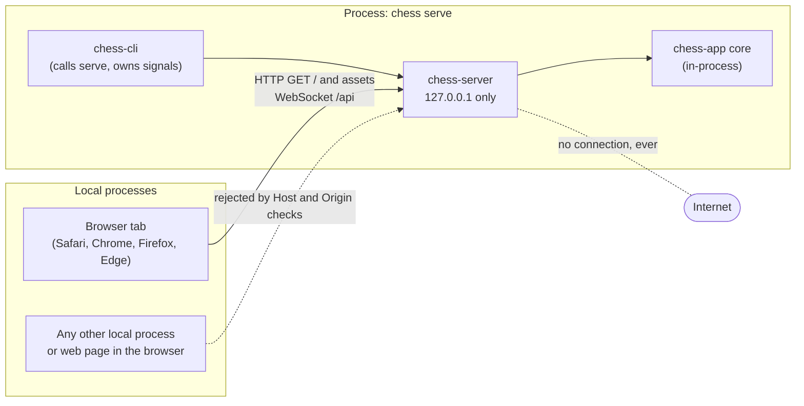
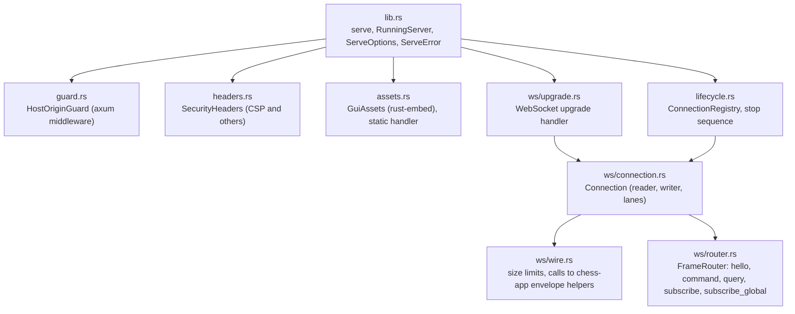
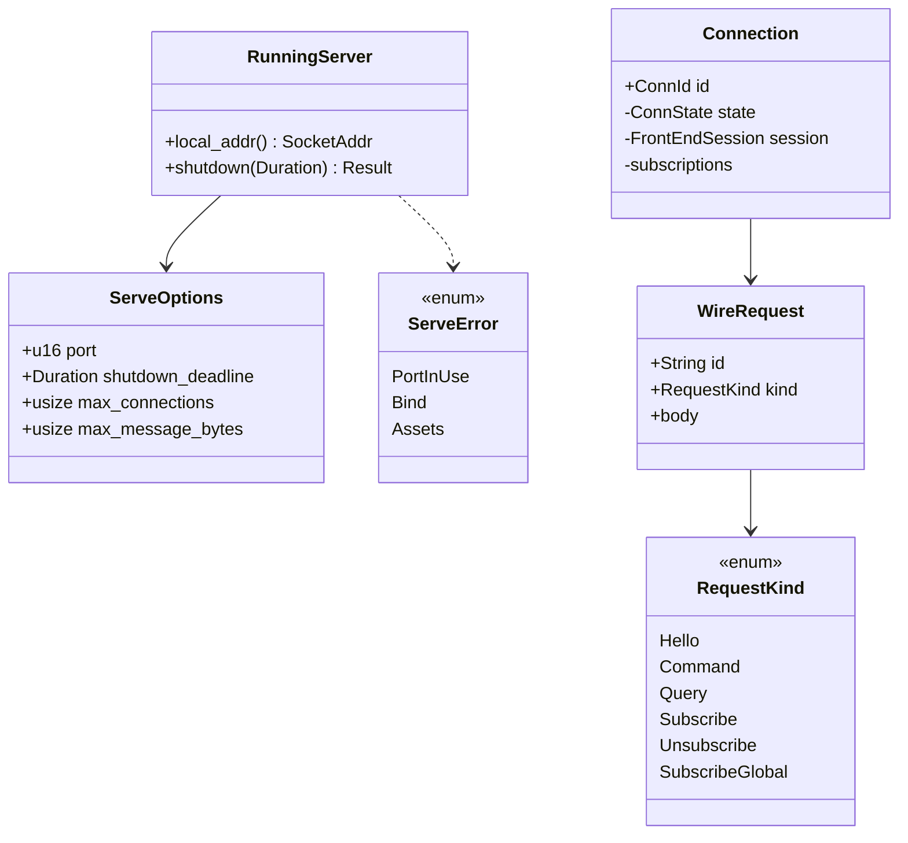
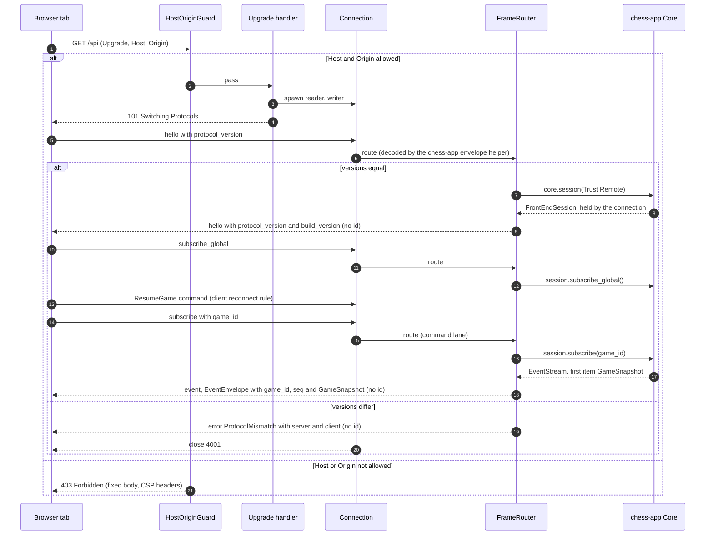
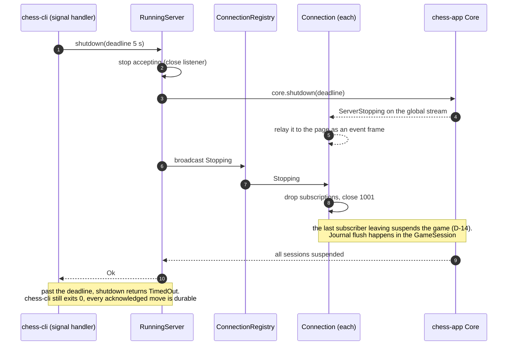
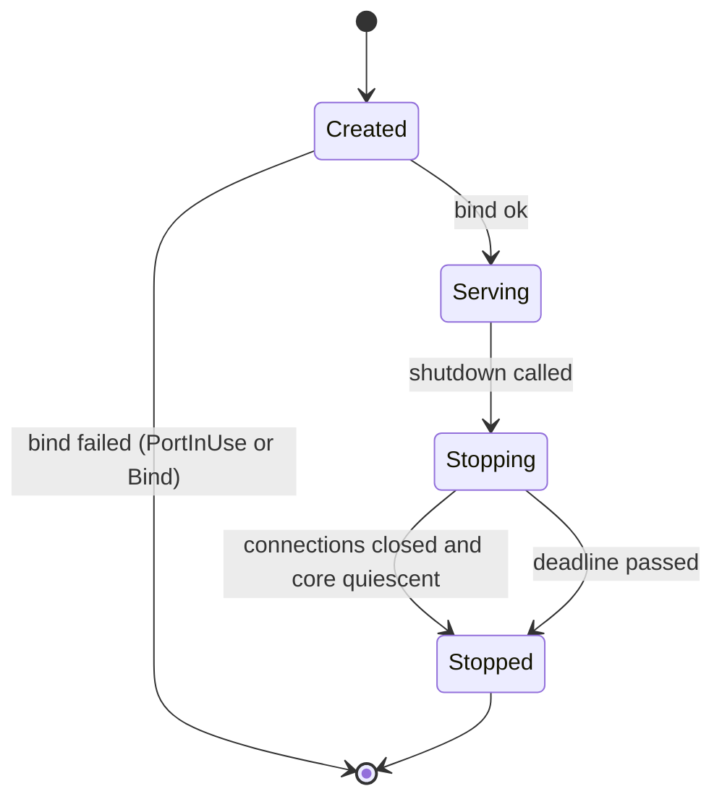
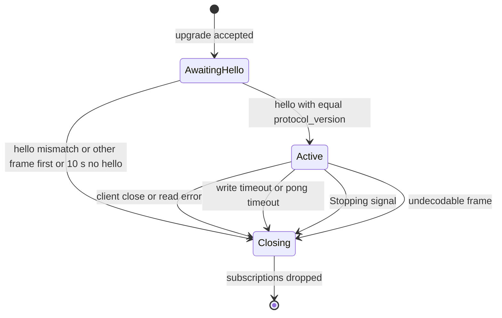

# SDD-chess-server: Software Design Description for `chess-server` (axum HTTP + WebSocket)

| Field | Value |
|---|---|
| Document | docs/design/SDD-chess-server.md |
| Version | **0.3.2 DRAFT** (0.3.1 DRAFT was 2026-11-01; 0.2 DRAFT and 0.1 DRAFT were 2026-10-31 and 2026-10-30) |
| Date | 2026-11-04 |
| Status | **DRAFT** (v0.3.1, 2026-11-01). Not reviewed. Not approved. No code exists yet. v0.2 applied the architect's triage rulings that Brian Prascher approved on 2026-10-31; v0.3 aligns to architecture Addendum A (D-51 to D-58) and D-59; v0.3.1 aligns to addendum B and C (D-60 to D-62, agreed 2026-11-01) (see section 12c) |
| Owner | Software engineer role (Claude), for Brian Prascher |
| Approver | **Pending.** Gate G0 for this document (documents only, no approver, SWE-001 §3). The design it describes, once implemented, is G1 (System-architect agent, desk review) while it stays inside this crate with the §3.2 edges and §5.7 contracts unchanged. Any new item that touches a second crate, an interface, an edge or the protocol would be G2 and need Brian Prascher. The G2 and G3 rulings this version implements were approved by him on 2026-10-31 (triage section 5, requirements CR-9.1); that approval does not approve this document |
| Gate record | G0, status DRAFT. The gate record is filed under `docs/engineering/gates/` by the gate register (SWE-001 ASM-S5); no gate ID is written in this document (XC-30). Not filed here |
| Allocation name (architecture §2.2) | `axum HTTP + WebSocket` |
| Crate / path | `crates/chess-server` (architecture §3.1) |
| Runs in | Process: `chess serve` (architecture §2) |
| Languages | Rust 1.99.1, edition 2024 (SWE-001 §1, architecture §3.4) |
| Sibling SDDs | [chess-cli](SDD-chess-cli.md) (caller of `serve`), [chess-app](SDD-chess-app.md) (the core it fronts), [ui](SDD-ui.md) (the GUI it serves and talks to), [desktop-tauri](SDD-desktop-tauri.md) (the other transport), [chess-store](SDD-chess-store.md), [chess-engine](SDD-chess-engine.md), [chess-domain](SDD-chess-domain.md), [chess-rules](SDD-chess-rules.md) |

Evidence tags follow `swe-governance` §6. `[OBS architecture.md §n]` means read in this session. `[UNV]` means not verified here (no code, no toolchain, no network). Numbers marked `ESTIMATE` have no measurement behind them.

---

## 1. Introduction

### 1.1 Purpose and scope

`chess-server` is the transport block that lets a browser tab use the shared core. It is a thin adapter (architecture §1 principle 4, §5.2). It binds the loopback interface, serves the embedded GUI bundle with a Content-Security-Policy, rejects any request whose `Host` or `Origin` is not its own loopback origin, and carries the protocol over one WebSocket. It holds no chess rules, no store access and no engine access (principle 1). Its only workspace dependency is `chess-app`, the facade for every front-end (decision 1, TR-1, D-38); it builds no production wiring, because `Core::open_default` in `chess-app` does that for `chess-cli`.

In scope: the HTTP and WebSocket surface, Host/Origin enforcement, CSP and other response headers, port binding and port-in-use reporting, the version handshake, framing and routing of protocol messages, per-connection ordering, backpressure, and the stop sequence.

Out of scope, owned elsewhere: configuration loading, port precedence, `--no-open`, browser launching and signal capture (`chess-cli`, see [SDD-chess-cli](SDD-chess-cli.md)); protocol types, error mapping and sessions (`chess-app`); the GUI (`ui`).

### 1.2 Allocated requirements, functions and decisions

| Kind | IDs | Source |
|---|---|---|
| Primary requirements | NFR-7 (Host/Origin), NFR-4 (loopback only, no outbound) | [OBS architecture.md §3.3 `chess-server` row, §10.1 rows NFR-4, NFR-7] |
| Supporting requirements | PLAT-4 (this block owns the bind, serve and stop half; architecture 10.1 names `chess-cli serve -> chess-server` as the primary, and the CLI SDD owns the command half), PLAT-1, PLAT-3 (CSP is half of its enforcement), PLAT-5 (version handshake), DAT-1 (web served locally), GUI-1 (one transport for the shared GUI), NFR-8 (nothing blocks the runtime), NFR-9 (errors reach the user as catalogue codes), NFR-10 (log content). Wording per XC-29 and architecture 10.1 (Amd 7): where two SDDs claim a requirement, the component named in 10.1 is primary and the other claim is supporting | [OBS architecture.md §3.3, §10.1] |
| Functions | **F-7.4.3** Carry protocol over WebSocket; **F-7.4.5** Serve embedded GUI bundle; **F-8.2** Start local web server (the server half: bind loopback, serve, Host/Origin, port-in-use error; the CLI half is flags, configuration, browser open, signals and exit status, in `CLI front-end`; CR-9.7, Q-SE-16); **F-8.3** Reject foreign-origin requests; **F-8.4** Confine traffic to loopback (shared with `WKWebView`); **F-8.12** Stop local web server | [OBS functional_decomp.md lines 196-212, 220] |
| Decisions | D-1 (the web path is the WebSocket, desktop does not use it), D-2, D-8 (`chess serve` started by the user), D-13 (concurrency model), D-14 (suspend when the last front-end detaches), D-16 (one build version), D-22 (no token), D-24 (port precedence), D-36 (serve lifecycle), **Amendment 7:** D-38 (edge rule, facade), D-39 (temp-dir store in tests), D-48 (protocol package: envelope kinds, sessions, global stream), D-49 (file transfer in frames), **Addendum A:** D-51 to D-55 (move errors, `ParsedMove`, event envelope, `MalformedFrame`, export reply), D-56 (profile switch), D-59 (ECO import commands, accepted) | [OBS architecture.md §11, Amendment 7 status block] |
| Risks | R-5 (localhost reachable by other pages and apps), R-10 (reload suspends a game) | [OBS architecture.md §12] |
| Assumptions | ASM-1 (one person per Mac account, CONFIRMED) | [OBS architecture.md §14] |
| Use cases | UC-4 Start Local Web Server | [OBS use_cases/README.md] |

### 1.3 Inputs read

SDD-architect-triage.md section 2 (TR-1, TR-2) and section 5; SDD-SE-desk-answers.md Q-SE-13, Q-SE-14; requirements.md Amendment 7 (CR-9.1, CR-9.5); architecture.md (amended 2026-10-31) §1, §2, §2.2, §3 (3.1-3.4), §4.1, §4.2, §4.8, §5.1-§5.7, §6.1 (`chess serve` lifecycle), §6.2 (connection loss), §7.5, §8, §8.1, §8.2 (port and config), §10.1 (rows for this block), §11 (D-1 to D-37), §12, §14. functional_decomp.md F-7.4.x and F-8.x rows. requirements.md PLAT-3, PLAT-4, PLAT-5, NFR-4, NFR-7, NFR-8, NFR-9, NFR-10. test-strategy.md (Principles, Non-functional checks: "Web server Host/Origin rejection, including a DNS-rebinding host name"). SWE-001 (profile, CERT-informed mapping §6).

### 1.4 Conventions

- Entities: `DD-SRV-n`. Interfaces: `IFP-SRV-n` (provided), `IFR-SRV-n` (required). Planned tests: `CT-SRV-nn`, `UT-SRV-nn`. Findings for upstream owners: `UF-SRV-n` (section 12). Assumptions: `ASM-SRV-n`. Open questions: `OQ-SRV-n`. ID format (XC-30): IDs issued in v0.1 are unchanged; IDs added from v0.2 use three digits (`UF-SRV-013`, `OQ-SRV-001`, `CT-SRV-030`).
- Interface assumptions about the sibling `chess-app` design are marked `IA-SRV-n` (section 5.3). If SDD-chess-app disagrees, this document is changed to follow it, unless the §5.7 contracts are involved. SDD-chess-app was revised to v0.2 in parallel; quotations were checked against v0.2 on 2026-10-31 (UF-SRV-014 is closed by D-53; OQ-SRV-007 lists what the app SDD still has to follow). Later changes to the app SDD govern.
- Coding standard: CERT-informed best practice, warnings as errors, no conformance claim (SWE-001 §1, §6). The CERT area is named where a design choice follows it.

---

## 2. Design overview and viewpoint selection

| IEEE 1016 viewpoint | Used? | Where | Reason if omitted |
|---|---|---|---|
| Context | Yes | 3.1 | |
| Composition | Yes | 3.2, 4 | |
| Logical (types) | Yes | 3.3 | |
| Dependency | Yes | 3.4 | |
| Information | Omitted | | The crate owns no persistent data and has no schema. Per-connection state is in memory and listed under Resource and State dynamics |
| Patterns use | Yes | 3.5 | |
| Interface | Yes | 5 | |
| Structure | Yes | 3.2 (module layering) | |
| Interaction (sequence) | Yes | 3.6 | |
| State dynamics | Yes | 3.7 | |
| Algorithm | Yes | 3.8 (Host/Origin decision, routing order) | |
| Resource | Yes | 7 | |

---

## 3. Viewpoints

### 3.1 Context viewpoint

**Concern:** what the block talks to, and where the trust boundary is.



Trust boundary [OBS architecture.md §2, §5.2]: the only boundary inside the Mac is loopback. Any local process can reach the port, and ASM-1 (one person per Mac account) means that is accepted (D-22, no token). The browser is treated as untrusted input to the core. The Host/Origin check stops browser-borne attacks only: web pages from other origins and DNS-rebinding names (R-5). It does not stop a local process that forges both headers, and this document does not claim it does.

### 3.2 Composition and structure viewpoint

**Concern:** parts and their purposes.



| Entity | Type | Purpose | Traces |
|---|---|---|---|
| DD-SRV-1 `serve` / `RunningServer` | API (function + handle) | Bind the loopback listener, build the router, start accepting, expose `local_addr()` and `shutdown()` | F-8.2, PLAT-4, NFR-4 |
| DD-SRV-2 `HostOriginGuard` | middleware | Decide accept or reject before any other handler runs | F-8.3, NFR-7 |
| DD-SRV-3 `SecurityHeaders` | middleware | Add CSP and companion headers to every response, including rejections | F-7.4.5, PLAT-3 |
| DD-SRV-4 `GuiAssets` + static handler | module | Serve the embedded bundle by exact key lookup | F-7.4.5, PLAT-3 |
| DD-SRV-5 WebSocket upgrade handler | handler | Upgrade `/api`, enforce the connection cap, set size limits | F-7.4.3, NFR-7 |
| DD-SRV-6 `Connection` | task group | Per-socket reader, writer, command lane, query tasks, forwarders, ping; holds one `FrontEndSession` | F-7.4.3, NFR-8 |
| DD-SRV-7 Wire handling | module | Calls the `chess-app` envelope helpers; size limits; decode-failure mapping. Defines no frame types | F-7.4.3, section 5 |
| DD-SRV-8 `FrameRouter` | module | Map a decoded request to `session.execute`, `query`, `subscribe`, `subscribe_global`, or the handshake | F-7.4.3, PLAT-5 |
| DD-SRV-9 `ConnectionRegistry` and stop sequence | module | Track live connections, call `core.shutdown(deadline)`, close them on stop | F-8.12, D-14 |

### 3.3 Logical viewpoint (key types)

**Concern:** the types a reader needs to follow the rest. Key types only.



`WireRequest` and `RequestKind` are `chess-app` types (IFP-APP-03), shown so the reader can follow the router. This crate does not define them.

### 3.4 Dependency viewpoint

**Concern:** what this crate may depend on, and what it uses at run time.

Allowed workspace edges [OBS architecture.md 3.2, Amd 7]: `chess-server -> chess-app` only, and `chess-app` is the only facade (decision 1, TR-1). `chess-cli -> chess-server`. Nothing depends on `chess-server` except `chess-cli`. `chess-server -.-> ui` is a build-time embed of the built assets, not a code dependency. This crate has no edge to `chess-rules`, `chess-domain`, `chess-store` or `chess-engine`, and builds no production seams (`Core::open_default` is in `chess-app`).

| Dependency | Kind | Use | Version source |
|---|---|---|---|
| `chess-app` | workspace crate | `Core`, `FrontEndSession`, envelope helpers, `ProtocolError`, `Core::build_info()` | architecture 3.2 |
| `axum` 0.8.9 (feature `ws`) | third party | HTTP, routing, WebSocket | [OBS architecture.md 3.4] |
| `rust-embed` 8.13.0 | third party | embed `ui/dist` | [OBS 3.4] |
| `tokio` 1.54.1 | third party | runtime (shared, one per process, D-13); features listed per crate in the build files | [OBS 3.4], TR-10 |
| `thiserror` 2.0.21, `tracing` 0.1.44 | third party | errors, logging | [OBS 3.4] |
| `futures-util` | third party | `StreamExt`/`SinkExt` on the socket | admitted in principle (review row D-17, architecture 3.4 Amd 7); **no version stated, lookup pending `[UNV]`** |

`serde` and `serde_json` are not direct dependencies of this crate while the envelope helpers take and return text (IA-SRV-5, UF-SRV-9). No `tower-http`: headers are added by our own middleware, which keeps the CORS layer out of the tree altogether (R-5: "no CORS"). New direct dependencies are decisions (TR-10, D-47): `futures-util` waits for the version lookup, licence check and CVE scan before it enters architecture 3.4, and it goes into the SBOM.

### 3.5 Patterns-use viewpoint

| Pattern | Where | Why | Misuse tell |
|---|---|---|---|
| Middleware chain | DD-SRV-2, DD-SRV-3 | Guard runs first for every route, so a new route cannot forget the check | A handler that reads `Host` itself |
| Adapter | whole crate | Maps wire frames to the §5.7 `Protocol` contract with no logic of its own | Rule or policy code appearing here |
| Actor-style lanes | DD-SRV-6 | One FIFO lane per connection keeps command order | A second lane that can overtake the first for commands |
| Registry plus broadcast signal | DD-SRV-9 | One place that can tell every connection to stop | Connections that capture their own copy of "stopping" |
| Embedded static assets | DD-SRV-4 | One binary, offline (PLAT-3) | Reading files from disk at run time |

### 3.6 Interaction viewpoint (sequences)

**Concern:** how a connection starts, how a foreign origin is refused, and how the server stops.



Sequence for the stop path (F-8.12, PLAT-4, architecture 6.1 and 4.8 [OBS]):



### 3.7 State dynamics viewpoint

**Concern:** lifecycle of the server and of one connection.





Transition rules: in `AwaitingHello` any frame other than `hello` gets `MalformedFrame{reason: before_hello}`, then the socket closes (4001). The 10 s hello window is `ESTIMATE`. In `Active`, a frame that does not decode (bad JSON, unknown `kind`, unknown field, unknown command variant, binary frame) gets `MalformedFrame{reason}`, then the socket closes (4001). The reasons are the closed set of architecture 5.5 (D-54): `bad_json`, `unknown_kind`, `unknown_field`, `before_hello`. Which of these an unknown command variant inside a well-formed `command` frame maps to, and that a binary frame is `bad_json`, are `[INF]` and belong to the `chess-app` envelope helper, which makes the mapping once (OQ-SRV-006). `MalformedFrame` is a dedicated catalogue code (architecture 5.5, D-54). It replaced the interim use of `ProtocolMismatch` with `details.reason`; `ProtocolMismatch` now means only a version mismatch. The error frame is sent first and the transport closes after it; the WebSocket close code (4001 here) is the server's choice and is not fixed upstream (D-54, ASM-SRV-1).

### 3.8 Algorithm viewpoint

**Concern:** the two decisions that carry the security claim.

**A1. Host/Origin decision (NFR-7, F-8.3).** Input: request method, `Host` header values, `Origin` header values, `bound_port` (the port the listener actually bound, never the configured one). Output: allow or reject.

```
allowed_hosts   = { "127.0.0.1:" + bound_port, "localhost:" + bound_port }
allowed_origins = { "http://127.0.0.1:" + bound_port, "http://localhost:" + bound_port }

1. Host headers: exactly one value required, else reject.
2. Lowercase the Host value (ASCII). If not in allowed_hosts, reject.
   (Rejects: a missing Host, "localhost.:port", "evil.example:port", a rebinding name,
    "127.0.0.1" without port, userinfo, "[::1]:port".)
3. Origin headers:
   - more than one value: reject.
   - one value: lowercase (ASCII). If not in allowed_origins, reject. ("null" is rejected.)
   - none: if the request is a WebSocket upgrade, reject.
           otherwise allow only for GET or HEAD.
4. Method other than GET, HEAD for non-upgrade requests: 405 (after steps 1 to 3).
5. Allow.
```

This is the confirmed reading of NFR-7 (Q-SE-13): `Host` must match on every request, `Origin`, when present, must match, and both loopback spellings (`127.0.0.1:<port>` and `localhost:<port>`) are the server's own origin. A local non-browser client can forge both headers; that is outside the threat model (ASM-1, CR-7.7). A test client that is not a browser must set `Origin`. Rationale: browsers always send `Origin` on a WebSocket handshake, so a WebSocket without one is not a browser page and is refused; same-origin navigations and subresource loads by GET do not carry `Origin`, so absence is allowed there. Comparison is exact string equality on a closed set, with no URL parsing, so there is no parser differential to exploit (CERT IDS-style input validation intent, SWE-001 §6). The set is built from the bound port at start-up and never from request data.

**A2. Per-connection ordering (NFR-8, §4.2).** Commands for one connection run one at a time, in arrival order, on the **command lane**. This keeps `MakeMove` then `Resign` in the order the user sent them, which the optimistic `ply` guard assumes. Queries run concurrently in their own tasks, at most 16 in flight (`ESTIMATE`); when 16 are in flight the reader stops reading, which pushes back on the client through TCP. `subscribe` and `subscribe_global` ride the command lane so that "resume, then subscribe" cannot reorder. The reader never awaits a core future inline: it hands work to the lane, so a slow `ImportPgn` cannot stop the socket from answering pings. Two frame kinds are handled **out of lane**: `unsubscribe` and the socket close. They only remove a subscription, so they cannot depend on a pending command, and they must not wait behind a long one.

---

## 4. Design entities

### DD-SRV-1 `serve` and `RunningServer`
- Type: public API of the crate | Traces: F-8.2, PLAT-4, NFR-4, D-8, D-24, D-36
- Signature (design, not yet code): `pub async fn serve(core: Arc<Core>, opts: ServeOptions) -> Result<RunningServer, ServeError>`. This widens the architecture's `serve(core, port)` [OBS §3.3] by an options struct. It stays one function on the existing `chess-cli -> chess-server` edge (UF-SRV-6).
- `ServeOptions`: `port: u16` (0 allowed for tests only; `chess-cli` rejects 0 because PLAT-4 range is 1 to 65535), `shutdown_deadline: Duration` (default 5 s, [OBS §4.8]), `max_connections: usize` (default 8, `ESTIMATE`), `max_message_bytes: usize` (default 32 MiB, `ESTIMATE`, the cap for file contents inside frames, decision 9; see section 7).
- Processing: bind `127.0.0.1:port` with `tokio::net::TcpListener`; the address is the literal `Ipv4Addr::LOCALHOST`, never a hostname lookup and never `0.0.0.0` or `::`. Record `local_addr`. Build the router (guard, headers, static handler, `/api`). Spawn the accept loop. Return the handle.
- Failure behaviour: `AddrInUse` becomes `ServeError::PortInUse{port}`, which names only the port that was asked for. There is no hint about another `chess serve` and no URL of one: no requirement asks for a port hint and the store has no port column (Q-SE-14, XC-27). Any other bind error becomes `ServeError::Bind{port, kind}` (kind is `io::ErrorKind`, no path or OS text beyond it in the user message). Nothing is left running on failure.
- Concurrency: runs on the process's shared tokio runtime (D-13). No thread is created.
- Rationale: a literal loopback address removes DNS and `localhost` resolution (which can return `::1`) from the bind. The printed URL uses `127.0.0.1` for the same reason. The Host allow-list still accepts `localhost:<port>` because a user may type it, and it resolves to the same listener over IPv4 in practice `[UNV]`; a browser that tries `::1` first falls back or fails, and neither is a security problem.
- Verification: CT-SRV-01, CT-SRV-02, CT-SRV-03.

### DD-SRV-2 `HostOriginGuard`
- Type: axum middleware (`from_fn_with_state`), outermost layer | Traces: F-8.3, NFR-7, R-5, D-22
- Function: algorithm A1. The state holds the two string sets built from `local_addr` after bind.
- Failure behaviour: reject with `403 Forbidden`, a fixed short plain-text body, no echo of the offending value. The rejection still passes through `SecurityHeaders`. Log one `tracing` event `request_rejected` with a category field (`host`, `origin`, `no_origin_ws`, `method`) and the offending value escaped and truncated to 128 characters (CERT-informed: no log injection; NFR-10 allows no names, and a header value is not a Player name).
- Concurrency: stateless after construction.
- Rationale: one middleware at the outermost position guarantees every route, including the WebSocket upgrade and the 404 fallback, is checked. Alternatives rejected: a check inside the `/api` handler only (a future route could forget it); a CORS layer (it sends headers rather than refusing, and R-5 says no CORS); `tower-http` validation (extra dependency for a six-line comparison).
- Verification: CT-SRV-04 to CT-SRV-09.

### DD-SRV-3 `SecurityHeaders`
- Type: axum middleware, wraps the guard so it also decorates 403 and 405 | Traces: F-7.4.5, PLAT-3, F-8.4
- Headers on every response:

| Header | Value | Why |
|---|---|---|
| `Content-Security-Policy` | `default-src 'self'; script-src 'self'; style-src 'self'; img-src 'self'; font-src 'self'; connect-src 'self' ws://127.0.0.1:{port} ws://localhost:{port}; object-src 'none'; base-uri 'none'; form-action 'none'; frame-ancestors 'none'` | PLAT-3 requires `default-src 'self'`, and architecture §8.1 gives `default-src 'self'; connect-src 'self' ws://127.0.0.1:*`. This text is the same policy made narrower: exact port instead of `*`, `localhost` added to match the Host allow-list, and the listed directives pinned instead of inheriting. `default-src 'self'` is the floor (Q-SE-13, UF-SRV-2): the test asserts the floor and "no remote scheme or host", not the exact string |
| `X-Content-Type-Options` | `nosniff` | asset type is the declared type |
| `Referrer-Policy` | `no-referrer` | nothing leaves the page |
| `Cross-Origin-Resource-Policy` | `same-origin` | other origins cannot embed our assets |
| `Cross-Origin-Opener-Policy` | `same-origin` | isolates the browsing context |
| `X-Frame-Options` | `DENY` | older agents; the CSP `frame-ancestors` is primary |
| `Cache-Control` | `no-cache` for `index.html`; `public, max-age=31536000, immutable` for hashed assets; `no-store` for errors | a rebuilt bundle is picked up at once, and stale tabs are caught by the handshake (D-16) |

- No `Access-Control-*` header is ever added (R-5).
- `style-src 'self'` has no `'unsafe-inline'`. React and chessground set styles through the CSSOM (`element.style`), which CSP allows, but markup `style="..."` attributes and `<style>` elements would be blocked. This is a constraint on the `ui` build and is stated in [SDD-ui](SDD-ui.md); it is `[UNV]` until the GUI E2E runs in Safari, Chrome, Firefox, Edge and WKWebView (CT-SRV-10).
- `img-src 'self'` has no `data:`. The `ui` build sets Vite's inline-asset limit to 0 so small assets are not turned into `data:` URIs `[UNV: option name `build.assetsInlineLimit`]`.
- Verification: CT-SRV-10, CT-SRV-11, bundle scan (PLAT-3, CI).

### DD-SRV-4 `GuiAssets` and static handler
- Type: module | Traces: F-7.4.5, PLAT-3, PLAT-4
- Function: `#[derive(RustEmbed)]` over `ui/dist`, embedded in release **and** debug builds so the server never reads files at run time (feature `debug-embed` `[UNV: feature name]`). Routes: `GET /` returns `index.html`; `GET /assets/<hashed>` returns the file by **exact key lookup in the embedded set**. Anything else is `404`. There is no single-page-app fallback: the GUI keeps its screens in memory (see [SDD-ui](SDD-ui.md)), so an unknown path must not return HTML (it would also hide a bundle-scan failure).
- Path safety: the request path is percent-decoded once, then rejected if it contains `..`, `\`, NUL, a second `/` run, or a leading character other than `/`. Because lookup is by key in a compiled-in table and never joins a filesystem path, traversal has nothing to traverse (CERT FIO-intent).
- Content type: from the embedded metadata (`mime-guess` via `rust-embed`) `[UNV]`.
- Build precondition: `build.rs` fails a release build when `ui/dist/index.html` is absent. A debug or test build creates a one-file placeholder so `cargo test -p chess-server` works without the Node toolchain. The placeholder text says "GUI bundle not built" and the release check prevents shipping it. Build order is `ui` first, then `cargo build` (architecture §3.2 dashed edge, §8.1). Details of `rust-embed` behaviour are `[UNV]` and are checked at step 2.
- Failure behaviour: a missing key is `404`. A `ServeError::Assets` at start-up if the embedded set has no `index.html`.
- Verification: CT-SRV-12, CT-SRV-13.

### DD-SRV-5 WebSocket upgrade handler (`GET /api`)
- Type: axum handler | Traces: F-7.4.3, NFR-7
- Processing: after the guard, take a permit from a `Semaphore(max_connections)`; if none, `503 Service Unavailable`. Configure `max_message_size = max_message_bytes` (32 MiB, decision 9) and `max_frame_size = max_message_bytes` `[UNV: axum/tungstenite option names, OQ-SRV-001]`. The frame limit equals the message limit because a browser normally sends one text message as one frame; a smaller frame limit would refuse an archive of about 24 MiB that grew to about 32 MiB as base64. Accept the upgrade and spawn DD-SRV-6. The permit is held for the life of the connection.
- No subprotocol is negotiated. The cap bounds memory, not user count: one person uses the Mac (ASM-1), a handful of tabs is the realistic maximum, and 8 is `ESTIMATE` (now also in the architecture 4.8 table, AMD-13).
- Verification: CT-SRV-14, CT-SRV-30 (message at the cap accepted, one byte over refused).

### DD-SRV-6 `Connection`
- Type: per-socket task group | Traces: F-7.4.3, NFR-8, D-14, architecture 5.6
- Tasks: one **reader** (decode frames with the `chess-app` helper, handle out-of-lane frames, push to the lane), one **writer** (owns the sink; consumes a bounded mpsc of outbound frames), one **command lane** (processes commands in order), query tasks (spawned, at most 16), per-subscription **forwarders** (read the core's event stream and enqueue frames), one optional **global forwarder** (started by `subscribe_global`), one **ping timer** inside the writer.
- Session: after a successful `hello` the connection creates one `FrontEndSession` with `Trust::Remote` and keeps it until the connection ends. A `Remote` session may send file contents as bytes only and never a path (decision 9, architecture 5.2).
- Outbound path and backpressure: forwarders enqueue to the writer through a bounded `mpsc` (capacity 64, `ESTIMATE`) using `send().await`. A slow socket therefore blocks the forwarder, the forwarder stops reading the core's per-game broadcast receiver, the receiver lags, and `chess-app` answers `RecvError::Lagged` with a fresh `GameSnapshot` instead of the missed events (architecture 4.8 Backpressure [OBS]). The server never buffers without bound and never stalls a game. If one write takes longer than 10 s (the client command timeout, architecture 4.8 [OBS]) the connection is closed (`Closing`).
- Keep-alive: a Ping every 20 s, a Pong expected within 10 s, both `ESTIMATE`. A closed tab normally closes the socket at once, which is what makes D-14 "immediately" true; pings only catch a peer that vanished without closing.
- Subscriptions: a map `game_id -> forwarder handle` owned by the connection. Dropping the connection drops every forwarder and thereby every core subscription, which is how "the last front-end detached" is detected in the core (F-7.4.2). The server contains no suspend logic.
- Failure behaviour: any I/O error ends the connection and nothing else. A panic in one connection task is caught by the task boundary (`JoinHandle`), logged with a correlation id, and ends that connection; it must not take down the process. (Rust panics in async tasks do not unwind across tasks.) A panic inside a core call is turned into `Internal{id}` by the core (IFP-APP-01), not here.
- Concurrency: see algorithm A2 and section 7.
- Verification: CT-SRV-15 to CT-SRV-21.

### DD-SRV-7 Wire handling
- Type: module | Traces: F-7.4.3, architecture 5.2 envelope, architecture 5.6
- The envelope and its kinds are defined by `chess-app` (IFP-APP-03; `hello`, `command`, `query`, `subscribe`, `unsubscribe`, `subscribe_global` in; `result`, `error` and `event` out). Frame shape is `{id?, kind, body}`. `id` is a client-chosen request id: it is present on `command`, `query`, `subscribe`, `unsubscribe` and `subscribe_global` frames and is echoed on the `result` or `error` that answers them. `hello` and `event` frames carry **no `id`**. An `error` for a frame that could not be decoded has no `id` unless one could be read from it (architecture 5.6, D-53). This crate keeps **no frame types of its own** (it replaces the earlier `Frame`, `FrameKind` and `wire.rs` types). It calls `chess_app::protocol::envelope` to decode a text message into a request and to encode replies and events, and `check_version` for `hello`.
- Decode failure (bad JSON, unknown kind, unknown field, binary frame, frame before `hello`): send the `error` frame `MalformedFrame{reason}` with `reason` in {`bad_json`, `unknown_kind`, `unknown_field`, `before_hello`} (architecture 5.5, D-54; UF-SRV-3), then close 4001. The close code is the server's choice (D-54, ASM-SRV-1). An unknown variant is what version skew looks like.
- Size: the transport limit (DD-SRV-5) is the first line; there is no per-field limit here.
- Verification: UT-SRV-02 (close-code mapping, `MalformedFrame` reasons), CT-SRV-15 to 17, random-input property test FZ-SRV-1 (`proptest`; architecture 9 "protocol fuzzing at the WebSocket" [OBS] is read as random and malformed frames into the decoder, D-76). Decoding itself is tested in `chess-app`.

### DD-SRV-8 `FrameRouter`
- Type: module | Traces: F-7.4.3, PLAT-5
- Routing table: see 5.1. `hello`: `check_version(client, Core::build_info().protocol_version)`; answer with the server's own `hello` frame `{protocol_version, build_version}` (the handshake sends `protocol_version` both ways, architecture 5.6; `hello` has no `id`, D-53) or with the `error` frame `ProtocolMismatch{server, client}` (architecture 5.5, 5.6, D-16 [OBS]). That the server's answer is a `hello` frame and not a `result` is `[INF]` from D-53 and is confirmed by the app owner (OQ-SRV-006). `command`: `session.execute(cmd).await`. `query`: `session.query(q).await` (this includes `ParseMove`, which is read-only and routed like any query; FF-6 measures its loopback round trip). `subscribe`: `session.subscribe(game_id)`, start a forwarder, answer with a `result` frame carrying the request `id`. `unsubscribe`: drop the forwarder. `subscribe_global`: `session.subscribe_global()` and start the global forwarder once.
- Results: success becomes a `result` frame carrying the `Reply`. A `ProtocolError` already carries `{code, message, details}` from `chess-app`'s mapping and becomes an `error` frame. The server adds no error text of its own except `ProtocolMismatch` and `MalformedFrame`. No internal path or SQL text can reach `message` because `chess-app` does the mapping (architecture 5.5 [OBS]); the server does not format `io::Error` or `Debug` output into a frame.
- Files: `FileRef::Bytes` travels inside `body` as the core's type defines it (base64 text). The router neither decodes nor stores it.
- Verification: CT-SRV-22 to CT-SRV-27.

### DD-SRV-9 `ConnectionRegistry` and the stop sequence
- Type: module | Traces: F-8.12, PLAT-4, D-14, D-36, architecture 4.8 "Web server stop"
- State: a `watch::Sender<bool>` named `stopping`, and a set of connection join handles.
- `RunningServer::shutdown(deadline)`:
  1. stop the accept loop and drop the listener (new connections are refused by the OS);
  2. call `core.shutdown(deadline).await` (IFP-APP-05): the core stops taking commands, emits `ServerStopping` on the global stream, and suspends every live session with its journal flush;
  3. set `stopping`; each connection relays the `ServerStopping` event it received on its global stream (the server no longer writes that event itself), then closes with 1001 (going away) and drops its subscriptions. A connection that never sent `subscribe_global` just closes with 1001, which the page reads as "server stopped" (SDD-ui DD-UI-1);
  4. return `Ok(())`, or `Err(ShutdownTimedOut)` if `deadline` (5 s, architecture 4.8 [OBS]) passes first.
- Failure behaviour: on timeout the caller still exits 0, because "every acknowledged move is already durable, so nothing is lost" [OBS architecture 4.8]. The timeout is logged and printed as a warning on standard error.
- Rationale: the server does not enumerate games to suspend. Dropping subscriptions reuses the one D-14 rule in the core, so the stop path and a closed tab cannot diverge, and `Core::shutdown(deadline)` tells the caller when the flushes are done.
- Verification: CT-SRV-28, CT-SRV-29.

---

## 5. Interface viewpoint

### 5.1 IFP-SRV-1 / IFP-SRV-2: network interfaces (provided)

The wire envelope is defined by architecture 5.1 and 5.6 (D-48, D-53, D-54) and by [SDD-chess-app](SDD-chess-app.md) IFP-APP-03, and is encoded and decoded by the helpers in `chess-app::protocol::envelope`. This section quotes it so a reader can follow the server; if they differ, architecture 5.6 governs, then the app SDD (XC-19). Every frame is `{id?, kind, body}`: `id` is on requests and their replies only (D-53).

**IFP-SRV-1 Static GUI over HTTP** (F-7.4.5)

| Item | Value |
|---|---|
| Bind | `127.0.0.1:<port>` only, TCP, HTTP/1.1 |
| Routes | `GET /`, `GET /assets/*`; `HEAD` on the same |
| Responses | `200` with body; `403` Host/Origin; `404`; `405` other methods; `503` connection cap (WebSocket only) |
| Errors | fixed plain-text bodies, no detail |
| Auth | none (D-22, ASM-1) |

**IFP-SRV-2 Protocol over WebSocket** (F-7.4.3). URL `ws://127.0.0.1:<port>/api` [OBS architecture.md 5.2]. Text frames, one JSON object per frame, UTF-8. Binary frames are rejected as undecodable.

Client to server (request frame `{id, kind, body}`, `id` at most 64 characters, client-chosen):

| `kind` | `body` | Reply |
|---|---|---|
| `hello` (no `id`) | `{protocol_version}` | the server's own `hello` frame with `{protocol_version, build_version}` (no `id`, `[INF]`, OQ-SRV-006), or an `error` frame with `ProtocolMismatch{server, client}` and then close 4001. Must be first |
| `command` | a `chess-app` `Command`, including `ImportPgn{file, on_duplicate, eco?}`, `ResolveImport{import_id, eco}` and `CancelImport{import_id}` (D-59) | a `result` frame (the command's `Reply`) or an `error` frame. An `ImportPgn` with an unanswered ECO mismatch is answered with the `ImportConflicts{import_id, list}` error frame (kind `eco_mismatch` entries); `PreviewDataImport` answers `ImportConflicts{list}` with no `import_id` (archives are stateless, FIND-JR3-004), and the answers travel in `ApplyDataImport{plan, confirmed, eco}`. `ResolveImport` and `CancelImport` exist for PGN imports only. The server forwards everything unchanged and keeps no import state |
| `query` | a `chess-app` `Query`, including `ParseMove{game_id, ply, text}` and the exports (`ExportPgn`, `ExportData`) | a `result` frame (`ParsedMove{uci, san}`, or `ExportedFile{name, media_type, content: Bytes{base64}}`, D-52, D-55) or an `error` frame (`IllegalMove`, `ParseError{kind: move, reason, ...}`, `StalePosition`, D-51) |
| `subscribe` | `{game_id}` | a `result` frame, then `event` frames, the first one `GameSnapshot` |
| `unsubscribe` | `{game_id}` | a `result` frame |
| `subscribe_global` | `{}` | a `result` frame, then global `event` frames (`ServerStopping`, `StoreBacklog`, `AnalysisProgress` of stored games, `RatingsUpdated`). A second request on the same connection is answered with a `result` frame and changes nothing |

Server to client:

| Shape | When |
|---|---|
| `{id, kind: "result", body}` | success, `id` echoes the request, `body` is the `Reply` |
| `{id, kind: "error", body: {code, message, details}}` | failure, `code` from the architecture 5.5 catalogue |
| `{kind: "event", body: EventEnvelope{game_id, seq, event}}` (no `id`) | a game event: `game_id` set, `seq` strictly increasing and gap-free per game subscription, the first item is the `GameSnapshot` (D-53) |
| `{kind: "event", body: EventEnvelope{game_id: null, seq, event}}` (no `id`) | a global event (`ServerStopping`, `StoreBacklog`, `AnalysisProgress` of stored games, `RatingsUpdated`): `seq` is a per-subscription counter, strictly increasing, and **may show a gap** after the receiver lagged; the client re-queries and no snapshot repairs it. An event about one stored game names the game inside `event` (D-53) |

Unknown **event** kinds are ignored by clients (architecture 5.6). A frame that does not decode (bad JSON, unknown kind, unknown field, a frame before `hello`) is answered with the `error` frame `MalformedFrame{reason}` (reason `bad_json`, `unknown_kind`, `unknown_field` or `before_hello`; a dedicated catalogue code, D-54) and then the socket closes with 4001. The error frame has no `id` unless one could be read from the bad frame.

WebSocket close codes: 1000 normal (client initiated), 1001 server stopping, 1009 message too big (library), 4001 protocol (mismatch, handshake missing, malformed frame), 4002 write or pong timeout. 4001 and 4002 are application codes in the 4000 range and are `ASM-SRV-1`: architecture D-54 leaves the close code to the server and does not fix it.

Reconnect (architecture 5.6, UR-30). After a drop the client reconnects with 0.5, 1, 2, 4 s backoff capped at 4 s, sends `hello`, then `subscribe_global`, then `ResumeGame{game_id}` and `subscribe{game_id}` for each game it held, and treats the new `GameSnapshot` as authoritative. A session with no subscriber suspends after the 5 s attach window (ASM-APP-03), so `ResumeGame` comes before `subscribe`. The server keeps no per-client memory between connections; the active Player is state of the connection's `FrontEndSession` and is lost with it, so the client selects its profile again (`SelectProfile`) **before** it resumes. The order is forced by D-56: once `ResumeGame` or `subscribe` gives the session an open game, `SelectProfile` is refused with `Denied{reason: state_not_allowed, details.game_ids}`. Whether a fresh session needs `SelectProfile` before `ResumeGame` at all is not stated upstream and stays with the app owner (UF-UI-012 in [SDD-ui](SDD-ui.md)). A pending import (D-59) lives in the `FrontEndSession`, so a dropped connection drops it; a later `ResolveImport` gets `NotFound{entity: import}` and the client starts again from `ImportPgn`. Idempotency is the client's job (SDD-ui).

### 5.2 IFP-SRV-3: Rust API (provided to `chess-cli`)

`serve`, `ServeOptions`, `RunningServer::{local_addr, shutdown}`, `ServeError::{PortInUse, Bind, Assets}`, `ShutdownTimedOut`. `ServeError` implements `std::error::Error`; `chess-cli` maps `PortInUse` and `Bind` to exit code 1 (D-36, [OBS architecture.md 6.1]). `chess-cli` obtains the `Core` with `Core::open_default` and passes it in.

### 5.3 IFR-SRV-1: protocol contract from `chess-app` (required)

The required side is the `chess-app` facade only (decision 1, TR-1). Names are quoted from SDD-chess-app v0.2 IFP-APP-01 to 06 (read 2026-10-31) and architecture 3.2, 5.1, 5.6 and 5.8.

| ID | Required item | Status |
|---|---|---|
| IA-SRV-1 | `Core::session(Trust::Remote) -> FrontEndSession` (IFP-APP-01 v0.2); `FrontEndSession::{execute, query, subscribe, subscribe_global}`; errors are `ProtocolError{code, message, details}` and no path, SQL or panic text reaches `message`. One session per connection | Matches IFP-APP-01. Replaces the earlier `core.execute` form |
| IA-SRV-2 | `subscribe(game_id)` returns an `EventStream`; dropping it detaches; the first item is `GameSnapshot`; a lagging subscriber receives a fresh `GameSnapshot` (architecture 4.8) | Matches IFP-APP-02 |
| IA-SRV-3 | `Core::shutdown(deadline)` suspends every live session with its journal flush and emits `ServerStopping` on the global stream | **RESOLVED**: IFP-APP-05. The polling fallback is dropped |
| IA-SRV-4 | `Core::build_info()` returns `{build_version, protocol_version}`; `envelope::check_version(client, server)` returns `ProtocolMismatch{server, client}` | **RESOLVED**: TR-1 item 5, IFP-APP-03 |
| IA-SRV-5 | The envelope encode and decode helpers (IFP-APP-06 lists them) take and return text or bytes, so this crate needs no `serde` | Assumption `[INF]` |

Reconnect and `seq`: on a new connection the client receives a new `GameSnapshot` as the first item of each game subscription and a new per-subscription counter on the global stream; nothing is carried over.

A core in recovery mode (store missing or corrupt) is served like any `Core`: the page shows the recovery flow and the core refuses every command except the recovery commands. A page that arrives while the core refused to open does not exist, because `chess serve` exits 3 first.

Failure behaviour of the required side: every `ProtocolError` is forwarded; the server never retries a command (never replay blindly, architecture 5.6).

### 5.4 Interface to the GUI bundle (build time)

`ui/dist` is read at compile time by `rust-embed`. The contract with [SDD-ui](SDD-ui.md): all assets are same-origin files under `/assets/` with content-hashed names; no inline script, no inline style element, no `style=""` attribute, no `data:` image, no remote URL; entry point `index.html`.

---

## 6. Error handling (mapping to §5.5)

| Situation | Code returned | Notes |
|---|---|---|
| Foreign Host or Origin | HTTP 403, no protocol code | Happens before any protocol frame exists |
| `hello` version mismatch | `ProtocolMismatch{server, client}` | Raised by "WebSocket adapter" in §5.5 [OBS]; client says "hard reload" |
| Frame before `hello`; undecodable frame | `MalformedFrame{reason}` (reasons `bad_json`, `unknown_kind`, `unknown_field`, `before_hello`), then close 4001 | Catalogue code of architecture 5.5 (D-54; UF-SRV-3). Client: "protocol error" and a reload |
| `ResolveImport` with an unknown, expired or foreign `import_id` (including after a reconnect) | `NotFound{entity: import, id}` from the core | Forwarded unchanged (D-59); the page starts again from `ImportPgn` |
| File over its limit | `ValidationFailed{field: file, reason: too_large}` from the core | The message names the limit, the file size and, for an archive, the CLI alternative (decision 9). The store is unchanged |
| Message over the 32 MiB cap | socket closes 1009 | The core never sees it; the GUI checks the size first (OQ-SRV-002) |
| Core in recovery mode | recovery commands only; others `Denied` or the core's own code | Forwarded unchanged |
| Any core error | forwarded unchanged | `ConfirmationRequired`, `StalePosition`, `Denied`, `GameLeased`, `Store*`, `EngineUnavailable`, `Busy`, `Internal{id}`, ... produced by chess-app |
| Connection cap | HTTP 503 | Not a protocol error; the page shows the connection-loss banner |
| Bind failure at start | `ServeError`, mapped by chess-cli to exit 1 | `PortInUse{port}` names the port (PLAT-4) |
| Server stopping | event `ServerStopping`, close 1001 | The page shows "server stopped" and does not retry (D-36) |
| Panic in a connection task | connection closes; log `Internal` correlation id | The client sees a drop and reconnects |

Nothing here formats an OS error string, a path or SQL into a response. Detail goes to the log with identifiers only (NFR-10, §8 Logging [OBS]).

---

## 7. Resource and concurrency viewpoint

**Concern:** threads, tasks, memory and time limits (§4.8 [OBS]).

| Resource | Design | Source |
|---|---|---|
| Threads | none created; all work on the process's tokio multi-thread runtime | D-13, §4.8 |
| Tasks per connection | 3 fixed (reader, writer, lane) + up to 16 query tasks + one forwarder per subscribed game + at most one global forwarder | DD-SRV-6 |
| Blocking | no blocking call anywhere; no `rusqlite`, no file I/O at run time (assets are embedded) | §4.8 "Must not block" |
| Locks | no `Mutex` is held across `.await`; shared state is a `watch` channel, a `Semaphore` and per-connection owned maps (CERT CON/LCK intent) | SWE-001 §6 |
| Memory | bounded by connections (8) times message cap (32 MiB) worst case 256 MiB `ESTIMATE`; realistic frames are kilobytes. Outbound queue 64 frames per connection | `ESTIMATE` |
| Sockets | 1 listener + up to 8 | |
| Time limits | hello 10 s; write 10 s; ping 20 s / pong 10 s; stop 5 s | `ESTIMATE`, except stop 5 s [OBS §4.8]. Connection cap 8, hello window 10 s, message cap 32 MiB and outbound queue 64 are also rows of the §4.8 timeout table (AMD-13, UR-44); ping, pong and write time-outs are set here |
| Startup | `serve` does no I/O but one `bind`; the 3 s web startup budget (NFR-1) is dominated by `Core::open` in chess-cli | NFR-1 |

The 32 MiB message cap exists because the protocol carries file contents inside frames (decision 9, XC-20, UR-35): `ImportPgn`, `PreviewDataImport` and the exports hold base64 bytes (`FileRef::Bytes`, the only form a remote session may use [OBS architecture.md 5.2]). Base64 grows data by 4/3, so the cap leaves room for an archive of about 24 MiB (`ESTIMATE`, TBD-35) and a 10 MB PGN is about 13.4 MB in a frame (`ESTIMATE`). The size limits themselves are enforced by the core with `ValidationFailed{field: file, reason: too_large}`; this crate enforces only the transport cap, and a message above it closes the socket with 1009 (OQ-SRV-002). There are no HTTP upload or download routes and no dialog plugin, so the server keeps one kind of endpoint and one set of Host/Origin checks.

Concurrency across processes is not this block's concern (journal `flock` and leases are in the core, §7.3 [OBS]); a game open in the CLI answers `GameLeased` through the normal error path.

---

## 8. Verification mapping

Test levels follow test-strategy.md and architecture §9 [OBS]. All IDs below are **planned**. None has been written or run.

| ID | Level (§9 row) | Case | Requirement |
|---|---|---|---|
| UT-SRV-01..04 | Unit | Host/Origin decision table (A1): every row of the allowed and rejected sets, incl. missing Host, two Host headers, uppercase `LOCALHOST`, `localhost.`, `[::1]`, `null`, `http://127.0.0.1:otherport`; frame decode through the `chess-app` helper (`deny_unknown_fields`, `MalformedFrame` reasons); close-code mapping; path-safety predicate | NFR-7 |
| FZ-SRV-1 | Property (`proptest`, random input; ID kept, the `FZ` prefix is historical) | arbitrary and malformed bytes, frames and paths into the frame decoder and the path predicate must never panic, and every `Ok` result is well-formed. **Accepted loss (D-76):** no coverage-guided fuzzing, no nightly toolchain | NFR-3 spirit, §9 |
| CT-SRV-01 | Component | `serve` on port 0 binds only `127.0.0.1` (assert `local_addr().ip()`) | NFR-4, PLAT-4 |
| CT-SRV-02 | Component | second `serve` on the same port returns `PortInUse{port}` | PLAT-4 |
| CT-SRV-03 | Component | nothing is listening on a non-loopback address of the host | NFR-4 |
| CT-SRV-04..09 | Component | request matrix (a non-browser test client sets `Origin`, Q-SE-13): foreign Host, rebinding name, foreign Origin, `null` Origin, missing Origin on WebSocket, missing Origin on GET; each rejection is 403 with CSP headers and no CORS header; a page from another origin cannot open the WebSocket (Playwright, "E" in NFR-7) | NFR-7 |
| CT-SRV-10, 11 | Component + GUI E2E | CSP present on 200, 403, 404, 405; GUI loads and plays with that CSP in WebKit, Chrome, Firefox, Edge; an injected remote script fails to load | PLAT-3 |
| CT-SRV-12, 13 | Component | exact asset lookup; `..`, encoded `..`, backslash, NUL return 404; unknown path is 404, not HTML | PLAT-3 |
| CT-SRV-14 | Component | 9th connection gets 503 | resource limit |
| CT-SRV-15..21 | Component | hello first; hello mismatch closes 4001; undecodable closes 4001; commands on one connection keep arrival order; a slow command does not block a concurrent query; slow reader gets a fresh snapshot (lag) and the game clock is not delayed; ping/pong and write timeout | GUI-1, NFR-8 |
| CT-SRV-22..27 | Component (with `Core` over the `FakeEngine` factory and a temp-dir store, TR-2; the test `Core` and the factory come from `chess-app` behind its `test-support` feature, architecture 3.2 items 3 and 4, UF-SRV-013) | each §5.5 code reaches the client unchanged; no frame contains a path or SQL text; subscribe returns `GameSnapshot` first; unsubscribe stops events | NFR-9 |
| CT-SRV-28, 29 | Component + CLI E2E | stop sequence: `ServerStopping` arrives, socket closes 1001, game is suspended, returns within 5 s; with a stalled core the call returns `ShutdownTimedOut` | PLAT-4 |
| CT-SRV-30 | Component | a text message of exactly `max_message_bytes` is accepted and one byte more closes 1009; a base64 archive of about 24 MiB passes through to the core (decision 9, OQ-SRV-001) | PLAT-1, DAT-2 |
| CT-SRV-31 | Component | `subscribe_global` returns `ok` once, a repeat returns `ok` and starts no second forwarder; a connection that never sent it still closes 1001 on stop | D-36 |
| CT-SRV-32 | Component | a `ParseMove` query returns `ParsedMove` or an error through the query path; round trip over loopback recorded for FF-6 (budget NFR-8, 100 ms `ESTIMATE`, Q-SE-6) | GUI-2, NFR-8 |
| CT-SRV-033 | Component | event envelope (D-53): game event frames carry `game_id` and a gap-free `seq`, no `id`; a global event frame has `game_id` null and a strictly increasing `seq`; after a forced lag on the global stream a gap in `seq` is forwarded unchanged and no snapshot is sent; no event frame and no `hello` frame carries an `id`; a `result` or `error` frame echoes the request `id` | GUI-1 |
| CT-SRV-034 | Component | `MalformedFrame` (D-54): one frame per reason (`bad_json`, `unknown_kind`, `unknown_field`, `before_hello`, binary frame) gets the `error` frame first and then the close 4001; the error frame has no `id` when none could be read | PLAT-5 |
| CT-SRV-035 | Component | D-59 pass-through: `ImportPgn` for a file with an ECO mismatch returns the `ImportConflicts` error frame with `import_id`; `ResolveImport{import_id, eco}` completes it; `CancelImport` drops it and a second `CancelImport` is a no-op; an archive `PreviewDataImport` reply has no `import_id` and `ApplyDataImport` with `eco` completes it (no `CancelImport` for archives); closing the socket drops the pending import (a new connection's `ResolveImport` gets `NotFound`); the server holds no import state; a base64 PGN file near 10 MB in the first call passes the 32 MiB cap | IF-2, DAT-3 |
| CT-SRV-036 | Component | export reply (D-55): `ExportPgn` and `ExportData` over the socket return `ExportedFile` with `content: Bytes{base64}` and never `Saved{path}` (a `Remote` session) | DAT-2, IF-1 |
| NF-SRV-1 | Non-functional | network-capture harness records zero non-loopback connections during the offline E2E; DNS-rebinding host name is rejected [OBS test-strategy "Non-functional checks"] | NFR-4, NFR-7 |
| NF-SRV-2 | Non-functional | `chess serve` to first page accepting input within the NFR-1 web budget (measured by chess-cli's benchmark) | NFR-1 |

Coverage targets: the test-strategy quality gate (90 % line coverage) names rules, Elo, clock, policy and parser modules [OBS SWE-001 §1 Definition of done]. This crate is not in that list. The design target for the guard and wire modules is every branch of A1 exercised by UT-SRV-01; this is a target, not a claim.

---

## 9. Requirement-to-design traceability

| Requirement | Design entities | Planned tests |
|---|---|---|
| PLAT-4 (supporting; bind, port-in-use, stop halves. Primary: `chess-cli serve`) | DD-SRV-1, DD-SRV-9 (port precedence and config are in chess-cli) | CT-SRV-01, 02, 28, 29 |
| NFR-7 (Host/Origin) | DD-SRV-2, A1 | UT-SRV-01, CT-SRV-04..09, NF-SRV-1 |
| NFR-4 (no outbound, loopback) | DD-SRV-1 (literal loopback bind), DD-SRV-3 (`connect-src`), no HTTP client in the tree | CT-SRV-01, 03, NF-SRV-1 |
| PLAT-3 (CSP half) | DD-SRV-3, DD-SRV-4 | CT-SRV-10..13, bundle scan |
| PLAT-5 (handshake) | DD-SRV-8 | CT-SRV-16 |
| GUI-1 (one GUI codebase, transport only differs) | DD-SRV-6, DD-SRV-7, DD-SRV-8 | CT-SRV-15..21 |
| NFR-8 (no blocking) | DD-SRV-6, A2, section 7 | CT-SRV-19, 20 |
| NFR-9 (errors shown) | DD-SRV-8, section 6 | CT-SRV-22..27 |
| NFR-10 (log content) | DD-SRV-2, DD-SRV-6 (identifiers only) | inspection |
| F-7.4.3 | DD-SRV-5..8 | CT-SRV-15..27 |
| F-7.4.5 | DD-SRV-3, DD-SRV-4 | CT-SRV-10..13 |
| F-8.2 (bind part) | DD-SRV-1 | CT-SRV-01, 02 |
| F-8.3 | DD-SRV-2 | CT-SRV-04..09 |
| F-8.4 | DD-SRV-1, DD-SRV-3 | CT-SRV-03, NF-SRV-1 |
| F-8.12 | DD-SRV-9 | CT-SRV-28, 29 |
| D-14 | DD-SRV-6, DD-SRV-9 (subscription drop) | CT-SRV-28 |
| D-22 | no token anywhere in the design | inspection |

No design entity is without a driver. Every allocated requirement and function has at least one entity.

---

## 10. Design rationale and decisions

| ID | Decision | Alternatives rejected | Door |
|---|---|---|---|
| RAT-SRV-1 | Closed-set exact-string Host/Origin comparison built from the bound port | URL parsing and suffix match (parser differentials); allowing any `localhost.*` | Two-way |
| RAT-SRV-2 | Reject a WebSocket upgrade with no `Origin` | Allow it (would admit a script on the same machine, but that threat is outside D-22 anyway); the stricter rule costs only test clients, which can send the header | Two-way |
| RAT-SRV-3 | Commands in one FIFO lane per connection; queries concurrent | Fully sequential (a 2 s `Analyze` would block `Resign`); fully concurrent (reorders `MakeMove`, `Resign`) | Two-way |
| RAT-SRV-4 | Suspend by dropping subscriptions plus an awaitable `core.shutdown()` | Server walks the sessions and suspends each (duplicates D-14 in a second place) | Two-way |
| RAT-SRV-5 | Embed assets in all build profiles; no run-time file reads | Read `ui/dist` from disk in debug (diverges dev from release; a second code path) | Two-way |
| RAT-SRV-6 | Own header middleware, no `tower-http` | `tower-http` (dependency, and its CORS layer is one line away from R-5) | Two-way |
| RAT-SRV-7 | No SPA fallback | Fallback to `index.html` (hides routing mistakes) | Two-way |
| RAT-SRV-8 | File contents travel as base64 inside frames with a 32 MiB message cap; the server has no upload or download route (decision 9) | HTTP upload and download routes (a second kind of endpoint with its own Host/Origin and size handling); a dialog plugin (widens the webview's reach) | Two-way |
| RAT-SRV-9 | One `FrontEndSession` per connection, created after `hello` | One shared session (the active Player would be shared between tabs, contradicting Q48) | Two-way |
| RAT-SRV-10 | The server defines no wire types; `chess-app` helpers encode and decode | Own frame types (a second definition that drifts, XC-19) | Two-way |

**ADR requests to the System Architect** (this document does not edit ADRs or the architecture): none. D-38, D-39, D-48 and D-49 already record the decisions this version implements. The alternative of HTTP upload and download routes was rejected by decision 9 and is not requested.

---

## 11. Risks, assumptions, not analysed

| ID | Item |
|---|---|
| ASM-SRV-1 | Close codes 4001 and 4002 are this design's; nothing upstream defines them (D-54 leaves the close code to the server) |
| ASM-SRV-2 | All numeric limits in section 7 are `ESTIMATE`. None was measured. They are config in `ServeOptions` so tests can change them |
| ASM-SRV-3 | `axum` 0.8.9, `rust-embed` 8.13.0 option and feature names used above (including the message and frame size options) are from memory and not checked against their documentation (no network used for this draft) `[UNV]` |
| ASM-SRV-4 | A browser resolving `localhost` to `::1` first either falls back to IPv4 or fails to connect; neither opens a security hole. Not tested `[UNV]` |
| RSK-SRV-1 | CSP `style-src 'self'` may break a library that writes inline styles by markup. Mitigation: CT-SRV-10 on all five engines before the GUI spike closes (OQ-9) |
| RSK-SRV-2 | Host/Origin plus loopback does not stop a local process that forges headers; accepted by D-22 and ASM-1 |
| RSK-SRV-3 | 32 MiB frames let a local client make the process allocate that much per connection; bounded by the cap of 8 connections. The cap is now deliberate (decision 9) and listed in the architecture 4.8 table |
| ASM-SRV-5 | The archive limit of about 24 MiB (TBD-35) is an `ESTIMATE` derived from 32 MiB and the 4/3 growth of base64 `[INF]`; the real archive size of a store with several thousand analysed games is not known |

**Not analysed:** IPv6 behaviour, behaviour behind a VPN or a macOS firewall prompt, TLS (out of scope, v1 is plain HTTP on loopback, §8.4 [OBS]), HTTP/2, WebSocket compression (disabled by not enabling it), Intel-specific behaviour (no Intel Mac available, deferred per CR-7.6).

---

## 12. Open issues and upstream findings

Status key. **RESOLVED** means a ruling that Brian Prascher approved on 2026-10-31 ([SDD-architect-triage](SDD-architect-triage.md) section 5, requirements Amendment 7 / CR-9) or a desk answer he confirmed ([SDD-SE-desk-answers](SDD-SE-desk-answers.md)) settles the finding, and this document now follows it. **OPEN** means it still needs an owner. ID format (XC-30): IDs already issued are kept as they are, because CLAUDE.md says amendments add and never renumber; new IDs in this document use three digits (`UF-SRV-013` on). Which prefix family the architect wants for findings (`UF-` or `FIND-`) is left to the architect (OQ-SRV-005).

| ID | Finding (short) | Status and ruling | Where it is applied |
|---|---|---|---|
| UF-SRV-1 | Envelope kinds, `hello`, subscribe and unsubscribe were undefined | **RESOLVED**: decision 10 (UR-29, XC-19). Kinds `hello`, `command`, `query`, `subscribe`, `unsubscribe`, `subscribe_global`, `result`, `error`, `event` [OBS architecture.md 5.1, 5.2]. The app SDD governs exact shapes | 5.1, DD-SRV-7, DD-SRV-8 |
| UF-SRV-2 | CSP names only `127.0.0.1` while the Host list accepts `localhost` | **RESOLVED**: Q-SE-13 (confirmed, CR-9.2). `default-src 'self'` is a floor; extra directives are allowed; no non-loopback origin; `localhost:<port>` and `127.0.0.1:<port>` both count as the own loopback origin | DD-SRV-3, A1, CT-SRV-10 |
| UF-SRV-3 | No catalogue code for an undecodable frame | **RESOLVED**: decision 10 (UR-29) and **D-54** (Addendum A). Dedicated code `MalformedFrame{reason}` in architecture 5.5; reasons `bad_json`, `unknown_kind`, `unknown_field`, `before_hello`; the error frame is sent, then the transport closes; the close code is the server's choice (ASM-SRV-1) | 3.7, DD-SRV-7, section 6 |
| UF-SRV-4 | No awaitable `Core::shutdown()` | **RESOLVED**: IFP-APP-05, `Core::shutdown(deadline)` | DD-SRV-9, 3.6 |
| UF-SRV-5 | File transfer for the browser was unspecified | **RESOLVED**: decision 9 (XC-20, UR-35, CR-9.1, CR-9.5): base64 inside frames, 32 MiB message cap, archive limit about 24 MiB `ESTIMATE` (TBD-35), PGN 10 MB (TBD-25), no HTTP routes, no dialog plugin | DD-SRV-5, section 7, RAT-SRV-8 |
| UF-SRV-6 | `serve(core, port)` needs an options struct and a handle | OPEN, G1, desk review pending. Assumed: DD-SRV-1 | DD-SRV-1 |
| UF-SRV-7 | Port-in-use hint needs the other server's port, which `PROCESS_HEARTBEAT` does not hold | **RESOLVED**: Q-SE-14 (already answered by DAT-4, no port hint is a requirement), XC-27. No port column, no live-entry query. The refusal names the port the user asked for | DD-SRV-1, [SDD-chess-cli](SDD-chess-cli.md) DD-CLI-9 |
| UF-SRV-8 | Server limits are not in the section 4.8 timeout table | **RESOLVED**: AMD-13, UR-44. The table now carries 8 connections, a 10 s hello window, a 32 MiB message cap and a 64-frame outbound queue; ping, pong and write time-outs stay in this SDD (`ESTIMATE`) | section 7 |
| UF-SRV-9 | `serde_json`, `futures-util` and `mime-guess` are not in the section 3.4 baseline | **RESOLVED (narrowed)**: TR-10, D-47. `futures-util` is admitted in principle (review row D-17), version pending lookup, and no version is stated here. `serde` and `serde_json` are no longer direct dependencies of this crate, because the envelope helpers of `chess-app` encode and decode (TR-1). `mime-guess` arrives through `rust-embed` and is covered by the lock file | 3.4 |
| UF-SRV-10 | A request with no `Origin` is not addressed by NFR-7 | **RESOLVED**: Q-SE-13 (confirmed). `Host` must match on every request; `Origin`, when present, must match; a WebSocket upgrade without `Origin` is rejected; a non-browser test client must set `Origin` | A1, CT-SRV-04 to 09 |
| UF-SRV-11 | Open failures and recovery flows for `chess serve` | **RESOLVED**: decision 10 (UR-31). A missing or corrupt store gives a `Core` in recovery mode, which the server fronts like any `Core`; `SchemaTooNew`, `BackupFailed`, `OtherVersionRunning` and a version refusal return no `Core` and `chess serve` exits 3 with the message (CLI SDD) | 5.3, section 6 |
| UF-SRV-12 | `Core::open(cfg, seams)` needs production seams the server cannot build | **RESOLVED**: decision 1 (TR-1, XC-10, UR-02). `Core::open_default(cfg)` lives in `chess-app`; this crate builds no seams and has no edge to `chess-engine` or `chess-store` (ED-5, ED-6 rejected) | 1.1, 3.4 |

## 12a. Rulings applied in v0.2

| Ruling | Effect on this document |
|---|---|
| TR-1, decision 1 (D-38) | Dependency only on `chess-app`. The server sees only what `chess-app` offers: `Core`, `FrontEndSession`, the envelope helpers, `ProtocolError`, `Core::build_info()` |
| TR-2, decision 2 (D-39) | Server tests run a real `Core` over `FakeEngine` and a **temp-dir store**; the words "in-memory store" are removed (CT-SRV-22 to 27) |
| XC-19, decision 10 (D-48) | The stale frame shapes, the `core.execute` and `core.subscribe` calls, the server-written `ServerStopping` and the `shutdown()` without a deadline are replaced by the v0.2 text in 3.6, 5.1, 5.3 and DD-SRV-5 to DD-SRV-9. The banner (review edit E-12) is removed |
| Decision 9 (D-49) | Base64 in frames, 32 MiB cap, no HTTP upload or download route, Blob download in the browser. The server never touches files |
| Q-SE-13 | Host, Origin and CSP rules as in A1 and DD-SRV-3 |
| Q-SE-14 | No port hint |
| UR-44, AMD-13 | Server limits recorded in the section 4.8 timeout table and kept as `ServeOptions` fields |
| XC-29, CR-9.7 | Primary and supporting wording follows architecture 10.1; F-8.2 is read as the server half only |
| XC-30 | New IDs use three digits. Old IDs are not renumbered |

## 12b. New findings and open questions

| ID | Item | Owner and gate |
|---|---|---|
| UF-SRV-013 | Server component tests need a test `Core` over a `FakeEngine` and a temp-dir store, but the server has no edge to `chess-engine` (TR-1). **RESOLVED** by architecture 3.2 items 3 and 4 (Addendum A, FIND-JR-006): behind the `chess-app` Cargo feature `test-support` the curated list holds `Seams`, `Core::open`, `Core::open_for_calibration`, a `FakeEngine` factory (an `EngineFactory` that returns scripted `FakeEngine`s) and a helper that opens a `Core` over a temp-directory store; the feature turns on `chess-engine`'s own `test-support`, so no edge is added. Exact names are fixed in the app design (IFP-APP-06), which its owner still has to update (OQ-SRV-007) | none here |
| UF-SRV-014 | Global events had no defined envelope and "every frame has an `id`" was contradicted. **RESOLVED** by **D-53** (FIND-JR-013): `id` is on requests and their replies only; `hello` and `event` frames have none; an event body is `EventEnvelope{game_id, seq, event}`; on the global stream `game_id` is null and `seq` is a per-subscription counter that may show gaps after a lag. Applied in 3.6, 5.1, DD-SRV-7, CT-SRV-033. The app SDD IFP-APP-02/03 still says "every frame is `{id, kind, body}`" and must follow (OQ-SRV-007) | none here |
| UF-SRV-015 | **WITHDRAWN** (kept so the ID is not reused): the dedicated decode-error code asked for here is `MalformedFrame{reason}` in SDD-chess-app v0.2 IFP-APP-03 | none |
| OQ-SRV-001 | Option names for the WebSocket message and frame size limits in `axum` 0.8.9 and the underlying library are from memory `[UNV]`. A spike must show that one browser text message of 32 MiB is accepted and one byte more is refused | Server developer, step 2 |
| OQ-SRV-002 | A browser archive between 32 MiB (base64) and the 24 MiB file limit is refused by the core as `too_large`; a message above the 32 MiB cap closes the socket with 1009 before the core sees it. The GUI must therefore check the file size before sending (SDD-ui DD-UI-13) | UI developer |
| OQ-SRV-006 | Two points `[INF]` from D-53/D-54 that architecture does not state: the server's answer to `hello` is a `hello` frame without `id` (not a `result`), and which `MalformedFrame` reason an unknown command variant inside a well-formed `command` frame takes | `chess-app` owner (envelope helper), G1 |
| OQ-SRV-007 | **CLOSED (FIND-JR3-012):** SDD-chess-app IFP-APP-02/03/06 are updated and agree with this SDD (v0.3 joint review). The earlier note that they were stale was wrong | none |
| OQ-SRV-005 | Findings prefix family (`UF-` or `FIND-`), XC-30 | System architect, G0 |

## 12c. Change log

| Version | Date | Change |
|---|---|---|
| 0.1 DRAFT | 2026-10-30 | First draft, reconciliation 12a against SDD-chess-app v0.1, banner E-12 |
| 0.3.2 DRAFT | 2026-11-04 | G0 (text). **L5 / D-76:** `FZ-SRV-1` keeps its ID; level and tool change from `cargo-fuzz` to a `proptest` random-input property test; the accepted loss is stated. No Amendment 8 item touches this crate. Not approved, not desk-reviewed |
| 0.3.1 DRAFT | 2026-11-01 | Archive imports are stateless (no `import_id`, no `CancelImport`; FIND-JR3-004); OQ-SRV-007 closed and status line fixed (FIND-JR3-012); test-ID forms: `CT-SRV-30` in 1.4 is read as `CT-SRV-030` (FIND-JR3-013, CR-9.9 allows both forms for one item). Closed later the same day by D-60, D-61 and D-62 (architecture addendum B and C): D-62 confirms `ResolveImport{import_id, eco}` is forwarded unchanged; Status row and version label updated (FIND-JR4-004, -005) |
| 0.3 DRAFT | 2026-11-01 | Aligned to architecture Addendum A and D-59 (accepted): event envelope and `id` rule (D-53; UF-SRV-014 closed), `MalformedFrame` reasons and close behaviour (D-54; UF-SRV-3), `ExportedFile` reply as `Bytes` for a `Remote` session (D-55), `ParsedMove{uci, san}` and `ParseError{kind: move}` pass-through (D-51, D-52), reconnect order forced by D-56, `FakeEngine` factory behind `test-support` (UF-SRV-013 closed), D-59 commands (`ImportPgn eco`, `ResolveImport`, `CancelImport`) forwarded with no server state; tests CT-SRV-033 to 036; new open items OQ-SRV-006, 007. No code exists; nothing verified by running |
| 0.2 DRAFT | 2026-10-31 | Applied the approved triage rulings (TR-1, TR-2, decisions 9 and 10, UR-29 to UR-31, UR-35, UR-44), desk answers Q-SE-13 and Q-SE-14, XC-19, XC-29, XC-30. Aligned the frame shapes and the decode-error code with SDD-chess-app v0.2 (IFP-APP-03, `MalformedFrame{reason}`). Rewrote the protocol bodies (3.3, 3.6, DD-SRV-5 to 9, 5.1 to 5.3); removed banner E-12; all findings UF-SRV-1 to 12 given a status; added 12b. No code exists; nothing verified by running |

## 13. Review and approval record

| Item | Status |
|---|---|
| Engineer self-check against `swe-governance` guardrails | Done for v0.2: library option names not read from a source stay `[UNV]`; no dependency version was added; no result is claimed |
| Reviewer pass (separate stance) | **Not done** |
| System Architect desk review | **Pending** (G1 items: UF-SRV-6, OQ-SRV-006) |
| Systems Engineer review | **Pending** for nothing new: the readings used here are the confirmed Q-SE-13 and Q-SE-14 |
| Mermaid | `[RAN node ~/.claude/skills/architecture-governance/scripts/validate-mermaid.mjs docs/design/SDD-chess-server.md]` -> 7 of 7 blocks parsed OK, 2026-11-01 (after the v0.3 edits) |
| Human approval | **Pending**; none is claimed for this document. The rulings it implements were approved by Brian Prascher on 2026-10-31 |
| Mermaid | `[RAN node ~/.claude/skills/architecture-governance/scripts/validate-mermaid.mjs docs/design/SDD-chess-server.md]` -> 7 of 7 blocks parsed OK, 2026-10-31. A parse pass proves syntax, not readability |