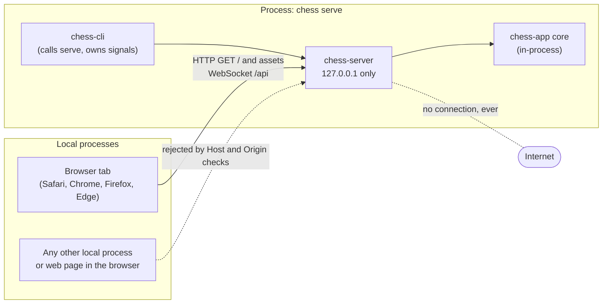
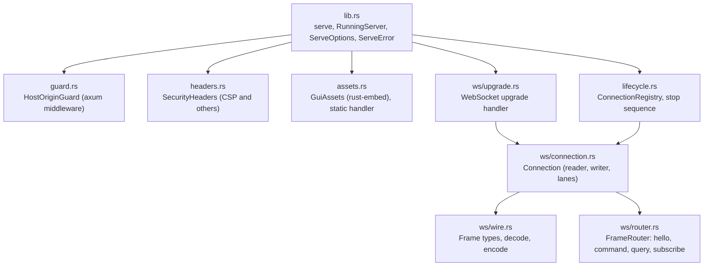
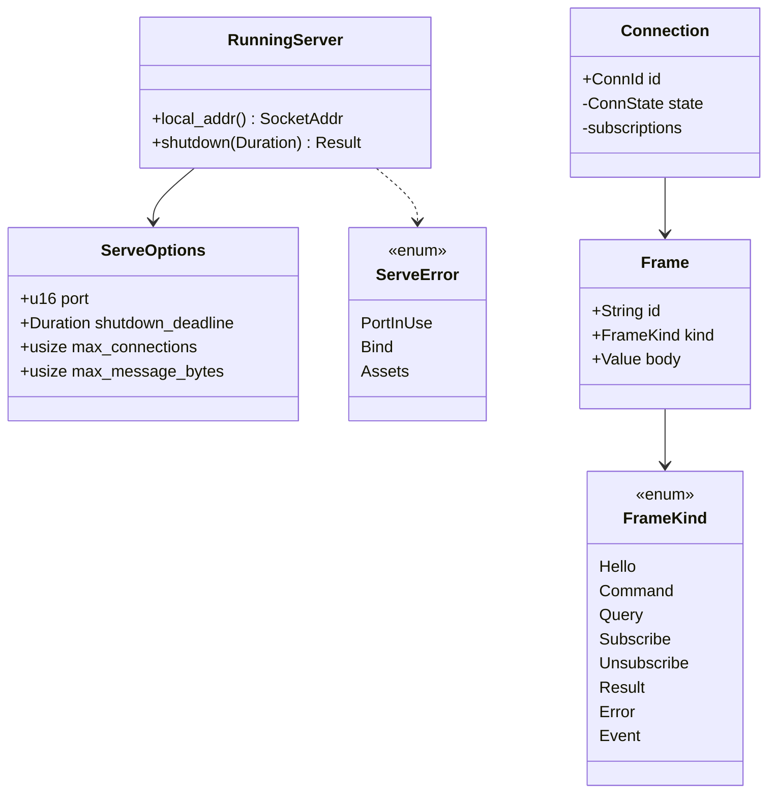
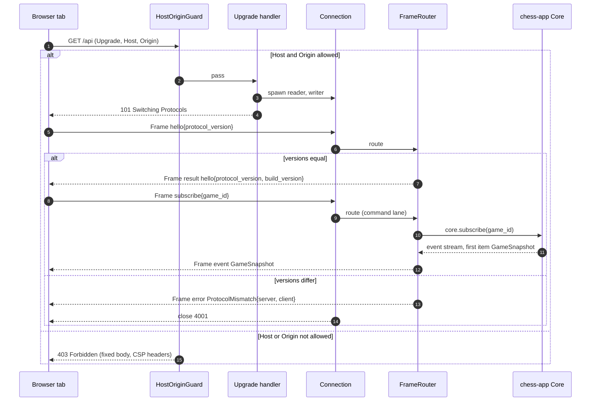
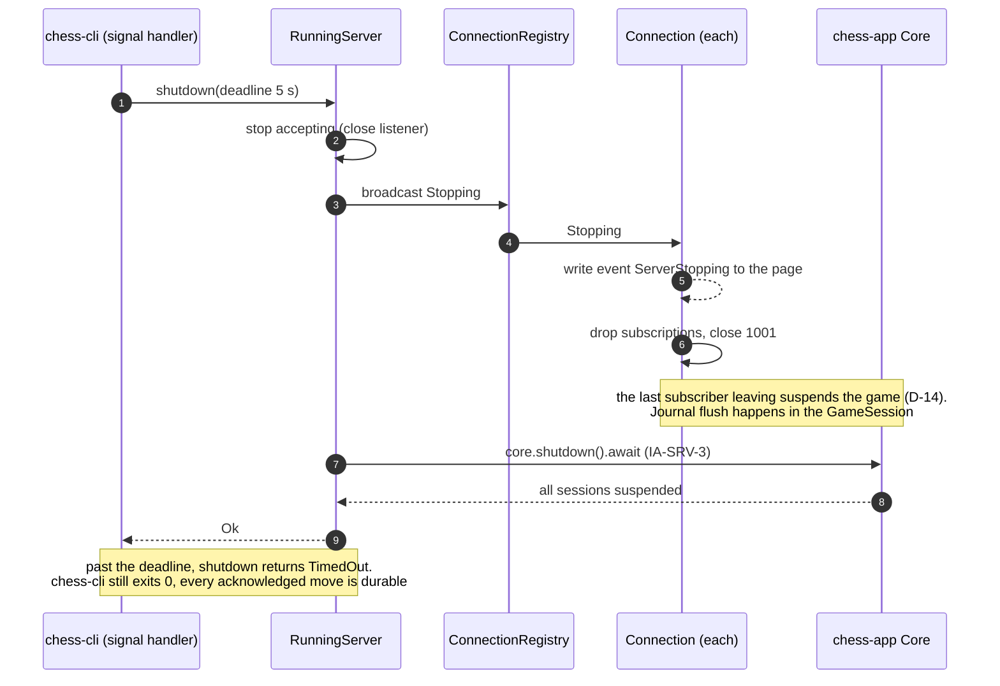
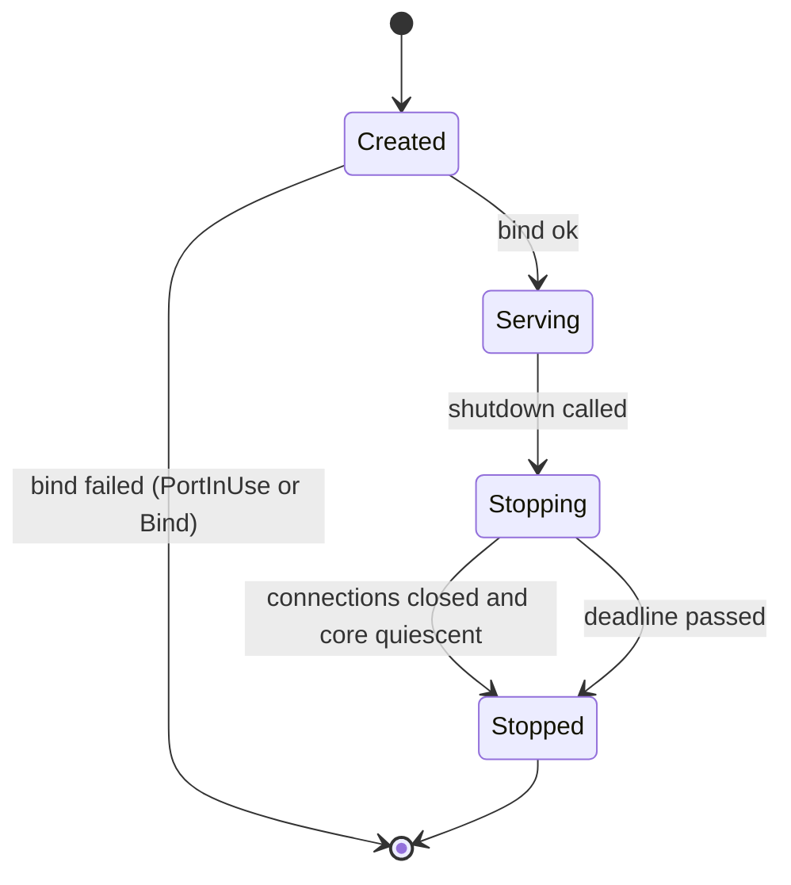
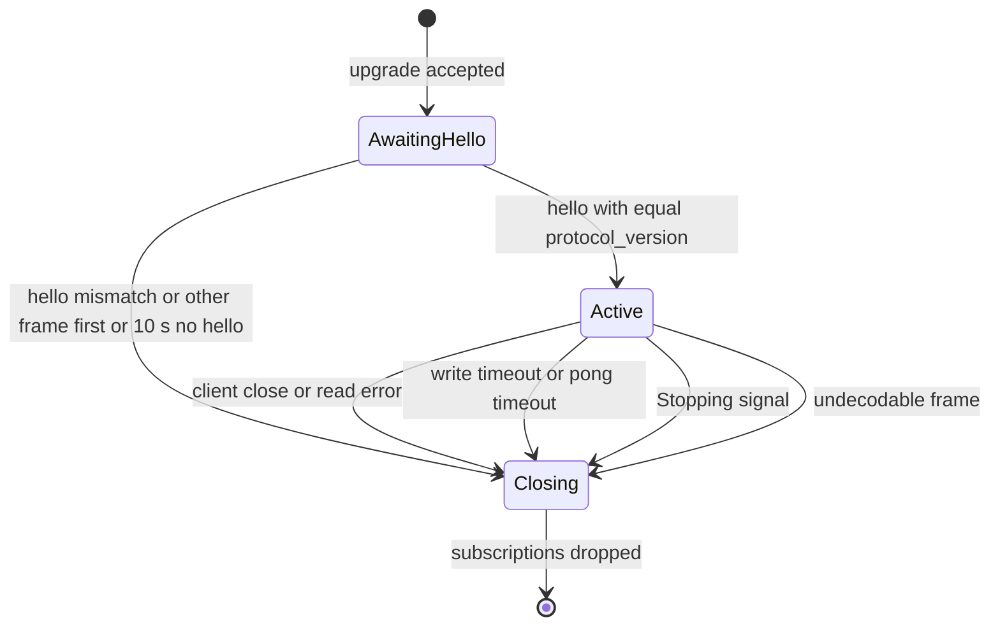

# SDD-chess-server: Software Design Description for `chess-server` (axum HTTP + WebSocket)

| Field | Value |
|---|---|
| Document | docs/design/SDD-chess-server.md |
| Version | 0.1 DRAFT |
| Date | 2026-10-30 |
| Status | **DRAFT.** Not reviewed. Not approved. No code exists yet |
| Owner | Software engineer role (Claude), for Brian Prascher |
| Approver | **Pending.** Gate G0 for this document (documents only, no approver, SWE-001 §3). The design it describes, once implemented, is G1 (System-architect agent, desk review) while it stays inside this crate with the §3.2 edges and §5.7 contracts unchanged. Items in section 12 marked "G2" would need Brian Prascher |
| Gate record | G0, status DRAFT. A `GATE-1nn` number is assigned when the record is filed under `docs/engineering/gates/` (SWE-001 ASM-S5). Not filed here |
| Allocation name (architecture §2.2) | `axum HTTP + WebSocket` |
| Crate / path | `crates/chess-server` (architecture §3.1) |
| Runs in | Process: `chess serve` (architecture §2) |
| Languages | Rust 1.99.1, edition 2024 (SWE-001 §1, architecture §3.4) |
| Sibling SDDs | [chess-cli](SDD-chess-cli.md) (caller of `serve`), [chess-app](SDD-chess-app.md) (the core it fronts), [ui](SDD-ui.md) (the GUI it serves and talks to), [desktop-tauri](SDD-desktop-tauri.md) (the other transport), [chess-store](SDD-chess-store.md), [chess-engine](SDD-chess-engine.md), [chess-domain](SDD-chess-domain.md), [chess-rules](SDD-chess-rules.md) |

Evidence tags follow `swe-governance` §6. `[OBS architecture.md §n]` means read in this session. `[UNV]` means not verified here (no code, no toolchain, no network). Numbers marked `ESTIMATE` have no measurement behind them.

---

## 1. Introduction

### 1.1 Purpose and scope

`chess-server` is the transport block that lets a browser tab use the shared core. It is a thin adapter (architecture §1 principle 4, §5.2). It binds the loopback interface, serves the embedded GUI bundle with a Content-Security-Policy, rejects any request whose `Host` or `Origin` is not its own loopback origin, and carries the protocol over one WebSocket. It holds no chess rules, no store access and no engine access (principle 1, §3.2: the only workspace dependency is `chess-app`).

In scope: the HTTP and WebSocket surface, Host/Origin enforcement, CSP and other response headers, port binding and port-in-use reporting, the version handshake, framing and routing of protocol messages, per-connection ordering, backpressure, and the stop sequence.

Out of scope, owned elsewhere: configuration loading, port precedence, `--no-open`, browser launching and signal capture (`chess-cli`, see [SDD-chess-cli](SDD-chess-cli.md)); protocol types, error mapping and sessions (`chess-app`); the GUI (`ui`).

### 1.2 Allocated requirements, functions and decisions

| Kind | IDs | Source |
|---|---|---|
| Primary requirements | PLAT-4 (bind, port, stop), NFR-7 (Host/Origin), NFR-4 (loopback only, no outbound) | [OBS architecture.md §3.3 `chess-server` row, §10.1 rows PLAT-4, NFR-4, NFR-7] |
| Supporting requirements | PLAT-1, PLAT-3 (CSP is half of its enforcement), PLAT-5 (version handshake), DAT-1 (web served locally), GUI-1 (one transport for the shared GUI), NFR-8 (nothing blocks the runtime), NFR-9 (errors reach the user as catalogue codes), NFR-10 (log content) | [OBS architecture.md §3.3, §10.1] |
| Functions | **F-7.4.3** Carry protocol over WebSocket; **F-7.4.5** Serve embedded GUI bundle; **F-8.2** Start local web server (the bind, port-in-use and URL part; the config and browser part is `CLI front-end`); **F-8.3** Reject foreign-origin requests; **F-8.4** Confine traffic to loopback (shared with `WKWebView`); **F-8.12** Stop local web server | [OBS functional_decomp.md lines 196-212, 220] |
| Decisions | D-1 (the web path is the WebSocket, desktop does not use it), D-2, D-8 (`chess serve` started by the user), D-13 (concurrency model), D-14 (suspend when the last front-end detaches), D-16 (one build version), D-22 (no token), D-24 (port precedence), D-36 (serve lifecycle) | [OBS architecture.md §11] |
| Risks | R-5 (localhost reachable by other pages and apps), R-10 (reload suspends a game) | [OBS architecture.md §12] |
| Assumptions | ASM-1 (one person per Mac account, CONFIRMED) | [OBS architecture.md §14] |
| Use cases | UC-4 Start Local Web Server | [OBS use_cases/README.md] |

### 1.3 Inputs read

architecture.md §1, §2, §2.2, §3 (3.1-3.4), §4.1, §4.2, §4.8, §5.1-§5.7, §6.1 (`chess serve` lifecycle), §6.2 (connection loss), §7.5, §8, §8.1, §8.2 (port and config), §10.1 (rows for this block), §11 (D-1 to D-37), §12, §14. functional_decomp.md F-7.4.x and F-8.x rows. requirements.md PLAT-3, PLAT-4, PLAT-5, NFR-4, NFR-7, NFR-8, NFR-9, NFR-10. test-strategy.md (Principles, Non-functional checks: "Web server Host/Origin rejection, including a DNS-rebinding host name"). SWE-001 (profile, CERT-informed mapping §6).

### 1.4 Conventions

- Entities: `DD-SRV-n`. Interfaces: `IFP-SRV-n` (provided), `IFR-SRV-n` (required). Planned tests: `CT-SRV-nn`, `UT-SRV-nn`. Findings for upstream owners: `UF-SRV-n` (section 12). Assumptions: `ASM-SRV-n`. Open questions: `OQ-SRV-n`.
- Interface assumptions about the sibling `chess-app` design are marked `IA-SRV-n` (section 5.3). If SDD-chess-app disagrees, this document is changed to follow it, unless the §5.7 contracts are involved.
- Coding standard: CERT-informed best practice, warnings as errors, no conformance claim (SWE-001 §1, §6). The CERT area is named where a design choice follows it.

---

## 2. Design overview and viewpoint selection

| IEEE 1016 viewpoint | Used? | Where | Reason if omitted |
|---|---|---|---|
| Context | Yes | 3.1 | |
| Composition | Yes | 3.2, 4 | |
| Logical (types) | Yes | 3.3 | |
| Dependency | Yes | 3.4 | |
| Information | Omitted | | The crate owns no persistent data and has no schema. Per-connection state is in memory and listed under Resource and State dynamics |
| Patterns use | Yes | 3.5 | |
| Interface | Yes | 5 | |
| Structure | Yes | 3.2 (module layering) | |
| Interaction (sequence) | Yes | 3.6 | |
| State dynamics | Yes | 3.7 | |
| Algorithm | Yes | 3.8 (Host/Origin decision, routing order) | |
| Resource | Yes | 7 | |

---

## 3. Viewpoints

### 3.1 Context viewpoint

**Concern:** what the block talks to, and where the trust boundary is.



Trust boundary [OBS architecture.md §2, §5.2]: the only boundary inside the Mac is loopback. Any local process can reach the port, and ASM-1 (one person per Mac account) means that is accepted (D-22, no token). The browser is treated as untrusted input to the core. The Host/Origin check stops browser-borne attacks only: web pages from other origins and DNS-rebinding names (R-5). It does not stop a local process that forges both headers, and this document does not claim it does.

### 3.2 Composition and structure viewpoint

**Concern:** parts and their purposes.



| Entity | Type | Purpose | Traces |
|---|---|---|---|
| DD-SRV-1 `serve` / `RunningServer` | API (function + handle) | Bind the loopback listener, build the router, start accepting, expose `local_addr()` and `shutdown()` | F-8.2, PLAT-4, NFR-4 |
| DD-SRV-2 `HostOriginGuard` | middleware | Decide accept or reject before any other handler runs | F-8.3, NFR-7 |
| DD-SRV-3 `SecurityHeaders` | middleware | Add CSP and companion headers to every response, including rejections | F-7.4.5, PLAT-3 |
| DD-SRV-4 `GuiAssets` + static handler | module | Serve the embedded bundle by exact key lookup | F-7.4.5, PLAT-3 |
| DD-SRV-5 WebSocket upgrade handler | handler | Upgrade `/api`, enforce the connection cap, set size limits | F-7.4.3, NFR-7 |
| DD-SRV-6 `Connection` | task group | Per-socket reader, writer, command lane, query tasks, ping | F-7.4.3, NFR-8 |
| DD-SRV-7 Wire types | module | Envelope `{id, kind, body}` encode and decode | F-7.4.3, section 5 |
| DD-SRV-8 `FrameRouter` | module | Map a decoded frame to `core.execute`, `core.query`, `core.subscribe`, or the handshake | F-7.4.3, PLAT-5 |
| DD-SRV-9 `ConnectionRegistry` and stop sequence | module | Track live connections, notify and close them on stop | F-8.12, D-14 |

### 3.3 Logical viewpoint (key types)

**Concern:** the types a reader needs to follow the rest. Key types only.



### 3.4 Dependency viewpoint

**Concern:** what this crate may depend on, and what it uses at run time.

Allowed workspace edges [OBS architecture.md §3.2]: `chess-server -> chess-app` only. `chess-cli -> chess-server`. Nothing depends on `chess-server` except `chess-cli`. `chess-server -.-> ui` is a build-time embed of the built assets, not a code dependency.

| Dependency | Kind | Use | Version source |
|---|---|---|---|
| `chess-app` | workspace crate | `Core`, protocol types, error mapping | §3.2 |
| `axum` 0.8.9 (feature `ws`) | third party | HTTP, routing, WebSocket | [OBS §3.4] |
| `rust-embed` 8.13.0 | third party | embed `ui/dist` | [OBS §3.4] |
| `tokio` 1.54.1 | third party | runtime (shared, one per process, D-13) | [OBS §3.4] |
| `serde`, `serde_json` | third party | frame encode and decode | `serde` 1.0.229 [OBS §3.4]; `serde_json` not in §3.4 (UF-SRV-9) |
| `thiserror` 2.0.21, `tracing` 0.1.44 | third party | errors, logging | [OBS §3.4] |
| `futures-util` | third party | `StreamExt`/`SinkExt` on the socket | not in §3.4 (UF-SRV-9) |

No `tower-http`: headers are added by our own middleware, which keeps the CORS layer out of the tree altogether (R-5: "no CORS"). New direct dependencies are decisions (system prompt rule 10); the two not in §3.4 are raised in UF-SRV-9 for the SBOM and for the architect's approval of direct dependencies.

### 3.5 Patterns-use viewpoint

| Pattern | Where | Why | Misuse tell |
|---|---|---|---|
| Middleware chain | DD-SRV-2, DD-SRV-3 | Guard runs first for every route, so a new route cannot forget the check | A handler that reads `Host` itself |
| Adapter | whole crate | Maps wire frames to the §5.7 `Protocol` contract with no logic of its own | Rule or policy code appearing here |
| Actor-style lanes | DD-SRV-6 | One FIFO lane per connection keeps command order | A second lane that can overtake the first for commands |
| Registry plus broadcast signal | DD-SRV-9 | One place that can tell every connection to stop | Connections that capture their own copy of "stopping" |
| Embedded static assets | DD-SRV-4 | One binary, offline (PLAT-3) | Reading files from disk at run time |

### 3.6 Interaction viewpoint (sequences)

**Concern:** how a connection starts, how a foreign origin is refused, and how the server stops.



Sequence for the stop path (F-8.12, PLAT-4, §6.1 and §4.8 [OBS]):



### 3.7 State dynamics viewpoint

**Concern:** lifecycle of the server and of one connection.





Transition rules: in `AwaitingHello` any frame other than `hello` gets `ProtocolMismatch` with `details.reason = "handshake_required"` and the socket closes (4001). The 10 s hello window is `ESTIMATE`. In `Active`, a frame that does not decode (bad JSON, unknown `kind`, unknown command variant) gets `ProtocolMismatch` with `details.reason = "undecodable"` and the socket closes (4001): an unknown variant is what version skew looks like, and it is not in the §5.5 catalogue by any other code (UF-SRV-3).

### 3.8 Algorithm viewpoint

**Concern:** the two decisions that carry the security claim.

**A1. Host/Origin decision (NFR-7, F-8.3).** Input: request method, `Host` header values, `Origin` header values, `bound_port` (the port the listener actually bound, never the configured one). Output: allow or reject.

```
allowed_hosts   = { "127.0.0.1:" + bound_port, "localhost:" + bound_port }
allowed_origins = { "http://127.0.0.1:" + bound_port, "http://localhost:" + bound_port }

1. Host headers: exactly one value required, else reject.
2. Lowercase the Host value (ASCII). If not in allowed_hosts, reject.
   (Rejects: a missing Host, "localhost.:port", "evil.example:port", a rebinding name,
    "127.0.0.1" without port, userinfo, "[::1]:port".)
3. Origin headers:
   - more than one value: reject.
   - one value: lowercase (ASCII). If not in allowed_origins, reject. ("null" is rejected.)
   - none: if the request is a WebSocket upgrade, reject.
           otherwise allow only for GET or HEAD.
4. Method other than GET, HEAD for non-upgrade requests: 405 (after steps 1 to 3).
5. Allow.
```

Rationale: browsers always send `Origin` on a WebSocket handshake, so a WebSocket without one is not a browser page and is refused; same-origin navigations and subresource loads by GET do not carry `Origin`, so absence is allowed there. Comparison is exact string equality on a closed set, with no URL parsing, so there is no parser differential to exploit (CERT IDS-style input validation intent, SWE-001 §6). The set is built from the bound port at start-up and never from request data.

**A2. Per-connection ordering (NFR-8, §4.2).** Commands for one connection run one at a time, in arrival order, on the **command lane**. This keeps `MakeMove` then `Resign` in the order the user sent them, which the optimistic `ply` guard assumes. Queries run concurrently in their own tasks, at most 16 in flight (`ESTIMATE`); when 16 are in flight the reader stops reading, which pushes back on the client through TCP. `subscribe` rides the command lane so that "resume, then subscribe" cannot reorder. The reader never awaits a core future inline: it hands work to the lane, so a slow `ImportPgn` cannot stop the socket from answering pings. Two frame kinds are handled **out of lane**: `unsubscribe` and the socket close. They only remove a subscription, so they cannot depend on a pending command, and they must not wait behind a long one.

---

## 4. Design entities

### DD-SRV-1 `serve` and `RunningServer`
- Type: public API of the crate | Traces: F-8.2, PLAT-4, NFR-4, D-8, D-24, D-36
- Signature (design, not yet code): `pub async fn serve(core: Arc<Core>, opts: ServeOptions) -> Result<RunningServer, ServeError>`. This widens the architecture's `serve(core, port)` [OBS §3.3] by an options struct. It stays one function on the existing `chess-cli -> chess-server` edge (UF-SRV-6).
- `ServeOptions`: `port: u16` (0 allowed for tests only; `chess-cli` rejects 0 because PLAT-4 range is 1 to 65535), `shutdown_deadline: Duration` (default 5 s, [OBS §4.8]), `max_connections: usize` (default 8, `ESTIMATE`), `max_message_bytes: usize` (default 32 MiB, `ESTIMATE`, see rationale).
- Processing: bind `127.0.0.1:port` with `tokio::net::TcpListener`; the address is the literal `Ipv4Addr::LOCALHOST`, never a hostname lookup and never `0.0.0.0` or `::`. Record `local_addr`. Build the router (guard, headers, static handler, `/api`). Spawn the accept loop. Return the handle.
- Failure behaviour: `AddrInUse` becomes `ServeError::PortInUse{port}`; any other bind error becomes `ServeError::Bind{port, kind}` (kind is `io::ErrorKind`, no path or OS text beyond it in the user message). Nothing is left running on failure.
- Concurrency: runs on the process's shared tokio runtime (D-13). No thread is created.
- Rationale: a literal loopback address removes DNS and `localhost` resolution (which can return `::1`) from the bind. The printed URL uses `127.0.0.1` for the same reason. The Host allow-list still accepts `localhost:<port>` because a user may type it, and it resolves to the same listener over IPv4 in practice `[UNV]`; a browser that tries `::1` first falls back or fails, and neither is a security problem.
- Verification: CT-SRV-01, CT-SRV-02, CT-SRV-03.

### DD-SRV-2 `HostOriginGuard`
- Type: axum middleware (`from_fn_with_state`), outermost layer | Traces: F-8.3, NFR-7, R-5, D-22
- Function: algorithm A1. The state holds the two string sets built from `local_addr` after bind.
- Failure behaviour: reject with `403 Forbidden`, a fixed short plain-text body, no echo of the offending value. The rejection still passes through `SecurityHeaders`. Log one `tracing` event `request_rejected` with a category field (`host`, `origin`, `no_origin_ws`, `method`) and the offending value escaped and truncated to 128 characters (CERT-informed: no log injection; NFR-10 allows no names, and a header value is not a Player name).
- Concurrency: stateless after construction.
- Rationale: one middleware at the outermost position guarantees every route, including the WebSocket upgrade and the 404 fallback, is checked. Alternatives rejected: a check inside the `/api` handler only (a future route could forget it); a CORS layer (it sends headers rather than refusing, and R-5 says no CORS); `tower-http` validation (extra dependency for a six-line comparison).
- Verification: CT-SRV-04 to CT-SRV-09.

### DD-SRV-3 `SecurityHeaders`
- Type: axum middleware, wraps the guard so it also decorates 403 and 405 | Traces: F-7.4.5, PLAT-3, F-8.4
- Headers on every response:

| Header | Value | Why |
|---|---|---|
| `Content-Security-Policy` | `default-src 'self'; script-src 'self'; style-src 'self'; img-src 'self'; font-src 'self'; connect-src 'self' ws://127.0.0.1:{port} ws://localhost:{port}; object-src 'none'; base-uri 'none'; form-action 'none'; frame-ancestors 'none'` | PLAT-3 requires `default-src 'self'`, and architecture §8.1 gives `default-src 'self'; connect-src 'self' ws://127.0.0.1:*`. This text is the same policy made narrower: exact port instead of `*`, `localhost` added to match the Host allow-list, and the listed directives pinned instead of inheriting. See UF-SRV-2 |
| `X-Content-Type-Options` | `nosniff` | asset type is the declared type |
| `Referrer-Policy` | `no-referrer` | nothing leaves the page |
| `Cross-Origin-Resource-Policy` | `same-origin` | other origins cannot embed our assets |
| `Cross-Origin-Opener-Policy` | `same-origin` | isolates the browsing context |
| `X-Frame-Options` | `DENY` | older agents; the CSP `frame-ancestors` is primary |
| `Cache-Control` | `no-cache` for `index.html`; `public, max-age=31536000, immutable` for hashed assets; `no-store` for errors | a rebuilt bundle is picked up at once, and stale tabs are caught by the handshake (D-16) |

- No `Access-Control-*` header is ever added (R-5).
- `style-src 'self'` has no `'unsafe-inline'`. React and chessground set styles through the CSSOM (`element.style`), which CSP allows, but markup `style="..."` attributes and `<style>` elements would be blocked. This is a constraint on the `ui` build and is stated in [SDD-ui](SDD-ui.md); it is `[UNV]` until the GUI E2E runs in Safari, Chrome, Firefox, Edge and WKWebView (CT-SRV-10).
- `img-src 'self'` has no `data:`. The `ui` build sets Vite's inline-asset limit to 0 so small assets are not turned into `data:` URIs `[UNV: option name `build.assetsInlineLimit`]`.
- Verification: CT-SRV-10, CT-SRV-11, bundle scan (PLAT-3, CI).

### DD-SRV-4 `GuiAssets` and static handler
- Type: module | Traces: F-7.4.5, PLAT-3, PLAT-4
- Function: `#[derive(RustEmbed)]` over `ui/dist`, embedded in release **and** debug builds so the server never reads files at run time (feature `debug-embed` `[UNV: feature name]`). Routes: `GET /` returns `index.html`; `GET /assets/<hashed>` returns the file by **exact key lookup in the embedded set**. Anything else is `404`. There is no single-page-app fallback: the GUI keeps its screens in memory (see [SDD-ui](SDD-ui.md)), so an unknown path must not return HTML (it would also hide a bundle-scan failure).
- Path safety: the request path is percent-decoded once, then rejected if it contains `..`, `\`, NUL, a second `/` run, or a leading character other than `/`. Because lookup is by key in a compiled-in table and never joins a filesystem path, traversal has nothing to traverse (CERT FIO-intent).
- Content type: from the embedded metadata (`mime-guess` via `rust-embed`) `[UNV]`.
- Build precondition: `build.rs` fails a release build when `ui/dist/index.html` is absent. A debug or test build creates a one-file placeholder so `cargo test -p chess-server` works without the Node toolchain. The placeholder text says "GUI bundle not built" and the release check prevents shipping it. Build order is `ui` first, then `cargo build` (architecture §3.2 dashed edge, §8.1). Details of `rust-embed` behaviour are `[UNV]` and are checked at step 2.
- Failure behaviour: a missing key is `404`. A `ServeError::Assets` at start-up if the embedded set has no `index.html`.
- Verification: CT-SRV-12, CT-SRV-13.

### DD-SRV-5 WebSocket upgrade handler (`GET /api`)
- Type: axum handler | Traces: F-7.4.3, NFR-7
- Processing: after the guard, take a permit from a `Semaphore(max_connections)`; if none, `503 Service Unavailable`. Configure `max_message_size = max_message_bytes` and `max_frame_size = 16 MiB` `[UNV: axum/tungstenite option names]`. Accept the upgrade and spawn DD-SRV-6. The permit is held for the life of the connection.
- No subprotocol is negotiated. The cap bounds memory, not user count: one person uses the Mac (ASM-1), a handful of tabs is the realistic maximum, and 8 is `ESTIMATE`.
- Verification: CT-SRV-14.

### DD-SRV-6 `Connection`
- Type: per-socket task group | Traces: F-7.4.3, NFR-8, D-14, §5.6
- Tasks: one **reader** (decode frames, handle out-of-lane frames, push to the lane), one **writer** (owns the sink; consumes a bounded mpsc of outbound frames, see below), one **command lane** (processes commands in order), query tasks (spawned, at most 16), per-subscription **forwarders** (read the core's event stream and enqueue frames), one **ping timer** inside the writer.
- Outbound path and backpressure: forwarders enqueue to the writer through a bounded `mpsc` (capacity 64, `ESTIMATE`) using `send().await`. A slow socket therefore blocks the forwarder, the forwarder stops reading the core's per-game broadcast receiver, the receiver lags, and chess-app answers `RecvError::Lagged` with a fresh `GameSnapshot` instead of the missed events (§4.8 Backpressure [OBS]). The server never buffers without bound and never stalls a game. If one write takes longer than 10 s (the client command timeout, §4.8 [OBS]) the connection is closed (`Closing`).
- Keep-alive: a Ping every 20 s, a Pong expected within 10 s, both `ESTIMATE`. A closed tab normally closes the socket at once, which is what makes D-14 "immediately" true; pings only catch a peer that vanished without closing.
- Subscriptions: a map `game_id -> forwarder handle` owned by the connection. Dropping the connection drops every forwarder and thereby every core subscription, which is how "the last front-end detached" is detected in the core (F-7.4.2) [OBS functional_decomp.md]. The server contains no suspend logic.
- Failure behaviour: any I/O error ends the connection and nothing else. A panic in one connection task is caught by the task boundary (`JoinHandle`), logged with a correlation id, and ends that connection; it must not take down the process. (Rust panics in async tasks do not unwind across tasks.)
- Concurrency: see algorithm A2 and section 7.
- Verification: CT-SRV-15 to CT-SRV-21.

### DD-SRV-7 Wire types
- Type: module | Traces: F-7.4.3, §5.2 envelope, §5.6
- Envelope: `{ "id": string, "kind": string, "body": object }` [OBS architecture.md §5.2, §5.6]. The kinds are not enumerated in the architecture (UF-SRV-1); this design fixes them, and [SDD-ui](SDD-ui.md) and [SDD-desktop-tauri](SDD-desktop-tauri.md) use the same set. See section 5.1.
- `id` is a client-chosen request id of at most 64 characters, echoed in the response. A push frame has no `id`.
- Decode: `serde_json::from_slice` into `Frame` with `#[serde(deny_unknown_fields)]` on the envelope (SWE-001 §6 SER: external formats deny unknown fields). The `body` is decoded by chess-app's own `Command` or `Query` type, which are the generated source of the TypeScript types (D-7). Unknown **event** kinds on the client side are ignored (§5.6); unknown **request** shapes on the server side are `undecodable`.
- Size: the transport limit (DD-SRV-5) is the first line; there is no per-field limit here.
- Verification: UT-SRV-01 to UT-SRV-04, fuzz target FZ-SRV-1 (§9 "protocol fuzzing at the WebSocket" [OBS]).

### DD-SRV-8 `FrameRouter`
- Type: module | Traces: F-7.4.3, PLAT-5
- Routing table: see section 5.1. For `hello`: compare `protocol_version` to the build's, reply or `ProtocolMismatch{server, client}` (§5.5, §5.6, D-16 [OBS]). For `command`: `core.execute(cmd).await`. For `query`: `core.query(q).await`. For `subscribe`: `core.subscribe(game_id)` and start a forwarder. For `unsubscribe`: drop the forwarder.
- Results: success becomes `{id, kind:"result", body}`. A core error already carries `{code, message, details}` from chess-app's mapping and becomes `{id, kind:"error", body}`. The server adds no error text of its own except `ProtocolMismatch`. No internal path or SQL text can reach `message` because chess-app does the mapping (§5.5 [OBS]); the server does not format `io::Error` or `Debug` output into a frame.
- Verification: CT-SRV-22 to CT-SRV-27.

### DD-SRV-9 `ConnectionRegistry` and the stop sequence
- Type: module | Traces: F-8.12, PLAT-4, D-14, D-36, §4.8 "Web server stop"
- State: a `watch::Sender<bool>` named `stopping`, and a set of connection join handles.
- `RunningServer::shutdown(deadline)`:
  1. stop the accept loop and drop the listener (new connections are refused by the OS);
  2. set `stopping`; each connection writes one `ServerStopping` event frame, then closes with 1001 (going away) and drops its subscriptions;
  3. `core.shutdown().await` (IA-SRV-3) so that every game has finished its `Suspend` journal write;
  4. return `Ok(())`, or `Err(ShutdownTimedOut)` if `deadline` (5 s, [OBS §4.8]) passes first.
- Failure behaviour: on timeout the caller still exits 0, because "every acknowledged move is already durable, so nothing is lost" [OBS §4.8]. The timeout is logged and printed as a warning on standard error.
- Rationale: the server does not enumerate games to suspend. Dropping subscriptions reuses the one D-14 rule in the core, so the stop path and a closed tab cannot diverge. The explicit `core.shutdown()` exists only to know when the flushes are done; without it the process could exit between "last subscriber left" and "journal written". If chess-app offers no such method, the fallback is to poll for zero live sessions until the deadline (UF-SRV-4).
- Verification: CT-SRV-28, CT-SRV-29.

---

## 5. Interface viewpoint

### 5.1 IFP-SRV-1 / IFP-SRV-2: network interfaces (provided)

> **Consistency review XC-19 (2026-10-30):** the server-to-client frame shapes in the IFP-SRV-2 tables below, the `core.execute` / `core.subscribe` / `core.shutdown()` calls of IFR-SRV-1, DD-SRV-1, DD-SRV-6, DD-SRV-8 and DD-SRV-9, and the server writing `ServerStopping` itself are **superseded** by section 12a (SDD-chess-app IFP-APP-01 to 05 govern: `FrontEndSession`, the shared envelope helpers, `Core::shutdown(deadline)`). The bodies were not rewritten.

**IFP-SRV-1 Static GUI over HTTP** (F-7.4.5)

| Item | Value |
|---|---|
| Bind | `127.0.0.1:<port>` only, TCP, HTTP/1.1 |
| Routes | `GET /`, `GET /assets/*`; `HEAD` on the same |
| Responses | `200` with body; `403` Host/Origin; `404`; `405` other methods; `503` connection cap (WebSocket only) |
| Errors | fixed plain-text bodies, no detail |
| Auth | none (D-22, ASM-1) |

**IFP-SRV-2 Protocol over WebSocket** (F-7.4.3). URL `ws://127.0.0.1:<port>/api` [OBS architecture.md §5.2]. Text frames, one JSON object per frame, UTF-8. Binary frames are rejected as `undecodable`.

Client to server:

| `kind` | `body` | Reply |
|---|---|---|
| `hello` | `{protocol_version: string}` | `result` with `{protocol_version, build_version}`, or `error` `ProtocolMismatch{server, client}` then close 4001. Must be first |
| `command` | a chess-app `Command` (§5.1 [OBS]) | `result` or `error`; on success the body is the command's result type |
| `query` | a chess-app `Query` | `result` or `error` |
| `subscribe` | `{game_id}` | `result` (empty) then an `event` frame carrying `GameSnapshot` |
| `unsubscribe` | `{game_id}` | `result` (empty) |

Server to client:

| `kind` | `id` | `body` |
|---|---|---|
| `result` | echoes request | result value |
| `error` | echoes request | `{code, message, details}` with `code` from the §5.5 catalogue |
| `event` | none | `{game_id?, event}` where `event` is a chess-app `Event` (`GameSnapshot`, `MoveApplied`, `ClockSync`, ..., `ServerStopping`) |

WebSocket close codes: 1000 normal (client initiated), 1001 server stopping, 1009 message too big (library), 4001 protocol (mismatch, handshake missing, undecodable), 4002 write or pong timeout. 4001 and 4002 are application codes in the 4000 range and are `ASM-SRV-1` (not defined upstream).

Idempotency and reconnect are the client's job and are specified in §5.6 and in [SDD-ui](SDD-ui.md): after a drop the client reconnects with 0.5, 1, 2, 4 s backoff capped at 4 s, resubscribes and treats the new snapshot as authoritative. The server keeps no per-client memory between connections.

### 5.2 IFP-SRV-3: Rust API (provided to `chess-cli`)

`serve`, `ServeOptions`, `RunningServer::{local_addr, shutdown}`, `ServeError::{PortInUse, Bind, Assets}`, `ShutdownTimedOut`. `ServeError` implements `std::error::Error`; `chess-cli` maps `PortInUse` and `Bind` to exit code 1 (D-36, [OBS §6.1]).

### 5.3 IFR-SRV-1: protocol contract from `chess-app` (required)

The §5.7 "Protocol" row: `chess-app -> CLI, chess-server, src-tauri, ui/`, "Async request/response plus a per-game event stream" [OBS]. The CLI row of §5.2 names the in-process calls `core.execute(cmd).await` and `core.subscribe(game_id)` [OBS]. The server needs exactly these three operations and one more. Interface assumptions, to be reconciled with [SDD-chess-app](SDD-chess-app.md):

| ID | Assumption | If wrong |
|---|---|---|
| IA-SRV-1 | `Core::execute(Command) -> Result<CommandResult, AppError>` and `Core::query(Query) -> Result<QueryResult, AppError>` exist, with `serde` on all four types; `AppError` serialises to `{code, message, details}` | The server would map errors itself, which breaks "no internal text" ownership. Raise as a finding against SDD-chess-app |
| IA-SRV-2 | `Core::subscribe(game_id) -> impl Stream<Item = Event>`; dropping the stream detaches; the first item is `GameSnapshot`; a lagging subscriber receives a fresh `GameSnapshot` (§4.8 [OBS]) | Backpressure design (DD-SRV-6) must change |
| IA-SRV-3 | `Core::shutdown() -> impl Future` completes when every live session has journalled `Suspend` | Fallback in DD-SRV-9 (poll) |
| IA-SRV-4 | `Core::protocol_version()` and `Core::build_version()` return the build version used in `PROCESS_HEARTBEAT` (D-16) | Handshake cannot compare |

Failure behaviour of the required side: every `AppError` is forwarded; the server never retries a command (never replay blindly, §5.6 [OBS]).

### 5.4 Interface to the GUI bundle (build time)

`ui/dist` is read at compile time by `rust-embed`. The contract with [SDD-ui](SDD-ui.md): all assets are same-origin files under `/assets/` with content-hashed names; no inline script, no inline style element, no `style=""` attribute, no `data:` image, no remote URL; entry point `index.html`.

---

## 6. Error handling (mapping to §5.5)

| Situation | Code returned | Notes |
|---|---|---|
| Foreign Host or Origin | HTTP 403, no protocol code | Happens before any protocol frame exists |
| `hello` version mismatch | `ProtocolMismatch{server, client}` | Raised by "WebSocket adapter" in §5.5 [OBS]; client says "hard reload" |
| Frame before `hello`; undecodable frame | `ProtocolMismatch` with `details.reason` | No other catalogue code fits (UF-SRV-3) |
| Any core error | forwarded unchanged | `ConfirmationRequired`, `StalePosition`, `Denied`, `GameLeased`, `Store*`, `EngineUnavailable`, `Busy`, `Internal{id}`, ... produced by chess-app |
| Connection cap | HTTP 503 | Not a protocol error; the page shows the connection-loss banner |
| Bind failure at start | `ServeError`, mapped by chess-cli to exit 1 | `PortInUse{port}` names the port (PLAT-4) |
| Server stopping | event `ServerStopping`, close 1001 | The page shows "server stopped" and does not retry (D-36) |
| Panic in a connection task | connection closes; log `Internal` correlation id | The client sees a drop and reconnects |

Nothing here formats an OS error string, a path or SQL into a response. Detail goes to the log with identifiers only (NFR-10, §8 Logging [OBS]).

---

## 7. Resource and concurrency viewpoint

**Concern:** threads, tasks, memory and time limits (§4.8 [OBS]).

| Resource | Design | Source |
|---|---|---|
| Threads | none created; all work on the process's tokio multi-thread runtime | D-13, §4.8 |
| Tasks per connection | 3 fixed (reader, writer, lane) + up to 16 query tasks + one forwarder per subscribed game | DD-SRV-6 |
| Blocking | no blocking call anywhere; no `rusqlite`, no file I/O at run time (assets are embedded) | §4.8 "Must not block" |
| Locks | no `Mutex` is held across `.await`; shared state is a `watch` channel, a `Semaphore` and per-connection owned maps (CERT CON/LCK intent) | SWE-001 §6 |
| Memory | bounded by connections (8) times message cap (32 MiB) worst case 256 MiB `ESTIMATE`; realistic frames are kilobytes. Outbound queue 64 frames per connection | `ESTIMATE` |
| Sockets | 1 listener + up to 8 | |
| Time limits | hello 10 s; write 10 s; ping 20 s / pong 10 s; stop 5 s | `ESTIMATE`, except stop 5 s [OBS §4.8] |
| Startup | `serve` does no I/O but one `bind`; the 3 s web startup budget (NFR-1) is dominated by `Core::open` in chess-cli | NFR-1 |

The 32 MiB message cap exists because the protocol has no file-transfer mechanism for a browser (UF-SRV-5): `ImportPgn`, `PreviewDataImport` and exports carry file contents inside frames. A 10 MB PGN as base64 is about 13.4 MB (`ESTIMATE`, 4/3 growth). TBD-25 limits PGN only; the full-data archive has no stated limit.

Concurrency across processes is not this block's concern (journal `flock` and leases are in the core, §7.3 [OBS]); a game open in the CLI answers `GameLeased` through the normal error path.

---

## 8. Verification mapping

Test levels follow test-strategy.md and architecture §9 [OBS]. All IDs below are **planned**. None has been written or run.

| ID | Level (§9 row) | Case | Requirement |
|---|---|---|---|
| UT-SRV-01..04 | Unit | Host/Origin decision table (A1): every row of the allowed and rejected sets, incl. missing Host, two Host headers, uppercase `LOCALHOST`, `localhost.`, `[::1]`, `null`, `http://127.0.0.1:otherport`; frame decode (`deny_unknown_fields`); close-code mapping; path-safety predicate | NFR-7 |
| FZ-SRV-1 | Fuzz (`cargo-fuzz`) | arbitrary bytes into the frame decoder and the path predicate must never panic | NFR-3 spirit, §9 |
| CT-SRV-01 | Component | `serve` on port 0 binds only `127.0.0.1` (assert `local_addr().ip()`) | NFR-4, PLAT-4 |
| CT-SRV-02 | Component | second `serve` on the same port returns `PortInUse{port}` | PLAT-4 |
| CT-SRV-03 | Component | nothing is listening on a non-loopback address of the host | NFR-4 |
| CT-SRV-04..09 | Component | request matrix: foreign Host, rebinding name, foreign Origin, `null` Origin, missing Origin on WebSocket, missing Origin on GET; each rejection is 403 with CSP headers and no CORS header; a page from another origin cannot open the WebSocket (Playwright, "E" in NFR-7) | NFR-7 |
| CT-SRV-10, 11 | Component + GUI E2E | CSP present on 200, 403, 404, 405; GUI loads and plays with that CSP in WebKit, Chrome, Firefox, Edge; an injected remote script fails to load | PLAT-3 |
| CT-SRV-12, 13 | Component | exact asset lookup; `..`, encoded `..`, backslash, NUL return 404; unknown path is 404, not HTML | PLAT-3 |
| CT-SRV-14 | Component | 9th connection gets 503 | resource limit |
| CT-SRV-15..21 | Component | hello first; hello mismatch closes 4001; undecodable closes 4001; commands on one connection keep arrival order; a slow command does not block a concurrent query; slow reader gets a fresh snapshot (lag) and the game clock is not delayed; ping/pong and write timeout | GUI-1, NFR-8 |
| CT-SRV-22..27 | Component (with `Core` over `FakeEngine` and an in-memory store) | each §5.5 code reaches the client unchanged; no frame contains a path or SQL text; subscribe returns `GameSnapshot` first; unsubscribe stops events | NFR-9 |
| CT-SRV-28, 29 | Component + CLI E2E | stop sequence: `ServerStopping` arrives, socket closes 1001, game is suspended, returns within 5 s; with a stalled core the call returns `ShutdownTimedOut` | PLAT-4 |
| NF-SRV-1 | Non-functional | network-capture harness records zero non-loopback connections during the offline E2E; DNS-rebinding host name is rejected [OBS test-strategy "Non-functional checks"] | NFR-4, NFR-7 |
| NF-SRV-2 | Non-functional | `chess serve` to first page accepting input within the NFR-1 web budget (measured by chess-cli's benchmark) | NFR-1 |

Coverage targets: the test-strategy quality gate (90 % line coverage) names rules, Elo, clock, policy and parser modules [OBS SWE-001 §1 Definition of done]. This crate is not in that list. The design target for the guard and wire modules is every branch of A1 exercised by UT-SRV-01; this is a target, not a claim.

---

## 9. Requirement-to-design traceability

| Requirement | Design entities | Planned tests |
|---|---|---|
| PLAT-4 (loopback bind, port, port-in-use, stop) | DD-SRV-1, DD-SRV-9 (bind and stop parts; port precedence and config are in chess-cli) | CT-SRV-01, 02, 28, 29 |
| NFR-7 (Host/Origin) | DD-SRV-2, A1 | UT-SRV-01, CT-SRV-04..09, NF-SRV-1 |
| NFR-4 (no outbound, loopback) | DD-SRV-1 (literal loopback bind), DD-SRV-3 (`connect-src`), no HTTP client in the tree | CT-SRV-01, 03, NF-SRV-1 |
| PLAT-3 (CSP half) | DD-SRV-3, DD-SRV-4 | CT-SRV-10..13, bundle scan |
| PLAT-5 (handshake) | DD-SRV-8 | CT-SRV-16 |
| GUI-1 (one GUI codebase, transport only differs) | DD-SRV-6, DD-SRV-7, DD-SRV-8 | CT-SRV-15..21 |
| NFR-8 (no blocking) | DD-SRV-6, A2, section 7 | CT-SRV-19, 20 |
| NFR-9 (errors shown) | DD-SRV-8, section 6 | CT-SRV-22..27 |
| NFR-10 (log content) | DD-SRV-2, DD-SRV-6 (identifiers only) | inspection |
| F-7.4.3 | DD-SRV-5..8 | CT-SRV-15..27 |
| F-7.4.5 | DD-SRV-3, DD-SRV-4 | CT-SRV-10..13 |
| F-8.2 (bind part) | DD-SRV-1 | CT-SRV-01, 02 |
| F-8.3 | DD-SRV-2 | CT-SRV-04..09 |
| F-8.4 | DD-SRV-1, DD-SRV-3 | CT-SRV-03, NF-SRV-1 |
| F-8.12 | DD-SRV-9 | CT-SRV-28, 29 |
| D-14 | DD-SRV-6, DD-SRV-9 (subscription drop) | CT-SRV-28 |
| D-22 | no token anywhere in the design | inspection |

No design entity is without a driver. Every allocated requirement and function has at least one entity.

---

## 10. Design rationale and decisions

| ID | Decision | Alternatives rejected | Door |
|---|---|---|---|
| RAT-SRV-1 | Closed-set exact-string Host/Origin comparison built from the bound port | URL parsing and suffix match (parser differentials); allowing any `localhost.*` | Two-way |
| RAT-SRV-2 | Reject a WebSocket upgrade with no `Origin` | Allow it (would admit a script on the same machine, but that threat is outside D-22 anyway); the stricter rule costs only test clients, which can send the header | Two-way |
| RAT-SRV-3 | Commands in one FIFO lane per connection; queries concurrent | Fully sequential (a 2 s `Analyze` would block `Resign`); fully concurrent (reorders `MakeMove`, `Resign`) | Two-way |
| RAT-SRV-4 | Suspend by dropping subscriptions plus an awaitable `core.shutdown()` | Server walks the sessions and suspends each (duplicates D-14 in a second place) | Two-way |
| RAT-SRV-5 | Embed assets in all build profiles; no run-time file reads | Read `ui/dist` from disk in debug (diverges dev from release; a second code path) | Two-way |
| RAT-SRV-6 | Own header middleware, no `tower-http` | `tower-http` (dependency, and its CORS layer is one line away from R-5) | Two-way |
| RAT-SRV-7 | No SPA fallback | Fallback to `index.html` (hides routing mistakes) | Two-way |

**ADR requests to the System Architect** (this document does not edit ADRs or the architecture): none required if UF-SRV-1 to UF-SRV-6 are answered as "document it". An ADR is requested only if the architect picks the alternative in UF-SRV-5 (HTTP upload and download routes), which would add a provided interface to this crate (Q2, G2).

---

## 11. Risks, assumptions, not analysed

| ID | Item |
|---|---|
| ASM-SRV-1 | Close codes 4001 and 4002 are this design's; nothing upstream defines them |
| ASM-SRV-2 | All numeric limits in section 7 are `ESTIMATE`. None was measured. They are config in `ServeOptions` so tests can change them |
| ASM-SRV-3 | `axum` 0.8.9, `rust-embed` 8.13.0 option and feature names used above are from memory and not checked against their documentation (no network used for this draft) `[UNV]` |
| ASM-SRV-4 | A browser resolving `localhost` to `::1` first either falls back to IPv4 or fails to connect; neither opens a security hole. Not tested `[UNV]` |
| RSK-SRV-1 | CSP `style-src 'self'` may break a library that writes inline styles by markup. Mitigation: CT-SRV-10 on all five engines before the GUI spike closes (OQ-9) |
| RSK-SRV-2 | Host/Origin plus loopback does not stop a local process that forges headers; accepted by D-22 and ASM-1 |
| RSK-SRV-3 | 32 MiB frames let a local client make the process allocate that much per connection; bounded by the cap of 8 connections |

**Not analysed:** IPv6 behaviour, behaviour behind a VPN or a macOS firewall prompt, TLS (out of scope, v1 is plain HTTP on loopback, §8.4 [OBS]), HTTP/2, WebSocket compression (disabled by not enabling it), Intel-specific behaviour (no Intel Mac available, deferred per CR-7.6).

---

## 12. Open issues and upstream findings

For the system architect (SA) unless noted. Each says what was found, where, and what this SDD assumed meanwhile.

| ID | Finding | Evidence | Assumed meanwhile | Gate if changed |
|---|---|---|---|---|
| UF-SRV-1 | The envelope `kind` values and the `hello` handshake message are not defined. §5.2 and §5.6 say `{id, kind, body}` and "handshake sends `protocol_version` both ways" but name no kinds, no subscribe or unsubscribe message, and `CoreClient.subscribe` needs one | architecture.md §5.2, §5.6, §5.1 (no `Subscribe` command) | Section 5.1 sets `hello`, `command`, `query`, `subscribe`, `unsubscribe`, `result`, `error`, `event`. Needs to be matched by chess-app's generated types (D-7) and used by ui and Tauri | G1 if chess-app only names them; G2 if a command is added |
| UF-SRV-2 | The CSP in architecture §8.1 (`default-src 'self'; connect-src 'self' ws://127.0.0.1:*`) names only `127.0.0.1`, while the Host allow-list (§5.2) accepts `localhost:<port>` too. A page opened at `localhost` would have a `connect-src` that does not list `ws://localhost`, and Safari has historically not matched `'self'` to `ws:` `[UNV]`. Also PLAT-3 verification says `default-src 'self'` | architecture.md §8.1, §5.2; requirements.md PLAT-3 | DD-SRV-3 policy: same intent, exact port, both hosts, extra directives. Requirement wording "default-src 'self'" is still satisfied | SE to confirm PLAT-3 wording is a floor, not an exact string |
| UF-SRV-3 | The §5.5 catalogue has no code for a request the server cannot decode (bad JSON, unknown command, frame before `hello`). `ProtocolMismatch{server, client}` is used meanwhile; its `details.reason` is added | architecture.md §5.5 | Use `ProtocolMismatch` with `details.reason` in {`handshake_required`, `undecodable`}. Alternative: add `ProtocolError` (new codes may be added without breaking clients, §5.6) | G1 |
| UF-SRV-4 | No `Core::shutdown()` (an awaitable "all sessions suspended") is listed in §5.1 or §5.7. F-8.12 and §4.8 require the stop to finish within 5 s with each game suspended | architecture.md §4.8, §6.1; functional_decomp.md F-8.12 | IA-SRV-3 with a polling fallback | G1 (chess-app addition used by three adapters) |
| UF-SRV-5 | **File transfer for browser and webview is unspecified.** `ImportPgn{file, ...}`, `PreviewDataImport{file}`, `ExportPgn`, `ExportData` take or return a "file", but a browser has no file path (SWE-001 §6: the GUI has no file access) and `ExportData` makes a zip (binary). Full-data import has no size limit (TBD-25 covers PGN only) | architecture.md §5.1, §5.7; SWE-001 §6 | Contents travel inside frames (base64 for binary), with a 32 MiB frame cap. Alternative: `POST /api/import` and `GET /api/export/*` routes on this crate (adds a provided interface) | G2 if routes are added (Q2) |
| UF-SRV-6 | §3.3 gives `serve(core, port)`. The design needs an options struct (deadline, limits, test port 0) and a returned handle with `shutdown()`. Same edge, same crate | architecture.md §3.3 | DD-SRV-1 signature | G1 |
| UF-SRV-7 | "Port in use ... the URL of the other `chess serve` when `PROCESS_HEARTBEAT` shows one": the `PROCESS_HEARTBEAT` table has no port column, so the other server's port cannot be read; it can only be inferred as the port that is busy. If an unrelated program holds the port while a `chess serve` runs on another, the hint would be wrong | architecture.md §6.1, §7.2 (`PROCESS_HEARTBEAT` columns) | chess-cli words the hint as "another chess serve appears to be running (pid N)" and does not state a URL as fact. Alternative: add a `port` column | G1 or G2 (schema, Q5) |
| UF-SRV-8 | `max_connections`, hello window, ping and pong periods, write timeout, and message cap are not in §4.8's timeout table | architecture.md §4.8 | section 7 values, `ESTIMATE` | G0 (add to §4.8) |
| UF-SRV-9 | Direct dependencies `serde_json` and `futures-util` (and `mime-guess` via `rust-embed`) are not in the §3.4 baseline table, which says it lists components that affect the design | architecture.md §3.4 | Added, to be pinned by `Cargo.lock` and recorded in the SBOM | G1 (new third-party dependency) |
| UF-SRV-10 | Test requirement NFR-7 says a request is rejected when its `Origin` "is not the server's own loopback origin". A request with no `Origin` is not addressed | requirements.md NFR-7 | A1 step 3 | SE to confirm: no `Origin` is allowed on GET and HEAD, refused on WebSocket |
| UF-SRV-11 | An API `Core::open` can fail with `SchemaTooNew`, `BackupFailed`, `StoreCorrupt`, `StoreMissing` or a version-refusal before any server exists. §5.5 describes client behaviour for them (restore flow, "update the app") but for `chess serve` the user has only a terminal; whether `StoreMissing` and `StoreCorrupt` recovery flows are reachable through the web page (core in a recovery state) is not stated | architecture.md §5.5, §7.1, §7.5 | `chess serve` exits 3 with the catalogue message for every open failure (see [SDD-chess-cli](SDD-chess-cli.md)). The page-based recovery flow, if wanted, needs the core to start in a recovery state | G1 (chess-app) |

---

## 12a. Reconciliation with SDD-chess-app v0.1

SDD-chess-app.md appeared while this draft was being written. It was read at 2026-10-30 (sections IFP-APP-01 to 05, DD-APP-03, UF-APP-04, 05, 08, 09). Where it speaks, **it governs** (it owns the protocol types). Effect on this document:

| Item here | SDD-chess-app says | Effect |
|---|---|---|
| Frame shapes in 5.1 (`result`, `error`, `event` kinds with `body.game_id`) | Request `{id, kind, body}`, response `{id, ok, body}` or `{id, error}`, event `{game_id, seq, kind, body}`, plus `Hello{protocol_version}`; encode, decode and `check_version` live in `chess-app::protocol::envelope` (IFP-APP-03) | The response and event shapes of 5.1 are **superseded** by IFP-APP-03; the server uses the shared helpers and keeps no frame types of its own (DD-SRV-7 shrinks to size limits and routing). UF-SRV-1 narrows to: the request kinds `subscribe` and `unsubscribe` are still not named |
| IA-SRV-1, IA-SRV-2 | `Core::session(Trust::Remote) -> FrontEndSession` with `execute`, `query`, `subscribe`, `subscribe_global`; errors are `ProtocolError{code, message, details}` | One `FrontEndSession` per WebSocket connection (it holds the active Player). Replace `core.execute` by `session.execute` |
| IA-SRV-3 / UF-SRV-4 | `Core::shutdown(deadline)` suspends every live session with its journal flush and emits `ServerStopping` on the global stream (IFP-APP-05) | **UF-SRV-4 is answered.** Stop sequence becomes: stop accepting, call `core.shutdown(5 s)`, relay the `ServerStopping` that each connection's `subscribe_global` stream delivers, then close sockets with 1001. The server no longer writes `ServerStopping` itself |
| Events outside a game (`StoreBacklog`, `RatingsUpdated`, `ServerStopping`) | `subscribe_global` (UF-APP-05) | Each connection opens one global forwarder after `hello` |
| UF-SRV-5 (file transfer) | `FileRef = Path or Bytes`; a `Remote` session may use `Bytes` only (UF-APP-08) | Half answered: bytes travel in frames. The JSON encoding of `Bytes` (base64?) and a size cap for archives are still open, and `ExportData` returns bytes the browser must save |
| UF-SRV-11 (open failures) | `Core::open` yields Ready or RecoveryMode (DD-APP-01, UF-APP-09) | `chess serve` may serve the page in recovery mode so the user can run the recovery commands in the GUI; only an `OpenError` that is not recoverable (for example `SchemaTooNew`) exits 3. Decision for chess-cli; see [SDD-chess-cli](SDD-chess-cli.md) section 13a |
| Attach window | A session with no subscriber suspends after 5 s (ASM-APP-03); reconnect is `ResumeGame` then `subscribe` (UF-APP-05) | The server's reconnect contract with [SDD-ui](SDD-ui.md): after a drop the client must `ResumeGame` before `subscribe` |

New finding from the reconciliation:

| ID | Finding | Gate if changed |
|---|---|---|
| UF-SRV-12 | `Core::open(cfg, seams)` takes `Seams` (engine factory, store, journal ports, time, rng). The §3.2 edges give `chess-cli`, `chess-server` and `src-tauri` no edge to `chess-engine` or `chess-store`, so none of them can build production seams. A constructor such as `Core::open_default(cfg)` inside `chess-app` is needed. Same for [SDD-chess-cli](SDD-chess-cli.md) and [SDD-desktop-tauri](SDD-desktop-tauri.md) | G1 (chess-app) |


## 13. Review and approval record

| Item | Status |
|---|---|
| Engineer self-check against `swe-governance` guardrails | Done for this draft: no symbol cited that is not in architecture.md, no result claimed, library details marked `[UNV]` |
| Reviewer pass (separate stance) | **Not done** |
| System Architect desk review | **Pending** |
| Systems Engineer review of requirement readings (UF-SRV-2, UF-SRV-10) | **Pending** |
| Human approval | **Pending**; none is claimed |
| Mermaid | validated, 7 of 7 blocks parsed, 2026-10-30 |
