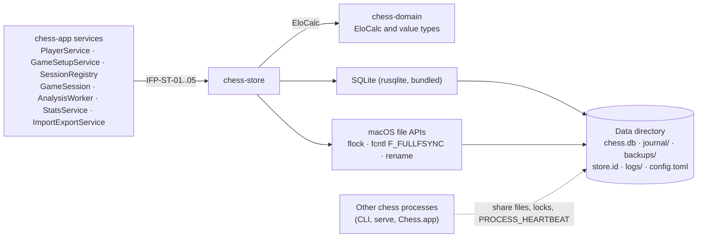
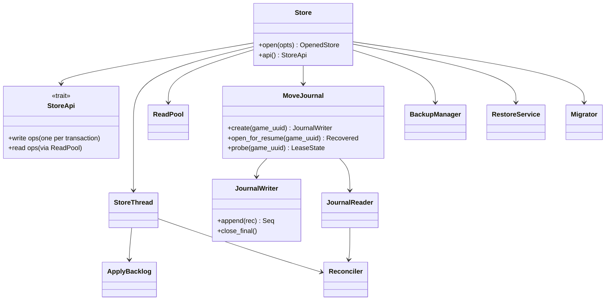
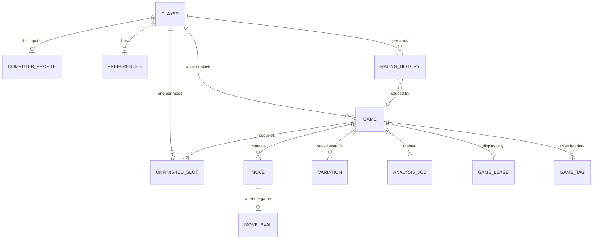
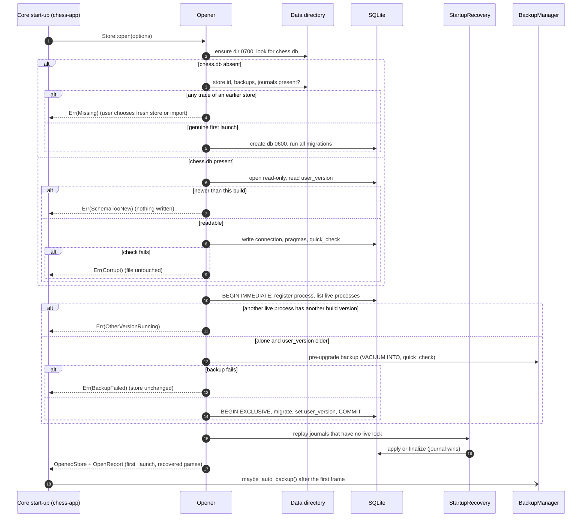
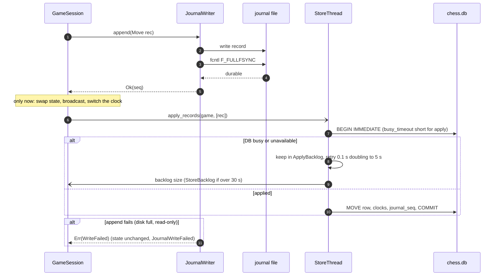
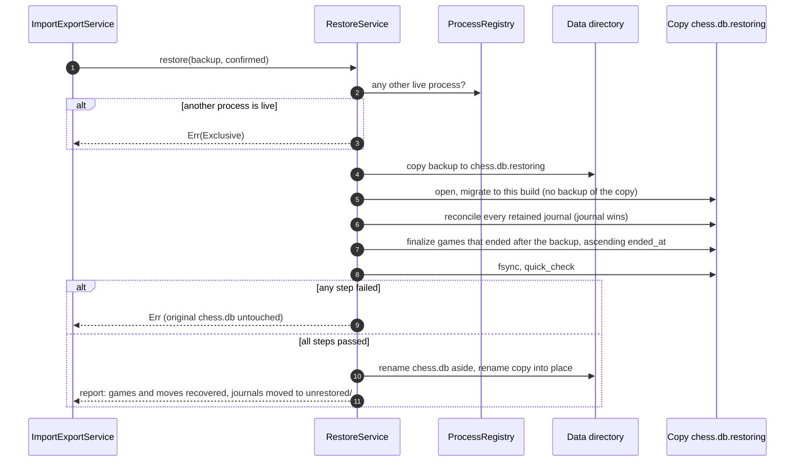
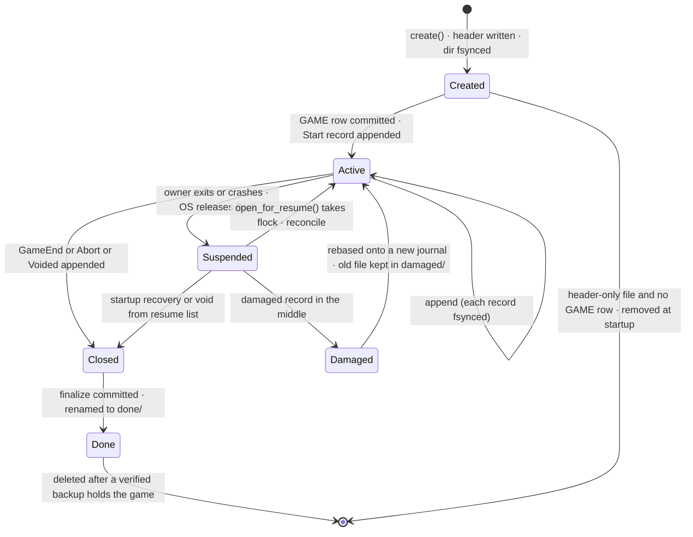

# SDD-chess-store: Software Design Description of the `chess-store` crate

| Field | Value |
|---|---|
| Document | docs/design/SDD-chess-store.md |
| Version / status | 0.1 DRAFT |
| Date | 2026-10-30 |
| Standard basis | IEEE 1016-style (no conformance claim; `implementation-design-1016` skill) |
| Owner | Software engineer role (Claude), for Brian Prascher |
| Approver | PENDING. Nothing in this document is approved. |
| Gate | Drafting this document is documents-only: **G0**, no approver (SWE-001 §3). No `GATE-` file was created here, because gate numbers (GATE-101 onward, SWE-001 ASM-S5) are assigned by the coordinator. Implementing parts of the design that are marked "gate impact" in section 9 would be G1, G2 or G3 and needs the approver named there. |
| Engineering profile | [SWE-001](../engineering/SWE-001-engagement-profile.md): Rust 1.99.1 / edition 2024, CERT-informed practice with no conformance claim, warnings are errors |
| Crate / allocation name | `crates/chess-store`; architecture §2.2 block `chess-app core :: chess-store` (also the data store block `chess.db + journals`, files only) |
| Sibling SDDs | [chess-rules](SDD-chess-rules.md), [chess-domain](SDD-chess-domain.md), [chess-engine](SDD-chess-engine.md), [chess-app](SDD-chess-app.md), [chess-server](SDD-chess-server.md), [chess-cli](SDD-chess-cli.md), [ui](SDD-ui.md), [desktop-tauri](SDD-desktop-tauri.md) |
| Evidence tags | `[OBS file §]` read in this session; `[RAN]` executed; `[INF]` inferred; `[ASM-ST-n]` assumed; `[UNV]` unverified |

## 1 Introduction

### 1.1 Purpose and scope

This SDD designs the crate that owns **everything on disk**: the SQLite database, the per-game move journals, backups, the on-disk layout, the multi-process coordination (journal locks, lease rows, process heartbeats), the analysis job queue, and the typed row input and output used by export, import and restore. It is the only place in the code base that contains SQL (architecture §5.7, "No SQL outside `chess-store`") and the only place that writes to the data directory other than the log writer and `config.toml`.

In scope: schema and migrations (§7.1, §7.2), the store thread and read pool (§4.8, D-13), repositories and the transactions of §7.4, the move journal (§7.6, D-23), recovery, backups, restore (D-35), leases and the job queue (§7.3), and row IO for `ImportExportService`.

Out of scope (owned elsewhere): file formats of PGN and the zip archive and the merge decisions (`ImportExportService` in `chess-app`, [SDD-chess-app](SDD-chess-app.md)); game rules, `Policy`, `EloCalc` and the `Clock` (`chess-domain`, [SDD-chess-domain](SDD-chess-domain.md)); choosing when to write a journal record (`GameSession`, `chess-app`); mapping `StoreError` to protocol codes (`chess-app`); the log writer (`Diagnostic log`, `chess-app`).

### 1.2 Allocated requirements and functions

Requirement allocation is architecture §10.1 `[OBS architecture.md §10.1 rows RULE-5, DAT-1..6, DAT-7, NFR-2, PLAT-5, ELO-1]`; requirement text was read in requirements.md (DAT-1..DAT-7, RULE-5, NFR-2, NFR-9, NFR-10, IF-5).

| Requirement | Role of this crate | Primary DD |
|---|---|---|
| DAT-1 central store, concurrent access, migrations | Whole crate | DD-ST-001..007 |
| DAT-2 export and import (merge) | Row IO and exclusive import transaction; formats stay in `ImportExportService` | DD-ST-022 |
| DAT-3 per-game statistics | Schema for the stored fields; stats queries; eval upserts | DD-ST-007, 009, 011, 012 |
| DAT-4 one front-end per live game | Journal `flock` is the lease; `GAME_LEASE` is display only | DD-ST-014, 016 |
| DAT-5 integrity check, restore, automatic backup | `quick_check`, restore on a copy, 24 h backups, newest 3 kept | DD-ST-005, 020, 021 |
| DAT-6 backup before upgrade | Pre-upgrade copy, `BackupFailed` | DD-ST-006, 020 |
| DAT-7 all-or-nothing writes, unreadable journals | One transaction per command; recovery rules | DD-ST-009, 017, 018, 019 |
| NFR-2 / RULE-5 no completed move lost; clocks restored | Journal with `F_FULLFSYNC` first, SQLite second, journal wins | DD-ST-015..019 |
| PLAT-5 one version everywhere | `SchemaTooNew`, process heartbeats, journal version | DD-ST-005, 006, 014 |
| ELO-1 / ELO-2, PLY-7 (store side) | Finalize and reset transactions, rating history, invariant check | DD-ST-009, 010 |
| PLAT-3 offline first launch | Create store and layout with no network | DD-ST-004, 005 |
| NFR-9 / NFR-10 (store side) | `StoreError` has no paths or SQL; log lines carry identifiers only | DD-ST-023 |
| NFR-1 (CLI start-up ≤ 1 s), NFR-8 | Start-up work is small and the backup runs after start-up; no SQLite call on a runtime worker | DD-ST-002, 003, 020 |

| Function (functional_decomp) | Name | Where |
|---|---|---|
| F-4.3 | Record rating history | DD-ST-010 (written inside finalize and reset transactions) |
| F-6.2 | Journal state changes durably | DD-ST-016 |
| F-6.3 | Reconcile journal and database | DD-ST-017, 018, 019 |
| F-6.4 | Coordinate concurrent access | DD-ST-002, 003, 014 |
| F-6.5 | Initialise store on first launch (roster seeding is `PlayerService`; this crate creates schema and layout) | DD-ST-004, 005 |
| F-6.6 | Check store integrity | DD-ST-005 |
| F-6.7 | Restore or recreate store | DD-ST-021, 005 |
| F-6.8 | Back up before schema upgrade | DD-ST-006, 020 |
| F-6.9 | Migrate and guard schema version | DD-ST-006 |
| F-6.15 | Back up store automatically | DD-ST-020 |
| F-8.5 | Verify build version consistency (store side) | DD-ST-005, 014 |
| F-6.1 | Retain persistent records (block `chess.db + journals`) | DD-ST-004, 007 |

`[OBS functional_decomp.md §F-4, F-6, F-8 tables; allocation count of 11 functions to chess-store matches the list above]`

### 1.3 Decisions and risks this design implements

D-2 (per-process core, coordination through the data dir), D-12 (SQLite, WAL), D-13 (store thread), D-14 (suspend, via the journal), D-16 (one version; `SchemaTooNew`), D-17 (exclusive import), D-23 (move journal), D-26 and D-30 (reset and void transactions), D-27 (unfinished slots), D-28 (two rating tracks), D-29 (archive; row side only), D-34 (content hash, UUIDs), D-35 (backups, restore, damaged journals). Risks mitigated: R-3, R-9, R-11, R-15, R-17, R-19.

### 1.4 Definitions

*Journal*: the append-only file `journal/<game_uuid>.jnl`. *Apply*: writing the effect of a journal record into SQLite. *Intact run*: the records of a journal from its start up to the first damaged record. *Store thread*: the single OS thread that owns the write connection. *Track*: `strict` or `training` rating scale.

## 2 Design overview

### 2.1 Readiness basis

Upstream is baselined (architecture v1.0 amendment 6, requirements Amendment 6). No separate readiness report was produced for this block. The findings in section 7 are the readiness input to the System Architect and Systems Engineer; none of them blocks drafting. Two of them (FIND-ST-01 journal payload, FIND-ST-02 `VARIATION` owner) should be answered before the journal format and schema are frozen at implementation.

### 2.2 Viewpoints

| # | Viewpoint | Included | Section |
|---|---|---|---|
| 1 | Context | yes | 3.1 |
| 2 | Composition | yes | 3.2 |
| 3 | Logical (types) | yes | 3.3 |
| 4 | Dependency | yes | 3.4 |
| 5 | Information | yes (largest) | 3.5 |
| 6 | Patterns use | yes | 3.6 |
| 7 | Interface | yes | 3.7 |
| 8 | Structure (module layout) | yes | 3.8 |
| 9 | Interaction | yes | 3.9 |
| 10 | State dynamics | yes | 3.10 |
| 11 | Algorithm | yes | 3.11 |
| 12 | Resource | yes | 3.12 |

No viewpoint is omitted. The Information viewpoint carries the schema because the crate's main concern is persistent data.

### 2.3 Conventions

Design entities are `DD-ST-nnn`. Interfaces are `IFP-ST-nn` (provided) and `IFR-ST-nn` (required). Tests are `UT-ST-nnn` and `CT-ST-nnn`. Upstream findings are `FIND-ST-nn`; open questions `OQ-ST-n`; assumptions `ASM-ST-n`. Numbers that no requirement or decision fixes are marked `ESTIMATE`.

## 3 Viewpoints

### 3.1 Context viewpoint

**Concern:** who uses this crate, and what outside it does the crate touch?



The crate has no network access and no knowledge of the engine, the protocol or any front-end.

### 3.2 Composition viewpoint

**Concern:** which parts is the crate made of, and what is each part for?

| DD | Part | Purpose | Traces to |
|---|---|---|---|
| DD-ST-001 | `Store` handle and `StoreApi` | The one async facade `chess-app` calls; routes writes to the store thread and reads to the read pool | DAT-1, D-13, §5.7 |
| DD-ST-002 | `StoreThread` | Owns the write connection; runs every write transaction; owns the apply backlog and retry timer | D-13, §4.8, NFR-2 |
| DD-ST-003 | `ReadPool` | Small pool of read-only connections used through `spawn_blocking` | §4.8, R-11 |
| DD-ST-004 | `DataDir` | On-disk layout, permissions, directory resolution helper | §7.1, §8 (security), PLAT-3 |
| DD-ST-005 | `Opener` | The open sequence: missing-store test, version probe, process registration, integrity check, upgrade, startup recovery | DAT-1, DAT-5, PLAT-5, F-6.5, F-6.6 |
| DD-ST-006 | `Migrator` | Numbered migrations, schema-version guard, pre-upgrade backup | DAT-6, D-16, F-6.8, F-6.9 |
| DD-ST-007 | `Schema` | DDL of every table, constraints and indexes (section 3.5) | §7.2, DAT-3 |
| DD-ST-008 | `PlayerRepo` | Players, computer profiles, preferences, app settings | PLY-4, PLY-6, §7.4 |
| DD-ST-009 | `GameRepo` | Start, apply, slots, finalize, abort, void, reset, takeback | GAME-4, D-27, D-30, §7.4 |
| DD-ST-010 | `RatingRepo` | Rating history, rating-invariant check | ELO-1, F-4.3 |
| DD-ST-011 | `EvalRepo` and `VariationRepo` | `MOVE_EVAL` upsert and read, saved variations | DAT-3, ANA-3 |
| DD-ST-012 | `StatsQueries` | SQL views and parameterised queries for statistics and history | UI-2, UI-5, D-26 |
| DD-ST-013 | `JobQueue` | Analysis job claim, heartbeat, complete, fail | §7.3, F-5.5 |
| DD-ST-014 | `ProcessRegistry` and `Lease` | `PROCESS_HEARTBEAT`, `GAME_LEASE`, flock probe | DAT-4, D-16 |
| DD-ST-015 | `JournalFormat` | Record layout, codec, version | §7.6, D-23 |
| DD-ST-016 | `JournalWriter` | Exclusive lock, append, `F_FULLFSYNC` | RULE-5, NFR-2, F-6.2 |
| DD-ST-017 | `JournalReader` | Scan, torn-tail detection, damaged-middle resync | DAT-7, F-6.3 |
| DD-ST-018 | `Reconciler` | Pure function: journal fold versus stored rows | NFR-2, Q54 |
| DD-ST-019 | `StartupRecovery` | Replays journals without a live lock | §7.6, R-15 |
| DD-ST-020 | `BackupManager` | Automatic, pre-upgrade and pre-import backups; pruning; journal collection | DAT-5, DAT-6, F-6.15 |
| DD-ST-021 | `RestoreService` | Restore on a copy with journal replay and re-finalise | DAT-5, D-35, R-19 |
| DD-ST-022 | `RowIo` | Typed export snapshot and import apply | DAT-2, IF-5, D-17 |
| DD-ST-023 | `StoreError` | Typed errors and their catalogue mapping | §5.5, NFR-9 |
| DD-ST-024 | `FaultPlan` (feature `test-support`) | Failpoints and delays for failure-injection tests | R-11, R-15, NFR-2 |

### 3.3 Logical viewpoint

**Concern:** which are the key types and how do they relate?



Only key types are shown. The architecture's `PlayerRepo`, `GameRepo`, `RatingRepo`, `JobQueue`, `Lease` (§3.3) are the repository groups of `StoreApi`.

### 3.4 Dependency viewpoint

**Concern:** what does this crate depend on, and what depends on it?

Crate edges, exactly as architecture §3.2: `chess-app → chess-store`, `chess-store → chess-domain`. The crate has **no edge to `chess-rules`**, `chess-engine`, `chess-server` or any front-end `[OBS architecture.md §3.2]`. `chess-domain` reaches `chess-rules` transitively; this crate must not name `chess_rules` in its manifest.

| Dependency | Use | Version source |
|---|---|---|
| `chess-domain` | `EloCalc`, value types (`Mode`, `Matchup`, `Track`, `Side`, `GameResult`) `[ASM-ST-1: names to be reconciled with SDD-chess-domain]` | workspace |
| `rusqlite` (bundled) | all SQL | 0.41.1 `[OBS architecture.md §3.4]` |
| `tokio` (features `sync`, `rt`, `time`) | `oneshot` replies, `spawn_blocking`, retry timer | 1.54.1 `[OBS §3.4]` |
| `thiserror`, `serde`, `tracing` | errors, journal and row DTOs, log events | 2.0.21, 1.0.229, 0.1.44 `[OBS §3.4]` |
| `libc` | `flock`, `fcntl(F_FULLFSYNC)`, in a single `sys` module | not in §3.4; see below |
| `serde_json`, `crc32fast`, `uuid` | journal payloads, record checksum, UUID parsing | not in §3.4; see below |

Dependencies not in the §3.4 table are proposals, not decisions. Before use they must be verified (exists, intended crate, maintained, licence compatible with GPL-3.0-or-later, pinned, in the SBOM) per `swe-governance` guardrail 5. `libc` defines `F_FULLFSYNC` for Apple targets (value 51) and `flock` `[OBS ~/.cargo/registry libc-0.2.174 src/unix/bsd/apple/mod.rs:3248, src/unix/mod.rs:1689]`; that is a locally cached version, not a pin. `rustix` is an alternative with safe wrappers `[UNV: not present locally, API names not checked]`. `tokio` is listed in §3.2 as an external dependency of `chess-app` only; using its `sync` and `rt` features here is raised as FIND-ST-10.

### 3.5 Information viewpoint

**Concern:** which persistent data exists, who owns it, in what shape, and how does it evolve?

#### 3.5.1 Files in the data directory

| Path (under the data directory) | Content | Owner | Mode |
|---|---|---|---|
| `chess.db`, `chess.db-wal`, `chess.db-shm` | SQLite database | `StoreThread` | file `0600` |
| `store.id` | `{store_uuid, created_at}` written when a store is created | `Opener` | `0600` |
| `journal/<game_uuid>.jnl` | live or suspended game journal | holder of its `flock` | `0600` |
| `journal/done/` | journals of final games, kept until a backup contains the game | `BackupManager` | dir `0700` |
| `journal/damaged/` | journals with a damaged middle, never deleted | `JournalReader` | dir `0700` |
| `journal/unrestored/` | journals a restore could not apply (R-19), never deleted | `RestoreService` | dir `0700` |
| `backups/chess-<UTC date>.db` | automatic backups (newest 3 kept) | `BackupManager` | `0600` |
| `chess.db.bak-v<N>` | pre-upgrade copy, never pruned | `Migrator` | `0600` |
| `chess.db.pre-import-<UTC time>` | pre-import copy, never pruned `[ASM-ST-2: the name is chosen here; architecture does not name it]` | `RowIo` | `0600` |
| `missing-<date>/` | traces of a lost store set aside by `CreateFreshStore` | `Opener` | dir `0700` |
| `logs/`, `config.toml` | not written by this crate | `chess-app`, `chess-cli` | n/a |

The data directory is created `0700`, the database `0600` (architecture §8 Security `[OBS]`). `VACUUM INTO` needs a target that does not exist or is empty `[UNV: SQLite documentation not re-read here]`, so each backup file is created empty with mode `0600` first.

#### 3.5.2 Schema

The tables and columns are those of architecture §7.2 `[OBS architecture.md §7.2 ER]`. This section adds the types, constraints and indexes that the ER does not carry. Deviations from the ER are listed explicitly in 3.5.3.

Conventions: every `datetime` is `INTEGER` Unix epoch milliseconds in UTC; every `bool` is `INTEGER` with `CHECK (x IN (0,1))`; text identifiers are compared with the default `BINARY` collation (case-sensitive); `PRAGMA foreign_keys=ON`.

```sql
-- migrations/0001_init.sql (design-level; the constraints are normative, formatting is not)
CREATE TABLE player (
  id INTEGER PRIMARY KEY,
  uuid TEXT NOT NULL UNIQUE,
  kind TEXT NOT NULL CHECK (kind IN ('human','computer')),
  name TEXT NOT NULL UNIQUE COLLATE BINARY CHECK (length(name) > 0),
  start_category TEXT NOT NULL,
  strict_elo INTEGER NOT NULL,
  training_elo INTEGER NOT NULL,
  strict_rated_games INTEGER NOT NULL DEFAULT 0 CHECK (strict_rated_games >= 0),
  training_rated_games INTEGER NOT NULL DEFAULT 0 CHECK (training_rated_games >= 0),
  reset_at INTEGER,
  archived INTEGER NOT NULL DEFAULT 0 CHECK (archived IN (0,1)),
  created_at INTEGER NOT NULL,
  CHECK (kind = 'human' OR reset_at IS NULL)
);
CREATE TABLE computer_profile (
  player_id INTEGER PRIMARY KEY REFERENCES player(id),
  roster_seed INTEGER NOT NULL, roster_index INTEGER NOT NULL,
  skill_level INTEGER NOT NULL, depth_limit INTEGER NOT NULL, movetime_ms INTEGER NOT NULL,
  uci_elo INTEGER, error_rate REAL NOT NULL, error_multipv INTEGER NOT NULL,
  UNIQUE (roster_seed, roster_index)
);
-- ENG-2 backstop: no two computers share a parameter set (NULL uci_elo made comparable)
CREATE UNIQUE INDEX computer_profile_params ON computer_profile
  (skill_level, depth_limit, movetime_ms, COALESCE(uci_elo,-1), error_rate, error_multipv);
CREATE TABLE preferences (
  player_id INTEGER PRIMARY KEY REFERENCES player(id),
  json TEXT NOT NULL CHECK (json_valid(json))
);
CREATE TABLE game (
  id INTEGER PRIMARY KEY,
  uuid TEXT NOT NULL UNIQUE,
  white_id INTEGER REFERENCES player(id), black_id INTEGER REFERENCES player(id),
  matchup TEXT CHECK (matchup IN ('hh','hc','cc')),
  mode TEXT CHECK (mode IN ('training','strict')),
  rated INTEGER NOT NULL CHECK (rated IN (0,1)),
  self_play INTEGER NOT NULL CHECK (self_play IN (0,1)),
  start_fen TEXT, clock_spec TEXT,
  white_clock_ms INTEGER, black_clock_ms INTEGER,
  status TEXT NOT NULL CHECK (status IN ('in_progress','completed','aborted','voided','imported')),
  result TEXT CHECK (result IN ('1-0','0-1','1/2-1/2')),
  termination TEXT, voided_by INTEGER REFERENCES player(id),
  eco TEXT, opening_name TEXT,
  started_at INTEGER, ended_at INTEGER,
  white_time_used_ms INTEGER, black_time_used_ms INTEGER, total_active_ms INTEGER,
  analysis_used INTEGER NOT NULL DEFAULT 0 CHECK (analysis_used IN (0,1)),
  white_elo_before INTEGER, white_elo_after INTEGER, black_elo_before INTEGER, black_elo_after INTEGER,
  content_hash TEXT NOT NULL,
  journal_seq INTEGER NOT NULL DEFAULT 0,
  CHECK (CASE status WHEN 'completed' THEN result IS NOT NULL
                     WHEN 'imported' THEN 1 ELSE result IS NULL END),
  CHECK (status <> 'imported' OR (matchup IS NULL AND mode IS NULL AND rated = 0)),
  CHECK (status = 'imported' OR (matchup IS NOT NULL AND mode IS NOT NULL)),
  CHECK (mode IS NULL OR mode <> 'training' OR (matchup = 'hc' AND clock_spec IS NULL)),
  CHECK (voided_by IS NULL OR status = 'voided')
);
CREATE INDEX game_white ON game(white_id);  CREATE INDEX game_black ON game(black_id);
CREATE INDEX game_status ON game(status);   CREATE INDEX game_hash ON game(content_hash);
CREATE TABLE move (
  game_id INTEGER NOT NULL REFERENCES game(id), ply INTEGER NOT NULL CHECK (ply >= 1),
  san TEXT NOT NULL, uci TEXT NOT NULL, fen_after TEXT NOT NULL,
  think_ms INTEGER, white_clock_ms INTEGER, black_clock_ms INTEGER, played_at INTEGER,
  PRIMARY KEY (game_id, ply)
) WITHOUT ROWID;
CREATE TABLE move_eval (
  game_id INTEGER NOT NULL, ply INTEGER NOT NULL, cp INTEGER, mate INTEGER,
  best_uci TEXT, cp_loss INTEGER, flag TEXT CHECK (flag IN ('blunder','mistake','inaccuracy')),
  depth INTEGER, engine_version TEXT NOT NULL,
  PRIMARY KEY (game_id, ply), FOREIGN KEY (game_id, ply) REFERENCES move(game_id, ply),
  CHECK (cp IS NULL OR mate IS NULL)
) WITHOUT ROWID;
CREATE TABLE rating_history (
  id INTEGER PRIMARY KEY, player_id INTEGER NOT NULL REFERENCES player(id),
  track TEXT NOT NULL CHECK (track IN ('strict','training')),
  game_id INTEGER REFERENCES game(id),
  rating_before INTEGER NOT NULL, rating_after INTEGER NOT NULL, k INTEGER NOT NULL, at INTEGER NOT NULL
);
CREATE INDEX rating_history_player ON rating_history(player_id, track, id);
CREATE TABLE variation (id INTEGER PRIMARY KEY, game_id INTEGER NOT NULL REFERENCES game(id),
  from_ply INTEGER NOT NULL, pgn TEXT NOT NULL);           -- see FIND-ST-02
CREATE TABLE analysis_job (game_id INTEGER PRIMARY KEY REFERENCES game(id),
  state TEXT NOT NULL CHECK (state IN ('queued','running','done','failed')),
  owner TEXT, heartbeat_at INTEGER);
CREATE TABLE game_tag (game_id INTEGER NOT NULL REFERENCES game(id), name TEXT NOT NULL, value TEXT NOT NULL,
  PRIMARY KEY (game_id, name)) WITHOUT ROWID;
CREATE TABLE game_lease (game_id INTEGER PRIMARY KEY REFERENCES game(id), owner TEXT NOT NULL, heartbeat_at INTEGER NOT NULL);
CREATE TABLE unfinished_slot (
  player_id INTEGER NOT NULL REFERENCES player(id), mode TEXT NOT NULL CHECK (mode IN ('training','strict')),
  game_id INTEGER NOT NULL REFERENCES game(id), PRIMARY KEY (player_id, mode)) WITHOUT ROWID;
CREATE TABLE app_setting (setting_key TEXT PRIMARY KEY, value TEXT NOT NULL) WITHOUT ROWID;
CREATE TABLE process_heartbeat (owner TEXT PRIMARY KEY, build_version TEXT NOT NULL, heartbeat_at INTEGER NOT NULL) WITHOUT ROWID;
```

Reduced entity view (keys only):



`APP_SETTING` and `PROCESS_HEARTBEAT` have no relationships and are omitted above.

#### 3.5.3 Deviations from architecture §7.2 (proposals for the System Architect, gate impact in section 9)

| # | Change | Reason | Finding |
|---|---|---|---|
| 1 | Timestamps are `INTEGER` epoch milliseconds, not `datetime` | No time-zone ambiguity, exact ordering for "finalise in order of end time" | refinement, FIND-ST-14 |
| 2 | `PROCESS_HEARTBEAT.build_version` is `TEXT`, not `int` | The handshake and the message "Chess version X is still running" need a displayable version; a semantic version string does not fit an integer without losing information | FIND-ST-07 |
| 3 | CHECK constraints and the `computer_profile_params` unique index | Make the stated invariants (result only for completed games, Training only h–c and untimed, unique parameter sets) hold even for a buggy caller | refinement |
| 4 | `VARIATION` needs an owner and a time (not added to the DDL above) | Views of a reset Player must hide that Player's older variations (D-26) | FIND-ST-02 |

#### 3.5.4 Ownership and transaction boundaries

The table of architecture §7.4 `[OBS]` stands. The store methods that realise each transaction are:

| §7.4 row | Store method (section 3.7) | Transaction |
|---|---|---|
| Register | `register_player` | `BEGIN IMMEDIATE`: `PLAYER` + default `PREFERENCES` + one `RATING_HISTORY` row per track |
| Reset | `reset_player` | `BEGIN IMMEDIATE`; rolls back with `UnlistedUnfinishedGames` if an unfinished game is not in `void_game_ids` |
| Rename, archive, preferences | `rename_player`, `archive_player`, `update_preferences` | one transaction each |
| Roster batch | `insert_computers` | one transaction for N Players and 2N rating rows |
| Start | `start_game` | `BEGIN IMMEDIATE`: `GAME` + slots; idempotent on `game_uuid` |
| Move | `apply_records` | one transaction per applied batch: rows, clocks, `journal_seq` |
| Finalize, c–c abort | `finalize_game`, `abort_game` | `BEGIN IMMEDIATE`; skipped if already final |
| Void unreadable | `void_unreadable_game` | `BEGIN IMMEDIATE` |
| Evals | `upsert_move_eval` | one upsert per ply |
| Import, restore, migrate | `RowIo::apply_import`, `RestoreService`, `Migrator` | exclusive, see DD-ST-021, 022, 006 |

### 3.6 Patterns-use viewpoint

**Concern:** which recognised solutions are used, and what would show they are being misused?

| Pattern | Where | Why | Misuse tell |
|---|---|---|---|
| Single-writer thread with command channel (actor-like) | DD-ST-002 | One owner of the write connection; no lock across `await` (D-13, R-11) | A second place that opens a write connection; `Mutex<Connection>` appears |
| Write-ahead log (application level) | Journal, DD-ST-015..019 | Durable-before-ack independent of SQLite availability (Q54) | A journal record that is acknowledged before `F_FULLFSYNC` returns |
| Repository functions over `&Connection`/`&Transaction` | DD-ST-008..013 | The same code runs on the store thread, on a restore copy and in tests | SQL strings outside `repo/` |
| Pure reconciler (functional core) | DD-ST-018 | The hardest logic (R-15) is testable without files | `Reconciler` takes a file handle |
| Compare-and-set on `heartbeat_at` and `owner` | DD-ST-013, 014 | Safe claim of a job and a lease row without a lock | An `UPDATE` without the `WHERE owner = ?` guard |
| Copy-then-rename | Restore, DD-ST-021 | A failed restore leaves the original untouched (DAT-7) | In-place edit of `chess.db` |
| Ports and adapters (failpoints) | DD-ST-024 | Fault injection without mocking the unit under test | A mock of `rusqlite` in a store test |

### 3.7 Interface viewpoint

**Concern:** what does the crate offer to `chess-app`, what does it need, and what are the failure semantics?

#### 3.7.1 Provided interfaces

| ID | Interface | Style | Consumer |
|---|---|---|---|
| IFP-ST-01 | `StoreApi` (all repository methods) | async fns; writes through the store thread, reads through the read pool | `PlayerService`, `GameSetupService`, `SessionRegistry`, `GameSession`, `StatsService`, `AnalysisWorker`, `AnalysisService` |
| IFP-ST-02 | `MoveJournal`, `JournalWriter`, `Recovered` | async `append`; sync open and probe | `GameSession`, `SessionRegistry`, `PlayerService` (void of a suspended game) |
| IFP-ST-03 | `Store::open`, `DataDir`, `OpenReport` | async open | `Core` start-up, `chess-cli`, `src-tauri` |
| IFP-ST-04 | `BackupManager`, `RestoreService` | async | `Core` start-up, `ImportExportService` |
| IFP-ST-05 | `RowIo` (export snapshot, import apply, lookups) | blocking iterators plus one async apply | `ImportExportService` |
| IFP-ST-06 | `FaultPlan` | test-only | tests in all crates |

This matches architecture §5.7: "One method per transaction in §7.4. No SQL outside `chess-store`", failure behaviour `StoreBusy` / `StoreUnavailable` / `SchemaTooNew`, plus the journal contract of §7.6 `[OBS architecture.md §5.7, §7.6]`.

`StoreApi` is a trait with native `async fn` methods and is used with static dispatch (generics or one concrete `Store`), not `dyn` `[INF: dyn-compatibility of async fn in traits is not available; to be confirmed at implementation, UNV]`. The only implementation is `Store`. Tests use `FaultPlan` and temp directories instead of a fake store (rationale in 3.13 R-ST-2).

#### 3.7.2 `StoreApi` methods

Names are design proposals. "W" = write on the store thread. "R" = read pool. All writes are single transactions unless stated.

| Group | Method | Kind | Notes |
|---|---|---|---|
| Players | `register_player(NewPlayer)` | W | `PLAYER` + `PREFERENCES` + 2 rating rows; `NameTaken` on UNIQUE violation (backstop for `PlayerService`'s own check) |
| | `insert_computers(Vec<NewComputer>)` | W | all N or none; skips nothing |
| | `rename_player`, `archive_player` | W | store re-checks nothing about policy (`PlayerService` owns it) except the archive guard `has_unfinished` inside the same transaction |
| | `update_preferences(player, json)` | W | |
| | `get_player`, `list_players(kind, include_archived)`, `find_player_by_name`, `get_preferences` | R | |
| | `get_app_setting`, `set_app_setting` | R, W | |
| Games | `start_game(NewGame)` | W | inserts `GAME` + slot rows; returns the existing game when `uuid` exists; `SlotTaken{game_id, mode, player_id}` |
| | `apply_records(game_id, Vec<JournalRecord>)` | W, queued | applies a batch in order; see 3.11.3 and the backlog rule in 3.12 |
| | `finalize_game(FinalizeRequest)` | W | see 3.11.4; returns `FinalizeOutcome` |
| | `abort_game`, `void_unreadable_game`, `reset_player` | W | |
| | `set_analysis_used(game_id)` | W | idempotent |
| | `list_unfinished(player_id)` | R | reads `GAME`, not the slot table (architecture §4.4 resume list) |
| | `get_game`, `list_games(filter)`, `game_moves(game_id)` | R | |
| Ratings | `rating_history(player, track)`, `check_rating_invariant(player_ids)` | R | invariant: current = last reset point (or initial) + Σ later deltas |
| Analysis | `upsert_move_eval(MoveEvalRow)`, `get_game_analysis(game_id)` | W, R | `get_game_analysis` returns evals, job state, `evaluated` and `total` ply counts |
| | `save_variation`, `delete_variation`, `list_variations(game_id)` | W, R | shape depends on FIND-ST-02 |
| Jobs | `enqueue_job(game_id)`, `enqueue_unevaluated_games()`, `claim_job(owner)`, `job_heartbeat`, `complete_job`, `fail_job` | W | 3.11.7 |
| Coordination | `register_process`, `process_heartbeat`, `deregister_process`, `list_live_processes` | W, R | 3.11.6 |
| | `lease_beat(game_id, owner) -> LeaseBeat` | W | `RowGone{status}` tells a session that it was voided (architecture §7.2 reset sequence) |
| | `lease_upsert`, `lease_delete` | W | |
| Statistics | `player_stats(player, filter)`, `head_to_head`, `games_for_history` | R | SQL views, filter `self_play = 0 AND status = 'completed' AND start_fen IS NULL` for aggregates `[OBS §7.2 notes]` |
| Barrier | `sync_backlog(timeout) -> Result<()>` | W | waits until the apply backlog is empty; used before an export (3.11.9) |

`FinalizeRequest` carries every input of the transaction so that a restore can rebuild it from the journal: `{game_id, result, termination, ended_at, white_time_used_ms, black_time_used_ms, total_active_ms, eco, opening_name, analysis_used, final_journal_seq}`.

#### 3.7.3 Journal interface (IFP-ST-02)

```rust
pub struct MoveJournal { /* data dir handle, io policy */ }
impl MoveJournal {
    /// Creates journal/<uuid>.jnl (mode 0600), takes flock(LOCK_EX|LOCK_NB), writes the header,
    /// fsyncs file and directory. Err(Locked{owner}) when another descriptor holds the lock.
    pub fn create(&self, game_uuid: &GameUuid) -> Result<JournalWriter, JournalError>;
    /// Takes the lock, scans, reconciles with the store, returns the recovered game.
    pub async fn open_for_resume(&self, store: &Store, game_uuid: &GameUuid)
        -> Result<(JournalWriter, Recovered), JournalError>;
    /// Reports whether the lock is held without keeping it (lock then release).
    pub fn probe(&self, game_uuid: &GameUuid) -> LeaseState;       // Free | Held
}
impl JournalWriter {
    /// Appends one record and returns only after F_FULLFSYNC returned. Cancel-safe: a dropped
    /// future either wrote the whole record durably or nothing the reader accepts.
    pub async fn append(&self, rec: JournalRecord) -> Result<Seq, JournalError>;
    /// Appends nothing further; renames the file into journal/done/; releases the lock.
    pub fn close_final(self) -> Result<(), JournalError>;
}
pub struct Recovered { pub records: Vec<JournalRecord>, pub moves: Vec<MoveRecord>,
    pub clocks: Clocks, pub report: RecoveryReport }
pub struct RecoveryReport { pub torn_tail_dropped: bool, pub damaged: Option<DamagedInfo>,
    pub recovered_moves: u32, pub source: RunSource /* Journal | Store | Both */ }
```

`JournalError` variants: `Locked{owner_kind}`, `WriteFailed{cause}`, `Unreadable` (nothing readable, caller offers `VoidUnreadableGame`), `VersionMismatch{found, expected}`, `ForeignStore`. `JournalWriter::append` calls blocking I/O inside `spawn_blocking` (3.12).

#### 3.7.4 Required interfaces

| ID | Interface | Contract relied on | If it fails |
|---|---|---|---|
| IFR-ST-01 | SQLite via `rusqlite` | WAL, `synchronous=FULL`, `fullfsync`, `busy_timeout`, `VACUUM INTO`, `quick_check`, `user_version` | Mapped in 3.8 error table |
| IFR-ST-02 | macOS file APIs | `flock` is released by the OS when the descriptor closes or the process ends; `fcntl(F_FULLFSYNC)`; `rename` is atomic on one volume; all descriptors opened with close-on-exec | `JournalWriteFailed` / `StoreUnavailable` |
| IFR-ST-03 | `chess_domain::EloCalc` `[ASM-ST-1; reconciled with SDD-chess-domain IFP-DOM-4 by XC-3]` | `rating_track(&GameFacts) -> Rated(Track) \| Unrated(reason)`, then `settle(white: RatedSide, black: RatedSide, result: GameResult) -> Settlement { white: SideUpdate, black: SideUpdate }` (each `SideUpdate` has `before`, `after`, `delta`, `k`, `counter_after`), whole-integer rounding half away from zero (ELO-1). Error `EloError::RatingOverflow` maps to `InvariantViolated` | Compile-time mismatch |
| IFR-ST-04 | `tokio` | `oneshot`, `spawn_blocking`, timers | Panic in a blocking task is mapped to `Internal` |
| IFR-ST-05 | Wall clock | `fn() -> i64` injected in `StoreOptions` (default system time); tests inject a fake | n/a |
| IFR-ST-06 | `tracing` | Events carry identifiers and codes only (NFR-10) | n/a |

### 3.8 Structure viewpoint

**Concern:** how is the crate organised internally?

```
crates/chess-store/
  Cargo.toml                    # features: test-support (FaultPlan, temp stores)
  migrations/0001_init.sql
  src/
    lib.rs                      # #![forbid(unsafe_code)] except src/sys
    api.rs                      # StoreApi, DTOs (NewPlayer, NewGame, FinalizeRequest, rows)
    error.rs                    # StoreError, JournalError (DD-ST-023)
    store.rs                    # Store handle (DD-ST-001)
    thread.rs                   # StoreThread, command enum, ApplyBacklog (DD-ST-002)
    readpool.rs                 # DD-ST-003
    datadir.rs                  # DD-ST-004
    open.rs                     # Opener (DD-ST-005)
    migrate.rs                  # Migrator (DD-ST-006)
    repo/{player,game,rating,eval,stats,jobs,coord}.rs   # DD-ST-008..014, functions over &Connection
    journal/{format,writer,reader,reconcile,recover}.rs  # DD-ST-015..019
    backup.rs  restore.rs  rowio.rs                      # DD-ST-020..022
    sys.rs                      # the only module with unsafe: flock, F_FULLFSYNC (SAFETY comment each)
    fault.rs                    # DD-ST-024 (cfg feature test-support)
  tests/                        # fixtures/ (one DB per released schema version), integration tests
```

Layering rule: `repo/*` and `journal/reconcile.rs` know nothing about threads; `thread.rs` and `store.rs` know nothing about SQL text. A CI grep (or `clippy` disallowed-methods) forbids `rusqlite::Connection::execute` outside `repo/`, `migrate.rs`, `open.rs`, `backup.rs` and `restore.rs`.

#### Error mapping (DD-ST-023)

`StoreError` is a `thiserror` enum. Its `Display` prints a category only: no path, no SQL, no row data (NFR-9, NFR-10; SWE-001 §6 ERR row). Details go to `tracing` at the point of conversion with the correlation id.

| `StoreError` variant | Raised when | Protocol code in `chess-app` (§5.5) |
|---|---|---|
| `Busy` | `SQLITE_BUSY` / `SQLITE_LOCKED` after `busy_timeout` | `StoreBusy` |
| `Unavailable{cause: DiskFull \| ReadOnly \| Io(kind) \| Permission}` | `SQLITE_FULL`, `SQLITE_READONLY`, `SQLITE_IOERR`, `SQLITE_CANTOPEN`, OS errors | `StoreUnavailable{cause}` |
| `Corrupt` | `NOTADB`, `CORRUPT`, `quick_check` not `ok` | `StoreCorrupt` |
| `Missing` | no `chess.db` but traces of an earlier store | `StoreMissing` |
| `SchemaTooNew{db, app}` | `user_version` greater than the build's | `SchemaTooNew` |
| `BackupFailed{cause}` | pre-upgrade backup or its check failed | `BackupFailed` |
| `SlotTaken{game_id, mode, player_id}` | `unfinished_slot` primary key violated | `UnfinishedGameExists` |
| `NameTaken` | `player.name` UNIQUE violated | `ValidationFailed{already_used}` |
| `UnlistedUnfinishedGames{ids}` | reset found an unfinished game not in `void_game_ids` | `ConfirmationRequired{reset, voids}` |
| `NotFound{entity, id}` | row absent | `NotFound` |
| `Exclusive{reason}` | import, restore or migration needs the data dir alone and another live process exists | `Busy{reason}` |
| `OtherVersionRunning{version, kind}` | a live process of another build version is registered | **no catalogue code**, FIND-ST-04 (proposed `Busy{reason: other_version_running}`) |
| `Leased{owner_kind}` | journal lock held | `GameLeased{owner_kind}` |
| `Journal(JournalError)` | see 3.7.3 | `JournalWriteFailed{cause}`; `JournalUnreadable` is a report, not an error |
| `InvariantViolated` | a CHECK, FK or the Elo invariant failed | `Internal{id}` (a bug, or FIND-ST-09 for imports) |

### 3.9 Interaction viewpoint

**Concern:** how do the parts collaborate in the main scenarios, including failures?

#### 3.9.1 Opening the store (SEQ-ST-01)



#### 3.9.2 A move: journal first, SQLite second (SEQ-ST-02)



#### 3.9.3 Restore (SEQ-ST-03)



The reset-with-void sequence is architecture §7.2 and §7.6 and is not repeated; this crate supplies `reset_player`, `lease_beat` and the journal `Voided` record that sequence uses.

### 3.10 State-dynamics viewpoint

**Concern:** which things change state over time, and which transitions are legal?

#### 3.10.1 Journal file lifecycle (STATE-ST-01)



Transition guards: only the descriptor holding the `flock` appends. `Closed → Done` happens only after the store transaction for the final state committed (finalize, abort, void). `Done → [*]` is guarded by the rule in 3.11.8.

#### 3.10.2 Analysis job (STATE-ST-02)

`queued → running` (claim, sets `owner`, `heartbeat_at`); `running → done` (complete); `running → failed` (fail); `running → running` (claim by a new owner when the old heartbeat is stale); `failed → queued` (only by `enqueue_failed_once_per_start`, 3.11.7). A job never moves backwards from `done`.

#### 3.10.3 Open lifecycle

`Probing → (Missing | TooNew | Corrupt | OtherVersion | Ready)`; `Ready` is the only state in which `StoreApi` is usable. A failed open leaves the data directory exactly as it was found, except for the heartbeat row of the failed process, which is removed on every error path.

### 3.11 Algorithm viewpoint

**Concern:** what are the non-trivial procedures, their invariants and edge cases?

#### 3.11.1 Journal format (DD-ST-015)

File header: magic `CHSJ` (4 bytes), `journal_version: u16` (1), `game_uuid` (16 bytes), `store_id` (16 bytes), `header_crc32`. Record: `sync` (2 bytes `A5 5A`), `len: u32` (body length), `crc32: u32` over `len` and the body, then the body: `seq: u64`, `kind: u8`, `wall_ms: i64`, `payload` (UTF-8 JSON, `deny_unknown_fields`). Integers are little-endian.

Why JSON payloads: readable with a hex editor and `jq` when a user's data is damaged, and tolerant of additive fields; the size cost is irrelevant at chess rates `[INF]`. Why journal-owned DTOs instead of serialising domain types: a change to a domain type would silently change what old journals mean. Conversion lives in `chess-app`.

Kinds and payloads (the kinds are those of architecture §7.6 `[OBS]`; the field additions marked * are proposals, FIND-ST-01):

| Kind | Payload | DB effect when applied |
|---|---|---|
| `Start` | `game_uuid`, `white_uuid*`, `black_uuid*`, `matchup`, `mode`, `rated*`, `self_play*`, `start_fen`, `clock_spec`, `started_at*`, setup JSON as sent | none if the `GAME` row exists; else creates it (restore only) |
| `Move` | `ply`, `uci`, `san`, `fen_after*`, `think_ms`, `white_ms`, `black_ms` | `MOVE` row at `ply` (journal wins), clocks |
| `Takeback` | `to_ply` | delete `MOVE` rows with `ply > to_ply` |
| `Clock` | `white_ms`, `black_ms`, `running_side` | `GAME` clock columns |
| `DrawOffer`, `DrawDeclined`, `Pause`, `Resume`, `Suspend` | small | none (kept for `GameSession` rebuild) |
| `GameEnd` | `result`, `reason`, `resigning_side?`, plus the `FinalizeRequest` inputs* (`ended_at`, times, `eco`, `opening_name`, `analysis_used`) | finalize |
| `Abort` | none (c–c only) | abort |
| `Voided` | `reason`, `reset_player_uuid?` | none (the store transaction was the reset or the unreadable-game void) |

`wall_ms*` is in every record because `MOVE.played_at` and `GAME.ended_at` need a wall time that the architecture's record list does not carry.

#### 3.11.2 Journal scan with torn-tail and damage detection (DD-ST-017)

```
read header; bad magic, header_crc, version > build, or store_id != this store -> Unreadable / VersionMismatch / ForeignStore
pos = end of header; expected_seq = 1
loop:
  if pos == EOF: done (clean)
  read sync+len+crc+body at pos
  if sync wrong, or len exceeds remaining bytes, or crc wrong, or seq != expected_seq:
      look ahead: find the next sync marker after pos whose record has a valid crc and seq > last_good_seq
      none found  -> torn tail: drop it silently (never acknowledged), done
      found       -> damaged middle: intact run = records before pos; report DamagedInfo; done
  accept record; last_good_seq = seq; expected_seq += 1; pos += record size
```

The look-ahead is bounded by the file size and costs one CRC per sync marker found. A record that was acknowledged was fully written and fsynced before the acknowledgement, so a torn record is by construction an unacknowledged one (NFR-2). A rewritten tail after a crash is possible only if the writer is the new owner; it appends after the last good record, truncating the torn tail first (`ftruncate` to `pos`, then fsync).

#### 3.11.3 Reconcile (DD-ST-018, pure)

Input: `J` = moves and clocks folded from the intact journal records (`Move` sets ply `p` and drops every later ply, `Takeback` drops plies above `to_ply`); `S` = stored `MOVE` rows (ordered); `damaged: bool`; `db_seq`, `last_intact_seq`, stored clocks. Output: a plan `{replace_from: Option<ply>, rows_to_write, rows_to_delete_from, clocks, source}`.

| Case | Rule |
|---|---|
| Journal intact (no damage) | Result = `J`. Rows of `S` from the first ply where `S` and `J` differ, and rows beyond `J`'s end, are replaced or deleted. Journal wins. |
| Damaged middle, `S` and `J` agree on all common plies | Resume from the longer run. If `S` is longer, the stored rows stay and `source = Store`. |
| Damaged middle, `S` and `J` differ at ply `d` within `J` | Journal wins from `d`: rows of `S` from `d` are replaced by `J`'s and rows beyond `J`'s end are dropped. `source = Journal`. |
| Nothing readable in either | `Unreadable`; the caller offers `VoidUnreadableGame` |

Clocks come from the last `Move` or `Clock` record of the intact run, unless `GAME.journal_seq` is greater than `last_intact_seq`, in which case the stored clocks belong to a later record and are used. This is the architecture's "or from the `GAME` checkpoint when that is later" made precise `[OBS §7.6]`. The function is total, deterministic and idempotent: applying its plan and reconciling again yields an empty plan (property test UT-ST-012). Idempotence is what makes startup replay, resume and restore safe to repeat after a crash in the middle of recovery.

If the journal is damaged, resuming continues on a **rebased journal**: a new file starts with the header, a `Start`, the recovered `Move` records and one `Clock`; `GAME.journal_seq` is set to the new last sequence number in the same transaction; the old file moves to `journal/damaged/`.

#### 3.11.4 Finalize (DD-ST-009, DD-ST-010)

```
BEGIN IMMEDIATE
  g = load game; if g.status in (completed, aborted, voided): COMMIT; return AlreadyFinal   -- idempotent (§7.4)
  if g.status != in_progress: Err(InvariantViolated)
  if g.rated: for each side (once if self_play is impossible because rated=0):
        read the Player's rating and rated-game counter on the game's track (re-read inside the transaction)
        Settlement = EloCalc.settle(white RatedSide, black RatedSide, result)   -- whole integers; one call settles both sides (XC-3)
        INSERT rating_history(player, track, game, before, before+delta, k, ended_at)
        UPDATE player SET <track>_elo = before+delta, <track>_rated_games = counter+1
  UPDATE game: status=completed, result, termination, ended_at, times, eco, opening_name,
               analysis_used, *_elo_before/after on the track (NULL when not rated), journal_seq
  DELETE unfinished_slot WHERE game_id = g.id; DELETE game_lease WHERE game_id = g.id
  INSERT analysis_job(game_id, 'queued')
COMMIT
```

Invariant maintained: for every Player and track, `elo = initial + Σ deltas since the latest reset point` (ELO-1); checked by `check_rating_invariant`. `abort_game` is the same without rating work. `void_unreadable_game` sets `status='voided'`, `termination='voided: unreadable'`, `voided_by=NULL`, deletes the slots and queues a job (architecture §7.2).

`reset_player`: inside one `BEGIN IMMEDIATE`, compare the Player's unfinished games with `void_game_ids`; any extra game rolls back and returns `UnlistedUnfinishedGames`. Otherwise set `reset_at`, restore default preferences (passed in), append one reset point per track (`game_id` NULL, before = after = current), and void each listed game (status, termination `voided by reset`, `voided_by`, `ended_at`, delete all slot and lease rows of the game, queue a job); counters and ratings are untouched `[OBS §7.2, §7.4]`.

#### 3.11.5 Open, migrate, guard (DD-ST-005, DD-ST-006)

Migrations are `(version, sql)` pairs embedded with `include_str!`. A migration runs inside the same `BEGIN EXCLUSIVE` transaction that sets `PRAGMA user_version` (SQLite DDL is transactional `[UNV: confirmed from SQLite behaviour, not re-read]`). The pre-upgrade backup runs before that transaction, because `VACUUM INTO` cannot run inside one `[UNV]`. After taking the exclusive lock the migrator re-reads `user_version` and the live-process list; if either changed it stops with `Busy`, so two processes cannot both migrate. A second process that arrives during a migration blocks on its first write for at most `busy_timeout` and then gets `Busy`.

Invariant for all schema versions: **`user_version`, `process_heartbeat` and the live-process check never change shape**, because an older table layout must still answer "who is running" before any migration (DD-ST-014). A migration that needs to change `process_heartbeat` is a G3 change.

Test support: `Migrator::with(&[Migration])` lets tests add a synthetic version 2, so DAT-1's upgrade path is testable while only version 1 exists. Fixture databases for each released schema version live in `tests/fixtures/` (architecture §7.1).

#### 3.11.6 Process registry and leases (DD-ST-014)

`process_heartbeat.owner` is `<kind>:<pid>`. A row counts as **live** when its pid exists (`kill(pid, 0)` succeeds or fails with `EPERM`) and its `heartbeat_at` is within 10 s `ESTIMATE` of now; the heartbeat period is 2 s, the same as the lease heartbeat (§4.8). A stale row (crashed process) is deleted by the first process that sees it. Registration and the check for other live processes happen in one `BEGIN IMMEDIATE`, so two simultaneous starts see each other.

`Lease::probe` takes `flock(LOCK_EX|LOCK_NB)` on the journal and releases it at once: the lock, not the row, decides whether a game is open elsewhere. The `GAME_LEASE` row only names the owner for the message `GameLeased{owner_kind}`; if the lock is held but the row is missing, the owner is reported as unknown.

All descriptors opened by this crate are close-on-exec (`File::open`/`OpenOptions` in std set it `[UNV: std behaviour recalled, to be checked by test CT-ST-006]`). Otherwise a Stockfish child started by `chess-engine` would inherit a journal descriptor, keep the `flock` after the parent died, and break "another process can take over immediately" (DAT-4, TBD-28 = 0 s).

#### 3.11.7 Job queue (DD-ST-013)

`claim_job(owner)`: in one `BEGIN IMMEDIATE`, select the lowest `game_id` with `state='queued'`, or `state='running'` with `heartbeat_at` older than 10 s `ESTIMATE` (stale owner); set `state='running'`, `owner`, `heartbeat_at`. `job_heartbeat`, `complete_job`, `fail_job` update only `WHERE game_id=? AND owner=?`, so a worker that lost the job cannot overwrite the new owner. `enqueue_failed_once_per_start` moves `failed` jobs back to `queued` once per process start (bounded retry without an attempt counter column). Evals are upserted per ply, so a resumed job starts after the last stored ply (§7.4).

#### 3.11.8 Backups and journal collection (DD-ST-020)

*Writing a backup:* create an empty file `0600`, `VACUUM INTO` it on a **read connection** (so writers continue), open the copy read-only and `PRAGMA quick_check`; on failure delete the partial file and report. Automatic backups run after start-up, only when no other live process exists and the newest backup of any kind is older than 24 h (TBD-33 `ESTIMATE`); they keep the newest 3 files named `backups/chess-*.db` and never touch `chess.db.bak-v*` or `chess.db.pre-import-*`. A failure is logged and never stops the program (F-6.15).

*Collecting `journal/done/`:* a done journal for game `g` is deleted only if the newest verified backup contains `g` as a final game with `journal_seq` equal to the journal's last sequence. This implies the architecture's "a backup written after the game's end time" and is stricter, because it also proves the finalize had committed before the copy was taken `[OBS §7.6 Lifecycle]`.

#### 3.11.9 Row IO (DD-ST-022)

*Export:* call `sync_backlog` so unapplied journal records are in `MOVE`, then open a read connection, `BEGIN` (a WAL snapshot), and stream rows table by table in primary-key order as typed structs (`PlayerRow`, `ComputerProfileRow`, `PreferencesRow`, `RatingRow`, `GameRow`, `MoveRow`, `MoveEvalRow`, `GameTagRow`, `VariationRow`, `AppSettingRow`). Unfinished games and archived Players are included. Clock checkpoints of unfinished games are in `GameRow`.

*Import:* `apply_import(plan)`: refuse with `Exclusive` if another process is live; replay pending journals; write `chess.db.pre-import-<time>` (verified); `BEGIN EXCLUSIVE`; apply inserts, replacements and kept-both rows. Rows refer to each other by **uuid**, and the store maps uuids to local ids inside the transaction. For every game to be replaced the store probes the journal lock and skips and reports a game that is open anywhere (defence in depth for architecture §7.4 point 5). Finally run `check_rating_invariant` for every affected Player and commit, or roll back everything (FIND-ST-09: no catalogue code for a failed invariant).

*Lookups* for the preview: `find_players_by_uuid`, `find_computer_by_roster`, `find_games_by_uuid`, `find_name_conflicts`, `find_games_by_content_hash`.

#### 3.11.10 Restore (DD-ST-021)

As SEQ-ST-03 and architecture §7.6. Order inside the copy: (1) for each retained journal, matched to its game by `game_uuid`: reconcile if the game exists in the copy; if it does not exist and both Players (matched by **uuid**, FIND-ST-01) exist, create it from the `Start` record; otherwise move the journal to `journal/unrestored/`; (2) finalise, in ascending `ended_at`, every game with a `GameEnd`, `Abort` or `Voided` record that is not already final in the copy with the same `journal_seq`; (3) only then insert unfinished-slot rows for games still in progress; a game whose slot is taken by another game goes to `unrestored/` and is named in the report. Finalising before inserting slots avoids false slot conflicts between a game that ended after the backup and a later game of the same Player. The restore message lists games and moves recovered and every journal in `unrestored/` (DAT-5, R-19).

### 3.12 Resource viewpoint

**Concern:** which shared resources does the crate use, with what limits and lifetimes?

| Resource | Rule | Value and source |
|---|---|---|
| Store thread | exactly one per process, owns the only write connection | D-13, §4.8 |
| Read connections | read-only, `query_only`; used from `spawn_blocking` | 2 `ESTIMATE` (the architecture says "small pool") |
| SQLite pragmas | `journal_mode=WAL`, `synchronous=FULL`, `fullfsync=ON`, `checkpoint_fullfsync=ON`, `foreign_keys=ON`, `busy_timeout=5000` | §7.1 `[OBS]` |
| Apply attempts | `busy_timeout` set to 100 ms for an apply attempt; backoff 0.1 s doubling to 5 s between attempts; so the store thread is never blocked for 5 s by an apply | refinement of §4.8 (0.1 s to 5 s); FIND-ST-05 |
| Apply backlog | per-game ordered queue in memory; reported as `StoreBacklog` over 30 s | §4.8 |
| `F_FULLFSYNC` | a few ms per record (`ESTIMATE`, ASM-2); runs in `spawn_blocking`, never on a runtime worker | §4.8; FIND-ST-05 |
| Journal size | about one `Clock` record per second while a clock runs; record size about 100 to 300 bytes `ESTIMATE`; no compaction in v1 | §4.8 row "Journal clock checkpoint" |
| File descriptors | one per live journal, plus the database files; all close-on-exec | 3.11.6 |
| Backups | up to 3 automatic copies plus pre-upgrade and pre-import copies; "a few MB" each `ESTIMATE` | D-35 |
| Heartbeat | every 2 s per process and per live game; live if within 10 s `ESTIMATE` | §4.8 (2 s); 10 s is mine |
| Start-up cost | version probe, `quick_check`, journal scan: small for a small database; **to be measured** against NFR-1 (CLI ≤ 1 s) | ASM-ST-3 |
| Locking order | `flock(journal)` is taken before any store transaction that touches that game; no store transaction is held across an `await` or across a journal `fsync` | prevents deadlock between the two lock kinds |
| Concurrency | `Store` is `Clone + Send + Sync`; `JournalWriter` is `Send`, has `&self` append guarded by an internal mutex; two appends to one journal are serialised, and `GameSession` issues them one at a time anyway | §4.2 |

### 3.13 Design rationale

| ID | Decision | Alternatives rejected | Cost / risk |
|---|---|---|---|
| R-ST-1 | Journal payloads are JSON owned by this crate | Binary (smaller, opaque); serialising domain types (couples the format to a changing type) | Larger files; negligible at this rate |
| R-ST-2 | No fake store; use `Store` over a temp directory plus `FaultPlan` | A hand-written in-memory fake (about 40 methods, drifts from SQL behaviour); `:memory:` SQLite (cannot use WAL or a read pool) | Tests touch the disk; the architecture's "in-memory store" wording is met by a temp-dir store (FIND-ST-13) |
| R-ST-3 | `fen_after`, `wall_ms`, player uuids and finalize inputs go into journal records | Store recomputes FEN (needs `chess-rules`, a new edge); GameSession re-sends data on restore (not possible after a crash) | Journal records are larger; format change vs §7.6 list (FIND-ST-01) |
| R-ST-4 | Journal appends use `spawn_blocking`, not a new thread | A dedicated journal thread (a new execution context in §4.8); appending on the store thread (a busy DB would delay the durability point, defeating Q54) | One blocking-pool task per move |
| R-ST-5 | Reconcile is a total pure function over a full fold of the journal, not "apply records after `journal_seq`" | Incremental apply only (cannot repair a differing row after a restore) | O(moves) work per recovery; trivial |
| R-ST-6 | Startup order is backup, migrate, then replay journals | Replay before migrate as §7.5 says (needs a replayer for every old schema) | Differs from §7.5 text; same outcome (FIND-ST-03) |
| R-ST-7 | Restore finalises before inserting slots | Insert slots as games are recreated (false conflicts) | Two passes |
| R-ST-8 | Done-journal deletion requires a verified backup that contains the game | Delete by time only | One extra query per candidate |
| R-ST-9 | Automatic backup runs after start-up on a read connection | Run during open (adds to NFR-1; blocks the write connection) | The first frame can appear before the backup exists |

## 4 Design entities

Each entity record is brief: the viewpoints above carry the detail. All entities: language Rust 1.99.1 edition 2024; `thiserror` errors; no `unwrap`/`expect` outside tests; `unsafe` only in `sys.rs` with a `// SAFETY:` comment per block; parsing and file input validated at the boundary (SWE-001 §6 rows IDS, FIO, ERR, CON).

| DD | Interface (see) | Failure behaviour | Concurrency | Resources | Verification | Code |
|---|---|---|---|---|---|---|
| DD-ST-001 `Store` | 3.7.2 | every method returns `Result<_, StoreError>`; a dropped caller never leaves a half transaction | `Clone + Send + Sync`; routes by method kind | channel + oneshot per call | CT-ST-001, UT-ST-001 | `src/store.rs` (not yet written) |
| DD-ST-002 `StoreThread` | internal | panic in a command is caught per command and returned as `Internal`; thread restarts the connection once, then every call returns `Unavailable` | single thread, `std::sync::mpsc` unbounded request channel | write connection, backlog | CT-ST-004, CT-ST-007 | `src/thread.rs` |
| DD-ST-003 `ReadPool` | internal | pool exhausted waits; closed pool returns `Unavailable` | `Mutex<Vec<Connection>>` + condvar inside `spawn_blocking` | 2 connections | CT-ST-005 | `src/readpool.rs` |
| DD-ST-004 `DataDir` | `resolve(flag, env, default)`, `ensure()` | permissions wrong on an existing directory: warn, never `chmod` (it is the user's) | n/a | directory tree | UT-ST-020, CT-ST-021 | `src/datadir.rs` |
| DD-ST-005 `Opener` | 3.9.1 | every error path removes this process's heartbeat row and leaves the files as found | open is serial per process | | CT-ST-010..016 | `src/open.rs` |
| DD-ST-006 `Migrator` | 3.11.5 | `BackupFailed`, `SchemaTooNew`, `Busy`; a failed migration rolls back | exclusive transaction | | CT-ST-017..019 | `src/migrate.rs` |
| DD-ST-007 `Schema` | 3.5.2 | constraint violations map to typed errors | | | UT-ST-030..034 | `migrations/0001_init.sql` |
| DD-ST-008..012 repos | 3.7.2 | single transaction; rollback on any error | store thread or read pool | | UT-ST-040..060 | `src/repo/*.rs` |
| DD-ST-013 `JobQueue` | 3.11.7 | stale claim handled; worker that lost ownership gets `NotOwner` | compare-and-set | | CT-ST-030..032 | `src/repo/jobs.rs` |
| DD-ST-014 `ProcessRegistry`/`Lease` | 3.11.6 | stale rows removed; unknown owner reported as such | atomic register+check | | CT-ST-006, 025..027 | `src/repo/coord.rs`, `src/journal/recover.rs` |
| DD-ST-015 `JournalFormat` | 3.11.1 | decode errors are typed, never panics (fuzzed) | pure | | UT-ST-070..073, fuzz | `src/journal/format.rs` |
| DD-ST-016 `JournalWriter` | 3.7.3 | `WriteFailed{DiskFull \| ReadOnly \| Io}`; state of the caller unchanged | exclusive `flock`; internal mutex | one fd | CT-ST-001..003 | `src/journal/writer.rs`, `src/sys.rs` |
| DD-ST-017 `JournalReader` | 3.11.2 | torn tail dropped silently; damaged middle reported | read-only | | UT-ST-074..079 | `src/journal/reader.rs` |
| DD-ST-018 `Reconciler` | 3.11.3 | total function | pure | | UT-ST-010..014 | `src/journal/reconcile.rs` |
| DD-ST-019 `StartupRecovery` | 3.9.1 | per journal; one bad journal never stops the others | takes each flock non-blocking | | CT-ST-008, 009 | `src/journal/recover.rs` |
| DD-ST-020 `BackupManager` | 3.11.8 | failed automatic backup logged; failed pre-X backup is an error | read connection | disk | CT-ST-040..045 | `src/backup.rs` |
| DD-ST-021 `RestoreService` | 3.9.3, 3.11.10 | original untouched on any failure | exclusive | a copy of the database | CT-ST-050..053 | `src/restore.rs` |
| DD-ST-022 `RowIo` | 3.11.9 | rollback everything | exclusive for import | | CT-ST-060..064 | `src/rowio.rs` |
| DD-ST-023 `StoreError` | 3.8 | no path or SQL in `Display` | | | UT-ST-080, CT-ST-070 | `src/error.rs` |
| DD-ST-024 `FaultPlan` | named failpoints, delay, error injection; compiled only with `test-support` | | thread-safe | | used by CT-ST-* | `src/fault.rs` |

Failpoint names (stable, used by kill-at-every-write-point tests): `journal.before_write`, `journal.after_write`, `journal.before_fsync`, `journal.after_fsync`, `apply.before_commit`, `apply.after_commit`, `finalize.after_journal_end`, `finalize.before_commit`, `finalize.after_commit_before_rename`, `reset.after_commit_before_voided_record`, `backup.after_copy`, `restore.after_replay`, `restore.before_rename`.

## 5 Traceability: requirement to design to verification

| Requirement | DD | Test (section 6) | Evidence / code |
|---|---|---|---|
| DAT-1 shared store, concurrency, migrations | DD-ST-001..007, 014 | CT-ST-004, 005, 017, 018; UT-ST-030 | not yet written |
| DAT-2 (row side) | DD-ST-022 | CT-ST-060..064 | not yet written |
| DAT-3 stored fields | DD-ST-007, 009, 011 | UT-ST-031..034, 050 | |
| DAT-4 one front-end per live game | DD-ST-014, 016 | CT-ST-006, 025..027 | |
| DAT-5 integrity, restore, backup | DD-ST-005, 020, 021 | CT-ST-012, 040..045, 050..053 | |
| DAT-6 backup before upgrade | DD-ST-006, 020 | CT-ST-017, 019 | |
| DAT-7 all-or-nothing, unreadable journal | DD-ST-009, 017, 018, 019 | CT-ST-007, 008, 009; UT-ST-010..014, 074..079 | |
| NFR-2, RULE-5 | DD-ST-015..019 | CT-ST-001..003, 008; UT-ST-012 | |
| PLAT-5 | DD-ST-005, 006, 014 | CT-ST-013, 014, 015 | |
| ELO-1 / PLY-7 (store) | DD-ST-009, 010 | UT-ST-050..056, CT-ST-028 | |
| PLAT-3 | DD-ST-004, 005 | CT-ST-010, 021 | |
| NFR-9 / NFR-10 (store) | DD-ST-023 | UT-ST-080, CT-ST-070 | |
| NFR-1, NFR-8 | DD-ST-002, 003, 020 | benchmark BM-ST-01, BM-ST-02 | |
| Orphan check | every DD above traces to a requirement or decision; no requirement allocated to this crate is without a DD | | |

## 6 Verification mapping

Levels follow test-strategy.md and architecture §9: unit, property/fuzz, core integration with a real DB file in a temp dir, fault injection at every write step (NFR-2), fixtures per schema version, and multi-process tests. Every test uses an isolated data directory (test-strategy "Determinism"). No test has been written or run `[UNV]`: no code exists.

| ID | Level | Purpose | Requirement |
|---|---|---|---|
| UT-ST-010 | unit | reconcile: intact journal wins over differing rows; extra DB rows beyond journal removed | NFR-2 |
| UT-ST-011 | unit | reconcile: damaged middle, runs agree, store longer: store kept | DAT-7 |
| UT-ST-012 | property (proptest) | reconcile plan is idempotent for arbitrary journals and stores | R-15 |
| UT-ST-013 | unit | clocks from journal, or from `GAME` when `journal_seq` is later | RULE-5 |
| UT-ST-014 | unit | `Takeback` folding | D-33 |
| UT-ST-030..034 | unit | each CHECK/UNIQUE of the schema rejects the bad row (result vs status; Training untimed h–c; parameter-set uniqueness; case-sensitive names; slot key) | DAT-3, ENG-2, PLY-6, GAME-4 |
| UT-ST-040..049 | unit | repo transactions roll back on error (register, roster batch, rename) | DAT-7 |
| UT-ST-050..056 | unit | finalize: rated Strict/Training, K counters per track, self-play and custom start unrated, idempotent repeat, history sums to rating, integer rounding vectors | ELO-1, ELO-2 |
| UT-ST-060 | unit | stats filter excludes self-play, custom start, voided; reset view uses `reset_at` | UI-2, D-26 |
| UT-ST-070..073 | unit/fuzz | journal codec round trip; `cargo-fuzz` on the decoder: never panics | NFR-3 spirit, SWE-001 §6 |
| UT-ST-074..079 | unit | torn tail variants (short length, short body, bad crc at end) dropped silently; damaged middle resync; wrong header, wrong store id, higher version | DAT-7 |
| UT-ST-080 | unit | no `StoreError::Display` contains a path or SQL | NFR-9 |
| CT-ST-001 | component | append returns only after fsync (failpoints `journal.*`) | NFR-2 |
| CT-ST-002 | component | disk-full / read-only injected into append: `WriteFailed`, nothing accepted by the reader | NFR-2 |
| CT-ST-003 | component | kill the process at each `journal.*` failpoint; restart; every acknowledged move present, clocks equal last recorded | NFR-2, RULE-5 |
| CT-ST-004 | component | two processes write concurrently to one DB (concurrent-access test) | DAT-1, R-3 |
| CT-ST-005 | component | readers proceed during a long write | R-11 |
| CT-ST-006 | component | kill -9 of a process that has a live child process: lock is free at once (close-on-exec) | DAT-4, TBD-28 |
| CT-ST-007 | component | fault injection in each store-changing command leaves the store byte-identical in content | DAT-7 |
| CT-ST-008 | component | DB locked by another process: play continues from the journal, backlog drains, `StoreBacklog` | NFR-2 |
| CT-ST-009 | component | kill between journal `GameEnd` and finalize commit: startup finalizes once | R-15 |
| CT-ST-010 | component | clean directory: first launch creates layout with modes `0700`/`0600`, no network | PLAT-3 |
| CT-ST-012 | component | fixture corrupt file: `Corrupt`, bytes unchanged | DAT-5 |
| CT-ST-013..015 | component | newer `user_version`: `SchemaTooNew`, nothing written; other-version process refused; migration needs no other live process | PLAT-5 |
| CT-ST-016 | component | `StoreMissing` with traces; `CreateFreshStore` sets traces aside | DAT-5 (Q51) |
| CT-ST-017..019 | component | each fixture version migrates; backup opens at the old version; unwritable backup folder: no migration, store unchanged, retry succeeds | DAT-1, DAT-6 |
| CT-ST-021 | component | permissions and `store.id` | §8 |
| CT-ST-025..027 | component | second open of a game is refused with owner named; after kill, resume at once; lease row gone reported by `lease_beat` | DAT-4 |
| CT-ST-028 | component | reset voids suspended, same-process and other-process games; no rating change; extra game rolls back | PLY-7, D-30 |
| CT-ST-030..032 | component | job claim, stale reclaim, lost-owner rejection | §7.3 |
| CT-ST-040..045 | component | auto backup older/newer than 24 h; keep 3; pre-upgrade copy survives; unwritable folder does not stop start-up; done-journal collection rule | DAT-5, DAT-6 |
| CT-ST-050..053 | component | restore: finished-after-backup game applied once, in end order; player created after backup goes to `unrestored/`; failure leaves original | DAT-5, R-19 |
| CT-ST-060..064 | component | export snapshot after `sync_backlog`; import all-or-nothing; replace refuses an open game; invariant check; round trip of unfinished game clocks | DAT-2 |
| CT-ST-070 | component | every `StoreError` maps to a catalogue code | NFR-9 |
| BM-ST-01 | benchmark | `fsync` per record, p95 | ASM-2, NFR-8 |
| BM-ST-02 | benchmark | open + `quick_check` + journal scan on a seeded DB | NFR-1 |

Coverage target for `reconcile`, `format`, `reader` and the finalize repo functions: at least 90 % line coverage, plus mutation testing (`cargo-mutants`) on `reconcile` and finalize `ESTIMATE` target, proposed here; test-strategy requires mutation testing only for Elo and mode policy.

## 7 Open issues / upstream findings (for the System Architect and Systems Engineer)

No upstream document was modified. Severity: Major = needs an answer before the stated item is frozen; Minor = clarify or accept.

| ID | Sev | Finding | Evidence | Proposed resolution / owner |
|---|---|---|---|---|
| FIND-ST-01 | Major | The §7.6 record list cannot populate the rows it must write: `MOVE.fen_after` and `MOVE.played_at` have no source in `Move{ply, uci, san, think_ms, clocks_after}`; a restore must recreate a game from `Start{setup}` and match Players, but `setup` holds local integer ids, which can be reused after a restore; `GameEnd{result, reason}` lacks the finalize inputs (times, ECO, `analysis_used`). | architecture §7.2 (`MOVE`), §7.6 (kinds) | SDD adds `fen_after`, `wall_ms`, Player UUIDs, `started_at`, `rated`, `self_play` and the finalize inputs to the payloads (3.11.1). Journal format is a one-way door once released (SWE-001 §3: G3); nothing is released. SA to confirm. |
| FIND-ST-02 | Major | `VARIATION` has no owner and no time, but D-26 says a reset hides the reset Player's saved variations from that Player's views and the archive carries variations. | architecture §7.2 ER (`VARIATION`), §7.2 notes (D-26 views) | Add `player_id` (the Player who saved it) and `created_at`; or decide that variations are visible to every participant and drop them from the reset rule. SA / SE. |
| FIND-ST-03 | Major | §7.5 says journals are replayed before a migration and that a journal header must equal the build's `journal_version`. Replaying before a migration needs a replayer for every old schema, and an equality rule strands pending journals after an upgrade that changes `journal_version`. | architecture §7.5 | SDD orders backup, migrate, then replay (R-ST-6), and reads journal versions up to the build's own (refuses newer). SA to confirm; moot while only version 1 exists. |
| FIND-ST-04 | Minor | No catalogue code for "startup refused because a live process of another build version is running" (§7.5, PLAT-5). | architecture §5.5, §7.5 | Proposed `Busy{reason: other_version_running}`. SA. |
| FIND-ST-05 | Minor | §4.8 does not say where the journal `F_FULLFSYNC` runs, and `busy_timeout=5000` would block the store thread for 5 s on every apply attempt while the DB is locked. | architecture §4.8 | `spawn_blocking` for appends; short busy timeout for apply attempts (3.12). Fits §4.8; SA to confirm. |
| FIND-ST-06 | Minor | Not specified: staleness of `PROCESS_HEARTBEAT` and job heartbeats (a crashed process leaves rows forever); retry policy for a `failed` job. | architecture §7.3, §7.4 | Live = pid exists and heartbeat within 10 s `ESTIMATE`; failed jobs retried once per start. SA to set the values. |
| FIND-ST-07 | Minor | `PROCESS_HEARTBEAT.build_version` is `int` in the ER, but the build version is displayed ("version X is still running") and sent in the handshake. | architecture §7.2, §7.5, §5.6 | `TEXT`. SA. |
| FIND-ST-08 | Minor | Backup details unnamed: file name of the pre-import copy; whether a pre-upgrade or pre-import copy counts as "the newest backup" for the 24 h rule; two backups on one UTC date; where `chess.db.bak-v<N>` lives. | architecture §7.1; requirements DAT-5, DAT-6 | 3.5.1 and 3.11.8 choose: any verified backup counts; collision gets a numeric suffix. SE to confirm the DAT-5 reading. |
| FIND-ST-09 | Minor | D-17 step 3 re-checks the Elo invariant after an import but §5.5 has no code for a failure. | architecture §7.4 | Proposed: roll back and report as `ImportConflicts`-class error with a new code, or `Internal{id}`. SA. |
| FIND-ST-10 | Minor | `tokio` is shown only under `chess-app` in §3.2; the store needs its `sync` and `rt` features for async replies and `spawn_blocking`. Libraries not in §3.4 (`libc`, `serde_json`, `crc32fast`, `uuid`) are also needed. | architecture §3.2, §3.4 | Accept the dependencies after verification (guardrail 5) and update §3.4. SA. |
| FIND-ST-11 | Minor | `GAME.opening` columns are set at finalize, but ECO classification is in `chess-domain`; the store cannot compute it without more domain API. | architecture §3.3 | The caller passes `eco` and `opening_name` in `FinalizeRequest`. No change needed; recorded for SDD-chess-app. |
| FIND-ST-12 | Minor | `MOVE_EVAL.cp` does not say whose point of view it uses. | architecture §7.2 | Define (suggest White's point of view) in SDD-chess-app and the schema comment. SA. |
| FIND-ST-13 | Minor | §4.1 shows "Store (SQLite file \| in-memory)" and §9 says "in-memory or temp-file store". A WAL database with a read pool cannot be purely in memory. | architecture §4.1, §9 | Temp-directory store (R-ST-2). Accept. |
| FIND-ST-14 | Minor | The ER uses the word `datetime` only; no stored format is given. | architecture §7.2 | Epoch milliseconds, UTC (3.5.3). Accept. |

## 8 Assumptions and not analyzed

| ID | Assumption | Validation |
|---|---|---|
| ASM-ST-1 | `chess-domain` exports `EloCalc` with the shape in IFR-ST-03 (now `settle`, per SDD-chess-domain IFP-DOM-4) and the value types named in 3.4. **Still open (XC-9):** `Side` is a `chess-rules` type and this crate has no edge to `chess-rules`; `chess-domain` must re-export it or the store must use its own `Side` | Reconcile with SDD-chess-domain before implementation |
| ASM-ST-2 | File names of pre-import copy and the backup collision suffix | FIND-ST-08 |
| ASM-ST-3 | Start-up cost (version probe, `quick_check`, journal scan) fits the CLI budget of 1 s on the baseline Mac | BM-ST-02 at implementation step 2 |
| ASM-ST-4 | `fcntl(F_FULLFSYNC)` is supported on the data directory's volume (APFS). On `ENOTSUP` the writer falls back to `sync_all` and logs once | CT-ST-001 on the development Mac; the fallback weakens NFR-2 and should be an owner decision |
| ASM-ST-5 | SQLite behaviours recalled, not re-read here: `VACUUM INTO` needs an absent or empty target and cannot run in a transaction; DDL is transactional; WAL and shm files take the database file's mode | Check against the bundled SQLite's documentation when implementing `[UNV]` |

**Not run:** no build, test or scan, because no code exists. Only the Mermaid validator was run. **Not analyzed:** the content of use cases UC-1 to UC-29 beyond the names of UC-20, UC-24, UC-25, UC-26; test-strategy mutation scope for this crate; the final API of the sibling SDDs (written in parallel). Mermaid validation: see the end of section 10.

## 9 Gate impact of the design content (for the approver)

| Item | Tier when implemented | Reason | Approver |
|---|---|---|---|
| Implementing the crate as designed, with the §3.2 edges and §5.7 contracts unchanged | G1 | One existing component | System-architect agent (desk review), SWE-001 §3 |
| Journal record additions (FIND-ST-01), schema column changes (FIND-ST-02, 07), startup order (FIND-ST-03) | G3 | Stored-format change (Q5, Q8); no release yet, so no migration is needed | Brian Prascher |
| New catalogue codes (FIND-ST-04, 09), new dependencies (FIND-ST-10) | G2 | Interface and dependency decisions across crates | Brian Prascher |
| Journal I/O on `spawn_blocking` (FIND-ST-05) | G1 if the SA agrees it is inside §4.8; otherwise G2 | Concurrency description | System-architect agent, else Brian Prascher |

## 10 Review and approval record

Reviewer pass: **not performed.** This is a draft written by the Engineer stance only. A Reviewer pass (`code-review-conformance`, design review) is required before any approval request.

Approval record: none. Status PENDING. The SDD has not been reviewed by the System Architect or the Systems Engineer.

Mermaid: `node validate-mermaid.mjs docs/design/SDD-chess-store.md` from the `swe-governance` skill `[RAN 2026-10-30 -> 7 block(s) checked, 0 failed]`. A parse pass proves syntax, not readability.
