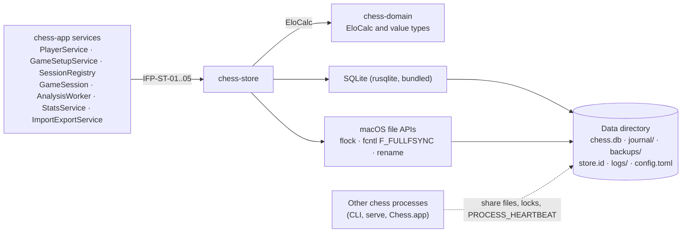
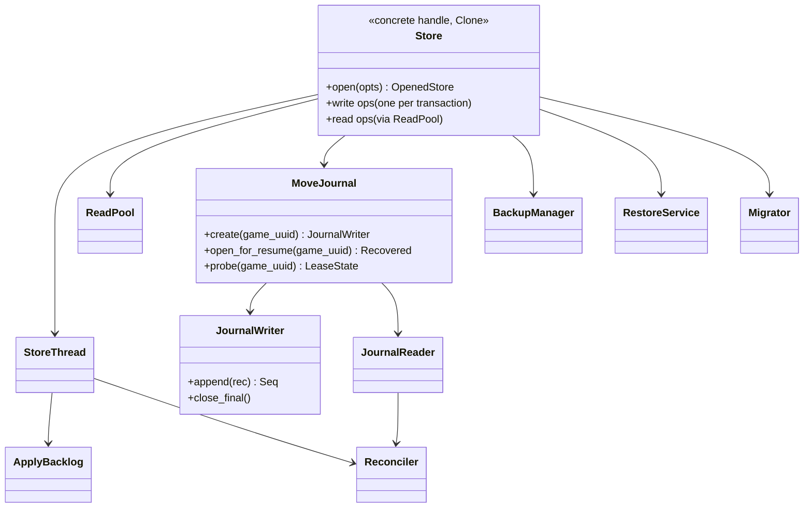
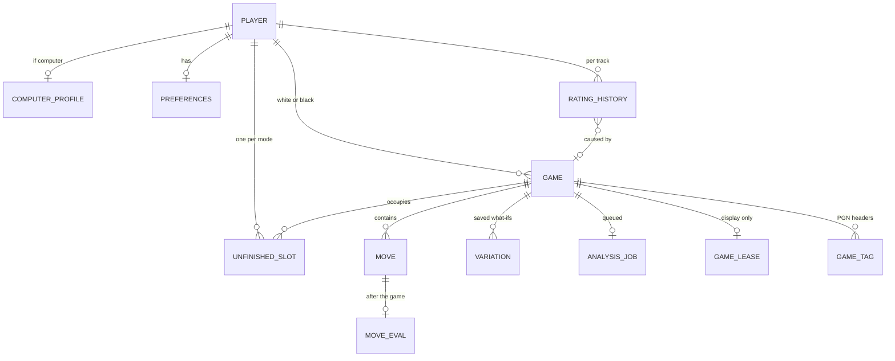
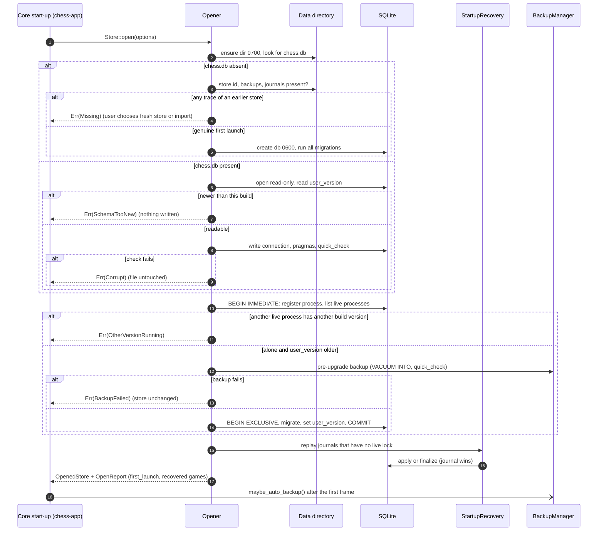
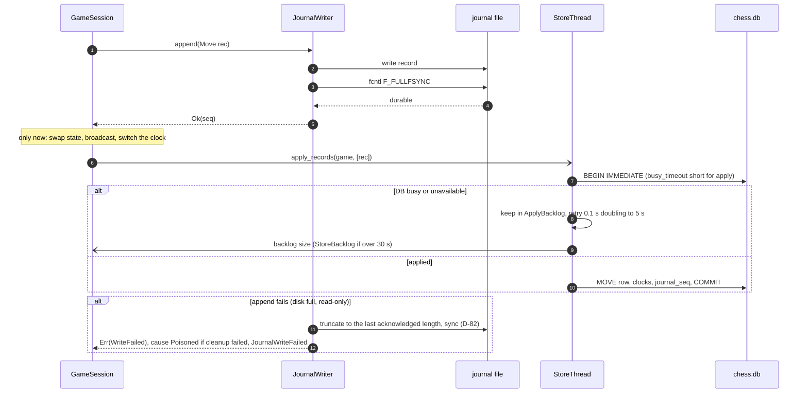
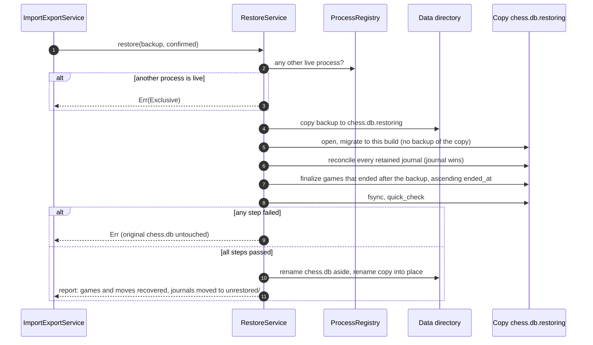
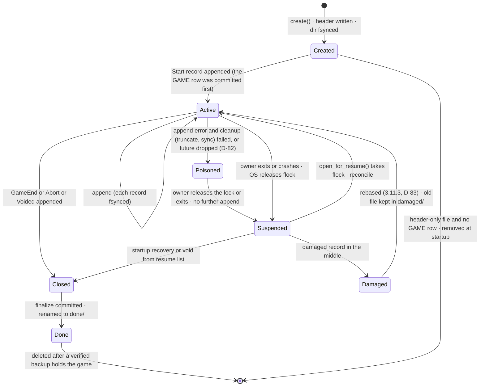

# SDD-chess-store: Software Design Description of the `chess-store` crate

| Field | Value |
|---|---|
| Document | docs/design/SDD-chess-store.md |
| Version / status | **1.0 BASELINED** (2026-11-05; supersedes 0.4.5 DRAFT) (0.4.4 of 2026-11-05 superseded; change log in section 11) |
| Date | 2026-11-05 (v0.4.3: 2026-11-04) |
| Standard basis | IEEE 1016-style (no conformance claim; `implementation-design-1016` skill) |
| Owner | Software engineer role (Claude), for Brian Prascher |
| Approver | **Baselined at v1.0 by Brian Prascher (G2), 2026-11-05 (tracker chess-a0r.1.53, decision recorded); G1 desk reviews as recorded in the Gate record; open conditions are listed in the 1.0 row of the change log. No other approval is claimed.** *Earlier status, kept as history and superseded by the preceding sentence:* PENDING for this document. Nothing in this document is approved. The **decisions it implements** were approved by Brian Prascher on 2026-10-31 ([SDD-architect-triage](SDD-architect-triage.md) section 5, decisions 1 to 13; requirements Amendment 7, CR-9.1; architecture amendment 7, D-38 to D-50). That approval covers the decisions, not this text. Architecture Amendment 8 (D-63 to D-73, SF-01 to SF-22) was approved by Brian Prascher on 2026-11-04, carried into the SDDs; version 0.4 carries it into this text. **Version 0.4 had no desk review** *(Update 2026-11-04: the two OQ-16 desk reviews were held on version 0.4.1 of the three SDDs and returned PASS WITH CONDITIONS; version 0.4.2 answers them and has not been re-reviewed; version 0.4.3 applies Brian's decisions of 2026-11-04 (OQ-26, OQ-27, OQ-28, D-83 rated G2) and the limited re-review findings in text, and has not been re-reviewed either.)*: the OQ-16 closing condition (a desk review by the system-architect and the systems engineer, in separate invocations from the author) was not met when 0.4 to 0.4.3 were written, and OQ-16 was open then. **Status 2026-11-05: OQ-16 is closed (closed 2026-11-04 by Brian Prascher, gate G-2, beads chess-a0r.1.47 `[OBS architecture.md:2764]`), so D-77 (no `chess-store` code before OQ-16 closes) no longer blocks code.** The paragraph above is history of those versions. |
| Gate | **1.0 BASELINE, 2026-11-05: G2 acceptance by Brian Prascher, chess-a0r.1.53 (OQ-APP-015 option B, D-89; baseline v1.0 of the eight readiness-checked SDDs in docs/engineering/readiness-step2-3.md, verdict READY-WITH-CONDITIONS; conditions open as listed in the 1.0 change-log row; residual risk FIND-R23-015, lightly reviewed text, accepted by Brian). The fix-pass text applied after the G1 limited re-review (docs/design/SDD-G1-rereview-2026-11-05.md) was not independently re-reviewed.** *Earlier record, kept as history:* Drafting versions up to 0.4 were text edits that implement approved decisions: **G0**, no approver (SWE-001 §3). Versions 0.4.1 and 0.4.2 are **G1 (text)**: they carry rulings of the architect under Brian's delegation (D-78 (5)) and the architect's answers to the OQ-16 desk review (architecture Addendum E, D-82, D-83, D-84, D-88), none of which changes a record format, a §3.2 edge or a §5.7 contract except `NewGame.started_at` (decided by Brian on 2026-11-04, G2, OQ-26 option A; applied in 0.4.3) (JR5-006 (c)). **Version 0.4.3 is G1 (text) for the text it adds**; it carries Brian's decisions: `NewGame.started_at` (G2), the D-83 rating (G2, approved), D-78 ratified (option A, G2) and the `canonical_form` rule of OQ-27 (G3, a rules-crate matter that this SDD only cites). No `GATE-` file was created here (gate numbers are assigned by the coordinator, SWE-001 ASM-S5). Implementing the crate is G1 (system-architect desk review) as long as the §3.2 edges and §5.7 contracts stay as amended; anything beyond them needs the approver named in section 9. |
| Rulings applied | **Amendment 8, 2026-11-04: D-63 to D-73, SF-01 to SF-22 (section 11, 0.4); D-76 for the test tools**; **Addendum F, Brian Prascher's decisions of 2026-11-04 (CR-12): OQ-26 option A (`NewGame.started_at`), OQ-28 option A (D-78 ratified), D-83 rated G2, the D-71 refusal as an NFR-2 case**; TR-2, TR-3, TR-4, TR-5, TR-6, TR-7, TR-9 (store side), XC-16, XC-27, UR-15, UR-19, UR-36, UR-51, decisions 2, 3, 4, 6, 7, 12, 13 and SE interpretations Q-SE-2, Q-SE-9, Q-SE-19, as listed in section 11 |
| ID format (XC-30) | Existing IDs are not renumbered: `FIND-ST-01` and `FIND-ST-001` name the same finding. New IDs use `PREFIX-nnn` (`FIND-ST-015`, `OQ-ST-001`, `ASM-ST-6`). Findings use one prefix family, `FIND-` |
| Engineering profile | [SWE-001](../engineering/SWE-001-engagement-profile.md): Rust 1.99.1 / edition 2024, CERT-informed practice with no conformance claim, warnings are errors |
| Crate / allocation name | `crates/chess-store`; architecture §2.2 block `chess-app core :: chess-store` (also the data store block `chess.db + journals`, files only) |
| Sibling SDDs | [chess-rules](SDD-chess-rules.md), [chess-domain](SDD-chess-domain.md), [chess-engine](SDD-chess-engine.md), [chess-app](SDD-chess-app.md), [chess-server](SDD-chess-server.md), [chess-cli](SDD-chess-cli.md), [ui](SDD-ui.md), [desktop-tauri](SDD-desktop-tauri.md) |
| Evidence tags | `[OBS file §]` read in this session; `[RAN]` executed; `[INF]` inferred; `[ASM-ST-n]` assumed; `[UNV]` unverified |

## 1 Introduction

### 1.1 Purpose and scope

This SDD designs the crate that owns **everything on disk**: the SQLite database, the per-game move journals, backups, the on-disk layout, the multi-process coordination (journal locks, lease rows, process heartbeats), the analysis job queue, and the typed row input and output used by export, import and restore. It is the only place in the code base that contains SQL (architecture §5.7, "No SQL outside `chess-store`") and the only place that writes to the data directory other than the log writer and `config.toml`.

In scope: schema and migrations (§7.1, §7.2), the store thread and read pool (§4.8, D-13), repositories and the transactions of §7.4, the move journal (§7.6, D-23), recovery, backups, restore (D-35), leases and the job queue (§7.3), and row IO for `ImportExportService`.

Out of scope (owned elsewhere): file formats of PGN and the zip archive and the merge decisions (`ImportExportService` in `chess-app`, [SDD-chess-app](SDD-chess-app.md)); game rules, `Policy`, `EloCalc` and the `Clock` (`chess-domain`, [SDD-chess-domain](SDD-chess-domain.md)); choosing when to write a journal record (`GameSession`, `chess-app`); mapping `StoreError` to protocol codes (`chess-app`); the log writer (`Diagnostic log`, `chess-app`).

### 1.2 Allocated requirements and functions

Requirement allocation is architecture §10.1 `[OBS architecture.md §10.1 rows RULE-5, DAT-1..6, DAT-7, NFR-2, PLAT-5, ELO-1]`; requirement text was read in requirements.md (DAT-1..DAT-7, RULE-5, NFR-2, NFR-9, NFR-10, IF-5).

| Requirement | Role of this crate | Primary DD |
|---|---|---|
| DAT-1 central store, concurrent access, migrations | Whole crate | DD-ST-001..007 |
| DAT-2 export and import (merge) | Row IO and exclusive import transaction; formats stay in `ImportExportService` | DD-ST-022 |
| DAT-3 per-game statistics | Schema for the stored fields; stats queries; eval upserts | DD-ST-007, 009, 011, 012 |
| DAT-4 one front-end per live game | Journal `flock` is the lease; `GAME_LEASE` is display only | DD-ST-014, 016 |
| DAT-5 integrity check, restore, automatic backup | `quick_check`, restore on a copy, 24 h backups, newest 3 kept | DD-ST-005, 020, 021 |
| DAT-6 backup before upgrade | Pre-upgrade copy, `BackupFailed` | DD-ST-006, 020 |
| DAT-7 all-or-nothing writes, unreadable journals | One transaction per command; recovery rules | DD-ST-009, 017, 018, 019 |
| NFR-2 / RULE-5 no completed move lost; clocks restored | Journal with `F_FULLFSYNC` first, SQLite second, journal wins | DD-ST-015..019 |
| PLAT-5 one version everywhere | `SchemaTooNew`, process heartbeats, journal version | DD-ST-005, 006, 014 |
| ELO-1 / ELO-2, PLY-7 (store side) | Finalize and reset transactions, rating history, invariant check | DD-ST-009, 010 |
| PLAT-3 offline first launch | Create store and layout with no network | DD-ST-004, 005 |
| NFR-9 / NFR-10 (store side) | `StoreError` has no paths or SQL; log lines carry identifiers only | DD-ST-023 |
| NFR-1 (CLI start-up ≤ 1 s), NFR-8 | Start-up work is small and the backup runs after start-up; no SQLite call on a runtime worker | DD-ST-002, 003, 020 |

| Function (functional_decomp) | Name | Where |
|---|---|---|
| F-4.3 | Record rating history | DD-ST-010 (written inside finalize and reset transactions) |
| F-6.2 | Journal state changes durably | DD-ST-016 |
| F-6.3 | Reconcile journal and database | DD-ST-017, 018, 019 |
| F-6.4 | Coordinate concurrent access | DD-ST-002, 003, 014 |
| F-6.5 | Initialise store on first launch (roster seeding is `PlayerService`; this crate creates schema and layout) | DD-ST-004, 005 |
| F-6.6 | Check store integrity | DD-ST-005 |
| F-6.7 | Restore or recreate store | DD-ST-021, 005 |
| F-6.8 | Back up before schema upgrade | DD-ST-006, 020 |
| F-6.9 | Migrate and guard schema version | DD-ST-006 |
| F-6.15 | Back up store automatically | DD-ST-020 |
| F-8.5 | Verify build version consistency (store side) | DD-ST-005, 014 |
| F-6.1 | Retain persistent records (block `chess.db + journals`) | DD-ST-004, 007 |

`[OBS functional_decomp.md §F-4, F-6, F-8 tables; allocation count of 11 functions to chess-store matches the list above]`

### 1.3 Decisions and risks this design implements

D-2 (per-process core, coordination through the data dir), D-12 (SQLite, WAL), D-13 (store thread), D-14 (suspend, via the journal), D-16 (one version; `SchemaTooNew`), D-17 (exclusive import), D-23 (move journal), D-26 and D-30 (reset and void transactions), D-27 (unfinished slots), D-28 (two rating tracks), D-29 (archive; row side only), D-34 (content hash, UUIDs), D-35 (backups, restore, damaged journals). Risks mitigated: R-3, R-9, R-11, R-15, R-17, R-19.

Amendment 7 decisions implemented by this version (all approved by Brian Prascher, 2026-10-31): D-39 (`Store` is a concrete handle; no `dyn`, no fake store), D-40 (UUID newtypes outside the store; integer ids internal), D-41 (journal contract and stored-format batch), D-42 (`content_hash` nullable until terminal), D-43 (`error_permille INTEGER`), D-44 (statistics rows, no SQL views), D-46 (`roster_indexes()`, pinned `UCI_Elo` range). Amendment 8 decisions implemented by version 0.4 (approved by Brian Prascher on 2026-11-04, carried into the SDDs; architecture §11 and §11.4): D-63 (`GameEnd` time totals, SF-01), D-64 (`custom_start`, SF-02, SF-13), D-65 part 2 and D-66 (durable prefix; a store ahead of the journal is damage, not a torn tail), D-67 (the hash of a voided game is advisory; `get_game` and `LeaseBeat` return the columns the session needs; `void_unreadable_game` hashes zero or more readable moves), D-68 (`sha256:v1:<hex>`, SF-03, SF-04), D-69 (`Voided.ended_at`, `journal_seq` of a voided game, SF-05, SF-06), D-70 (SF-07 to SF-22), D-71 (refuse a volume without `F_FULLFSYNC`), D-72 (startup finalize order, D-58 wording). D-76 (stable toolchain only) is applied to the tests: `proptest` replaces `cargo-fuzz`. Addendum A decisions applied by version 0.3 (D-41 and D-42 as amended; Brian Prascher's rulings 1 to 3 of 2026-10-31): `content_hash` in the `GameEnd`, `Abort` and `Voided` payloads and in `VoidSpec`; the exact payload fields per kind of architecture §7.6; `roster_indexes() -> Vec<u32>` (option C, no `roster_class` column).

### 1.4 Definitions

*Journal*: the append-only file `journal/<game_uuid>.jnl`. *Apply*: writing the effect of a journal record into SQLite. *Intact run*: the records of a journal from its start up to the first damaged record. *Store thread*: the single OS thread that owns the write connection. *Track*: `strict` or `training` rating scale.

## 2 Design overview

### 2.1 Readiness basis

Upstream is baselined (architecture v1.0 through Amendment 8 and Addenda B to F of 2026-11-04, requirements through Amendment 8 with CR-9 to CR-12; v0.1 to v0.3 were written against Amendment 7, which is the baseline the next sentence's triage decisions come from). No separate readiness report was produced for this block. The findings of v0.1 are dispositioned in section 7 (most are RESOLVED by a triage ruling). The stored-format batch (journal kinds and payloads, nullable columns, `error_permille`, `build_version`, evaluation point of view, `VARIATION`) was decided as one G3 batch before any store code exists (decision 4), so the format is not frozen by this document but is settled for implementation. The open items that remain are in section 7 (OQ-ST-001, 003, 004, 005; OQ-ST-002 is RESOLVED by Addendum A).

### 2.2 Viewpoints

| # | Viewpoint | Included | Section |
|---|---|---|---|
| 1 | Context | yes | 3.1 |
| 2 | Composition | yes | 3.2 |
| 3 | Logical (types) | yes | 3.3 |
| 4 | Dependency | yes | 3.4 |
| 5 | Information | yes (largest) | 3.5 |
| 6 | Patterns use | yes | 3.6 |
| 7 | Interface | yes | 3.7 |
| 8 | Structure (module layout) | yes | 3.8 |
| 9 | Interaction | yes | 3.9 |
| 10 | State dynamics | yes | 3.10 |
| 11 | Algorithm | yes | 3.11 |
| 12 | Resource | yes | 3.12 |

No viewpoint is omitted. The Information viewpoint carries the schema because the crate's main concern is persistent data.

### 2.3 Conventions

Design entities are `DD-ST-nnn`. Interfaces are `IFP-ST-nn` (provided) and `IFR-ST-nn` (required). Tests are `UT-ST-nnn` and `CT-ST-nnn`. Upstream findings are `FIND-ST-nn`; open questions `OQ-ST-n`; assumptions `ASM-ST-n`. Numbers that no requirement or decision fixes are marked `ESTIMATE`.

## 3 Viewpoints

### 3.1 Context viewpoint

**Concern:** who uses this crate, and what outside it does the crate touch?



The crate has no network access and no knowledge of the engine, the protocol or any front-end.

### 3.2 Composition viewpoint

**Concern:** which parts is the crate made of, and what is each part for?

| DD | Part | Purpose | Traces to |
|---|---|---|---|
| DD-ST-001 | `Store` (concrete, clonable handle) and the `StoreApi` contract | The one async facade `chess-app` calls; routes writes to the store thread and reads to the read pool. A struct, not a trait (D-39); `StoreApi` names its methods in this document and is not a seam | DAT-1, D-13, D-39, §5.7 |
| DD-ST-002 | `StoreThread` | Owns the write connection; runs every write transaction; owns the apply backlog and retry timer | D-13, §4.8, NFR-2 |
| DD-ST-003 | `ReadPool` | Small pool of read-only connections used through `spawn_blocking` | §4.8, R-11 |
| DD-ST-004 | `DataDir` | On-disk layout, permissions, directory resolution helper | §7.1, §8 (security), PLAT-3 |
| DD-ST-005 | `Opener` | The open sequence: missing-store test, version probe, process registration, integrity check, upgrade, startup recovery | DAT-1, DAT-5, PLAT-5, F-6.5, F-6.6 |
| DD-ST-006 | `Migrator` | Numbered migrations, schema-version guard, pre-upgrade backup | DAT-6, D-16, F-6.8, F-6.9 |
| DD-ST-007 | `Schema` | DDL of every table, constraints and indexes (section 3.5) | §7.2, DAT-3 |
| DD-ST-008 | `PlayerRepo` | Players, computer profiles, preferences, app settings, `roster_indexes` | PLY-4, PLY-6, §7.4, D-46 |
| DD-ST-009 | `GameRepo` | Start, apply, slots, finalize, abort, void, reset, takeback | GAME-4, D-27, D-30, §7.4 |
| DD-ST-010 | `RatingRepo` | Rating history, rating-invariant check | ELO-1, F-4.3 |
| DD-ST-011 | `EvalRepo` and `VariationRepo` | `MOVE_EVAL` upsert and read (White's point of view), saved variations (one line, anchor ply, `created_at`) | DAT-3, ANA-3, D-41 |
| DD-ST-012 | `StatsQueries` | Parameterised **row** queries for statistics and history, filtered by structural keys only; no SQL views and no aggregation (the domain aggregates, D-44) | UI-2, UI-5, D-26, D-44 |
| DD-ST-013 | `JobQueue` | Analysis job claim, heartbeat, complete, fail | §7.3, F-5.5 |
| DD-ST-014 | `ProcessRegistry` and `Lease` | `PROCESS_HEARTBEAT`, `GAME_LEASE`, flock probe | DAT-4, D-16 |
| DD-ST-015 | `JournalFormat` | Record layout, codec, version | §7.6, D-23 |
| DD-ST-016 | `JournalWriter` | Exclusive lock, append, `F_FULLFSYNC` | RULE-5, NFR-2, F-6.2 |
| DD-ST-017 | `JournalReader` | Scan, torn-tail detection, damaged-middle resync | DAT-7, F-6.3 |
| DD-ST-018 | `Reconciler` | Pure function: journal fold versus stored rows | NFR-2, Q54 |
| DD-ST-019 | `StartupRecovery` | Replays journals without a live lock | §7.6, R-15 |
| DD-ST-020 | `BackupManager` | Automatic, pre-upgrade and pre-import backups; pruning; journal collection | DAT-5, DAT-6, F-6.15 |
| DD-ST-021 | `RestoreService` | Restore on a copy with journal replay and re-finalise | DAT-5, D-35, R-19 |
| DD-ST-022 | `RowIo` | Typed export snapshot and import apply | DAT-2, IF-5, D-17 |
| DD-ST-023 | `StoreError` | Typed errors and their catalogue mapping | §5.5, NFR-9 |
| DD-ST-024 | `FaultPlan` (feature `test-support`) | Failpoints and delays for failure-injection tests | R-11, R-15, NFR-2 |

### 3.3 Logical viewpoint

**Concern:** which are the key types and how do they relate?



Only key types are shown. The architecture's `PlayerRepo`, `GameRepo`, `RatingRepo`, `JobQueue`, `Lease` (§3.3) are the repository groups of the methods on `Store`. `StoreApi` (3.7.2) is the name of that method list in this document, not a Rust trait.

### 3.4 Dependency viewpoint

**Concern:** what does this crate depend on, and what depends on it?

Crate edges, exactly as architecture §3.2 after amendment 7: `chess-app → chess-store`, `chess-store → chess-domain`. The crate has **no edge to `chess-rules`**, `chess-engine`, `chess-server` or any front-end `[OBS architecture.md §3.2]` (ED-8 rejected, TR-1). `chess-domain` reaches `chess-rules` transitively; this crate must not name `chess_rules` in its manifest and `chess-domain` does not re-export `chess-rules` types. Because `Side` is a `chess-rules` type, the store keeps **its own stored-side enum** `StoredSide { White, Black }` in its journal and row DTOs (D-38). The stored format is therefore independent of any `chess-rules` enum, and `chess-app` converts at the boundary.

| Dependency | Use | Version source |
|---|---|---|
| `chess-domain` | `EloCalc` (`rating_track`, `settle`) and value types: `GameId(Uuid)`, `PlayerId(Uuid)` (D-40), `Mode`, `Matchup`, `Track`, `GameResult`. Not `Side` | workspace |
| `rusqlite` (bundled) | all SQL | 0.41.1 `[OBS architecture.md §3.4]` |
| `tokio` (features `sync`, `rt`, `time`) | `oneshot` replies, `spawn_blocking`, retry timer | 1.54.1 `[OBS §3.4]` |
| `thiserror`, `serde`, `tracing` | errors, journal and row DTOs, log events | 2.0.21, 1.0.229, 0.1.44 `[OBS §3.4]` |
| `serde_json`, `uuid` (v5 feature), `crc32fast` | journal payloads, UUID text parsing, record checksum. The checksum is CRC-32 ISO-HDLC (SF-08); that `crc32fast` computes exactly this variant is `[UNV]` and is checked by the check-value test UT-ST-081 | admitted in principle by decision 11; no version is stated, each needs a registry lookup, licence check and CVE scan before it enters §3.4 `[UNV]`. `uuid` was looked up on 2026-11-04 for `chess-rules` and `chess-domain` ([dependency-lookup-step1.md](../engineering/dependency-lookup-step1.md) F8, P1); that lookup does not cover this crate's use of the `v5` feature `[UNV]` |
| File locking and `F_FULLFSYNC` (`sys` module) | `flock`, `fcntl(F_FULLFSYNC)` | **deferred, spike first** (review row D-7, OQ-14): the standard library may provide `File::lock` and a full sync on macOS `[UNV]`. A 30-minute spike on the target toolchain decides. A safe wrapper crate (`rustix`) is added only if the standard library is not enough, and `libc` last, with one documented `unsafe` module |

Dependencies not in the §3.4 table are admitted in principle only (decision 11, accepted with modifications). Before use each must be verified (exists, intended crate, maintained, licence compatible with GPL-3.0-or-later, pinned, in the SBOM) per `swe-governance` guardrail 5. `libc` defines `F_FULLFSYNC` for Apple targets (value 51) and `flock` `[OBS ~/.cargo/registry libc-0.2.174 src/unix/bsd/apple/mod.rs:3248, src/unix/mod.rs:1689]`; that is a locally cached version, not a pin. `rustix` is an alternative with safe wrappers `[UNV: not present locally, API names not checked]`. The use of `tokio` features `sync`, `rt` and `time` in this crate is part of the per-crate tokio feature sets of architecture §3.4 (FIND-ST-10).

### 3.5 Information viewpoint

**Concern:** which persistent data exists, who owns it, in what shape, and how does it evolve?

#### 3.5.1 Files in the data directory

| Path (under the data directory) | Content | Owner | Mode |
|---|---|---|---|
| `chess.db`, `chess.db-wal`, `chess.db-shm` | SQLite database | `StoreThread` | file `0600` |
| `store.id` | `{store_uuid, created_at}` written when a store is created | `Opener` | `0600` |
| `journal/<game_uuid>.jnl` | live or suspended game journal | holder of its `flock` | `0600` |
| `journal/done/` | journals of final games, kept until a backup contains the game | `BackupManager` | dir `0700` |
| `journal/<game_uuid>.jnl.rebase` | the new journal while a damaged journal is rebased (3.11.3, D-83); present only during the rebase or after a crash inside it; startup deletes it when `<game_uuid>.jnl` exists, and renames it into place when `<game_uuid>.jnl` is absent (a row with no journal looks for it first, 3.11.3). **Two names added to the data directory (`.jnl.rebase` and `damaged/<uuid>.<k>.jnl`): D-83 is rated G2 by Brian (2026-11-04)** | holder of the `flock` | `0600` |
| `journal/damaged/` | journals with a damaged middle, kept as `<game_uuid>.<k>.jnl` (`k` the first unused integer), never deleted | `JournalReader` | dir `0700` |
| `journal/unrestored/` | journals a restore could not apply (R-19), never deleted | `RestoreService` | dir `0700` |
| `backups/chess-<UTC date>.db` | automatic backups (newest 3 kept) | `BackupManager` | `0600` |
| `chess.db.bak-v<N>` | pre-upgrade copy, never pruned | `Migrator` | `0600` |
| `chess.db.pre-import-<UTC time>` | pre-import copy, never pruned `[ASM-ST-2: the name is chosen here; architecture does not name it]` | `RowIo` | `0600` |
| `missing-<date>/` | traces of a lost store set aside by `CreateFreshStore` | `Opener` | dir `0700` |
| `logs/`, `config.toml` | not written by this crate | `chess-app`, `chess-cli` | n/a |

The data directory is created `0700`, the database `0600` (architecture §8 Security `[OBS]`). `VACUUM INTO` needs a target that does not exist or is empty `[UNV: SQLite documentation not re-read here]`, so each backup file is created empty with mode `0600` first.

#### 3.5.2 Schema

The tables and columns are those of architecture §7.2 `[OBS architecture.md §7.2 ER]`, as amended by Amendment 8 (D-64, D-68, SF-02, SF-12, SF-17 to SF-20); the DDL below equals the architecture §7.2 note "Stored-format batch, second part" and the architecture §7.2 ER block. This section adds the types, constraints and indexes that the ER does not carry. Deviations from the ER are listed explicitly in 3.5.3.

Conventions: every `datetime` is `INTEGER` Unix epoch milliseconds in UTC; every `bool` is `INTEGER` with `CHECK (x IN (0,1))`; text identifiers are compared with the default `BINARY` collation (case-sensitive); `PRAGMA foreign_keys=ON`.

**Identity (TR-3, D-40).** `player.id` and `game.id` are `INTEGER` row keys **internal to this crate**: they are the foreign-key targets inside the database and nothing else. The public API takes and returns `PlayerId(Uuid)` and `GameId(Uuid)` (from `chess-domain`); the repositories translate through the `uuid` columns (each `UNIQUE`, so the lookup is an index probe). Integer ids never appear in a `StoreError`, a journal record, a row DTO used by export and import, a log line or the protocol. Reason: a journal must survive a restore, and a restore can reuse integer ids.

```sql
-- migrations/0001_init.sql (design-level; the constraints are normative, formatting is not)
CREATE TABLE player (
  id INTEGER PRIMARY KEY,
  uuid TEXT NOT NULL UNIQUE CHECK (uuid = lower(uuid) AND length(uuid) = 36),   -- SF-12
  kind TEXT NOT NULL CHECK (kind IN ('human','computer')),
  name TEXT NOT NULL UNIQUE COLLATE BINARY CHECK (length(name) > 0),
  start_category TEXT NOT NULL,
  strict_elo INTEGER NOT NULL,
  training_elo INTEGER NOT NULL,
  strict_rated_games INTEGER NOT NULL DEFAULT 0 CHECK (strict_rated_games >= 0),
  training_rated_games INTEGER NOT NULL DEFAULT 0 CHECK (training_rated_games >= 0),
  reset_at INTEGER,
  archived INTEGER NOT NULL DEFAULT 0 CHECK (archived IN (0,1)),
  created_at INTEGER NOT NULL,
  CHECK (kind = 'human' OR reset_at IS NULL)
);
CREATE TABLE computer_profile (
  player_id INTEGER PRIMARY KEY REFERENCES player(id),
  roster_seed INTEGER NOT NULL, roster_index INTEGER NOT NULL,
  skill_level INTEGER NOT NULL, depth_limit INTEGER NOT NULL, movetime_ms INTEGER NOT NULL,
  uci_elo INTEGER,
  error_permille INTEGER NOT NULL CHECK (error_permille BETWEEN 0 AND 1000),   -- TR-6: integer, never REAL
  error_multipv INTEGER NOT NULL,
  CHECK (error_permille = 0 OR error_multipv >= 2),                              -- SF-19 (D-70)
  UNIQUE (roster_seed, roster_index)
);
-- ENG-2 backstop: no two computers share a parameter set (NULL uci_elo made comparable;
-- every column is an integer, so the index compares integers and never floats)
CREATE UNIQUE INDEX computer_profile_params ON computer_profile
  (skill_level, depth_limit, movetime_ms, COALESCE(uci_elo,-1), error_permille, error_multipv);
CREATE TABLE preferences (
  player_id INTEGER PRIMARY KEY REFERENCES player(id),
  json TEXT NOT NULL CHECK (json_valid(json))
);
CREATE TABLE game (
  id INTEGER PRIMARY KEY,
  uuid TEXT NOT NULL UNIQUE CHECK (uuid = lower(uuid) AND length(uuid) = 36),    -- SF-12
  white_id INTEGER REFERENCES player(id), black_id INTEGER REFERENCES player(id),
  matchup TEXT CHECK (matchup IN ('hh','hc','cc')),
  mode TEXT CHECK (mode IN ('training','strict')),
  rated INTEGER NOT NULL CHECK (rated IN (0,1)),
  self_play INTEGER NOT NULL CHECK (self_play IN (0,1)),
  custom_start INTEGER NOT NULL DEFAULT 0 CHECK (custom_start IN (0,1)),         -- D-64, SF-02: 1 iff the start differs from the standard start (all six FEN fields)
  start_fen TEXT,                    -- NULL exactly for the standard start; never the standard FEN (SF-02, SF-13)
  clock_spec TEXT,                   -- NULL | '<base>+<inc>' whole seconds, e.g. '300+0' (SF-11)
  white_clock_ms INTEGER, black_clock_ms INTEGER,
  status TEXT NOT NULL CHECK (status IN ('in_progress','completed','aborted','voided','imported')),
  result TEXT CHECK (result IN ('1-0','0-1','1/2-1/2')),
  termination TEXT, voided_by INTEGER REFERENCES player(id),
  eco TEXT, opening_name TEXT,
  started_at INTEGER, ended_at INTEGER,
  white_time_used_ms INTEGER, black_time_used_ms INTEGER, total_active_ms INTEGER,
  analysis_used INTEGER NOT NULL DEFAULT 0 CHECK (analysis_used IN (0,1)),
  white_elo_before INTEGER, white_elo_after INTEGER, black_elo_before INTEGER, black_elo_after INTEGER,
  content_hash TEXT,                 -- TR-5, SF-03: NULL while in_progress; "sha256:v1:<64 lowercase hex>" once terminal; advisory for 'voided' (D-67)
  journal_seq INTEGER NOT NULL DEFAULT 0,
  CHECK ((status = 'in_progress') = (content_hash IS NULL)),                     -- SF-17: every terminal row has a hash (premise ASM-9)
  CHECK (custom_start = (start_fen IS NOT NULL)),                                -- SF-02
  CHECK (custom_start = 0 OR rated = 0),                                         -- SF-02
  CHECK ((white_clock_ms IS NULL) = (black_clock_ms IS NULL)),                   -- SF-18
  CHECK (status = 'imported' OR (white_id IS NOT NULL AND black_id IS NOT NULL)), -- SF-20 (self-play uses one id twice)
  CHECK (CASE status WHEN 'completed' THEN result IS NOT NULL
                     WHEN 'imported' THEN 1 ELSE result IS NULL END),
  CHECK (status <> 'imported' OR (matchup IS NULL AND mode IS NULL AND rated = 0)),
  CHECK (status = 'imported' OR (matchup IS NOT NULL AND mode IS NOT NULL)),
  CHECK (mode IS NULL OR mode <> 'training' OR (matchup = 'hc' AND clock_spec IS NULL)),
  CHECK (voided_by IS NULL OR status = 'voided')
);
CREATE INDEX game_white ON game(white_id);  CREATE INDEX game_black ON game(black_id);
CREATE INDEX game_status ON game(status);   CREATE INDEX game_hash ON game(content_hash);
CREATE TABLE move (
  game_id INTEGER NOT NULL REFERENCES game(id), ply INTEGER NOT NULL CHECK (ply >= 1),
  san TEXT NOT NULL, uci TEXT NOT NULL, fen_after TEXT NOT NULL,
  think_ms INTEGER, white_clock_ms INTEGER, black_clock_ms INTEGER, played_at INTEGER,
  PRIMARY KEY (game_id, ply),
  CHECK ((white_clock_ms IS NULL) = (black_clock_ms IS NULL))                    -- SF-18
) WITHOUT ROWID;
CREATE TABLE move_eval (
  game_id INTEGER NOT NULL, ply INTEGER NOT NULL, cp INTEGER, mate INTEGER,
  -- cp and mate are from WHITE's point of view (D12, CR-9.3): positive is good for White,
  -- a mate for White is positive. cp_loss stays the mover's point of view (ANA-3).
  best_uci TEXT, cp_loss INTEGER, flag TEXT CHECK (flag IN ('blunder','mistake','inaccuracy')),
  depth INTEGER, engine_version TEXT NOT NULL,
  PRIMARY KEY (game_id, ply), FOREIGN KEY (game_id, ply) REFERENCES move(game_id, ply),
  CHECK (cp IS NULL OR mate IS NULL)
) WITHOUT ROWID;
CREATE TABLE rating_history (
  id INTEGER PRIMARY KEY, player_id INTEGER NOT NULL REFERENCES player(id),
  track TEXT NOT NULL CHECK (track IN ('strict','training')),
  game_id INTEGER REFERENCES game(id),
  rating_before INTEGER NOT NULL, rating_after INTEGER NOT NULL, k INTEGER NOT NULL, at INTEGER NOT NULL
);
CREATE INDEX rating_history_player ON rating_history(player_id, track, id);
-- D13, CR-9.4: one row = one saved line. No player_id (PLY-7 hides a variation with its game).
-- from_ply = number of main-line plies played before the line's first move (0 = from the start
-- position), so the line's first move is an alternative to main-line ply from_ply + 1.
-- save_variation refuses from_ply >= the game's ply count (final position, see 3.7.2).
CREATE TABLE variation (id INTEGER PRIMARY KEY, game_id INTEGER NOT NULL REFERENCES game(id),
  from_ply INTEGER NOT NULL CHECK (from_ply >= 0), pgn TEXT NOT NULL,
  created_at INTEGER NOT NULL);
CREATE TABLE analysis_job (game_id INTEGER PRIMARY KEY REFERENCES game(id),
  state TEXT NOT NULL CHECK (state IN ('queued','running','done','failed')),
  owner TEXT, heartbeat_at INTEGER);
CREATE TABLE game_tag (game_id INTEGER NOT NULL REFERENCES game(id), name TEXT NOT NULL, value TEXT NOT NULL,
  PRIMARY KEY (game_id, name)) WITHOUT ROWID;
CREATE TABLE game_lease (game_id INTEGER PRIMARY KEY REFERENCES game(id), owner TEXT NOT NULL, heartbeat_at INTEGER NOT NULL);
CREATE TABLE unfinished_slot (
  player_id INTEGER NOT NULL REFERENCES player(id), mode TEXT NOT NULL CHECK (mode IN ('training','strict')),
  game_id INTEGER NOT NULL REFERENCES game(id), PRIMARY KEY (player_id, mode)) WITHOUT ROWID;
CREATE TABLE app_setting (setting_key TEXT PRIMARY KEY, value TEXT NOT NULL) WITHOUT ROWID;
CREATE TABLE process_heartbeat (owner TEXT PRIMARY KEY, build_version TEXT NOT NULL, heartbeat_at INTEGER NOT NULL) WITHOUT ROWID;
```

Imported games that carry nested PGN variations: how their nesting is stored so that the DAT-2 round trip keeps it is **OPEN** (architecture OQ-15, OQ-ST-003). This design stores one line per `variation` row and does not decide the nesting; nothing in the schema above is a decision on it.

Reduced entity view (keys only):



`APP_SETTING` and `PROCESS_HEARTBEAT` have no relationships and are omitted above.

#### 3.5.3 Relation to architecture §7.2 after amendment 7

The v0.1 list of deviations is closed: the architecture now carries the stored-format batch (§7.2, "Stored-format batch", AMD-5, D-41), and the DDL above matches it. What remains is a record of where each point came from and the refinements this design adds on its own.

| # | Point | Status | Source |
|---|---|---|---|
| 1 | Timestamps are `INTEGER` epoch milliseconds, not `datetime` | Store design choice; stays in this SDD (UR-51: timestamps and replay order stay in the store SDD) | FIND-ST-14, UR-51 |
| 2 | `PROCESS_HEARTBEAT.build_version` is `TEXT` | **RESOLVED**, now in §7.2 | FIND-ST-07, XC-27, UR-18, AMD-5 |
| 3 | CHECK constraints and the `computer_profile_params` unique index | Refinement, kept | |
| 4 | `VARIATION` gains `created_at`; **no `player_id`**; anchor ply `from_ply` kept; one saved line per row | **RESOLVED** by decision 13 (CR-9.4) and Q-SE-9 | FIND-ST-02, UR-19 |
| 5 | `GAME.content_hash` is `TEXT NULL`, set at finalize, abort and void; an `in_progress` game has none; CHECK keeps that true | **RESOLVED** (TR-5, D-42) | XC-6, UR-07 |
| 6 | `COMPUTER_PROFILE.error_permille INTEGER` replaces `error_rate REAL`; the unique index compares integers | **RESOLVED** (TR-6, D-43) | XC-8, UR-11 |
| 7 | `MOVE_EVAL.cp` and `mate` are from White's point of view | **RESOLVED** (decision 12, CR-9.3) | FIND-ST-12, UR-15 |
| 8 | Integer `player.id`, `game.id` are internal; the API uses UUID newtypes | **RESOLVED** (TR-3, D-40) | XC-7, UR-03 |
| 9 | The SQL views `player_stats` and `head_to_head` are dropped | **RESOLVED** (TR-7, D-44) | XC-13, UR-09 |
| 10 | `GAME.custom_start INTEGER NOT NULL DEFAULT 0`, defined once; `start_fen` NULL exactly for the standard start; CHECKs `custom_start = (start_fen IS NOT NULL)` and `custom_start = 0 OR rated = 0`. The comparison is all six FEN fields, made in `chess-domain`, not in the store | **RESOLVED** (Amd 8; APPROVED by Brian, 2026-11-04; G3) | D-64, SF-02, SF-13 |
| 11 | `content_hash` is `sha256:v1:<64 lowercase hex>`; CHECK `(status = 'in_progress') = (content_hash IS NULL)`, so every terminal row (completed, aborted, voided, imported) has one; the store treats the value as an opaque string and does not parse the version | **RESOLVED** (Amd 8, G3); the premise that an imported row always gets a hash is ASM-9: the importer hashes every imported game before the store call (D-78 (5), XC-ST-A8-2); ASM-9 closes when the app SDD's import design says so | D-68, SF-03, SF-17 |
| 12 | Clock-pair CHECKs on `MOVE` and `GAME`; `COMPUTER_PROFILE` `error_permille = 0 OR error_multipv >= 2`; `white_id` and `black_id` NOT NULL unless `imported`; uuid columns lower-case, 36 characters | **RESOLVED** (Amd 8, G3) | D-70, SF-12, SF-18, SF-19, SF-20 |
| 13 | `white_time_used_ms`, `black_time_used_ms`, `total_active_ms` are written by finalize from the `GameEnd` record (`FinalizeRequest`) and never recomputed from `MOVE.think_ms` | **RESOLVED** (Amd 8, G3) | D-63, SF-01 |

#### 3.5.4 Ownership and transaction boundaries

The table of architecture §7.4 `[OBS]` stands. The store methods that realise each transaction are:

| §7.4 row | Store method (section 3.7) | Transaction |
|---|---|---|
| Register | `register_player` | `BEGIN IMMEDIATE`: `PLAYER` + default `PREFERENCES` + one `RATING_HISTORY` row per track |
| Reset | `reset_player` | `BEGIN IMMEDIATE`; rolls back with `UnlistedUnfinishedGames` if an unfinished game is not in `void_game_ids` |
| Rename, archive, preferences | `rename_player`, `archive_player`, `update_preferences` | one transaction each |
| Roster batch | `insert_computers` | one transaction for N Players and 2N rating rows, each Player carrying its `roster_index`. The read of the stored indices (`roster_indexes()`) is a **separate call** before the insert, not part of this transaction (architecture §4.6, Addendum A ruling 3); `UNIQUE(roster_seed, roster_index)` is the arbiter and a unique violation returns `RosterIndexTaken` so the caller (`PlayerService`) can repeat the read and the insert once, then report `StoreBusy` (TR-9, UR-49, D-46) |
| Start | `start_game` | `BEGIN IMMEDIATE`: `GAME` + slots; idempotent on `GameId`. The journal is created **after** this transaction commits (start order, 3.9.2) |
| Move | `apply_records` | one transaction per applied batch: rows, clocks, `journal_seq` |
| Finalize, c–c abort | `finalize_game`, `abort_game` | `BEGIN IMMEDIATE`; skipped if already final; both set `content_hash`; finalize also writes the three time totals from the request (D-63) |
| Void unreadable | `void_unreadable_game` | `BEGIN IMMEDIATE`; sets `content_hash` (hash of whatever moves are readable, zero moves allowed, D-67 (iv); the column is never NULL for a terminal row, SF-17) |
| Apply a `Voided` record | `apply_records` | one transaction: sets `journal_seq` to the record's `seq`; only if the row is not yet `voided`, re-runs the void from the record (D-69, SF-06; 3.11.4) |
| Evals | `upsert_move_eval` | one upsert per ply |
| Import, restore, migrate | `RowIo::apply_import`, `RestoreService`, `Migrator` | exclusive, see DD-ST-021, 022, 006 |

### 3.6 Patterns-use viewpoint

**Concern:** which recognised solutions are used, and what would show they are being misused?

| Pattern | Where | Why | Misuse tell |
|---|---|---|---|
| Single-writer thread with command channel (actor-like) | DD-ST-002 | One owner of the write connection; no lock across `await` (D-13, R-11) | A second place that opens a write connection; `Mutex<Connection>` appears |
| Write-ahead log (application level) | Journal, DD-ST-015..019 | Durable-before-ack independent of SQLite availability (Q54) | A journal record that is acknowledged before `F_FULLFSYNC` returns |
| Repository functions over `&Connection`/`&Transaction` | DD-ST-008..013 | The same code runs on the store thread, on a restore copy and in tests | SQL strings outside `repo/` |
| Pure reconciler (functional core) | DD-ST-018 | The hardest logic (R-15) is testable without files | `Reconciler` takes a file handle |
| Compare-and-set on `heartbeat_at` and `owner` | DD-ST-013, 014 | Safe claim of a job and a lease row without a lock | An `UPDATE` without the `WHERE owner = ?` guard |
| Copy-then-rename | Restore, DD-ST-021 | A failed restore leaves the original untouched (DAT-7) | In-place edit of `chess.db` |
| Ports and adapters (failpoints) | DD-ST-024 | Fault injection without mocking the unit under test | A mock of `rusqlite` in a store test |

### 3.7 Interface viewpoint

**Concern:** what does the crate offer to `chess-app`, what does it need, and what are the failure semantics?

#### 3.7.1 Provided interfaces

| ID | Interface | Style | Consumer |
|---|---|---|---|
| IFP-ST-01 | `Store` methods (the `StoreApi` list of 3.7.2; one concrete type, D-39) | async fns; writes through the store thread, reads through the read pool. Ids are `GameId`/`PlayerId` (UUID) | `PlayerService`, `GameSetupService`, `SessionRegistry`, `GameSession`, `StatsService`, `AnalysisWorker`, `AnalysisService` |
| IFP-ST-02 | `MoveJournal`, `JournalWriter`, `Recovered` | async `append`; sync open and probe | `GameSession`, `SessionRegistry`, `PlayerService` (void of a suspended game) |
| IFP-ST-03 | `Store::open`, `DataDir`, `OpenReport` | async open; refuses a directory on a volume without `F_FULLFSYNC` with `DurabilityUnsupported{path, errno}` (D-71, 3.11.5) | `Core` start-up, `chess-cli`, `src-tauri` |
| IFP-ST-04 | `BackupManager`, `RestoreService` | async | `Core` start-up, `ImportExportService` |
| IFP-ST-05 | `RowIo` (export snapshot, import apply, lookups) | blocking iterators plus one async apply | `ImportExportService` |
| IFP-ST-06 | `FaultPlan` | test-only | tests in all crates |

This matches architecture §5.7: "One method per transaction in §7.4. No SQL outside `chess-store`", failure behaviour `StoreBusy` / `StoreUnavailable` / `SchemaTooNew`, plus the journal contract of §7.6 `[OBS architecture.md §5.7, §7.6]`.

**`Store` is one concrete, cheaply clonable handle** to the store thread (D-39, TR-2). `chess-app` holds a `Store`, not an `Arc<dyn Store>` and not a generic parameter. There is no `dyn Store`, no boxed-future trait and **no fake store**. `StoreApi` is the name of the method list in 3.7.2: it is a documentation contract that the architecture §5.7 row refers to, and no code uses it as a seam. Tests use a `Store` over a temporary directory plus `FaultPlan` (DD-ST-024, rationale R-ST-2). If the core integration suite exceeds its time budget (FF-2, measured at the first run, `ESTIMATE`), a trait and a fake are introduced then; the change is mechanical and callers' public types do not change. `MoveJournal` and `JournalWriter` are concrete types too (§5.7).

**Identity at the boundary (TR-3).** Every method that names a Player or a game takes and returns `PlayerId` or `GameId`. Integer row ids are private to the repositories.

#### 3.7.2 `StoreApi` methods

Names are design proposals. "W" = write on the store thread. "R" = read pool. All writes are single transactions unless stated.

| Group | Method | Kind | Notes |
|---|---|---|---|
| Players | `register_player(NewPlayer)` | W | `PLAYER` + `PREFERENCES` + 2 rating rows; `NameTaken` on UNIQUE violation (backstop for `PlayerService`'s own check) |
| | `insert_computers(Vec<NewComputer>)` | W | all N or none; skips nothing. Each `NewComputer` carries `error_permille: u16` (domain `Personality`) and its `roster_index` |
| | `roster_indexes() -> Vec<u32>` | R | every stored `roster_index` (at most a few hundred integers). The store knows nothing of the interleaved `5*k + class` scheme and has **no class column** (Brian's option C, architecture OQ-21 closed, D-46); `first_k_after` in `chess-domain`, called by `PlayerService`, derives the next *k* per class. Replaces `next_roster_index`, which is dropped. The unique constraint arbitrates a race; `insert_computers` returns `RosterIndexTaken` and the caller repeats the read and the insert once (TR-9) |
| | `rename_player`, `archive_player` | W | store re-checks nothing about policy (`PlayerService` owns it) except the archive guard `has_unfinished` inside the same transaction |
| | `update_preferences(player, json)` | W | |
| | `get_player`, `list_players(kind, include_archived)`, `find_player_by_name`, `get_preferences` | R | |
| | `get_app_setting`, `set_app_setting` | R, W | |
| Games | `start_game(NewGame)` | W | inserts `GAME` + slot rows; returns the existing game when the `GameId` exists; `SlotTaken{game_id, mode, player_id}`. A game with a row and no journal (a crash between this call and `MoveJournal::create`) is a game with zero moves, replayed from `start_fen`; no new state exists for it. *Addendum E, D-84 (F-02):* `GAME.started_at` is the session's start `Stamp`, the same value as the `Start` record's `wall_ms`. **Decided by Brian Prascher on 2026-11-04 (G2, OQ-26 option A, CR-12 item 2): `NewGame` gains `started_at: i64`** (a `WallMs`, milliseconds since the Unix epoch), supplied by the app and written unchanged to `GAME.started_at`; the store reads no clock for it and, for a known `GameId`, returns the existing game and leaves its `started_at` alone. `NewGame` is a Rust DTO of this crate, never serialized to a front-end, and has no `ts-rs` derive (architecture §5.1, §5.7). Test UT-ST-092 |
| | `apply_records(game_id, Vec<JournalRecord>)` | W, queued | applies a batch in order; see 3.11.3 and the backlog rule in 3.12. DB effect of a `Voided` record (D-69, SF-06): set `journal_seq` to the record's `seq`; only if the row is not yet `voided` (a restore), re-run the void from the record's `reason`, `reset_player`, `ended_at` and `content_hash`. The holder passes the `Voided` record it appended to this method, and the startup scan applies an unapplied `Voided` the same way |
| | `finalize_game(FinalizeRequest)` | W | see 3.11.4; returns `FinalizeOutcome` |
| | `abort_game`, `void_unreadable_game`, `reset_player` | W | `abort_game` and `void_unreadable_game` take the `content_hash` computed by the caller. `void_unreadable_game` takes the hash of whatever moves are readable, **zero moves allowed**, and a non-NULL hash is always stored (D-67 (iv), SF-17); `chess-app` must pass it (the app SDD call that passed none is corrected there). `reset_player(player, voids: Vec<VoidSpec{game, content_hash}>, ...)` sets the hash of each voided game in the same transaction (the store cannot compute it: it has no `chess-rules`; carried in the journal records too, ruling 1, D-42) and writes the commit time to `GAME.ended_at` of each voided game (the store's own injected wall clock, IFR-ST-05); that time is the `ended_at` of the `Voided` record (D-69, SF-05), and **the app reads it back from the `GAME` row with `get_game` before it appends `Voided`** (JR5-004: no new field in `VoidSpec` or in the return value, never `now`). The hash of a voided game is advisory (D-67 (i)) |
| | `set_analysis_used(game_id)` | W | idempotent |
| | `list_unfinished(player_id)` | R | reads `GAME`, not the slot table (architecture §4.4 resume list) |
| | `get_game`, `list_games(filter)`, `game_moves(game_id)` | R | `get_game` and `list_games` return the whole `GAME` row as a DTO, including `custom_start`, `content_hash`, `voided_by` (as a `PlayerId`) and `ended_at`, so statistics and history can mark and exclude custom starts (D-64) and the session that was voided elsewhere can build its `Voided` record (D-67 (iii)). The time totals are returned too |
| Ratings | `rating_history(player, track)`, `check_rating_invariant(player_ids)` | R | invariant: current = last reset point (or initial) + Σ later deltas |
| Analysis | `upsert_move_eval(MoveEvalRow)`, `get_game_analysis(game_id)` | W, R | `get_game_analysis` returns evals, job state, `evaluated` and `total` ply counts |
| | `save_variation(game, from_ply, pgn)`, `delete_variation`, `list_variations(game)` | W, R | one saved line, its anchor ply and `created_at` (from the injected clock). Backstop for decision 13: `from_ply >=` the game's stored ply count (a branch from the **final position**) returns `VariationAnchor`, which `chess-app` maps to `ValidationFailed{field: from_ply, reason: no_move_after_position}`. The app refuses first; this is the second guard. Storage of imported nested variations is OPEN (OQ-ST-003) |
| Jobs | `enqueue_job(game_id)`, `enqueue_unevaluated_games()`, `claim_job(owner)`, `job_heartbeat`, `complete_job`, `fail_job` | W | 3.11.7 |
| Coordination | `register_process`, `process_heartbeat`, `deregister_process`, `list_live_processes` | W, R | 3.11.6 |
| | `lease_beat(game, owner) -> LeaseBeat` | W | `RowGone{status, voided_by, content_hash, ended_at}` tells a session that it was voided (architecture §7.2 reset sequence) and carries what it needs to build its `Voided` record from the `GAME` row without a second call (D-67 (iii), D-69: copied from the row, never `now`). Architecture D-67 (iii) says "added to `get_game` or to `LeaseBeat`"; this design does both, and both stay (D-78 (5), finding XC-ST-A8-1, section 7.3): the live session reads `RowGone` from `lease_beat` (called every 2 s anyway); the repair path of §7.6 reads `get_game` |
| | `lease_upsert`, `lease_delete` | W | |
| Statistics (rows only, D-44) | `stats_rows(player, window, side?, limit?)`, `head_to_head_rows(player, opponent, window, limit?)`, `games_for_history(player, window, limit?)` | R | Return **rows**, filtered only by structural keys: the Player, the reset window `started_at >= reset_at`, the side and a `LIMIT`. They apply **no** predicate (`self_play`, completed, custom start) and compute no aggregate: `chess-domain` (`aggregate`, `rating_series`, `check_history`, `counts_in_aggregates`) owns both the predicate and the empty-state rule (CR-4.15). The SQL views `player_stats` and `head_to_head` do not exist. FF-5 measures the cost on a 10 000-game fixture; if it fails, a SQL fast path may be added behind a differential test against the domain function |
| Barrier | `sync_backlog(timeout) -> Result<()>` | W | waits until the apply backlog is empty; used before an export (3.11.9) |

`FinalizeRequest` carries every input of the transaction so that a restore can rebuild it from the journal: `{game, result, termination, ended_at, white_time_used_ms, black_time_used_ms, total_active_ms, eco, opening_name, analysis_used, content_hash, final_journal_seq}`. The three time totals are whole milliseconds `>= 0`, always present, and come from the `GameEnd` record (D-63, SF-01): finalize and restore write them to `GAME` and **nothing recomputes them from `Move.think_ms`**, so a live finalize and a finalize from the journal alone give the same `GAME` row (FF-3, UT-ST-070, UT-ST-082). `content_hash` is `"sha256:v1:" + hex(SHA-256(canonical_form))` (D-68, SF-03), computed by `ImportExportService` in `chess-app` (D-42); the store stores the string and does not interpret it or its version. The store builds `GameFacts` and `RatedSide` for `EloCalc` from the rows it re-reads inside the transaction.

#### 3.7.3 Journal interface (IFP-ST-02)

```rust
pub struct MoveJournal { /* data dir handle, io policy */ }
impl MoveJournal {
    /// Creates journal/<uuid>.jnl (mode 0600), takes flock(LOCK_EX|LOCK_NB), writes the header,
    /// fsyncs file and directory. Err(Locked{owner}) when another descriptor holds the lock.
    pub fn create(&self, game: &GameId) -> Result<JournalWriter, JournalError>;
    /// Takes the lock, scans, reconciles with the store, returns the recovered game.
    /// A game row with no journal file yields an empty `Recovered` (zero moves, from start_fen).
    pub async fn open_for_resume(&self, store: &Store, game: &GameId)
        -> Result<(JournalWriter, Recovered), JournalError>;
    /// Reports whether the lock is held without keeping it (lock then release).
    pub fn probe(&self, game: &GameId) -> LeaseState;       // Free | Held
}
impl JournalWriter {
    /// Appends one record and returns only after F_FULLFSYNC returned. The work is one blocking
    /// task that runs to completion even if the future is dropped. On a write or sync error the
    /// task truncates the file to `acked_len` and syncs (cleanup) before it returns: if that
    /// succeeds the file is as before and the writer stays usable (`WriteFailed`); if it fails, or
    /// the future was dropped before the outcome was reported, the writer is POISONED and every
    /// later append returns `WriteFailed` with cause `Poisoned` without touching the file (D-82, 3.7.3 rule below).
    pub async fn append(&self, rec: JournalRecord) -> Result<Seq, JournalError>;
    /// Appends nothing further; renames the file into journal/done/; releases the lock.
    pub fn close_final(self) -> Result<(), JournalError>;
}
pub struct Recovered { pub records: Vec<JournalRecord>, pub moves: Vec<MoveRecord>,
    pub clocks: Clocks, pub report: RecoveryReport }
pub struct RecoveryReport { pub torn_tail_dropped: bool, pub damaged: Option<DamagedInfo>,
    pub recovered_moves: u32, pub source: RunSource /* Journal | Store | Both */ }
```

**Writer rule after a failed or ambiguous append (D-82, desk review F-01; G1, no format change).** (1) The writer keeps `acked_len` and checks nothing else: a record is written at `acked_len`, synced, and only then is `acked_len` advanced. (2) A write or sync error is followed by `ftruncate(acked_len)` and `F_FULLFSYNC` inside the same blocking task. Cleanup succeeded: the append returns `WriteFailed{cause}`, the file is exactly as before, the session does **not** consume the `seq`, and the next record reuses it (safe, because the failed record is gone). (3) Cleanup failed, or the caller dropped the future before the outcome was known: the writer is **poisoned**, returns `WriteFailed{cause: Poisoned}` for every later append, never writes again, and is released by `close`, `Detach`, `Shutdown` or process exit; the next owner's scan applies the torn-tail rule (3.11.2) and truncates. (4) Therefore a failed record is never followed by another record in the same file, a `seq` is never used twice in one file, and the scan cannot meet a damaged record followed by intact ones from this cause. (5) A record whose append failed and whose cleanup failed may still be intact on disk; the resume then applies it (journal wins) and the move that the player was told had failed appears. This is accepted, because the only alternative discards intact records that might be acknowledged ones. (6) Failpoints `journal.partial_write` (write stops part-way) and `journal.fsync_error` (sync returns an error) and `journal.truncate_error` drive UT-ST-087 and CT-ST-087. `[UNV]` that `ftruncate` then `F_FULLFSYNC` behaves as stated on the target volume (OQ-ST-004 spike).

`JournalError` variants: `Locked{owner_kind}`, `WriteFailed{cause}` (the cause type has a `Poisoned` member, D-82; no new variant, so the §5.7 list is unchanged), `Unreadable` (nothing readable, caller offers `VoidUnreadableGame`), `VersionMismatch{found, expected}`, `ForeignStore`. `JournalWriter::append` calls blocking I/O inside `spawn_blocking` (3.12).

#### 3.7.4 Required interfaces

| ID | Interface | Contract relied on | If it fails |
|---|---|---|---|
| IFR-ST-01 | SQLite via `rusqlite` | WAL, `synchronous=FULL`, `fullfsync`, `busy_timeout`, `VACUUM INTO`, `quick_check`, `user_version` | Mapped in 3.8 error table |
| IFR-ST-02 | macOS file APIs | `flock` is released by the OS when the descriptor closes or the process ends; `fcntl(F_FULLFSYNC)`; `rename` is atomic on one volume; all descriptors opened with close-on-exec | `JournalWriteFailed` / `StoreUnavailable` |
| IFR-ST-03 | `chess_domain::EloCalc` `[ASM-ST-1; shape from SDD-chess-domain IFP-DOM-4]` | `rating_track(&GameFacts) -> Rated(Track) \| Unrated(reason)`, then `settle(white: RatedSide, black: RatedSide, result: GameResult) -> Settlement { white: SideUpdate, black: SideUpdate }` (each `SideUpdate` has `before`, `after`, `delta`, `k`, `counter_after`), whole-integer rounding half away from zero (ELO-1). Error `EloError::RatingOverflow` maps to `InvariantViolated` | Compile-time mismatch |
| IFR-ST-04 | `tokio` | `oneshot`, `spawn_blocking`, timers | Panic in a blocking task is mapped to `Internal` |
| IFR-ST-05 | Wall clock | `fn() -> i64` injected in `StoreOptions` (default system time); tests inject a fake | n/a |
| IFR-ST-06 | `tracing` | Events carry identifiers and codes only (NFR-10) | n/a |

### 3.8 Structure viewpoint

**Concern:** how is the crate organised internally?

```
crates/chess-store/
  Cargo.toml                    # features: test-support (FaultPlan, temp stores)
  migrations/0001_init.sql
  src/
    lib.rs                      # #![forbid(unsafe_code)] except src/sys
    api.rs                      # StoreApi, DTOs (NewPlayer, NewGame, FinalizeRequest, rows)
    error.rs                    # StoreError, JournalError (DD-ST-023)
    store.rs                    # Store handle (DD-ST-001)
    thread.rs                   # StoreThread, command enum, ApplyBacklog (DD-ST-002)
    readpool.rs                 # DD-ST-003
    datadir.rs                  # DD-ST-004
    open.rs                     # Opener (DD-ST-005)
    migrate.rs                  # Migrator (DD-ST-006)
    repo/{player,game,rating,eval,stats,jobs,coord}.rs   # DD-ST-008..014, functions over &Connection
    journal/{format,writer,reader,reconcile,recover}.rs  # DD-ST-015..019
    backup.rs  restore.rs  rowio.rs                      # DD-ST-020..022
    sys.rs                      # the only module with unsafe: flock, F_FULLFSYNC (SAFETY comment each)
    fault.rs                    # DD-ST-024 (cfg feature test-support)
  tests/                        # fixtures/ (one DB per released schema version), integration tests
```

Layering rule: `repo/*` and `journal/reconcile.rs` know nothing about threads; `thread.rs` and `store.rs` know nothing about SQL text. A CI grep (or `clippy` disallowed-methods) forbids `rusqlite::Connection::execute` outside `repo/`, `migrate.rs`, `open.rs`, `backup.rs` and `restore.rs`.

#### Error mapping (DD-ST-023)

`StoreError` is a `thiserror` enum. Its `Display` prints a category only: no path, no SQL, no row data (NFR-9, NFR-10; SWE-001 §6 ERR row). Details go to `tracing` at the point of conversion with the correlation id.

| `StoreError` variant | Raised when | Protocol code in `chess-app` (§5.5) |
|---|---|---|
| `Busy` | `SQLITE_BUSY` / `SQLITE_LOCKED` after `busy_timeout` | `StoreBusy` |
| `Unavailable{cause: DiskFull \| ReadOnly \| Io(kind) \| Permission}` | `SQLITE_FULL`, `SQLITE_READONLY`, `SQLITE_IOERR`, `SQLITE_CANTOPEN`, OS errors | `StoreUnavailable{cause}` |
| `Corrupt` | `NOTADB`, `CORRUPT`, `quick_check` not `ok` | `StoreCorrupt` |
| `Missing` | no `chess.db` but traces of an earlier store | `StoreMissing` |
| `SchemaTooNew{db, app}` | `user_version` greater than the build's | `SchemaTooNew` |
| `BackupFailed{cause}` | pre-upgrade backup or its check failed | `BackupFailed` |
| `SlotTaken{game_id, mode, player_id}` | `unfinished_slot` primary key violated | `UnfinishedGameExists` |
| `NameTaken` | `player.name` UNIQUE violated | `ValidationFailed{already_used}` |
| `UnlistedUnfinishedGames{ids}` | reset found an unfinished game not in `void_game_ids` | `ConfirmationRequired{reset, voids}` |
| `NotFound{entity, id}` | row absent | `NotFound` |
| `Exclusive{reason}` | import, restore or migration needs the data dir alone and another live process exists | `Busy{reason}` |
| `OtherVersionRunning{version, kind}` | a live process of another build version is registered | `OtherVersionRunning{version, kind}` (additive catalogue code, architecture §5.5, UR-36; FIND-ST-04 RESOLVED) |
| `RosterIndexTaken` | `UNIQUE(roster_seed, roster_index)` violated by a concurrent roster insert | not mapped: `chess-app` retries once, then `StoreBusy` (UR-49) |
| `VariationAnchor` | `save_variation` with `from_ply` at or beyond the game's last ply | `ValidationFailed{field: from_ply, reason: no_move_after_position}` (decision 13) |
| `DurabilityUnsupported{path, errno}` | the open probe `fcntl(F_FULLFSYNC)` on the data directory fails with `ENOTSUP` or `ENOTTY` (D-71, BP-014); `Display` prints the category only, so the path and errno travel in the variant for the front-end message and not in the log line (NFR-9) | `DurabilityUnsupported{path, errno}` (additive code, architecture §5.5; no `Core` is returned) |
| `Leased{owner_kind}` | journal lock held | `GameLeased{owner_kind}` |
| `Journal(JournalError)` | see 3.7.3 | `JournalWriteFailed{cause}`; `JournalUnreadable` is a report, not an error |
| `InvariantViolated` | a CHECK, FK or the Elo invariant failed | `Internal{id}` (a bug). For an import post-check the store returns `ImportInvariant{check}`, which `chess-app` maps to `ImportInvariantFailed{check}` (additive code, UR-36; FIND-ST-09 RESOLVED) |

### 3.9 Interaction viewpoint

**Concern:** how do the parts collaborate in the main scenarios, including failures?

#### 3.9.1 Opening the store (SEQ-ST-01)



**Volume probe (D-71, BP-014; Amendment 8).** Not drawn in the diagram above (the diagram is unchanged in version 0.4). After the directory exists with mode `0700` and **before** the write connection, the heartbeat registration or any other write, the `Opener` creates a scratch file `0600` in the data directory, calls `fcntl(F_FULLFSYNC)` on it and removes it. On `ENOTSUP` or `ENOTTY` it returns `Err(DurabilityUnsupported{path, errno})` and leaves the directory as found (a first-launch directory it just created stays, empty). There is no `sync_all` fallback and no "continue anyway". Any other error of the probe is `Unavailable{Io}`. The probe is the only new step of the open path; the order of the rest is unchanged `[UNV]` (the probe uses a scratch file removed after the probe, D-78 (5), XC-ST-A8-3; the scratch-file name is left to implementation; architecture §7.1 also allows `store.id`, which is not used). A later `F_FULLFSYNC` failure of the same kind at an append is a write failure (`JournalError::WriteFailed`), not a refusal.

#### 3.9.2 A move: journal first, SQLite second (SEQ-ST-02)



**Start order (UR-04, TR-4; architecture §7.4, §7.6).** (1) `start_game`: one store transaction claims the slots and inserts the `GAME` row; (2) `MoveJournal::create` writes the header and the `Start` record with `F_FULLFSYNC`; (3) the start is acknowledged. **One stamp (D-84, F-02):** `GAME.started_at` and the `Start` record's `wall_ms` are the same value, the start `Stamp` that the session takes once before (1); the app passes it in `NewGame.started_at` and the store writes it unchanged (decided by Brian, G2, OQ-26 option A, 2026-11-04). A crash between (1) and (2) leaves an `in_progress` row with no journal: resume treats it as a game with zero moves replayed from `start_fen`, and `open_for_resume` returns an empty `Recovered` for a file that it creates with a header only; **the app then appends the `Start` record as record 1 with `wall_ms = GAME.started_at` read from the row** (fields from the row), so the row and the journal agree from the first record. Such a row holds a slot for a start that was never acknowledged; it is kept as a zero-move game, not voided (D-88, F-13). A header-only file with no `GAME` row is removed at startup (STATE-ST-01). A slot conflict at (1) leaves no journal behind.

#### 3.9.3 Restore (SEQ-ST-03)



The reset-with-void sequence is architecture §7.2 and §7.6 and is not repeated; this crate supplies `reset_player`, `lease_beat` and the journal `Voided` record that sequence uses.

### 3.10 State-dynamics viewpoint

**Concern:** which things change state over time, and which transitions are legal?

#### 3.10.1 Journal file lifecycle (STATE-ST-01)



Transition guards: only the descriptor holding the `flock` appends; a `Poisoned` writer appends nothing (D-82). `Closed → Done` happens only after the store transaction for the final state committed (finalize, abort, void). `Done → [*]` is guarded by the rule in 3.11.8.

#### 3.10.2 Analysis job (STATE-ST-02)

`queued → running` (claim, sets `owner`, `heartbeat_at`); `running → done` (complete); `running → failed` (fail); `running → running` (claim by a new owner when the old heartbeat is stale); `failed → queued` (only by `enqueue_failed_once_per_start`, 3.11.7). A job never moves backwards from `done`.

#### 3.10.3 Open lifecycle

`Probing → (Missing | TooNew | Corrupt | OtherVersion | Ready)`; `Ready` is the only state in which `StoreApi` is usable. A failed open leaves the data directory exactly as it was found, except for the heartbeat row of the failed process, which is removed on every error path.

### 3.11 Algorithm viewpoint

**Concern:** what are the non-trivial procedures, their invariants and edge cases?

#### 3.11.1 Journal format (DD-ST-015)

File header: magic `CHSJ` (4 bytes), `journal_version: u16` (1), `game_uuid` (16 bytes), `store_id` (16 bytes), `header_crc32`. Record: `sync` (2 bytes `A5 5A`), `len: u32` (body length), `crc32: u32`, then the body: `seq: u64`, `kind: u8`, `wall_ms: i64`, `payload` (UTF-8 JSON, `deny_unknown_fields`). Integers are little-endian.

**Fixed by Amendment 8 (SF-07 to SF-09, approved by Brian, 2026-11-04; frozen at the first release, D-41).**
- *Checksum (SF-08).* CRC-32 of the ISO-HDLC / IEEE 802.3 family (the zlib `crc32`): reflected, initial value and final XOR `0xFFFFFFFF`; the check value of the ASCII bytes `123456789` is `0xCBF43926` (architecture SF-08 `[RAN python3 zlib.crc32]`). The record `crc32` covers `len` (4 bytes, little-endian) followed by the body; the `A5 5A` marker is not covered. `header_crc32` covers the header from the magic to the end of `store_id`. A unit test with the check value is UT-ST-081.
- *Maximum record body (SF-09).* 65 536 bytes. A larger `len` is read as damage (3.11.2); the writer refuses to write a larger body (a `WriteFailed`).
- *Kind codes (SF-07).* `Start` 1, `Move` 2, `Takeback` 3, `Clock` 4, `DrawOffer` 5, `DrawDeclined` 6, `DrawDropped` 7, `Pause` 8, `Resume` 9, `Suspend` 10, `SuspendResume` 11, `GameEnd` 12, `Abort` 13, `Voided` 14. Code 0 and codes 15 to 255 are invalid (a decode error), so a zero-filled block does not decode as a record. A code is never reused; a new kind takes the next number with `journal_version` 2.

Why JSON payloads: readable with a hex editor and `jq` when a user's data is damaged, and tolerant of additive fields; the size cost is irrelevant at chess rates `[INF]`. Why journal-owned DTOs instead of serialising domain types: a change to a domain type would silently change what old journals mean. **Owners (TR-4):** this crate owns the **format** (records, header, checksum, version); `chess-domain` owns the **vocabulary** of state changes (`Fact`); `chess-app` owns the **conversion** (`JournalCodec`, [SDD-chess-app](SDD-chess-app.md) DD-APP-18). `journal_version` stays 1 (nothing is released).

All identifiers in payloads are UUID text (`GameId`, `PlayerId`), never integer row ids (D-40). A side is the store's own `StoredSide` (`white` | `black`), not a `chess-rules` type. `white_ms` and `black_ms` are **nullable** in `Move` and `Clock` payloads: an untimed game writes `null`, and the matching `GAME`/`MOVE` columns are null too. **Text forms (SF-10 to SF-14, SF-15, approved 2026-11-04):** a UUID is lower-case, hyphenated, 36 characters (8-4-4-4-12), in payloads, journal file names and uuid columns, and the decoder rejects any other form (SF-12); `clock_spec` is `<base>+<increment>`, both whole seconds in decimal, no sign, no spaces, no leading zeros (`0` alone is allowed), e.g. `300+0`, `180+2`, both parts always present, `null` when untimed, and the decoder rejects other forms (SF-11; the CLI minutes shorthand `5+0` is input only and is converted by the caller); `white_ms` and `black_ms` are both `null` or both numbers in `Move` and `Clock`, and a half-null pair is a decode error (SF-14; the DDL backstop is the clock-pair CHECK, SF-18); `VoidReason` is the journal string `reset` or `unreadable`, any other value is a decode error, and the codec maps them to the unchanged `GAME.termination` values `voided by reset` and `voided: unreadable` (SF-10); `GameEnd.reason` is a snake_case code (below, SF-15).

Kinds and payloads. **The authority is the table of architecture §7.6 as amended by Addendum A (rulings 1 and 2, D-41, D-42); this table repeats it and must be kept equal to it.** The one-to-one mapping from the domain `Fact` is that table and the app SDD DD-APP-18. The column "Payload" lists every field of the record (`wall_ms` is in the record body, not the payload). Fields of the `Fact` are written into the record; the fields marked + are added by the app codec (from the `RecordCtx` or an assembler) and are not in the `Fact`. The variant names are the domain's (`Ended`, `Aborted`; FIND-JR-004):

| Kind | Domain `Fact` | Payload | DB effect when applied |
|---|---|---|---|
| `Start` | `Start{setup, started_at}` | `game`, `white`, `black` (UUIDs), `white_kind`, `black_kind` (`human` or `computer`), `matchup`, `mode`, `custom_start` (bool; defined once, D-64, SF-02), `start_fen` (JSON `null` exactly for the standard start, never the standard FEN; SF-02, SF-13), `clock_spec` (null when untimed), and, added by the `Start` assembler, `rated+`, `self_play+` (frozen history, authoritative for a restored row, never recomputed; D-64). **There is no `started_at` field** (SF-16, decided by Brian, 2026-11-04): `GAME.started_at` is the record's `wall_ms`, the same rule as `Move.played_at` | none if the `GAME` row exists; else creates it (restore only), with `started_at` = the record's `wall_ms` and `custom_start` from the payload |
| `Move` | `Move{ply, mv, think_ms, clocks_after, played_at}` | `ply`, `uci`, `think_ms`, `white_ms`, `black_ms` (both null when untimed), and `san+`, `fen_after+` from the `RecordCtx`. `played_at` is the record's `wall_ms` | `MOVE` row at `ply` (journal wins), clocks (null when untimed) |
| `Takeback` | `Takeback{to_ply}` | `to_ply` (the protocol command `Takeback{ply}` is a stale guard; the codec maps the computed target to `to_ply`) | delete `MOVE` rows with `ply > to_ply` |
| `Clock` | `Clock{clocks, running}` | `white_ms`, `black_ms` (both null when untimed), `running_side` (null when stopped) | `GAME` clock columns |
| `DrawOffer`, `DrawDeclined` | same names | `by` (side) | none (kept for `GameSession` rebuild) |
| `DrawDropped` | `DrawDropped{by, cause}` | `by` (the side whose offer was dropped), `cause`: `engine_failure` or `suspend` | none; replay learns that the offer ended without an answer and checks `by` against the pending offer (a mismatch is logged and replay continues with the pending offer's side, never an error: SF-22, D-70) |
| `Suspend` | `Suspend{cause}` | `cause`: `detach`, `shutdown` or `recovered` (a D-14 detach, a server stop, a D-58 crash recovery); any other value is a decode error. *Amd 8, SF-21, decided by Brian, 2026-11-04 (option A)* | none |
| `Pause`, `Resume`, `SuspendResume` | `Pause`, `PlayResume`, `SuspendResume` | none: the payload is `{}`. The kind for `PlayResume` is named `Resume` as in architecture §7.6 | none. **There is no implicit resume**: replay does not infer a resume from a later fact (TR-4). A `Move` while paused is a stepped move, stated once in the domain replay rules; there is no `Step` kind |
| `GameEnd` | `Ended{outcome}` (`Outcome{result, reason}`) | `result`, `reason` (snake_case code: `checkmate`, `stalemate`, `insufficient_material`, `threefold_repetition`, `fifty_move_rule`, `time_forfeit`, `timeout_opponent_cannot_mate`, `resignation`, `draw_agreed`; SF-15, decided by Brian, 2026-11-04; unknown value is a decode error; the codec maps them 1:1 to the unchanged `GAME.termination` strings), and, added by the `GameEnd` assembler as the finalize inputs, `ended_at+`, `eco+`, `opening_name+`, `analysis_used+`, **`content_hash+`**, and, *Amd 8 (D-63, SF-01)*, **`white_time_used_ms+`, `black_time_used_ms+`, `total_active_ms+`** (whole milliseconds, `>= 0`, always present) | finalize, with the three totals written to `GAME` |
| `Abort` | `Aborted` | none from the `Fact`; `ended_at+`, **`content_hash+`** from the `Abort` assembler; c–c only | abort |
| `Voided` | `Voided{reason, reset_player}` | `reason` (`VoidReason`: `reset` or `unreadable`, SF-10), `reset_player` (UUID or null), **`content_hash+`** (advisory, D-67), and, *Amd 8 (D-69, SF-05)*, **`ended_at+`** (epoch ms, the unit of `GAME.ended_at`) | set `journal_seq` to the record's `seq`; only if the row is not yet `voided` (restore), re-run the void from `reason`, `reset_player`, `ended_at`, `content_hash` (D-69, SF-06; replaces the earlier cell "none") |

`wall_ms` is in every record body because `MOVE.played_at` and `GAME.ended_at` need a wall time that the architecture's record list did not carry; it is stated in §7.6 (the record body is `seq`, `kind`, `wall_ms`, payload). **`content_hash` (ruling 1, D-42, G3, decided by Brian Prascher 2026-10-31):** `"sha256:" + hex(...)`, never null in `GameEnd`, `Abort` and `Voided` because the game is terminal. The store cannot compute it (it has no edge to `chess-rules`), and a restore re-runs the finalize, abort or void from the journal, so the value is in the record. `chess-app` computes it before the store transaction and passes it in; for a reset it is also in the `VoidSpec` of each voided game, and the `Voided` record carries the hash that was committed to the `GAME` row. *Amendment 8 (D-67, D-68):* the value is `sha256:v1:<64 lowercase hex>` (SF-03), the hash of the game **as of game end** (SF-04), and for a **voided** game it is advisory. **Not carried (architecture §7.6 flag 1):** `resigning_side` in `GameEnd` (the resigning side is the loser of `result` when `reason` is resignation) and the setup JSON in `Start` (it would give two truths beside the flat fields). The earlier drop of "times" is **rejected** by D-63: the three time totals are in `GameEnd`. `Voided` has `ended_at` (flag 6 resolved by D-69, SF-05): on a reset it is the commit time written to `GAME.ended_at`, for an unreadable void it is the void time, and for a `Voided` appended later (repair, other process) it is copied from the `GAME` row, never `now`; the record's `wall_ms` stays the append time.

A unit test asserts, per kind, that the payload field names equal the table (UT-ST-070). The decoder uses `deny_unknown_fields`, so a field not in the table is a decode error.

Round-trip check: a unit test builds one record of every kind, encodes and decodes it, and compares (UT-ST-070). The fact-level round trip `record_to_fact(fact_to_record(f)) == f` is FF-3 and lives in `chess-app`.

#### 3.11.2 Journal scan with torn-tail and damage detection (DD-ST-017)

```
read header; bad magic, header_crc, version > build, or store_id != this store -> Unreadable / VersionMismatch / ForeignStore
pos = end of header; expected_seq = 1
loop:
  if pos == EOF: done (clean)
  read sync+len+crc+body at pos
  if sync wrong, or len exceeds remaining bytes or 65 536 (SF-09), or crc wrong, or seq != expected_seq, or kind invalid (SF-07):
      look ahead: find the next sync marker after pos whose record has a valid crc and seq > last_good_seq
      none found  -> torn tail: drop it silently (never acknowledged), done
      found       -> damaged middle: intact run = records before pos; report DamagedInfo; done
  accept record; last_good_seq = seq; expected_seq += 1; pos += record size
```

The look-ahead is bounded by the file size and costs one CRC per sync marker found. A record that was acknowledged was fully written and fsynced before the acknowledgement, so a torn record is by construction an unacknowledged one (NFR-2). **That reasoning holds only while the store does not hold a later record (Amd 8, D-66, Board BP-004).** The scan itself classifies by the journal alone, and the caller then applies this rule: if `GAME.journal_seq` (`db_seq`) is greater than the last intact `seq` of the journal, the dropped or missing tail is **not** a torn tail, because the store applied a record that the journal no longer proves (an acknowledged tail damaged or lost after the fact). The case is damage whether the scan ended clean or found a torn tail. `RecoveryReport.damaged` is then `Some(DamagedInfo{kind: StoreAhead})` (a design proposal for the field), reconcile uses the damaged-middle rows of 3.11.3, no stored `MOVE` row beyond the journal's end is deleted, and the app reports `JournalUnreadable{game_id, recovered_moves}`. Only when `db_seq <= last_intact_seq` is a dropped tail silent. A rewritten tail after a crash is possible only if the writer is the new owner; for a **torn tail** (no damage elsewhere) it appends after the last good record, truncating the torn tail first (`ftruncate` to `pos`, then fsync). A **damaged middle** is never appended to: it is rebased (3.11.3). Limit, not a defect (desk review I-1): bit rot of the last acknowledged record while the store is backlogged cannot be told from a torn write and is lost silently; the design covers torn writes, not media faults.

#### 3.11.3 Reconcile (DD-ST-018, pure)

Input: `J` = moves and clocks folded from the intact journal records (`Move` sets ply `p` and drops every later ply, `Takeback` drops plies above `to_ply`; `DrawOffer`, `DrawDeclined`, `DrawDropped`, `Pause`, `Resume`, `Suspend` and `SuspendResume` change no row and no clock); `S` = stored `MOVE` rows (ordered); `damaged: bool` (true for a damaged middle **and** when `db_seq > last_intact_seq`, D-66); `db_seq`, `last_intact_seq`, stored clocks. Output: a plan `{replace_from: Option<ply>, rows_to_write, rows_to_delete_from, clocks, source}`.

**Ply base (amendment 1.0.1, B3, D-92; text only).** The journal record `Move.ply` is the domain value as is: the number of plies already played before the move, so the first move has `ply` 0 (`Fact::Move.ply`, domain SDD 3.11.1). `MOVE.ply` is one-based (`CHECK (ply >= 1)`). **The store applier (`apply_records`) writes `MOVE.ply = journal ply + 1`**, and the fold `J` above reads `Move` "sets ply `p`" as `p = journal ply + 1`. `Takeback.to_ply` is the number of plies kept, so "drops plies above `to_ply`" compares one-based `MOVE.ply` with it and needs no conversion. The `+ 1` lives only here; `JournalCodec` does not add it. A self-consistent round trip passes for either base, so UT-ST-012 and the FF-3 property cannot catch a mismatch: add a case with a journal `Move{ply: 0}` and expect `MOVE.ply = 1` when the applier is coded `[INF]`.

| Case | Rule |
|---|---|
| Journal intact (no damage) **and `db_seq <= last_intact_seq`** | Result = `J`. Rows of `S` from the first ply where `S` and `J` differ, and rows beyond `J`'s end, are replaced or deleted. Journal wins. |
| Damaged middle, `S` and `J` agree on all common plies | Resume from the longer run. If `S` is longer, the stored rows stay and `source = Store`. |
| Damaged middle, `S` and `J` differ at ply `d` within `J` | Journal wins from `d`: rows of `S` from `d` are replaced by `J`'s and rows beyond `J`'s end are dropped. `source = Journal`. |
| `db_seq > last_intact_seq` (D-66, SF-06 context; with or without a torn tail or a damaged middle) | Treated as damage: the two damaged-middle rows above apply. In particular a stored `MOVE` row beyond the journal's end is never deleted when the store is longer and the two agree on the common plies (`source = Store`); the user is told through `JournalUnreadable`. Test: UT-ST-083 |
| Nothing readable in either | `Unreadable`; the caller offers `VoidUnreadableGame` |

Clocks come from the last `Move` or `Clock` record of the intact run, unless `GAME.journal_seq` is greater than `last_intact_seq` (the D-66 case above), in which case the stored clocks belong to a later record and are used. This is the architecture's "or from the `GAME` checkpoint when that is later" made precise `[OBS §7.6]`. The function is total, deterministic and idempotent: applying its plan and reconciling again yields an empty plan (property test UT-ST-012). Idempotence is what makes startup replay, resume and restore safe to repeat after a crash in the middle of recovery.

**Rebase (D-83, desk review F-03; architecture §7.6 states the same text).** If the journal is damaged (a damaged middle, or `db_seq > last_intact_seq`), resuming continues on a **rebased journal**, built as a pure function of the intact run `R` (records `1..L`) and the stored `MOVE` rows `S`:
1. Create `<game_uuid>.jnl.rebase` (mode `0600`) and take `flock` on it. Write the header (same `journal_version`, `game_uuid`, `store_id`). Copy the records of `R` **byte for byte** (same `seq`, `wall_ms`, payload; nothing is renumbered or re-timed, so `Start.wall_ms` is unchanged and every `Takeback`, `DrawOffer`, `Pause` and taken-back `Move` of `R` stays). If `S` holds plies beyond the last ply in force of `R` and agrees with `R` on the common plies (reconcile rows 2 and 4 above, `source = Store`), append one synthesized `Move` record per such ply with `seq = L+1, L+2, ...`: `uci`, `san`, `fen_after`, `think_ms`, `white_ms`, `black_ms` from the `MOVE` row (which holds them, DDL 3.5.2); `wall_ms` = the row's `played_at`, or the previous record's `wall_ms` when `played_at` is NULL (never `now`). Then append one `Clock` with the reconciled clocks (below), `running_side` null, `wall_ms` of the previous record. When the journal wins at some ply (reconcile row 3), no record is synthesized. `F_FULLFSYNC` the file, then the directory.
   - **The intact run holds no `Start` (RR-A-1 (a), Addendum F).** If the header or record 1 is the damaged part, `R` is empty. The builder then writes a `Start` as record 1, synthesized from the `GAME` row exactly as the "row with no journal" path does (3.9.2: `wall_ms = GAME.started_at`, fields from the row: the frozen `rated`, `self_play` and `custom_start`, the players, matchup, mode, `start_fen`, clock), and numbers the synthesized `Move` records from `seq` 2, one per stored ply in force (the `MOVE` rows are valid by replay, so the agreement test is vacuous), then the closing `Clock`. A replay of the rebased file builds the game; the Player is not offered `VoidUnreadableGame` for a recoverable game. Test UT-ST-090.
   - **A final or voided game is not rebased (RR-A-1 (b), Addendum F).** If `GAME.status` is `completed`, `aborted` or `voided` (the lost tail held the `GameEnd`, `Abort` or `Voided` and the store applied it), nothing will be appended to the journal, so no rebase file is built. The damaged file is moved to `journal/damaged/<game_uuid>.<k>.jnl` with the rename and the directory syncs of step 3, no `<game_uuid>.jnl` takes its place, and the `GAME` row and its `MOVE` rows are not changed; `JournalUnreadable` is reported as in the other damage cases. Test UT-ST-091.
2. One store transaction applies the reconcile plan and sets `GAME.journal_seq` to the new file's last `seq` `N` (this can be lower than the old value when the intact run was short; the old file is no longer the journal, so D-66 does not compare against it).
3. Rename the old file to `journal/damaged/<game_uuid>.<k>.jnl` (`k` = the first unused integer), then rename `.rebase` to `<game_uuid>.jnl`. **Both renames have no-replace semantics (RR-A-1 (c)):** they fail when the target exists, so neither can overwrite a file (the call is chosen at implementation; for example `renamex_np` with `RENAME_EXCL`, or `link` then `unlink` `[UNV]`). **After the first rename sync both directories, `journal/` and `journal/damaged/` (RR-A-5):** the rename crosses them, and a power loss that persisted one directory and not the other could let the second rename replace the damaged file, which must never be deleted. After the second rename sync `journal/`. The writer then continues with `seq = N + 1`. Test CT-ST-089.

*Crash windows (CT-ST-088 kills at each).* (a) Before step 2: `<game_uuid>.jnl` is still the damaged file, the scan finds damage again, a stale `.rebase` is deleted and the same new file is rebuilt (same inputs, same bytes: UT-ST-088). (b) Between steps 2 and 3: `GAME.journal_seq = N`, the file is still damaged, the scan finds damage again and step 1 gives the same file, and step 2 changes nothing. (c) Between the two renames of step 3: `<game_uuid>.jnl` is absent and `.rebase` is present; it was synced before step 2, so it is complete: startup renames it into place. **The "row with no journal" path (3.9.2) checks for `<game_uuid>.jnl.rebase` before it creates a journal:** a complete `.rebase` is renamed into place; only when neither file exists is a new `Start` journal created, and that creation is also no-replace. So the path can never create a new journal that the second rename then replaces. The DB lease and the `flock` held during the rebase probably exclude a second writer already `[INF, not checked]`. (d) After step 3: the journal is intact and `journal_seq = N = last_intact_seq`; D-66 does not fire and no second `damaged/` file is made. `seq` is therefore continuous in every state. **What a rebase cannot restore:** records in the lost part of the old file (`Takeback`, `Pause`, `DrawOffer`, `Clock` ticks, taken-back `Move` records); their effects on the stored rows are already in the rows. The D-78 seed after a rebase (domain 3.11.13) counts `think_ms` of the plies in force in the lost part only, so the time of taken-back plies lost with it is not counted: this is the damaged-journal case and not a change to D-78 (ratified by Brian, option A, 2026-11-04).

#### 3.11.4 Finalize (DD-ST-009, DD-ST-010)

```
BEGIN IMMEDIATE
  g = load game; if g.status in (completed, aborted, voided): COMMIT; return AlreadyFinal   -- idempotent (§7.4)
  if g.status != in_progress: Err(InvariantViolated)
  if g.rated: for each side (once if self_play is impossible because rated=0):
        read the Player's rating and rated-game counter on the game's track (re-read inside the transaction)
        Settlement = EloCalc.settle(white RatedSide, black RatedSide, result)   -- whole integers; one call settles both sides (XC-3)
        INSERT rating_history(player, track, game, before, before+delta, k, ended_at)
        UPDATE player SET <track>_elo = before+delta, <track>_rated_games = counter+1
  UPDATE game: status=completed, result, termination, ended_at, white_time_used_ms, black_time_used_ms,
               total_active_ms (all three from the request, i.e. from the GameEnd record; never recomputed, D-63),
               eco, opening_name, analysis_used, content_hash, *_elo_before/after on the track (NULL when not rated), journal_seq
  DELETE unfinished_slot WHERE game_id = g.id; DELETE game_lease WHERE game_id = g.id
  INSERT analysis_job(game_id, 'queued')
COMMIT
```

Invariant maintained: for every Player and track, `elo = initial + Σ deltas since the latest reset point` (ELO-1); checked by `check_rating_invariant`. `abort_game` is the same without rating work and also sets `content_hash`. `void_unreadable_game` sets `status='voided'`, `termination='voided: unreadable'`, `voided_by=NULL`, `content_hash` (of whatever moves are readable, zero moves allowed; never NULL, SF-17), `ended_at` (the void time), deletes the slots and queues a job (architecture §7.2).

**`Voided` applied from a record (Amd 8, D-69, SF-06).** `reset_player` runs before any `Voided` record exists and cannot set the journal sequence. After the holder appends and syncs `Voided`, it passes the record to `apply_records`, whose effect is: set `GAME.journal_seq` to the record's `seq`; only if the row is not yet `voided` (a restore), re-run the void from the record: `status='voided'`, `termination` from `reason` (`voided by reset` or `voided: unreadable`), `voided_by` from `reset_player`, `ended_at` and `content_hash` from the record, slots and leases deleted, job queued; **this is the same function as the live void (D-78 (5), XC-ST-A8-4): a restore clears the slots, the leases and the analysis job exactly as `reset_player` and `void_unreadable_game` do**. The startup scan applies an unapplied `Voided` the same way. A `Voided` that a repair appends later (a crash between the reset commit and the journal write) takes `ended_at`, `content_hash` and `reset_player` from the `GAME` row, never from `now` (D-67 (iii), D-69). **`GameEnd` before `Voided` (D-67 (v)):** if the row is already `voided` when a `GameEnd` is applied, finalize returns `AlreadyFinal` and the `GameEnd` is superseded by the committed void; a restore skips the pair. **D-87 (XC-APP-A8-4, desk review F-12):** a journal that holds `GameEnd` followed by `Voided` is a **voided** journal: the scan, a resume and a restore apply the moves and the `Voided` and never finalize the `GameEnd`, so no rating is settled for it; only the repair routine produces the pair. `Abort` followed by `Voided` is not a pair this design produces and is not in the rule: the domain accepts `Voided` only from `Completed` (T18), so the scan would report it as damage (RR-A-2, Addendum F).

**Order of startup finalize (Amd 8, D-72, BP-012).** When the startup scan finds several `GameEnd` journals whose finalize did not commit, it finalizes them ascending by `GAME.ended_at` of the record, ties by `game_uuid` (the rule of restore, 3.11.10), because two games against the same computer Player change its rating in order.

`reset_player`: inside one `BEGIN IMMEDIATE`, compare the Player's unfinished games with `void_game_ids`; any extra game rolls back and returns `UnlistedUnfinishedGames`. Otherwise set `reset_at`, restore default preferences (passed in), append one reset point per track (`game_id` NULL, before = after = current), and void each listed game (status, termination `voided by reset`, `voided_by`, `ended_at`, `content_hash` from its `VoidSpec`, delete all slot and lease rows of the game, queue a job); counters and ratings are untouched `[OBS §7.2, §7.4]`.

#### 3.11.5 Open, migrate, guard (DD-ST-005, DD-ST-006)

**Order at an upgrade: backup, migrate, replay journals (R-ST-6; UR-51, architecture §7.1 as amended).** The architecture §7.5 earlier said replay first; replaying before a migration would need a replayer for every old schema. Journal versions up to the build's own are read; a newer version is refused (`VersionMismatch`). Restoring a pre-upgrade copy (old schema) triggers the migrate step again before its journals are replayed (3.11.10).

Migrations are `(version, sql)` pairs embedded with `include_str!`. A migration runs inside the same `BEGIN EXCLUSIVE` transaction that sets `PRAGMA user_version` (SQLite DDL is transactional `[UNV: confirmed from SQLite behaviour, not re-read]`). The pre-upgrade backup runs before that transaction, because `VACUUM INTO` cannot run inside one `[UNV]`. After taking the exclusive lock the migrator re-reads `user_version` and the live-process list; if either changed it stops with `Busy`, so two processes cannot both migrate. A second process that arrives during a migration blocks on its first write for at most `busy_timeout` and then gets `Busy`.

Invariant for all schema versions: **`user_version`, `process_heartbeat` and the live-process check never change shape**, because an older table layout must still answer "who is running" before any migration (DD-ST-014). A migration that needs to change `process_heartbeat` is a G3 change.

Test support: `Migrator::with(&[Migration])` lets tests add a synthetic version 2, so DAT-1's upgrade path is testable while only version 1 exists. Fixture databases for each released schema version live in `tests/fixtures/` (architecture §7.1).

#### 3.11.6 Process registry and leases (DD-ST-014)

`process_heartbeat.owner` is `<kind>:<pid>`. **Values (XC-16, UR-17, architecture §4.8 as amended; all `ESTIMATE`, unit tests inject the clock):** a process refreshes its `PROCESS_HEARTBEAT` row every **10 s**; the analysis-job claim lease is **10 s** (the same value); the game lease-row heartbeat (display only) is **2 s**. A row counts as **live** when its pid exists (`kill(pid, 0)` succeeds or fails with `EPERM`) **and** its `heartbeat_at` is not older than the staleness threshold. The threshold is a store-design value that the architecture leaves to this document: **30 s (three refresh periods) `ESTIMATE`, OQ-ST-001**. Architecture §4.8 (AMD-13) states that this threshold is a store-design value "not set here", so the number is this document's to give; it stays an `ESTIMATE` until measured. The pid test makes a crashed process dead at once; the threshold covers pid reuse and a stopped process. A stale row (crashed process) is deleted by the first process that sees it. Registration and the check for other live processes happen in one `BEGIN IMMEDIATE`, so two simultaneous starts see each other.

`Lease::probe` takes `flock(LOCK_EX|LOCK_NB)` on the journal and releases it at once: the lock, not the row, decides whether a game is open elsewhere. The `GAME_LEASE` row only names the owner for the message `GameLeased{owner_kind}`; if the lock is held but the row is missing, the owner is reported as unknown.

All descriptors opened by this crate are close-on-exec (`File::open`/`OpenOptions` in std set it `[UNV: std behaviour recalled, to be checked by test CT-ST-006]`). Otherwise a Stockfish child started by `chess-engine` would inherit a journal descriptor, keep the `flock` after the parent died, and break "another process can take over immediately" (DAT-4, TBD-28 = 0 s).

#### 3.11.7 Job queue (DD-ST-013)

`claim_job(owner)`: in one `BEGIN IMMEDIATE`, select the lowest `game_id` with `state='queued'`, or `state='running'` with `heartbeat_at` older than the **10 s claim lease** `ESTIMATE` (stale owner; the one value shared with the process heartbeat, XC-16; the app's earlier 6 s is withdrawn). The worker refreshes with `job_heartbeat` after every evaluated ply and at least every 2 s `ESTIMATE`; set `state='running'`, `owner`, `heartbeat_at`. `job_heartbeat`, `complete_job`, `fail_job` update only `WHERE game_id=? AND owner=?`, so a worker that lost the job cannot overwrite the new owner. `enqueue_failed_once_per_start` moves `failed` jobs back to `queued` once per process start (bounded retry without an attempt counter column). Evals are upserted per ply, so a resumed job starts after the last stored ply (§7.4).

#### 3.11.8 Backups and journal collection (DD-ST-020)

*Writing a backup:* create an empty file `0600`, `VACUUM INTO` it on a **read connection** (so writers continue), open the copy read-only and `PRAGMA quick_check`; on failure delete the partial file and report. Automatic backups run after start-up, only when no other live process exists and the newest backup of any kind is older than 24 h (TBD-33 `ESTIMATE`). "Any kind" is SE interpretation Q-SE-19, confirmed by CR-9.2: **any complete backup copy that was verified to open counts as "the newest backup"**, whichever event wrote it (automatic, pre-upgrade, pre-import); a full-data export is not a store backup and does not count. A pre-import copy needs the same open check before it counts. Consequence: right after an upgrade or an import the next automatic backup is not due for 24 h; and a pre-upgrade copy is at the old schema, so restoring it runs the migrate step again (R-ST-6 order: backup, migrate, replay). they keep the newest 3 files named `backups/chess-*.db` and never touch `chess.db.bak-v*` or `chess.db.pre-import-*`. A failure is logged and never stops the program (F-6.15).

*Collecting `journal/done/`:* a done journal for game `g` is deleted only if the newest verified backup contains `g` as a final game with `journal_seq` equal to the journal's last sequence. This implies the architecture's "a backup written after the game's end time" and is stricter, because it also proves the finalize had committed before the copy was taken `[OBS §7.6 Lifecycle]`. *Amd 8 (D-69, SF-06):* a voided game satisfies the rule because applying its `Voided` record advances `GAME.journal_seq` to that record's `seq`; without it `done/` would keep reset-voided journals forever. No exemption for voided games is made.

#### 3.11.9 Row IO (DD-ST-022)

*Export:* call `sync_backlog` so unapplied journal records are in `MOVE`, then open a read connection, `BEGIN` (a WAL snapshot), and stream rows table by table in primary-key order as typed structs (`PlayerRow`, `ComputerProfileRow`, `PreferencesRow`, `RatingRow`, `GameRow`, `MoveRow`, `MoveEvalRow`, `GameTagRow`, `VariationRow`, `AppSettingRow`). Unfinished games and archived Players are included. Clock checkpoints of unfinished games are in `GameRow`.

*Import:* `apply_import(plan)`: refuse with `Exclusive` if another process is live; replay pending journals; write `chess.db.pre-import-<time>` (verified); `BEGIN EXCLUSIVE`; apply inserts, replacements and kept-both rows. Rows refer to each other by **uuid**, and the store maps uuids to local ids inside the transaction. For every game to be replaced the store probes the journal lock and skips and reports a game that is open anywhere (defence in depth for architecture §7.4 point 5). Finally run `check_rating_invariant` for every affected Player and commit, or roll back everything (FIND-ST-09: no catalogue code for a failed invariant).

*Lookups* for the preview: `find_players_by_uuid`, `find_computer_by_roster`, `find_games_by_uuid`, `find_name_conflicts`, `find_games_by_content_hash`.

#### 3.11.10 Restore (DD-ST-021)

As SEQ-ST-03 and architecture §7.6. Order inside the copy: (1) for each retained journal, matched to its game by `game_uuid`: reconcile if the game exists in the copy; if it does not exist and both Players (matched by **uuid**, FIND-ST-01) exist, create it from the `Start` record; otherwise move the journal to `journal/unrestored/`; (2) finalise, in ascending `ended_at` (ties by `game_uuid`, D-72), every game with a `GameEnd`, `Abort` or `Voided` record that is not already final in the copy with the same `journal_seq`; a `Voided` record is applied as in 3.11.4, with the same function as the live void, so slots, leases and the analysis job are cleared as in the live void (D-78 (5), XC-ST-A8-4; its `ended_at` and `content_hash` come from the record, not from `now`); the three time totals of a `GameEnd` come from the record (D-63); (3) only then insert unfinished-slot rows for games still in progress; a game whose slot is taken by another game goes to `unrestored/` and is named in the report. Finalising before inserting slots avoids false slot conflicts between a game that ended after the backup and a later game of the same Player. The restore message lists games and moves recovered and every journal in `unrestored/` (DAT-5, R-19).

### 3.12 Resource viewpoint

**Concern:** which shared resources does the crate use, with what limits and lifetimes?

| Resource | Rule | Value and source |
|---|---|---|
| Store thread | exactly one per process, owns the only write connection | D-13, §4.8 |
| Read connections | read-only, `query_only`; used from `spawn_blocking` | 2 `ESTIMATE` (the architecture says "small pool") |
| SQLite pragmas | `journal_mode=WAL`, `synchronous=FULL`, `fullfsync=ON`, `checkpoint_fullfsync=ON`, `foreign_keys=ON`, `busy_timeout=5000` | §7.1 `[OBS]` |
| Apply attempts | `busy_timeout` set to 100 ms for an apply attempt; backoff 0.1 s doubling to 5 s between attempts; so the store thread is never blocked for 5 s by an apply | refinement of §4.8 (0.1 s to 5 s); FIND-ST-05 |
| Apply backlog | per-game ordered queue in memory; reported as `StoreBacklog` over 30 s | §4.8 |
| `F_FULLFSYNC` | a few ms per record (`ESTIMATE`, ASM-2); runs in `spawn_blocking`, never on a runtime worker | §4.8; FIND-ST-05 |
| Journal size | about one `Clock` record per second while a clock runs; record size about 100 to 300 bytes `ESTIMATE`; no compaction in v1 | §4.8 row "Journal clock checkpoint" |
| File descriptors | one per live journal, plus the database files; all close-on-exec | 3.11.6 |
| Backups | up to 3 automatic copies plus pre-upgrade and pre-import copies; "a few MB" each `ESTIMATE` | D-35 |
| Heartbeat | process row every 10 s `ESTIMATE`; game lease row every 2 s (display only); job claim lease 10 s `ESTIMATE`; process staleness threshold 30 s `ESTIMATE` (OQ-ST-001) | §4.8 as amended (XC-16); the threshold is this document's |
| Start-up cost | version probe, `quick_check`, journal scan: small for a small database; **to be measured** against NFR-1 (CLI ≤ 1 s) | ASM-ST-3 |
| Locking order | `flock(journal)` is taken before any store transaction that touches that game; no store transaction is held across an `await` or across a journal `fsync` | prevents deadlock between the two lock kinds |
| Concurrency | `Store` is `Clone + Send + Sync`; `JournalWriter` is `Send`, has `&self` append guarded by an internal mutex; two appends to one journal are serialised, and `GameSession` issues them one at a time anyway | §4.2 |

### 3.13 Design rationale

| ID | Decision | Alternatives rejected | Cost / risk |
|---|---|---|---|
| R-ST-1 | Journal payloads are JSON owned by this crate | Binary (smaller, opaque); serialising domain types (couples the format to a changing type) | Larger files; negligible at this rate |
| R-ST-2 | `Store` is a concrete handle; no `dyn Store`, no generic `Core<S>`, no fake store; use `Store` over a temp directory plus `FaultPlan` (D-39, approved 2026-10-31) | A hand-written in-memory fake or boxed-future trait (about 40 methods, drifts from SQL behaviour); `:memory:` SQLite (cannot use WAL or a read pool) | Tests touch the disk; "in-memory store" in the architecture is now "temp-directory store" (FIND-ST-13 RESOLVED). Revisit if FF-2 fails |
| R-ST-3 | `fen_after`, `wall_ms`, player uuids and finalize inputs go into journal records | Store recomputes FEN (needs `chess-rules`, a new edge); GameSession re-sends data on restore (not possible after a crash) | Journal records are larger; the format is the amended §7.6 (FIND-ST-01 RESOLVED) |
| R-ST-4 | Journal appends use `spawn_blocking`, not a new thread | A dedicated journal thread (a new execution context in §4.8); appending on the store thread (a busy DB would delay the durability point, defeating Q54) | One blocking-pool task per move |
| R-ST-5 | Reconcile is a total pure function over a full fold of the journal, not "apply records after `journal_seq`" | Incremental apply only (cannot repair a differing row after a restore) | O(moves) work per recovery; trivial |
| R-ST-6 | Startup order is backup, migrate, then replay journals | Replay before migrate as §7.5 says (needs a replayer for every old schema) | Accepted by UR-51 and architecture §7.1 (FIND-ST-03 RESOLVED) |
| R-ST-7 | Restore finalises before inserting slots | Insert slots as games are recreated (false conflicts) | Two passes |
| R-ST-8 | Done-journal deletion requires a verified backup that contains the game | Delete by time only | One extra query per candidate |
| R-ST-9 | Automatic backup runs after start-up on a read connection | Run during open (adds to NFR-1; blocks the write connection) | The first frame can appear before the backup exists |
| R-ST-10 | UUID newtypes at the API, integer ids internal (D-40) | Integer ids across the boundary plus a mapping entity in the app | One `uuid` index probe per lookup; repositories translate |
| R-ST-11 | The store returns statistics rows and no aggregates; no SQL views (D-44) | SQL views as the owner; SQL plus a domain duplicate | More rows per query on a local single-user store; FF-5 guards it |
| R-ST-12 | Store-owned `StoredSide` enum; no edge to `chess-rules` (TR-1.3, ED-8 rejected) | Re-export `Side` through `chess-domain` | One small conversion in `chess-app` |
| R-ST-13 | `content_hash` is computed by the caller and stored as an opaque string, nullable until terminal (D-42) | Hash in the store (needs `chess-rules`' canonical form) | The hash travels in `GameEnd`, `Abort`, `Voided` records and in `VoidSpec` (Addendum A ruling 1; OQ-ST-002 RESOLVED) |

## 4 Design entities

Each entity record is brief: the viewpoints above carry the detail. All entities: language Rust 1.99.1 edition 2024; `thiserror` errors; no `unwrap`/`expect` outside tests; `unsafe` only in `sys.rs` with a `// SAFETY:` comment per block; parsing and file input validated at the boundary (SWE-001 §6 rows IDS, FIO, ERR, CON).

| DD | Interface (see) | Failure behaviour | Concurrency | Resources | Verification | Code |
|---|---|---|---|---|---|---|
| DD-ST-001 `Store` (concrete handle) | 3.7.2 | every method returns `Result<_, StoreError>`; a dropped caller never leaves a half transaction; ids are `GameId`/`PlayerId` | `Clone + Send + Sync`; routes by method kind | channel + oneshot per call | CT-ST-001, CT-ST-004, UT-ST-038 | `src/store.rs` (not yet written) |
| DD-ST-002 `StoreThread` | internal | panic in a command is caught per command and returned as `Internal`; thread restarts the connection once, then every call returns `Unavailable` | single thread, `std::sync::mpsc` unbounded request channel | write connection, backlog | CT-ST-004, CT-ST-007 | `src/thread.rs` |
| DD-ST-003 `ReadPool` | internal | pool exhausted waits; closed pool returns `Unavailable` | `Mutex<Vec<Connection>>` + condvar inside `spawn_blocking` | 2 connections | CT-ST-005 | `src/readpool.rs` |
| DD-ST-004 `DataDir` | `resolve(flag, env, default)`, `ensure()` | permissions wrong on an existing directory: warn, never `chmod` (it is the user's) | n/a | directory tree | CT-ST-010, CT-ST-021 | `src/datadir.rs` |
| DD-ST-005 `Opener` | 3.9.1, volume probe | every error path removes this process's heartbeat row and leaves the files as found; `DurabilityUnsupported{path, errno}` before any write (D-71) | open is serial per process | | CT-ST-010, CT-ST-012..019, CT-ST-085 | `src/open.rs` |
| DD-ST-006 `Migrator` | 3.11.5 | `BackupFailed`, `SchemaTooNew`, `Busy`; a failed migration rolls back | exclusive transaction | | CT-ST-017..019 | `src/migrate.rs` |
| DD-ST-007 `Schema` | 3.5.2 | constraint violations map to typed errors | | | UT-ST-030..034 | `migrations/0001_init.sql` |
| DD-ST-008..012 repos | 3.7.2 | single transaction; rollback on any error | store thread or read pool | | UT-ST-040..056, UT-ST-060 | `src/repo/*.rs` |
| DD-ST-013 `JobQueue` | 3.11.7 | stale claim handled; worker that lost ownership gets `NotOwner` | compare-and-set | | CT-ST-030..032 | `src/repo/jobs.rs` |
| DD-ST-014 `ProcessRegistry`/`Lease` | 3.11.6 | stale rows removed; unknown owner reported as such | atomic register+check | | CT-ST-006, 025..027 | `src/repo/coord.rs`, `src/journal/recover.rs` |
| DD-ST-015 `JournalFormat` | 3.11.1 | decode errors are typed, never panics (random-input property test `proptest`, D-76) | pure | | UT-ST-070..073, UT-ST-081 | `src/journal/format.rs` |
| DD-ST-016 `JournalWriter` | 3.7.3 | `WriteFailed{DiskFull \| ReadOnly \| Io}`; state of the caller unchanged | exclusive `flock`; internal mutex | one fd | CT-ST-001..003 | `src/journal/writer.rs`, `src/sys.rs` |
| DD-ST-017 `JournalReader` | 3.11.2 | torn tail dropped silently; damaged middle reported | read-only | | UT-ST-074..079 | `src/journal/reader.rs` |
| DD-ST-018 `Reconciler` | 3.11.3 | total function | pure | | UT-ST-010..014 | `src/journal/reconcile.rs` |
| DD-ST-019 `StartupRecovery` | 3.9.1 | per journal; one bad journal never stops the others | takes each flock non-blocking | | CT-ST-008, 009 | `src/journal/recover.rs` |
| DD-ST-020 `BackupManager` | 3.11.8 | failed automatic backup logged; failed pre-X backup is an error | read connection | disk | CT-ST-040..045 | `src/backup.rs` |
| DD-ST-021 `RestoreService` | 3.9.3, 3.11.10 | original untouched on any failure | exclusive | a copy of the database | CT-ST-050..053 | `src/restore.rs` |
| DD-ST-022 `RowIo` | 3.11.9 | rollback everything | exclusive for import | | CT-ST-060..064 | `src/rowio.rs` |
| DD-ST-023 `StoreError` | 3.8 | no path or SQL in `Display` | | | UT-ST-080, CT-ST-070 | `src/error.rs` |
| DD-ST-024 `FaultPlan` | named failpoints, delay, error injection; compiled only with `test-support` | | thread-safe | | used by CT-ST-* | `src/fault.rs` |

Failpoint names (stable, used by kill-at-every-write-point tests): `journal.before_write`, `journal.after_write`, `journal.before_fsync`, `journal.after_fsync`, `apply.before_commit`, `apply.after_commit`, `finalize.after_journal_end`, `finalize.before_commit`, `finalize.after_commit_before_rename`, `reset.after_commit_before_voided_record`, `backup.after_copy`, `restore.after_replay`, `restore.before_rename`.

## 5 Traceability: requirement to design to verification

| Requirement | DD | Test (section 6) | Evidence / code |
|---|---|---|---|
| DAT-1 shared store, concurrency, migrations | DD-ST-001..007, 014 | CT-ST-004, 005, 017, 018; UT-ST-030 | not yet written |
| DAT-2 (row side) | DD-ST-022 | CT-ST-060..064 | not yet written |
| DAT-3 stored fields (incl. the start time: one stamp, D-84) | DD-ST-007, 009, 011, 015 | UT-ST-031..034, 050, 082, 089, 092 | |
| DAT-4 one front-end per live game | DD-ST-014, 016 | CT-ST-006, 025..027 | |
| DAT-5 integrity, restore, backup | DD-ST-005, 020, 021 | CT-ST-012, 040..045, 050..053 | |
| DAT-6 backup before upgrade | DD-ST-006, 020 | CT-ST-017, 019 | |
| DAT-7 all-or-nothing, unreadable journal | DD-ST-009, 017, 018, 019 | CT-ST-007, 008, 009; UT-ST-010..014, 074..079 | |
| NFR-2, RULE-5 | DD-ST-015..019 | CT-ST-001..003, 008, 085, 087, 088, 089; UT-ST-012, 083, 085..091 | The NFR-2 **full-sync refusal case** (D-71; requirements CR-12 item b, TBR-4) is carried by CT-ST-085 (open probe), CT-ST-001 (a `F_FULLFSYNC` failure at an append) and, in `chess-app`, CT-APP-33; this row is its mapping and is the text to accept before this SDD is baselined |
| PLAT-5 | DD-ST-005, 006, 014 | CT-ST-013, 014, 015 | |
| ELO-1 / PLY-7 (store) | DD-ST-009, 010 | UT-ST-050..056, CT-ST-028 | |
| PLAT-3 | DD-ST-004, 005 | CT-ST-010, 021 | |
| NFR-9 / NFR-10 (store) | DD-ST-023 | UT-ST-080, CT-ST-070 | |
| NFR-1, NFR-8 | DD-ST-002, 003, 020 | benchmark BM-ST-01, BM-ST-02 | |
| Orphan check | every DD above traces to a requirement or decision; no requirement allocated to this crate is without a DD | | |

## 6 Verification mapping

Levels follow test-strategy.md and architecture §9: unit, property (random-input; `proptest`, stable toolchain, D-76), core integration with a real DB file in a temp dir, fault injection at every write step (NFR-2), fixtures per schema version, and multi-process tests. Every test uses an isolated data directory (test-strategy "Determinism"). No test has been written or run `[UNV]`: no code exists.

| ID | Level | Purpose | Requirement |
|---|---|---|---|
| UT-ST-010 | unit | reconcile: intact journal wins over differing rows; extra DB rows beyond journal removed | NFR-2 |
| UT-ST-011 | unit | reconcile: damaged middle, runs agree, store longer: store kept | DAT-7 |
| UT-ST-012 | property (proptest) | reconcile plan is idempotent for arbitrary journals and stores. *Amd 8 (D-66):* extended with the example "journal truncated by one acknowledged record (clean end or torn tail), the store holds that record": the stored `MOVE` row is kept, `source = Store`, `damaged` is reported, and applying the plan then reconciling again gives an empty plan | R-15, NFR-2 |
| UT-ST-013 | unit | clocks from journal, or from `GAME` when `journal_seq` is later | RULE-5 |
| UT-ST-014 | unit | `Takeback` folding | D-33 |
| UT-ST-030..034 | unit | each CHECK/UNIQUE of the schema rejects the bad row (result vs status; Training untimed h–c; parameter-set uniqueness on integer `error_permille`; case-sensitive names; slot key) | DAT-3, ENG-2, PLY-6, GAME-4 |
| UT-ST-035 | unit | `content_hash` is NULL for `in_progress` (CHECK rejects a hash) and non-NULL for every terminal status (CHECK rejects a completed, aborted, voided or imported row without one, SF-17); set by finalize, abort, void and reset; a voided game with zero readable moves still has one; an imported game keeps its hash | TR-5, IF-2, SF-17 |
| UT-ST-036 | unit | `error_permille` outside 0..=1000 is rejected; two profiles differing only by one permille are distinct | TR-6, ENG-2 |
| UT-ST-037 | unit | `save_variation` with `from_ply` at the game's ply count returns `VariationAnchor`; below it stores one line with `created_at`; no `player_id` column | decision 13, CR-9.4 |
| UT-ST-038 | unit | API boundary: no method signature, `StoreError` or DTO exposes an integer game or player id (compile-time review plus a grep test) | TR-3 |
| UT-ST-039 | unit | `roster_indexes()` returns every stored `roster_index`, in no class-specific form, from a seeded table (empty table gives an empty vector); two concurrent `insert_computers` with the same `(roster_seed, roster_index)`: the second gets `RosterIndexTaken`; the schema has no `roster_class` column | TR-9, UR-49, D-46 |
| UT-ST-040..049 | unit | repo transactions roll back on error (register, roster batch, rename) | DAT-7 |
| UT-ST-050..056 | unit | finalize: rated Strict/Training, K counters per track, self-play and custom start unrated, idempotent repeat, history sums to rating, integer rounding vectors | ELO-1, ELO-2 |
| UT-ST-060 | unit | row queries apply only structural keys: Player, `started_at >= reset_at`, side, limit; they do **not** filter self-play, custom start or voided games (that predicate is `chess-domain`'s, UT-DOM-091) | UI-2, D-26, D-44 |
| UT-ST-070..073 | unit/property (`proptest`) | journal codec round trip for **every** record kind (`Start` with UUIDs, `white_kind`, `black_kind`, `custom_start`, a null `start_fen` for the standard start and **no `started_at`** (SF-16), `Move` with null clocks, `DrawDropped` with `by` and `cause`, `Pause`, `Resume` and `SuspendResume` with the empty payload `{}`, `Suspend` with each `cause` (SF-21), `GameEnd` with `content_hash` and the three time totals and a snake_case `reason` (SF-01, SF-15), `Abort` with `content_hash`, `Voided` with `content_hash` and `ended_at` (SF-05)); per-kind payload field names equal the architecture §7.6 table; unknown `reason`, `VoidReason`, `Suspend.cause`, kind code 0 or 15 to 255, a half-null clock pair, a malformed UUID or `clock_spec` are decode errors (SF-07, SF-10, SF-11, SF-12, SF-14, SF-15, SF-21). Random-input property test (`proptest`, stable, D-76) on the decoder: arbitrary bytes and arbitrary JSON payloads never panic, `Ok` results round-trip, and memory is bounded by the 65 536-byte limit. **Accepted loss (D-76):** no coverage-guided fuzzing, so a decoder fault that only a corpus-guided fuzzer would find can ship | NFR-3 spirit, SWE-001 §6, TR-4, D-76 |
| UT-ST-074..079 | unit | torn tail variants (short length, short body, bad crc at end) dropped silently; damaged middle resync; wrong header, wrong store id, higher version | DAT-7 |
| UT-ST-080 | unit | no `StoreError::Display` contains a path or SQL (also for `DurabilityUnsupported`) | NFR-9 |
| UT-ST-081 | unit | CRC-32 ISO-HDLC: the check value of `123456789` is `0xCBF43926` (SF-08); record CRC covers `len` then the body, not the `A5 5A` marker; `header_crc32` covers magic to the end of `store_id`; kind codes of SF-07; a body above 65 536 bytes is refused by the writer and read as damage by the scan (SF-09) | SF-07, SF-08, SF-09 |
| UT-ST-082 | unit | finalize live and finalize from the journal's `GameEnd` alone (restore path) give the same `GAME` row: all columns compared, including the three time totals (D-63; the store half of FF-3) | D-63, SF-01 |
| UT-ST-083 | unit | reconcile with `db_seq > last_intact_seq` for a clean end, a torn tail and a damaged middle: stored `MOVE` rows are kept, `source = Store`, damage reported (D-66) | D-66, NFR-2 |
| UT-ST-084 | unit | the new CHECKs reject the bad row: `custom_start` not equal to `start_fen IS NOT NULL`; `custom_start = 1` with `rated = 1`; one NULL clock of a pair in `MOVE` and in `GAME`; `error_permille > 0` with `error_multipv < 2`; a non-imported game with a NULL player id (self-play uses one id twice); an upper-case or short uuid (SF-02, SF-12, SF-18, SF-19, SF-20) | D-64, D-70 |
| UT-ST-085 | unit | `apply_records` of `Voided`: sets `journal_seq`; a row not yet `voided` is voided from the record (`ended_at`, `content_hash`, `reset_player`); an already voided row only gets `journal_seq`; the done-journal rule then holds for a reset-voided game (D-69, SF-06) | D-69, SF-05, SF-06 |
| UT-ST-086 | unit | `void_unreadable_game` with zero readable moves stores a non-NULL hash; `get_game` and `lease_beat` `RowGone` return `content_hash`, `voided_by` and `ended_at` (D-67 (iii), (iv)) | D-67 |
| UT-ST-087 | unit | writer rule (D-82): `journal.partial_write` then a successful append: the scan finds no damage and the file holds exactly the acknowledged records; `journal.fsync_error` with a successful cleanup: `WriteFailed`, file length equals `acked_len`, the next record reuses the `seq`; `journal.truncate_error` after a failed write: the writer is poisoned, every later append returns `WriteFailed` with cause `Poisoned` and the file is unchanged; a dropped append future marks the writer `Poisoned`; no `seq` appears twice in any file | D-82, NFR-2 |
| UT-ST-088 | unit | rebase builder (D-83): the intact run is copied byte for byte (same `seq`, `wall_ms`, payload, including `Takeback` and taken-back `Move` records); synthesized `Move` records are made only when the store is longer and agrees on the common plies, with `seq` continuing, `wall_ms` from `played_at` or the previous record when NULL; `seq` is continuous; the function is deterministic (two runs give identical bytes); after the rebase `db_seq = last_intact_seq` and reconcile gives an empty plan | D-83, D-66 |
| UT-ST-089 | unit | a restore of a `Start`-only journal creates the `GAME` row with `started_at` equal to the record's `wall_ms`, and a second restore changes nothing (D-84; the store half of the FF-3 restore test); the live row of a game started with `NewGame.started_at = s` also has `started_at = s` (UT-ST-092) | D-84, SF-16 |
| UT-ST-090 | unit | rebase when the intact run holds no `Start` (damaged header, or damaged record 1) while the store holds `MOVE` rows (D-83, RR-A-1 (a)): the rebased file starts with a synthesized `Start` at `seq` 1 whose `wall_ms` is `GAME.started_at` and whose fields come from the row, the synthesized `Move` records follow from `seq` 2, one per stored ply, then the closing `Clock`; `Game::replay` of the file builds the game; two runs give identical bytes; `VoidUnreadableGame` is not offered | NFR-2, D-83, D-84 |
| UT-ST-091 | unit | rebase of a final or voided game (D-83, RR-A-1 (b)): with `GAME.status` `completed`, `aborted` and `voided` and a damaged tail, no `.rebase` file is built; the damaged file is moved to `journal/damaged/<uuid>.<k>.jnl`; no `<uuid>.jnl` exists afterwards; the `GAME` and `MOVE` rows are unchanged; `JournalUnreadable` is reported | NFR-2, D-83 |
| UT-ST-092 | unit | `start_game(NewGame{started_at: s, ..})` writes `GAME.started_at = s` unchanged and reads no store clock for it; a second call with the same `GameId` returns the existing game and leaves `started_at` as it was; `NewGame` has no `ts-rs` derive and is not in `chess-app::protocol` (OQ-26 option A, D-84) | D-84, DAT-3 |
| CT-ST-001 | component | append returns only after fsync (failpoints `journal.*`); an `ENOTSUP` or `ENOTTY` from `F_FULLFSYNC` at an append is `WriteFailed` and nothing the reader accepts is written (D-71, last sentence). Part of the NFR-2 full-sync refusal case with CT-ST-085 and CT-APP-33 (CR-12 item b, TBR-4) | NFR-2 |
| CT-ST-002 | component | disk-full / read-only injected into append: `WriteFailed`, nothing accepted by the reader | NFR-2 |
| CT-ST-003 | component | kill the process at each `journal.*` failpoint; restart; every acknowledged move present, clocks equal last recorded. *Amd 8 (D-65):* extended with a kill between the `Move` record and the `Ended`/`GameEnd` record for each terminal reason: the journal ends with the `Move` only; the store half is that the scan and reconcile return that state unchanged and apply no `GameEnd`; the terminal re-check itself is in `chess-domain` and `chess-app` | NFR-2, RULE-5 |
| CT-ST-087 | component | kill the process, with `FaultPlan`, at `journal.partial_write` and at `journal.fsync_error`, then restart: every acknowledged move present, the scan reports no torn tail that hides a later record and no damage, and no `seq` is duplicated (D-82) | NFR-2, D-82 |
| CT-ST-088 | component | kill the process at each rebase failpoint (`journal.rebase.built`, `journal.rebase.db_committed`, `journal.rebase.old_aside`, `journal.rebase.new_in_place`), then restart: the final journal equals the uninterrupted result, exactly one `journal/damaged/<uuid>.<k>.jnl` exists, `journal_seq` equals the last `seq`, and a second restart changes nothing (D-83) | NFR-2, D-83 |
| CT-ST-089 | component | rebase renames (D-83, RR-A-1 (c), RR-A-5): with a file already present at the target, each rename fails and replaces nothing (no-replace); a failpoint after the first rename shows both `journal/` and `journal/damaged/` were synced before the second rename; with a complete `<uuid>.jnl.rebase` and no `<uuid>.jnl`, the "row with no journal" path renames the `.rebase` into place and does not create a new `Start` journal | NFR-2, D-83 |
| CT-ST-004 | component | two processes write concurrently to one DB (concurrent-access test) | DAT-1, R-3 |
| CT-ST-005 | component | readers proceed during a long write | R-11 |
| CT-ST-006 | component | kill -9 of a process that has a live child process: lock is free at once (close-on-exec) | DAT-4, TBD-28 |
| CT-ST-007 | component | fault injection in each store-changing command leaves the store byte-identical in content | DAT-7 |
| CT-ST-008 | component | DB locked by another process: play continues from the journal, backlog drains, `StoreBacklog` | NFR-2 |
| CT-ST-009 | component | kill between journal `GameEnd` and finalize commit: startup finalizes once | R-15 |
| CT-ST-010 | component | clean directory: first launch creates layout with modes `0700`/`0600`, no network | PLAT-3 |
| CT-ST-012 | component | fixture corrupt file: `Corrupt`, bytes unchanged | DAT-5 |
| CT-ST-013..015 | component | newer `user_version`: `SchemaTooNew`, nothing written; other-version process refused; migration needs no other live process | PLAT-5 |
| CT-ST-016 | component | `StoreMissing` with traces; `CreateFreshStore` sets traces aside | DAT-5 (Q51) |
| CT-ST-017..019 | component | each fixture version migrates; backup opens at the old version; unwritable backup folder: no migration, store unchanged, retry succeeds | DAT-1, DAT-6 |
| CT-ST-021 | component | permissions and `store.id` | §8 |
| CT-ST-025..027 | component | second open of a game is refused with owner named; after kill, resume at once; lease row gone reported by `lease_beat` | DAT-4 |
| CT-ST-028 | component | reset voids suspended, same-process and other-process games; no rating change; extra game rolls back | PLY-7, D-30 |
| CT-ST-030..032 | component | job claim, stale reclaim, lost-owner rejection | §7.3 |
| CT-ST-040..045 | component | auto backup older/newer than 24 h; keep 3; pre-upgrade copy survives; unwritable folder does not stop start-up; done-journal collection rule | DAT-5, DAT-6 |
| CT-ST-050..053 | component | restore: finished-after-backup game applied once, in end order; player created after backup goes to `unrestored/`; failure leaves original | DAT-5, R-19 |
| CT-ST-060..064 | component | export snapshot after `sync_backlog`; import all-or-nothing; replace refuses an open game; invariant check; round trip of unfinished game clocks | DAT-2 |
| CT-ST-070 | component | every `StoreError` maps to a catalogue code | NFR-9 |
| BM-ST-01 | benchmark | `fsync` per record, p95 | ASM-2, NFR-8 |
| BM-ST-02 | benchmark | open + `quick_check` + journal scan on a seeded DB | NFR-1 |
| BM-ST-03 | benchmark | `stats_rows` and `games_for_history` on a 10 000-game fixture (store half of FF-5; the NFR budget is applied to the whole statistics path in `chess-app`) | UI-2, D-44 |
| CT-ST-080 | component | start order: kill between `start_game` and `MoveJournal::create`; resume treats the game as zero moves from `start_fen`; a slot conflict leaves no journal | UR-04, DAT-7 |
| CT-ST-081 | component | restore of a pre-upgrade copy runs migrate before journal replay (order backup, migrate, replay) | UR-51, DAT-5 |
| CT-ST-082 | component | any verified backup (pre-upgrade, pre-import) postpones the 24 h automatic backup; a full-data export does not | Q-SE-19, DAT-5 |
| CT-ST-083 | component | untimed game: null clocks in `Move` and `Clock` records survive append, scan, reconcile and restore | TR-4 |
| CT-ST-084 | component | several pending `GameEnd` journals at startup are finalized ascending by `ended_at`, ties by `game_uuid`; the rating of a computer Player equals the in-order result (D-72, BP-012) | D-72 |
| CT-ST-085 | component | `ENOTSUP` and `ENOTTY` injected into the open probe (`FaultPlan`): `open` returns `DurabilityUnsupported{path, errno}`, writes no heartbeat row, no database and no journal, and removes the scratch file; any other probe error is `Unavailable` (D-71). The open-time half of the NFR-2 full-sync refusal case (CR-12 item b, TBR-4) | D-71, NFR-2 |
| CT-ST-086 | component | restore replays a reset-voided journal (`Voided` with `ended_at`) over a backup taken before the reset: the copy gets the same `ended_at`, `content_hash` and `voided_by` as the live reset; the `GameEnd`-before-`Voided` pair is skipped (D-67 (v), D-69); the restored void clears slots, leases and the analysis job as the live void does (D-78 (5), XC-ST-A8-4; D-78 is ratified) | D-67, D-69, D-78 |

Coverage target for `reconcile`, `format`, `reader` and the finalize repo functions: at least 90 % line coverage (measured with `cargo-llvm-cov`, D-76), plus mutation testing (`cargo-mutants`) on `reconcile` and finalize `ESTIMATE` target, proposed here; test-strategy requires mutation testing only for Elo and mode policy.

## 7 Findings and open items

Version 0.2 applies the rulings of the architect triage approved by Brian Prascher on 2026-10-31 ([SDD-architect-triage](SDD-architect-triage.md) sections 3 and 5; requirements Amendment 7, CR-9). A finding marked **RESOLVED** names the ruling. The v0.1 text of each finding is kept in short form; no ID is reused or renumbered (XC-30). Severity is that of v0.1.

### 7.1 Findings of v0.1

| ID | Sev | Finding (v0.1, short) | Status | Ruling and where applied |
|---|---|---|---|---|
| FIND-ST-01 | Major | The §7.6 record list could not populate `MOVE.fen_after`, `played_at`, the restore `Start` with Player identity, or the finalize inputs | **RESOLVED** | TR-4, D-41, TR-3 (UUIDs): journal contract and payloads in 3.11.1. The payload fields per kind are those of architecture §7.6 (Addendum A rulings 1 and 2). The residual `content_hash` item is RESOLVED (OQ-ST-002) |
| FIND-ST-02 | Major | `VARIATION` had no owner and no time | **RESOLVED** | Decision 13, CR-9.4, Q-SE-9: no `player_id`; `created_at` and `from_ply` kept; one line per row; final-position save refused. DDL in 3.5.2. Imported nested variations remain OPEN (OQ-ST-003) |
| FIND-ST-03 | Major | §7.5 replay-before-migrate and journal version equality rule | **RESOLVED** | UR-51, AMD-2: order backup, migrate, replay (3.11.5, R-ST-6) |
| FIND-ST-04 | Minor | No catalogue code for a live process of another build version | **RESOLVED** | UR-36: additive `OtherVersionRunning{version, kind}` (3.8) |
| FIND-ST-05 | Minor | Where the journal `F_FULLFSYNC` runs; `busy_timeout` blocking the store thread | **RESOLVED** | UR-05, AMD-3: `spawn_blocking` for appends; short busy timeout for apply (3.12) |
| FIND-ST-06 | Minor | Staleness of heartbeats and job claims; retry of failed jobs | **RESOLVED** (values), threshold OPEN | XC-16, UR-17, AMD-13: process refresh 10 s, claim lease 10 s, lease row 2 s (3.11.6, 3.11.7). Architecture §4.8 (AMD-13) states that the staleness threshold is a store-design value and does not set it. The 30 s here is this document's `ESTIMATE`, to be measured: OQ-ST-001 |
| FIND-ST-07 | Minor | `PROCESS_HEARTBEAT.build_version` was `int` | **RESOLVED** | XC-27, UR-18, AMD-5: `TEXT` (3.5.2). The port column is not added (Q-SE-14: no requirement) |
| FIND-ST-08 | Minor | Backup naming; whether a pre-upgrade or pre-import copy counts for the 24 h rule | **RESOLVED** (reading), names OPEN | Q-SE-19, CR-9.2: any verified backup counts (3.11.8). File names stay ASM-ST-2 |
| FIND-ST-09 | Minor | No code for a failed Elo invariant after an import | **RESOLVED** | UR-36: additive `ImportInvariantFailed{check}` (3.8) |
| FIND-ST-10 | Minor | `tokio` features and libraries missing from §3.4 | **RESOLVED** in principle, versions OPEN | Decision 11, AMD-8, D-47: admitted in principle, each needs a registry lookup, licence check and CVE scan before a version is written (3.4). `libc`/`rustix` need the D-7 spike (OQ-ST-004) |
| FIND-ST-11 | Minor | ECO columns set at finalize but classified in the domain | **RESOLVED** | XC-14: the app reads `view().eco` and passes `eco` and `opening_name` in `FinalizeRequest`; the store classifies nothing |
| FIND-ST-12 | Minor | `MOVE_EVAL.cp` point of view | **RESOLVED** | Decision 12, UR-15, CR-9.3: White's point of view (3.5.2) |
| FIND-ST-13 | Minor | "in-memory store" wording cannot be met with WAL and a read pool | **RESOLVED** | TR-2, AMD-2, D-39: temp-directory store, concrete handle (3.7.1, R-ST-2) |
| FIND-ST-14 | Minor | The ER named `datetime` only | **RESOLVED** | UR-51: epoch milliseconds UTC stay in this SDD (3.5.3 row 1) |

### 7.2 Open items after v0.2

| ID | Item | Owner | Gate if adopted |
|---|---|---|---|
| OQ-ST-001 | Staleness threshold of a `PROCESS_HEARTBEAT` row: 30 s (three refresh periods) `ESTIMATE`. Architecture §4.8 (AMD-13) confirms that the threshold is a store-design value and does not set it, so this SDD owns the number. It stays an `ESTIMATE` until measured at implementation (with OQ-ST-005) | Software engineer (measure); system architect desk review | G0 (value) |
| OQ-ST-002 | **RESOLVED 2026-10-31** (Addendum A, ruling 1, D-42, Brian Prascher, G3): `content_hash` is carried in the `GameEnd`, `Abort` and `Voided` payloads and in `VoidSpec` for a reset. Architecture §7.6 now lists the exact payload fields per kind and this SDD's 3.11.1 repeats them. The alternative (leave the hash NULL after a restore) is not taken | Closed | G3 (decided) |
| OQ-ST-003 | How imported nested PGN variations are stored so that the DAT-2 round trip keeps their nesting (architecture OQ-15). Not decided here. This design stores one line per row | System architect, systems engineer | G3 |
| OQ-ST-004 | The D-7 spike: whether the standard library (`File::lock`, a full sync on macOS) is enough, or `rustix`/`libc` is needed | Software engineer, at implementation | G1 |
| OQ-ST-005 | Whether the apply backlog and heartbeat refresh periods need a different value once measured (BM-ST-01, BM-ST-02) | Software engineer | G0 |

### 7.3 Findings of version 0.4 (alignment with Amendment 8)

These are points where the architecture text leaves a choice or two documents differ. They are findings for the architect; this SDD records the choice it made and does not edit the architecture.

| ID | Sev | Finding | This SDD's choice | Owner |
|---|---|---|---|---|
| XC-ST-A8-1 | Minor | D-67 (iii) says the live-elsewhere session reads `content_hash` and `voided_by` "added to `get_game` or to `LeaseBeat`" | **Ruled D-78 (5), applied** (2026-11-04, under Brian's delegation): both reads stay; `RowGone` carries `voided_by`, `content_hash`, `ended_at` and `get_game` returns the full row. The live session uses `RowGone`; the repair path uses `get_game` | Applied (G1; D-78 was ratified by Brian on 2026-11-04, option A, so part 5 stands with it) |
| XC-ST-A8-2 | Minor | SF-17 requires a hash on every terminal row including `imported`; ASM-9 (that an imported row always gets one) is still open | **Ruled D-78 (5), applied** (2026-11-04, under Brian's delegation): the CHECK is written as approved, and the importer hashes every imported game before the store call, so no imported row fails it. ASM-9 closes when the app SDD's import design says so (DD-APP-15) | Applied here (G1); ASM-9 stays open until the app SDD import text is accepted |
| XC-ST-A8-3 | Minor | Architecture §7.1 lets the volume probe use `store.id` or a scratch file | **Ruled D-78 (5), applied** (2026-11-04, under Brian's delegation): scratch file, removed after the probe; accepted (3.9.1) | Applied (G1; independent of the DAT-3 choice) |
| XC-ST-A8-4 | Minor | The architecture says the `Voided` DB effect for a restore re-runs the void "from `reason`, `reset_player`, `ended_at`, `content_hash`" but does not say what the restore does for the unlisted columns (slots, leases, job) | **Ruled D-78 (5), applied** (2026-11-04, under Brian's delegation): a restore re-runs the void with the same function as the live void (3.11.4), including slots, leases and the analysis job; stated in 3.11.4 and in the restore step (3.11.10) | Applied (G1; independent of the DAT-3 choice) |

### 7.4 Answers to the OQ-16 desk review (architecture Addendum E, 2026-11-04; version 0.4.2)

| ID | Sev | Finding (desk review) | This SDD's answer | Status |
|---|---|---|---|---|
| F-01 | Major | A failed or ambiguous append leaves the file indeterminate; no writer rule | 3.7.3 writer rule: truncate-and-sync, else poison; `seq` not reused after an ambiguous failure unless the truncate succeeded; failpoints and UT-ST-087, CT-ST-087 (D-82) | Applied as text (G1); not reviewed |
| F-02 | Major | `GAME.started_at` and `Start.wall_ms` come from two moments | Invariant applied: one stamp; 3.7.2, 3.9.2; "row without journal" path; UT-ST-089, UT-ST-092. **`NewGame.started_at`: decided by Brian on 2026-11-04 (G2, OQ-26 option A) and applied in 0.4.3** | Applied (G2 decided by Brian) |
| F-03 | Major | The rebase is undefined and contradicts D-66, D-78 and the seq rules | 3.11.3 defines it (byte-for-byte copy, synthesized tail, DB then file swap, crash windows); 3.5.1 lists the file names; UT-ST-088, CT-ST-088 (D-83). *0.4.3:* D-83 is rated G2 by Brian; the re-review findings RR-A-1 (no `Start` in the run; final or voided game; no-journal path and no-replace renames) and RR-A-5 (both directories synced) are in 3.11.3 with UT-ST-090, UT-ST-091, CT-ST-089 | Applied as text (G2 rating by Brian, 2026-11-04); not reviewed |
| F-13 | Minor | A crash between the two start steps leaves a slot-holding zero-move row | Kept as a zero-move game, not voided (D-88) | Applied (text) |
| I-1 | Info | Bit rot of the last acknowledged record is lost silently | Stated as a limit in 3.11.2 | Applied (text) |
| JR5-004 | Minor | How the app learns the reset's commit time | The app reads it from the `GAME` row with `get_game`; no new field | Applied (text) |
| XC-APP-A8-4 / F-12 | Minor | `GameEnd` then `Voided` | D-87 rule in 3.11.4 | Applied (text) |

## 8 Assumptions and not analyzed

| ID | Assumption | Validation |
|---|---|---|
| ASM-ST-1 | `chess-domain` exports `EloCalc` with the shape in IFR-ST-03 (`rating_track`, `settle`, per SDD-chess-domain IFP-DOM-4) and the value types `GameId`, `PlayerId`, `Mode`, `Matchup`, `Track`, `GameResult` named in 3.4. The store uses its own `StoredSide` and does not name `chess-rules` (TR-1.3, ED-8 rejected) | Confirm names against SDD-chess-domain v0.2 before implementation |
| ASM-ST-2 | File names of pre-import copy and the backup collision suffix | FIND-ST-08 |
| ASM-ST-3 | Start-up cost (version probe, `quick_check`, journal scan) fits the CLI budget of 1 s on the baseline Mac | BM-ST-02 at implementation step 2 |
| ASM-ST-4 | `fcntl(F_FULLFSYNC)` is supported on the data directory's volume (APFS). **Amd 8 (D-71, BP-014; replaces the earlier fallback to `sync_all`):** the open probe refuses a directory where the call fails with `ENOTSUP` or `ENOTTY` and returns `DurabilityUnsupported{path, errno}`; there is no fallback and no "continue anyway" | CT-ST-001 and CT-ST-085 on the development Mac; that the default directory on the internal APFS volume passes is `[UNV]` (the D-7 spike, OQ-ST-004) |
| ASM-ST-5 | SQLite behaviours recalled, not re-read here: `VACUUM INTO` needs an absent or empty target and cannot run in a transaction; DDL is transactional; WAL and shm files take the database file's mode | Check against the bundled SQLite's documentation when implementing `[UNV]` |
| ASM-ST-6 | Heartbeat values: process refresh 10 s, claim lease 10 s, lease row 2 s, process staleness 30 s (XC-16 and this document, all `ESTIMATE`) | Unit tests inject the clock; measure at implementation; OQ-ST-001 |
| ASM-ST-7 | The standard library may offer `File::lock` and a full sync on macOS (D-7) | The 30-minute spike, OQ-ST-004 `[UNV]` |

**Not run:** no build, test or scan, because no code exists. Only the Mermaid validator was run. **Not analyzed:** the content of use cases UC-1 to UC-29 beyond the names of UC-20, UC-24, UC-25, UC-26; test-strategy mutation scope for this crate; the final API of the sibling SDDs (written in parallel). Mermaid validation: see the end of section 10.

## 9 Gate impact of the design content (for the approver)

The G2 and G3 decisions behind this design were approved by Brian Prascher on 2026-10-31 ([SDD-architect-triage](SDD-architect-triage.md) section 5; requirements CR-9.1). That approval is recorded here as a reference only. What it does not cover is listed in the last two rows.

| Item | Tier when implemented | Status | Approver |
|---|---|---|---|
| Implementing the crate as designed, with the §3.2 edges and §5.7 contracts as amended | G1 | Desk review PENDING | System-architect agent (desk review), SWE-001 §3 |
| Journal kinds and payloads, nullable clocks, `content_hash`, `error_permille`, `build_version`, evaluation point of view, `VARIATION` (the stored-format batch) | G3 | Approved as decision 4, 12, 13 (2026-10-31) | Brian Prascher |
| Concrete `Store`, UUID identity, statistics rows, `roster_indexes()` (replaces `next_roster_index`, ruling 3, D-46) | G2 | Approved as decisions 2, 3, 6, 7 (2026-10-31); `roster_indexes()` by Brian Prascher's ruling 3 (option C) the same day | Brian Prascher |
| New catalogue codes (FIND-ST-04, 09), startup order, `spawn_blocking` journal I/O | G1/G2 | Accepted in the triage (UR-36, UR-51, UR-05) and architecture §5.5 | Brian Prascher / system-architect agent |
| `content_hash` carried in `GameEnd`, `Abort`, `Voided` and `VoidSpec`; exact payload fields per kind, including `DrawDropped{by, cause}`, empty `Pause`/`Resume`/`Suspend`/`SuspendResume`, and `Start` with `white_kind`, `black_kind`, `custom_start` (OQ-ST-002) | G3 | **Decided** (ruling 1, ruling 2, D-41, D-42; Brian Prascher 2026-10-31). The seven flags of architecture §7.6 remain for the Review Board | Brian Prascher |
| **Amendment 8 stored-format batch** (`custom_start`, `GameEnd` time totals, `Voided.ended_at`, `Suspend.cause`, kind codes, CRC-32 ISO-HDLC, 65 536-byte limit, text forms, snake_case reason codes, `sha256:v1:<hex>`, no `Start.started_at`, DDL CHECKs; SF-01 to SF-05, SF-07 to SF-21) | G3 | **Approved** by Brian Prascher, 2026-11-04 (architecture D-63 to D-70). This text carries it; not desk-reviewed | Brian Prascher |
| Amendment 8 store-internal items (D-66 reconcile clause, SF-06 `Voided` DB effect, SF-22, D-72 startup order, D-71 probe behaviour) | G1 | Confirmed by Brian on 2026-11-04 as a batch; the desk review that is part of the OQ-16 closing condition **has not been held** | System-architect agent (desk review) with the systems engineer |
| D-83 the journal rebase (adds two names to the data directory, `.jnl.rebase` and `damaged/<uuid>.<k>.jnl`) | G2 | Rated G2 and approved by Brian Prascher on 2026-11-04 (CR-12 item 4). The rebase cases added in 0.4.3 (no `Start` in the run, final or voided game, no-replace renames) are text under that decision and are not re-reviewed | Brian Prascher |
| `NewGame.started_at` (D-84, OQ-26) | G2 | Decided by Brian Prascher on 2026-11-04, option A (CR-12 item 2) | Brian Prascher |
| `DurabilityUnsupported` additive catalogue code; D-67 (iii) and (iv) (what the store returns and what the app passes) | G2 | Approved by Brian Prascher on 2026-11-04 | Brian Prascher |
| Process staleness threshold value (OQ-ST-001); imported nested variations (OQ-ST-003); dependency versions and the D-7 spike (OQ-ST-004) | G0 / G3 / G1 | **Not decided** | System architect; Brian Prascher for OQ-ST-003 |

## 10 Review and approval record

Reviewer pass: **not performed.** This is a draft written by the Engineer stance only. A Reviewer pass (`code-review-conformance`, design review) is required before any approval request.

Approval record: none for this document. Status PENDING. The desk reviews by the System Architect and the Systems Engineer (2026-11-04) were held on version 0.4.1; later versions have not been reviewed by them. The decisions it implements are approved (section 9; version 0.4.3 adds Brian's decisions of 2026-11-04 on OQ-26, OQ-28 and D-83, applied as text). **OQ-16 was open** when this record was written and **closed 2026-11-04** (Brian Prascher, gate G-2, beads chess-a0r.1.47); D-77 no longer blocks `chess-store` code. History: version 0.4 was the alignment text (chess-a0r.1.8); the independent desk reviews by the system-architect and the systems engineer were held later and returned PASS WITH CONDITIONS. Still true: this SDD has no approval record.

Mermaid: `node validate-mermaid.mjs docs/design/SDD-chess-store.md` from the `swe-governance` skill `[RAN 2026-10-30 -> 7 block(s) checked, 0 failed]` for v0.1; v0.2 `[RAN 2026-10-31 -> 7 block(s) checked, 0 failed]`. v0.3 `[RAN 2026-11-01 -> 7 block(s) checked, 0 failed]` (no diagram was changed). v0.4 `[RAN 2026-11-04 node validate-mermaid.mjs docs/design/SDD-chess-store.md -> 7/7 mermaid blocks parsed OK]` (no diagram was changed; the volume probe is described in text under 3.9.1). A parse pass proves syntax, not readability.

## 11 Change log

| Version | Date | Change |
|---|---|---|
| Baseline v1.0 (2026-11-05) | **Baselined by Brian Prascher (G2), 2026-11-05, tracker chess-a0r.1.53.** The rows below record the state at the last 0.4.x revision and are kept as history. Where they say Pending, Not done or Not reviewed, the baseline decision and the Gate record in the header apply; the open conditions are in the 1.0 change-log row. No independent review of the final fix-pass text was held (accepted residual risk FIND-R23-015) |
| 0.1 DRAFT | 2026-10-30 | First draft. Edits E-1 to E-3 of the consistency review (Elo shape) were applied to IFR-ST-03, 3.11.4 and ASM-ST-1 |
| 0.2 DRAFT | 2026-10-31 | Implements the approved triage (decisions 1 to 13, CR-9, architecture amendment 7). The E-n reconciliation wording is removed because the points are now corrected in the text. Concrete `Store`, no `dyn`, no fake (TR-2); UUID newtypes at the API with integer ids internal (TR-3); journal kinds `DrawDropped`, `SuspendResume`, `Resume`, nullable clocks, `Start` with UUIDs, `GameEnd` finalize inputs, no implicit resume (TR-4); `content_hash TEXT NULL` (TR-5); `error_permille INTEGER` (TR-6); `build_version TEXT`; `MOVE_EVAL` from White's point of view; `VARIATION` with `created_at`, no `player_id`, final-position save refused; SQL views dropped, rows returned (TR-7); `next_roster_index` (TR-9); heartbeat 10 s, claim 10 s, lease 2 s (XC-16); order backup, migrate, replay and Q-SE-19; own `StoredSide`; findings FIND-ST-01 to 14 dispositioned; new open items OQ-ST-001 to 005. Imported nested variations left OPEN |
| 0.3 DRAFT | 2026-10-31 | Applies architecture amendment 7 addendum A (Brian Prascher's rulings on the joint review, G0 text edits, nothing self-approved). 3.11.1 journal payloads rewritten to equal architecture §7.6: `content_hash` in `GameEnd`, `Abort` and `Voided`; `Start` gains `white_kind`, `black_kind`, `custom_start`; `Pause`, `Resume`, `Suspend`, `SuspendResume` have an empty payload; `DrawDropped{by, cause}`; domain names `Ended` and `Aborted`; `reset_player` (FIND-JR-001, -003, -004). OQ-ST-002 RESOLVED. `roster_indexes() -> Vec<u32>` replaces `next_roster_index`; no `roster_class` column; `RosterIndexTaken` retry sits with `PlayerService` (FIND-JR-008, OQ-21). Codec cited as DD-APP-18, not DD-APP-09 (FIND-JR-004). `player_stats` path wording removed (FIND-JR-018). OQ-ST-001 re-stated: architecture §4.8 confirms the threshold is the store's value; 30 s stays an `ESTIMATE` |
| 0.3 DRAFT (rev. 2) | 2026-11-01 | Test-ID references corrected so every cited ID is defined (UT-ST-001, UT-ST-020, CT-ST-011, UT-ST-057..059 removed; FIND-JR3-009). No other store change from the rulings of 2026-11-01 (D-59 touches no stored format) |
| 0.3.1 DRAFT | 2026-11-01 | G0. Applies architecture addendum B and C: no store change (D-60 and D-62 write the same `GAME.eco` and `GAME.opening_name` columns; no journal change). Version label unified. Cites D-60 (ECO import refinements), D-61 (`EngineFactory` owned by `chess-app`) and D-62 (PGN duplicates and the ECO question stay two steps; OQ-23 closed). Nothing is approved; no code exists |
| 0.4 DRAFT | 2026-11-04 | G0 (text). Carries architecture **Amendment 8** (D-63 to D-73; stored-format batch SF-01 to SF-22; approved by Brian Prascher on 2026-11-04, carried into the SDDs) into the store design, and applies D-76 to the tests. DDL: `custom_start` with its two CHECKs (D-64, SF-02), hash CHECK `(status = 'in_progress') = (content_hash IS NULL)` (SF-17), clock-pair CHECKs on `GAME` and `MOVE` (SF-18), `COMPUTER_PROFILE` CHECK (SF-19), non-imported games have both player ids (SF-20), lower-case 36-character uuid CHECKs (SF-12), `start_fen` and `clock_spec` and `content_hash` comments (SF-03, SF-11). Journal 3.11.1: kind codes 1 to 14 (SF-07), CRC-32 ISO-HDLC with check value `0xCBF43926` and what it covers (SF-08), 65 536-byte maximum body (SF-09), `VoidReason` strings (SF-10), `clock_spec` form (SF-11), UUID form (SF-12), `Start.start_fen` null for the standard start and no `Start.started_at` (SF-13, SF-16), half-null clock pair is a decode error (SF-14), snake_case `GameEnd.reason` codes (SF-15), `GameEnd` time totals (D-63, SF-01), `Voided.ended_at` and its DB effect (D-69, SF-05, SF-06), `Suspend.cause` (SF-21), `DrawDropped.by` mismatch logged (SF-22); the "times not carried" and "`Voided` has no `ended_at`" text is withdrawn. 3.11.2 and 3.11.3: `db_seq > last_intact_seq` is damage, not a torn tail (D-66). 3.11.4: times from the request; `Voided` applied from a record; startup finalize order (D-72). 3.7.2: `get_game` and `LeaseBeat::RowGone` return `content_hash`, `voided_by`, `ended_at` (D-67); `void_unreadable_game` hashes zero or more moves. 3.9.1 and ASM-ST-4: the open path refuses a volume without `F_FULLFSYNC` with `DurabilityUnsupported` (D-71). 3.11.8: done-journal rule is met by a voided game. Tests: UT-ST-012, 035, 070..073, CT-ST-001, 003 changed; UT-ST-081 to 086 and CT-ST-084 to 086 added; `cargo-fuzz` removed and the decoder test is a `proptest` random-input test (D-76; the loss is stated). `cargo-llvm-cov` named as the coverage tool. No ID renumbered. **Not approved, not desk-reviewed; OQ-16 stays open (D-77).** |
| 0.4.1 DRAFT | 2026-11-04 | G1 (text; the store minors were ruled by the architect under Brian's delegation and are reversible by him). **D-78 (5), Addendum D:** XC-ST-A8-1 (both reads stay; the app uses `RowGone` live and `get_game` for repair), XC-ST-A8-2 (the importer hashes every imported game before the store call; ASM-9 text), XC-ST-A8-3 (scratch file accepted), XC-ST-A8-4 (restore re-runs the void with the same function as the live void; stated in 3.11.4 and the restore step); CT-ST-086 extended. XC-ST-A8-1 to -4 closed. **D-79, D-80:** no store change (no stored format and no store interface changes). No ID renumbered. Not approved, not desk-reviewed; OQ-16 stays open |
| 0.4.2 DRAFT | 2026-11-04 | G1 (text). Answers the system-architect part of the OQ-16 desk review (architecture Addendum E, chess-a0r.1.31, **not reviewed**): **D-82** writer rule after a failed append (3.7.3, STATE-ST-01, SEQ-ST-02, a `Poisoned` cause of `WriteFailed`), **D-83** the rebase defined (3.11.3, 3.5.1, STATE-ST-01 label), **D-84** one start stamp (3.7.2, 3.9.2; `NewGame.started_at` PROPOSED FOR BRIAN, OQ-26), **D-87** (3.11.4), **D-88** (3.9.2), I-1 (3.11.2), JR5-004 (3.11.4), tests UT-ST-087 to UT-ST-089, CT-ST-087, CT-ST-088, section 7.3 status labels, new section 7.4, the Gate row (JR5-006 (c)). One Mermaid diagram edited twice (SEQ-ST-02 alt branch, STATE-ST-01 `Poisoned`). Nothing is approved |
| 0.4.3 DRAFT | 2026-11-04 | G1 (text) carrying Brian Prascher's decisions of 2026-11-04 (architecture Addendum F, chess-a0r.1.41; requirements CR-12), **not reviewed**. **OQ-26 (G2, option A):** `NewGame.started_at: i64`, supplied by the app and written unchanged (3.7.2, 3.9.2; UT-ST-092); the PROPOSED marks are removed. **OQ-28 (G2, option A):** D-78 is ratified; the 3.11.3 sentence and the XC-ST-A8 rows say so. **D-83 rated G2** (3.5.1, section 9). **RR-A-1, RR-A-5 (3.11.3):** a rebase of a run with no `Start` synthesizes it from the row; a final or voided game is not rebased; the no-journal path checks `.rebase` first; both renames are no-replace; the first rename syncs both directories; new UT-ST-090, UT-ST-091, CT-ST-089. **RR-A-2 (3.11.4):** the voided-pair rule covers `GameEnd` only. **m-4:** CT-ST-085, CT-ST-001 (with CT-APP-33) are the NFR-2 full-sync refusal case (section 5, section 6). **RR-S-1:** the NFR-2 and DAT-3 rows of section 5 list the new tests. **RR-S-10, RR-S-6:** D-78 (5) and CT-ST-086 trace to a ratified decision; approver text reads "approved by Brian Prascher on 2026-11-04, carried into the SDDs" ("G-2" is dropped everywhere). No ID renumbered. No Mermaid block edited |
| 0.4.4 DRAFT | 2026-11-05 | **G0** (wording; no decision changed; chess-a0r.1.38, chess-a0r.1.44). **FIND-R23-006:** header Approver row and the approval record no longer say OQ-16 stays open; status marker added (closed 2026-11-04, Brian Prascher, G-2, chess-a0r.1.47); change-log history rows left as written. No ID renumbered. Not approved, not desk-reviewed |
| 0.4.5 DRAFT | 2026-11-05 | **G0** (wording; no decision changed; chess-a0r.1.44, "G1 desk review fixes", fix cycle 1). Section 2.1 "Upstream is baselined" no longer says Amendment 7 only: it states the baseline read through Amendment 8 and Addenda B to F and keeps Amendment 7 as the source of the triage decisions (a stale statement found in the 0.4.4 edit pass, not a desk-review finding). No ID renumbered. Not approved |
| 1.0 BASELINED | 2026-11-05 | **Baselined by Brian Prascher (G2), tracker chess-a0r.1.53 (ruling of 2026-11-05 accepting the PM recommendations).** Label change only: no design content changed from 0.4.5 DRAFT. Basis: readiness-step2-3.md (READY-WITH-CONDITIONS), the OQ-APP-015 cycle (D-89, option B; SDD-G1-rereview-2026-11-05.md, APPROVE WITH CONDITIONS, fix pass applied). Residual risks accepted by Brian: FIND-R23-015 (lightly reviewed text); fix-pass text after the limited re-review not independently re-reviewed; OQ-APP-016(b) open, Minor. Open conditions: chess-ddu (OQ-APP-016(b), FND-RR2-04 and FND-RR2-06; owner software-engineer with an architect desk review; before the CLI and UI reducers are coded); chess-bix (architecture 11.4.15 fact 8 and D-89 untimed-game alignment; owner architect; with the next architecture amendment, before app code); chess-2bb (XC-DOM-A8-5; owner software-engineer; at step-1 domain code); chess-e64 (TBR-4, NFR-2 full-sync refusal case; systems-engineer proposes, Brian reviews; before store code chess-a0r.3.6); chess-out (OQ-17 part 1, final G2 acceptance by Brian of docs/engineering/dependency-lookup-step1.md v0.2; before the first Cargo.toml entry, chess-a0r.2.2); chess-ckq (OQ-14 spike scope and GATE-101+ records; owner software-engineer; first store code and each block's first code task); TBD-36 (CLI signal and subcommand exit status; Brian, G3; chess-a0r.3.16, before CLI code). The rules SDD (0.3.5 DRAFT) is not part of this baseline. No other approval is claimed |
| 1.0.1 BASELINED (amendment) | 2026-11-09 | **G1 text note only (no design change; chess-fwm, baseline B4; Decision Log CR-16, entered in requirements.md 2026-11-09).** Records Brian Prascher's decision of 2026-11-09 (B3; architecture Addendum H, D-92): the journal `Move.ply` is the domain value as is (zero-based, plies already played) and the store applier writes `MOVE.ply = journal ply + 1`. Text added in 3.11.3 ("Ply base"). No DDL, record or API change. The Approver and Status cells above are unchanged; no approval of this amendment is claimed |
