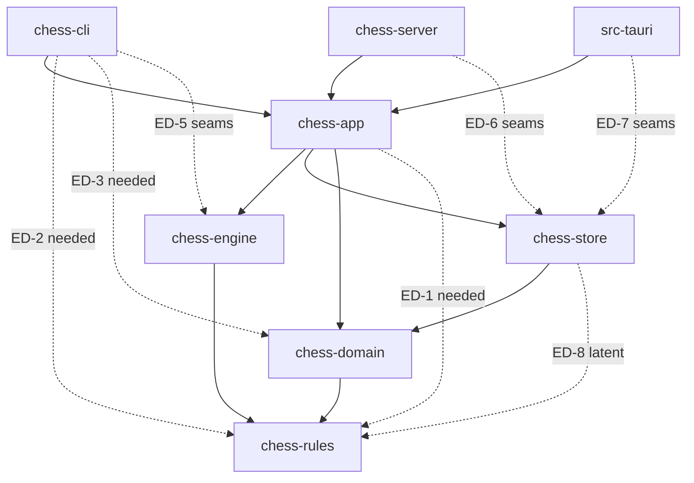

# SDD-consistency-review: cross-SDD consistency check of the nine DRAFT v0.1 SDDs

| Field | Value |
|---|---|
| Document | docs/design/SDD-consistency-review.md |
| Version | 0.1 DRAFT |
| Date | 2026-10-30 |
| Stance | **Reviewer** (`swe-governance` section 3): findings and mismatches only. Nothing is redesigned. Upstream documents (architecture, requirements, functional_decomp) are not edited |
| Gate | Review and the mechanical SDD edits below are **G0** (documents only). The resolution of each mismatch carries the tier in the table (SWE-001 section 3). **No approval is claimed.** Every item that needs the System Architect, the Systems Engineer or Brian Prascher is PENDING |
| Scope | [SDD-chess-rules](SDD-chess-rules.md), [SDD-chess-domain](SDD-chess-domain.md), [SDD-chess-store](SDD-chess-store.md), [SDD-chess-engine](SDD-chess-engine.md), [SDD-chess-app](SDD-chess-app.md), [SDD-chess-server](SDD-chess-server.md), [SDD-chess-cli](SDD-chess-cli.md), [SDD-ui](SDD-ui.md), [SDD-desktop-tauri](SDD-desktop-tauri.md) |
| Upstream read | architecture.md sections 3.2 to 3.4, 5.5, 5.7, 10.1 (full tables); functional_decomp.md section 3 table (parsed by script); SWE-001 v1.1 |
| Evidence tags | `swe-governance` section 6. `[OBS file section]` = read in this session. `[RAN ...]` = executed here. `[INF]` = inferred. Everything is design text: no code, build or test exists |

---

## 1 Method

1. Read `SWE-001`, `swe-governance`, architecture sections 3.2 to 3.4, 5.5, 5.7 and 10.1.
2. For each SDD, read the scope and allocation, the interface/provided/required sections, the key algorithms where a sibling depends on them (journal, finalize, Elo, facts, roster, stats, clocks, gateway), the design entities that touch a boundary, the error mapping, and the findings and assumptions registers. **Not every line of every SDD was read**: verification-mapping tables (UT/CT lists), per-entity traceability tables and the use-case references were skimmed or skipped.
3. Built a provider/consumer matrix for the checks (1) to (7) of the request and compared names, types, error types, sync/async and ownership.
4. Allocation check by script: `/private/tmp/claude-501/-Users-brianprascher-Projects-chess/4b5bd23d-b4b4-4840-b1c9-7b8f5af989d0/scratchpad/alloc.py` parses the 104 leaf functions of functional_decomp.md and the function IDs in each SDD's allocation table. `[RAN python3 alloc.py -> 104 functions, 104 leaves; 5 leaves unclaimed (all enabling system); 7 leaves claimed by two SDDs; 5 claims against the expected block]`. Requirement allocation was compared by reading architecture 10.1 against the "primary" lists of each SDD (manual, plus a script that counted SDD mentions per requirement ID: only RISK-1 is mentioned in no SDD).
5. ID and link check by script: local ID prefixes, foreign references and relative links. `[RAN python3 -> no cross-SDD ID is referenced without being defined in its owner file; every relative link resolves to an existing file]`. A definition check by "token appears in owner file" is weak (it does not prove the token is a definition), so section 8 reports it as "no dangling reference found", not as proof.
6. Edits: made only where two SDDs disagree on a name, signature or shape and the provider (or `-app` for protocol/envelope) is clearly authoritative. Each edit is recorded in section 3 and is tagged in the edited text with its XC number.
7. Where the right answer is a design choice, nothing was picked: the mismatch is logged with a proposed owner and gate tier.

Severity: **Major** = a frozen interface, stored format, dependency edge or protocol cannot be implemented consistently until it is settled. **Minor** = a statement, a value or a name.

Gate tiers use SWE-001 section 3: G0 text only; G1 one component, architecture intact (system-architect agent, desk review); G2 two or more crates, an interface, an edge or a dependency (Brian Prascher); G3 stored format or irreversible (Brian Prascher; the independent reviewer step is waived by FIND-016).

---

## 2 Summary

| Item | Count |
|---|---|
| Mismatches logged (XC-1 to XC-30) | 30 (15 Major, 15 Minor) |
| Mechanical edits made to SDDs | 14 edits in 7 files (store, app, domain, cli, server, desktop-tauri, ui). None in rules or engine |
| Dependency edges needed and not in architecture 3.2 | 8 rows: 3 live decisions (ED-1 to ED-3), 3 avoidable by `Core::open_default` (ED-5 to ED-7), 1 latent (ED-8), 1 already avoided by the engine SDD (ED-4); plus 4 intra-crate edges of `chess-app` |
| Third-party dependencies | 33 rows; 16 are not in 3.4: 13 production dependencies to decide, 1 test dependency, 2 not adopted (D-25, D-28). Seven SDDs need at least one (store, domain, app, server, cli, desktop-tauri, ui) |
| Duplicated or unowned responsibilities | 24 rows; 11 are real conflicts or holes, 4 more are duplicates or overlaps |
| Leaf functions with no SDD | 5 (F-8.6 to F-8.10, enabling system: packaging, CI, release docs) |
| Leaf functions claimed by two SDDs | 7 (6 accepted upstream as FG-4, 1 (F-8.2) needs a statement) |
| De-duplicated upstream findings | 52 rows from the 115 findings registered in the nine SDDs (see section 9) |

**Top issues** (all need a decision before the stated artifact is frozen):

1. **Journal contract is not agreed** (XC-1, XC-2, XC-6, XC-7): the domain needs `DrawDropped` and `SuspendResume` journal kinds the store does not have; the conversion between domain `Fact` and store `JournalRecord`, and between integer `PlayerId` and UUID, has an owner on paper (`chess-app`) but no design entity; `game.content_hash` is `NOT NULL` in the store with no source for a live game.
2. **Reachability of `chess-rules` and `chess-domain` types** (XC-9, XC-10, XC-11, XC-12): four SDDs take three different positions (add edges, re-export through `chess-domain`, re-export through `chess-app`). No SDD actually specifies the re-export. The CLI, server and Tauri shell also cannot build production `Seams` and no SDD provides `Core::open_default` or the data-directory resolver.
3. **Store trait style** (XC-4): the store designs a non-`dyn` async trait and no fake store; `chess-app`, `chess-cli`, `chess-server` and `src-tauri` all assume `Arc<dyn Store>` and an in-memory store double.
4. **Stats, typed-move parsing and Personality each have two or three implementations** (XC-13, XC-11, XC-8).
5. **First-launch roster vs `UCI_Elo` range** (XC-25): the 25-Player roster is generated before the engine has reported its range, and the personality depends on that range; D-34 makes the result permanent after release.

---

## 3 Edits made to the SDDs

Each edit follows the rule "the provider's SDD is authoritative for its own API; `-app` is authoritative for protocol and envelope".

| # | File and place | Change | Reason | XC |
|---|---|---|---|---|
| E-1 | SDD-chess-store, IFR-ST-03 | `EloCalc.update(own, opponent, score, counter) -> {k, delta}` replaced by `rating_track(&GameFacts)` and `settle(white: RatedSide, black: RatedSide, result) -> Settlement` | Domain IFP-DOM-4 and 3.9.3 are the provider | XC-3 |
| E-2 | SDD-chess-store, 3.11.4 finalize pseudocode | the per-side `update` call replaced by one `settle` call | same | XC-3 |
| E-3 | SDD-chess-store, ASM-ST-1 | rewritten to the `settle` shape; records that `Side` is a `chess-rules` type the store cannot name | same; `Side` is open | XC-3, XC-9 |
| E-4 | SDD-chess-app, 5.0 | appended a reconciliation paragraph that maps each proposed store operation name to the store's name and lists the shapes that differ and were **not** renamed | Store 3.7.2 and 3.7.3 are the provider | XC-5 |
| E-5 | SDD-chess-app, ALG-APP-05 step 6 | `store.name_owner` to `store.find_player_by_name` | same | XC-5 |
| E-6 | SDD-chess-app, DD-APP-07 `generate_computer` | "takes the set of all used names" to the `taken: &dyn Fn(&str) -> bool` predicate of domain IFP-DOM-5 | Domain is the provider | XC-25 |
| E-7 | SDD-chess-app, DD-APP-07 `void_unreadable` | `store.void_game(game, ...)` to `store.void_unreadable_game(game)` | Store is the provider | XC-5 |
| E-8 | SDD-chess-app, DD-APP-10 lease | `store.lease_heartbeat` to `store.lease_beat` | same | XC-5 |
| E-9 | SDD-chess-app, DD-APP-11 step 4 | `mark_analysis_used` to `set_analysis_used` | same | XC-5 |
| E-10 | SDD-chess-domain, 3.4 serde row | removed the claim that `GameSetup`, `Fact`, `Outcome`, `Personality`, `ClockSpec` "are written to the journal"; added that the journal uses the store's DTOs and that `chess-app` converts | Store 3.11.1 owns the journal format | XC-2 |
| E-11 | SDD-chess-cli, IA-CLI-4 | the sketch `resolve_typed_move(text, legal_moves)` replaced by the rules provider shape `Position::parse_move(text, ParseMode::Typed)` and its error set; notes that it needs a `Position` | Rules IFP-RUL-3 is the provider | XC-11 |
| E-12 | SDD-chess-server, start of 5.1 | banner: frame shapes, `core.*` calls and server-written `ServerStopping` are superseded by 12a | `-app` governs the protocol; the body contradicts the SDD's own 12a | XC-19 |
| E-13 | SDD-desktop-tauri, start of 5.1 | banner of the same kind (reply/event frames, `core.*`, `shutdown()` without deadline) | same | XC-19 |
| E-14 | SDD-ui, start of DD-UI-1 | banner: frame kinds, reconnect rule, gap detection by `ply` superseded by 13a | same | XC-19 |

Not edited although a candidate: the `Arc<dyn Store>` of `-app` (XC-4), the `PlayerId`/UUID question (XC-7), the 6 s job staleness of `-app` against the store's 10 s (XC-16), the `Fen` accessors (XC-26). Each is a design choice or an addition to a provider's API, not a rename.

---

## 4 Mismatch table

Columns: the evidence cites the section of each SDD. "Owner" is the party who should resolve it: an SDD owner (software engineer role), or SA, SE, user for decisions. "Status" is `OPEN` unless an edit was made.

| ID | SDDs | Evidence | Sev | Proposed owner | Gate | Status |
|---|---|---|---|---|---|---|
| XC-1 | domain, store, app | **Journal record kinds.** Domain 3.11.1 needs `DrawDropped` (an offer to a computer dropped by engine failure or suspend) and `SuspendResume`, plus the rule that a `Move` in `Paused` is a stepped move; it implements an implicit-resume fallback and says it "needs agreement with" the store (FIND-DOM-1). Store 3.11.1 lists only the architecture 7.6 kinds (`Start, Move, Takeback, Clock, DrawOffer, DrawDeclined, Pause, Resume, Suspend, GameEnd, Abort, Voided`) and knows nothing of the two (no FIND-ST item). Name clash: store `Resume` is domain `PlayResume` (resume after `Pause`); domain uses `SuspendResume` for resume after `Suspend`. App ALG-APP-01/02 and DD-APP-09 never name the kinds | Major | store owner and domain owner, then SA | **G3** (stored format; nothing released, so no migration, store 9) | OPEN |
| XC-2 | domain, store, app | **Fact to JournalRecord conversion and payload gaps.** Store 3.11.1: journal-owned DTOs, "Conversion lives in `chess-app`". App has no entity for it (ALG-APP-01 step 3: "Build the journal record(s) from the clone's delta"; no mention of `Fact`, `decide` or `evolve` anywhere in the app SDD `[OBS grep]`). Field gaps: store `Move` needs `fen_after*` and `wall_ms`; domain `Fact::Move` has `played_at` but no `fen_after` (it is in `PlyRecord`); store `white_ms, black_ms` are mandatory, domain `clocks_after` is `Option` (untimed); store `Start` needs `white_uuid, black_uuid, rated, self_play, started_at`; domain `GameSetup` has integer `PlayerId`; store `Voided.reset_player_uuid` vs domain `reset_player_id: PlayerId`; store `GameEnd` carries the `FinalizeRequest` inputs (`ended_at`, times, `eco`, `opening_name`, `analysis_used`) that the domain `Outcome` does not. Domain 3.4 said the domain types are written to the journal (edited, E-10) | Major | app owner (new entity), store and domain to confirm | G2 (new design entity across three crates; field additions are G3 with XC-1) | OPEN (text corrected by E-10) |
| XC-3 | domain, store | **Elo shape.** Store IFR-ST-03: `update(own, opponent, score, rated_games_before) -> {k, delta}` per side. Domain IFP-DOM-4: `settle(white: RatedSide, black: RatedSide, result) -> Settlement` and `rating_track(&GameFacts)` | Major | store owner | G0 (text) | **EDITED** E-1 to E-3. Residual: store must build `GameFacts` and `RatedSide` from rows (no new design) |
| XC-4 | store, app, cli, server, desktop | **Store as `dyn` or not.** Store 3.7.1: `StoreApi` with native `async fn`, static dispatch, "not `dyn`", "Tests use `FaultPlan` and temp directories instead of a fake store" (R-ST-2, FIND-ST-13: no in-memory store). App 4.7.1: `Seams { store: Arc<dyn Store>, journal: Arc<dyn JournalPort>, ... }`; DD-APP-17: "an in-memory `Store` and `JournalPort` are test doubles owned by `chess-store`". CLI DD-CLI-10, server CT-SRV-22..27 and desktop CT-TAU-01 test against "a core with in-memory store". Four SDDs assume what the store rejects | Major | store owner and app owner | G2 (interface style across crates) | OPEN |
| XC-5 | store, app | **Store API names and shapes.** App 5.0 invents names "owned by SDD-chess-store"; store 3.7.2/3.7.3 differ. Renamed by E-4..E-9: `insert_computers`, `apply_records`, `lease_beat`, `find_player_by_name`, `void_unreadable_game`, `set_analysis_used`, `claim_job`/`job_heartbeat`/`complete_job`/`fail_job`, `enqueue_unevaluated_games`. **Not 1:1 (open):** `reset_player` returns error `UnlistedUnfinishedGames` (app: `Done or Mismatch{current}`); `start_game` returns the existing game or `SlotTaken` (app: `Started/Existing/SlotConflict`); `finalize_game(FinalizeRequest)` (app: `finalize_game(game, end)`); no `delete_trailing_moves` (the `Takeback` record does it); `import_game`, `bulk_read_all`, `import_exclusive` vs `RowIo`; `create_fresh_store`, `restore_backup` vs `Opener`/`RestoreService`; journal port `create(&uuid)` + `open_for_resume(&store,&uuid)` + `probe` + `close_final` (store) vs `create(uuid, Start)` + `open_exclusive` + `replay_into_store` + `close_to_done` (app). Store error table (3.8) has `OtherVersionRunning` and `Exclusive`, which app section 6 does not list | Major | app owner (adopt the store's shapes) | G1 | PARTLY EDITED |
| XC-6 | rules, store, app | **content_hash.** Store schema: `game.content_hash TEXT NOT NULL` with index; `NewGame` and `FinalizeRequest` (3.7.2) carry no hash, `Start` payload carries none. App ALG-APP-09 computes it only for PGN import, from rules `canonical_form` (IFP-RUL-5), "hash function not named upstream" (UF-APP-02, ASM-APP-06). So a live game cannot be inserted (NOT NULL) and no step fills it at finalize. Tag set that counts (`GameUUID`, `Mode`, `Rated`) is undecided (FIND-RUL-4). No hash crate in 3.4 | Major | SA (algorithm, tag set, crate), then store and app | G2 (new dependency; schema nullability is G3) | OPEN |
| XC-7 | domain, store, app, ui | **Identifier representation.** Domain DD-DOM-001: `PlayerId(i64)` "mirrors `PLAYER.id`", `Uuid` only for `game_uuid` and roster identity. App DD-APP-03: "identifiers are UUID strings" on the wire. Store: journal carries UUIDs because integer ids "can be reused after a restore" (FIND-ST-01); rows keyed by integer. App does not define `GameId`/`PlayerId` (`[OBS grep]`: used, never defined). No SDD owns the mapping UUID to integer at the protocol boundary or at `Start` | Major | app owner; SA to confirm id policy | G2 (protocol) | OPEN |
| XC-8 | domain, engine, store, app | **Personality types.** Domain `Personality` (`error_rate` as permille `u16`, FIND-DOM-12); engine `EnginePersonality` (`error_rate: f64`, `error_multipv: u8`); store `computer_profile.error_rate REAL` inside a UNIQUE index (float equality). Engine R-EN-1 and domain FIND-DOM-5 say `chess-app` converts. App SDD never mentions `Personality`, `EnginePersonality` or the conversion (`[OBS grep]`). Permille to `REAL` to `f64` must round-trip exactly for the ENG-2 uniqueness index | Major | app owner (conversion entity), SA for FIND-EN-01 | G2 if an edge is chosen instead; G1 for the conversion | OPEN |
| XC-9 | rules, domain, store, app, cli | **Reachability of `chess-rules` / `chess-domain` types.** Rules FIND-RUL-2: recommends adding `app -> rules` and `cli -> rules` (Option A). Domain 3.4/FIND-DOM-6(i): `cli -> domain` needed for `BoardGrid`. App DR-APP-13/UF-APP-01: re-export `chess-rules` through `chess-domain` (no edge). CLI 3.4/UF-CLI-1: re-export `BoardGrid`, `BoardStyle`, the typed-move matcher through `chess-app`. **Neither domain nor app specifies a `pub use`** (domain 3.8: "`lib.rs` is the only place with `pub use`", none listed; CLI 13a: "no `BoardGrid` re-export ... named in SDD-chess-app"). Store needs `Side` (3.4) and has no edge to rules; domain lists no `Side`. If re-export is chosen, `chess-rules` is part of `chess-domain`'s public API and the "pure domain" boundary leaks upstream types | Major | SA, then Brian Prascher | G2 (Q4) | OPEN |
| XC-10 | app, cli, server, desktop, store | **Production seams and helpers.** `Core::open(cfg, Seams)` (app 4.7.1) needs engine factory, store, journal; CLI, server and `src-tauri` have no edge to engine or store (UF-SRV-12, UF-CLI-11, UF-TAU-11). Needed and absent in app: `Core::open_default(cfg)`; `resolve_data_dir(flag)` (CLI IA-CLI-1, Tauri IA-TAU-1; it exists only as `DataDir::resolve(flag, env, default)` in store DD-ST-004, unreachable from those crates); `Core::protocol_version()`/`build_version()` (IA-SRV-4; app has only `CoreConfig.build_version`); a `game_uuid` helper (IA-CLI-5; the GUI uses Web Crypto, DD-UI-1); a live-entry-point query for the port hint (IA-CLI-6; store has `list_live_processes`) | Major | app owner | G1 (additions inside `chess-app`); G2 if edges are added instead | OPEN |
| XC-11 | rules, cli, ui, app | **Typed-move parsing: three implementations.** Rules `Position::parse_move(text, Typed\|Pgn)` (IFP-RUL-3, DD-RUL-006). CLI A4/IA-CLI-4 wanted a matcher over a legal-move list (corrected by E-11). UI DD-UI-7/UF-UI-2: a TypeScript matcher with shared vectors. Rules FIND-RUL-3 proposes a core query `ParseMove{fen, text}` or typed text in `MakeMove.mv`; app has neither (`MakeMove.mv` is UCI; no `ParseMove`). Principle 1 ("front-ends hold no rules") is at risk, and Q44 / CLI-3 give the rule one owner | Major | SA | G2 (protocol) | OPEN (CLI text edited, E-11) |
| XC-12 | domain, cli, app | **BoardGrid input shape.** Domain `BoardGrid::render(&Position, &BoardView{last_move: Option<Move>, ...})` needs rules `Position` and `Move`. The CLI receives snapshots with FEN and UCI strings through the app. Either the CLI builds a `Position` (needs rules types, XC-9) or the snapshot exposes one (in-process only) or `render` takes `Fen`. Also: CLI 4.4 prose lists styles "plain ASCII, Unicode glyphs, ANSI colour, light/dark"; domain `BoardStyle` is `Plain, Unicode, Ansi, NoColor` | Minor | domain owner and cli owner | G1 | OPEN |
| XC-13 | domain, store, app | **Statistics aggregation in three places.** Store 3.7.2 `player_stats`, `head_to_head`, `games_for_history`: "SQL views, filter `self_play = 0 AND status = 'completed' AND start_fen IS NULL`". Domain DD-DOM-018: pure `aggregate(rows, window)`, `rating_series`, `check_history`, `counts_in_aggregates`; "SQL only selects rows". App ALG-APP-13/DD-APP-14: `StatsService` applies the subject filter and computes means, and does not mention domain `aggregate`. Three copies of the predicate and of the empty-state rule (CR-4.15). The reset window `started_at >= reset_at` is stated in all three | Major | SA (FIND-DOM-2) | G2 | OPEN |
| XC-14 | domain, app, rules | **ECO timing.** Domain 3.11.9: `Game` calls `EcoTable::observe` after every move (standard start only) and recomputes after a takeback; `view().eco`. App DD-APP-10: "ECO classification via `EcoTable` at game end". Import: domain `eco_for_import` is not referenced by app DD-APP-15 (and rules FIND-RUL-7 says the importer must not classify custom starts) | Minor | app owner | G1 | OPEN |
| XC-15 | domain, engine, app | **Seeded randomness.** `SplitMix64` is implemented twice (domain DD-DOM-002 for roster and colour draw; engine R-EN-6 for the error pick), both "fully specified". The seed for the error pick is "a hash of `(game_id, ply)` supplied by the caller" (engine 3.10.8) and "derived by `GameSession` with `SplitMix64`" (domain FIND-DOM-5); app has an `RngFactory` "seeded from `(game_id, ply)`" and no `seed` field in `ComputerMove` or in the limits (ALG-APP-03). The mixing function is unowned, and replays depend on it | Minor | app owner and domain owner | G1 | OPEN |
| XC-16 | store, app | **Staleness values.** Store 3.11.6/3.11.7: process heartbeat and analysis-job claim stale after 10 s `ESTIMATE`. App 4.12/ASM-APP-10: analysis job stale after 6 s `ESTIMATE`. Lease heartbeat is 2 s in both | Minor | SA (one value; FIND-ST-06, UF-APP-14) | G0 (value) | OPEN |
| XC-17 | domain, app, store | **Policy and validation duplicates.** (a) Slot-holder table: domain `Policy::slot_holders` (3.11.6) and app ALG-APP-07 table. (b) Player actions: domain `check_player_action` (FIND-DOM-8) and app PlayerService rules (`computer_player`, `active_player`, `archived_player`). (c) Gateway mapping: app `ComputerMove`, `ComputerDrawDecision` have no domain action of that name (domain has `MakeMove{actor: Engine}`, `RespondDraw`); app says `WhatIf` is allowed "in Training in progress, or any finished game", domain adds "and human to move". (d) App proposes `Denied` reasons `game_open`, `archived_player` not in the domain `DeniedReason` list | Minor | domain owner and app owner | G1 | OPEN |
| XC-18 | engine, app | **Engine restart policy.** App DD-APP-10: "`EngineError`: restart once (gateway/engine), then emit `EngineUnavailable`". Engine 3.10.4: transparent restart only before a request; a failure in flight is returned and not repeated; `RetryEngine` is the next request (FIND-EN-12). App 4.9 flow and the pool's "restart once" differ on whether a failed search is retried | Minor | engine owner, SE to confirm (F-3.7) | G1 | OPEN |
| XC-19 | server, ui, desktop, app | **Stale protocol text.** Each of the three SDDs has a reconciliation section saying `-app` governs, but the bodies still carry the superseded shapes (frame kinds `result/error/event`, `core.execute`, server-written `ServerStopping`, `shutdown()` with no deadline, reconnect without `ResumeGame`, gap detection by `ply`). Also still undefined in `-app`: the request kinds `subscribe`, `unsubscribe` and the kind for `subscribe_global` | Minor | server, ui, desktop owners; app owner for the kinds | G0 for the text; G2 for the kinds (protocol) | BANNERS ADDED (E-12 to E-14) |
| XC-20 | app, server, ui, desktop, cli | **File transfer.** App: `FileRef = Path \| Bytes`, remote sessions `Bytes` only, JSON encoding not stated. Server: base64 inside frames, 32 MiB frame cap (UF-SRV-5). UI: `{name, data}` base64, 10 MB PGN check, `<a download>` may not work in WKWebView. Desktop: no save path (no dialog plugin). CLI 13a: paths for in-process sessions. No archive size limit exists (TBD-25 covers PGN) | Major | SA, Brian Prascher | G2 | OPEN |
| XC-21 | app, ui, domain | **Snapshot content.** UI IA-UI-1 needs `legal_moves: {uci, san}[]` per current ply; app DD-APP-03 lists "the current ply's legal moves" without shape (UI 13a says the same). `allowed_actions` is a list of `ActionKind` (domain) vs "action names" (UI). `ClockSync` agrees (domain, app, UI) | Minor | app owner | G1 | OPEN |
| XC-22 | domain, app | **Wire shapes of domain types.** Protocol commands carry domain types (`GameSetup`, `Mode`, `Matchup`, `ClockSpec`, `Category`, `Preferences`). App DD-APP-03: every public protocol type derives `ts_rs::TS` with an export path. Domain has `serde` but no `ts-rs` in its dependency table (3.4), and §3.2 does not draw `ts-rs` for domain. Either domain derives TS (new third-party edge for a "pure" crate) or app mirrors the types. Also two `Command` types (domain `Command` for `decide`, app `protocol::Command`) and two `Outcome`/`Event`/`Fact` vocabularies | Major | SA (dependency), app owner | G2 | OPEN |
| XC-23 | domain, cli, rules | **Clock units and model.** Domain 3.5 stores `clock_spec` as `base+inc` in seconds; 3.11.5 presets are "minutes plus seconds"; CLI `--clock 5+0` is minutes plus seconds (UF-CLI-5); PGN `TimeControl` is seconds (rules DD-RUL-009). The conversion owner is not named. App ALG-APP-02 describes a `Clock {white_ms, black_ms, running_side, as_of_mono}`; domain `Clock` is `remaining_ms`, `turn_elapsed`, `running {side, since}`. App also omits the domain rule that a `Move` arriving at zero remaining time becomes the flag result | Minor | domain owner and cli owner | G0 | OPEN |
| XC-24 | domain, app, ui | **VariationTree has no consumer.** Domain DD-DOM-016 (arena tree, `to_pgn_text`). App IFR-APP-04 lists it as needed, but DD-APP-12 says "the client holds the tree (D-11)" and the service replays moves through `chess-rules`. UI has no tree entity (`LegalMoves{fen}` per move). The architecture allocates ANA-2 to `AnalysisService + VariationTree` | Minor | SA / SE (ANA-2, OQ-DOM-3) | G1 | OPEN |
| XC-25 | domain, engine, app | **First-launch roster vs engine range.** Domain 3.11.8: `uci_elo` is `Some` only if the class baseline lies in the engine's reported range; `RosterGen::new(seed, None)` makes every `uci_elo` `None`. Engine exposes the range after the handshake (`EngineInfo.uci_elo_range`). App DD-APP-01: start-up order puts "first-launch roster" before the engine is started (lazy engine, NFR-1). The default 25 are therefore generated with `None` while later batches could have a range, and a personality is fixed once stored (D-34 one-way after release). Also: domain `generate(category, first_k, ...)` needs the next `k` per class; app says "next positions continue the seed's stream" and store has no counter (it could read the highest `roster_index` per class) | Major | SA, Brian Prascher | G2 (one-way once released) | OPEN (predicate wording edited, E-6) |
| XC-26 | rules, engine, app | **API details at the engine boundary.** Engine ASM-EN-1 needs `Fen` to convert to text; rules IFP-RUL-4 states no `as_str`/`Display`. App IFR-APP-01 quotes the architecture signature `search(position, SearchLimits, multipv)`; engine provides `search(SearchRequest)` and `EnginePool`/`EngineHandle` (app: `EngineFactory`). `UciMove` (engine) to `Move` (rules `Move::from_uci`) bridge is used by the gateway: rules provides it, engine FIND-EN-08 asks for it. Score point of view: engine side-to-move, app stores White's (ASM-APP-07) | Minor | rules owner (add `Fen` accessor), app owner | G0 | OPEN |
| XC-27 | store, app, cli | **PROCESS_HEARTBEAT.** Store: `build_version TEXT`, `owner = <kind>:<pid>`. App UF-APP-19 still treats it as an `int`. CLI IA-CLI-6 and server UF-SRV-7 want the live entry points (and a port) through a core query; store offers `list_live_processes` but no port column; app has no such query | Minor | app owner, SA for the port column | G1 (G3 if a column is added) | OPEN |
| XC-28 | cli, store, app | **config.toml writer.** CLI: reads it (`toml`), "never writes" (UF-CLI-8). Store: "not written by this crate", owner column names `chess-app`, `chess-cli`. App: no mention (`[OBS grep]`). Architecture 8.2 says it is created "only when the user saves a setting", but no setting writes it | Minor | SE (UI-1), SA | G1 | OPEN |
| XC-29 | all, architecture 10.1 | **Requirement and function allocation.** See section 8: no SDD for the enabling-system blocks (F-8.6 to F-8.10, PLAT-1/2/5, NFR-5/6); F-8.1 not claimed by the CLI SDD for `chess` and `chess serve`; several requirements claimed "primary" by two or three SDDs while architecture 10.1 names one | Minor | SA | G0 | OPEN |
| XC-30 | all | **ID format.** No ID collision and no dangling link. Governance format is `PREFIX-nnn`; SDDs use unpadded (`FIND-RUL-1`), two-digit (`FIND-ST-01`, `FIND-EN-01`) and different prefixes for the same kind (`FIND-` in rules, domain, store, engine; `UF-` in app, server, cli, ui, desktop). Local gate IDs are not used (SWE-001 ASM-S5 reserves `GATE-101` upward) | Minor | each SDD owner | G0 | OPEN |

---

## 5 Consolidated dependency-edge table

Edges are crate-to-crate edges needed by an SDD and not drawn in architecture 3.2 `[OBS architecture.md:291-348]`. The drawn edges are: `cli -> server, app`; `server -> app`; `tauri -> app`; `app -> engine, store, domain`; `engine -> rules`; `store -> domain`; `domain -> rules`.

| # | Edge | Needed by (SDD, section) | Reason | Source findings | Alternative that avoids the edge | Status |
|---|---|---|---|---|---|---|
| ED-1 | `chess-app -> chess-rules` | rules 3.4, 3.1; app 4.4, DD-APP-11/12/15 | legality check of engine output, FEN and PGN I/O, canonical PGN writer, `LegalMoves`, variation replay | FIND-RUL-2, UF-APP-01, DR-APP-13, FIND-DOM-6(i) | `chess-domain` re-exports `chess_rules` (not specified in the domain SDD) | OPEN, G2 (SA then Brian Prascher) |
| ED-2 | `chess-cli -> chess-rules` | cli 3.4, DD-CLI-5 | `Position::parse_move(Typed)`, `Position::from_fen` for `BoardGrid` and typed input | FIND-RUL-2, UF-CLI-1 | re-export through `chess-app` (not specified in the app SDD) | OPEN, G2 |
| ED-3 | `chess-cli -> chess-domain` | domain 3.4, cli 3.4, DD-CLI-4/7 | `BoardGrid`, `BoardStyle` | FIND-DOM-6(i), UF-CLI-1 | re-export through `chess-app` | OPEN, G2 |
| ED-4 | `chess-engine -> chess-domain` | engine 3.4 | `Personality`, `Rng` | FIND-EN-01, FIND-DOM-5 | `EnginePersonality` in engine, `u64` seed, conversion in `chess-app` (engine R-EN-1; chosen by the engine SDD) | NOT NEEDED if R-EN-1 accepted (XC-8, XC-15) |
| ED-5 | `chess-cli -> chess-engine`, `chess-store` | cli 6.3, IA-CLI-1/7; UF-CLI-11 | build production `Seams`, calibration | UF-CLI-1, UF-CLI-11 | `Core::open_default(cfg)` and `Core::open_for_calibration` in `chess-app` (the latter exists, IFP-APP-04) | OPEN (XC-10) |
| ED-6 | `chess-server -> chess-engine`, `chess-store` | server 12a | production `Seams` | UF-SRV-12 | same `Core::open_default` | OPEN (XC-10) |
| ED-7 | `desktop/src-tauri -> chess-engine`, `chess-store` | desktop 12a | production `Seams` | UF-TAU-11 | same | OPEN (XC-10) |
| ED-8 | `chess-store -> chess-rules` (latent) | store 3.4 (`Side`) | the `Side` type | ASM-ST-1 | `chess-domain` re-exports `Side`, or store keeps its own enum | LATENT (XC-9) |

Intra-crate edges of `chess-app` missing from architecture 4.1 (UF-APP-16, not in 3.2): `PlayerService -> SessionRegistry` (void), `GameSetupService -> SessionRegistry`, `AnalysisService -> Store` (`VARIATION`), `EngineGateway -> Store` (`analysis_used`) plus a game-state source (`GameContextProvider`). Source: app 4.4 and UF-APP-16.

Solid arrows are architecture 3.2. Dotted arrows are the needed edges of the table above. ED-4 is not drawn: the engine SDD avoids it.

---

## 6 Consolidated third-party dependency table

Reference: architecture 3.4 baseline table `[OBS architecture.md:367-391]`. "Y" = in 3.4. Rows marked "NO" are decisions for the SA and Brian Prascher (new dependency, G2); none was looked up here (guardrail 5, no network used), so existence, version, licence and features are `[UNV]`.

| # | Dependency | Used for | Needed by SDDs | In 3.4? | Note |
|---|---|---|---|---|---|
| D-1 | `shakmaty` 0.30.2, `pgn-reader` 0.29.1 | rules engine, PGN | rules | Y | |
| D-2 | `thiserror` 2.0.21 | typed errors | rules, domain, store, engine, app, server, cli, desktop | Y | |
| D-3 | `serde` 1.0.229 | DTOs | domain, store, app, server, desktop | Y | not drawn in 3.2 for domain or store; rules and engine deliberately do not use it |
| D-4 | `serde_json` | journal payloads, protocol, frames, archive | store, app, server, desktop | **NO** | UF-APP-02, UF-SRV-9, UF-TAU-9, FIND-ST-10 |
| D-5 | `uuid` (feature `v5`) | `Uuid`, UUIDv5 roster identity, parsing | domain, store, app (cli avoids it via a helper) | **NO** | FIND-DOM-3, FIND-ST-10, UF-APP-02; the GUI uses Web Crypto (UI DD-UI-1) |
| D-6 | `crc32fast` | journal record checksum | store | **NO** | FIND-ST-10 |
| D-7 | `libc` | `flock`, `fcntl(F_FULLFSYNC)` | store | **NO** | `rustix` named as alternative, not chosen (store 3.4) |
| D-8 | `tokio` 1.54.1 (features) | runtime, channels, `spawn_blocking`, timers | store (`sync`, `rt`, `time`), engine (`process`, `io-util`, `sync`, `time`, `rt`, `macros`), app, server (`net`, `[UNV]`), cli (`signal`), desktop (via Tauri runtime) | Y (crate); features not stated | 3.2 draws it only under `chess-app` (FIND-ST-10, FIND-EN-10) |
| D-9 | `tracing` 0.1.44 | log events | store, engine, app, server, cli, desktop | Y | |
| D-10 | `tracing-appender` 0.2.5 | non-blocking log writer | app | Y | |
| D-11 | `tracing-subscriber` | subscriber setup | app | **NO** | UF-APP-02 |
| D-12 | `rusqlite` 0.41.1 (bundled) | SQL | store | Y | |
| D-13 | `unicode-segmentation` 1.13.3, `unicode-normalization` 0.1.26 | PLY-6 | app | Y | |
| D-14 | `ts-rs` 12.0.1 | TypeScript types | app, possibly domain (XC-22) | Y | |
| D-15 | ZIP library | full-data archive | app | **NO** | UF-APP-02 |
| D-16 | content-hash function (SHA-2 class) | `content_hash`; ECO TSV hash is checked by CI, not code | app (and rules `canonical_form` input) | **NO** | FIND-RUL-4, UF-APP-02, ASM-APP-06 (XC-6) |
| D-17 | `futures` / `futures-util` / `tokio-stream` | `Stream`, `StreamExt`, `SinkExt` | app, server, cli | **NO** | UF-APP-02, UF-SRV-9; cli `EventStream` also needs crossterm `event-stream` |
| D-18 | `tokio-util` or equivalent (cancellation) | cancel tokens | app | **NO** | UF-APP-02 |
| D-19 | `axum` 0.8.9 (feature `ws`), `rust-embed` 8.13.0 | HTTP, WebSocket, embed | server | Y (feature `ws` not stated); `mime-guess` transitive | |
| D-20 | `ratatui` 0.30.2, `crossterm` 0.29.0, `toml` 1.1.8 | TUI, config | cli | Y | |
| D-21 | `clap` | argument parsing | cli | **NO** | named in 3.3, absent from 3.4 (UF-CLI-9) |
| D-22 | `signal-hook` | raise SIGTSTP | cli | **NO** | named in 6.1 diagram, absent from 3.4 (UF-CLI-9) |
| D-23 | `tauri` 2.12.5, `@tauri-apps/cli` 2.12.4, `@tauri-apps/api` 2.12.4 | desktop shell | desktop, ui | Y | |
| D-24 | single-instance mechanism (plugin or lock file) | second launch focuses the first | desktop | **NO** | UF-TAU-4; a Tauri plugin would widen the webview's reach |
| D-25 | native save dialog plugin | save PGN/zip in the webview | desktop, ui | **NO** (excluded by design) | UF-TAU-5, UF-UI-3 |
| D-26 | React 19.3.1, `react-dom`, `@lichess-org/chessground` 10.5.0, Vite 8.3.5, TypeScript 7.0.2 | GUI | ui | Y | |
| D-27 | Testing Library and a DOM environment | component tests | ui | **NO** | UF-UI-5 |
| D-28 | schema validator for core messages (not adopted) | validate JSON from the core | ui | **NO** (not used; envelope checks only) | UF-UI-8 |
| D-29 | `proptest` 1.12.0, `insta` 1.49.0, `cargo-fuzz` 0.13.2, `cargo-mutants` 27.1.0 | tests | rules, domain, store, engine, app | Y | |
| D-30 | `arc-swap`-like cell | `CoreState` | app (alternative `RwLock` stated) | **NO** | app DD-APP-01 |
| D-31 | `rand`, `rand_chacha` | RNG | none | rejected by domain DR-DOM-9 and engine R-EN-6 | each crate writes its own `SplitMix64` (XC-15) |
| D-32 | Lichess `chess-openings` snapshot (CC0-1.0 data) | ECO table | rules | data dependency in D-20, not in 3.4 | NFR-6 audit item |
| D-33 | Stockfish 19 | engine | engine | Y | |

Distinct SDDs needing at least one dependency not in 3.4: store, domain, app, server, cli, desktop, ui, rules (data only). The engine SDD names none beyond 3.4.

---

## 7 Duplicated or unowned responsibilities

"Real" = the SDDs disagree or nobody owns it. "OK" = more than one SDD touches it but the split is consistent.

| # | Responsibility | Claimed or implemented by | Assessment | Proposed owner | XC |
|---|---|---|---|---|---|
| OW-1 | Typed-move parsing | rules `parse_move(Typed)`; cli IA-CLI-4; ui TS matcher; rules FIND-RUL-3 | **Real**: three implementations, no protocol path for one | rules (sole Rust), SA decides GUI path | XC-11 |
| OW-2 | Clock-derived engine budget formula | engine DD-EN-009 (`min(remaining/30 + 3*inc/4, remaining/2)`, floor 50 ms `ESTIMATE`); domain FIND-DOM-10 and app UF-APP-18 point to engine | OK: one owner (engine). Formula is `ESTIMATE`; SE to confirm | engine; SE | |
| OW-3 | Score point of view | engine side-to-move; app White's (ASM-APP-07, ALG-APP-12); store `cp` unspecified (FIND-ST-12) | OK in effect (app normalises), open decision | app normalises; SA decides storage | U-15 |
| OW-4 | `content_hash` | rules `canonical_form`; app hashes; store `NOT NULL` column | **Real**: nobody fills it for a live game | SA | XC-6 |
| OW-5 | Name generation | domain `RosterGen` and pools, `taken` predicate; app passes `taken` and validates | OK after E-6; next-`k` per class unowned | domain; app for `k` | XC-25 |
| OW-6 | Heartbeat staleness | store (10 s); app (6 s for jobs) | **Real**: two values | store | XC-16 |
| OW-7 | ECO | rules table and `lookup`; domain `observe`; app "at game end" | Overlap (domain per move, app at end) | domain | XC-14 |
| OW-8 | Stats aggregation | store SQL views; domain `aggregate`; app `StatsService` | **Real**: three places | SA | XC-13 |
| OW-9 | Data-directory resolution | store `DataDir::resolve`; cli/tauri expect `chess_app::resolve_data_dir`; cli parses `--data-dir` with `clap`, desktop by hand | **Real**: provider unreachable | app (re-export or wrapper) | XC-10 |
| OW-10 | `config.toml` writer | cli reads only; store, app silent | **Real**: no writer, no reader outside cli | SE / SA | XC-28 |
| OW-11 | File transfer (encoding, size) | app `FileRef`; server base64; ui base64 `{name,data}`; desktop none | **Real** | SA | XC-20 |
| OW-12 | `game_uuid` generation | ui Web Crypto; cli wants an app helper; domain holds `Uuid` | Two sources; helper absent | app | XC-10 |
| OW-13 | `SplitMix64` and seed derivation | domain and engine each; seed mixing unowned | Duplicate | domain / app | XC-15 |
| OW-14 | `Fact` to `JournalRecord` conversion | store says app; app silent | **Real**: owner on paper only | app | XC-2 |
| OW-15 | `Personality` to `EnginePersonality` conversion | engine and domain say app; app silent | **Real** | app | XC-8 |
| OW-16 | `PlayerId`/UUID mapping | nobody | **Real** | app | XC-7 |
| OW-17 | Slot-holder rule | domain `slot_holders`; app ALG-APP-07; store PK | Duplicate table | domain | XC-17 |
| OW-18 | Player-action policy | domain `check_player_action`; app PlayerService | Duplicate | SA (FIND-DOM-8) | XC-17 |
| OW-19 | Elo chart renderer | domain FIND-DOM-11 proposes cli; cli UF-CLI-7 puts it in cli; ui hand-built SVG, D-21 deferred | OK: cli owns the TUI renderer | cli | |
| OW-20 | Journal lock | store `flock`; app registry acquires; session holds | OK (UF-APP-13 on `LeaseLost` trigger) | store / app | U-17 |
| OW-21 | PGN custom tags | rules extras map; app assembles | OK | app | |
| OW-22 | `Termination` / `EndStatus` text | domain `EndReason` strings and `pgn_termination()`; rules enum; app tags | OK; strings are a proposal (FIND-DOM-7) | SE | U-21 |
| OW-23 | Flag/clock timers | domain `flag_deadline`; app arms one timer | OK | app | |
| OW-24 | Variation tree | domain `VariationTree`; app/ui say client holds it | **Real**: no consumer | SA / SE | XC-24 |

---

## 8 Allocation check

### 8.1 Functions (functional_decomp.md section 3, 104 leaves)

`[RAN alloc.py -> 104 functions, 104 leaves]`. Each leaf was mapped from its allocation block to the SDD that covers that block (`chess-app core :: X` to app, `Game domain`/`Policy` to domain, `chess-rules` to rules, `chess-engine` to engine, `chess-store`/`chess.db + journals` to store, `CLI front-end` to cli, `axum HTTP + WebSocket` to server, `Browser tab`/`WKWebView` to ui, `Tauri shell and IPC adapter` to desktop).

| Result | Leaves | Assessment |
|---|---|---|
| Claimed in the allocation table of the expected SDD | 99 | OK |
| Claimed by **no** SDD | F-8.6 Package application, F-8.7 Acquire and bundle pinned engine, F-8.8 Document install and use, F-8.9 Audit license compliance, F-8.10 Verify release platform matrix | Enabling-system blocks (`packaging/`, `third_party/stockfish/`, `CI checks`, `Release checklist and install docs`). None of the nine SDDs covers them. Expected, but there is no SDD at all for them (XC-29) |
| Claimed by two SDDs | F-2.5.6, F-7.3.1, F-7.3.2, F-7.3.3, F-7.3.4 (cli and ui) | Accepted upstream as FG-4 (same behaviour once per front-end) |
| Claimed by two or more SDDs | F-8.2 Start local web server (server and cli); F-8.4 Confine traffic to loopback (server, ui, desktop) | F-8.4 is in the FG-4 list (accepted). F-8.2 is not: the functional decomposition allocates it to the server block only, while the CLI SDD claims the config and browser half (the server SDD 1.2 itself says "the config and browser part is `CLI front-end`"). Needs a one-line statement upstream, not a design change |
| Claimed by an SDD other than the allocated block | F-3.2 Search position (`stockfish`; engine as client), F-3.9 Calibrate (`CI checks`; cli claims the subcommand code), F-8.1 Launch entry point (three process boundaries; only desktop claims it) | F-8.1: the CLI SDD claims neither `Process: chess` nor `Process: chess serve`; one of three process boundaries is unowned in the SDD set |
| Allocated to an app part but computed in another crate | F-4.5 (StatsService; domain DD-DOM-018 and store views), F-2.2.3 (GameSession; domain `decide`), F-5.2/F-5.3 (AnalysisService; domain `VariationTree`), F-1.6 (PlayerService; domain `RosterGen`) | Consistent for F-2.2.3, F-1.6. F-4.5 and F-5.2/5.3 are XC-13 and XC-24 |

### 8.2 Requirements (architecture 10.1)

Architecture 10.1 names **one primary component** per requirement. The SDDs claim primary more liberally. Checked by reading each SDD's primary list against 10.1.

| Requirement | 10.1 primary | SDDs claiming it as primary | Assessment |
|---|---|---|---|
| RULE-2, RULE-3, RULE-4 | `chess-domain` (Game, Clock) | domain; app 2.2 ("Games ... primary") | double claim; app should say supporting |
| PLY-4 | `chess-domain::RosterGen` | domain; app 2.2 | double claim |
| RULE-6, RULE-7, RULE-8 | `ImportExportService`, `GameSetupService` | app; rules 1.3 ("primary") | double claim; rules is supporting in 10.1 |
| IF-1, IF-2, IF-3 | `chess-rules` + `ImportExportService` | rules; app | co-primary in 10.1 (OK) |
| CLI-3 | `chess-cli::InputParser` | cli; rules 1.3 | double claim |
| CLI-2 | `chess-domain::BoardGrid` | domain; cli ("rendering") | split (OK if stated) |
| ENG-3, ENG-4 | `chess-engine` (ENG-3 `SearchLimits`; ENG-4 engine + gateway) | engine; app 2.2 | co-primary in 10.1 for ENG-4; ENG-3 double |
| ENG-5 | `GameSession` | app; engine table (no primary column) | OK |
| GUI-1 | `ui/` | ui; desktop 1.2 | double claim |
| PLAT-1 | `packaging/` | desktop ("primary"); app ("primary, cross-cutting"); cli supporting | three claims against `packaging/` |
| PLAT-4 | `chess-cli serve -> chess-server` | server; cli | co-primary in 10.1 (OK) |
| ANA-2 | `AnalysisService + VariationTree` | app; domain | co-primary (OK) but see XC-24 |
| RULE-5 | journal + `GameSession` | app; store (no primary column) | co-primary (OK) |
| PLAT-2, PLAT-5, NFR-5, NFR-6 | `packaging/`, `CI checks` | none of the nine SDDs | no SDD for the primary block (XC-29) |
| RISK-1 | mirrored by architecture R-13 | no SDD mentions it | outside SDD scope |
| All other IDs in 10.1 (78 of 79 are mentioned by at least one SDD) | | | `[RAN]` count only; mention is not allocation |

No requirement in 10.1 is claimed by no SDD apart from those whose primary block has no SDD.

---

## 9 De-duplicated upstream findings register

Source finding IDs are those of each SDD (`FIND-RUL`, `FIND-DOM`, `FIND-ST`, `FIND-EN`, `UF-APP`, `UF-SRV`, `UF-CLI`, `UF-UI`, `UF-TAU`). Source findings registered in the SDDs `[RAN grep of table rows]`: rules 8, domain 13, store 14, engine 12, app 23, server 12, cli 11 (10 table rows plus UF-CLI-11 stated in 13a), ui 11, desktop 11 (10 table rows plus UF-TAU-11 stated in 12a) = 115. Interface assumptions (`IA-*`) and the lettered sub-items of FIND-DOM-6 are cited where they belong to a row but are not counted as findings. "Decides" lists who must decide: **SA** = system-architect (agent or role), **SE** = systems engineer, **User** = Brian Prascher (G2/G3 approval, or a user preference). All are PENDING.

| UR | Topic | Source finding IDs | Decides | Tier | Linked XC |
|---|---|---|---|---|---|
| UR-01 | Reach `chess-rules` and `BoardGrid` from `app` and `cli`: add edges or re-export | FIND-RUL-2, FIND-DOM-6(i), UF-APP-01, UF-CLI-1 | SA, User | G2 | XC-9, ED-1..3 |
| UR-02 | Production `Seams`: `Core::open_default`, data-dir resolver, version getters, uuid helper, live-process query | UF-SRV-12, UF-CLI-11, UF-TAU-11, UF-CLI-1 (part), IA-CLI-1/5/6, IA-TAU-1, IA-SRV-4 | SA | G1 | XC-10 |
| UR-03 | Journal kinds `DrawDropped`, `SuspendResume`; payload additions (`fen_after`, `wall_ms`, UUIDs, finalize inputs) | FIND-DOM-1, FIND-ST-01 | SA, User | G3 | XC-1, XC-2 |
| UR-04 | Start order (store then journal `Start`), journal inside the start transaction | UF-APP-11 (part), DR-APP-04, FIND-ST-03 (part) | SA | G2 | XC-5 |
| UR-05 | Journal API absent from 5.7; fsync thread; short busy timeout for apply | UF-APP-10, FIND-ST-05 | SA | G1 | XC-5 |
| UR-06 | Elo inside the finalize transaction: ownership and contract | UF-APP-11 (part), IFP-DOM-4, IFR-ST-03 | SA (confirm text) | G0 | XC-3 |
| UR-07 | `content_hash`: algorithm, tag set, crate, NOT NULL for live games | FIND-RUL-4, UF-APP-02 (part), ASM-APP-06 | SA, User (new dependency) | G2 | XC-6 |
| UR-08 | Third-party dependencies absent from 3.4 (section 6) | FIND-DOM-3, FIND-ST-10, FIND-EN-10, UF-APP-02, UF-SRV-9, UF-CLI-9, UF-TAU-4, UF-TAU-9, UF-UI-5, UF-UI-8 | SA, User | G2 | section 6 |
| UR-09 | Where statistics aggregation lives | FIND-DOM-2 | SA | G2 | XC-13 |
| UR-10 | Typed-move parsing for the GUI (query or typed `MakeMove.mv` or TS matcher) | FIND-RUL-3, UF-UI-2, IA-CLI-4 | SA, User | G2 | XC-11 |
| UR-11 | `Personality` home (conversion in app or a domain-engine edge); `error_rate` representation | FIND-EN-01, FIND-DOM-12, FIND-DOM-5 (part) | SA | G2 | XC-8 |
| UR-12 | Roster identity: index space, namespace UUID, default seed, name pools, class bounds; first-launch range | FIND-DOM-4, FIND-DOM-12 (part) | SA, User | G2 (one-way after release, D-34) | XC-25 |
| UR-13 | `TimeSource`/`Rng` placement; seed for the error pick | FIND-DOM-5 | SA | G1 | XC-15 |
| UR-14 | Clock-derived engine budget formula | FIND-DOM-10, FIND-EN-05, UF-APP-18 (part) | SE (formula), SA (owner) | G1 | |
| UR-15 | Score point of view (`MOVE_EVAL.cp`, `mate`); start-position evaluation `E_0` | FIND-ST-12, FIND-EN-09, UF-APP-17, ASM-APP-07, DR-APP-11 | SA, SE (ANA-3) | G3 (stored data) | OW-3 |
| UR-16 | Computer draw decision: point of view of "eval 0 or worse" | UF-APP-18 (part), ALG-APP-04 | SE | G1 | |
| UR-17 | Staleness and retry values: process heartbeat, job lease, failed-job retry; `LeaseLost` trigger | FIND-ST-06, UF-APP-14, UF-APP-13, UF-SRV-8 (part) | SA | G0 / G1 | XC-16 |
| UR-18 | `PROCESS_HEARTBEAT` shape: `build_version` text, port column | FIND-ST-07, UF-APP-19 (part), UF-SRV-7, IA-CLI-6 | SA | G3 (schema) | XC-27 |
| UR-19 | `VARIATION` owner and time; what-if branch after the last ply; payload; single line or tree | FIND-ST-02, UF-APP-06 (part), FIND-DOM-6(h), OQ-DOM-3 | SA, SE | G3 (schema) | XC-24 |
| UR-20 | Allocation of termination detection (arch 3.3 vs F-2.2.4); end-reason precedence | FIND-RUL-1, FIND-DOM-6(e) | SA (wording), SE (precedence) | G0 | |
| UR-21 | `GAME.termination` strings and PGN `Termination` mapping | FIND-DOM-7 | SE | G0 | OW-22 |
| UR-22 | Behaviours left open in RULE-2/4/ANA-2: custom clock limits, who starts the clock, increment rule, clock during c-c step, takeback in `EngineError`, reset boundary | FIND-DOM-6(a)-(d), (f), (g) | SE | G0 | |
| UR-23 | Policy scope for player actions (`computer_player`, `active_player`); archived Player as a side | FIND-DOM-8, UF-APP-20 | SA, SE | G1 | XC-17 |
| UR-24 | Custom FEN that is already mate or stalemate; ECO for imported custom starts | FIND-DOM-9, FIND-RUL-7 | SE | G0 | |
| UR-25 | Owner of the ASCII/Braille Elo chart renderer | FIND-DOM-11, UF-CLI-7 | SA | G1 | OW-19 |
| UR-26 | FEN en-passant field convention on output | FIND-RUL-5 | SA | G1 (affects PLAT-1 bytes) | |
| UR-27 | ECO build details: duplicate positions, file names, hash check, ECO tags on export | FIND-RUL-6 | SA, SE | G1 | |
| UR-28 | Import size limits: PGN 10 MB `ESTIMATE` (TBD-25), full-data archive limit, frame cap | FIND-RUL-8, UF-SRV-5 (part), UF-SRV-8 (part) | SE, SA | G1 | XC-20 |
| UR-29 | Protocol: envelope kinds, `hello`, `subscribe`/`unsubscribe`, global subscribe, decode-error code | UF-SRV-1, UF-SRV-3, UF-TAU-10, UF-UI-1 (part) | SA | G2 | XC-19 |
| UR-30 | Protocol: `FrontEndSession`, global event stream, attach window, reconnect (`ResumeGame` then `subscribe`) | UF-APP-04, UF-APP-05 | SA, User | G2 | XC-19 |
| UR-31 | Core in recovery mode when the store cannot open | UF-APP-09, UF-CLI-3, UF-SRV-11, UF-TAU-3 | SA | G2 | |
| UR-32 | Game-scoped addressing, `Takeback{ply}` vs `to_ply`, `StopAnalysis`, `Analyze` as query, `FreeAnalysis`, `save`, game number for export | UF-APP-03, UF-APP-06, UF-APP-07, UF-CLI-4 | SA, SE (ANA-1) | G2 | |
| UR-33 | Snapshot content and clock fields (`legal_moves` shape, `as_of`) | UF-UI-1, UF-UI-9, IA-UI-1, IA-UI-4 | SA | G1 | XC-21 |
| UR-34 | Awaitable `Core::shutdown` | UF-SRV-4, UF-TAU-7, IA-SRV-3, IA-TAU-3 | SA (confirm) | G1 | answered by IFP-APP-05; close after SA confirms |
| UR-35 | File transfer for browser and webview; `ExportData` save path; plugin | UF-APP-08, UF-SRV-5, UF-UI-3, UF-TAU-5 | SA, User | G2 | XC-20 |
| UR-36 | New error codes and cause lists: other version running, import invariant, engine causes, undecodable frame, `JournalUnreadable` as error vs report | FIND-ST-04, FIND-ST-09, FIND-EN-11, UF-SRV-3, UF-APP-23 | SA | G1 | |
| UR-37 | "Sidecar" wording and who spawns Stockfish | FIND-EN-02, UF-TAU-1 | SA | G0 (G2 if the shell spawns) | |
| UR-38 | Binary name collision `Contents/MacOS/chess` vs Tauri main binary | UF-TAU-2 | SA | G1 | |
| UR-39 | Engine options `Threads`, `Hash`; analysis priority by preemption | FIND-EN-04, FIND-EN-03, UF-APP-12 | SA | G1 | |
| UR-40 | Engine interface additions (`updates`, `lines`, `SearchPosition::Moves`); repetition history in the engine position | FIND-EN-06, FIND-EN-07, FIND-EN-08 | SA | G1 (Q2) | XC-26 |
| UR-41 | Engine failure and restart policy | FIND-EN-12 | SE, SA | G1 | XC-18 |
| UR-42 | CSP wording (PLAT-3 floor or exact), `localhost` in `connect-src`, Tauri CSP text | UF-SRV-2, UF-TAU-6, UF-UI-11 | SE, SA | G1 | |
| UR-43 | No-`Origin` requests (NFR-7) | UF-SRV-10 | SE | G0 | |
| UR-44 | Server limits into the 4.8 timeout table | UF-SRV-8 | SA | G0 | |
| UR-45 | Single instance of the desktop app | UF-TAU-4 | SA, User (dependency) | G2 | section 6 |
| UR-46 | `config.toml`: who writes it; unknown keys kept | UF-CLI-8 | SE, SA | G1 | XC-28 |
| UR-47 | CLI scope not in requirements: SIGTERM/SIGHUP exit status, setup flags, exit codes for subcommands, plain mode beyond the transcript | UF-CLI-2, UF-CLI-5, UF-CLI-6, UF-CLI-10 | SE | G1 | |
| UR-48 | Log file shared by three processes; architecture 4.1 missing intra-core edges; `APP_SETTING` writer | UF-APP-15, UF-APP-16 | SA | G1 | |
| UR-49 | Name and roster edge cases: grapheme guard, roster race | UF-APP-21, UF-APP-22 | SE, SA | G1 | |
| UR-50 | `ts-rs` limits, `ResultOf` helper, 64-bit integers | UF-APP-19 (part) | SA | G1 | XC-22 |
| UR-51 | Store details: backup naming and the 24 h rule, in-memory store wording, timestamps, migration/replay order | FIND-ST-03, FIND-ST-08, FIND-ST-11, FIND-ST-13, FIND-ST-14 | SA, SE (DAT-5 reading) | G1 / G3 | XC-4 |
| UR-52 | GUI items: bundle budget, TBD-18 wording, key bindings, `BoardProps` additions | UF-UI-4, UF-UI-6, UF-UI-7, UF-UI-10 | SE (UF-UI-6, 10), GUI developer (UF-UI-7), none (UF-UI-4 internal) | G0 / G1 | |

Decider totals `[RAN count of the Decides column]`: SA appears in 45 rows, SE in 20, User in 9 (the User rows are G2 or G3). A row can name more than one decider.

---

## 10 Not run, not analyzed, assumed

**Not run:** no code, build, test, coverage or scan exists in the repository. Python was used only for the allocation and ID scripts. Mermaid was validated (see section 11).

**Not analyzed:**

- The verification-mapping tables (UT/CT/E2E plans), the per-entity requirement traceability tables and the "Resource" tables of each SDD were not compared one by one. Test-ID collisions across SDDs were checked only by prefix.
- Use cases UC-1 to UC-29, requirements.md and test-strategy.md were not re-read; requirement text is taken from the SDDs' citations and from architecture 10.1.
- Architecture sections 6 to 9, 11 and 12 were not re-read apart from the sections quoted by the SDDs.
- The `-rules` SDD sections 3.11.3 to 3.11.9 (algorithm detail), the engine UCI driver internals and the UI A1 to A6 algorithms were read for interfaces, not for correctness.
- Third-party crate existence, versions, features and licences were not looked up (no network). Every "NO" in section 6 is a proposal to decide, not a verified dependency.
- Time-sensitive facts (Rust edition, Tauri 2.12.5 behaviour) are as cited in the SDDs and were not checked.

**Assumed:** that the SDDs' own statements about each other are accurate where I could not confirm them in the sibling (for example the store's `list_live_processes` is read from store 3.7.2 only). "Provider authoritative" is applied only to renames and signatures, never to behaviour or to a design choice.

**Needs a human:** all 15 Major items (SA first, then Brian Prascher for G2 and G3), the SE items in section 9, and the question of whether the 14 mechanical edits are acceptable. No approval was received or recorded.

---

## 11 Review and validation record

| Item | Status |
|---|---|
| Reviewer stance, findings only (no redesign) | Done |
| Mechanical edits recorded | 14 (section 3) |
| Mermaid in this document and in the seven edited SDDs | `[RAN node ~/.claude/skills/swe-governance/scripts/validate-mermaid.mjs` on this file and the seven edited SDDs `-> 56 block(s) checked, 0 failed]`, 2026-10-30. A parse pass proves syntax, not readability |
| Approval | **PENDING.** System-architect desk review not requested. Brian Prascher decisions not requested |

No commit was made.
