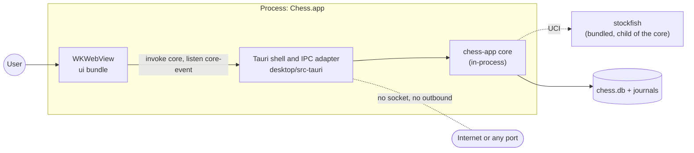
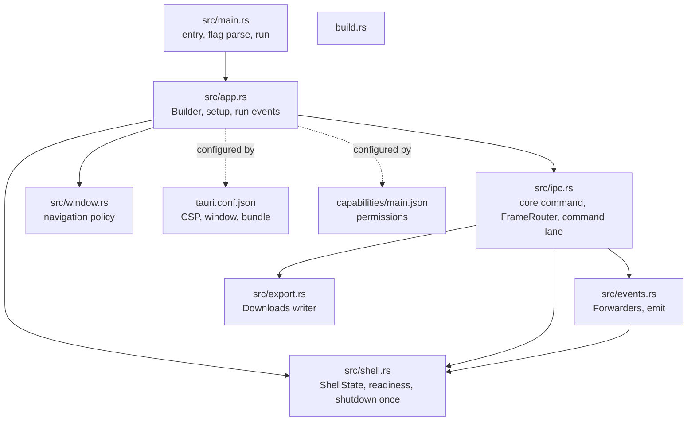
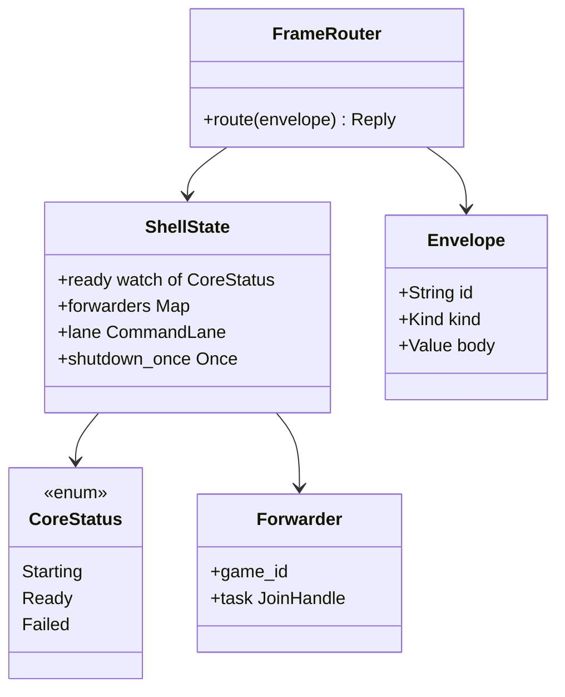
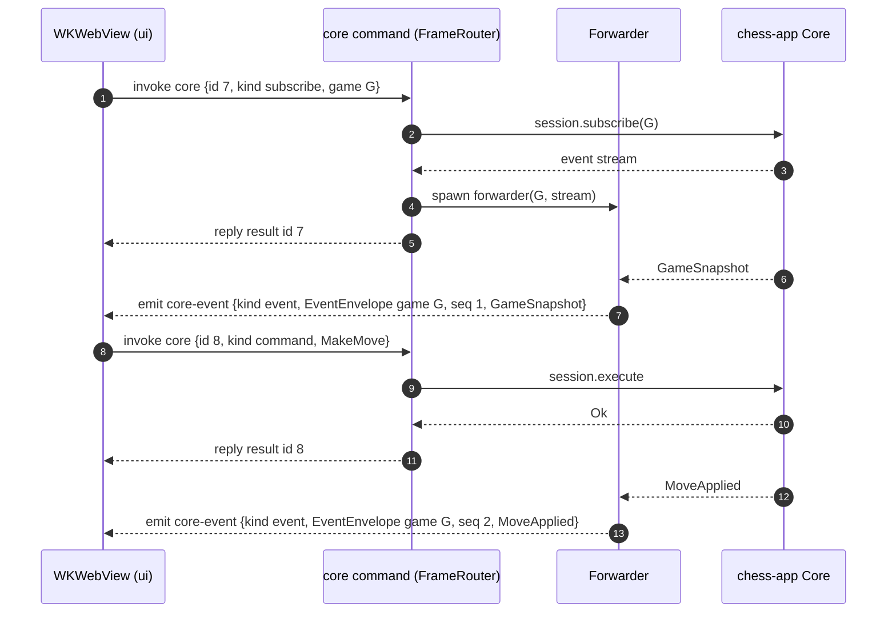
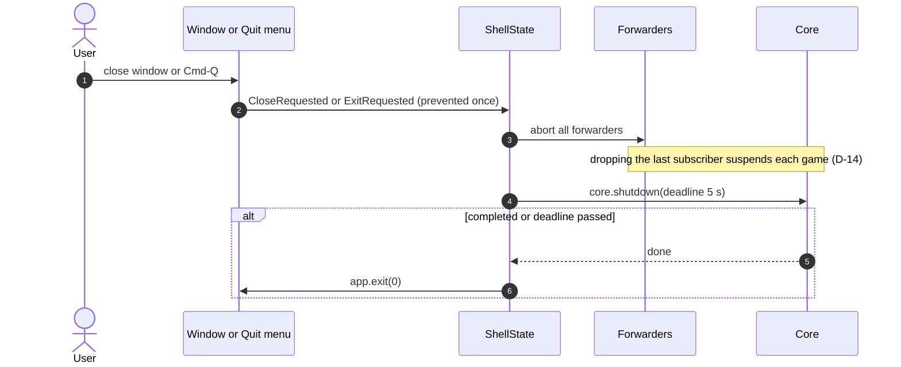
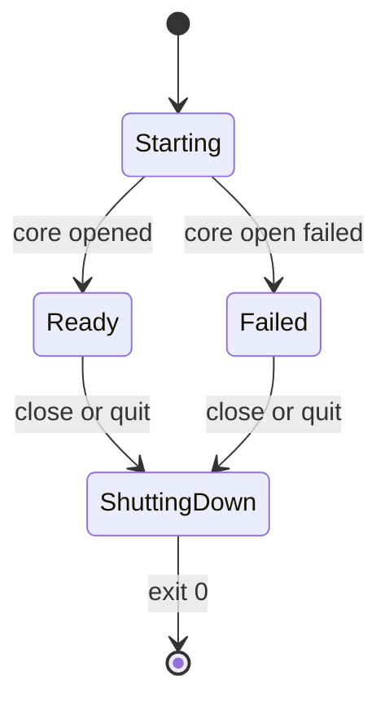

# SDD-desktop-tauri: Software Design Description for `desktop/src-tauri` (Tauri shell and IPC adapter)

| Field | Value |
|---|---|
| Document | docs/design/SDD-desktop-tauri.md |
| Version | **0.3.1 DRAFT** (0.2 DRAFT and 0.1 DRAFT were 2026-10-31 and 2026-10-30) |
| Date | 2026-10-31 |
| Status | **DRAFT** (v0.3.1, 2026-11-01). Not reviewed. Not approved. No code exists yet. v0.2 applied the architect's triage rulings that Brian Prascher approved on 2026-10-31; v0.3 aligns to architecture Addendum A (D-51 to D-58) and D-59; v0.3.1 aligns to addendum B and C (D-60 to D-62, agreed 2026-11-01) (see section 12c) |
| Owner | Software engineer role (Claude), for Brian Prascher |
| Approver | **Pending.** Gate G0 for this document (documents only). The implementation is G1 (System-architect agent, desk review) inside this crate with the §3.2 edge (`tauri -> chess-app`) and the §5.7 contracts unchanged. Adding a Tauri plugin or changing the packaged layout is a new dependency or a packaging interface and is G2 (Brian Prascher); decisions 9 and 11 (2026-10-31) rule out the dialog plugin and the single-instance plugin. The decisions this version implements were approved by Brian Prascher on 2026-10-31 (triage section 5, requirements CR-9.1); that approval does not approve this document |
| Gate record | G0, status DRAFT. The gate record is filed by the gate register (SWE-001 ASM-S5); no gate ID is written here (XC-30). Not filed here |
| Allocation name (architecture §2.2) | `Tauri shell and IPC adapter` |
| Path | `desktop/src-tauri` (architecture §3.1) |
| Runs in | Process: Chess.app (Tauri desktop, ad-hoc signed local build) |
| Languages | Rust 1.99.1 edition 2024; Tauri crate 2.12.5 (the 3.x line is alpha) |
| Sibling SDDs | [ui](SDD-ui.md) (the webview content and `TauriCoreClient`), [chess-server](SDD-chess-server.md) (the other transport and the envelope definition), [chess-app](SDD-chess-app.md), [chess-cli](SDD-chess-cli.md) |

Evidence tags per `swe-governance` §6. `[OBS x]` = read in this session. `[RAN]` = run here. `[UNV]` = not verified (no code, toolchain or network used). Tauri 2 configuration keys and API names below are from memory and are `[UNV]` unless stated; OQ-11 already commits the architecture to checking Tauri facts against the pinned version when packaging is set up [OBS architecture.md §14].

---

## 1. Introduction

### 1.1 Purpose and scope

The Tauri shell is the desktop process. It creates the shared core in-process, opens one window that shows the GUI bundle, maps one `invoke("core", envelope)` call onto the core, forwards core events to the webview with `emit`, applies the Tauri CSP, and quits cleanly. It holds no rules (architecture §1 principle 1) and opens **no TCP port** (D-1) [OBS §2, §6.3].

In scope: start-up and core creation, the single `core` command, event forwarding, window and navigation policy, the Tauri security configuration (CSP, capabilities), writing exports to the Downloads folder (decision 9), close and quit handling, the shell's contribution to the bundle (bundled helper binaries, main binary name, minimum system version). There is no single-instance behaviour: that mechanism was dropped by the user (decision 11, 2026-10-31).

Out of scope: the GUI itself (ui); the engine and every rule (`chess-app` and below, reached only through `chess-app`, decision 1); the build, universal merge and ad-hoc signing procedure (`packaging/`, F-8.6); Stockfish discovery and spawn (`chess-engine`, D-18); everything the core does.

### 1.2 Allocated requirements, functions and decisions

| Kind | IDs | Source |
|---|---|---|
| Primary function | **F-7.4.4** Carry protocol over Tauri IPC. This block is not the primary component of any requirement in architecture 10.1 (XC-29) | [OBS architecture.md §2.2, §10.1] |
| Requirements (all supporting here; primary components in brackets) | PLAT-1 (`packaging/`; this block is the desktop entry point), PLAT-3 (offline enforcement; this block sets the Tauri CSP), GUI-1 (`ui/`; this block is the IPC transport) | [OBS architecture.md §3.3 `desktop/src-tauri` row, §10.1 Amd 7] |
| Supporting requirements | PLAT-5 (one bundle, one version), PLAT-6 (the bundle declares macOS 26 as minimum; `packaging/` primary), NFR-1 (desktop starts within 3 s), NFR-4 (no outbound), NFR-8 (no blocking), NFR-9, NFR-10 (log content), RULE-5 and D-14 (closing the app suspends live games), RISK-2 (`--data-dir` for desktop E2E) | [OBS architecture.md §10.1, §6.3; requirements PLAT-6] |
| Functions | **F-7.4.4** Carry protocol over Tauri IPC (primary); F-8.1 launch entry point, for the `Chess.app` launch only (the `chess` and `chess serve` launches are claimed by [SDD-chess-cli](SDD-chess-cli.md); CR-9.7); F-8.4 confine traffic to loopback (the webview half of the CSP is `WKWebView`; the Tauri `csp` setting is this crate's) | [OBS functional_decomp.md lines 200, 209, 212] |
| Decisions | D-1 (in-process core, Tauri IPC with the WebSocket's envelope), D-2, D-7, D-9, D-13, D-14, D-16, D-18, D-25, D-32 (the shell is a block), **Amendment 7:** D-38 (facade), D-39 (temp-dir store in tests), D-48 (protocol package), D-49 (file transfer: the shell writes exports to Downloads), decision 11 as modified (no single-instance mechanism); **Addendum A:** D-53 (event envelope), D-54 (`MalformedFrame`), D-55 (`ExportedFile`, `ExportWriteFailed`), D-56 (profile switch), D-59 (ECO import commands, accepted) | [OBS architecture.md §11, §3.4, §6.3] |
| Risks / open items | R-1 (`tauri-driver` has no macOS WebDriver), R-13/R-14 (Intel), OQ-11 (helper-binary naming for a universal target; Tauri calls it a sidecar), ASM-5 (macOS signing facts) | [OBS architecture.md §12, §14] |
| Use cases | UC-2 and others (desktop path), UC-1 (install) | |

### 1.3 Inputs read

SDD-architect-triage.md section 2 (TR-1, TR-2) and section 5; SDD-SE-desk-answers.md Q-SE-13, Q-SE-21, Q-SE-26; requirements.md Amendment 7 (CR-9.1, CR-9.5); architecture.md (amended 2026-10-31) §1, §2 (diagram and key points), §2.2, §3 (3.1 to 3.4), §4.2, §4.8, §5.1 to §5.7, §6.2, §6.3, §8, §8.1, §8.2, §9 (desktop rows), §10.1 (PLAT-1, PLAT-3, GUI-1), §11 (D-1, D-16, D-18, D-32), §12 (R-1), §14 (OQ-11, ASM-5). functional_decomp.md F-7.4.4, F-8.1, F-8.4. requirements.md PLAT-1, PLAT-3, PLAT-6. test-strategy.md. SWE-001.

### 1.4 Conventions

`DD-TAU-n` entities, `IFP-TAU-n` / `IFR-TAU-n` interfaces, `UT-TAU-nn`, `CT-TAU-nn`, `E2E-TAU-nn` planned tests, `UF-TAU-n` upstream findings (section 12), `ASM-TAU-n`, `IA-TAU-n`, `RAT-TAU-n`, `OQ-TAU-n` open questions. ID format (XC-30): IDs issued in v0.1 are unchanged; IDs added from v0.2 use three digits (`DD-TAU-008`, `UF-TAU-012`, `CT-TAU-014`).

---

## 2. Viewpoint selection

| Viewpoint | Used? | Where | Reason if omitted |
|---|---|---|---|
| Context | Yes | 3.1 | |
| Composition | Yes | 3.2, 4 | |
| Logical | Yes | 3.3 | |
| Dependency | Yes | 3.4 | |
| Information | Omitted | | The shell owns no data. Configuration files are listed in 3.2; the data directory belongs to the core |
| Patterns use | Yes | 3.5 | |
| Interface | Yes | 5 | |
| Structure | Yes | 3.2 | |
| Interaction | Yes | 3.6 | |
| State dynamics | Yes | 3.7 | |
| Algorithm | Yes | 3.8 | |
| Resource | Yes | 7 | |

---

## 3. Viewpoints

### 3.1 Context

**Concern:** what the shell sits between.



The core spawns Stockfish itself (chess-engine); the shell does not touch the engine.

### 3.2 Composition and structure

**Concern:** files and what each owns.



| Entity | Type | Purpose | Traces |
|---|---|---|---|
| DD-TAU-1 Start-up and `ShellState` | module | Parse `--data-dir`, open the core on the async runtime, expose readiness or the startup error | PLAT-1, NFR-1, RISK-2 |
| DD-TAU-2 `core` command and `FrameRouter` | module | One IPC command: decode an envelope, route it, return the reply | F-7.4.4, GUI-1 |
| DD-TAU-3 Window and navigation policy | module + config | One window, no minimum size, only the app origin may load. No single-instance mechanism | GUI-5, PLAT-3, NFR-4 |
| DD-TAU-4 Event forwarders | module | Core event stream to `emit("core-event")`; drop on reload, unsubscribe, exit | F-7.4.4, D-14 |
| DD-TAU-5 Close and quit | module | Suspend games and flush before exit; closing the window quits | RULE-5, D-14, §6.3 |
| DD-TAU-6 Security configuration | config | CSP, capabilities, no plugins that open I/O | PLAT-3, NFR-4, F-8.4 |
| DD-TAU-7 Bundle contribution | config | Bundled helper binaries, main binary name, minimum system version | PLAT-1, PLAT-5, PLAT-6, D-18 |
| DD-TAU-008 Export writer | module | Write an export to the Downloads folder and return the path | DAT-2, IF-1, D-49 |

### 3.3 Logical viewpoint

**Concern:** the few types that matter.



`Envelope` and its `Kind` set are `chess-app` types (IFP-APP-03; the shell calls the shared helpers and defines none): `hello`, `command`, `query`, `subscribe`, `unsubscribe`, `subscribe_global` from the webview; `{id, kind: "result", body}` and `{id, kind: "error", body: {code, message, details}}` back, and `event` frames with no `id` (architecture 5.6, D-53; FIND-JR-014: the earlier `{id, ok, body}` and `{id, error}` shapes were stale). The server SDD quotes the same shapes in its section 5.1. `hello` is accepted and answered for symmetry but the Tauri client does not need it (same build, no version skew possible inside one bundle).

### 3.4 Dependency viewpoint

Allowed workspace edge [OBS architecture.md §3.2]: `desktop/src-tauri -> chess-app` only. Third-party edge: Tauri (`tauri -.-> tauriLib`). `tauri -.-> ui` is a build-time bundling of the built assets.

| Dependency | Version | Use | Source |
|---|---|---|---|
| `chess-app` | workspace | `Core`, protocol types | §3.2 |
| `tauri` | 2.12.5 | app, window, IPC, events | [OBS §3.4] |
| `@tauri-apps/cli` | 2.12.4 | `cargo tauri build --target universal-apple-darwin` | [OBS §3.4, §6.3] |
| `tokio` 1.54.1, `serde` 1.0.229, `thiserror` 2.0.21, `tracing` 0.1.44 | | runtime types, envelope, errors, log | [OBS §3.4] |
| `serde_json` | not a direct dependency while the `chess-app` helper decodes the envelope (IA-TAU-5); admitted in principle for `chess-app` and `chess-store`; **no version stated, lookup pending `[UNV]`** | envelope body, only if Tauri's argument handling forces it | UF-TAU-9, TR-10 |

No Tauri `shell`, `fs`, `http`, `updater`, `dialog` or single-instance plugin is in this design. The updater is excluded by §8.1 [OBS]. The native save dialog plugin is rejected (decision 9, review row D-25) and the single-instance mechanism is dropped (decision 11, review row D-24). The others would widen the webview's reach (a shell or file plugin lets script in the page start processes or read files) and are not needed: the Rust code of the shell writes the export file itself (DD-TAU-008), which no webview script can request except through the `core` command.

### 3.5 Patterns use

| Pattern | Where | Why | Misuse tell |
|---|---|---|---|
| Adapter | whole crate | Same envelope as the WebSocket; no logic | Any rule or policy text in this crate |
| Single entry point | `core` command | The whole attack surface of the webview is one function that decodes a closed set of frames | A second `#[tauri::command]` |
| Command lane | `FrameRouter` | Keeps arrival order of commands as in [SDD-chess-server](SDD-chess-server.md) A2 | Spawning each command independently |
| Deny by default | capabilities, navigation | Only what the GUI needs | A permission added "for convenience" |
| Idempotent shutdown | `shutdown_once` | Window close and macOS Quit both arrive | Two shutdown paths |

### 3.6 Interaction (sequences)

**Concern:** the lifetime of a subscription and a close.





### 3.7 State dynamics

**Concern:** shell life cycle, including failure to open the core (the user has no terminal).



In `Starting` the window already exists and a `core` call waits (bounded by the client's 10 s command timeout, which makes the GUI show "core not responding" rather than hang silently; typical open is well under the 3 s NFR-1 budget `[UNV]`). In `Failed` (only when `Core::open_default` returns no `Core`: `SchemaTooNew`, `BackupFailed`, `OtherVersionRunning`, a version refusal) every `core` call replies with an `error` envelope carrying the catalogue `{code, message, details}` of the startup error. A missing or corrupt store (`StoreMissing`, `StoreCorrupt`) is not a failure of the shell: the core opens in recovery mode, the state is `Ready`, and the GUI runs the recovery flow (UR-31). The GUI shows a failure full-screen with the message and next step ([SDD-ui](SDD-ui.md) section 7). This is how a double-clicked app reports a failure without a terminal.

### 3.8 Algorithm viewpoint

**A1. Routing (`FrameRouter::route`).**

```
wait for status != Starting            (see 3.7)
if Failed -> reply error(startup error) for every kind except unsubscribe
decode envelope with the chess-app helper. failure -> error MalformedFrame{reason}
match kind:
  hello             -> a hello frame {protocol_version, build_version}, no id   (Core::build_info; [INF], OQ-TAU-004)
  command           -> enqueue on the command lane, await its reply
  query             -> spawn (at most 16 in flight), await its reply
  subscribe         -> lane: start forwarder(game_id) if none exists, reply ok
  unsubscribe       -> abort forwarder(game_id), reply ok      (out of lane)
  subscribe_global  -> lane: start the global forwarder if none exists, reply ok
reply: a result frame | an error frame  with the request id echoed (hello and event frames carry no id, D-53)
for the result of ExportPgn and ExportData (ExportedFile{name, media_type, content: Bytes{base64}}):
    write the bytes to the Downloads folder (DD-TAU-008) and rewrite content to Saved{path} before replying;
    a failed write -> error ExportWriteFailed{cause} instead of the result (D-55)
all other results, including ImportConflicts, ResolveImport, CancelImport and ApplyDataImport-with-eco replies (D-59), pass through unchanged
```

`decode` failure is a `MalformedFrame{reason}` error frame (reasons `bad_json`, `unknown_kind`, `unknown_field`, `before_hello`, D-54). There is no socket to close, so after the error frame the shell only keeps serving: a correct webview never sends one, and the GUI offers a reload (SDD-ui section 7). Whether the shell should also drop its forwarders on a malformed frame is not stated upstream and is not done.

The command lane and the query limit are the same rules as in [SDD-chess-server](SDD-chess-server.md) A2, so the two transports behave alike (GUI-1). The shell's lane is one lane per process because there is one window.

**A2. Page load.** On every page-load start of the main webview (first load or reload) all forwarders are aborted. A reloaded page has lost its JavaScript state, so its old subscriptions are dead; this is the desktop equivalent of a WebSocket close (D-14, R-10); the reloaded page must send `ResumeGame` then `subscribe` for any game it still wants, within the 5 s attach window (architecture 5.6). The `on_page_load` hook is `[UNV: hook name]`.

**A3. Shutdown once.** A `std::sync::Once` (or an `AtomicBool` compare-and-set) guards the sequence: abort forwarders, `core.shutdown(deadline)` with a 5 s deadline (the web server's figure, `ESTIMATE` for desktop), then `app.exit(0)`. Later calls do nothing.

---

## 4. Design entities

### DD-TAU-1 Start-up and `ShellState`
- Traces: PLAT-1, NFR-1, RISK-2, D-13, D-16.
- `main` parses `--data-dir <path>` and `--data-dir=<path>` by hand from `std::env::args` (no `clap` dependency in this crate; unknown arguments are ignored because macOS may add its own). The data directory is then resolved with `chess_app::resolve_data_dir(flag, env)` (IA-TAU-1), which returns a `DataDirChoice`, in the order flag, `CHESS_DATA_DIR`, default, "the same data-directory resolution as the CLI" [OBS §6.3]. The core is built with `Core::open_default(CoreConfig)`, which wires the production engine factory, clock and random source inside `chess-app`; the shell builds no seams (TR-1). A Finder-launched app inherits no shell environment, so the environment variable matters only for tests started from a shell; desktop E2E isolation therefore uses `--data-dir` (RISK-2).
- The core is opened inside Tauri's own async runtime (`tauri::async_runtime`, a tokio runtime), so `chess-app` finds a runtime handle and §4.8's "one runtime per process" holds `[UNV: that the Tauri runtime is the tokio multi-thread flavour]`. The open runs from the `setup` hook as a spawned task; its result is published on a `watch` channel `CoreStatus`.
- Engine path: not passed. `chess-engine` finds `<directory of current_exe>/stockfish`; in a Tauri bundle the bundled helper sits beside the main executable (D-18, §8.2) [OBS].
- Failure behaviour: a failed open (no `Core`) stores the typed `OpenError` for A1 and never panics; the window still opens (3.7). A `Core` in recovery mode is a normal `Ready` outcome.
- Concurrent launches: a second `Chess.app` or a CLI started at the same time is handled by the store's own locking, including the first-launch roster race (retry once on a unique violation, UR-49); the shell has no instance lock (decision 11).
- Concurrency: `ShellState` is `Send + Sync`; the `watch` receiver is cloned per call; no lock is held across `.await`.
- Verification: CT-TAU-01, 02.

### DD-TAU-2 `core` command and `FrameRouter`
- Traces: F-7.4.4, GUI-1, D-1, D-7, NFR-9.
- One `#[tauri::command] async fn core(state, envelope) -> Result<Reply, ShellError>`. The shell holds one `FrontEndSession` for its one window (IFP-APP-01). Its trust level is `Trust::Remote` `[INF]`: the page is script content, so the session sends and receives file contents as bytes only and never a path. Architecture 5.1 (D-55) supports this reading: "the core returns `Bytes` to a remote or Tauri session", and only an in-process CLI export gets `Saved{path}` from the core. The architecture names no trust value for the Tauri session, so the enum choice stays open (UF-TAU-015). Protocol-level failures are normal replies (`error` frames), exactly as on the WebSocket; `ShellError` (an `Err`) is only for conditions that have no frame, which should not occur.
- Algorithm A1. Error text comes from chess-app's catalogue mapping; the shell does not format an `io::Error`, a path or a `Debug` string into any reply (NFR-9, §5.5 [OBS]).
- Ordering: the lane preserves the order in which calls **reach the lane**. Tauri runs each `invoke` as its own task on the runtime, so two calls sent back to back from JavaScript may be polled in either order `[UNV]`. The GUI sends a dependent command only after the earlier reply, and the optimistic `ply` check in `MakeMove` makes a reordered pair harmless (it is rejected as `StalePosition`), so no correctness claim depends on IPC ordering (ASM-TAU-2, UF-TAU-8).
- Verification: CT-TAU-03 to 08.

### DD-TAU-3 Window and navigation policy
- Traces: GUI-5, PLAT-3, NFR-4, §6.3 (close quits).
- One window, label `main`, title "Chess", **no minimum size** (Q55, GUI-5), default size chosen by the GUI developer. Developer tools are not enabled in release builds.
- Navigation: only the app's own origin may load. A navigation handler returns false for any other URL, and new-window requests are denied. External links are shown as text and never opened (§8.1 "External links ... shown as text") [OBS].
- **No single-instance mechanism** (user decision 11, 2026-10-31; architecture 6.3 amended; Q-SE-21). It is not a requirement. A second launch starts a second process with its own core; a second desktop instance is valid under DAT-1 and DAT-4: it can play other games, and a game that is live in the first instance is refused with `GameLeased` (the owner kind is named). The first-launch roster race against another `Chess.app`, the CLI or `chess serve` is settled by the store's own locking (WAL, `PROCESS_HEARTBEAT`, the unique roster index), not by a UI rule. No plugin and no lock file are added.
- Appearance: the shell never forces a window theme, so `prefers-color-scheme` inside WKWebView follows macOS and the GUI's CSS-only theme switching works (UI-10) `[UNV]`.
- Menus: the default macOS application menu is kept (Quit, and the Edit menu that makes copy and paste work in the SAN field). Quit is routed to DD-TAU-5.
- Verification: CT-TAU-09, E2E-TAU-04 (two instances), M-TAU-1.

### DD-TAU-4 Event forwarders
- Traces: F-7.4.4, D-14, §4.8 backpressure.
- One forwarder task per subscribed game, and one global forwarder (started by `subscribe_global`). A forwarder reads the core's stream (`session.subscribe`, `session.subscribe_global`) and calls `emit_to("main", "core-event", frame)`, where `frame` is the event frame as `chess-app` shapes it (D-53): `{kind: "event", body: EventEnvelope{game_id, seq, event}}`, the same shape as on the WebSocket, with no `id`. For a game event `game_id` is set and `seq` is gap-free; for a global event `game_id` is null and `seq` is a per-subscription counter that may show a gap after a lag. The shell forwards both unchanged. The webview registers one `listen("core-event")` and demultiplexes by `game_id` ([SDD-ui](SDD-ui.md) DD-UI-2).
- Dropping the forwarder drops the core subscription. When the last subscriber of a game leaves, the core suspends it (D-14); the shell has no suspend code.
- Backpressure: `emit` does not tell the shell whether the webview kept up, so unlike the WebSocket (where a slow socket makes the receiver lag and the core resends a snapshot) a stalled webview would let events queue inside the webview process. Volume is a handful of small events per second per game (moves, clock syncs), and the webview is local and single, so this is accepted (RSK-TAU-2). The GUI resubscribes when it sees a gap in a **game** stream's `seq`; a gap in the global stream is allowed and the GUI re-queries instead ([SDD-ui](SDD-ui.md) DD-UI-3).
- Failure behaviour: if `emit` returns an error the forwarder ends and the subscription is dropped (the window is gone or closing).
- Verification: CT-TAU-05, 06.

### DD-TAU-5 Close and quit
- Traces: RULE-5, D-14, §6.3 "Closing the window quits the app, which suspends any live game".
- Both `CloseRequested` on the main window and the application `ExitRequested` event (Cmd-Q, Dock Quit) call the same `shutdown_once` (A3) and prevent the default close until it finishes. After the last window is destroyed the app exits; macOS's default of staying alive without windows is turned off.
- `core.shutdown(deadline)` is the awaitable "every live session has journalled `Suspend`" (IA-TAU-3, IFP-APP-05). On the 5 s deadline the shell exits anyway: every acknowledged move is already durable [OBS §4.8].
- A crash, SIGKILL or power loss is an interruption in the NFR-2 sense, recovered by the core's journal on the next start.
- Verification: CT-TAU-10, E2E-TAU-05 (close during a game, relaunch, game resumes with each clock at its last recorded value).

### DD-TAU-6 Security configuration
- Traces: PLAT-3, NFR-4, F-8.4, R-5 (analogue), SWE-001 §6.
- **CSP** (`app.security.csp`). Intent: the same policy as the web server's ([SDD-chess-server](SDD-chess-server.md) DD-SRV-3) with the connection directive replaced by the IPC channel: `default-src 'self'; script-src 'self'; style-src 'self'; img-src 'self'; font-src 'self'; connect-src ipc: http://ipc.localhost; object-src 'none'; base-uri 'none'; form-action 'none'; frame-ancestors 'none'`. The scheme names for Tauri 2's IPC (`ipc:` and `http://ipc.localhost`) and whether Tauri adds its own entries or `'unsafe-inline'` for styles are from memory and `[UNV]` (UF-TAU-6). The test PLAT-3 asks for ("the Content-Security-Policy is set by both the local server and the desktop app") is CT-TAU-11. `default-src 'self'` is the floor (Q-SE-13): extra directives are allowed, no non-loopback origin may be allowed, and the test asserts the floor plus "no remote scheme or host".
- **Capabilities:** one capability file for the `main` window granting only event `listen`/`unlisten` and the app's own `core` command. If the app-manifest mechanism allows, `core` is declared as an explicit permission rather than allowed by default `[UNV]`. No file system, shell, HTTP, dialog, opener, clipboard, single-instance or updater permission. `withGlobalTauri` stays off; the GUI imports `@tauri-apps/api` as a module.
- Prototype freezing and similar hardening switches of Tauri 2 are enabled where they exist `[UNV: names]`.
- The webview can call `invoke("core", ...)` from any script it runs; only the signed-in bundle loads (navigation policy, CSP), so the surface is the frame decoder, which is a closed `serde` type with `deny_unknown_fields`.
- Verification: CT-TAU-11, 12; bundle scan (CI); E2E offline.

### DD-TAU-7 Bundle contribution
- Traces: PLAT-1, PLAT-5, PLAT-6, D-16, D-18, OQ-11.
- `bundle.macOS.minimumSystemVersion = "26.0"` (writes `LSMinimumSystemVersion`) [OBS §8.2].
- `bundle.externalBin` lists the two bundled helper binaries that sit in `Contents/MacOS/` beside the main executable: `stockfish` and the `chess` CLI. For a universal target Tauri's naming rule for these files (target-triple suffix) is OQ-11 and is checked against 2.12.5 when packaging is set up `[UNV]`.
- **Main binary name.** `Contents/MacOS/chess` is the CLI (§8.2 [OBS]). Tauri's main executable would by default be named after the product ("Chess"). On a case-insensitive volume those are the same file. This Mac's APFS volume is case-insensitive [RAN `touch Chess; ls chess` in the scratchpad -> listed `chess`, 2026-10-30; `diskutil info /` -> APFS], and the default for APFS is case-insensitive, so the collision is real. The design sets the main binary name explicitly to a different name (UR-38, AMD-9; the name is chosen when packaging is set up, OQ-11; `chess-desktop` is only a suggestion, OQ-TAU-002; option key `[UNV]`) and `CFBundleExecutable` follows. UF-TAU-2.
- The shell does not spawn Stockfish and does not use the shell plugin's sidecar API. "Sidecar" is Tauri's word for a bundled helper executable and means only that (UR-37, AMD-9, Q-SE-26); `chess-engine` spawns `<exe dir>/stockfish`. A shell-spawn path would be a G2 design change and is not adopted. The architecture text is already reworded.
- Ad-hoc signing, the universal `lipo` merge, `codesign --verify --deep --strict`, the `lipo -info` test and licence notices are `packaging/` (F-8.6, F-8.7, F-8.9). This crate contributes the configuration above only.
- Verification: packaging tests belong to `packaging/`; CT-TAU-13 checks the config values by inspection.

### DD-TAU-008 Export writer
- Type: module (`export.rs`) | Traces: DAT-2, IF-1, UC-22, UC-24, D-49 (decision 9, XC-20, UR-35).
- Function: the router (A1) recognises the result of `ExportPgn` and `ExportData`, which is `ExportedFile{name, media_type, content: Bytes{base64}}` (D-55). The shell decodes the bytes and writes the file into the user's **Downloads folder**: a new file created with `create_new` (a name that does not overwrite an existing file gets a numeric suffix), written to a temporary file in the same folder, flushed, then renamed. `name` from the core is used only as a file name: path separators and a leading dot are refused or replaced, so it cannot leave the folder `[INF]`. The shell then **rewrites `content` to `Saved{path}` before the reply reaches the UI** (architecture 5.1, D-55), so the UI has one reply type for both transports and shows the path ([SDD-ui](SDD-ui.md) DD-UI-13). No dialog opens and no dialog plugin exists (decision 9).
- The folder is the fixed target; the shell never accepts a path from the webview, so a script in the page cannot choose where the shell writes.
- Failure behaviour (D-55): a failed write gives the `error` frame `ExportWriteFailed{cause}` in place of the result, with `cause` one of `folder_missing` (no Downloads folder), `permission_denied`, `disk_full`, `io_error` (any other error). No partial file is left at the final name, and the game and the store are unchanged. The `message` is the catalogue's English sentence naming the cause and the next step (free space, check the folder permission, try again; NFR-9). The mapping from `std::io::ErrorKind` to `cause` is made once in `export.rs`; no path and no OS text reaches `message`. The shell builds the frame with a `chess-app` constructor so the message text is not written twice `[INF]` (OQ-TAU-004). The export itself is never size-limited (CR-9.5).
- Concurrency: runs on the blocking pool (`spawn_blocking`), never on the Tauri main thread or a runtime worker.
- Open: how the folder is resolved and whether macOS prompts for permission on the first write (OQ-TAU-001, `[UNV]`). The reply type is settled by D-55 (UF-TAU-014).
- Verification: CT-TAU-014.

---

## 5. Interface viewpoint

### 5.1 Provided

**IFP-TAU-1 IPC to the webview** (architecture 5.2 "Desktop" row: `invoke("core", envelope)` + `listen("core-event")`, "Same JSON envelope as the web ... No TCP port opened" [OBS]). The envelope is defined by [SDD-chess-app](SDD-chess-app.md) IFP-APP-03 and encoded and decoded by the shared `chess-app` helpers; shapes below follow architecture 5.1 and 5.6 (Addendum A) and are re-checked at v0.3 (UF-TAU-10).

| Item | Value |
|---|---|
| Command | `core(envelope) -> reply` |
| Request kinds | `hello`, `command`, `query`, `subscribe`, `unsubscribe`, `subscribe_global` |
| Reply | every frame is `{id, kind, body}`: a `result` frame or an `error` frame (body `{code, message, details}`, a catalogue code) |
| Event channel | `core-event`; payload an `event` frame with body `EventEnvelope{game_id, seq, event}` (game events, `game_id` set) or `EventEnvelope{game_id: null, seq, event}` (global events), no `id` on either (D-53) |
| Export replies | the core's `ExportedFile{name, media_type, content: Bytes{base64}}` is rewritten by the shell to `content: Saved{path}` before the UI sees it; a failed write is `ExportWriteFailed{cause}` (DD-TAU-008, D-55) |
| Import commands | `ImportPgn{file, on_duplicate, eco?}`, `ResolveImport{import_id, eco}`, `CancelImport{import_id}` pass through the `command` kind unchanged; an unanswered ECO mismatch comes back as the `ImportConflicts{import_id, list}` error frame (D-59); an archive preview (`PreviewDataImport`) comes back as `ImportConflicts{list}` with no `import_id`, and its answers travel in `ApplyDataImport{plan, confirmed, eco}` (stateless; no `CancelImport` for archives, FIND-JR3-004). `eco_mismatch` entries carry `moves_san` and no `tag_name` (ruling 2026-11-01). The shell holds no import state |
| Auth | none; only the app's own origin can run script in the window |
| Errors outside the catalogue | `ShellError` (should not occur) |

Envelope definitions are shared with [SDD-chess-server](SDD-chess-server.md) section 5.1 and consumed by [SDD-ui](SDD-ui.md) DD-UI-2.

**IFP-TAU-2 Command line of the app executable:** `--data-dir <path>` (RISK-2). Nothing else.

### 5.2 Required

| ID | From | What |
|---|---|---|
| IFR-TAU-1 | chess-app | `Core::open_default`, `Core::session(Trust::Remote) -> FrontEndSession` (trust level `[INF]`, UF-TAU-015; D-55 treats a Tauri session like a remote one for file contents) with `execute`, `query`, `subscribe`, `subscribe_global`, `Core::shutdown(deadline)`, `Core::build_info()`, `chess_app::resolve_data_dir`, the envelope helpers (IA-TAU-1 to 5) |
| IFR-TAU-2 | Tauri 2.12.5 | builder, `State`, window events, `emit_to`, `on_navigation` or equivalent, capabilities, bundle config, a way to resolve the user's Downloads folder `[UNV]` |
| IFR-TAU-3 | macOS | WKWebView, application menu, `~/Library/Application Support/Chess/`, the Downloads folder |

### 5.3 Interface assumptions about chess-app (reconcile with [SDD-chess-app](SDD-chess-app.md) v0.2)

| ID | Assumption | Status |
|---|---|---|
| IA-TAU-1 | `resolve_data_dir` and `Core::open_default` are public in chess-app because this crate has no other edge | **RESOLVED**: TR-1 item 5. `chess_app::resolve_data_dir(flag: Option<&Path>, env) -> Result<DataDirChoice, ConfigError>` |
| IA-TAU-2 | `Core::open` returns a typed error for startup refusals that maps to a catalogue frame | **RESOLVED**: UR-31. Recovery mode for a missing or corrupt store; no `Core` and a typed `OpenError` for `SchemaTooNew`, `BackupFailed`, `OtherVersionRunning`, version refusal |
| IA-TAU-3 | `Core::shutdown()` awaits every session's `Suspend` write | **RESOLVED**: IFP-APP-05, `Core::shutdown(deadline)` |
| IA-TAU-4 | `execute`, `query`, `subscribe` | **RESOLVED**: IFP-APP-01 (v0.2), through one `FrontEndSession`; `subscribe_global` added; the trust level of the Tauri session is not named there (UF-TAU-015) |
| IA-TAU-5 | (new) The envelope helpers take the envelope as it arrives from the webview and return the reply or event, so the shell needs no `serde_json` | Assumption `[INF]`, UF-TAU-9 |

---

## 6. Error handling (mapped to §5.5)

| Situation | Reply |
|---|---|
| Core still starting | the call waits (3.7) |
| Core failed to open (no `Core`: `SchemaTooNew`, `BackupFailed`, `OtherVersionRunning`, version refusal) | `error` frame with the startup error's catalogue code and message, for every request |
| Core in recovery mode (store missing or corrupt) | normal operation of the shell; the core refuses everything except the recovery commands and the GUI shows the recovery flow |
| Undecodable envelope | `error` `MalformedFrame{reason}` (reasons `bad_json`, `unknown_kind`, `unknown_field`, `before_hello`; D-54). No socket to close; the GUI offers a reload |
| Any core error | forwarded unchanged: `ConfirmationRequired`, `StalePosition`, `Denied`, `Store*`, `EngineUnavailable`, `Internal{id}` ... |
| File over its limit | `ValidationFailed{field: file, reason: too_large}` from the core, unchanged |
| Export file cannot be written | `error` `ExportWriteFailed{cause}` with `cause` in `folder_missing`, `permission_denied`, `disk_full`, `io_error`; no partial file (D-55, DD-TAU-008) |
| `ResolveImport` with an unknown or expired `import_id` | `NotFound{entity: import, id}` from the core, unchanged (D-59). The session of the window outlives a page reload while the page loses its `import_id`; the core drops the held import when the same session starts another one or after its idle time-out (architecture 5.8) |
| `SelectProfile` while this window's session has a game open | `Denied{reason: state_not_allowed, details.game_ids}` from the core, unchanged (D-56). A reload aborts the forwarders, which releases the session's subscriptions (A2), so the reloaded page's `SelectProfile` is allowed unless that release has not finished; the UI handles the refusal ([SDD-ui](SDD-ui.md) section 7) |
| Panic in a forwarder or in a command task | the task ends; an `Internal{id}` frame is returned to the caller where one is pending; logged with a correlation id; the process keeps running |
| `emit` fails | forwarder ends |
| Navigation to a foreign URL | denied silently and logged by category |
| `ServerStopping` as a global event | forwarded on `core-event` like any event (the desktop app does not stop because of it; it is emitted by `Core::shutdown`, which this shell itself calls only when quitting) |
| `ProtocolMismatch` from a socket | not applicable (no socket, same build) |

Logging: `tracing` through chess-app's setup; identifiers only, no names or move lists (NFR-10 [OBS §8]).

---

## 7. Resource and concurrency viewpoint

**Concern:** threads, tasks, limits (§4.8 [OBS]).

| Context | Runs | Must not |
|---|---|---|
| Tauri main thread (macOS UI) | window and menu events | run core calls or wait on a future |
| Tauri async runtime (tokio) | `setup` task opening the core, the `core` command futures, forwarders, the core's actors and axum-free dispatcher | block; `rusqlite` runs on the store thread inside chess-store |
| WKWebView process | the GUI | compute rules |

- Tasks: one command lane task, up to 16 query tasks, one forwarder per subscribed game (normally one).
- Memory: events are small; no buffer in the shell beyond the lane queue (bounded at 64, `ESTIMATE`; a full queue makes the caller wait, which pushes back on the webview).
- Time limits: shutdown 5 s (`ESTIMATE` for desktop; the web server's figure is [OBS §4.8]); startup budget 3 s total for the desktop entry point (NFR-1), of which the shell adds only task spawns.
- No port, no socket, so there is nothing to bind or free.

---

## 8. Verification mapping

IDs are planned. Nothing has been written or run. R-1 applies: `tauri-driver` has no macOS WebDriver, so the GUI suite runs in Playwright WebKit against a harness that supplies the Tauri transport, plus a scripted smoke test of the real `.app` [OBS §12, §9].

| ID | Level (§9 row) | Case | Requirement |
|---|---|---|---|
| UT-TAU-01 | Unit | envelope decode: valid frames, unknown field, unknown kind, oversize id | F-7.4.4 |
| UT-TAU-02 | Unit | `--data-dir` parsing in both forms; unknown arguments ignored | RISK-2 |
| CT-TAU-01, 02 | Component (Tauri mock runtime, core over the `FakeEngine` factory and a temp-dir store, TR-2; the test `Core` and the factory come from `chess-app` behind its `test-support` feature, architecture 3.2 items 3 and 4, UF-TAU-013) | start-up success; start-up failure returns the catalogue error for every request and never panics | PLAT-1, NFR-9 |
| CT-TAU-03..08 | Component | route table: command, query, subscribe, unsubscribe; result and error correlation by id; command lane keeps arrival order; query concurrency cap; subscribe first event is `GameSnapshot`; the same behavioural cases as the WebSocket contract suite CT-UI-10 | GUI-1 |
| CT-TAU-05, 06 | Component | forwarder lifetime: unsubscribe aborts; page-load start aborts all; last subscriber leaving suspends the game | D-14 |
| CT-TAU-09 | Component | foreign navigation denied; new window denied | PLAT-3 |
| CT-TAU-10 | Component | shutdown once: close and quit together run one sequence; deadline respected with a stalled core | RULE-5 |
| CT-TAU-11, 12 | Config inspection + component | CSP string present in the built config and equal in intent to the server's (floor `default-src 'self'` plus no remote scheme or host, Q-SE-13); capabilities grant only the listed permissions; no network, shell, fs, dialog, single-instance or updater plugin in `Cargo.toml` | PLAT-3, NFR-4 |
| CT-TAU-13 | Inspection | `minimumSystemVersion` 26.0; main binary name differs from `chess`; `externalBin` lists the two helpers | PLAT-6, D-18 |
| E2E-TAU-01 | GUI E2E (R-1 harness) | the scenario suite through the Tauri transport gives the same PGN as CLI and web | PLAT-1, GUI-1 |
| E2E-TAU-02 | Smoke (real `.app`, scripted) | launches on the development Mac, reaches the profile chooser, plays a scripted game | PLAT-1 |
| E2E-TAU-03 | Offline | with non-loopback networking blocked and the network-capture harness running, zero connections | PLAT-3, NFR-4 |
| E2E-TAU-04 | E2E | two instances: a second launch starts a second process; a game live in the first is refused in the second with `GameLeased`; two launches on an empty data directory end with one default roster (the store lock, not a UI rule) | DAT-1, DAT-4 |
| E2E-TAU-05 | E2E | close mid-game, relaunch, game resumable with every move and each clock at its last recorded value | RULE-5, NFR-2 |
| CT-TAU-014 | Component | export writer: `ExportData` and `ExportPgn` results (`Bytes{base64}`) become files in a temporary stand-in for Downloads and `content` is rewritten to `Saved{path}`; no overwrite; a `name` with `..` or `/` stays inside the folder | DAT-2, IF-1 |
| CT-TAU-016 | Component | export write failures (D-55): a missing folder, a read-only folder, a full volume (small quota or injected writer) and another I/O error give `ExportWriteFailed` with `cause` `folder_missing`, `permission_denied`, `disk_full`, `io_error`; message names cause and next step; no partial file at the final name; the store is unchanged | DAT-2, NFR-9 |
| CT-TAU-017 | Component | event envelope (D-53): game events arrive on `core-event` with `game_id` and a gap-free `seq`; global events with `game_id` null and a strictly increasing `seq`; none carries an `id`; a forced lag on the global stream shows a gap that is forwarded unchanged; `result` and `error` frames echo the request `id`, `hello` has none | GUI-1 |
| CT-TAU-018 | Component | `MalformedFrame` (D-54): one envelope per reason gives the error frame with that reason and no `id` when none was readable; the shell keeps serving afterwards | GUI-1 |
| CT-TAU-019 | Component | D-59 pass-through: `ImportPgn` of a file with an ECO mismatch returns the `ImportConflicts{import_id, list}` error frame; `ResolveImport` completes it; `CancelImport` drops it; an archive preview has no `import_id` and `ApplyDataImport` with `eco` completes it; the shell keeps no import state; after a simulated page reload a `ResolveImport` for the old id still works while the core holds it, and gets `NotFound` after the core dropped it | IF-2, DAT-3 |
| CT-TAU-020 | Component | D-56: `SelectProfile` with a game subscribed on the window's session returns `Denied{state_not_allowed, details.game_ids}`; after the page-load abort of the forwarders `SelectProfile` succeeds | PLY-2 |
| CT-TAU-015 | Component | the webview cannot choose the export folder; a request carrying a path is refused or ignored | NFR-4 |
| M-TAU-1 | Manual | double-click launch; Cmd-Q; appearance switch light/dark inside the webview; VoiceOver in the desktop app | PLAT-1, UI-10, UI-4 |
| M-TAU-2 | Manual (best effort) | Intel Mac: not run, hardware unavailable (CR-7.6) | PLAT-2 |

---

## 9. Requirement-to-design traceability

| Requirement / function | Design entities | Tests |
|---|---|---|
| PLAT-1 (supporting; primary `packaging/`) | DD-TAU-1, DD-TAU-7 | CT-TAU-01, E2E-TAU-02, M-TAU-1 |
| PLAT-3 (supporting; primary offline enforcement) | DD-TAU-3, DD-TAU-6 | CT-TAU-09, 11, E2E-TAU-03 |
| GUI-1 (supporting; primary `ui/`) | DD-TAU-2, DD-TAU-4 | CT-TAU-03..08, E2E-TAU-01 |
| F-7.4.4 (IPC transport, primary function) | DD-TAU-2, DD-TAU-4, DD-TAU-008 | CT-TAU-03..08, CT-TAU-014 |
| PLAT-5 (one bundle) | DD-TAU-7 (one build, helpers beside the main binary) | CT-TAU-13 |
| PLAT-6 (minimum system version) | DD-TAU-7 | CT-TAU-13 (primary: `packaging/`) |
| NFR-1 (startup 3 s) | DD-TAU-1, 3.7 | start-up benchmark (median of 10 warm starts) |
| NFR-4 (no outbound) | DD-TAU-6, 3.4 (no plugin), no socket | CT-TAU-11, 12, E2E-TAU-03 |
| NFR-8 (no blocking) | section 7 | latency test via chess-app |
| NFR-9 (errors shown) | section 6, DD-TAU-1 failed state | CT-TAU-02 |
| RULE-5, D-14 (close suspends) | DD-TAU-4, DD-TAU-5 | CT-TAU-05, 06, 10, E2E-TAU-05 |
| RISK-2 (isolated store) | DD-TAU-1 | UT-TAU-02, E2E |
| F-8.1 (the `Chess.app` launch), F-8.4 (webview half) | DD-TAU-1, DD-TAU-6 | E2E-TAU-02, 03 |
| DAT-1, DAT-4 (concurrent launches, no instance lock) | DD-TAU-3 | E2E-TAU-04 |
| DAT-2, IF-1 (export written to Downloads) | DD-TAU-008 | CT-TAU-014 |

No design entity lacks a driver.

---

## 10. Design rationale

| ID | Decision | Alternatives rejected |
|---|---|---|
| RAT-TAU-1 | One `core` command carrying the WebSocket's envelope | One Tauri command per protocol command (the TypeScript client would differ between transports, and the permission list would grow with every command); Tauri's typed-command generators (`specta`, rejected as D-7) |
| RAT-TAU-2 | No plugins in v1 | `shell`, `fs`, `dialog` plugins (each widens what script in the page can reach) |
| RAT-TAU-3 | Engine spawned by the core, not by the shell | Shell plugin sidecar API (puts process control in a JavaScript-reachable plugin, and the CLI would need a second spawn path) |
| RAT-TAU-4 | Startup failure is reported through the IPC channel | Native dialog (needs a dialog plugin) or silent exit |
| RAT-TAU-5 | Abort all forwarders on every page load | Trust the page to unsubscribe (a reload cannot) |
| RAT-TAU-6 | Closing the window quits | Keep running without a window (macOS default; a live game would keep running with no subscriber, contradicting D-14 and §6.3) |
| RAT-TAU-7 | Explicit main-binary name | Default product name (collides with the `chess` CLI on a case-insensitive volume) |
| RAT-TAU-8 | No single-instance mechanism (decision 11) | The official single-instance plugin (a dependency for a behaviour no requirement asks for); a lock file (cannot focus the first window, and the store lock already arbitrates) |
| RAT-TAU-9 | The shell writes exports to the Downloads folder with its own Rust code (decision 9) | A dialog plugin (widens the webview's reach); `<a download>` in the webview (`[UNV]` in WKWebView); letting the page name the path (arbitrary file write) |

ADR requests to the System Architect: none by this document; D-38, D-48 and D-49 and decision 11 already record what this version implements, and architecture §2, §6.3 and §8.2 were reworded by AMD-9.

---

## 11. Risks, assumptions, not analysed

| ID | Item |
|---|---|
| ASM-TAU-1 | Tauri 2.12.5 keys and APIs named here (`externalBin`, `minimumSystemVersion`, capabilities, `on_page_load`, navigation handler, `emit_to`, main-binary-name option, hardening switches, `ipc:` CSP scheme) are from memory and not verified `[UNV]` |
| ASM-TAU-2 | Correctness does not depend on IPC call ordering (DD-TAU-2) |
| ASM-TAU-3 | The Tauri async runtime is a multi-thread tokio runtime that `chess-app` can use as its one runtime |
| RSK-TAU-1 | R-1: the desktop shell cannot be driven by WebDriver on macOS; the harness is a weaker substitute |
| RSK-TAU-2 | A stalled webview lets events queue inside it (no backpressure from `emit`) |
| RSK-TAU-3 | WKWebView differences (drag quirk, CSP handling of inline styles) show only in the real `.app`. Downloads no longer depend on the webview (DD-TAU-008) |
| RSK-TAU-4 | The universal helper-binary naming rule (OQ-11) and ad-hoc signing facts (ASM-5) are unverified upstream |
| RSK-TAU-5 | macOS may ask for permission on the first write to the Downloads folder `[UNV]`, or refuse it; the export then fails with a message (UF-TAU-012, OQ-TAU-001) |
| RSK-TAU-6 | Two desktop instances can run (decision 11); a user may be confused by `GameLeased` from the other window. Accepted: the message names the owner kind |

**Not analysed:** Intel Macs (no hardware, deferred per CR-7.6), Mac App Store sandboxing (out of scope: ad-hoc signed local build), Gatekeeper behaviour of a copied app (PLAT-6 documents the steps; ASM-5), deep links, system tray, notifications, window state restore, accessibility APIs of the native menu.

---

## 12. Open issues and upstream findings

Status key. **RESOLVED** means a ruling that Brian Prascher approved on 2026-10-31 ([SDD-architect-triage](SDD-architect-triage.md) section 5, requirements Amendment 7 / CR-9) or a desk answer he confirmed ([SDD-SE-desk-answers](SDD-SE-desk-answers.md)) settles the finding and this document follows it. **OPEN** means no approved ruling covers it. ID format (XC-30): IDs issued in v0.1 are kept; new IDs use three digits (`UF-TAU-012` on, `DD-TAU-008`). The prefix family (`UF-` or `FIND-`) is the architect's call (OQ-TAU-003).

| ID | Finding (short) | Status and ruling | Where applied |
|---|---|---|---|
| UF-TAU-1 | "Sidecar": who spawns Stockfish | **RESOLVED**: UR-37, AMD-9, Q-SE-26 (confirmed). "Sidecar" means a bundled helper binary only; `chess-engine` spawns `<exe dir>/stockfish`. A shell-spawn path would be G2 and is not adopted | DD-TAU-7, RAT-TAU-3 |
| UF-TAU-2 | Main binary name collides with the CLI `chess` on a case-insensitive volume | **RESOLVED**: UR-38, AMD-9. The Tauri main binary is renamed in the bundle configuration; the name is chosen when packaging is set up (OQ-11, OQ-TAU-002) | DD-TAU-7 |
| UF-TAU-3 | `Core::open` behaviour on refusal and recovery | **RESOLVED**: decision 10 (UR-31). A missing or corrupt store gives a `Core` in recovery mode (Ready state, recovery commands only); `SchemaTooNew`, `BackupFailed`, `OtherVersionRunning` and a version refusal return no `Core` and use the Failed state | 3.7, section 6 |
| UF-TAU-4 | Single instance needs a plugin or a lock | **RESOLVED (dropped)**: decision 11 as modified (UR-45); Q-SE-21 (not a requirement). No plugin, no lock file; the store lock covers concurrent launches (DAT-1, DAT-4) | DD-TAU-3, RAT-TAU-8 |
| UF-TAU-5 | Saving a PGN or zip from the webview | **RESOLVED**: decision 9 (D-49; XC-20, UR-35) and D-55. The shell writes the export to the Downloads folder and rewrites the reply to `Saved{path}`; no dialog plugin | DD-TAU-008 |
| UF-TAU-6 | Exact Tauri CSP text | CSP floor and rule **RESOLVED**: Q-SE-13 (confirmed). The IPC scheme entries and Tauri's own additions are still `[UNV]` until checked against 2.12.5 at packaging. **OPEN (verification)**, G1 | DD-TAU-6 |
| UF-TAU-7 | No awaitable `Core::shutdown()` | **RESOLVED**: IFP-APP-05, `Core::shutdown(deadline)` | DD-TAU-5, A3 |
| UF-TAU-8 | Order of IPC calls is not guaranteed | **OPEN (information, no gate)**: no ruling needed; correctness does not depend on it (ASM-TAU-2) | DD-TAU-2 |
| UF-TAU-9 | `serde_json` is not in 3.4 | **RESOLVED (narrowed)**: TR-10, D-47. `serde_json` is admitted in principle for `chess-app` and `chess-store` (review row D-4), with no version stated. The shell hands the envelope to the `chess-app` helper and is assumed to need no `serde_json` (IA-TAU-5) | 3.4 |
| UF-TAU-10 | Envelope kinds, subscribe and unsubscribe, `hello` | **RESOLVED**: decision 10 (UR-29, XC-19): kinds `hello`, `command`, `query`, `subscribe`, `unsubscribe`, `subscribe_global`; app SDD governs shapes | 3.3, 5.1 |
| UF-TAU-11 | Production `Seams` cannot be built under the single edge | **RESOLVED**: decision 1 (TR-1): `Core::open_default` | DD-TAU-1 |

## 12a. Rulings applied in v0.2

| Ruling | Effect on this document |
|---|---|
| TR-1, decision 1 (D-38) | Only edge `tauri -> chess-app`. `resolve_data_dir(flag, env)`, `Core::open_default`, `Core::session(trust)` (UF-TAU-015), `Core::shutdown(deadline)`, `Core::build_info()` |
| TR-2, decision 2 (D-39) | Test text "in-memory store" becomes "temp-dir store" (CT-TAU-01, 02) |
| XC-19, decision 10 (D-48) | The stale reply and event shapes, the `core.*` calls and `shutdown()` without a deadline are replaced (3.3, 3.6, 3.8, 5.1 to 5.3). The banner (review edit E-13) is removed. One global forwarder is added |
| Decision 9 (D-49) | Export writer, DD-TAU-008; no dialog plugin |
| Decision 11 as modified (UR-45) | Single-instance mechanism **dropped**: removed from scope, dependencies, DD-TAU-3, traceability and tests |
| UR-37, UR-38, AMD-9 | "Sidecar" is a bundled helper only; main binary renamed |
| Q-SE-13 | CSP floor and loopback origins |
| XC-29, CR-9.7 | PLAT-1, PLAT-3 and GUI-1 are supporting here; the primary function is F-7.4.4; F-8.1 is claimed for the `Chess.app` launch only |
| XC-30 | New IDs have three digits; nothing renumbered; no gate IDs |

## 12b. New findings and open questions

| ID | Item | Owner and gate |
|---|---|---|
| UF-TAU-012 | No catalogue code for a failed export write. **RESOLVED** by **D-55**: `ExportWriteFailed{cause}`, `cause` in `folder_missing`, `permission_denied`, `disk_full`, `io_error`, raised by the Tauri shell (architecture 5.5). Applied in DD-TAU-008, section 6, CT-TAU-016 | none |
| UF-TAU-013 | Shell component tests need a test `Core` (temp-dir store, `FakeEngine`) without an edge to `chess-engine` or `chess-store`. **RESOLVED** by architecture 3.2 items 3 and 4 (Addendum A, FIND-JR-006): the `FakeEngine` factory and a temp-directory `Core` helper exist behind the `chess-app` feature `test-support`. Exact names are fixed in the app design (IFP-APP-06), which its owner still has to update. Same closure as UF-SRV-013 in [SDD-chess-server](SDD-chess-server.md) | none here |
| UF-TAU-015 | The trust level of the Tauri session. **Narrowed, not closed.** Architecture 5.1 and D-55 say the core returns `Bytes` to "a remote or Tauri session", which supports this design's `Trust::Remote` `[INF]` (a script in the webview can never make the core read or write a path). The architecture names no `Trust` value for the Tauri session, so the enum choice stays with the app owner | `chess-app` owner, G1 |
| UF-TAU-014 | The reply type of `ExportPgn` and `ExportData` must carry a saved path. **RESOLVED** by **D-55**: `ExportedFile{name, media_type, content}` with `content` either `Bytes{base64}` or `Saved{path}`; the shell rewrites `content` to `Saved{path}` (UF-UI-013 in [SDD-ui](SDD-ui.md) closed the same way) | none |
| OQ-TAU-004 | Two points `[INF]` that architecture does not state: the shell's answer to `hello` is a `hello` frame without `id`, and the shell builds the `ExportWriteFailed` frame (code, message) through a `chess-app` constructor rather than writing the message itself | `chess-app` owner, G1 |
| OQ-TAU-001 | How the Downloads folder is resolved (Tauri path API name `[UNV]`, or the OS call) and whether macOS asks the user for permission on the first write to it `[UNV]` | Shell developer, packaging step |
| OQ-TAU-002 | The new name of the Tauri main binary (a suggestion only: `chess-desktop`) | System architect at packaging (OQ-11) |
| OQ-TAU-003 | Findings prefix family (`UF-` or `FIND-`), XC-30 | System architect, G0 |

## 12c. Change log

| Version | Date | Change |
|---|---|---|
| 0.1 DRAFT | 2026-10-30 | First draft; reconciliation 12a against SDD-chess-app v0.1; banner E-13 |
| 0.3.1 DRAFT | 2026-11-01 | Archive imports are stateless (no `import_id`, no `CancelImport`; FIND-JR3-004); `eco_mismatch` entry shape per Brian's ruling (`moves_san`); the idle time-out is the app's `ESTIMATE` (FIND-JR3-014, no number held here); status line fixed (FIND-JR3-012). Closed later the same day by D-60, D-61 and D-62 (architecture addendum B and C): D-62 confirms `ResolveImport{import_id, eco}` is forwarded unchanged; Status row and version label updated (FIND-JR4-004, -005) |
| 0.3 DRAFT | 2026-11-01 | Aligned to architecture Addendum A and D-59 (accepted): stale reply shape fixed (FIND-JR-014); event envelope (D-53); `MalformedFrame` (D-54); `ExportedFile` rewritten to `Saved{path}` and `ExportWriteFailed{cause}` (D-55; UF-TAU-012, 014 closed); D-56 note on reload; `FakeEngine` factory (UF-TAU-013 closed); `Trust::Remote` checked against architecture 5.1 (UF-TAU-015 narrowed); D-59 commands carried with no shell state; tests CT-TAU-016 to 020; OQ-TAU-004. No code exists; nothing verified by running |
| 0.2 DRAFT | 2026-10-31 | Applied the approved triage rulings and desk answers listed in 12a. Single-instance mechanism dropped; export writer added (DD-TAU-008); stale protocol bodies replaced; banner E-13 removed; XC-29 supporting wording; all findings UF-TAU-1 to 11 given a status; added 12b. No code exists; nothing verified by running |

## 13. Review and approval record

| Item | Status |
|---|---|
| Engineer self-check against guardrails | Done for v0.2: Tauri facts not read from a source stay `[UNV]`; no dependency version added; no result claimed |
| Reviewer pass | **Not done** |
| System Architect desk review | **Pending** |
| Systems Engineer review | **Pending** for nothing new |
| Human approval | **Pending**; none claimed for this document. Decisions 9 and 11 were approved by Brian Prascher on 2026-10-31 |
| Mermaid | `[RAN node ~/.claude/skills/architecture-governance/scripts/validate-mermaid.mjs docs/design/SDD-desktop-tauri.md]` -> 6 of 6 blocks parsed OK, 2026-11-01 (after the v0.3 edits). A parse pass proves syntax, not readability |
