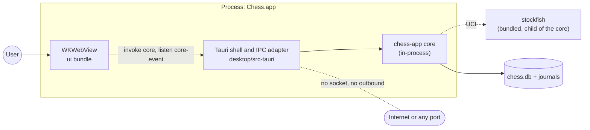
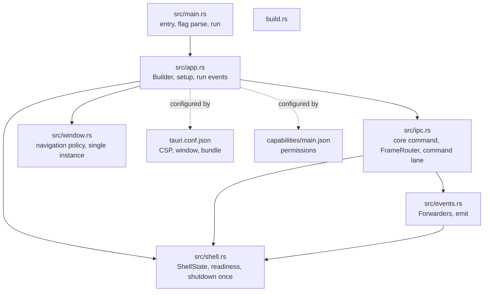
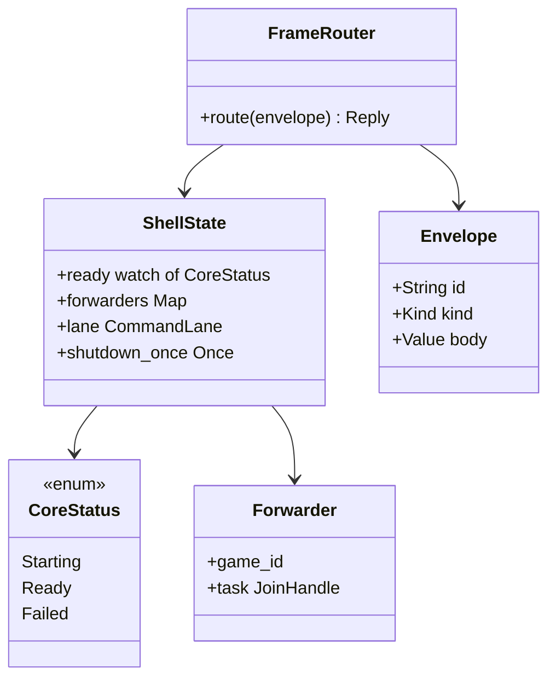
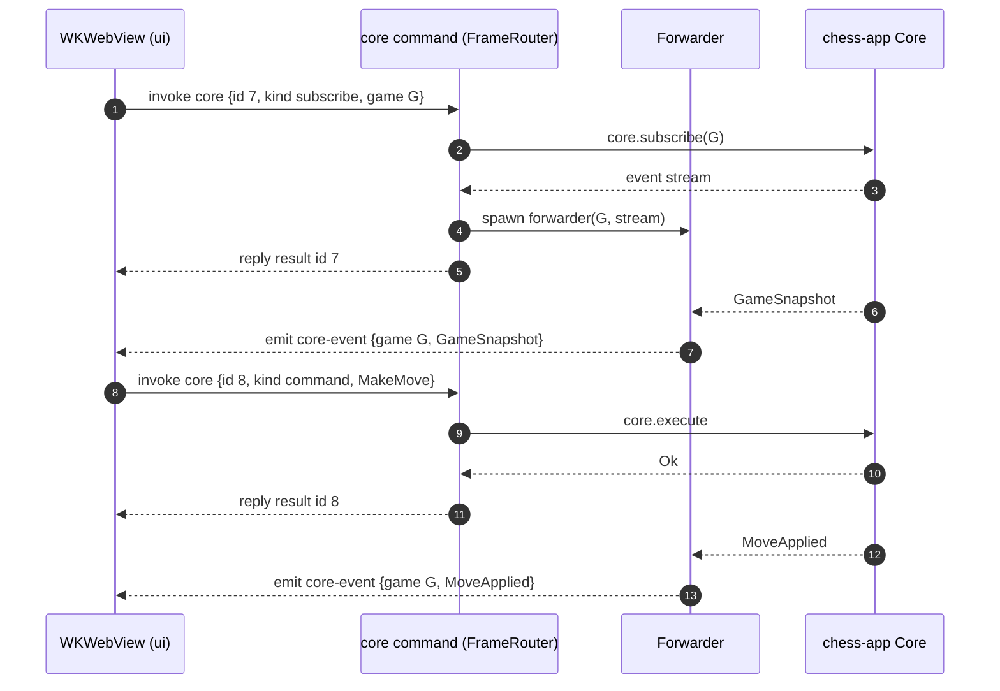
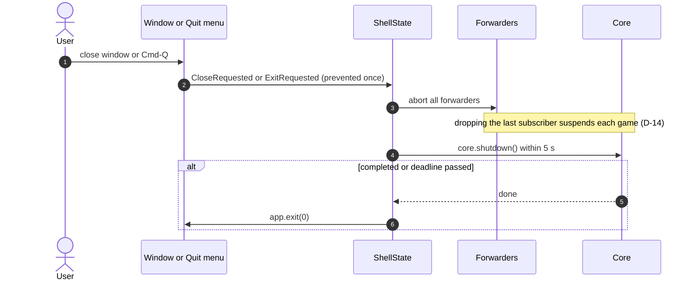
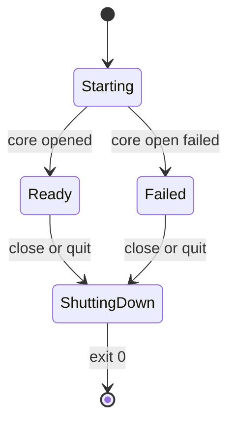

# SDD-desktop-tauri: Software Design Description for `desktop/src-tauri` (Tauri shell and IPC adapter)

| Field | Value |
|---|---|
| Document | docs/design/SDD-desktop-tauri.md |
| Version | 0.1 DRAFT |
| Date | 2026-10-30 |
| Status | **DRAFT.** Not reviewed. Not approved. No code exists yet |
| Owner | Software engineer role (Claude), for Brian Prascher |
| Approver | **Pending.** Gate G0 for this document (documents only). The implementation is G1 (System-architect agent, desk review) inside this crate with the §3.2 edge (`tauri -> chess-app`) and the §5.7 contracts unchanged. Adding a Tauri plugin or changing the packaged layout is a new dependency or a packaging interface and is G2 (Brian Prascher) |
| Gate record | G0, status DRAFT. `GATE-1nn` assigned when filed (SWE-001 ASM-S5). Not filed here |
| Allocation name (architecture §2.2) | `Tauri shell and IPC adapter` |
| Path | `desktop/src-tauri` (architecture §3.1) |
| Runs in | Process: Chess.app (Tauri desktop, ad-hoc signed local build) |
| Languages | Rust 1.99.1 edition 2024; Tauri crate 2.12.5 (the 3.x line is alpha) |
| Sibling SDDs | [ui](SDD-ui.md) (the webview content and `TauriCoreClient`), [chess-server](SDD-chess-server.md) (the other transport and the envelope definition), [chess-app](SDD-chess-app.md), [chess-cli](SDD-chess-cli.md) |

Evidence tags per `swe-governance` §6. `[OBS x]` = read in this session. `[RAN]` = run here. `[UNV]` = not verified (no code, toolchain or network used). Tauri 2 configuration keys and API names below are from memory and are `[UNV]` unless stated; OQ-11 already commits the architecture to checking Tauri facts against the pinned version when packaging is set up [OBS architecture.md §14].

---

## 1. Introduction

### 1.1 Purpose and scope

The Tauri shell is the desktop process. It creates the shared core in-process, opens one window that shows the GUI bundle, maps one `invoke("core", envelope)` call onto the core, forwards core events to the webview with `emit`, applies the Tauri CSP, and quits cleanly. It holds no rules (architecture §1 principle 1) and opens **no TCP port** (D-1) [OBS §2, §6.3].

In scope: start-up and core creation, the single `core` command, event forwarding, window and navigation policy, the Tauri security configuration (CSP, capabilities), single-instance behaviour, close and quit handling, the shell's contribution to the bundle (sidecar binaries, minimum system version).

Out of scope: the GUI itself (ui); the build, universal merge and ad-hoc signing procedure (`packaging/`, F-8.6); Stockfish discovery and spawn (`chess-engine`, D-18); everything the core does.

### 1.2 Allocated requirements, functions and decisions

| Kind | IDs | Source |
|---|---|---|
| Primary requirements | PLAT-1 (desktop entry point), PLAT-3 (CSP and offline), GUI-1 (one GUI codebase; transport differs) | [OBS architecture.md §3.3 `desktop/src-tauri` row] |
| Supporting requirements | PLAT-5 (one bundle, one version), PLAT-6 (the bundle declares macOS 26 as minimum; `packaging/` primary), NFR-1 (desktop starts within 3 s), NFR-4 (no outbound), NFR-8 (no blocking), NFR-9, NFR-10 (log content), RULE-5 and D-14 (closing the app suspends live games), RISK-2 (`--data-dir` for desktop E2E) | [OBS architecture.md §10.1, §6.3; requirements PLAT-6] |
| Functions | **F-7.4.4** Carry protocol over Tauri IPC (primary); F-8.1 launch entry point (shared with the process block); F-8.4 confine traffic to loopback (the webview half of the CSP is `WKWebView`; the Tauri `csp` setting is this crate's) | [OBS functional_decomp.md lines 200, 209, 212] |
| Decisions | D-1 (in-process core, Tauri IPC with the WebSocket's envelope), D-2, D-7, D-9, D-13, D-14, D-16, D-18, D-25, D-32 (the shell is a block) | [OBS architecture.md §11] |
| Risks / open items | R-1 (`tauri-driver` has no macOS WebDriver), R-13/R-14 (Intel), OQ-11 (sidecar naming for a universal target), ASM-5 (macOS signing facts) | [OBS architecture.md §12, §14] |
| Use cases | UC-2 and others (desktop path), UC-1 (install) | |

### 1.3 Inputs read

architecture.md §1, §2 (diagram and key points), §2.2, §3 (3.1 to 3.4), §4.2, §4.8, §5.1 to §5.7, §6.2, §6.3, §8, §8.1, §8.2, §9 (desktop rows), §10.1 (PLAT-1, PLAT-3, GUI-1), §11 (D-1, D-16, D-18, D-32), §12 (R-1), §14 (OQ-11, ASM-5). functional_decomp.md F-7.4.4, F-8.1, F-8.4. requirements.md PLAT-1, PLAT-3, PLAT-6. test-strategy.md. SWE-001.

### 1.4 Conventions

`DD-TAU-n` entities, `IFP-TAU-n` / `IFR-TAU-n` interfaces, `UT-TAU-nn`, `CT-TAU-nn`, `E2E-TAU-nn` planned tests, `UF-TAU-n` upstream findings (section 12), `ASM-TAU-n`, `IA-TAU-n`, `RAT-TAU-n`.

---

## 2. Viewpoint selection

| Viewpoint | Used? | Where | Reason if omitted |
|---|---|---|---|
| Context | Yes | 3.1 | |
| Composition | Yes | 3.2, 4 | |
| Logical | Yes | 3.3 | |
| Dependency | Yes | 3.4 | |
| Information | Omitted | | The shell owns no data. Configuration files are listed in 3.2; the data directory belongs to the core |
| Patterns use | Yes | 3.5 | |
| Interface | Yes | 5 | |
| Structure | Yes | 3.2 | |
| Interaction | Yes | 3.6 | |
| State dynamics | Yes | 3.7 | |
| Algorithm | Yes | 3.8 | |
| Resource | Yes | 7 | |

---

## 3. Viewpoints

### 3.1 Context

**Concern:** what the shell sits between.



The core spawns Stockfish itself (chess-engine); the shell does not touch the engine.

### 3.2 Composition and structure

**Concern:** files and what each owns.



| Entity | Type | Purpose | Traces |
|---|---|---|---|
| DD-TAU-1 Start-up and `ShellState` | module | Parse `--data-dir`, open the core on the async runtime, expose readiness or the startup error | PLAT-1, NFR-1, RISK-2 |
| DD-TAU-2 `core` command and `FrameRouter` | module | One IPC command: decode an envelope, route it, return the reply | F-7.4.4, GUI-1 |
| DD-TAU-3 Window and navigation policy | module + config | One window, no minimum size, only the app origin may load, single instance | GUI-5, PLAT-3, NFR-4 |
| DD-TAU-4 Event forwarders | module | Core event stream to `emit("core-event")`; drop on reload, unsubscribe, exit | F-7.4.4, D-14 |
| DD-TAU-5 Close and quit | module | Suspend games and flush before exit; closing the window quits | RULE-5, D-14, §6.3 |
| DD-TAU-6 Security configuration | config | CSP, capabilities, no plugins that open I/O | PLAT-3, NFR-4, F-8.4 |
| DD-TAU-7 Bundle contribution | config | Sidecar binaries, main binary name, minimum system version | PLAT-1, PLAT-5, PLAT-6, D-18 |

### 3.3 Logical viewpoint

**Concern:** the few types that matter.



`Envelope` and its `Kind` set are the wire definition in [SDD-chess-server](SDD-chess-server.md) section 5.1: `command`, `query`, `subscribe`, `unsubscribe` from the webview; `result`, `error`, `event` back. `hello` is accepted and answered for symmetry but the Tauri client does not need it (same build, no version skew possible inside one bundle).

### 3.4 Dependency viewpoint

Allowed workspace edge [OBS architecture.md §3.2]: `desktop/src-tauri -> chess-app` only. Third-party edge: Tauri (`tauri -.-> tauriLib`). `tauri -.-> ui` is a build-time bundling of the built assets.

| Dependency | Version | Use | Source |
|---|---|---|---|
| `chess-app` | workspace | `Core`, protocol types | §3.2 |
| `tauri` | 2.12.5 | app, window, IPC, events | [OBS §3.4] |
| `@tauri-apps/cli` | 2.12.4 | `cargo tauri build --target universal-apple-darwin` | [OBS §3.4, §6.3] |
| `tokio` 1.54.1, `serde` 1.0.229, `thiserror` 2.0.21, `tracing` 0.1.44 | | runtime types, envelope, errors, log | [OBS §3.4] |
| `serde_json` | not in §3.4 | envelope body | UF-TAU-9 |
| a single-instance mechanism | not in §3.4 | second launch focuses the first (§6.3) | UF-TAU-4 |

No Tauri `shell`, `fs`, `http`, `updater` or `dialog` plugin is in this design. The updater is excluded by §8.1 [OBS]. The others would widen the webview's reach (a shell or file plugin lets script in the page start processes or read files) and are not needed for the v1 behaviour, except possibly a native save panel (UF-TAU-5).

### 3.5 Patterns use

| Pattern | Where | Why | Misuse tell |
|---|---|---|---|
| Adapter | whole crate | Same envelope as the WebSocket; no logic | Any rule or policy text in this crate |
| Single entry point | `core` command | The whole attack surface of the webview is one function that decodes a closed set of frames | A second `#[tauri::command]` |
| Command lane | `FrameRouter` | Keeps arrival order of commands as in [SDD-chess-server](SDD-chess-server.md) A2 | Spawning each command independently |
| Deny by default | capabilities, navigation | Only what the GUI needs | A permission added "for convenience" |
| Idempotent shutdown | `shutdown_once` | Window close and macOS Quit both arrive | Two shutdown paths |

### 3.6 Interaction (sequences)

**Concern:** the lifetime of a subscription and a close.





### 3.7 State dynamics

**Concern:** shell life cycle, including failure to open the core (the user has no terminal).



In `Starting` the window already exists and a `core` call waits (bounded by the client's 10 s command timeout, which makes the GUI show "core not responding" rather than hang silently; typical open is well under the 3 s NFR-1 budget `[UNV]`). In `Failed` every `core` call replies with an `error` envelope carrying the catalogue `{code, message, details}` of the startup error (`SchemaTooNew`, `BackupFailed`, a version refusal, `StoreCorrupt` ...). The GUI shows it full-screen with the message and next step ([SDD-ui](SDD-ui.md) section 7). This is how a double-clicked app reports a failure without a terminal.

### 3.8 Algorithm viewpoint

**A1. Routing (`FrameRouter::route`).**

```
wait for status != Starting            (see 3.7)
if Failed -> reply error(startup error) for every kind except unsubscribe
decode envelope  (deny_unknown_fields). failure -> error ProtocolMismatch{reason: undecodable}
match kind:
  hello        -> result {protocol_version, build_version}
  command      -> enqueue on the command lane, await its reply
  query        -> spawn (at most 16 in flight), await its reply
  subscribe    -> lane: start forwarder(game_id) if none exists, reply result
  unsubscribe  -> abort forwarder(game_id), reply result      (out of lane)
reply: result | error  with the request id echoed
```

The command lane and the query limit are the same rules as in [SDD-chess-server](SDD-chess-server.md) A2, so the two transports behave alike (GUI-1). The shell's lane is one lane per process because there is one window.

**A2. Page load.** On every page-load start of the main webview (first load or reload) all forwarders are aborted. A reloaded page has lost its JavaScript state, so its old subscriptions are dead; this is the desktop equivalent of a WebSocket close (D-14, R-10). The `on_page_load` hook is `[UNV: hook name]`.

**A3. Shutdown once.** A `std::sync::Once` (or an `AtomicBool` compare-and-set) guards the sequence: abort forwarders, `core.shutdown()` with a 5 s deadline (the web server's figure, `ESTIMATE` for desktop), then `app.exit(0)`. Later calls do nothing.

---

## 4. Design entities

### DD-TAU-1 Start-up and `ShellState`
- Traces: PLAT-1, NFR-1, RISK-2, D-13, D-16.
- `main` parses `--data-dir <path>` and `--data-dir=<path>` by hand from `std::env::args` (no `clap` dependency in this crate; unknown arguments are ignored because macOS may add its own). The data directory is then resolved with the **chess-app helper** (IA-TAU-1) in the order flag, `CHESS_DATA_DIR`, default, "the same data-directory resolution as the CLI" [OBS §6.3]. A Finder-launched app inherits no shell environment, so the environment variable matters only for tests started from a shell; desktop E2E isolation therefore uses `--data-dir` (RISK-2).
- The core is opened inside Tauri's own async runtime (`tauri::async_runtime`, a tokio runtime), so `chess-app` finds a runtime handle and §4.8's "one runtime per process" holds `[UNV: that the Tauri runtime is the tokio multi-thread flavour]`. The open runs from the `setup` hook as a spawned task; its result is published on a `watch` channel `CoreStatus`.
- Engine path: not passed. `chess-engine` finds `<directory of current_exe>/stockfish`; in a Tauri bundle the sidecar sits beside the main executable (D-18, §8.2) [OBS].
- Failure behaviour: a failed open stores the `AppError` for A1 and never panics; the window still opens (3.7).
- Concurrency: `ShellState` is `Send + Sync`; the `watch` receiver is cloned per call; no lock is held across `.await`.
- Verification: CT-TAU-01, 02.

### DD-TAU-2 `core` command and `FrameRouter`
- Traces: F-7.4.4, GUI-1, D-1, D-7, NFR-9.
- One `#[tauri::command] async fn core(state, envelope) -> Result<Reply, ShellError>`. Protocol-level failures are normal replies (`error` frames), exactly as on the WebSocket; `ShellError` (an `Err`) is only for conditions that have no frame, which should not occur.
- Algorithm A1. Error text comes from chess-app's catalogue mapping; the shell does not format an `io::Error`, a path or a `Debug` string into any reply (NFR-9, §5.5 [OBS]).
- Ordering: the lane preserves the order in which calls **reach the lane**. Tauri runs each `invoke` as its own task on the runtime, so two calls sent back to back from JavaScript may be polled in either order `[UNV]`. The GUI sends a dependent command only after the earlier reply, and the optimistic `ply` check in `MakeMove` makes a reordered pair harmless (it is rejected as `StalePosition`), so no correctness claim depends on IPC ordering (ASM-TAU-2, UF-TAU-8).
- Verification: CT-TAU-03 to 08.

### DD-TAU-3 Window and navigation policy
- Traces: GUI-5, PLAT-3, NFR-4, §6.3 (single instance, close quits).
- One window, label `main`, title "Chess", **no minimum size** (Q55, GUI-5), default size chosen by the GUI developer. Developer tools are not enabled in release builds.
- Navigation: only the app's own origin may load. A navigation handler returns false for any other URL, and new-window requests are denied. External links are shown as text and never opened (§8.1 "External links ... shown as text") [OBS].
- Single instance: a second launch focuses the existing window instead of starting another core (§6.3). This needs a plugin or a lock (UF-TAU-4). The lock is also what prevents two Chess.app processes from racing each other on the first-launch roster creation; the store's own locking (WAL, `PROCESS_HEARTBEAT`) remains the real guard against any second process, including the CLI.
- Appearance: the shell never forces a window theme, so `prefers-color-scheme` inside WKWebView follows macOS and the GUI's CSS-only theme switching works (UI-10) `[UNV]`.
- Menus: the default macOS application menu is kept (Quit, and the Edit menu that makes copy and paste work in the SAN field). Quit is routed to DD-TAU-5.
- Verification: CT-TAU-09, E2E-TAU-04, M-TAU-1.

### DD-TAU-4 Event forwarders
- Traces: F-7.4.4, D-14, §4.8 backpressure.
- One forwarder task per subscribed game. It reads the core's per-game stream and calls `emit_to("main", "core-event", frame)`, where `frame` is `{kind:"event", body:{game_id, event}}`, the same shape as on the WebSocket. The webview registers one `listen("core-event")` and demultiplexes by `game_id` ([SDD-ui](SDD-ui.md) DD-UI-2).
- Dropping the forwarder drops the core subscription. When the last subscriber of a game leaves, the core suspends it (D-14); the shell has no suspend code.
- Backpressure: `emit` does not tell the shell whether the webview kept up, so unlike the WebSocket (where a slow socket makes the receiver lag and the core resends a snapshot) a stalled webview would let events queue inside the webview process. Volume is a handful of small events per second per game (moves, clock syncs), and the webview is local and single, so this is accepted (RSK-TAU-2). The GUI also resubscribes when it sees a ply gap ([SDD-ui](SDD-ui.md) DD-UI-3).
- Failure behaviour: if `emit` returns an error the forwarder ends and the subscription is dropped (the window is gone or closing).
- Verification: CT-TAU-05, 06.

### DD-TAU-5 Close and quit
- Traces: RULE-5, D-14, §6.3 "Closing the window quits the app, which suspends any live game".
- Both `CloseRequested` on the main window and the application `ExitRequested` event (Cmd-Q, Dock Quit) call the same `shutdown_once` (A3) and prevent the default close until it finishes. After the last window is destroyed the app exits; macOS's default of staying alive without windows is turned off.
- `core.shutdown()` is the awaitable "every live session has journalled `Suspend`" (IA-TAU-3, UF-TAU-7). On the 5 s deadline the shell exits anyway: every acknowledged move is already durable [OBS §4.8].
- A crash, SIGKILL or power loss is an interruption in the NFR-2 sense, recovered by the core's journal on the next start.
- Verification: CT-TAU-10, E2E-TAU-05 (close during a game, relaunch, game resumes with each clock at its last recorded value).

### DD-TAU-6 Security configuration
- Traces: PLAT-3, NFR-4, F-8.4, R-5 (analogue), SWE-001 §6.
- **CSP** (`app.security.csp`). Intent: the same policy as the web server's ([SDD-chess-server](SDD-chess-server.md) DD-SRV-3) with the connection directive replaced by the IPC channel: `default-src 'self'; script-src 'self'; style-src 'self'; img-src 'self'; font-src 'self'; connect-src ipc: http://ipc.localhost; object-src 'none'; base-uri 'none'; form-action 'none'; frame-ancestors 'none'`. The scheme names for Tauri 2's IPC (`ipc:` and `http://ipc.localhost`) and whether Tauri adds its own entries or `'unsafe-inline'` for styles are from memory and `[UNV]` (UF-TAU-6). The test PLAT-3 asks for ("the Content-Security-Policy is set by both the local server and the desktop app") is CT-TAU-11.
- **Capabilities:** one capability file for the `main` window granting only event `listen`/`unlisten` and the app's own `core` command. If the app-manifest mechanism allows, `core` is declared as an explicit permission rather than allowed by default `[UNV]`. No file system, shell, HTTP, dialog, opener, clipboard or updater permission. `withGlobalTauri` stays off; the GUI imports `@tauri-apps/api` as a module.
- Prototype freezing and similar hardening switches of Tauri 2 are enabled where they exist `[UNV: names]`.
- The webview can call `invoke("core", ...)` from any script it runs; only the signed-in bundle loads (navigation policy, CSP), so the surface is the frame decoder, which is a closed `serde` type with `deny_unknown_fields`.
- Verification: CT-TAU-11, 12; bundle scan (CI); E2E offline.

### DD-TAU-7 Bundle contribution
- Traces: PLAT-1, PLAT-5, PLAT-6, D-16, D-18, OQ-11.
- `bundle.macOS.minimumSystemVersion = "26.0"` (writes `LSMinimumSystemVersion`) [OBS §8.2].
- `bundle.externalBin` lists the two bundled binaries that sit in `Contents/MacOS/` beside the main executable: `stockfish` and the `chess` CLI. For a universal target Tauri's naming rule for these files (target-triple suffix) is OQ-11 and is checked against 2.12.5 when packaging is set up `[UNV]`.
- **Main binary name.** `Contents/MacOS/chess` is the CLI (§8.2 [OBS]). Tauri's main executable would by default be named after the product ("Chess"). On a case-insensitive volume those are the same file. This Mac's APFS volume is case-insensitive [RAN `touch Chess; ls chess` in the scratchpad -> listed `chess`, 2026-10-30; `diskutil info /` -> APFS], and the default for APFS is case-insensitive, so the collision is real. The design sets the main binary name explicitly to a different name (for example `chess-desktop`, `mainBinaryName`-style option `[UNV: key]`) and `CFBundleExecutable` follows. UF-TAU-2.
- The shell does not spawn Stockfish and does not use the shell plugin's sidecar API; "sidecar" here means a bundled helper executable. UF-TAU-1 asks the architect to reword §2 and §6.3 accordingly.
- Ad-hoc signing, the universal `lipo` merge, `codesign --verify --deep --strict`, the `lipo -info` test and licence notices are `packaging/` (F-8.6, F-8.7, F-8.9). This crate contributes the configuration above only.
- Verification: packaging tests belong to `packaging/`; CT-TAU-13 checks the config values by inspection.

---

## 5. Interface viewpoint

### 5.1 Provided

> **Consistency review XC-19 (2026-10-30):** the reply and event frame shapes in IFP-TAU-1 below, the `core.*` calls of DD-TAU-2, DD-TAU-4, DD-TAU-5 and IFR-TAU-1, and `Core::shutdown()` without a deadline are **superseded** by section 12a (SDD-chess-app IFP-APP-01 to 05 govern). The bodies were not rewritten.

**IFP-TAU-1 IPC to the webview** (§5.2 "Desktop" row: `invoke("core", envelope)` + `listen("core-event")`, "Same JSON envelope as the web ... No TCP port opened" [OBS]).

| Item | Value |
|---|---|
| Command | `core(envelope) -> reply` |
| Request kinds | `hello`, `command`, `query`, `subscribe`, `unsubscribe` |
| Reply | `{id, kind: "result" \| "error", body}`; errors are catalogue `{code, message, details}` |
| Event channel | `core-event`, payload `{kind: "event", body: {game_id?, event}}` |
| Auth | none; only the app's own origin can run script in the window |
| Errors outside the catalogue | `ShellError` (should not occur) |

Envelope definitions are shared with [SDD-chess-server](SDD-chess-server.md) section 5.1 and consumed by [SDD-ui](SDD-ui.md) DD-UI-2.

**IFP-TAU-2 Command line of the app executable:** `--data-dir <path>` (RISK-2). Nothing else.

### 5.2 Required

| ID | From | What |
|---|---|---|
| IFR-TAU-1 | chess-app | `Core::open`, `execute`, `query`, `subscribe`, `shutdown`, data-dir helper (IA-TAU-1 to 3) |
| IFR-TAU-2 | Tauri 2.12.5 | builder, `State`, window events, `emit_to`, `on_navigation` or equivalent, capabilities, bundle config |
| IFR-TAU-3 | macOS | WKWebView, application menu, `~/Library/Application Support/Chess/` |

### 5.3 Interface assumptions about chess-app (reconcile with [SDD-chess-app](SDD-chess-app.md))

| ID | Assumption | If wrong |
|---|---|---|
| IA-TAU-1 | `resolve_data_dir(flag)` (and `Core::open(CoreConfig)`) are public in chess-app, because §3.2 gives this crate no other edge. The same assumption is IA-CLI-1 | The shell would duplicate the precedence rule, or a G2 edge is needed |
| IA-TAU-2 | `Core::open` returns a typed error for startup refusals (`SchemaTooNew`, `BackupFailed`, version refusal, `StoreCorrupt`, `StoreMissing`) that maps to a catalogue frame | Failed state cannot show the cause |
| IA-TAU-3 | `Core::shutdown()` awaits every session's `Suspend` write (same as IA-SRV-3) | Fallback: poll for zero live sessions until the deadline |
| IA-TAU-4 | `execute`, `query`, `subscribe` as in IA-SRV-1 and IA-SRV-2 | See the server SDD |

---

## 6. Error handling (mapped to §5.5)

| Situation | Reply |
|---|---|
| Core still starting | the call waits (3.7) |
| Core failed to open | `error` frame with the startup error's catalogue code and message, for every request |
| Undecodable envelope | `error` `ProtocolMismatch` with `details.reason = "undecodable"` (UF-SRV-3) |
| Any core error | forwarded unchanged: `ConfirmationRequired`, `StalePosition`, `Denied`, `Store*`, `EngineUnavailable`, `Internal{id}` ... |
| Panic in a forwarder or in a command task | the task ends; an `Internal{id}` frame is returned to the caller where one is pending; logged with a correlation id; the process keeps running |
| `emit` fails | forwarder ends |
| Navigation to a foreign URL | denied silently and logged by category |
| `ServerStopping`, `ProtocolMismatch` from a socket | not applicable (no socket, same build) |

Logging: `tracing` through chess-app's setup; identifiers only, no names or move lists (NFR-10 [OBS §8]).

---

## 7. Resource and concurrency viewpoint

**Concern:** threads, tasks, limits (§4.8 [OBS]).

| Context | Runs | Must not |
|---|---|---|
| Tauri main thread (macOS UI) | window and menu events | run core calls or wait on a future |
| Tauri async runtime (tokio) | `setup` task opening the core, the `core` command futures, forwarders, the core's actors and axum-free dispatcher | block; `rusqlite` runs on the store thread inside chess-store |
| WKWebView process | the GUI | compute rules |

- Tasks: one command lane task, up to 16 query tasks, one forwarder per subscribed game (normally one).
- Memory: events are small; no buffer in the shell beyond the lane queue (bounded at 64, `ESTIMATE`; a full queue makes the caller wait, which pushes back on the webview).
- Time limits: shutdown 5 s (`ESTIMATE` for desktop; the web server's figure is [OBS §4.8]); startup budget 3 s total for the desktop entry point (NFR-1), of which the shell adds only task spawns.
- No port, no socket, so there is nothing to bind or free.

---

## 8. Verification mapping

IDs are planned. Nothing has been written or run. R-1 applies: `tauri-driver` has no macOS WebDriver, so the GUI suite runs in Playwright WebKit against a harness that supplies the Tauri transport, plus a scripted smoke test of the real `.app` [OBS §12, §9].

| ID | Level (§9 row) | Case | Requirement |
|---|---|---|---|
| UT-TAU-01 | Unit | envelope decode: valid frames, unknown field, unknown kind, oversize id | F-7.4.4 |
| UT-TAU-02 | Unit | `--data-dir` parsing in both forms; unknown arguments ignored | RISK-2 |
| CT-TAU-01, 02 | Component (Tauri mock runtime, core over FakeEngine and in-memory store) | start-up success; start-up failure returns the catalogue error for every request and never panics | PLAT-1, NFR-9 |
| CT-TAU-03..08 | Component | route table: command, query, subscribe, unsubscribe; result and error correlation by id; command lane keeps arrival order; query concurrency cap; subscribe first event is `GameSnapshot`; the same behavioural cases as the WebSocket contract suite CT-UI-10 | GUI-1 |
| CT-TAU-05, 06 | Component | forwarder lifetime: unsubscribe aborts; page-load start aborts all; last subscriber leaving suspends the game | D-14 |
| CT-TAU-09 | Component | foreign navigation denied; new window denied | PLAT-3 |
| CT-TAU-10 | Component | shutdown once: close and quit together run one sequence; deadline respected with a stalled core | RULE-5 |
| CT-TAU-11, 12 | Config inspection + component | CSP string present in the built config and equal in intent to the server's; capabilities grant only the listed permissions; no network, shell, fs, updater plugin in `Cargo.toml` | PLAT-3, NFR-4 |
| CT-TAU-13 | Inspection | `minimumSystemVersion` 26.0; main binary name differs from `chess`; `externalBin` lists the two helpers | PLAT-6, D-18 |
| E2E-TAU-01 | GUI E2E (R-1 harness) | the scenario suite through the Tauri transport gives the same PGN as CLI and web | PLAT-1, GUI-1 |
| E2E-TAU-02 | Smoke (real `.app`, scripted) | launches on the development Mac, reaches the profile chooser, plays a scripted game | PLAT-1 |
| E2E-TAU-03 | Offline | with non-loopback networking blocked and the network-capture harness running, zero connections | PLAT-3, NFR-4 |
| E2E-TAU-04 | E2E | second launch focuses the first window and starts no second core | §6.3 |
| E2E-TAU-05 | E2E | close mid-game, relaunch, game resumable with every move and each clock at its last recorded value | RULE-5, NFR-2 |
| M-TAU-1 | Manual | double-click launch; Cmd-Q; appearance switch light/dark inside the webview; VoiceOver in the desktop app | PLAT-1, UI-10, UI-4 |
| M-TAU-2 | Manual (best effort) | Intel Mac: not run, hardware unavailable (CR-7.6) | PLAT-2 |

---

## 9. Requirement-to-design traceability

| Requirement / function | Design entities | Tests |
|---|---|---|
| PLAT-1 (desktop entry point) | DD-TAU-1, DD-TAU-7 | CT-TAU-01, E2E-TAU-02, M-TAU-1 |
| PLAT-3 (CSP, offline) | DD-TAU-3, DD-TAU-6 | CT-TAU-09, 11, E2E-TAU-03 |
| GUI-1 (same GUI; transport differs) | DD-TAU-2, DD-TAU-4 | CT-TAU-03..08, E2E-TAU-01 |
| F-7.4.4 (IPC transport) | DD-TAU-2, DD-TAU-4 | CT-TAU-03..08 |
| PLAT-5 (one bundle) | DD-TAU-7 (one build, helpers beside the main binary) | CT-TAU-13 |
| PLAT-6 (minimum system version) | DD-TAU-7 | CT-TAU-13 (primary: `packaging/`) |
| NFR-1 (startup 3 s) | DD-TAU-1, 3.7 | start-up benchmark (median of 10 warm starts) |
| NFR-4 (no outbound) | DD-TAU-6, 3.4 (no plugin), no socket | CT-TAU-11, 12, E2E-TAU-03 |
| NFR-8 (no blocking) | section 7 | latency test via chess-app |
| NFR-9 (errors shown) | section 6, DD-TAU-1 failed state | CT-TAU-02 |
| RULE-5, D-14 (close suspends) | DD-TAU-4, DD-TAU-5 | CT-TAU-05, 06, 10, E2E-TAU-05 |
| RISK-2 (isolated store) | DD-TAU-1 | UT-TAU-02, E2E |
| F-8.1 (launch), F-8.4 (webview half) | DD-TAU-1, DD-TAU-6 | E2E-TAU-02, 03 |
| §6.3 single instance | DD-TAU-3 | E2E-TAU-04 |

No design entity lacks a driver.

---

## 10. Design rationale

| ID | Decision | Alternatives rejected |
|---|---|---|
| RAT-TAU-1 | One `core` command carrying the WebSocket's envelope | One Tauri command per protocol command (the TypeScript client would differ between transports, and the permission list would grow with every command); Tauri's typed-command generators (`specta`, rejected as D-7) |
| RAT-TAU-2 | No plugins in v1 | `shell`, `fs`, `dialog` plugins (each widens what script in the page can reach) |
| RAT-TAU-3 | Engine spawned by the core, not by the shell | Shell plugin sidecar API (puts process control in a JavaScript-reachable plugin, and the CLI would need a second spawn path) |
| RAT-TAU-4 | Startup failure is reported through the IPC channel | Native dialog (needs a dialog plugin) or silent exit |
| RAT-TAU-5 | Abort all forwarders on every page load | Trust the page to unsubscribe (a reload cannot) |
| RAT-TAU-6 | Closing the window quits | Keep running without a window (macOS default; a live game would keep running with no subscriber, contradicting D-14 and §6.3) |
| RAT-TAU-7 | Explicit main-binary name | Default product name (collides with the `chess` CLI on a case-insensitive volume) |

ADR requests to the System Architect: none by this document. UF-TAU-1 and UF-TAU-2 change wording or layout text in architecture §2, §6.3 and §8.2 and are for the architect to accept.

---

## 11. Risks, assumptions, not analysed

| ID | Item |
|---|---|
| ASM-TAU-1 | Tauri 2.12.5 keys and APIs named here (`externalBin`, `minimumSystemVersion`, capabilities, `on_page_load`, navigation handler, `emit_to`, main-binary-name option, hardening switches, `ipc:` CSP scheme) are from memory and not verified `[UNV]` |
| ASM-TAU-2 | Correctness does not depend on IPC call ordering (DD-TAU-2) |
| ASM-TAU-3 | The Tauri async runtime is a multi-thread tokio runtime that `chess-app` can use as its one runtime |
| RSK-TAU-1 | R-1: the desktop shell cannot be driven by WebDriver on macOS; the harness is a weaker substitute |
| RSK-TAU-2 | A stalled webview lets events queue inside it (no backpressure from `emit`) |
| RSK-TAU-3 | WKWebView differences (drag quirk, downloads, CSP handling of inline styles) show only in the real `.app` |
| RSK-TAU-4 | The universal sidecar naming rule (OQ-11) and ad-hoc signing facts (ASM-5) are unverified upstream |

**Not analysed:** Intel Macs (no hardware, deferred per CR-7.6), Mac App Store sandboxing (out of scope: ad-hoc signed local build), Gatekeeper behaviour of a copied app (PLAT-6 documents the steps; ASM-5), deep links, system tray, notifications, window state restore, accessibility APIs of the native menu.

---

## 12. Open issues and upstream findings

| ID | Finding | Evidence | Assumed meanwhile | Gate if changed |
|---|---|---|---|---|
| UF-TAU-1 | Architecture §2 and §6.3 say Stockfish is "started as Tauri sidecar" and "bundles the Stockfish binary as a Tauri sidecar". §3.3 and D-18 say the engine is found next to the executable and spawned by `chess-engine`. The two cannot both describe who spawns the process. Design: "sidecar" means a bundled helper binary only; the core spawns it | architecture.md §2 key points, §3.3 `chess-engine` row, §6.3, §8.2 | DD-TAU-7, RAT-TAU-3 | G0 wording; G2 if the shell must spawn it |
| UF-TAU-2 | **Binary name collision.** §8.2 puts the CLI at `Contents/MacOS/chess` and the Tauri app is also in `Contents/MacOS/`; Tauri's default executable name is the product name ("Chess"). The default macOS volume is case-insensitive, and this Mac's is [RAN] | architecture.md §8.2; Tauri defaults `[UNV]` | main binary renamed in config | G1 (packaging layout text) |
| UF-TAU-3 | `Core::open` behaviour on refusal and recovery (`StoreMissing`, `StoreCorrupt`, `SchemaTooNew`, `BackupFailed`, version refusal) is not specified. A desktop app has no terminal, so the GUI must show these; the recovery commands (`CreateFreshStore`, `RestoreBackup`) need a running core. Same finding as UF-CLI-3 and UF-SRV-11 | architecture.md §5.1, §5.5, §7.1 | 3.7: failed state reports the error; recovery flows depend on the core opening in a recovery state | G1 (chess-app) |
| UF-TAU-4 | Single instance (§6.3) needs a Tauri plugin or an OS lock; neither is in the §3.4 baseline table, and a new Tauri plugin is a new dependency | architecture.md §3.4, §6.3 | a lock file in the data directory is the lowest-dependency candidate, but it is not decided here | G1/G2 |
| UF-TAU-5 | Saving a PGN or zip from the webview: `<a download>` may not work in WKWebView, and a native save panel needs the dialog plugin (RAT-TAU-2 excludes plugins). Same as UF-UI-3 and UF-SRV-5 | architecture.md §5.1 `ExportPgn`, `ExportData` | export not designed for the webview | G2 if a plugin or command is added |
| UF-TAU-6 | The CSP for the desktop is "the equivalent Tauri `csp` config" (§8.1) without text. The IPC scheme entries, and whether Tauri adds `'unsafe-inline'` or hashes for styles, must be checked against 2.12.5 | architecture.md §8.1 | DD-TAU-6 | G1 |
| UF-TAU-7 | Same as UF-SRV-4: no awaitable `Core::shutdown()` is listed | architecture.md §4.8, §6.3 | IA-TAU-3 | G1 |
| UF-TAU-8 | The architecture does not say whether command order across IPC is guaranteed. Tauri may poll concurrent invokes in any order | architecture.md §4.2, §5.2 | ASM-TAU-2 | none |
| UF-TAU-9 | `serde_json` is a direct dependency of this crate and is not in §3.4 (same as UF-SRV-9) | architecture.md §3.4 | listed in 3.4 | G1 |
| UF-TAU-10 | Envelope kinds, subscribe/unsubscribe and the `hello` message are undefined upstream (same as UF-SRV-1). The shell and the server must use identical types | architecture.md §5.2, §5.6 | server SDD section 5.1 | G1 |

---

## 12a. Reconciliation with SDD-chess-app v0.1

Read at 2026-10-30 after this draft: IFP-APP-01 to 05, DD-APP-03, UF-APP-05, 08, 09. Where it speaks, it governs.

| Item here | SDD-chess-app says | Effect |
|---|---|---|
| Envelope shapes (3.3, 5.1) | Request `{id, kind, body}`, response `{id, ok, body}` or `{id, error}`, event `{game_id, seq, kind, body}`, `Hello`; shared encode, decode helpers in `chess-app::protocol::envelope` | The reply and event shapes in 5.1 are superseded; the shell calls the shared helpers. UF-TAU-10 narrows to the request kinds `subscribe` and `unsubscribe` |
| IA-TAU-3 / UF-TAU-7 | `Core::shutdown(deadline)` (IFP-APP-05) | **Answered.** DD-TAU-5 calls it with the 5 s deadline |
| IA-TAU-2 / UF-TAU-3 | Ready or RecoveryMode; `OpenError` for the rest | In recovery mode the window works and the GUI shows the recovery flow; only a non-recoverable `OpenError` uses the "Failed" state of 3.7 |
| `FrontEndSession` | one per front-end; `Trust::InProcess` for CLI and Tauri | The shell holds one `FrontEndSession` (one window), `Trust::InProcess`, so file paths are honoured for in-process callers (IFR-APP-06). That helps UF-TAU-5: a native save panel could hand the core a **path**, if a dialog is ever added |
| Global events | `subscribe_global` | The shell runs one global forwarder that emits the same `core-event` channel |
| Attach window | 5 s without a subscriber suspends a session | On page load the shell aborts forwarders (A2); the reloaded page must `ResumeGame` then `subscribe` within the window ([SDD-ui](SDD-ui.md)) |

New finding: **UF-TAU-11** `Core::open(cfg, seams)` needs production `Seams`, which this crate cannot build under the §3.2 edge `tauri -> chess-app` only. See UF-SRV-12.


## 13. Review and approval record

| Item | Status |
|---|---|
| Engineer self-check against guardrails | Done for this draft: Tauri facts not read from a source are marked `[UNV]`; the case-insensitivity claim is `[RAN]` |
| Reviewer pass | **Not done** |
| System Architect desk review | **Pending** |
| Systems Engineer review | **Pending** |
| Human approval | **Pending**; none claimed |
| Mermaid | validated, 6 of 6 blocks parsed, 2026-10-30 |
