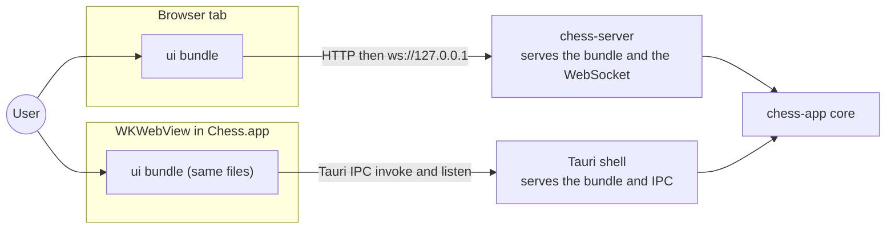
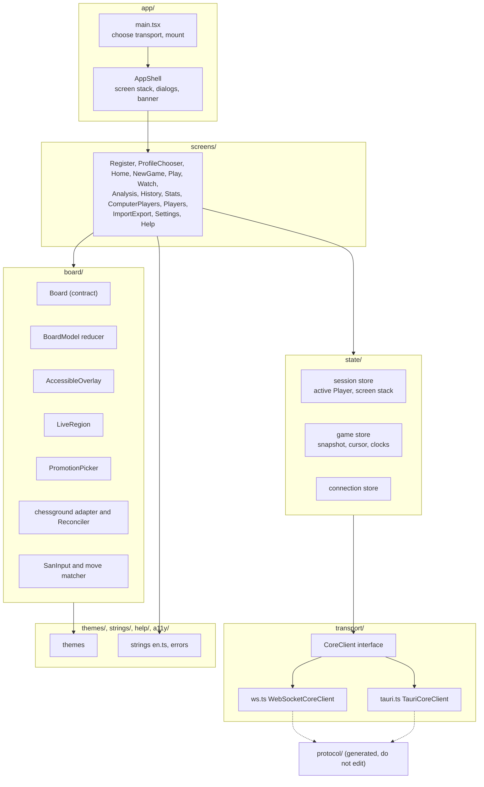
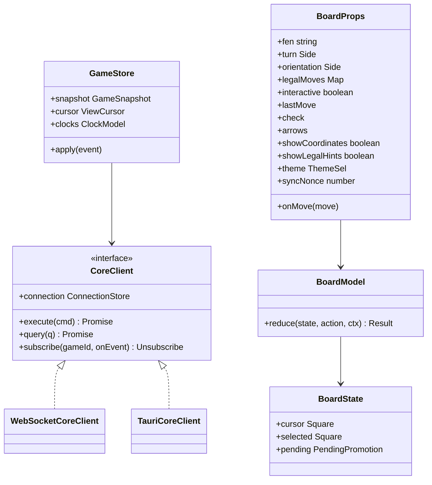
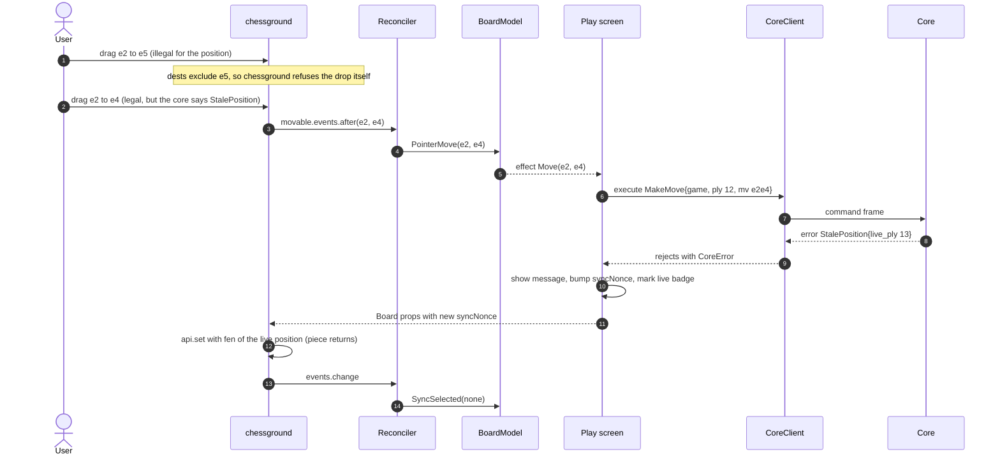
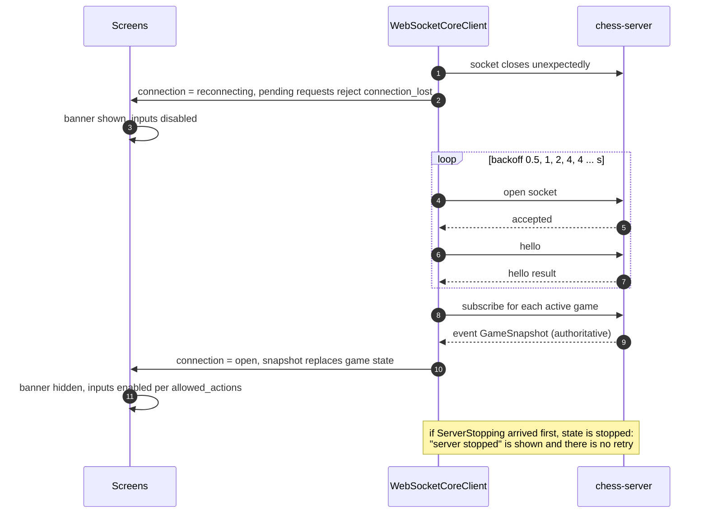
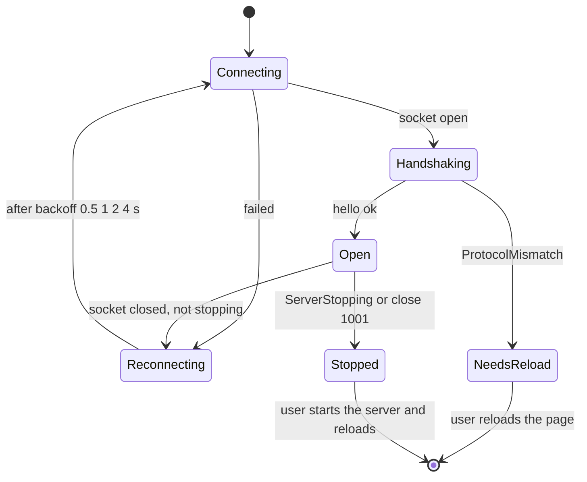
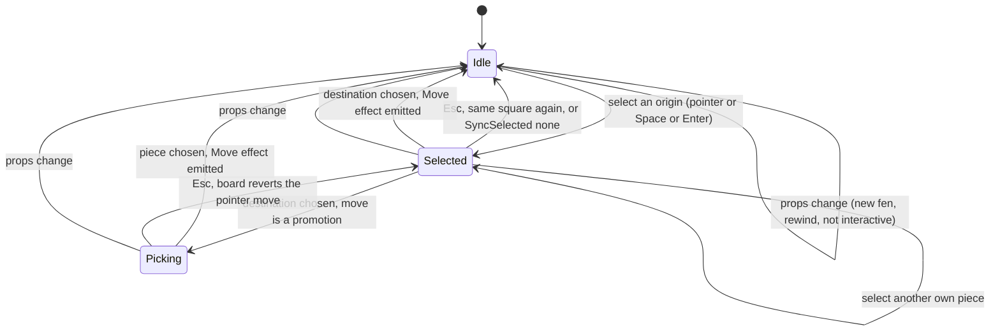

# SDD-ui: Software Design Description for `ui/` (TypeScript GUI: Browser tab and WKWebView)

| Field | Value |
|---|---|
| Document | docs/design/SDD-ui.md |
| Version | 0.1 DRAFT |
| Date | 2026-10-30 |
| Status | **DRAFT.** Not reviewed. Not approved. No code exists yet |
| Owner | Software engineer role (Claude), for Brian Prascher |
| Approver | **Pending.** Gate G0 for this document (documents only). The implementation is G1 (System-architect agent, desk review) inside `ui/` with the `CoreClient` and `Board` contracts and the protocol unchanged; swapping the board adapter behind the `Board` contract is two-way (D-4) and stays G1 |
| Gate record | G0, status DRAFT. `GATE-1nn` assigned when filed (SWE-001 ASM-S5). Not filed here |
| Allocation names (architecture §2.2) | `Browser tab` and `WKWebView` (one codebase, FG-4) |
| Path | `ui/` (Vite + React), architecture §3.1 |
| Languages | TypeScript 7.0.2 strict on Node.js 26.13.0 (build only); runs in the browser and in WKWebView |
| Sibling SDDs | [chess-server](SDD-chess-server.md) (WebSocket and asset host), [desktop-tauri](SDD-desktop-tauri.md) (IPC host), [chess-app](SDD-chess-app.md) (protocol and generated types), [chess-cli](SDD-chess-cli.md) (the other front-end), [chess-domain](SDD-chess-domain.md), [chess-rules](SDD-chess-rules.md) |

Evidence tags per `swe-governance` §6. `[OBS x]` = read in this session. `[UNV]` = not verified (no code, no toolchain, no network used). `ESTIMATE` = no measurement.

---

## 1. Introduction

### 1.1 Purpose and scope

`ui/` is the one GUI bundle shared by the web page served by `chess serve` and by the desktop webview (GUI-1). It renders the core's snapshots, sends intents, and decides nothing about chess: legal destinations, allowed actions, clocks and results come from the core (architecture §1 principle 1, §6.2 [OBS]). It differs between the two hosts only in the `CoreClient` transport chosen at start-up.

In scope: screens, the `Board` component (D-4: chessground adapter, `BoardModel`, `AccessibleOverlay`, `LiveRegion`, `PromotionPicker`, typed SAN input), `CoreClient` and its two transports, client state (snapshot, rewind cursor, local clock countdown), themes, accessibility, layout, help and strings, the build constraints that the CSP imposes.

Out of scope: rules, policy, persistence (core); the HTTP and WebSocket server (chess-server); the Tauri shell (desktop-tauri).

### 1.2 Allocated requirements, functions and decisions

| Kind | IDs | Source |
|---|---|---|
| Primary requirements | GUI-1, GUI-2, GUI-3, GUI-4, GUI-5, UI-3 (GUI themes), UI-4 (GUI part), UI-6, UI-7, UI-8, UI-10, UI-11 | [OBS architecture.md §10.1 rows; §3.3 `ui/` row] |
| Supporting requirements | PLAT-2 (browser matrix), PLAT-3 (bundle has no remote reference), UI-1 (settings take effect in the client), UI-2 and UI-5 (stats screens), UI-9 (help), UI-12 (dialogs), GAME-2 (watch), GAME-3 (rewind view), ENG-5 (Move now button), RULE-4 (local countdown), NFR-8, NFR-9 | [OBS architecture.md §10.1] |
| Functions | **F-7.2.1** Render board and game feedback; **F-7.2.2** Accept move input; **F-7.2.3** Expose board to assistive technology; **F-7.2.4** Apply visual themes; **F-7.2.5** Scale layout to window; **F-7.2.6** Count down clocks locally; **F-7.3.1..F-7.3.4** (GUI realisation); **F-2.5.6** Rewind (GUI part); **F-8.4** (the `WKWebView` half: load nothing remote) | [OBS functional_decomp.md lines 103, 184-195, 212] |
| Decisions | D-4 (chessground + shared layer), D-5 (React + Vite), D-7 (`ts-rs`), D-11 (what-if legal moves from the core), D-14 (tab close suspends), D-21 (Elo chart, DEFERRED), D-1 (Tauri IPC with the WebSocket envelope), D-33 (Move now), D-34 (duplicate prompt) | [OBS architecture.md §11] |
| Risks | R-1 (desktop E2E), R-8 (selection desync), R-10 (reload suspends a game) | [OBS architecture.md §12] |
| Open items owned here | OQ-9 (board spike), OQ-10 (browserslist query), TBD-18 (announcement wording) | [OBS architecture.md §14, requirements UI-6] |
| Use cases | UC-2, UC-3, UC-5 to UC-9, UC-10 to UC-28 (GUI part of each) | [OBS use_cases/README.md] |

### 1.3 Inputs read

architecture.md §1 to §3, §4.2 to §4.8, §5 (all), §6.2, §7.2 (data fields the client shows), §8, §8.1, §8.3, §9, §10.1, §11.1 (D-4 design and spike), §12, §14; trade-study-gui-board.md §5.0 (`BoardProps`); trade-study-gui-board-refined.md §4.1, §5, §6.2, §6.3 (chessground findings, reconciliation); functional_decomp.md F-7.2, F-7.3; requirements.md GUI-1 to GUI-5, UI-1, UI-3 to UI-12, PLAT-3, NFR-8, NFR-9; test-strategy.md; SWE-001 §6 (TypeScript rows).

### 1.4 Conventions

`DD-UI-n` entities, `IFP-UI-n` / `IFR-UI-n` interfaces, `UT-UI-nn` unit, `CT-UI-nn` component, `E2E-UI-nn` end-to-end, `UF-UI-n` upstream findings (section 13), `ASM-UI-n`, `IA-UI-n` (assumption about another block's interface), `RAT-UI-n` rationale. Types written below are design sketches, not code; names marked `(arch)` appear in the architecture [OBS], the rest are introduced here.

Standing coding rules for the whole bundle (SWE-001 §1, §6): `strict` plus `noUncheckedIndexedAccess`, `exactOptionalPropertyTypes`, `noImplicitOverride`; no `any` at a boundary; every promise awaited or explicitly voided with a reason (`@typescript-eslint/no-floating-promises`); `eqeqeq`; discriminated unions for states and results; ESLint with `typescript-eslint` strict set and `--max-warnings 0`; a suppression carries a written reason; no `dangerouslySetInnerHTML` (a restricted-syntax rule), so Player names are only ever text nodes.

---

## 2. Viewpoint selection

| Viewpoint | Used? | Where | Reason if omitted |
|---|---|---|---|
| Context | Yes | 3.1 | |
| Composition | Yes | 3.2, 4 | |
| Logical | Yes | 3.3 | |
| Dependency | Yes | 3.4 | |
| Information | Yes (client state only) | 5 | The GUI owns no persistent data. It must not use `localStorage`, cookies or IndexedDB: preferences live in `PREFERENCES` through the core (UI-1), and the profile is session state (Q48) |
| Patterns use | Yes | 3.5 | |
| Interface | Yes | 6 | |
| Structure | Yes | 3.2 | |
| Interaction | Yes | 3.6 | |
| State dynamics | Yes | 3.7 | |
| Algorithm | Yes | 3.8 | |
| Resource | Yes | 8 | |

---

## 3. Viewpoints

### 3.1 Context

**Concern:** the two hosts and the single bundle.

The bundle makes no request to any host other than its own origin (PLAT-3). In the browser that origin is `http://127.0.0.1:<port>`; in the webview it is the Tauri app origin.

### 3.2 Composition and structure

**Concern:** the parts of the bundle and their layering. The folders are those of architecture §3.1 [OBS]: `protocol/`, `transport/`, `board/`, `screens/`, `themes/`.

| Entity | Type | Purpose | Traces |
|---|---|---|---|
| DD-UI-1 `CoreClient` + `WebSocketCoreClient` | transport | Promise and subscription API over one WebSocket with reconnect | GUI-1, F-7.4.3 (client side), §5.2, §5.6 |
| DD-UI-2 `TauriCoreClient` | transport | The same API over Tauri `invoke` and `listen` | GUI-1, D-1 |
| DD-UI-3 Client stores | state | Session, game (snapshot, rewind cursor, clocks), connection | GAME-3, RULE-4, F-7.2.6 |
| DD-UI-4 `Board` contract and adapter | component | The only way a screen touches the board; chessground inside | GUI-2, GUI-3, GUI-4, D-4 |
| DD-UI-5 `BoardModel` reducer | pure module | One selection state for pointer, keyboard | GUI-2, R-8 |
| DD-UI-6 `AccessibleOverlay`, `LiveRegion`, `PromotionPicker` | components | ARIA grid, announcements, promotion choice | UI-4, UI-6, UI-8 |
| DD-UI-7 `SanInput` and move matcher | component | Typed notation, CLI-3 rules | GUI-2 (c), Q44 |
| DD-UI-8 Screens | components | The screens of §6.2 | GUI-4, UI-1, UI-2, UI-5, UI-9, UI-12 |
| DD-UI-9 Themes | assets and tokens | 10+ board themes, 5+ piece sets, app colour themes, contrast tests | UI-3, UI-7, UI-10 |
| DD-UI-10 Layout and scaling | CSS | Fluid layout, square board, resize | GUI-5 |
| DD-UI-11 Strings, errors, help | modules | English text, error code to message, help from registries | UI-9, UI-11, NFR-9 |
| DD-UI-12 Build constraints | config | Vite output that satisfies the CSP and the bundle scan | PLAT-3 |

### 3.3 Logical viewpoint (key types)

**Concern:** the contracts between the layers. Key types only.

`CoreClient` as given in architecture §5.2 has three methods `(arch)`: `execute`, `query`, `subscribe`. This design adds a read-only `connection` observable (status for the banner). Both implementations provide it; `TauriCoreClient` is always `open`. `BoardProps` is the contract of the first trade study §5.0 [OBS], extended by `turn` (needed for chessground `turnColor`, a presentation fact read from the snapshot) and `syncNonce` (DD-UI-4).

### 3.4 Dependency viewpoint

**Concern:** what the bundle may import.

Allowed edges: `ui -> protocol/ (generated)`; `screens -> state, board, strings, themes`; `state -> transport`; `board -> themes` and nothing in `screens` or `state`; `transport -> protocol/`. No cycle. `board/` knows nothing of the core, so the board can be swapped (D-4 fallback) and tested alone. A lint rule (`no-restricted-imports` per folder) enforces the direction.

| Dependency | Version | Where | Source |
|---|---|---|---|
| React, react-dom | 19.3.1 | all UI | [OBS §3.4] |
| `@lichess-org/chessground` | 10.5.0 (the unscoped `chessground` is not used) | `board/cg` only | [OBS §3.4] |
| `@tauri-apps/api` | 2.12.4 | `transport/tauri.ts`, loaded by dynamic `import()` only inside the webview | [OBS §3.4] |
| Vite / `@vitejs/plugin-react` | 8.3.5 / 6.1.2 | build | [OBS §3.4] |
| TypeScript | 7.0.2 | build, strict | [OBS §3.4] |
| Vitest 5.0.5, Playwright 1.64.1, `@axe-core/playwright` 4.14.0, ESLint 10.13.0, `typescript-eslint` 8.72.1, Prettier 3.9.10 | dev | [OBS §3.4] |
| a component-test library and a DOM environment (D-5 rationale names Testing Library) | not in §3.4 | dev | UF-UI-5 |

No router, state-management, schema-validation, chart or CSS-in-JS library. State uses `useSyncExternalStore` over small stores; the Elo chart is hand-built SVG pending D-21. Fewer dependencies means fewer entries in the SBOM and in `npm audit` (SWE-001 §5).

### 3.5 Patterns use

| Pattern | Where | Why | Misuse tell |
|---|---|---|---|
| Ports and adapters | `CoreClient`; `Board` contract | Two transports, two possible board libraries | A screen importing chessground or `window.__TAURI__` |
| Reducer with effects as data | `BoardModel` | One selection truth, unit-testable without a DOM (R-8) | A component keeping its own `selected` |
| Single source of truth plus reconciliation | chessground `Reconciler` | chessground mutates its own selection | Reading more of `api.state` than `selected` |
| Observer (external store) | stores | no framework dependency | A store updated outside `apply` |
| Table-driven help and errors | `controls` registry, `Record<ErrorCode, ...>` | cannot drift from the code | Help text written by hand |
| Controlled component | `Board` | board = f(props) | Imperative `api.move` calls from a screen |

### 3.6 Interaction (sequences)

**Concern:** a move made by pointer and rejected, and a connection drop. (The accepted-move flow is architecture §5.3 [OBS] and is not repeated.)

### 3.7 State dynamics

**Concern:** the connection life cycle (§5.6, D-36) and the board's selection states.

(`TauriCoreClient` has the single state `Open`.)

### 3.8 Algorithm viewpoint

**A1. `BoardModel.reduce(state, action, ctx) -> {state, effects}`** (pure; D-4, GUI-2).
`ctx = {legal: Map<Square, Square[]>, promotions: Set<"from+to">, orientation, interactive, pieceAt(sq)}` built from the snapshot. State `{cursor, selected, pending}`. Actions: `PointerSelect(sq)`, `PointerMove(o, d)`, `SyncSelected(sq|null)`, `CursorMove(dir)`, `Activate` (Space or Enter at the cursor), `Cancel` (Esc), `PromotionChosen(role)`, `PropsChanged`.

| Action | Rule | Effects |
|---|---|---|
| `PointerSelect(sq)` | ignored unless `interactive`. If `sq` is an origin: `selected = cursor = sq` | `SetSelected(sq)`, `FocusCell(sq)`, `Announce` |
| `PointerMove(o, d)` | if `o+d` is a promotion: `pending = {o, d}`, `selected = null` | `OpenPicker`; else `Move(o, d)`, `SetSelected(null)`, `FocusCell(d)` |
| `SyncSelected(sq)` | `selected = sq` if `sq` is null or an origin, else null. Fixes silent unselects (chessground fires no event on unselect) | none, or `SetSelected(null)` if corrected |
| `CursorMove(dir)` | arrows are screen-relative: with White at the bottom Up is rank + 1, with Black at the bottom Up is rank - 1 and Right is file - 1. No wrap | `FocusCell` |
| `Activate` at cursor `c` | nothing selected: `c` an origin selects it, otherwise feedback "no legal moves". Something selected: `c == selected` deselects; `c` in `legal[selected]` is a destination (promotion opens the picker, otherwise `Move`); `c` another origin reselects; otherwise `Announce` "not a legal destination" and `onIllegalAttempt` | per branch |
| `Cancel` | `pending` -> clear and `RevertBoard` if the pending move came from a pointer; else `selected` -> clear, `SetSelected(null)`; else nothing | |
| `PromotionChosen(role)` | `Move(from, to, role)` | |
| `PropsChanged` | new `fen`, or `interactive` becoming false: clear `selected` and `pending`; the cursor stays | `SetSelected(null)` |

Commit points are exactly GUI-2/Q65: pointer on drop or on the destination click; keyboard on Enter or Space at the destination; promotion when a piece is chosen [OBS architecture §6.2]. A property test generates random action sequences (pointer, keyboard, props changes) and checks the invariants: `selected` is null or an origin; `pending` implies `selected` is null; at most one `Move` effect per completed gesture (UT-UI-03).

**A2. chessground configuration `toConfig(props, model)`** (adapter; study refined §6.2 [OBS]): `fen`, `orientation`, `turnColor: props.turn`, `movable: {free: false, color: interactive ? turn : undefined, dests: props.legalMoves, showDests: props.showLegalHints, events: {after}}`, `draggable.enabled = interactive`, `selectable.enabled = true`, `premovable.enabled = false`, `drawable.enabled = false` (no user-drawn shapes), `drawable.autoShapes` from `arrows`, `highlight: {lastMove: true, check: true}`, `lastMove`, `check`, `selected: model.selected`, `viewOnly: !interactive` (rewound, computer turn, c-c), `coordinates: showCoordinates`, `animation.enabled = !prefersReducedMotion`, `events: {select, change}`, `addDimensionsCssVarsTo: overlayHost`, `jsHover` as the spike decides. Applied with `api.set(config)` on every change of props or model. Option names are from the study's reading of chessground 10.5.0 [OBS trade-study-gui-board-refined.md §4.1]; names not in that table (for example `selectable`, `premovable`) are `[UNV]` until the spike.

Rejected pointer moves: chessground has already moved the piece. The Play screen increments `syncNonce` when a `MakeMove` fails; the adapter then calls `api.set` with the full config including `fen` even though the `fen` prop has not changed, which puts the piece back (§5.3 "chessground reverts the piece" [OBS]). That `api.set({fen})` resets the pieces is `[UNV]` until spike criterion 1.

**A3. Local clock countdown** (RULE-4, F-7.2.6, §4.2). A `ClockModel` stores `{whiteMs, blackMs, running: Side | null}` and the `performance.now()` value at receipt of the last `ClockSync`, `MoveApplied.clocks` or `GameSnapshot`. Displayed value: `max(0, ms - (running === side ? now - receivedAt : 0))`. Display refresh every 100 ms by one timer while a clock runs and the document is visible; on `visibilitychange` to visible it recomputes at once (hidden-tab timers are throttled; the arithmetic uses timestamps, not accumulated ticks). The wall-clock `as_of` field of `ClockSync` is not used for the countdown (UF-UI-9). The client never declares a flag fall: `GameEnded` does, and `Paused` and `DrawOffered` arrive as `running = null`. Screen-reader clock announcements fire once when a side's remaining time first crosses 60 s and 10 s (fixed thresholds, no per-second announcements, §8.3 [OBS]; the thresholds themselves are `ESTIMATE` examples).

**A4. Typed-move matcher** (GUI-2 (c), CLI-3, Q44). `resolveTypedMove(text, legalMoves)`, `legalMoves = {uci, san}[]` from the snapshot. Normalise (trim; `0-0` and `0-0-0` to castling; strip `+`, `#`, `x` from both sides for comparison; files in either case). Piece letters only uppercase. A leading lowercase `b` is always the b-file. A leading uppercase `B` means bishop when a bishop move matches, otherwise the b-file. Exactly one match returns its `uci`; none returns a message built from `strings`; several returns an ambiguity message naming candidates. This is a **matcher over core-supplied legal moves**, not a rules engine. It exists in two places (this one and the Rust one used by the CLI); both are tested against one shared table `e2e/vectors/typed-move.json` (proposed file, UF-UI-2).

**A5. Contrast** (UI-7). `contrastRatio(a, b) = (L1 + 0.05) / (L2 + 0.05)` with relative luminance as defined in WCAG 2.2. The constants of the luminance function are copied by the test author from the WCAG 2.2 text when the test is written (UI-7 verification says exactly this) and are not recalled here. Known pairs checked: black on white is 21:1, identical colours 1:1 [OBS requirements UI-7].

**A6. Message decoding.** Every frame passes `decodeFrame(unknown) -> Frame | DecodeError` (hand-written guards: object, string `id`, `kind` in the known set, object `body`). Events are narrowed by their discriminant; an **unknown event kind is ignored** (§5.6 [OBS]); an unknown result shape is a `DecodeError` surfaced as an internal-error banner. Payload fields are trusted at the type level because bundle and core come from one build (D-16) and the generated types are the single source (D-7); no schema library is in the baseline, so field-by-field validation is not done (UF-UI-8 records the gap against SWE-001 §6 "validate every message").

---

## 4. Design entities

### DD-UI-1 `CoreClient` and `WebSocketCoreClient`

> **Consistency review XC-19 (2026-10-30):** the frame kinds (`result`, `error`, `event`), the reconnect rule ("subscriptions are re-sent after `hello`") and gap detection by `ply` in this entity and in DD-UI-3 are **superseded** by section 13a (SDD-chess-app governs: envelope `{id, ok, body}` / `{id, error}` / `{game_id, seq, kind, body}`, `ResumeGame` then `subscribe`, gap detection by `seq`). The bodies were not rewritten.
- Traces: GUI-1, §5.2, §5.6, PLAT-5, F-7.4.3 (client end). Counterpart: [SDD-chess-server](SDD-chess-server.md) section 5.1 (wire frames).
- `execute(cmd)` and `query(q)` send `{id, kind: "command"|"query", body}` with `id` from a counter, and return a promise settled by the frame with that `id`. A `result` resolves; an `error` rejects with `CoreError{code, message, details}`.
- `subscribe(gameId, onEvent)` sends `subscribe`, registers the listener, returns an `Unsubscribe` that sends `unsubscribe` once. The first event is `GameSnapshot`. Active subscriptions are remembered so they can be re-sent after a reconnect.
- Timeouts: a request without a reply in **10 s** rejects with `TransportError{kind: "timeout"}`, the banner says "core not responding", and the client re-sends the active subscriptions [OBS §4.8 "Client command timeout"].
- Reconnect: on an unexpected close, state `Reconnecting`; backoff 0.5, 1, 2, 4 s, capped at 4 s [OBS §5.6]; pending requests reject with `TransportError{kind: "connection_lost"}` and are never replayed; subscriptions are re-sent after `hello`; the next snapshot replaces game state.
- `ServerStopping` (event) or close code 1001: state `Stopped`; the shell shows "server stopped"; no retry (D-36). `ProtocolMismatch`: state `NeedsReload`; the shell asks for a reload.
- Origin: the URL is built from `location.host`, `ws://` + host + `/api`, so the page always connects back to the origin that served it (matching the server's Host/Origin set).
- Errors never contain a stack or internals; `message` comes from the core.
- Fresh ids and UUIDs: request ids from a counter; `game_uuid` for `StartGame` from `crypto.getRandomValues` formatted as UUID v4. `crypto.randomUUID()` is avoided because it needs a secure context and whether `http://127.0.0.1` counts as one in Safari is `[UNV]`.
- Verification: CT-UI-01 to CT-UI-06 against a fake WebSocket server.

### DD-UI-2 `TauriCoreClient`
- Traces: GUI-1, D-1, §5.2.
- Chosen at start-up: `main.tsx` asks whether the page runs inside Tauri (`isTauri()` from `@tauri-apps/api/core`, `[UNV: function name]`, with a fallback test of the injected global) and then `await import("./transport/tauri")`. In the browser that module is never fetched, which keeps `@tauri-apps/api` out of the web runtime path.
- `execute` and `query` call `invoke("core", {envelope})` with the **same envelope** as the WebSocket (§5.2 [OBS]); `subscribe` sends the `subscribe` kind through the same command and demultiplexes one `listen("core-event")` by `game_id`. No handshake is needed because the bundle and the core are one build; the client does not reconnect (there is no socket).
- On start it unsubscribes nothing and trusts the shell to drop stale subscriptions on page load (SDD-desktop-tauri DD-TAU-4).
- Behaviour must equal the WebSocket client for every case in the shared contract suite CT-UI-10 (GUI-1 "two implementations with identical behaviour").

### DD-UI-3 Client stores
- Traces: GAME-3, RULE-4, F-7.2.6, F-2.5.6, PLY-2/3 (profile).
- **Session store:** `activePlayerId` (from `SelectProfile`), the screen stack (in memory, no URL routing, no history API: a reload returns to the profile chooser as Q48 says "each GUI session starts at the profile chooser", and a game open at reload is suspended by D-14 and appears in the resume list).
- **Game store:** latest `GameSnapshot`; `apply(event)` returns a new value. `MoveApplied` is applied only when `event.ply == snapshot.ply + 1`; any other value means an event was missed, so the store marks itself `stale` and re-subscribes to obtain a fresh snapshot (the core already resynchronises a lagging subscriber; this guards the rest). `ViewCursor = {kind: "live"} | {kind: "ply", ply}`. Board props come from `snapshot.plies[viewedPly]`. While rewound `interactive = false`; a `MoveApplied` while rewound sets `liveChanged = true` (badge, GAME-3) [OBS §6.2]. `allowed_actions` is stored and used as given.
- **Connection store:** the `CoreClient.connection` value.
- Rewind and the cursor are view state only; nothing is sent to the core (GAME-3, §4.2).
- Concurrency: JavaScript main thread only; no worker; no store mutates outside its `apply`/`set` function.

### DD-UI-4 `Board` contract and chessground adapter
- Traces: GUI-2, GUI-3, GUI-4, UI-3, D-4.
- `Board` is a React component with `BoardProps` and nothing else public. Screens never import chessground. The fallback (react-chessboard + patch, option D1) replaces only the adapter folder [OBS §11.1].
- `BoardProps` (sketch): `fen`, `turn`, `orientation`, `legalMoves: Map<Square, Square[]>`, `interactive`, `lastMove?`, `check?`, `arrows?`, `showCoordinates`, `showLegalHints`, `theme: {board, pieces}`, `syncNonce`, `onMove({from, to, promotion?})`, `onIllegalAttempt?(reason)`.
- Lifecycle (`useChessground`): create on mount, `api.set(config)` on change, `destroy` on unmount; a `ResizeObserver` on the container calls `redrawAll()` so the overlay stays aligned at every size [OBS §6.2].
- `Reconciler`: `events.select(k)` -> `PointerSelect(k)`; `events.change` -> read `api.state.selected` and dispatch `SyncSelected`; `movable.events.after(o, d)` -> `PointerMove(o, d)`. This is the only module that reads `api.state`, and it reads `selected` only [OBS refined study §6.5 mitigation].
- Failure behaviour: if chessground throws on `set` (should not), the board shows an error boundary message and the SAN input still works, so a player can always move (GUI-2 "all methods available").
- Verification: the D-4 spike (section 9), CT-UI-12, E2E-UI-03.

### DD-UI-5 `BoardModel`
- Pure TypeScript module, algorithm A1. No DOM, no React. Traces: GUI-2, R-8, Q52/Q65.
- Verification: UT-UI-01 to UT-UI-04 (table tests per action, and the mixed-input property test).

### DD-UI-6 `AccessibleOverlay`, `LiveRegion`, `PromotionPicker`
- Traces: UI-4, UI-6, UI-8, GUI-2 (b), GUI-5.
- **AccessibleOverlay:** an absolutely positioned CSS grid exactly over the squares, sized from chessground's `---cg-width`/`---cg-height` custom properties [OBS refined study §4.1; exact property name checked in the spike]. `role="grid"` with 8 `role="row"` and 64 `role="gridcell"`. Roving `tabindex` (one tab stop; the cell under `cursor` has `0`). Cell label `"e4, white knight"` or `"e4, empty"` from the FEN of the viewed ply (§8.3 [OBS]), with `, selected` or `, legal destination` appended when true. `aria-selected` on the selected square. Orientation reverses cell order. The container has `pointer-events: none`, so mouse and touch reach chessground. After a pointer selection focus moves to the matching cell, drawn only under `:focus-visible`. The chessground board is `aria-hidden="true"`; chessground has no focusable elements, so this is axe-clean [OBS refined study §4.1].
  - Read-only boards (rewound, computer's turn, c-c, finished) remain navigable so a screen-reader user can explore the position; `Activate` then announces "the board is read-only".
  - Keys handled on the grid: arrows, Space, Enter, Esc. Everything else passes through.
- **Focus indicator (UI-8, UI-7):** a two-ring inset `box-shadow` (an inner and an outer ring in two contrasting colours), so at least one ring has 3:1 against both the light and the dark square of any theme. The theme manifest test (DD-UI-9) computes that.
- **LiveRegion:** one `aria-live="polite"` element plus one `assertive` element for rejected moves. Fed by an `Announcer` with a queue and de-duplication. Never moves focus. Events and draft wording in the table below (TBD-18 is **open**; this wording is a proposal for the GUI developer, not a decision).
- **PromotionPicker:** a focus-trapped `role="dialog"` with four buttons (queen, rook, bishop, knight), arrow-key navigation, Esc cancels, focus returns to the board on close.
- Verification: axe on every screen, Playwright keyboard-only scenarios, UT-UI-05 (label function), E2E-UI-04, 05, and a scripted VoiceOver walk-through (manual).

Draft announcement set (events fixed by §8.3 [OBS]; wording `ASM-UI-3`):

| Event | Draft text |
|---|---|
| own move confirmed | "You played {spoken}" |
| opponent move | "{name} played {spoken}" |
| check | "Check" (appended to the move text) |
| game end | "Game over. {result sentence}" |
| draw offer | "{name} offers a draw" |
| rejected move | "Move not allowed. {core message}" (assertive) |
| clock warning | "{side} has {n} seconds" at 60 s and 10 s |
| rewind | "Viewing move {n} of {total}" |
| thinking | "{name} is thinking" |

`{spoken}` is built by a pure function from the SAN and piece letters (for example Nf3 becomes "knight to f3"). Whether to speak SAN or the spoken form is the TBD-18 decision; the function is isolated so either is a one-line change.

### DD-UI-7 `SanInput` and the move matcher
- Traces: GUI-2 (c), CLI-3, Q44, Q65.
- A text field under the board. Commits on Enter; no confirmation. Resolves with A4 against the **live** snapshot's legal moves; input is disabled while rewound. Errors appear in a `role="status"` region and the text stays editable. A promotion suffix (`e8=Q`) is resolved by the matcher, so the picker is not opened for typed input.
- Never captures keys outside the field.
- Verification: UT-UI-06 (shared vector table), E2E-UI-06 (same move by three methods gives identical state).

### DD-UI-8 Screens

All screens are React function components. Controls shown come from `allowed_actions` (Policy) and never from client rules [OBS §4.4]. Each screen declares a `controls` registry that feeds Help (UI-9) and its keyboard tests. Dialogs are focus-trapped, announced, Esc cancels and changes nothing (UI-12, §8.3).

| Screen | Commands / queries | Notes | Traces |
|---|---|---|---|
| ProfileChooser | `ListPlayers`, `SelectProfile` | first screen of every session (Q48); `APP_SETTING.last_active_player` only pre-selects | PLY-3 |
| Register | `RegisterPlayer` | name rules shown from `ValidationFailed.reason`; self-assessment sets starting Elo | PLY-2, PLY-6 |
| Home | `ListUnfinishedGames` | resume list covers either side and every c-c game (D-33) | GAME-4 |
| NewGame | `ListPlayers`, `StartGame{game_uuid, GameSetup}` | invalid combinations not offered; `UnfinishedGameExists` shows Resume, Resign, Abort | GAME-1 |
| Play | `MakeMove`, `Takeback`, `OfferDraw`, `RespondDraw`, `Resign`, `CancelEngine`, `RetryEngine`, `DetachGame` | board, SAN input, move list, captured pieces (derived from the snapshot: material difference at the viewed ply), clocks, thinking indicator with **Move now** (Tab-reachable, label "Move now", Enter or Space, F2) only when `CancelEngine` is allowed (ENG-5, GUI-4) | GUI-2, GUI-4, GAME-3 |
| Watch | `Pause`, `Resume`, `Step`, `SetMoveDelay`, `Abort` | no rewind, move list scrolls (Q50) | GAME-2 |
| Analysis | `GetGameAnalysis`, `Analyze`, `LegalMoves`, `SaveVariation`, `DeleteVariation` | "evaluating..." and "n of N plies evaluated"; what-if moves use `LegalMoves{fen}` (D-11); Strict in-progress analysis is not offered and the core would refuse it | ANA-1..4 |
| History | `ListGames`, `GetGame`, `ExportPgn` | custom-start games marked; voided marked "voided by reset" or "voided: unreadable" | UI-2 |
| Stats | `GetPlayerStats`, `GetRatingHistory` | any Player; hand-built SVG chart with a table alternative (D-21 deferred) | UI-2, UI-5 |
| ComputerPlayers | `ListPlayers{computer}`, `GenerateComputerPlayers{category, count}` | 1 to 25, default 5; label follows Strict Elo | PLY-4, UI-5 |
| Players | `RenamePlayer`, `ArchivePlayer`, `ResetPlayerData` | human only; confirmations incl. the void list | PLY-4, PLY-7 |
| ImportExport | `ImportPgn`, `ImportFen`, `PreviewDataImport`, `ApplyDataImport`, `ExportData`, `RestoreBackup`, `CreateFreshStore` | file handling per DD-UI-13 | IF-1..3, DAT-2, DAT-5 |
| Settings | `GetPreferences`, `UpdatePreferences` | board theme, piece set, app colour theme, default opponent class and colour, legal hints, flip, coordinates, max think time; applies at once (UI-1) | UI-1 |
| Help | none | from the `controls` registries and shipped text | UI-9 |
| Global | | Connection banner; `ConfirmDialog`; `ResultDialog` on `GameEnded`; `GameVoided` leaves the game and shows why; `LeaseLost` makes the board read-only; recovery dialogs for `StoreMissing`, `StoreCorrupt`, `JournalUnreadable` (and the `VoidUnreadableGame` offer, whose dialog is its own confirmation) | UI-12, NFR-9 |

Confirmation handling: a command that returns `ConfirmationRequired{action, voids}` opens `ConfirmDialog`; Confirm resends the same command with `confirmed: true` (and `void_game_ids` echoed for a reset); in a hot-seat game `Resign` first asks which side [OBS §5.1, §5.5]. The client never skips the prompt and the core refuses without it.

### DD-UI-9 Themes
- Traces: UI-3, UI-7, UI-10, F-7.2.4.
- **App colour themes** (UI-10): `System` (default), `Light`, `Dark`, plus other bundled themes including a high-contrast one. Implemented as CSS custom properties on the root element: `System` uses `@media (prefers-color-scheme: dark)` token values, so the page follows macOS appearance and **switches live without JavaScript or reload**; an explicit theme sets `data-theme` on the root and overrides. `color-scheme` is set to match.
- **Board themes** (at least 10) are CSS classes applied to the board container. **Piece sets** (at least 5, one of them high contrast) are static SVG files served from the bundle with a CSS class per set. Names, sources and licences are not decided here; each theme and set ships a manifest entry `{id, source, licence}` consumed by the NFR-6 audit (nothing invented in this document). Board and piece assets are files, not `data:` URIs (CSP, DD-UI-12).
- **Contrast tests (UI-7, UT-UI-07):** each app theme declares its foreground/background token pairs; the test checks every text pair at 4.5:1 with no large-text exception (UI-7 keeps 4.5:1 for all text [OBS requirements UI-7]). Each board theme and piece set declares a colour manifest (light and dark square, last-move, check and selected highlights, legal-move marker, piece fill and stroke, focus rings); the test checks the 3:1 non-text pairs on both square colours. A manifest can disagree with the rendered SVG, so E2E-UI-08 samples rendered pixels for each theme and compares them with the manifest. axe `color-contrast` runs on every screen in every colour theme.
- Reduced motion: `prefers-reduced-motion: reduce` sets chessground `animation.enabled = false` and disables CSS transitions (§8.3 [OBS]).
- Colour independence: last move, check and selection also use outline or pattern (§8.3).

### DD-UI-10 Layout and scaling (GUI-5)
- Fluid CSS grid with `clamp()` sizing; the board is a square sized from its container (`aspect-ratio: 1`), never from the viewport alone. Below a narrow breakpoint (about 720 px, `ESTIMATE`) panels stack under the board; side panels such as the move list scroll vertically (Q75 [OBS requirements GUI-5]). No fixed pixel widths on containers; `min-width: 0` on grid children; no horizontal scrolling at any size. No minimum window size is enforced anywhere (Q55), and the Tauri window is created without a minimum (DD-TAU-3).
- Resize: `ResizeObserver` -> chessground `redrawAll()`; the overlay follows through the CSS variables.
- Verification: Playwright at 480x320, 1024x768, 1440x900, 2560x1440, 5120x2880 in both orientations: board square and fully visible, overlay aligned, every control reachable, no horizontal scroll, live resize without reload (E2E-UI-09).

### DD-UI-11 Strings, errors, help
- Traces: UI-11, UI-9, NFR-9.
- `strings/en.ts` is the single module for UI text (one module per front-end, §6.2). English only; move notation uses English piece letters.
- `errorMessage(code)` is a `Record<ErrorCode, ...>` over the generated `ErrorCode` union, so a code added in Rust without a client entry fails the TypeScript build (NFR-9 "every protocol error code has a message"). Because "new codes may be added without breaking clients" (§5.6), the runtime path falls back to the server's `message` for a code the bundle does not know.
- Help: each screen's `controls` registry yields its help; global help is shipped text. A Help button is present on every screen and F1 also opens it (on a Mac laptop F-keys may need Fn, so the button is the guaranteed path).
- Verification: UT-UI-08 (every `ErrorCode` has a message), E2E-UI-10 (help opens from every screen and lists its controls).

### DD-UI-12 Build constraints (CSP and bundle scan)
- Traces: PLAT-3, F-8.4, [SDD-chess-server](SDD-chess-server.md) DD-SRV-3.
- The server's CSP is `default-src 'self'; script-src 'self'; style-src 'self'; img-src 'self'; font-src 'self'; connect-src 'self' ws://127.0.0.1:{port} ws://localhost:{port}; object-src 'none'; ...`. The build must therefore emit: external script and stylesheet files only (no inline `<script>` or `<style>`); no `style="..."` attribute written into markup (React's `style` prop uses the CSSOM and is allowed; chessground sets styles the same way `[UNV]`); no `data:` URIs (Vite's `build.assetsInlineLimit` set to 0, `[UNV: name]`); fonts self-hosted; no `eval`, no `new Function`; no remote URL.
- Output: hashed names under `/assets/`; `index.html` at the root; one build used by both hosts.
- Browser targets (PLAT-2): a browserslist query for releases of Safari, Chrome, Firefox and Edge from the last 3 years (OQ-10, to be fixed with `npx browserslist` at set-up).
- Bundle scan (CI): fail on any `http(s)://` resource reference outside the allow-list (licence texts, documentation links shown as text and never fetched) [OBS PLAT-3].
- Verification: CT-UI-14 (scan), CT-SRV-10/11 (server side, GUI loads under the CSP in five engines).

### DD-UI-13 File import and export in the browser and webview
- Traces: IF-1, IF-2, DAT-2, UC-22..25.
- The GUI has no file-system access (SWE-001 §6). Import: `<input type="file">` -> `File.arrayBuffer()` -> a size check against the limit (10 MB for PGN, TBD-25) -> the contents are placed in the command. Export: the result bytes become a `Blob` and an `<a download>` click saves them.
- **How a file is represented in `ImportPgn{file, ...}` and `ExportData` is not defined upstream** (UF-UI-3 and UF-SRV-5). This design assumes `{name, data}` with `data` base64 for binary. In the webview `<a download>` may not save files `[UNV]`; the fallback needs a shell-side save (UF-UI-3, [SDD-desktop-tauri](SDD-desktop-tauri.md) section 12).
- The Import screen shows previews and the Skip/Keep-both prompt with "apply to all remaining" (D-34); Replace is not offered for PGN; for a full-data import each conflict offers Replace or Keep both (D-17).

---

## 5. Information viewpoint (client state)

**Concern:** what the client holds and where it must not.

| Datum | Held in | Lifetime | Source of truth |
|---|---|---|---|
| Active Player id | session store | tab or window session | core (`SelectProfile`) |
| Game snapshot, plies, clocks, `allowed_actions` | game store | while subscribed | core |
| Rewind cursor, `liveChanged` | game store | while the game screen is open | client (view state only) |
| Selection, cursor, pending promotion | `BoardModel` state | while mounted | client |
| Preferences | cached copy of `GetPreferences` | session; refreshed on `UpdatePreferences` | core (`PREFERENCES`) |
| Typed input text | component state | until sent or cleared | client |

Not used: `localStorage`, `sessionStorage`, `IndexedDB`, cookies. The reload behaviour (back to the chooser, game suspended and resumable) is what D-14 and Q48 specify; nothing needs to survive a reload on the client.

---

## 6. Interface viewpoint

### 6.1 Provided

**IFP-UI-1 `Board` contract** (§5.7 row "Board contract (BoardProps/onMove) -> GUI screens", React props [OBS]): `BoardProps` as in DD-UI-4. Failure behaviour: a rejected move is reverted by re-applying `fen` (`syncNonce`).

**IFP-UI-2 `CoreClient`** (§5.7 row "CoreClient -> GUI client state"; "two implementations with identical behaviour (GUI-1)" [OBS]): `execute`, `query`, `subscribe`, plus `connection`. Failure: `CoreError` (catalogue code) and `TransportError{kind: timeout | connection_lost | server_stopped | mismatch}`.

**IFP-UI-3 Static bundle** to hosts: `index.html` and `/assets/*` as constrained in DD-UI-12; consumed by chess-server (embed) and Tauri (bundle).

### 6.2 Required

| ID | From | What | Reference |
|---|---|---|---|
| IFR-UI-1 | `protocol/` (generated by `ts-rs` from `chess-app::protocol`) | `Command`, `Query`, `Event`, `GameSnapshot`, `ErrorCode`, DTOs; CI fails if stale | §5, D-7 [OBS] |
| IFR-UI-2 | chess-server | WebSocket `/api` framing (envelope kinds `hello`, `command`, `query`, `subscribe`, `unsubscribe`, `result`, `error`, `event`) | [SDD-chess-server](SDD-chess-server.md) section 5.1 |
| IFR-UI-3 | Tauri shell | `invoke("core", ...)`, `listen("core-event")` | [SDD-desktop-tauri](SDD-desktop-tauri.md) |
| IFR-UI-4 | chessground 10.5.0 | `Config`, `Api`, `events`, `state.selected` | [OBS refined study §4.1] |
| IFR-UI-5 | Browser/webview | `WebSocket`, `ResizeObserver`, `matchMedia`, `performance.now`, `crypto.getRandomValues`, `File`, `Blob` | |

### 6.3 Interface assumptions about chess-app (to be reconciled with [SDD-chess-app](SDD-chess-app.md))

| ID | Assumption | If wrong |
|---|---|---|
| IA-UI-1 | `GameSnapshot` carries, for the current ply, `legal_moves: {uci, san}[]` (not only destinations), every ply's `{san, uci, fen, clocks_after}`, `ply` (count of plies played), `state`, `allowed_actions` as a list of action names, setup, players | Board props and the typed matcher need another source; `LegalMoves{fen}` is a round trip per move (UF-UI-1) |
| IA-UI-2 | `MoveApplied` carries `ply` as in the §5.3 example (plies after the move) so the gap detection of DD-UI-3 works | Gap detection must use the move list length |
| IA-UI-3 | `ErrorCode` is exported as a string-literal union by `ts-rs` | Exhaustive message table cannot be type-checked |
| IA-UI-4 | `ClockSync` and clock fields carry remaining milliseconds and `running_side`; `as_of` is a wall-clock instant the client does not need | A3 changes |
| IA-UI-5 | The protocol offers some way to carry file contents (UF-UI-3) | DD-UI-13 |

---

## 7. Error handling (mapped to §5.5)

Every `Result` error crosses as `{code, message, details}`; the client branches on `code` and shows `message` (never an internal text) [OBS §5.5]. The message is rendered as text, never as HTML.

| Code | Client behaviour |
|---|---|
| `ConfirmationRequired` | `ConfirmDialog` (UI-12); resend with `confirmed: true` |
| `UnfinishedGameExists` | NewGame offers Resume, Resign (human games, side question in h-h), or Abort (c-c), each confirmed |
| `JournalWriteFailed` | message with cause; move not made; the board reverts; clock keeps running |
| `StoreMissing` | choose start fresh (`CreateFreshStore`) or import from a file |
| `ImportConflicts` | per-conflict choices (PGN: Skip default, Keep both, apply to all remaining; data: Replace or Keep both) |
| `IllegalMove`, `StalePosition` | message, board reverts (A2), "live position has changed" badge for stale; input stays editable |
| `Denied` | message; should not occur because controls come from `allowed_actions` |
| `ValidationFailed` | highlight the field, name the rule |
| `ParseError` | list per game; other games still import |
| `NotFound` | refresh the list |
| `GameLeased` | message with the owner kind; read-only view |
| `LeaseLost` (event) | board read-only; explain |
| `EngineUnavailable` | Retry (`RetryEngine`) or Leave (`DetachGame`) |
| `StoreBusy` | retried once by the core; then message |
| `StoreUnavailable` | message; a live game keeps playing, backlog shown by `StoreBacklog` |
| `StoreCorrupt` | restore-from-backup flow (`RestoreBackup`, confirmed) |
| `SchemaTooNew` | full-screen "update the app", nothing else |
| `Busy` | "close the other entry points" |
| `ProtocolMismatch` | `NeedsReload` banner with a reload button |
| `NothingToTakeBack` | message "Nothing to take back" |
| `PlayerHasUnfinishedGames` | names the games; offer Resume or Resign |
| `BackupFailed` | cause; Retry or Exit |
| `JournalUnreadable` | states `recovered_moves`; when nothing is readable, the `VoidUnreadableGame` offer |
| `ConfigInvalid` | not applicable in the GUI |
| `Internal{id}` | generic message with the id |
| unknown code | server `message` |
| `GameVoided` / `ServerStopping` (events) | leave the game and show why / "server stopped", no retry |

---

## 8. Resource and concurrency viewpoint

**Concern:** what runs where in the browser (§4.8 [OBS]).

| Context | Runs | Must not |
|---|---|---|
| Main thread | rendering, `BoardModel`, local clock countdown, stores | compute rules; block; hold a lock-like flag across an `await` |
| WebSocket / IPC callbacks | decode, update stores | do heavy work (frames are small) |
| Timers | one 100 ms clock timer while a clock runs and the page is visible; reconnect backoff timers; request timeouts | keep running when nothing needs them |

- No Web Workers: nothing heavy exists on the client (legal moves arrive in the snapshot, what-if moves use `LegalMoves`, D-11).
- Input feedback within 100 ms during an engine search (NFR-8): the page never waits on a core future before showing a press; selection is local reducer state, a command shows a pending state at once.
- Memory: one snapshot of at most a few hundred plies (FEN per ply is short) `ESTIMATE`; the move list is virtual-scrolled only if measurement shows a need.
- Bundle size: chessground is about 12 KB gzipped [OBS refined study §4.1]; React and application code size is not estimated. No budget is claimed (UF-UI-6).
- Ordering: the client sends commands in user order over one connection; the server preserves arrival order for commands ([SDD-chess-server](SDD-chess-server.md) A2).

---

## 9. Verification mapping

All IDs are **planned**. Nothing has been written or run. Tool names and versions from architecture §3.4 and §9 [OBS].

| ID | Level | Case | Requirement |
|---|---|---|---|
| UT-UI-01..04 | Unit (Vitest) | `BoardModel` action table, commit points, promotion, props change; property test of random mixed sequences (invariants in A1) | GUI-2, R-8 |
| UT-UI-05 | Unit | square label function; orientation mapping of arrow keys | UI-4 |
| UT-UI-06 | Unit | typed-move matcher against the shared vector table (bishop/b-file rule, `0-0`, optional `+ # x`, ambiguity) | GUI-2, CLI-3, Q44 |
| UT-UI-07 | Unit | contrast function (21:1 and 1:1 known pairs); every theme's token pairs at 4.5:1; board and piece manifests at 3:1; focus rings | UI-7, UI-8, UI-10 |
| UT-UI-08 | Unit | every `ErrorCode` has a message; unknown code falls back | NFR-9 |
| UT-UI-09 | Unit | `GameStore.apply`: gap detection, rewind cursor, `liveChanged`; `ClockModel` arithmetic | GAME-3, RULE-4 |
| UT-UI-10 | Unit | `decodeFrame` accepts valid and rejects malformed; unknown event kind ignored | §5.6 |
| CT-UI-01..06 | Component | `WebSocketCoreClient` against a fake socket server: id correlation, timeout 10 s, reconnect backoff 0.5/1/2/4, resubscribe, `ServerStopping` no retry, mismatch | §5.6, D-36 |
| CT-UI-10 | Contract suite | the same behavioural cases against `WebSocketCoreClient` and `TauriCoreClient` (fake `invoke`/`listen`) | GUI-1 |
| CT-UI-11 | Component | screens render controls exactly from `allowed_actions` (table over mode x matchup x state fixtures) | test-strategy principle 5 |
| CT-UI-12 | Component | chessground adapter in a real browser (Playwright component mode): `toConfig`, Reconciler, revert by `syncNonce` | D-4 |
| CT-UI-13 | Component | `ConfirmDialog`: focus trap, Esc, resend with `confirmed` | UI-12 |
| CT-UI-14 | CI | bundle scan: no `http(s)` resource references outside the allow-list; no inline script or style; no `data:` image | PLAT-3 |
| E2E-UI-01 | GUI E2E (web: WebKit, `chrome`, `msedge`, Firefox) | scenario files from `e2e/scenarios` through the GUI: same final PGN as CLI and desktop | PLAT-1, GUI-1 |
| E2E-UI-02 | GUI E2E (desktop) | same suite in Playwright WebKit against the Tauri transport harness plus a smoke test of the real `.app` (R-1) | GUI-1, R-1 |
| E2E-UI-03 | GUI E2E | selection-sync sequences: `BoardModel.selected == api.state.selected` after click then Enter, Space then click, drag then Esc, click elsewhere, rejected-move revert, promotion by mouse and by keyboard | D-4 spike criterion 1, GUI-2 |
| E2E-UI-04, 05 | GUI E2E + axe | axe clean on every screen, board `aria-hidden` axe-clean; keyboard-only scenario per screen; live-region text after each event type; focus ring within the square | UI-4, UI-6, UI-8 |
| E2E-UI-06 | GUI E2E | same move by mouse, keyboard, typed notation, touch: identical state; each method commits at its stated point only | GUI-2 |
| E2E-UI-07 | GUI E2E | Move now button present while a computer thinks in an h-c game, absent otherwise; keyboard operable | GUI-4, ENG-5 |
| E2E-UI-08 | GUI E2E | screenshot diffs per board theme and piece set and per colour theme, light and dark via emulated `prefers-color-scheme`; pixel sampling vs manifests | UI-3, UI-7, UI-10 |
| E2E-UI-09 | GUI E2E | five sizes, both orientations, overlay alignment, no horizontal scroll, live resize | GUI-5 |
| E2E-UI-10 | GUI E2E | help opens from every screen; settings take effect at once and persist after restart | UI-9, UI-1 |
| E2E-UI-11 | GUI E2E | emulated `prefers-reduced-motion`; switching appearance switches theme without reload (web and desktop) | UI-10 |
| E2E-UI-12 | GUI E2E | connection loss: banner, inputs disabled, reconnect, snapshot authoritative; `ServerStopping` shows "server stopped" | §5.6 |
| M-UI-1 | Manual | VoiceOver walk-through in Safari and in the desktop app | UI-4, UI-6 |
| M-UI-2 | Manual | oldest supported version of each of the four browsers smoke-tested per release (PLAT-2) | PLAT-2 |
| SPIKE-UI-1 | Spike (OQ-9, two days, first GUI task) | exit criteria: (1) selection equality in scripted mixed-input sequences; (2) axe clean; (3) overlay aligned in both orientations at three sizes; (4) drag works in Safari, Chrome, Firefox, Edge and the Tauri WKWebView; (5) overlay aligned during continuous resize to a narrow width. If (1) cannot be met reliably, switch the adapter to option D1 [OBS §11.1] | D-4, R-8 |

Platform note: Intel and other Macs without available hardware are deferred, not run, per test-strategy "Platform availability" (CR-7.6).

---

## 10. Requirement-to-design traceability

| Requirement | Design entities | Tests |
|---|---|---|
| GUI-1 (one codebase, two shells) | DD-UI-1, DD-UI-2, DD-UI-12 | CT-UI-10, E2E-UI-01, 02 |
| GUI-2 (input methods, commit points) | DD-UI-4, 5, 6, 7 | UT-UI-01..04, 06, E2E-UI-03, 06 |
| GUI-3 (coordinates) | DD-UI-4 (`showCoordinates`), DD-UI-8 Settings | E2E (labels in both orientations) |
| GUI-4 (feedback, Move now) | DD-UI-8 Play, DD-UI-4 | E2E-UI-07 |
| GUI-5 (scalable layout) | DD-UI-10 | E2E-UI-09 |
| UI-1 (settings effects) | DD-UI-8 Settings, DD-UI-9 | E2E-UI-10 |
| UI-2, UI-5 (stats, chart) | DD-UI-8 Stats, History, ComputerPlayers | CT/E2E on seeded store |
| UI-3 (themes) | DD-UI-9 | UT-UI-07, E2E-UI-08 |
| UI-4 (accessibility) | DD-UI-6 | E2E-UI-04, 05, M-UI-1 |
| UI-6 (announcements) | DD-UI-6 LiveRegion | E2E-UI-05, M-UI-1 |
| UI-7 (contrast) | DD-UI-9, A5 | UT-UI-07, axe |
| UI-8 (focus) | DD-UI-6 | E2E-UI-04, 05 |
| UI-9 (help) | DD-UI-11 | E2E-UI-10 |
| UI-10 (colour themes) | DD-UI-9 | E2E-UI-08, 11 |
| UI-11 (English) | DD-UI-11 | inspection |
| UI-12 (confirmations) | DD-UI-8 ConfirmDialog | CT-UI-13, E2E per action |
| GAME-2 (watch) | DD-UI-8 Watch | E2E |
| GAME-3 (rewind) | DD-UI-3 | UT-UI-09, E2E |
| ENG-5 (Move now) | DD-UI-8 Play | E2E-UI-07 |
| RULE-4 (clock display) | A3, DD-UI-3 | UT-UI-09 |
| PLAT-2 (browsers) | DD-UI-12 | M-UI-2, E2E |
| PLAT-3 (offline bundle) | DD-UI-12 | CT-UI-14, offline E2E |
| NFR-8 (feedback in 100 ms) | section 8 | latency test with a slow fake core |
| NFR-9 (errors shown) | DD-UI-11, section 7 | UT-UI-08, E2E per error path |
| F-7.2.1..F-7.2.6, F-7.3.1..F-7.3.4 | DD-UI-3..11 | as above |

Every entity has a driver; no allocated requirement is without an entity.

---

## 11. Design rationale

| ID | Decision | Alternatives rejected |
|---|---|---|
| RAT-UI-1 | `Board` is a controlled component with all selection in `BoardModel` and chessground reconciled to it | Two sources of truth (first-study option B/C-style mirror grid): permanent desync risk (R-8) |
| RAT-UI-2 | No router; in-memory screen stack | URL routing: back button and reload would imply states the core does not keep, and unknown paths would need an SPA fallback on the server |
| RAT-UI-3 | Own tiny stores on `useSyncExternalStore` | A state library (dependency, SBOM entry, no need) |
| RAT-UI-4 | Theme switching in CSS (`prefers-color-scheme`), not JavaScript | JS listener (extra code, flash on load) |
| RAT-UI-5 | Typed-move matcher over core-supplied legal moves, with shared test vectors | A full SAN parser in TypeScript (second rules implementation, violates principle 1) |
| RAT-UI-6 | Lazy `import()` of the Tauri module | Always bundling it (needless in the browser) |
| RAT-UI-7 | Hand-built SVG chart until D-21 is decided | Chart library now (D-21 is DEFERRED, two-way) |
| RAT-UI-8 | Timestamps, not accumulated ticks, for clocks | `setInterval` decrement (drifts, throttled in hidden tabs) |
| RAT-UI-9 | `getRandomValues` UUIDs | `crypto.randomUUID` (secure-context uncertainty) |

ADR requests to the System Architect: none by this document. If the D-4 spike fails, the switch to option D1 is already a decision of the architecture (§11.1), not a new one.

---

## 12. Risks, assumptions, not analysed

| ID | Item |
|---|---|
| ASM-UI-1 | chessground 10.5.0 option and API names beyond the study's table (`selectable`, `premovable`, `drawable.enabled`, the `---cg-width` variable, `api.set({fen})` resetting pieces) are from memory `[UNV]`; the spike confirms them |
| ASM-UI-2 | Vite, React and `@tauri-apps/api` option names (`build.assetsInlineLimit`, `isTauri`) are from memory `[UNV]` |
| ASM-UI-3 | Announcement wording in DD-UI-6 is a proposal; TBD-18 stays open until the GUI developer and the VoiceOver walk-through settle it |
| ASM-UI-4 | CSS-only theme switching follows macOS appearance inside WKWebView (the shell must not force a window theme) `[UNV]` |
| ASM-UI-5 | Mouse-selected focus transfer to the overlay works the same in all five engines `[UNV]`; part of the spike |
| RSK-UI-1 | R-8 selection desync; mitigated by A1, the property test and the spike |
| RSK-UI-2 | WKWebView drag quirk (`jsHover`) and file download behaviour differ from the browsers (R-1) |
| RSK-UI-3 | The CSP may block a library behaviour not seen yet (inline styles); CT-SRV-10 and the five-engine E2E catch it |
| RSK-UI-4 | R-10: a page reload suspends a timed game; accepted by the user |

**Not analysed:** exact bundle size, memory use of long games, behaviour on touch hardware (Macs without touch screens; the touch requirement is tested by emulation), right-to-left names, text scaling beyond browser zoom, Intel Macs (no hardware; deferred, CR-7.6), the spoken form of promotion and castling announcements.

---

## 13. Open issues and upstream findings

| ID | Finding | Evidence | Assumed meanwhile | Gate if changed |
|---|---|---|---|---|
| UF-UI-1 | **Snapshot contents.** §5.1 says the snapshot carries "the current ply's legal moves (for highlighting and keyboard input)" and "allowed_actions" but gives no shape. The board needs destination lists; the typed matcher and the overlay labels need SAN per legal move, and promotion detection needs the promotion piece in the `uci` | architecture.md §5.1, D-11 | IA-UI-1 | G1 (chess-app DTO) |
| UF-UI-2 | **Typed-move rules exist twice** (Rust for the CLI, TypeScript here) although principle 1 says the front-ends hold no rules and Q44 says typed GUI input uses the CLI-3 parser. Options: a core query `ParseMove{fen, text}` (single implementation, one more round trip, one more protocol item) or this matcher with shared vectors (proposed new file `e2e/vectors/typed-move.json`) | requirements.md GUI-2 (c), CLI-3; architecture.md §3.3, §6.2 | A4 and shared vectors | G1 / G2 if a protocol item is added |
| UF-UI-3 | **File transfer for the GUI is undefined** (see [SDD-chess-server](SDD-chess-server.md) UF-SRV-5). Also whether `<a download>` saves files inside WKWebView is unknown; if not, the desktop needs a shell-side save (a native dialog needs a Tauri plugin, a new dependency) | architecture.md §5.1, §5.7; SWE-001 §6 | DD-UI-13 | G2 if routes or plugins are added |
| UF-UI-4 | `BoardProps` in the first study §5.0 has no `turn` and no way to force a revert when `fen` has not changed. Added `turn` and `syncNonce`. This is internal to `ui/board`, noted so the contract in the study is not read as final | trade-study-gui-board.md §5.0 | DD-UI-4 | G1 (inside `ui/`) |
| UF-UI-5 | D-5's rationale cites Testing Library, and the unit/component tests need a DOM environment; neither is in the §3.4 baseline table | architecture.md §3.4, §11 D-5 | listed in section 3.4 as an open dependency | G1 |
| UF-UI-6 | No bundle-size or render budget exists for the GUI; NFR-1 covers startup of the entry point (web: `chess serve` to first screen accepting input) | requirements.md NFR-1 | none claimed | SE |
| UF-UI-7 | TBD-18 (announcement wording) is still open and owned by the GUI developer at step 3; a draft is proposed here | requirements.md UI-6; architecture.md §14 | ASM-UI-3 | none |
| UF-UI-8 | SWE-001 §6 asks the GUI to validate every message from the core; no schema library is in the baseline and `ts-rs` generates types, not validators | SWE-001 §6; architecture.md §3.4, D-7 | A6: envelope and discriminant checks only | G1 (dependency) |
| UF-UI-9 | `ClockSync.as_of` is not defined (wall clock or monotonic, which process). The client cannot compare it with its own clock reliably | architecture.md §4.2 | A3 uses receipt time | G0 text |
| UF-UI-10 | GUI-2 (b) says "Space selects piece, arrows pick destination, Enter confirms"; architecture §6.2 says "Enter/Space on the destination". This design accepts Space or Enter for both selecting and committing | requirements.md GUI-2; architecture.md §6.2 | A1 `Activate` | SE to confirm |
| UF-UI-11 | The CSP of architecture §8.1 and the Tauri `csp` setting are to be equivalent; the exact policy for Tauri IPC (custom protocol scheme in `connect-src`) is not stated | architecture.md §8.1, §6.3 | see [SDD-desktop-tauri](SDD-desktop-tauri.md) | G1 |

---

## 13a. Reconciliation with SDD-chess-app v0.1

Read at 2026-10-30 after this draft: IFP-APP-02, IFP-APP-03, DD-APP-03, UF-APP-05, UF-APP-08. Where it speaks, it governs.

| Item here | SDD-chess-app says | Effect |
|---|---|---|
| Gap detection by `ply` (DD-UI-3) | Every event carries a per-game `seq`, strictly increasing and gap-free per subscription; a lagging receiver is resynchronised by a fresh snapshot | Use `seq` for gap detection (a gap means resubscribe); `ply` stays for the `MakeMove` guard. IA-UI-2 changes accordingly |
| Reconnect (DD-UI-1, 3.6) | After a WebSocket drop the session has already suspended (D-14); reconnect is `ResumeGame` then `subscribe`, within a 5 s attach window (UF-APP-05, ASM-APP-03) | **DD-UI-1 is wrong as drafted.** After `hello` the client must send `ResumeGame{game_id}` for each game it had open, then `subscribe`. The 0.5/1/2/4 s backoff can exceed 5 s in total, so a slow reconnect finds the game suspended; resume handles that. The UI shows "resuming" until the snapshot arrives |
| Envelope | `{id, kind, body}` / `{id, ok, body}` / `{id, error}` / `{game_id, seq, kind, body}`, `Hello` | `decodeFrame` (A6) follows these shapes, not the `result`/`error`/`event` kinds drawn in [SDD-chess-server](SDD-chess-server.md) 5.1 |
| `ResultOf<C>` | "the `ResultOf<C>` helper is the client's, SDD-ui" and `Reply` has one variant per command and query | DD-UI-1 owns `ResultOf`, derived from the generated `Reply` by `Extract` |
| Global events | `subscribe_global`: `ServerStopping`, `StoreBacklog`, `RatingsUpdated`, `AnalysisProgress` of stored games | `CoreClient` gains `subscribeGlobal(onEvent)`; for the WebSocket it is a kind of `subscribe` with no game id (kind name still to be defined) |
| File transfer (UF-UI-3) | `FileRef`; remote sessions use `Bytes` only | DD-UI-13 sends bytes; encoding and size cap open |
| Snapshot (UF-UI-1) | `GameSnapshot` carries setup, players, every ply (SAN, UCI, FEN, timestamp, clock after), the current ply's legal moves, clocks, state, `allowed_actions`, `seq` | Matches IA-UI-1 except that the shape of "legal moves" (destinations only, or `{uci, san}`) is still not stated |
| `ClockSync` | `as_of` is a wall timestamp; sent on transitions of `running_side` and on subscribe, not periodically (ASM-APP-04) | Confirms A3 (receipt time, local countdown). UF-UI-9 is answered in substance |

## 14. Review and approval record

| Item | Status |
|---|---|
| Engineer self-check against guardrails | Done for this draft: library option names that were not read from a source are marked `[UNV]` |
| Reviewer pass | **Not done** |
| System Architect desk review | **Pending** |
| Systems Engineer review (UF-UI-2, 3, 6, 10) | **Pending** |
| Human approval | **Pending**; none claimed |
| Mermaid | validated, 7 of 7 blocks parsed, 2026-10-30 |
