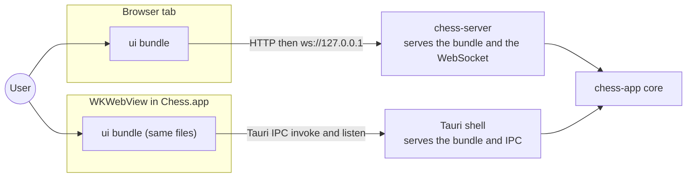
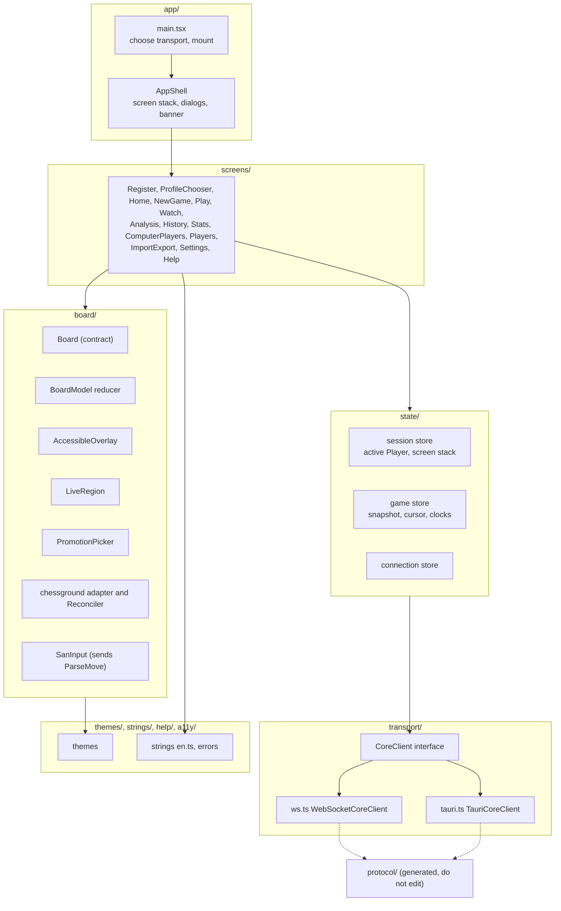
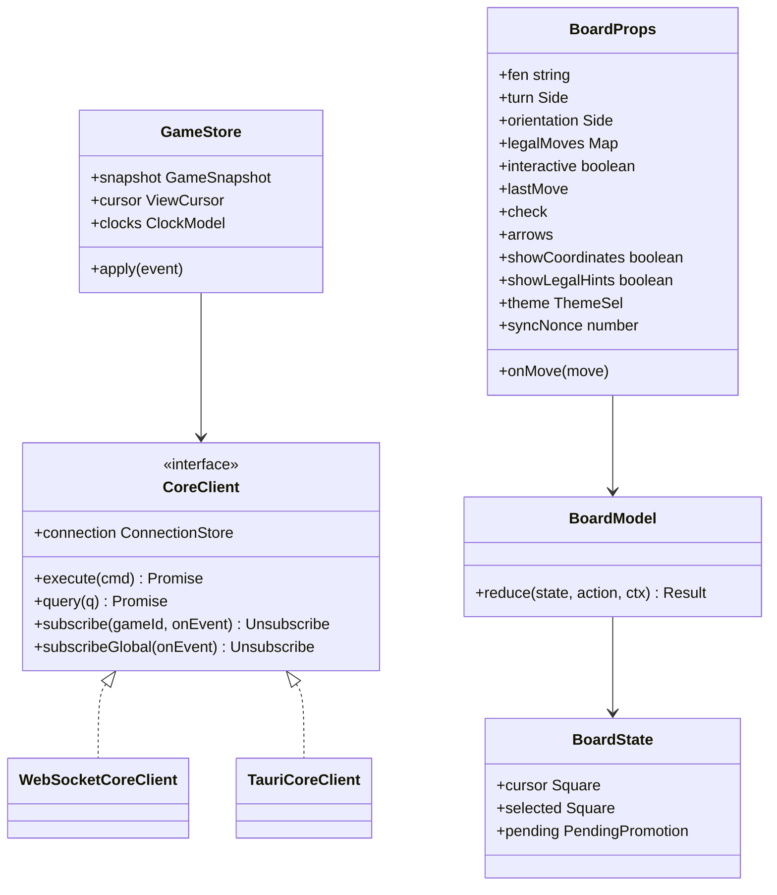
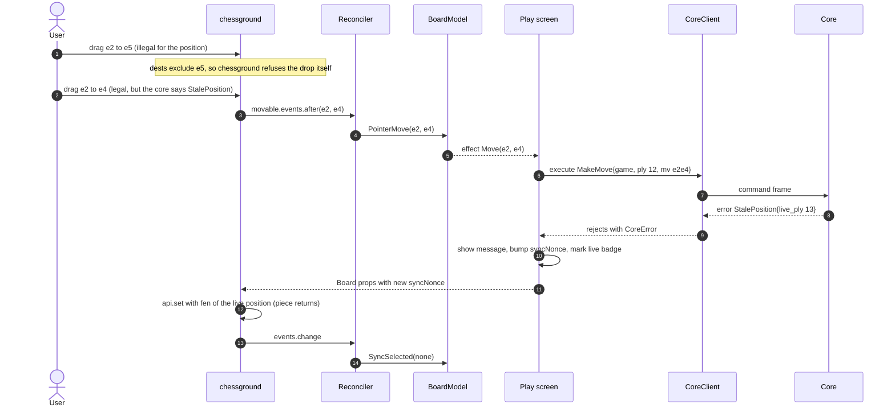
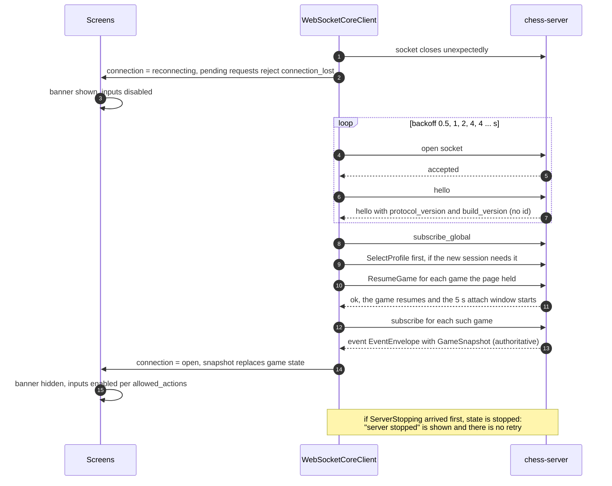
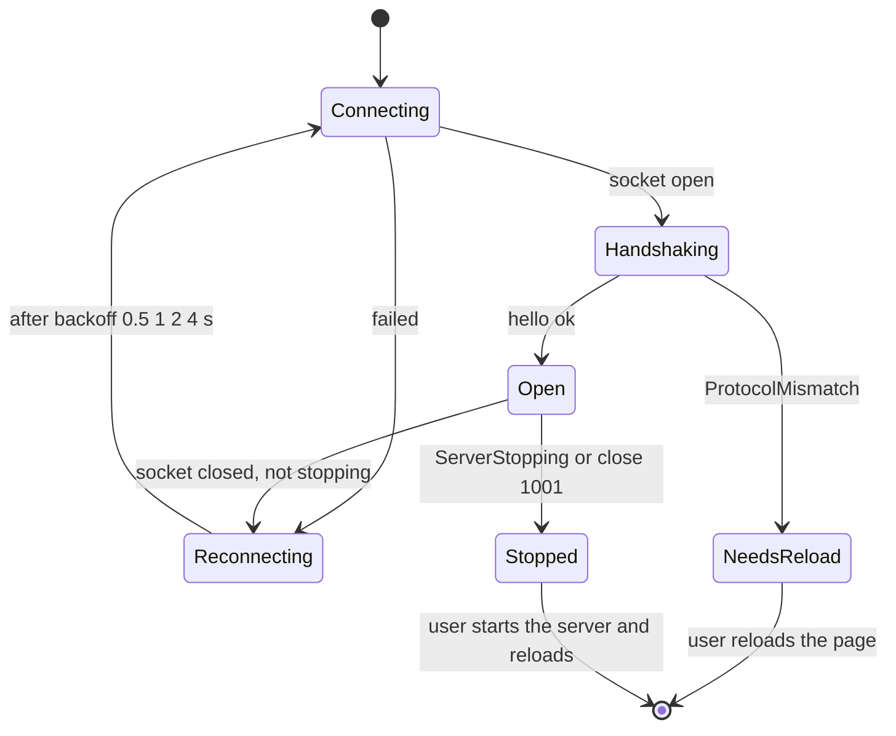
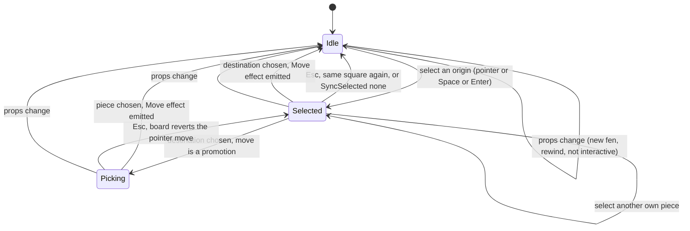

# SDD-ui: Software Design Description for `ui/` (TypeScript GUI: Browser tab and WKWebView)

| Field | Value |
|---|---|
| Document | docs/design/SDD-ui.md |
| Version | **1.0 BASELINED** (2026-11-05; supersedes 0.4.5 DRAFT) (0.4.4 DRAFT, 0.4.3 DRAFT and 0.4.2 DRAFT of 2026-11-05 and 0.4.1 DRAFT and 0.4 DRAFT of 2026-11-04, 0.3.1 DRAFT of 2026-11-01 superseded; 0.2 DRAFT and 0.1 DRAFT were 2026-10-31 and 2026-10-30) |
| Date | 2026-11-05 (v0.4.1: 2026-11-04) |
| Status | **BASELINED v1.0** (2026-11-05; was DRAFT v0.4.5, 2026-11-05; v0.4 carries architecture Amendment 8 and Addenda D and E into this bundle, see section 13c). Baselined at v1.0 by Brian Prascher (G2), 2026-11-05, with G1 desk reviews as recorded in the Gate record; conditions open per the 1.0 change-log row. No code exists yet. v0.2 applied the architect's triage rulings that Brian Prascher approved on 2026-10-31; v0.3 aligns to architecture Addendum A (D-51 to D-58) and D-59; v0.3.1 aligns to addendum B and C (D-60 to D-62, agreed 2026-11-01), see section 13c |
| Owner | Software engineer role (Claude), for Brian Prascher |
| Approver | **Baselined at v1.0 by Brian Prascher (G2), 2026-11-05 (tracker chess-a0r.1.53, decision recorded); G1 desk reviews as recorded in the Gate record; open conditions are listed in the 1.0 row of the change log. No other approval is claimed.** *Earlier status, kept as history and superseded by the preceding sentence:* **Pending.** Gate G0 for this document (documents only). The implementation is G1 (System-architect agent, desk review) inside `ui/` with the `CoreClient` and `Board` contracts and the protocol unchanged; swapping the board adapter behind the `Board` contract is two-way (D-4) and stays G1. The decisions this version implements were approved by Brian Prascher on 2026-10-31 (triage section 5, requirements CR-9.1); that approval does not approve this document |
| Gate record | **1.0 BASELINE, 2026-11-05: G2 acceptance by Brian Prascher, chess-a0r.1.53 (OQ-APP-015 option B, D-89; baseline v1.0 of the eight readiness-checked SDDs in docs/engineering/readiness-step2-3.md, verdict READY-WITH-CONDITIONS; conditions open as listed in the 1.0 change-log row; residual risk FIND-R23-015, lightly reviewed text, accepted by Brian). The fix-pass text applied after the G1 limited re-review (docs/design/SDD-G1-rereview-2026-11-05.md) was not independently re-reviewed.** *Earlier record, kept as history:* G0 for the document, status DRAFT. **Version 0.4 is G1 (text)**: it designs the front-end behaviour of decisions already made (D-71, D-80, D-82) and corrects text that contradicted them. It carries one G3 decision **already ruled by Brian Prascher** (exit class 3 for `DurabilityUnsupported`, accepted 2026-11-04, beads chess-a0r.1.30; the page itself has no exit class) and decides nothing at G2 or G3 itself. D-78, DAT-3 and time totals are not touched. The gate record is filed by the gate register (SWE-001 ASM-S5); no gate ID is written here (XC-30). Not filed here **Versions 0.4.4 and 0.4.5 are G1 (text)**: 0.4.4 applies architecture D-89 (Addendum G) to DD-UI-015; 0.4.5 applies the G1 desk re-review findings of `SDD-G1-rereview-2026-11-05.md` (work order CR-4 T-B reopen 1). The re-review is a recommendation, not an approval; the text of 0.4.5 has had no independent review. Rulings applied in these versions: D-89 and D-80, D-82 as before |
| Allocation names (architecture §2.2) | `Browser tab` and `WKWebView` (one codebase, FG-4) |
| Path | `ui/` (Vite + React), architecture §3.1 |
| Languages | TypeScript 7.0.2 strict on Node.js 26.13.0 (build only); runs in the browser and in WKWebView |
| Sibling SDDs | [chess-server](SDD-chess-server.md) (WebSocket and asset host), [desktop-tauri](SDD-desktop-tauri.md) (IPC host), [chess-app](SDD-chess-app.md) (protocol and generated types), [chess-cli](SDD-chess-cli.md) (the other front-end), [chess-domain](SDD-chess-domain.md), [chess-rules](SDD-chess-rules.md) |

Evidence tags per `swe-governance` §6. `[OBS x]` = read in this session. `[UNV]` = not verified (no code, no toolchain, no network used). `ESTIMATE` = no measurement.

---

## 1. Introduction

### 1.1 Purpose and scope

`ui/` is the one GUI bundle shared by the web page served by `chess serve` and by the desktop webview (GUI-1). It renders the core's snapshots, sends intents, and decides nothing about chess: legal destinations, allowed actions, clocks and results come from the core (architecture §1 principle 1, §6.2 [OBS]). It differs between the two hosts only in the `CoreClient` transport chosen at start-up.

In scope: screens, the `Board` component (D-4: chessground adapter, `BoardModel`, `AccessibleOverlay`, `LiveRegion`, `PromotionPicker`, typed SAN input), `CoreClient` and its two transports, client state (snapshot, rewind cursor, local clock countdown), themes, accessibility, layout, help and strings, the build constraints that the CSP imposes.

Out of scope: rules, policy, persistence (core); typed-move parsing (`chess-rules` through `Query::ParseMove`, D-45; the bundle has no matcher); the HTTP and WebSocket server (chess-server); the Tauri shell (desktop-tauri).

### 1.2 Allocated requirements, functions and decisions

| Kind | IDs | Source |
|---|---|---|
| Primary requirements | GUI-1, GUI-2, GUI-3, GUI-4, GUI-5, UI-3 (GUI themes), UI-4 (GUI part), UI-6, UI-7, UI-8, UI-10, UI-11 | [OBS architecture.md §10.1 rows; §3.3 `ui/` row] |
| Supporting requirements (wording per XC-29 and architecture 10.1 Amd 7: the component named in 10.1 is primary, any other claim is supporting) | PLAT-2 (browser matrix, primary `packaging/`), PLAT-3 (bundle has no remote reference), UI-1 (settings take effect in the client), UI-2 and UI-5 (stats screens), UI-9 (help), UI-12 (dialogs), GAME-2 (watch), GAME-3 (rewind view), ENG-5 (Move now button), RULE-4 (local countdown), NFR-8, NFR-9 | [OBS architecture.md §10.1] |
| Functions | **F-7.2.1** Render board and game feedback; **F-7.2.2** Accept move input; **F-7.2.3** Expose board to assistive technology; **F-7.2.4** Apply visual themes; **F-7.2.5** Scale layout to window; **F-7.2.6** Count down clocks locally; **F-7.3.1..F-7.3.4** (GUI realisation); **F-2.5.6** Rewind (GUI part); **F-8.4** (the `WKWebView` half: load nothing remote) | [OBS functional_decomp.md lines 103, 184-195, 212] |
| Decisions | D-4 (chessground + shared layer), D-5 (React + Vite), D-7 (`ts-rs`), D-11 (what-if legal moves from the core), D-14 (tab close suspends), D-21 (Elo chart, DEFERRED), D-1 (Tauri IPC with the WebSocket envelope), D-33 (Move now), D-34 (duplicate prompt), **Amendment 7:** D-45 (typed moves by `Query::ParseMove`), D-48 (protocol package: envelope kinds, global stream, `ResumeGame` then `subscribe`), D-49 (file transfer), D-50 (wire types), **Addendum A:** D-51 and D-52 (`ParseMove` errors and `ParsedMove`), D-53 (event envelope), D-54 (`MalformedFrame`), D-55 (`ExportedFile`, `ExportWriteFailed`), D-56 (profile switch), D-59 (ECO import dialog, accepted) | [OBS architecture.md §11] |
| Risks | R-1 (desktop E2E), R-8 (selection desync), R-10 (reload suspends a game) | [OBS architecture.md §12] |
| Open items owned here | OQ-9 (board spike), OQ-10 (browserslist query), TBD-18 (announcement wording) | [OBS architecture.md §14, requirements UI-6] |
| Use cases | UC-2, UC-3, UC-5 to UC-9, UC-10 to UC-28 (GUI part of each) | [OBS use_cases/README.md] |

### 1.3 Inputs read

SDD-architect-triage.md section 2 (TR-1, TR-8, TR-11) and section 5; SDD-SE-desk-answers.md Q-SE-6, Q-SE-13, Q-SE-20; requirements.md Amendment 7 (CR-9.1 to CR-9.5); architecture.md (amended 2026-10-31) §1 to §3, §4.2 to §4.8, §5 (all), §6.2, §7.2 (data fields the client shows), §8, §8.1, §8.3, §9, §10.1, §11.1 (D-4 design and spike), §12, §14; trade-study-gui-board.md §5.0 (`BoardProps`); trade-study-gui-board-refined.md §4.1, §5, §6.2, §6.3 (chessground findings, reconciliation); functional_decomp.md F-7.2, F-7.3; requirements.md GUI-1 to GUI-5, UI-1, UI-3 to UI-12, PLAT-3, NFR-8, NFR-9; test-strategy.md; SWE-001 §6 (TypeScript rows).

### 1.4 Conventions

`DD-UI-n` entities, `IFP-UI-n` / `IFR-UI-n` interfaces, `UT-UI-nn` unit, `CT-UI-nn` component, `E2E-UI-nn` end-to-end, `UF-UI-n` upstream findings (section 13), `ASM-UI-n`, `IA-UI-n` (assumption about another block's interface), `RAT-UI-n` rationale, `OQ-UI-n` open questions. ID format (XC-30): IDs issued in v0.1 are unchanged; IDs added from v0.2 use three digits (`UF-UI-012`, `CT-UI-015`). Types written below are design sketches, not code; names marked `(arch)` appear in the architecture [OBS], the rest are introduced here.

Standing coding rules for the whole bundle (SWE-001 §1, §6): `strict` plus `noUncheckedIndexedAccess`, `exactOptionalPropertyTypes`, `noImplicitOverride`; no `any` at a boundary; every promise awaited or explicitly voided with a reason (`@typescript-eslint/no-floating-promises`); `eqeqeq`; discriminated unions for states and results; ESLint with `typescript-eslint` strict set and `--max-warnings 0`; a suppression carries a written reason; no `dangerouslySetInnerHTML` (a restricted-syntax rule), so Player names are only ever text nodes.

---

## 2. Viewpoint selection

| Viewpoint | Used? | Where | Reason if omitted |
|---|---|---|---|
| Context | Yes | 3.1 | |
| Composition | Yes | 3.2, 4 | |
| Logical | Yes | 3.3 | |
| Dependency | Yes | 3.4 | |
| Information | Yes (client state only) | 5 | The GUI owns no persistent data. It must not use `localStorage`, cookies or IndexedDB: preferences live in `PREFERENCES` through the core (UI-1), and the profile is session state (Q48) |
| Patterns use | Yes | 3.5 | |
| Interface | Yes | 6 | |
| Structure | Yes | 3.2 | |
| Interaction | Yes | 3.6 | |
| State dynamics | Yes | 3.7 | |
| Algorithm | Yes | 3.8 | |
| Resource | Yes | 8 | |

---

## 3. Viewpoints

### 3.1 Context

**Concern:** the two hosts and the single bundle.

The bundle makes no request to any host other than its own origin (PLAT-3). In the browser that origin is `http://127.0.0.1:<port>`; in the webview it is the Tauri app origin.

### 3.2 Composition and structure

**Concern:** the parts of the bundle and their layering. The folders are those of architecture §3.1 [OBS]: `protocol/`, `transport/`, `board/`, `screens/`, `themes/`.

| Entity | Type | Purpose | Traces |
|---|---|---|---|
| DD-UI-1 `CoreClient` + `WebSocketCoreClient` | transport | Promise and subscription API (game and global) over one WebSocket with reconnect and resume | GUI-1, F-7.4.3 (client side), §5.2, §5.6 |
| DD-UI-2 `TauriCoreClient` | transport | The same API over Tauri `invoke` and `listen` | GUI-1, D-1 |
| DD-UI-3 Client stores | state | Session, game (snapshot, rewind cursor, clocks), connection | GAME-3, RULE-4, F-7.2.6 |
| DD-UI-4 `Board` contract and adapter | component | The only way a screen touches the board; chessground inside | GUI-2, GUI-3, GUI-4, D-4 |
| DD-UI-5 `BoardModel` reducer | pure module | One selection state for pointer, keyboard | GUI-2, R-8 |
| DD-UI-6 `AccessibleOverlay`, `LiveRegion`, `PromotionPicker` | components | ARIA grid, announcements, promotion choice | UI-4, UI-6, UI-8 |
| DD-UI-7 `SanInput` | component | Typed text, parsed by `Query::ParseMove`; no matcher in the bundle | GUI-2 (c), Q44, D-45 |
| DD-UI-8 Screens | components | The screens of §6.2 | GUI-4, UI-1, UI-2, UI-5, UI-9, UI-12 |
| DD-UI-9 Themes | assets and tokens | 10+ board themes, 5+ piece sets, app colour themes, contrast tests | UI-3, UI-7, UI-10 |
| DD-UI-10 Layout and scaling | CSS | Fluid layout, square board, resize | GUI-5 |
| DD-UI-11 Strings, errors, help | modules | English text, error code to message, help from registries | UI-9, UI-11, NFR-9 |
| DD-UI-12 Build constraints | config | Vite output that satisfies the CSP and the bundle scan | PLAT-3 |
| DD-UI-014 `EcoMismatchDialog` | component | The choice between the PGN's ECO and the table's for each mismatching imported game (D-59) | IF-2, DAT-3, UI-4, GUI-2 |

### 3.3 Logical viewpoint (key types)

**Concern:** the contracts between the layers. Key types only.

`CoreClient` as given in architecture §5.2 (Amd 7) has four methods `(arch)`: `execute`, `query`, `subscribe`, `subscribeGlobal`. This design adds a read-only `connection` observable (status for the banner). Both implementations provide it; `TauriCoreClient` is always `open`. `BoardProps` is the contract of the first trade study §5.0 [OBS], extended by `turn` (needed for chessground `turnColor`, a presentation fact read from the snapshot) and `syncNonce` (DD-UI-4).

### 3.4 Dependency viewpoint

**Concern:** what the bundle may import.

Allowed edges: `ui -> protocol/ (generated)`; `screens -> state, board, strings, themes`; `state -> transport`; `board -> themes` and nothing in `screens` or `state`; `transport -> protocol/`. No cycle. `board/` knows nothing of the core, so the board can be swapped (D-4 fallback) and tested alone. A lint rule (`no-restricted-imports` per folder) enforces the direction.

| Dependency | Version | Where | Source |
|---|---|---|---|
| React, react-dom | 19.3.1 | all UI | [OBS §3.4] |
| `@lichess-org/chessground` | 10.5.0 (the unscoped `chessground` is not used) | `board/cg` only | [OBS §3.4] |
| `@tauri-apps/api` | 2.12.4 | `transport/tauri.ts`, loaded by dynamic `import()` only inside the webview | [OBS §3.4] |
| Vite / `@vitejs/plugin-react` | 8.3.5 / 6.1.2 | build | [OBS §3.4] |
| TypeScript | 7.0.2 | build, strict | [OBS §3.4] |
| Vitest 5.0.5, Playwright 1.64.1, `@axe-core/playwright` 4.14.0, ESLint 10.13.0, `typescript-eslint` 8.72.1, Prettier 3.9.10 | dev | [OBS §3.4] |
| a component-test library and a DOM environment (D-5 rationale names Testing Library) | admitted in principle, review row D-27; **no version stated, lookup pending `[UNV]`** | dev | UF-UI-5, TR-10 |

No router, state-management, schema-validation, chart or CSS-in-JS library. State uses `useSyncExternalStore` over small stores; the Elo chart is hand-built SVG pending D-21. Fewer dependencies means fewer entries in the SBOM and in `npm audit` (SWE-001 §5).

### 3.5 Patterns use

| Pattern | Where | Why | Misuse tell |
|---|---|---|---|
| Ports and adapters | `CoreClient`; `Board` contract | Two transports, two possible board libraries | A screen importing chessground or `window.__TAURI__` |
| Reducer with effects as data | `BoardModel` | One selection truth, unit-testable without a DOM (R-8) | A component keeping its own `selected` |
| Single source of truth plus reconciliation | chessground `Reconciler` | chessground mutates its own selection | Reading more of `api.state` than `selected` |
| Observer (external store) | stores | no framework dependency | A store updated outside `apply` |
| Table-driven help and errors | `controls` registry, `Record<ErrorCode, ...>` | cannot drift from the code | Help text written by hand |
| Controlled component | `Board` | board = f(props) | Imperative `api.move` calls from a screen |

### 3.6 Interaction (sequences)

**Concern:** a move made by pointer and rejected, and a connection drop. (The accepted-move flow is architecture §5.3 [OBS] and is not repeated.)

### 3.7 State dynamics

**Concern:** the connection life cycle (§5.6, D-36) and the board's selection states.

(`TauriCoreClient` has the single state `Open`.)

### 3.8 Algorithm viewpoint

**A1. `BoardModel.reduce(state, action, ctx) -> {state, effects}`** (pure; D-4, GUI-2).
`ctx = {legal: Map<Square, Square[]>, promotions: Set<"from+to">, orientation, interactive, pieceAt(sq)}` built from the snapshot. State `{cursor, selected, pending}`. Actions: `PointerSelect(sq)`, `PointerMove(o, d)`, `SyncSelected(sq|null)`, `CursorMove(dir)`, `Activate` (Space or Enter at the cursor), `Cancel` (Esc), `PromotionChosen(role)`, `PropsChanged`.

| Action | Rule | Effects |
|---|---|---|
| `PointerSelect(sq)` | ignored unless `interactive`. If `sq` is an origin: `selected = cursor = sq` | `SetSelected(sq)`, `FocusCell(sq)`, `Announce` |
| `PointerMove(o, d)` | if `o+d` is a promotion: `pending = {o, d}`, `selected = null` | `OpenPicker`; else `Move(o, d)`, `SetSelected(null)`, `FocusCell(d)` |
| `SyncSelected(sq)` | `selected = sq` if `sq` is null or an origin, else null. Fixes silent unselects (chessground fires no event on unselect) | none, or `SetSelected(null)` if corrected |
| `CursorMove(dir)` | arrows are screen-relative: with White at the bottom Up is rank + 1, with Black at the bottom Up is rank - 1 and Right is file - 1. No wrap | `FocusCell` |
| `Activate` at cursor `c` | nothing selected: `c` an origin selects it, otherwise feedback "no legal moves". Something selected: `c == selected` deselects; `c` in `legal[selected]` is a destination (promotion opens the picker, otherwise `Move`); `c` another origin reselects; otherwise `Announce` "not a legal destination" and `onIllegalAttempt` | per branch |
| `Cancel` | `pending` -> clear and `RevertBoard` if the pending move came from a pointer; else `selected` -> clear, `SetSelected(null)`; else nothing | |
| `PromotionChosen(role)` | `Move(from, to, role)` | |
| `PropsChanged` | new `fen`, or `interactive` becoming false: clear `selected` and `pending`; the cursor stays | `SetSelected(null)` |

Commit points are exactly GUI-2/Q65: pointer on drop or on the destination click; keyboard on Enter or Space at the destination; promotion when a piece is chosen [OBS architecture §6.2]. A property test generates random action sequences (pointer, keyboard, props changes) and checks the invariants: `selected` is null or an origin; `pending` implies `selected` is null; at most one `Move` effect per completed gesture (UT-UI-03).

**A2. chessground configuration `toConfig(props, model)`** (adapter; study refined §6.2 [OBS]): `fen`, `orientation`, `turnColor: props.turn`, `movable: {free: false, color: interactive ? turn : undefined, dests: props.legalMoves, showDests: props.showLegalHints, events: {after}}`, `draggable.enabled = interactive`, `selectable.enabled = true`, `premovable.enabled = false`, `drawable.enabled = false` (no user-drawn shapes), `drawable.autoShapes` from `arrows`, `highlight: {lastMove: true, check: true}`, `lastMove`, `check`, `selected: model.selected`, `viewOnly: !interactive` (rewound, computer turn, c-c), `coordinates: showCoordinates`, `animation.enabled = !prefersReducedMotion`, `events: {select, change}`, `addDimensionsCssVarsTo: overlayHost`, `jsHover` as the spike decides. Applied with `api.set(config)` on every change of props or model. Option names are from the study's reading of chessground 10.5.0 [OBS trade-study-gui-board-refined.md §4.1]; names not in that table (for example `selectable`, `premovable`) are `[UNV]` until the spike.

Rejected pointer moves: chessground has already moved the piece. The Play screen increments `syncNonce` when a `MakeMove` fails; the adapter then calls `api.set` with the full config including `fen` even though the `fen` prop has not changed, which puts the piece back (§5.3 "chessground reverts the piece" [OBS]). That `api.set({fen})` resets the pieces is `[UNV]` until spike criterion 1.

**A3. Local clock countdown** (RULE-4, F-7.2.6, §4.2). A `ClockModel` stores `{whiteMs, blackMs, running: Side | null}` and the `performance.now()` value at receipt of the last `ClockSync`, `MoveApplied.clocks` or `GameSnapshot`. Displayed value: `max(0, ms - (running === side ? now - receivedAt : 0))`. Display refresh every 100 ms by one timer while a clock runs and the document is visible; on `visibilitychange` to visible it recomputes at once (hidden-tab timers are throttled; the arithmetic uses timestamps, not accumulated ticks). The wall-clock `as_of` field of `ClockSync` is not used for the countdown (UF-UI-9). The client never declares a flag fall: `GameEnded` does, and `Paused` and `DrawOffered` arrive as `running = null`. Screen-reader clock announcements fire once when a side's remaining time first crosses 60 s and 10 s (fixed thresholds, no per-second announcements, §8.3 [OBS]; the thresholds themselves are `ESTIMATE` examples).

**A4. Typed-move input** (GUI-2 (c), CLI-3, Q44, D-45). There is no matcher in the bundle. `SanInput` sends `Query::ParseMove{game_id, ply, text}` on Enter (or after a debounce) and acts on the reply: `ParsedMove{uci, san}` becomes `MakeMove{game_id, ply, mv: uci}` (the wire type has no `Move` object, D-52); `IllegalMove{reason}`, `ParseError{kind: move, reason, ...}` (D-51) and `StalePosition{live_ply}` become a message and change nothing. The extra fields of each `ParseError` reason are shown as in DD-UI-7. `chess-rules` is the only parser (TR-8). The snapshot's `legal_moves` (`[{uci, san}]`, XC-21) are still used for board destinations, overlay labels and promotion detection of pointer and keyboard moves, not for typed text. Details in DD-UI-7.

**A5. Contrast** (UI-7). `contrastRatio(a, b) = (L1 + 0.05) / (L2 + 0.05)` with relative luminance as defined in WCAG 2.2. The constants of the luminance function are copied by the test author from the WCAG 2.2 text when the test is written (UI-7 verification says exactly this) and are not recalled here. Known pairs checked: black on white is 21:1, identical colours 1:1 [OBS requirements UI-7].

**A6. Message decoding.** Every frame passes `decodeFrame(unknown) -> Frame | DecodeError` (hand-written guards): a frame is `{id?, kind, body}`: a response is `kind: "result"` or `kind: "error"` (body `{code, message, details}`) with the string `id` of its request; an event is `kind: "event"` with body `EventEnvelope{game_id, seq, event}` and **no `id`** (D-53); `hello` frames also carry no `id`; a global event has `game_id` null and a per-subscription `seq` that may show gaps. A decode failure on the wire side is the error `MalformedFrame{reason}` (D-54). Events are narrowed by their `kind`; an **unknown event kind is ignored** (architecture 5.6); an unknown result shape is a `DecodeError` surfaced as an internal-error banner. On a **game** stream a `seq` that is not the previous `seq` plus one marks the game store `stale` and resubscribes (DD-UI-3). On the **global** stream a gap is allowed (D-53): the client does not resubscribe and re-queries what the event concerns (the lists and stats it shows). Payload fields are trusted at the type level because bundle and core come from one build (D-16) and the generated types are the single source (D-7). No schema library is used (review row D-28 rejected, TR-10): envelope and discriminant checks only (UF-UI-8).

---

## 4. Design entities

### DD-UI-1 `CoreClient` and `WebSocketCoreClient`
- Traces: GUI-1, architecture 5.2, 5.6, PLAT-5, F-7.4.3 (client end). Counterparts: [SDD-chess-server](SDD-chess-server.md) section 5.1 (wire frames) and [SDD-chess-app](SDD-chess-app.md) IFP-APP-03 (the envelope; it governs).
- Interface (architecture 5.2, Amd 7): `execute(cmd)`, `query(q)`, `subscribe(gameId, onEvent)`, `subscribeGlobal(onEvent)`, plus this design's read-only `connection` observable. `ResultOf<C>` is this bundle's helper, derived from the generated `Reply` type with `Extract`.
- `execute` and `query` send `{id, kind: "command"|"query", body}` with `id` from a counter (at most 64 characters), and return a promise settled by the frame with that `id` (`id` is on requests and their replies only, D-53): a `result` frame (`{id, kind: "result", body}`) resolves, an `error` frame (`{id, kind: "error", body: {code, message, details}}`) rejects with `CoreError{code, message, details}`. Every frame is `{id, kind, body}` (SDD-chess-app IFP-APP-03, v0.2).
- `subscribe(gameId, onEvent)` sends `subscribe{game_id}`, registers the listener, returns an `Unsubscribe` that sends `unsubscribe` once. The first event is `GameSnapshot`; every event frame is `{kind: "event", body: EventEnvelope{game_id, seq, event}}` with no `id`. Active subscriptions are remembered so they can be resumed after a reconnect.
- `subscribeGlobal(onEvent)` sends `subscribe_global` once per connection, right after `hello`. It delivers `ServerStopping`, `StoreBacklog`, `AnalysisProgress` of stored games and `RatingsUpdated`; these four events are not part of a game subscription (architecture 5.1). Their envelope has `game_id` null and a `seq` counter per subscription that may show gaps after a lag; the listener treats each as a notification and re-queries (D-53).
- Timeouts: a request without a reply in **10 s** rejects with `TransportError{kind: "timeout"}`, the banner says "core not responding", and the client runs the resume sequence below [OBS architecture 4.8 "Client command timeout"].
- Reconnect (architecture 5.6, UR-30): on an unexpected close, state `Reconnecting`; backoff 0.5, 1, 2, 4 s, capped at 4 s; pending requests reject with `TransportError{kind: "connection_lost"}` and are never replayed. After the socket opens: `hello`, then `subscribe_global`, then for **each game the page held** `ResumeGame{game_id}` and only then `subscribe{game_id}`. The core suspended the game when the socket dropped (D-14), so resume comes first; the backoff can exceed the 5 s attach window, and resume handles a game that has already suspended. The page shows "resuming" until the first `GameSnapshot` arrives; that snapshot is authoritative and replaces game state. `SelectProfile{player_id}` is sent first if the new session needs it (`[INF]`, UF-UI-012): D-56 refuses `SelectProfile` with `Denied{state_not_allowed, details.game_ids}` once the session has a game open, so it can only come before `ResumeGame` and `subscribe`, never after. A pending ECO import (D-59) is lost with the old session; the dialog is closed with the message "the import was interrupted, choose the file again" and nothing was written.
- `ServerStopping` (global event) or close code 1001: state `Stopped`; the shell shows "server stopped"; no retry (D-36). `ProtocolMismatch`: state `NeedsReload`; the shell asks for a reload.
- Origin: the URL is built from `location.host`, `ws://` + host + `/api`, so the page always connects back to the origin that served it (matching the server's Host/Origin set).
- Errors never contain a stack or internals; `message` comes from the core.
- Fresh ids and UUIDs: request ids from a counter; `game_uuid` for `StartGame` from `crypto.getRandomValues` formatted as UUID v4 (the GUI keeps Web Crypto, architecture 5.6, TR-1). The wire command is unchanged by OQ-26 (Brian, 2026-11-04, option A; D-84): `NewGame` is the store's struct, built inside `chess-app`, not a protocol type; **the page sends `StartGame{game_uuid, GameSetup}` with no start stamp and never mints one**, and the app's single start stamp becomes `GAME.started_at` and the `Start` record's `wall_ms`. No generated `ts-rs` type changes `[INF: from architecture 5.1 and the D-84 row; the architect's final §5 text had not landed when this was written]`. `crypto.randomUUID()` is avoided because it needs a secure context and whether `http://127.0.0.1` counts as one in Safari is `[UNV]`.
- Verification: CT-UI-01 to CT-UI-06 against a fake WebSocket server.

### DD-UI-2 `TauriCoreClient`
- Traces: GUI-1, D-1, architecture 5.2.
- Chosen at start-up: `main.tsx` asks whether the page runs inside Tauri (`isTauri()` from `@tauri-apps/api/core`, `[UNV: function name]`, with a fallback test of the injected global) and then `await import("./transport/tauri")`. In the browser that module is never fetched, which keeps `@tauri-apps/api` out of the web runtime path.
- `execute` and `query` call `invoke("core", {envelope})` with the **same envelope** as the WebSocket (architecture 5.2 [OBS]); `subscribe`, `unsubscribe` and `subscribe_global` use the same command. Events arrive on one `listen("core-event")`: game events are demultiplexed by `game_id`, global events (no `game_id`) go to the `subscribeGlobal` listeners. No handshake is needed because the bundle and the core are one build; the client does not reconnect (there is no socket).
- On every page load, first or reload, the shell has dropped all forwarders (SDD-desktop-tauri A2), so the core has already suspended any game this page held. A reloaded page starts at the profile chooser (Q48); it sends `subscribe_global` at start, and `ResumeGame` then `subscribe` when the user resumes the game from the list.
- Exports return `ExportedFile` with `content: Saved{path}`: the shell rewrites the core's `Bytes{base64}` before the page sees it (D-55, DD-UI-13). A failed write is `ExportWriteFailed{cause}`.
- A reload does not end the window's `FrontEndSession` (one session per window). The reloaded page has lost any `import_id` it held; a `ResolveImport` for it either still works or gets `NotFound{entity: import}`, and the page starts again from `ImportPgn` (D-59).
- Behaviour must equal the WebSocket client for every case in the shared contract suite CT-UI-10 (GUI-1 "two implementations with identical behaviour").

### DD-UI-3 Client stores
- Traces: GAME-3, RULE-4, F-7.2.6, F-2.5.6, PLY-2/3 (profile).
- **Session store:** `activePlayerId` (from `SelectProfile`), the screen stack (in memory, no URL routing, no history API: a reload returns to the profile chooser as Q48 says "each GUI session starts at the profile chooser", and a game open at reload is suspended by D-14 and appears in the resume list).
- **Game store:** latest `GameSnapshot`; `apply(event)` returns a new value. Each event carries a per-game `seq`, strictly increasing and gap-free per subscription (IFP-APP-02); an event whose `seq` is not the previous one plus one means an event was missed, so the store marks itself `stale` and re-subscribes to obtain a fresh snapshot (the core already resynchronises a lagging subscriber with a fresh `GameSnapshot`; this guards the rest). This rule is for game streams only; gaps in the global stream's `seq` are allowed (D-53). `ply` stays for the `MakeMove` guard and the live badge. `ViewCursor = {kind: "live"} | {kind: "ply", ply}`. Board props come from `snapshot.plies[viewedPly]`. While rewound `interactive = false`; a `MoveApplied` while rewound sets `liveChanged = true` (badge, GAME-3) [OBS §6.2]. `allowed_actions` is stored and used as given.
- **Connection store:** the `CoreClient.connection` value.
- Rewind and the cursor are view state only; nothing is sent to the core (GAME-3, §4.2).
- Concurrency: JavaScript main thread only; no worker; no store mutates outside its `apply`/`set` function.

### DD-UI-4 `Board` contract and chessground adapter
- Traces: GUI-2, GUI-3, GUI-4, UI-3, D-4.
- `Board` is a React component with `BoardProps` and nothing else public. Screens never import chessground. The fallback (react-chessboard + patch, option D1) replaces only the adapter folder [OBS §11.1].
- `BoardProps` (sketch): `fen`, `turn`, `orientation`, `legalMoves: Map<Square, Square[]>`, `interactive`, `lastMove?`, `check?`, `arrows?`, `showCoordinates`, `showLegalHints`, `theme: {board, pieces}`, `syncNonce`, `onMove({from, to, promotion?})`, `onIllegalAttempt?(reason)`.
- Lifecycle (`useChessground`): create on mount, `api.set(config)` on change, `destroy` on unmount; a `ResizeObserver` on the container calls `redrawAll()` so the overlay stays aligned at every size [OBS §6.2].
- `Reconciler`: `events.select(k)` -> `PointerSelect(k)`; `events.change` -> read `api.state.selected` and dispatch `SyncSelected`; `movable.events.after(o, d)` -> `PointerMove(o, d)`. This is the only module that reads `api.state`, and it reads `selected` only [OBS refined study §6.5 mitigation].
- Failure behaviour: if chessground throws on `set` (should not), the board shows an error boundary message and the SAN input still works, so a player can always move (GUI-2 "all methods available").
- Verification: the D-4 spike (section 9), CT-UI-12, E2E-UI-03.

### DD-UI-5 `BoardModel`
- Pure TypeScript module, algorithm A1. No DOM, no React. Traces: GUI-2, R-8, Q52/Q65.
- Verification: UT-UI-01 to UT-UI-04 (table tests per action, and the mixed-input property test).

### DD-UI-6 `AccessibleOverlay`, `LiveRegion`, `PromotionPicker`
- Traces: UI-4, UI-6, UI-8, GUI-2 (b), GUI-5.
- **AccessibleOverlay:** an absolutely positioned CSS grid exactly over the squares, sized from chessground's `---cg-width`/`---cg-height` custom properties [OBS refined study §4.1; exact property name checked in the spike]. `role="grid"` with 8 `role="row"` and 64 `role="gridcell"`. Roving `tabindex` (one tab stop; the cell under `cursor` has `0`). Cell label `"e4, white knight"` or `"e4, empty"` from the FEN of the viewed ply (§8.3 [OBS]), with `, selected` or `, legal destination` appended when true. `aria-selected` on the selected square. Orientation reverses cell order. The container has `pointer-events: none`, so mouse and touch reach chessground. After a pointer selection focus moves to the matching cell, drawn only under `:focus-visible`. The chessground board is `aria-hidden="true"`; chessground has no focusable elements, so this is axe-clean [OBS refined study §4.1].
  - Read-only boards (rewound, computer's turn, c-c, finished) remain navigable so a screen-reader user can explore the position; `Activate` then announces "the board is read-only".
  - Keys handled on the grid: arrows, Space, Enter, Esc. Everything else passes through.
- **Focus indicator (UI-8, UI-7):** a two-ring inset `box-shadow` (an inner and an outer ring in two contrasting colours), so at least one ring has 3:1 against both the light and the dark square of any theme. The theme manifest test (DD-UI-9) computes that.
- **LiveRegion:** one `aria-live="polite"` element plus one `assertive` element for rejected moves. Fed by an `Announcer` with a queue and de-duplication. Never moves focus. Events and draft wording in the table below (TBD-18 is **open**; this wording is a proposal for the GUI developer, not a decision).
- **PromotionPicker:** a focus-trapped `role="dialog"` with four buttons (queen, rook, bishop, knight), arrow-key navigation, Esc cancels, focus returns to the board on close.
- Verification: axe on every screen, Playwright keyboard-only scenarios, UT-UI-05 (label function), E2E-UI-04, 05, and a scripted VoiceOver walk-through (manual).

Draft announcement set (events fixed by §8.3 [OBS]; wording `ASM-UI-3`):

| Event | Draft text |
|---|---|
| own move confirmed | "You played {spoken}" |
| opponent move | "{name} played {spoken}" |
| check | "Check" (appended to the move text) |
| game end | "Game over. {result sentence}" |
| draw offer | "{name} offers a draw" |
| rejected move | "Move not allowed. {core message}" (assertive) |
| clock warning | "{side} has {n} seconds" at 60 s and 10 s |
| rewind | "Viewing move {n} of {total}" |
| thinking | "{name} is thinking" |

`{spoken}` is built by a pure function from the SAN and piece letters (for example Nf3 becomes "knight to f3"). Whether to speak SAN or the spoken form is the TBD-18 decision; the function is isolated so either is a one-line change. TBD-18 stays **open** for Brian Prascher's review (Q-SE-20). The systems engineer's sample wording, for that review and not adopted here: move "White knight to f3", capture "Black bishop takes e5", castling "White castles kingside", check "check", mate "checkmate, White wins", rejected move "illegal move: <reason>" (NFR-9 text) `[UNV: not tested with VoiceOver]`.

### DD-UI-7 `SanInput` (typed moves through `Query::ParseMove`)
- Traces: GUI-2 (c), CLI-3, Q44, Q65, D-45 (TR-8).
- A text field under the board. Typed characters are echoed locally and never wait for the core (NFR-8). The move is parsed on Enter, or after a debounce chosen by the GUI developer; it is not parsed per keystroke (architecture 5.1, Q-SE-6). It commits only on Enter, with no confirmation (GUI-2).
- Flow: Enter -> `query(ParseMove{game_id, ply: livePly, text})`, with a pending state shown at once -> `ParsedMove{uci, san}` -> `execute(MakeMove{game_id, ply, mv: uci})`, the same path as the other input methods. A promotion suffix (`e8=Q`) is resolved by the parser, so the picker is not opened for typed input. `IllegalMove{reason}` -> the `message` and the `reason` in a `role="status"` region, text stays editable (text that is understood but names no legal move). `ParseError{kind: move, reason, ...}` (D-51) -> the `message` (an English sentence built by the core from `reason`) and, by `reason`, in the same region: `lowercase_piece`: the `suggestion` text with a "Use <suggestion>" button that replaces the field text; `promotion_required`: the `choices` strings as a list of buttons, each replacing the field text (the strings are shown as given and not interpreted; the `PromotionPicker` is not opened for typed input); `ambiguous`: the `candidates` (canonical SAN of each match) as a list of buttons, each replacing the field text; `empty`, `too_long`, `syntax`: the message only. After a button the user presses Enter and a new query runs, so a replaced text is parsed like any other. `StalePosition{live_ply}` -> refresh from the snapshot and show the live badge.
- Disabled while rewound. Never captures keys outside the field.
- **There is no TypeScript matcher** and no shared vector table (TR-8, D-45): either-case files, optional `+ # x`, `0-0` and the bishop/b-file rule (Q44) are `chess-rules` behaviour reached through the query.
- Verification: UT-UI-06 (the `SanInput` state machine against a fake `CoreClient`: echo, pending, each reply kind and each `ParseError` reason), CT-UI-016 (real `ParseMove` over loopback; FF-6 budget NFR-8 100 ms `ESTIMATE`), E2E-UI-06 (same move by three methods gives identical state).

### DD-UI-8 Screens

All screens are React function components. Controls shown come from `allowed_actions` (Policy) and never from client rules [OBS §4.4]. Each screen declares a `controls` registry that feeds Help (UI-9) and its keyboard tests. Dialogs are focus-trapped, announced, Esc cancels and changes nothing (UI-12, §8.3).

| Screen | Commands / queries | Notes | Traces |
|---|---|---|---|
| ProfileChooser | `ListPlayers`, `SelectProfile` | first screen of every session (Q48); `APP_SETTING.last_active_player` only pre-selects. A switch control is not shown on the Play and Watch screens (convenience only; the core refuses a switch while the session has a game open, D-56). `Denied{state_not_allowed, details.game_ids}` is handled as in section 7 | PLY-2, PLY-3 |
| Register | `RegisterPlayer` | name rules shown from `ValidationFailed.reason`; self-assessment sets starting Elo | PLY-2, PLY-6 |
| Home | `ListUnfinishedGames` | resume list covers either side and every c-c game (D-33) | GAME-4 |
| NewGame | `ListPlayers`, `StartGame{game_uuid, GameSetup}` | invalid combinations not offered; `UnfinishedGameExists` shows Resume, Resign, Abort | GAME-1 |
| Play | `ParseMove` (typed input), `MakeMove`, `Takeback`, `OfferDraw`, `RespondDraw`, `Resign`, `CancelEngine`, `RetryEngine`, `DetachGame` | board, SAN input, move list, captured pieces (derived from the snapshot: material difference at the viewed ply), clocks, thinking indicator with **Move now** (Tab-reachable, label "Move now", Enter or Space, F2) only when `CancelEngine` is allowed (ENG-5, GUI-4); the save-failure notice of DD-UI-015 (`JournalWriteFailed`, degraded game) | GUI-2, GUI-4, GAME-3, NFR-2 |
| Watch | `Pause`, `Resume`, `Step`, `SetMoveDelay`, `Abort` | no rewind, move list scrolls (Q50) | GAME-2 |
| Analysis | `GetGameAnalysis`, `Analyze`, `LegalMoves`, `SaveVariation`, `DeleteVariation` | "evaluating..." and "n of N plies evaluated"; evaluations from White's point of view, centipawn loss from the mover's (CR-9.3); what-if moves use `LegalMoves{fen}` (D-11); saving a branch from the final position is refused by the core with `ValidationFailed{field: from_ply, reason: no_move_after_position}` and the page shows the message while the branch stays playable (decision 13, CR-9.4); Strict in-progress analysis is not offered and the core would refuse it | ANA-1..4 |
| History | `ListGames`, `GetGame`, `ExportPgn` | custom-start games marked; voided marked "voided by reset" or "voided: unreadable" | UI-2 |
| Stats | `GetPlayerStats`, `GetRatingHistory` | any Player; hand-built SVG chart with a table alternative (D-21 deferred) | UI-2, UI-5 |
| ComputerPlayers | `ListPlayers{computer}`, `GenerateComputerPlayers{category, count}` | 1 to 25, default 5; label follows Strict Elo | PLY-4, UI-5 |
| Players | `RenamePlayer`, `ArchivePlayer`, `ResetPlayerData` | human only; confirmations incl. the void list | PLY-4, PLY-7 |
| ImportExport | `ImportPgn`, `ResolveImport`, `CancelImport`, `ImportFen`, `PreviewDataImport`, `ApplyDataImport`, `ExportPgn`, `ExportData`, `RestoreBackup`, `CreateFreshStore` | file handling per DD-UI-13 (bytes in frames, Blob download in the browser, saved path in the desktop app, archive size limit message); the ECO mismatch question per DD-UI-014 | IF-1..3, DAT-2, DAT-3, DAT-5 |
| Settings | `GetPreferences`, `UpdatePreferences` | board theme, piece set, app colour theme, default opponent class and colour, legal hints, flip, coordinates, max think time; applies at once (UI-1) | UI-1 |
| Help | none | from the `controls` registries and shipped text | UI-9 |
| Global | | Connection banner; `ConfirmDialog`; `ResultDialog` on `GameEnded`; `GameVoided` leaves the game and shows why; `LeaseLost` makes the board read-only; the full-screen startup refusal of DD-UI-016 (`SchemaTooNew`, `DurabilityUnsupported`, ...); recovery dialogs for `StoreMissing`, `StoreCorrupt` (the core is then in recovery mode and accepts only `CreateFreshStore`, `RestoreBackup`, `ApplyDataImport`, UR-31), `JournalUnreadable` (and the `VoidUnreadableGame` offer, whose dialog is its own confirmation) | UI-12, NFR-9 |

The ECO mismatch dialog (DD-UI-014) is **not** a `ConfirmationRequired` action: it chooses between two values and confirms no destructive act (architecture 5.8).

Confirmation handling: a command that returns `ConfirmationRequired{action, voids}` opens `ConfirmDialog`; Confirm resends the same command with `confirmed: true` (and `void_game_ids` echoed for a reset); in a hot-seat game `Resign` first asks which side [OBS §5.1, §5.5]. The client never skips the prompt and the core refuses without it.

### DD-UI-9 Themes
- Traces: UI-3, UI-7, UI-10, F-7.2.4.
- **App colour themes** (UI-10): `System` (default), `Light`, `Dark`, plus other bundled themes including a high-contrast one. Implemented as CSS custom properties on the root element: `System` uses `@media (prefers-color-scheme: dark)` token values, so the page follows macOS appearance and **switches live without JavaScript or reload**; an explicit theme sets `data-theme` on the root and overrides. `color-scheme` is set to match.
- **Board themes** (at least 10) are CSS classes applied to the board container. **Piece sets** (at least 5, one of them high contrast) are static SVG files served from the bundle with a CSS class per set. Names, sources and licences are not decided here; each theme and set ships a manifest entry `{id, source, licence}` consumed by the NFR-6 audit (nothing invented in this document). Board and piece assets are files, not `data:` URIs (CSP, DD-UI-12).
- **Contrast tests (UI-7, UT-UI-07):** each app theme declares its foreground/background token pairs; the test checks every text pair at 4.5:1 with no large-text exception (UI-7 keeps 4.5:1 for all text [OBS requirements UI-7]). Each board theme and piece set declares a colour manifest (light and dark square, last-move, check and selected highlights, legal-move marker, piece fill and stroke, focus rings); the test checks the 3:1 non-text pairs on both square colours. A manifest can disagree with the rendered SVG, so E2E-UI-08 samples rendered pixels for each theme and compares them with the manifest. axe `color-contrast` runs on every screen in every colour theme.
- Reduced motion: `prefers-reduced-motion: reduce` sets chessground `animation.enabled = false` and disables CSS transitions (§8.3 [OBS]).
- Colour independence: last move, check and selection also use outline or pattern (§8.3).

### DD-UI-10 Layout and scaling (GUI-5)
- Fluid CSS grid with `clamp()` sizing; the board is a square sized from its container (`aspect-ratio: 1`), never from the viewport alone. Below a narrow breakpoint (about 720 px, `ESTIMATE`) panels stack under the board; side panels such as the move list scroll vertically (Q75 [OBS requirements GUI-5]). No fixed pixel widths on containers; `min-width: 0` on grid children; no horizontal scrolling at any size. No minimum window size is enforced anywhere (Q55), and the Tauri window is created without a minimum (DD-TAU-3).
- Resize: `ResizeObserver` -> chessground `redrawAll()`; the overlay follows through the CSS variables.
- Verification: Playwright at 480x320, 1024x768, 1440x900, 2560x1440, 5120x2880 in both orientations: board square and fully visible, overlay aligned, every control reachable, no horizontal scroll, live resize without reload (E2E-UI-09).

### DD-UI-11 Strings, errors, help
- Traces: UI-11, UI-9, NFR-9.
- `strings/en.ts` is the single module for UI text (one module per front-end, §6.2). English only; move notation uses English piece letters.
- `errorMessage(code)` is a `Record<ErrorCode, ...>` over the generated `ErrorCode` union, so a code added in Rust without a client entry fails the TypeScript build (NFR-9 "every protocol error code has a message"). Because "new codes may be added without breaking clients" (§5.6), the runtime path falls back to the server's `message` for a code the bundle does not know.
- Help: each screen's `controls` registry yields its help; global help is shipped text. A Help button is present on every screen and F1 also opens it (on a Mac laptop F-keys may need Fn, so the button is the guaranteed path).
- Verification: UT-UI-08 (every `ErrorCode` has a message), E2E-UI-10 (help opens from every screen and lists its controls).

### DD-UI-12 Build constraints (CSP and bundle scan)
- Traces: PLAT-3, F-8.4, [SDD-chess-server](SDD-chess-server.md) DD-SRV-3.
- The server's CSP (a floor of `default-src 'self'` plus pinned directives, Q-SE-13; the Tauri text is in [SDD-desktop-tauri](SDD-desktop-tauri.md) DD-TAU-6) is `default-src 'self'; script-src 'self'; style-src 'self'; img-src 'self'; font-src 'self'; connect-src 'self' ws://127.0.0.1:{port} ws://localhost:{port}; object-src 'none'; ...`. The build must therefore emit: external script and stylesheet files only (no inline `<script>` or `<style>`); no `style="..."` attribute written into markup (React's `style` prop uses the CSSOM and is allowed; chessground sets styles the same way `[UNV]`); no `data:` URIs (Vite's `build.assetsInlineLimit` set to 0, `[UNV: name]`); fonts self-hosted; no `eval`, no `new Function`; no remote URL.
- Output: hashed names under `/assets/`; `index.html` at the root; one build used by both hosts.
- Browser targets (PLAT-2): a browserslist query for releases of Safari, Chrome, Firefox and Edge from the last 3 years (OQ-10, to be fixed with `npx browserslist` at set-up).
- Bundle scan (CI): fail on any `http(s)://` resource reference outside the allow-list (licence texts, documentation links shown as text and never fetched) [OBS PLAT-3].
- Verification: CT-UI-14 (scan), CT-SRV-10/11 (server side, GUI loads under the CSP in five engines).

### DD-UI-13 File import and export in the browser and webview
- Traces: IF-1, IF-2, DAT-2, UC-22..25; decision 9 (D-49, XC-20, UR-35, CR-9.5).
- The GUI has no file-system access (SWE-001 §6) and there is no dialog plugin. File contents travel inside frames as base64 bytes (`FileRef::Bytes`); there is no HTTP upload or download route. One message may be at most 32 MiB (architecture 4.8).
- **Import** (browser and webview alike): `<input type="file">` -> `File.arrayBuffer()` -> base64 -> the command (`ImportPgn`, `PreviewDataImport`). The page checks only the hard transport bound: if the base64 form of the file plus the envelope cannot fit in 32 MiB, the page does not send it and shows the same kind of message as below. Every other limit is the core's decision: PGN 10 MB (TBD-25, `ESTIMATE`), archive about 24 MiB (TBD-35, `ESTIMATE`). Over a limit the core answers `ValidationFailed{field: file, reason: too_large}` and the page shows its `message` verbatim, which names the limit, the file size and, for an archive, the CLI alternative (`chess import data <file>`); the store is unchanged (CR-9.5). The numbers come from that message: architecture 5.2 and 4.8 have the core build it and define no structured field or exported constant for them, so the page holds no limit constants of its own except the 32 MiB transport bound above (FIND-JR-019; OQ-UI-001 narrowed).
- **Export reply (D-55):** `ExportedFile{name, media_type, content}` with `content` either `Bytes{base64}` or `Saved{path}`. The page branches on `content`, not on the host: `Bytes` becomes a download, `Saved` shows the path. A failed desktop write is `ExportWriteFailed{cause}`; the page shows the `message` (it names the cause and the next step) and the `cause` is `folder_missing`, `permission_denied`, `disk_full` or `io_error`. Nothing was saved and the game and store are unchanged; the user can try again.
- **Export, browser:** the core returns `Bytes{base64}`; the bytes become a `Blob` named `name` with type `media_type`, and an `<a download>` click saves them. The export is never size-limited.
- **Export, desktop webview:** `<a download>` is not relied on (`[UNV]` in WKWebView). The Tauri shell writes the export to the user's Downloads folder (temporary file and rename, a name that does not overwrite) and rewrites `content` to `Saved{path}` before the reply reaches the page; the page shows "Saved to <path>" (D-55, [SDD-desktop-tauri](SDD-desktop-tauri.md) DD-TAU-008). No dialog opens.
- The Import screen shows previews and the Skip/Keep-both prompt with "apply to all remaining" (D-34); Replace is not offered for PGN; for a full-data import each conflict offers Replace or Keep both (D-17). An `ImportConflicts` reply is rendered by entry kind (a PGN reply holds one kind: duplicates first, with no `import_id`, then the ECO question; an archive preview lists both together; D-62, OQ-UI-005 closed): duplicate entries by the prompt above, `eco_mismatch` entries by DD-UI-014. The ECO question is asked for archives too (`PreviewDataImport` lists `eco_mismatch` entries without an `import_id`, and `ApplyDataImport{plan, confirmed}` carries `eco`; there is no `CancelImport` for it), but only for games whose ECO comes from PGN tags (architecture 5.8).
- Whether the GUI warns at export that the archive is larger than the GUI can import is OQ-UI-002 (a design choice for the architect, CR-9.5).
- Verification: CT-UI-015 (browser export Blob, desktop saved-path display, `ExportWriteFailed` for each cause, over-size message, large archive imported by the CLI in the same fixture, E2E).

### DD-UI-014 `EcoMismatchDialog` (D-59, CR-9.12, CR-9.13)
- Traces: IF-2, DAT-3, UI-4, GUI-2, UI-8, UI-12 (not a confirmation), NFR-9. Accepted design (architecture 5.8, D-59; OQ-ECO-1 to 3 decided).
- **Trigger.** `ImportPgn{file, on_duplicate}` (no `eco`) returns `ImportConflicts{import_id, list}`; `PreviewDataImport` returns `ImportConflicts{list}` with **no `import_id`** (archive imports are stateless, FIND-JR3-004). Both carry `eco_mismatch` entries `{game_index, white, black, tag_eco, table_eco, table_name, ply, moves_san}` (`moves_san`: SAN of the moves up to the matched position, additive, Brian's ruling 2026-11-01; `tag_name` is dropped because the name is empty when the file's code is kept). The page opens the dialog with one row per mismatching game, so the player is asked once, not once per round trip. Names are shown as text nodes only.
- **Row.** A `role="radiogroup"` with two radio buttons and **no choice preselected**: "Keep the file's ECO ({tag_eco})" = `keep_pgn`, and "Use the position's ECO ({table_eco}, {table_name})" = `keep_table`. The group's `aria-describedby` points to a sentence that states both values, so a screen reader announces the difference: draft "The file says {tag_eco}. The opening table says {table_eco}, {table_name}, found after {moves_san}. If you keep the file's code, the opening name stays empty." (the empty name is the decision of OQ-ECO-2). The sentence is draft wording (`ASM-UI-6`), like the announcements of DD-UI-6. Each row also shows the moves from `moves_san` as text (OQ-UI-004 closed).
- **Apply to all remaining.** Each row has a button "Use this choice for all games not yet answered" that sets `default` to the row's chosen value (a row must have a choice first). The answer is an `EcoResolutions{default, per_game}`; a row answered by hand goes to `per_game`.
- **Resolve.** Enabled only when every row is answered, by hand or by `default`. For a PGN it sends `ResolveImport{import_id, eco}`; for an archive the answers are kept in the page and sent as `eco` in `ApplyDataImport{plan, confirmed}` after the final confirmation. It shows the usual report with the counts `eco_kept_pgn` and `eco_kept_table`. If the core answers `ImportConflicts` again the dialog reopens with the rows still unanswered (nothing was written). `NotFound{entity: import}` (expired, foreign, or lost with a reconnect) shows "The import was interrupted. Choose the file again." and returns to the Import screen.
- **Cancel.** For a PGN the Cancel button and Esc send `CancelImport{import_id}`; for an archive nothing is sent (there is no held state, no `import_id` and no `CancelImport`). Nothing was written, nothing is undone. Closing the tab sends nothing: the core drops a held PGN import when the session ends.
- **Accessibility.** `role="dialog"`, `aria-modal`, an accessible name, focus trapped and returned to the Import button on close (like `ConfirmDialog`, UI-12); every control reachable by Tab and operable by Space and Enter; radio groups follow arrow-key behaviour; the choice is not conveyed by colour alone (UI-7, UI-10).
- **Remembering.** The choice is not remembered in v1 (OQ-ECO-3 decided): no setting, no `localStorage`.
- Verification: UT-UI-011 (the answer reducer: `default`, `per_game`, enabled state), CT-UI-017 (dialog against a fake `CoreClient`), E2E-UI-13 (keyboard-only and axe).

---

### DD-UI-015 Save-failure notice: `JournalWriteFailed` and the degraded game (D-65 part 2, D-80, D-82; findings F-05, F-09, JR5-003)
- Traces: NFR-2, NFR-9, GAME-3, GAME-4, UI-6, UI-12, D-14, D-27, D-30, D-58, D-65, D-80, D-82; architecture 5.5 (`JournalWriteFailed` row, Addendum E). **Replaces** the text "move not made; the board reverts; clock keeps running" (formerly in section 7), which contradicted D-65 part 2 and D-80. No new protocol field, code or command is used (a field to tell the two cases apart would be G2 and is not proposed).
- **State.** `GameStore` keeps `saveFault` per subscribed game: `none`, `failed(cause)` or `degraded(cause)`. *Rule applied 2026-11-05 for architecture D-89 (Brian Prascher's ruling, beads chess-a0r.1.53) and desk review FND-G1-006; it does not depend on the order in which the reply to a command and the pushed snapshot arrive.* When a command is sent the store keeps `boardAtCommand` (ply, draw offer and state of the newest snapshot). A reply `JournalWriteFailed{cause}` is recorded as a pending failure `{cause, boardAtCommand}` and sets `failed(cause)` at once. The pending failure and the newest snapshot are **evaluated each time either one arrives**, in either order, and the state becomes `degraded(cause)` when **any** of these holds: (a) the previous reply for this game was also `JournalWriteFailed` with no successful command between; (b) the newest snapshot differs from `boardAtCommand` in ply, draw offer or state although the command failed (the core adopted a durable prefix, D-65 part 2); (c) **a snapshot of this game has the degraded signature**: the game state is in progress, `allowed_actions` holds no kind except `Rewind` (the reduced list of the app SDD, ALG-APP-01 step 5a item 6) and, for a timed game, `running` is null. Test (c) needs no command and no pending failure: every entry into `JournalDegraded` publishes such a snapshot to the current subscribers (D-89), also after an engine move or a flag fall that has no replying front-end, and a late-subscribe or lag snapshot of a degraded session carries it too. `degraded` is left only by a successful command, by leaving the game, by a new session (a reload), **or by `GameEnded` for this game** (FND-RR2-01, 0.4.5). When the terminal re-check journals the missing `Ended`, the session finalizes, leaves the degraded state and publishes `GameEnded` after the entry snapshot, with no second snapshot (architecture D-89 item 1; app SDD ALG-APP-01 step 5a items 2 and 3, step 5b). On `GameEnded` the state becomes `none`, the alert dialog and banner, if open for the entry snapshot, are closed (focus returns as for any closed dialog) and the normal end-of-game view is shown; the text "This game cannot be saved from this session" is not shown after it, because the result is journaled. An ended game is not "in progress", so it cannot match signature (c) and a later snapshot does not re-enter `degraded` `[INF]`. `GameEnded` of another game changes nothing. A pending failure ends at the next command sent or a successful reply. A successful command sets `none`. `[INF]` The signature (c) is read from the app SDD's rule for `allowed_actions`, which is a proposal still open for the architect (OQ-APP-016); if that rule changes, this test changes with it. The poisoned single-record step (D-82 (iv)) is now caught by (c) when its snapshot arrives; the earlier note that it "looks like `failed` until the next command" is withdrawn. This is the front-end rule that architecture 5.5 states; the page decides no chess and the core is the only authority.
- **Board.** A rejected move is put back by re-applying the `fen` prop of the **newest snapshot** (`syncNonce`, A2), never a copy kept from before the command. After a failed multi-record step the newest snapshot holds the adopted durable prefix, so the board does not return to the pre-step position. The page does not revert on its own.
- **`failed`.** A `role="status"` message "Move not saved: <cause>. You can try the move again." The SAN text is kept. **No statement about the clock**, because `failed` cannot be told from a poisoned writer.
- **`degraded`.** Move-making controls and the SAN field are disabled (display state only; the core would answer each command with `JournalWriteFailed` and change nothing, D-80); queries, rewind and the leave action stay, and so does the Analysis screen **for stored (finished) games**. Live analysis and what-if are **not offered** while `degraded`: controls are rendered from `allowed_actions` only (architecture 4.4), and the degraded list is `[Rewind]` or empty (app SDD ALG-APP-01 step 5a item 6; whether the analysis service also refuses `Analyze` for a degraded live game is OQ-APP-016 (b), open) (FND-RR2-05). `ClockModel` (A3) is rebased to the value displayed at that instant with `running = null`, so the countdown stops. The degraded snapshot of D-89 carries the held values with `running_side` null; the model takes those values and stays stopped. **While `degraded`, no later snapshot restarts the countdown**: a snapshot is applied to the model as held values with `running = null`, and one that names a running side does not start it (FND-G1-005; the core holds the clocks, D-80). The notice and the dialog open when the state becomes `degraded` from **either** the reply or a snapshot, so they appear also for an engine move or flag fall that has no replying page (FND-G1-007 (b)). A modal `role="alertdialog"` (focus-trapped, announced, UI-6) with, in this order: (1) "This game cannot be saved from this session: <cause>." (2) "No clock is running and no more moves can be made here." (3) "To leave, choose Leave the game. Then resume the game from the Home list; you can also resign it there (computer-against-computer games: abort)." (4) For a timed game: "When you resume, the clocks go back to their last saved values. Resuming may lose up to one turn of clock time; it is not required to keep it (leaving a game in this state writes no clock record, D-80; D-78)." (5) "A move that was reported as not saved can still appear when you resume; check the board." (D-82 (i); the resume message already reports recovered moves). The action **Leave the game** sends `DetachGame{game_id}` and shows Home. Esc or "Keep looking at the board" closes the dialog and leaves a persistent banner "Not saved. Leave the game to continue." with the same action. The live region announces (1) and (2) once.
- **Closing the tab or reloading while `degraded`** is the same as `DetachGame`: the last subscriber leaving is a detach (D-14, D-80), nothing is appended, the game stays unfinished and is resumable (R-10 is unchanged). The desktop window close runs `Core::shutdown`, which a degraded session also accepts and answers by appending nothing.
- **The way out, as the player takes it.** After `DetachGame` the Home list (`ListUnfinishedGames`) shows the game. **Resume** calls `ResumeGame`; **Resign** (abort for a computer-against-computer game) goes through the held session (`open_held`, which accepts `Resign`, `Abort` and `Detach`) with the usual `ConfirmDialog`. Both first write the recovery `Suspend{cause: recovered}`.
- **If the journal volume is still unwritable at the resume (F-09 (a)).** `ResumeGame` or the held `Resign` or `Abort` returns `JournalWriteFailed{cause}`; the game stays unfinished with its journal intact (D-80, UT-APP-34). The page shows, naming the volume problem: "This game could not be opened for changes because the data folder cannot be written: <cause>. Its moves are safe. Until the folder works again you cannot resume it, resign it or abort it, and, as long as it is unfinished, <player> cannot start another <mode> game (one unfinished game per Player, D-27). Fix the problem with the folder (free space, make it writable, reconnect the volume) and try again. The only other way out is to reset <player> (D-30): that voids this game, discards this Player's history and the game then counts for neither player." Reset is offered only through its own `ConfirmDialog` (UI-12), which already names each game and its moves. `[UNV]` Whether a reset can complete on a volume that cannot be written is not stated by the architecture and is not claimed here.
- **Not designed here (open notes).** (1) *RESOLVED 2026-11-05 (OQ-UI-006, OQ-APP-015):* on entering `JournalDegraded` the session publishes one `GameSnapshot` to the current subscribers (architecture D-89, Brian Prascher's ruling, beads chess-a0r.1.53; app SDD ALG-APP-01 step 5a). The degraded board relies on it, `[UNV]` until the code exists; the snapshot's `running_side` field is not yet confirmed in the app SDD (OQ-APP-016). (2) A way for the core to tell `failed` from `degraded` is G2 and is not proposed. (3) The wording is this design's proposal (ASM-UI-6 style); the five parts are required, the sentences are not. (4) *Open, Minor, tracked (0.4.5; not redesigned here), FND-RR2-06:* rule (b) is not bounded. It does not say which snapshot is compared or when a pending failure expires, so after a plain `failed` a later unrelated change of the board (a flag fall, a `GameEnded`, an engine answer to a draw offer) could be read as an adopted prefix and give a wrong `degraded`. To be bounded, with the case "`failed`, then an unrelated state change, stays `failed`" added to UT-UI-015, before the reducer is coded. (5) *Open, Minor, tracked, FND-RR2-04:* signature (c) rests on an invariant of the domain table with no test that owns it, and on OQ-APP-016 (b); the app SDD row names the contract case to be allocated.
- Failure behaviour: the page keeps no state beyond `saveFault`; a reload clears it (the session is gone, the game is resumable). Verification: UT-UI-014, UT-UI-015, CT-UI-018, E2E-UI-14.

### DD-UI-016 Startup refusal screen (D-71, `SchemaTooNew` and the other no-`Core` codes)
- Traces: NFR-2, NFR-9, UI-6, D-16, D-71; architecture 5.5, 7.1; UR-31.
- When the core refused to open, the desktop shell is in `Failed` and answers every request with an `error` frame ([SDD-desktop-tauri](SDD-desktop-tauri.md) 3.7). The first such frame replaces the whole window with one full-screen, text-only screen (`role="alert"`, no navigation, no other control). In the web case no page exists, because `chess serve` exits 3 before it binds (SDD-chess-server UF-SRV-11); the screen exists for the desktop shell and is identical if a page ever receives the code.
- **`DurabilityUnsupported{path, errno}`:** (1) heading "Chess cannot use this folder"; (2) the **path** from `details.path` `[INF]` (the wire carries the code's fields in `details`, as for `Denied`), rendered as text, never as HTML; (3) the **reason**: "This folder is on a volume that cannot guarantee that a move survives a power loss, so Chess will not store games there." (architecture 7.1); (4) the **way out**: "Quit Chess, then start it with another folder: the `--data-dir <folder>` option or the `CHESS_DATA_DIR` environment variable. Both reach the app only when it is started from a terminal; a double-click does not pass them." (a Finder-launched app inherits no shell environment, [SDD-desktop-tauri](SDD-desktop-tauri.md) DD-TAU-1). The `errno` is not shown. There is **no "continue anyway"**, no retry button and no folder picker (the data directory is a start-up parameter; a picker would need a dialog plugin, [SDD-desktop-tauri](SDD-desktop-tauri.md) DD-TAU-6, G2). The window offers no Quit control of its own: the user quits with Cmd-Q, the application menu or by closing the window, which the shell already routes to its single shutdown ([SDD-desktop-tauri](SDD-desktop-tauri.md) DD-TAU-5); the text says so.
- `SchemaTooNew` keeps its text ("update the app"). `BackupFailed` keeps Retry or Exit. A code the bundle does not know shows the core's `message` on the same screen (DD-UI-11).
- Failure behaviour: none beyond the text; the screen holds no state and sends nothing but a refused request's already-sent frame.
- Verification: UT-UI-014, CT-UI-018, E2E-UI-14.

## 5. Information viewpoint (client state)

**Concern:** what the client holds and where it must not.

| Datum | Held in | Lifetime | Source of truth |
|---|---|---|---|
| Active Player id | session store | tab or window session | core (`SelectProfile`) |
| Game snapshot, plies, clocks, `allowed_actions` | game store | while subscribed | core |
| Rewind cursor, `liveChanged` | game store | while the game screen is open | client (view state only) |
| Selection, cursor, pending promotion | `BoardModel` state | while mounted | client |
| Preferences | cached copy of `GetPreferences` | session; refreshed on `UpdatePreferences` | core (`PREFERENCES`) |
| Typed input text | component state | until sent or cleared | client |

Not used: `localStorage`, `sessionStorage`, `IndexedDB`, cookies. The reload behaviour (back to the chooser, game suspended and resumable) is what D-14 and Q48 specify; nothing needs to survive a reload on the client.

---

## 6. Interface viewpoint

### 6.1 Provided

**IFP-UI-1 `Board` contract** (§5.7 row "Board contract (BoardProps/onMove) -> GUI screens", React props [OBS]): `BoardProps` as in DD-UI-4. Failure behaviour: a rejected move is reverted by re-applying `fen` (`syncNonce`).

**IFP-UI-2 `CoreClient`** (§5.7 row "CoreClient -> GUI client state"; "two implementations with identical behaviour (GUI-1)" [OBS]): `execute`, `query`, `subscribe`, `subscribeGlobal`, plus `connection`. Failure: `CoreError` (catalogue code) and `TransportError{kind: timeout | connection_lost | server_stopped | mismatch}`.

**IFP-UI-3 Static bundle** to hosts: `index.html` and `/assets/*` as constrained in DD-UI-12; consumed by chess-server (embed) and Tauri (bundle).

### 6.2 Required

| ID | From | What | Reference |
|---|---|---|---|
| IFR-UI-1 | `protocol/` (generated by `ts-rs` from `chess-app::protocol`) | `Command`, `Query`, `Event`, `GameSnapshot`, `ErrorCode`, DTOs; CI fails if stale | §5, D-7 [OBS] |
| IFR-UI-2 | chess-server | WebSocket `/api` framing (request kinds `hello`, `command`, `query`, `subscribe`, `unsubscribe`, `subscribe_global`; reply kinds `result` and `error`; `event` frames with body `EventEnvelope{game_id, seq, event}` and no `id`, D-53) | [SDD-chess-server](SDD-chess-server.md) section 5.1 |
| IFR-UI-3 | Tauri shell | `invoke("core", ...)`, `listen("core-event")`; export results carry `content: Saved{path}` (D-55) | [SDD-desktop-tauri](SDD-desktop-tauri.md) |
| IFR-UI-4 | chessground 10.5.0 | `Config`, `Api`, `events`, `state.selected` | [OBS refined study §4.1] |
| IFR-UI-5 | Browser/webview | `WebSocket`, `ResizeObserver`, `matchMedia`, `performance.now`, `crypto.getRandomValues`, `File`, `Blob` | |

### 6.3 Interface assumptions about chess-app (to be reconciled with [SDD-chess-app](SDD-chess-app.md) v0.2)

| ID | Assumption | Status |
|---|---|---|
| IA-UI-1 | `GameSnapshot` carries, for the current ply, `legal_moves: [{uci, san}]` (not only destinations), every ply's `{san, uci, fen, clocks_after}`, `ply` (count of plies played), `state`, `allowed_actions` as a list of `ActionKind`, setup, players, `seq` | **RESOLVED**: XC-21. Board props, the overlay labels and promotion detection use `legal_moves`; the typed text no longer does (D-45) |
| IA-UI-2 | Events carry a per-game `seq`, strictly increasing and gap-free per subscription; `MoveApplied` also carries `ply` for the `MakeMove` guard | **RESOLVED**: IFP-APP-02, D-48. Gap detection uses `seq` (DD-UI-3) |
| IA-UI-3 | `ErrorCode` is exported as a string-literal union by `ts-rs` | Assumption, unchanged |
| IA-UI-4 | `ClockSync` and clock fields carry remaining milliseconds and `running_side`; `as_of` is a wall-clock instant the client does not need | Assumption, A3 |
| IA-UI-5 | The protocol carries file contents | **RESOLVED**: decision 9. Base64 bytes in frames (`FileRef::Bytes`); the browser saves an export as a Blob; the desktop shell writes it to the Downloads folder (DD-UI-13) |
| IA-UI-6 | (new) `Query::ParseMove{game_id, ply, text}` returns `ParsedMove{uci, san}`, `IllegalMove{reason}`, `ParseError{kind: move, reason, ...}` or `StalePosition{live_ply}` | **RESOLVED**: D-45, D-51, D-52. Reason-specific fields: `suggestion`, `choices`, `candidates` (architecture 5.1). UF-CLI-014 closed the same way |
| IA-UI-7 | (new) `subscribe_global` is a request kind; a global event has `game_id` null and a per-subscription `seq` that may show gaps | **RESOLVED**: D-48, D-53; UF-SRV-014 closed |
| IA-UI-8 | (new) `ImportConflicts{import_id, list}` (PGN only) entries of kind `eco_mismatch` with `moves_san`, `ResolveImport`, `CancelImport` (PGN only) and the `eco: EcoResolutions` field (also on `ApplyDataImport`) exist as in architecture 5.8 and Brian's ruling of 2026-11-01 | **RESOLVED**: D-59 (accepted). Field names are those of architecture 5.8 (`moves_san`, D-60), which the app SDD follows |

---

## 7. Error handling (mapped to §5.5)

Every `Result` error crosses as `{code, message, details}`; the client branches on `code` and shows `message` (never an internal text) [OBS §5.5]. The message is rendered as text, never as HTML.

| Code | Client behaviour |
|---|---|
| `ConfirmationRequired` | `ConfirmDialog` (UI-12); resend with `confirmed: true` |
| `UnfinishedGameExists` | NewGame offers Resume, Resign (human games, side question in h-h), or Abort (c-c), each confirmed |
| `JournalWriteFailed{cause}` | **Not** "the board reverts; clock keeps running" (F-05, JR5-003): DD-UI-015. After one failed append (`Failed`): the message with the cause and "you can try the move again"; the game is unchanged; no statement about the clock. If the code repeats, or follows a multi-record step whose first records are durable, or the writer is poisoned (D-82): the game is `Degraded` (D-80): the page says this game cannot be saved from this session, no clock is running, the board shows the adopted durable prefix and never reverts, and the way out is Leave the game (`DetachGame`), then resume, resign or abort from the Home list. Returned by `ResumeGame` or a held `Resign`/`Abort`: the volume text of DD-UI-015 (F-09) |
| `StoreMissing` | recovery mode: choose start fresh (`CreateFreshStore`) or import from a file (`ApplyDataImport`) |
| `ImportConflicts{import_id, list}` (PGN) / `ImportConflicts{list}` (archive) | by entry kind. Duplicates: per-conflict choices (PGN: Skip default, Keep both, apply to all remaining; data: Replace or Keep both). `eco_mismatch`: the `EcoMismatchDialog` (DD-UI-014); `ResolveImport` or `CancelImport` follows for a PGN; `ApplyDataImport` with `eco` for an archive |
| `IllegalMove`, `StalePosition` | message, board reverts (A2), "live position has changed" badge for stale; input stays editable |
| `Denied` | message. For most reasons it should not occur because controls come from `allowed_actions`. Two occur in normal use: `archived_player` (another front-end archived a Player between listing and starting; refresh the list and say so; FIND-JR-016) and `state_not_allowed` with `details.game_ids` on `SelectProfile` (D-56, next row) |
| `Denied{state_not_allowed, details.game_ids}` on `SelectProfile` | ProfileChooser stays; the message names the open games (looked up in `ListUnfinishedGames`, shown as text) and says a profile cannot change while a game is open. Two actions: "Leave the game" sends `DetachGame{game_id}` for each listed id and then repeats `SelectProfile`; "Stay" returns. No automatic retry. `[INF]` (the architecture fixes the reply, not the screen; `ASM-UI-7`) |
| `ValidationFailed` | highlight the field, name the rule |
| `ParseError{kind: Pgn\|Fen, game_index, line, col, reason}` | list per game; other games still import |
| `ParseError{kind: move, reason, ...}` | message and reason-specific help under the SAN field (DD-UI-7); text stays editable |
| `ExportWriteFailed{cause}` | the message (cause and next step); nothing saved; try again (DD-UI-13) |
| `NotFound` | refresh the list. For `entity: import`: "The import was interrupted. Choose the file again." (D-59) |
| `GameLeased` | message with the owner kind; read-only view |
| `LeaseLost` (event) | board read-only; explain |
| `EngineUnavailable` | Retry (`RetryEngine`) or Leave (`DetachGame`) |
| `StoreBusy` | retried once by the core; then message |
| `StoreUnavailable` | message; a live game keeps playing, backlog shown by `StoreBacklog` |
| `StoreCorrupt` | recovery mode: restore-from-backup flow (`RestoreBackup`, confirmed) |
| `SchemaTooNew` | full-screen "update the app", nothing else |
| `DurabilityUnsupported{path, errno}` | full-screen refusal (DD-UI-016, D-71): the path, the reason and the way out; no "continue anyway"; nothing else on the screen. Exit class 3 is the CLI's (accepted by Brian, 2026-11-04); the page has no exit status |
| `Busy` | "close the other entry points" |
| `ProtocolMismatch` | `NeedsReload` banner with a reload button |
| `MalformedFrame{reason}` | should not happen (one build): reasons `bad_json`, `unknown_kind`, `unknown_field`, `before_hello` (D-54). Show "protocol error" and offer a reload (architecture 5.5); the web transport closes after the error frame and the client reconnects only after the reload |
| `NothingToTakeBack` | message "Nothing to take back" |
| `PlayerHasUnfinishedGames` | names the games; offer Resume or Resign |
| `BackupFailed` | cause; Retry or Exit |
| `JournalUnreadable` | an error only when nothing is readable: the `VoidUnreadableGame` offer. With partial damage `ResumeGame` succeeds and its reply carries `recovered_moves`; the page tells the user the count and play continues (AMD-14, UR-36) |
| `OtherVersionRunning` | not reached by the page (the core refused to open); the web page cannot load and the desktop "Failed" state shows the message (the full-screen of DD-UI-016) |
| `ImportInvariantFailed{check}` | message naming the check; nothing was written |
| `ValidationFailed{field: file, reason: too_large}` | message with the limit, the file size and, for an archive, the CLI alternative (DD-UI-13) |
| `ValidationFailed{field: from_ply, reason: no_move_after_position}` | message "a variation needs a move to branch from"; the branch stays playable (decision 13) |
| `StalePosition` from `ParseMove` | refresh from the snapshot, text kept |
| `ConfigInvalid` | not applicable in the GUI |
| `Internal{id}` | generic message with the id |
| unknown code | server `message` |
| `GameVoided` / `ServerStopping` (events) | leave the game and show why / "server stopped", no retry |

---

## 8. Resource and concurrency viewpoint

**Concern:** what runs where in the browser (§4.8 [OBS]).

| Context | Runs | Must not |
|---|---|---|
| Main thread | rendering, `BoardModel`, local clock countdown, stores | compute rules; block; hold a lock-like flag across an `await` |
| WebSocket / IPC callbacks | decode, update stores | do heavy work (frames are small) |
| Timers | one 100 ms clock timer while a clock runs and the page is visible; reconnect backoff timers; request timeouts | keep running when nothing needs them |

- No Web Workers: nothing heavy exists on the client (legal moves arrive in the snapshot, what-if moves use `LegalMoves`, D-11).
- Input feedback within 100 ms during an engine search (NFR-8): the page never waits on a core future before showing a press; selection is local reducer state, a command shows a pending state at once.
- Memory: one snapshot of at most a few hundred plies (FEN per ply is short) `ESTIMATE`; the move list is virtual-scrolled only if measurement shows a need.
- Bundle size: chessground is about 12 KB gzipped [OBS refined study §4.1]; React and application code size is not estimated. No requirement sets a bundle budget (Q-SE-20); none is claimed (UF-UI-6).
- Ordering: the client sends commands in user order over one connection; the server preserves arrival order for commands ([SDD-chess-server](SDD-chess-server.md) A2).

---

## 9. Verification mapping

All IDs are **planned**. Nothing has been written or run. Tool names and versions from architecture §3.4 and §9 [OBS].

| ID | Level | Case | Requirement |
|---|---|---|---|
| UT-UI-01..04 | Unit (Vitest) | `BoardModel` action table, commit points, promotion, props change; property test of random mixed sequences (invariants in A1) | GUI-2, R-8 |
| UT-UI-05 | Unit | square label function; orientation mapping of arrow keys | UI-4, GUI-3 `[INF]` |
| UT-UI-06 | Unit | `SanInput` state machine against a fake `CoreClient`: local echo before any reply, pending state, `ParsedMove` leads to `MakeMove`, `IllegalMove`, `ParseError` and `StalePosition` leave the text editable. No matcher exists, so there is no vector table | GUI-2, CLI-3, D-45 |
| UT-UI-07 | Unit | contrast function (21:1 and 1:1 known pairs); every theme's token pairs at 4.5:1; board and piece manifests at 3:1; focus rings | UI-7, UI-8, UI-10 |
| UT-UI-08 | Unit | every `ErrorCode` has a message; unknown code falls back | NFR-9 |
| UT-UI-09 | Unit | `GameStore.apply`: gap detection by `seq`, rewind cursor, `liveChanged`; `ClockModel` arithmetic | GAME-3, RULE-4 |
| UT-UI-10 | Unit | `decodeFrame` accepts `result`, `error` and `event` frames (game, and global with `game_id` null) and `hello` without `id`; rejects malformed ones; an `event` with an `id` is tolerated; unknown event kind ignored; a gap in the global `seq` is accepted and does not resubscribe, a gap in a game `seq` does | §5.6, D-53 |
| UT-UI-011 | Unit | `EcoMismatchDialog` answer reducer: no row preselected; "apply to all remaining" sets `default` only from an answered row; Resolve is enabled only when every row is answered; the `EcoResolutions` produced is `{default, per_game}` | IF-2, DAT-3 |
| UT-UI-012 | Unit | `ParseError{kind: move}` rendering: each of `empty`, `too_long`, `syntax`, `lowercase_piece`, `promotion_required`, `ambiguous` shows the message and only its own extra fields; a candidate, choice or suggestion button replaces the field text and sends nothing | GUI-2, D-51 |
| UT-UI-013 | Unit | `SelectProfile` refusal: `Denied{state_not_allowed, details.game_ids}` shows the games and the two actions; "Leave the game" sends `DetachGame` per id then `SelectProfile` again | PLY-2, D-56 |
| CT-UI-01..06 | Component | `WebSocketCoreClient` against a fake socket server: id correlation, timeout 10 s, reconnect backoff 0.5/1/2/4, `hello` then `subscribe_global` then `ResumeGame` before `subscribe`, `ServerStopping` no retry, mismatch | §5.6, D-36 |
| UT-UI-014 | Unit | startup refusal screen (DD-UI-016): `DurabilityUnsupported` with a path renders the heading, the path as text (a path containing `<script>` is shown literally), the reason and the way out (`--data-dir`, `CHESS_DATA_DIR`), no errno, no button, no "continue"; `SchemaTooNew` still shows only "update the app"; an unknown startup code shows the core's `message` | D-71, NFR-9 |
| UT-UI-015 | Unit | `saveFault` reducer (DD-UI-015): one `JournalWriteFailed` gives `failed` (message has the cause, no clock statement); a second without a success gives `degraded`; a failure after which the snapshot ply or state changed gives `degraded` at once; a success gives `none`; in `degraded` the move controls and the SAN field are disabled and `ClockModel` has `running = null` at the displayed value; **added 2026-11-05 (D-89, FND-G1-006):** (i) the same event pair in both orders (reply then snapshot, snapshot then reply) gives the same final state; (ii) a snapshot with the degraded signature and no command in flight gives `degraded` (engine move or flag fall, late subscribe, lag); (iii) a poisoned single-record step (reply, then a snapshot with an unchanged board and the signature) gives `degraded` with no second command; (iv) a snapshot of a normal paused or draw-offered timed game (running null, other actions listed) does not give `degraded`; (v) while `degraded`, a later snapshot naming a running side does not restart the countdown and a snapshot with held values and no running side shows those values stopped; (vi) the dialog opens once, from whichever of reply or snapshot arrives first; **added 2026-11-05 (FND-RR2-01):** (vii) a snapshot with the signature followed by `GameEnded` for the game (the `Move` + `Ended` case of UT-APP-28 in which the `Ended` append fails and the terminal re-check journals it) gives `none` and the normal ended view, closes the dialog and banner, and no string "cannot be saved" is rendered after `GameEnded`; the same pair in one batch gives the same result; `GameEnded` of another game leaves `degraded` unchanged; (viii) in `degraded` the live analysis and what-if entries are absent (FND-RR2-05); the board `fen` prop is always the newest snapshot (never the pre-step position); no string contains "clock keeps running" or "board reverts" | NFR-2, D-65, D-80, D-82 |
| CT-UI-10 | Contract suite | the same behavioural cases against `WebSocketCoreClient` and `TauriCoreClient` (fake `invoke`/`listen`) | GUI-1 |
| CT-UI-11 | Component | screens render controls exactly from `allowed_actions` (table over mode x matchup x state fixtures) | test-strategy principle 5 |
| CT-UI-12 | Component | chessground adapter in a real browser (Playwright component mode): `toConfig`, Reconciler, revert by `syncNonce` | D-4 |
| CT-UI-13 | Component | `ConfirmDialog`: focus trap, Esc, resend with `confirmed` | UI-12 |
| CT-UI-015 | Component + E2E | file transfer: a `Bytes{base64}` export reply saves a Blob; a `Saved{path}` reply shows the path (reply from the shell harness); `ExportWriteFailed` for each of its four causes shows the core message and saves nothing; an import over the archive limit shows the core's message with the limit, size and CLI alternative and changes nothing; a PGN over 10 MB likewise | DAT-2, IF-1, IF-2, D-55 |
| CT-UI-017 | Component | `EcoMismatchDialog` against a fake `CoreClient`: `ImportConflicts` with `eco_mismatch` opens it; Resolve sends `ResolveImport{import_id, eco}` (PGN) or `ApplyDataImport{plan, confirmed, eco}` (archive, no `import_id`); Cancel and Esc send `CancelImport` for a PGN and nothing for an archive; each row shows `moves_san`; `NotFound{entity: import}` shows the interrupted message; an unanswered reply reopens it; the dialog is not offered for a `ConfirmationRequired`; focus trap and focus return; radio groups have the `aria-describedby` sentence naming both values | IF-2, DAT-3, UI-4 |
| CT-UI-016 | Component | real `ParseMove` over loopback through the server: latency recorded for FF-6 (NFR-8 100 ms `ESTIMATE`); local echo does not wait for it | GUI-2, NFR-8 |
| CT-UI-018 | Component (fake `CoreClient`; the same cases through `TauriCoreClient` with a `Failed` harness) | (a) every request answered `DurabilityUnsupported` replaces the window with the refusal screen once and sends nothing more; (b) `JournalWriteFailed` on a move: board re-applies the newest snapshot, message shown; a second one opens the five-part dialog; "Leave the game" sends `DetachGame{game_id}` and shows Home; (c) `ResumeGame` answered `JournalWriteFailed` shows the unwritable-volume text with the slot, the reset way out and "counts for neither player"; (d) closing the page while degraded sends no command | NFR-2, D-71, D-80 |
| CT-UI-14 | CI | bundle scan: no `http(s)` resource references outside the allow-list; no inline script or style; no `data:` image | PLAT-3 |
| E2E-UI-01 | GUI E2E (web: WebKit, `chrome`, `msedge`, Firefox) | scenario files from `e2e/scenarios` through the GUI: same final PGN as CLI and desktop | PLAT-1, GUI-1, PLAT-2 `[INF]` |
| E2E-UI-02 | GUI E2E (desktop) | same suite in Playwright WebKit against the Tauri transport harness plus a smoke test of the real `.app` (R-1) | GUI-1, R-1 |
| E2E-UI-03 | GUI E2E | selection-sync sequences: `BoardModel.selected == api.state.selected` after click then Enter, Space then click, drag then Esc, click elsewhere, rejected-move revert, promotion by mouse and by keyboard | D-4 spike criterion 1, GUI-2 |
| E2E-UI-04, 05 | GUI E2E + axe | axe clean on every screen, board `aria-hidden` axe-clean; keyboard-only scenario per screen; live-region text after each event type; focus ring within the square | UI-4, UI-6, UI-8 |
| E2E-UI-06 | GUI E2E | same move by mouse, keyboard, typed notation, touch: identical state; each method commits at its stated point only | GUI-2 |
| E2E-UI-07 | GUI E2E | Move now button present while a computer thinks in an h-c game, absent otherwise; keyboard operable | GUI-4, ENG-5 |
| E2E-UI-08 | GUI E2E | screenshot diffs per board theme and piece set and per colour theme, light and dark via emulated `prefers-color-scheme`; pixel sampling vs manifests | UI-3, UI-7, UI-10 |
| E2E-UI-09 | GUI E2E | five sizes, both orientations, overlay alignment, no horizontal scroll, live resize | GUI-5, GUI-3 `[INF]` |
| E2E-UI-10 | GUI E2E | help opens from every screen; settings take effect at once and persist after restart | UI-9, UI-1 |
| E2E-UI-11 | GUI E2E | emulated `prefers-reduced-motion`; switching appearance switches theme without reload (web and desktop) | UI-10 |
| E2E-UI-13 | GUI E2E + axe | PGN with a mismatching ECO imported by keyboard only in the web and desktop harnesses: dialog reachable, both values announced, per-game and "apply to all remaining" answers, Resolve writes the chosen values (name empty when the file's code is kept), Cancel writes nothing; an archive without `games.json` asks, one with stored `eco` asks nothing | IF-2, DAT-3, UI-4 |
| E2E-UI-14 | GUI E2E (web and desktop harness, temp-directory store, `FaultPlan`) | the degraded game: an injected failure of the second append of a multi-record step shows the five-part dialog, the board holds the adopted prefix, clocks stopped; Leave the game, resume from Home restores the last saved clocks (the game may lose up to one turn of clock time on resume, D-78; the test does not assert an exact loss); a persistent write failure at the resume shows the volume text; with `ENOTSUP` injected at open the desktop harness shows the refusal screen and no game screen; axe clean on the dialog and the refusal screen | NFR-2, D-71, D-80, UI-6 |
| E2E-UI-12 | GUI E2E | connection loss: banner, inputs disabled, reconnect, game resumed then subscribed, snapshot authoritative; `ServerStopping` shows "server stopped" | §5.6 |
| CT-UI-019 | Component + E2E | Stats, History and ComputerPlayers screens render from a seeded store through a fake `CoreClient` and, in the E2E harness, through the real core with a temp-directory store; allocated 2026-11-05 for the trace row of UI-2, UI-5 (FIND-R23-013); the method is the one the trace row already named, with no further procedure defined here | UI-2, UI-5 |
| E2E-UI-15 | GUI E2E | the Watch screen of a computer-vs-computer game: controls `Pause`, `Resume`, `Step`, `SetMoveDelay`, `Abort` from DD-UI-8 Watch, no rewind, move list scrolls; allocated 2026-11-05 for GAME-2 (FIND-R23-013); no procedure beyond the DD-UI-8 Watch row is defined here | GAME-2 |
| CT-UI-020 | Component | input feedback within 100 ms while the core is slow: a fake `CoreClient` that delays every reply; a press, a selection and a pending state appear without waiting for the reply (section 8); allocated 2026-11-05 for NFR-8 (FIND-R23-013); **pass criterion (NFR-8 verification column, requirements line 1044):** 95th-percentile input-to-render latency at most 100 ms (`ESTIMATE`, TBR-2) for the presses, selections and pending states while the fake reply is delayed; this case delays replies and does **not** run an engine search, so the NFR-8 clause "during a maximum-length search" is not covered by it alone (gap; a real-engine case is for step 1); the 100 ms bound is `ESTIMATE` as in CT-UI-016 | NFR-8 |
| M-UI-1 | Manual | VoiceOver walk-through in Safari and in the desktop app | UI-4, UI-6 |
| M-UI-2 | Manual | oldest supported version of each of the four browsers smoke-tested per release (PLAT-2) | PLAT-2 |
| SPIKE-UI-1 | Spike (OQ-9, two days, first GUI task) | exit criteria: (1) selection equality in scripted mixed-input sequences; (2) axe clean; (3) overlay aligned in both orientations at three sizes; (4) drag works in Safari, Chrome, Firefox, Edge and the Tauri WKWebView; (5) overlay aligned during continuous resize to a narrow width. If (1) cannot be met reliably, switch the adapter to option D1 [OBS §11.1] | D-4, R-8 |

Platform note: Intel and other Macs without available hardware are deferred, not run, per test-strategy "Platform availability" (CR-7.6).

---

## 10. Requirement-to-design traceability

| Requirement | Design entities | Tests |
|---|---|---|
| GUI-1 (one codebase, two shells) | DD-UI-1, DD-UI-2, DD-UI-12 | CT-UI-10, E2E-UI-01, 02 |
| GUI-2 (input methods, commit points; typed text via `ParseMove`) | DD-UI-4, 5, 6, 7 | UT-UI-01..04, 06, E2E-UI-03, 06 |
| GUI-3 (coordinates) | DD-UI-4 (`showCoordinates`), DD-UI-8 Settings | UT-UI-05 (square labels, orientation), E2E-UI-09 (both orientations, overlay alignment) `[INF: existing cases chosen by their text; FIND-R23-013]` |
| GUI-4 (feedback, Move now) | DD-UI-8 Play, DD-UI-4 | E2E-UI-07 |
| GUI-5 (scalable layout) | DD-UI-10 | E2E-UI-09 |
| NFR-2 (no completed move lost; user-visible save failure and refused volume) | DD-UI-015, DD-UI-016 | UT-UI-014, UT-UI-015, CT-UI-018, E2E-UI-14 |
| UI-1 (settings effects) | DD-UI-8 Settings, DD-UI-9 | E2E-UI-10 |
| UI-2, UI-5 (stats, chart) | DD-UI-8 Stats, History, ComputerPlayers | CT-UI-019 (new, allocated 2026-11-05; no existing case covered it) |
| UI-3 (themes) | DD-UI-9 | UT-UI-07, E2E-UI-08 |
| UI-4 (accessibility) | DD-UI-6 | E2E-UI-04, 05, M-UI-1 |
| UI-6 (announcements) | DD-UI-6 LiveRegion | E2E-UI-05, M-UI-1 |
| UI-7 (contrast) | DD-UI-9, A5 | UT-UI-07, axe |
| UI-8 (focus) | DD-UI-6 | E2E-UI-04, 05 |
| UI-9 (help) | DD-UI-11 | E2E-UI-10 |
| UI-10 (colour themes) | DD-UI-9 | E2E-UI-08, 11 |
| UI-11 (English) | DD-UI-11 | inspection |
| UI-12 (confirmations) | DD-UI-8 ConfirmDialog | CT-UI-13, E2E per action |
| GAME-2 (watch) | DD-UI-8 Watch | E2E-UI-15 (new, allocated 2026-11-05; no existing case covered it) |
| GAME-3 (rewind) | DD-UI-3 | UT-UI-09 (rewind cursor of the store). No GUI E2E case exercises rewind: gap, not allocated here (FND-G1-010); the bare "E2E" is removed |
| ENG-5 (Move now) | DD-UI-8 Play | E2E-UI-07 |
| RULE-4 (clock display) | A3, DD-UI-3 | UT-UI-09 |
| PLAT-2 (browsers) | DD-UI-12 | M-UI-2, E2E-UI-01 (the scenario suite in the four browsers) |
| PLAT-3 (offline bundle) | DD-UI-12 | CT-UI-14, offline E2E |
| NFR-8 (feedback in 100 ms) | section 8 | CT-UI-020 (new, allocated 2026-11-05), CT-UI-016 (real `ParseMove` latency) |
| NFR-9 (errors shown) | DD-UI-11, section 7 | UT-UI-08, E2E per error path |
| F-7.2.1..F-7.2.6, F-7.3.1..F-7.3.4 | DD-UI-3..11 | as above |

Every entity has a driver; no allocated requirement is without an entity.

---

## 11. Design rationale

| ID | Decision | Alternatives rejected |
|---|---|---|
| RAT-UI-1 | `Board` is a controlled component with all selection in `BoardModel` and chessground reconciled to it | Two sources of truth (first-study option B/C-style mirror grid): permanent desync risk (R-8) |
| RAT-UI-2 | No router; in-memory screen stack | URL routing: back button and reload would imply states the core does not keep, and unknown paths would need an SPA fallback on the server |
| RAT-UI-3 | Own tiny stores on `useSyncExternalStore` | A state library (dependency, SBOM entry, no need) |
| RAT-UI-4 | Theme switching in CSS (`prefers-color-scheme`), not JavaScript | JS listener (extra code, flash on load) |
| RAT-UI-5 | Typed text is parsed by `Query::ParseMove`; no matcher in the bundle (D-45) | A TypeScript matcher over `legal_moves` with shared vectors (a second rules implementation, weakens principle 1); typed text in `MakeMove.mv` (mixes parse and execute) |
| RAT-UI-6 | Lazy `import()` of the Tauri module | Always bundling it (needless in the browser) |
| RAT-UI-7 | Hand-built SVG chart until D-21 is decided | Chart library now (D-21 is DEFERRED, two-way) |
| RAT-UI-8 | Timestamps, not accumulated ticks, for clocks | `setInterval` decrement (drifts, throttled in hidden tabs) |
| RAT-UI-9 | `getRandomValues` UUIDs | `crypto.randomUUID` (secure-context uncertainty) |
| RAT-UI-10 | Files as base64 in frames; Blob download in the browser; the desktop shell writes to Downloads and the page shows the path (D-49) | HTTP upload and download routes (a second endpoint kind); a dialog plugin (widens the webview's reach); relying on `<a download>` in WKWebView |

ADR requests to the System Architect: none by this document; D-45, D-48 and D-49 already record the decisions this version implements. If the D-4 spike fails, the switch to option D1 is already a decision of the architecture (§11.1), not a new one.

---

## 12. Risks, assumptions, not analysed

| ID | Item |
|---|---|
| ASM-UI-1 | chessground 10.5.0 option and API names beyond the study's table (`selectable`, `premovable`, `drawable.enabled`, the `---cg-width` variable, `api.set({fen})` resetting pieces) are from memory `[UNV]`; the spike confirms them |
| ASM-UI-2 | Vite, React and `@tauri-apps/api` option names (`build.assetsInlineLimit`, `isTauri`) are from memory `[UNV]` |
| ASM-UI-6 | The wording of the ECO dialog (DD-UI-014) is a proposal, like the announcement set; it is not a requirement text |
| ASM-UI-7 | The `SelectProfile` refusal screen (section 7) is this design's: the architecture fixes only the reply `Denied{state_not_allowed, details.game_ids}`. `DetachGame` is assumed to release the session's hold on a game so a repeated `SelectProfile` succeeds `[INF]` |
| ASM-UI-3 | Announcement wording in DD-UI-6 is a proposal; TBD-18 stays open for Brian Prascher's review (Q-SE-20) until the GUI developer and the VoiceOver walk-through settle it |
| ASM-UI-4 | CSS-only theme switching follows macOS appearance inside WKWebView (the shell must not force a window theme) `[UNV]` |
| ASM-UI-5 | Mouse-selected focus transfer to the overlay works the same in all five engines `[UNV]`; part of the spike |
| RSK-UI-1 | R-8 selection desync; mitigated by A1, the property test and the spike |
| RSK-UI-2 | WKWebView drag quirk (`jsHover`) differs from the browsers (R-1). File download is no longer a risk of this kind: the desktop app does not use `<a download>` (DD-UI-13) |
| RSK-UI-3 | The CSP may block a library behaviour not seen yet (inline styles); CT-SRV-10 and the five-engine E2E catch it |
| RSK-UI-4 | R-10: a page reload suspends a timed game; accepted by the user |
| RSK-UI-5 | The archive limit (about 24 MiB, TBD-35) is an `ESTIMATE`; a user with a very large store can export but not import in the GUI and must use the CLI (decision 9, accepted) |

**Not analysed:** exact bundle size, memory use of long games, behaviour on touch hardware (Macs without touch screens; the touch requirement is tested by emulation), right-to-left names, text scaling beyond browser zoom, Intel Macs (no hardware; deferred, CR-7.6), the spoken form of promotion and castling announcements.

---

## 13. Open issues and upstream findings

Status key. **RESOLVED** means a ruling that Brian Prascher approved on 2026-10-31 ([SDD-architect-triage](SDD-architect-triage.md) section 5, requirements Amendment 7 / CR-9) or a desk answer he confirmed ([SDD-SE-desk-answers](SDD-SE-desk-answers.md)) settles the finding and this document follows it. **OPEN** means no approved ruling covers it. ID format (XC-30): IDs issued in v0.1 are kept; new IDs use three digits (`UF-UI-012` on).

| ID | Finding (short) | Status and ruling | Where applied |
|---|---|---|---|
| UF-UI-1 | Shape of the snapshot's legal moves and `allowed_actions` | **RESOLVED**: XC-21 (UR-33). `legal_moves` is `[{uci, san}]` for the current ply; `allowed_actions` is a list of the domain's `ActionKind`; the UI follows the generated types | IA-UI-1, DD-UI-3, DD-UI-4 |
| UF-UI-2 | Typed-move rules exist twice | **RESOLVED**: decision 5 (TR-8, D-45; XC-11, UR-10). `Query::ParseMove` is the only parser. The TypeScript matcher and `e2e/vectors/typed-move.json` are not written | A4, DD-UI-7 |
| UF-UI-3 | File transfer for the GUI | **RESOLVED**: decision 9 (D-49; XC-20, UR-35; CR-9.5). Base64 in frames, 32 MiB cap, Blob download in the browser, the desktop shell writes to the Downloads folder and the page shows the path, no dialog plugin | DD-UI-13 |
| UF-UI-4 | `BoardProps` gained `turn` and `syncNonce` | **RESOLVED (internal)**: UR-52 and Q-SE-20: `BoardProps` is internal to `ui/board`; no systems-engineer input | DD-UI-4 |
| UF-UI-5 | Testing Library and a DOM environment are not in 3.4 | **RESOLVED**: TR-10, D-47 (review row D-27): admitted in principle as dev dependencies; **no version stated, lookup pending `[UNV]`** | 3.4 |
| UF-UI-6 | No bundle-size or render budget | **RESOLVED**: Q-SE-20 (confirmed): no requirement; at most a design `ESTIMATE` to protect NFR-1. None is claimed here | section 8 |
| UF-UI-7 | TBD-18 announcement wording | **OPEN (design)**: Q-SE-20: the sample wording stays open for Brian Prascher's review (requirements TBD-18). The SE's sample is listed in DD-UI-6 beside this design's draft | DD-UI-6, ASM-UI-3 |
| UF-UI-8 | Validate every message from the core | **RESOLVED**: TR-10, D-47 (review row D-28 rejected): no schema validator; envelope and discriminant checks only; types are generated | A6 |
| UF-UI-9 | `ClockSync.as_of` meaning | **RESOLVED in substance** by SDD-chess-app (ASM-APP-04, wall timestamp, not used for the countdown). Not a triage item | A3 |
| UF-UI-10 | GUI-2 (b): Space or Enter to select and to confirm | **OPEN (narrowed)**: Q-SE-20 makes key bindings design within GUI-2 and UI-9 (no shortcut may consume a character that begins a typed move while the move input has focus; F2 and Esc are fixed; every binding is in the help). The reading "Space or Enter for both" still wants the SE's confirmation | A1 |
| UF-UI-11 | CSP of the web server and the Tauri `csp` setting | **RESOLVED**: Q-SE-13 (confirmed): `default-src 'self'` is a floor, extra directives allowed, no non-loopback origin; the Tauri text is [SDD-desktop-tauri](SDD-desktop-tauri.md) DD-TAU-6 | DD-UI-12 |

## 13a. Rulings applied in v0.2

| Ruling | Effect on this document |
|---|---|
| XC-19, decision 10 (D-48; UR-29 to UR-31) | The stale frame kinds, the reconnect rule and gap detection by `ply` are replaced: every frame `{id, kind, body}` with kinds `result`, `error` and `event` out (event body `EventEnvelope{game_id, seq, event}`); reconnect is `hello`, `subscribe_global`, then `ResumeGame` and `subscribe` for each held game; gap detection by `seq`; `CoreClient.subscribeGlobal`. The banner (review edit E-14) is removed |
| TR-8, decision 5 (D-45) | No TypeScript matcher (UF-UI-2 matcher removed). `SanInput` sends `Query::ParseMove` |
| Decision 9 (D-49) | File transfer as in DD-UI-13 |
| XC-21 | Snapshot `legal_moves` and `allowed_actions` shapes |
| TR-1, decision 1 | The GUI keeps Web Crypto for `game_uuid` (architecture 5.6) |
| Decision 13 (CR-9.4) | `SaveVariation` from the final position is refused with `ValidationFailed{field: from_ply, reason: no_move_after_position}`; the Analysis screen shows the message and the branch can still be played and discarded |
| Decision 12 (CR-9.3) | Evaluations are shown from White's point of view; centipawn loss from the mover's |
| Q-SE-13 | CSP floor and loopback origins (DD-UI-12) |
| Q-SE-20 | TBD-18 open; key bindings are design; no bundle requirement |
| TR-10 | Dependencies: no version stated for new ones |
| XC-29, CR-9.7 | Primary and supporting wording follows architecture 10.1 |
| XC-30 | New IDs have three digits; nothing renumbered |

## 13b. New findings and open questions

| ID | Item | Owner and gate |
|---|---|---|
| UF-UI-012 | After a reconnect the new `FrontEndSession` has no active Player (it is session state, architecture 5.1). **Narrowed by D-56:** `SelectProfile` is refused once the session has a game open, so if it is needed it must be sent before `ResumeGame` and `subscribe`; this design does that. **Still open:** whether `ResumeGame` needs an active Player at all, which architecture does not state | `chess-app` owner, G1 |
| UF-UI-013 | Desktop export reply carrying a saved path. **RESOLVED** by **D-55**: `ExportedFile{name, media_type, content: Bytes{base64}\|Saved{path}}`; the shell rewrites `content` to `Saved{path}`; `ExportWriteFailed{cause}` for a failed write. Agrees with [SDD-desktop-tauri](SDD-desktop-tauri.md) DD-TAU-008 | none |
| OQ-UI-001 | Where the numbers in the "too large" message come from (FIND-JR-019). **Aligned with the architecture:** the core builds the message and it names the limit, the file size and the CLI alternative (architecture 4.8, 5.2); there is no structured field or exported constant, and the page shows the message verbatim. **Left open:** whether `details` should also carry the numbers (additive) for a client that wants to format them; not needed by this design | `chess-app` owner (info) |
| OQ-UI-002 | Whether the GUI warns at export when the archive is larger than the GUI can import (CR-9.5 interpretation: a design choice for the architect) | System architect |
| OQ-UI-004 | **CLOSED (2026-11-01, Brian Prascher):** the `eco_mismatch` entry gains `moves_san` (additive) and drops `tag_name?`; the dialog shows the moves. Field name per the ruling unless architecture 5.8 names it otherwise | none |
| OQ-UI-005 | **CLOSED (2026-11-01, D-62, OQ-23):** a PGN `ImportConflicts` reply holds one kind of entry; an archive preview lists both together. The dialog handles each kind it finds | none |
| OQ-UI-003 | **CLOSED** by CR-9.9: each SDD keeps its own prefix (`UF-` here); FIND-JR3-012 | none |
| OQ-UI-006 | **RESOLVED 2026-11-05.** (v0.4, F-09) Does the adopted-prefix step publish a snapshot for the degraded board? Answered by architecture **D-89** (Brian Prascher's ruling of 2026-11-05, beads chess-a0r.1.53; OQ-APP-015): one `GameSnapshot` to the current subscribers on every entry into `JournalDegraded`. DD-UI-015 applies it (order-independent rule, FND-G1-006; notice from the snapshot, FND-G1-007 (b); clock not restarted, FND-G1-005). Not this SDD's decision. Residue: OQ-APP-016 | Architect (D-89) | G1 |

## 13c. Change log

| Version | Date | Change |
|---|---|---|
| 0.1 DRAFT | 2026-10-30 | First draft; reconciliation 13a against SDD-chess-app v0.1; banner E-14 |
| 0.2 DRAFT | 2026-10-31 | Applied the approved triage rulings and desk answers listed in 13a. Replaced the stale protocol bodies (DD-UI-1 to DD-UI-3, A6, 3.6, 6.2, 6.3), removed the TypeScript matcher (A4, DD-UI-7), rewrote file transfer (DD-UI-13), removed banner E-14, gave every finding UF-UI-1 to 11 a status, added 13b. No code exists; nothing verified by running |
| 0.3 DRAFT | 2026-11-01 | Aligned to architecture Addendum A and D-59 (accepted): event envelope, no `id` on `hello` and `event`, global `game_id` null and gap rule (D-53; IA-UI-7); `MalformedFrame` (D-54); `ParsedMove{uci, san}` and `ParseError{kind: move}` rendering with suggestion, choices, candidates (D-51, D-52; IA-UI-6); `ExportedFile` `Bytes`/`Saved` and `ExportWriteFailed` (D-55; UF-UI-013 closed); `SelectProfile` refusal screen and reconnect order (D-56; UF-UI-012 narrowed); `Denied{archived_player}` can occur (FIND-JR-016); too_large numbers come from the core message (FIND-JR-019); new DD-UI-014 ECO mismatch dialog with `ResolveImport` and `CancelImport` (D-59); tests UT-UI-011 to 013, CT-UI-017, E2E-UI-13; OQ-UI-004. No code exists; nothing verified by running |
| 0.3.1 DRAFT | 2026-11-01 | Brian's rulings: `eco_mismatch` entry gains `moves_san`, drops `tag_name` (OQ-UI-004 closed); archive imports stateless, no `import_id`, no `CancelImport`, answers in `ApplyDataImport` (FIND-JR3-004); OQ-UI-005; OQ-UI-003 closed and A6 wording fixed, status line fixed (FIND-JR3-012). Closed later the same day by D-60, D-61 and D-62 (architecture addendum B and C): OQ-UI-005 closed, IA-UI-8 wording, Status row and version label updated (FIND-JR4-003 to -005) |
| 0.4 DRAFT | 2026-11-04 | G1 (text); work order chess-a0r.1.32 (CR-3 task T-B, baseline B3). Aligned to architecture Amendment 8 and Addenda D and E (D-71, D-80, D-82). **JR5-001 (chess-a0r.1.28):** `DurabilityUnsupported` row in section 7 and the Global row of DD-UI-8; new DD-UI-016 (full-screen refusal: path, reason, way out, no "continue anyway", no errno, no folder picker); exit class 3 carried as the CLI's (accepted by Brian, G3, 2026-11-04), the page has no exit status; UT-UI-014, CT-UI-018, E2E-UI-14. **F-05, JR5-003:** "move not made; the board reverts; clock keeps running" replaced for every `JournalWriteFailed` (section 7, new DD-UI-015): the board adopts the durable prefix and never reverts, a degraded game says it cannot be saved from this session and that no clock is running. **F-09:** the player-visible consequence of D-80 and D-82 designed in DD-UI-015 (Leave the game, resume, resign or abort from Home, an unwritable volume, the clock after a degraded Leave, a move that appears after the resume, tab close while degraded); UT-UI-015. **JR5-006:** version, date, status and gate rows brought into line. New open item OQ-UI-006. **Not touched:** D-78, DAT-3, time totals, OQ-26 to OQ-28. No Mermaid change. Not reviewed, not approved; nothing was run `[UNV]` |
| 0.4.1 DRAFT | 2026-11-04 | G1 (text); work order chess-a0r.1.42 (CR-3 task T-D3). **OQ-26 (Brian, option A, D-84):** the page sends `StartGame{game_uuid, GameSetup}` with no start stamp (section on fresh ids); generated types unchanged. **D-78 (ratified 2026-11-04):** degraded-game notice part 4 and E2E-UI-14 say a resumed game "may lose up to one turn of clock time; it is not required to keep it". **Exit class 3:** nothing to change (the page has no exit status). **OQ-27:** no `SetUp` or `FEN` canonical-form text here. Not reviewed, not approved; nothing was run `[UNV]`. No Mermaid change. architecture.md was not yet updated by the architect when this was written (derived from Brian's rulings of 2026-11-04 and the architecture text of Addendum E); re-check against the architect's final §5 / D-84 text. |
| 0.4.2 DRAFT | 2026-11-05 | **G0** for the wording and trace items; **G1 (text; needs the later architect desk review, not self-approved)** for the OQ-UI-006 pointer (chess-a0r.1.38, chess-a0r.1.44). **FIND-R23-010:** architecture D-80 does not settle the adopted-prefix snapshot; OQ-UI-006 and the open note point to OQ-APP-015; no answer assumed. **FIND-R23-013:** trace rows GUI-3 (UT-UI-05, E2E-UI-09) and PLAT-2 (E2E-UI-01) name existing cases; UI-2/UI-5, GAME-2 and NFR-8 had none, so the next free IDs CT-UI-019, E2E-UI-15 and CT-UI-020 are allocated, each with the method the row already named. **FIND-R23-007:** order note below the table. No ID renumbered. Not approved, not desk-reviewed |
| 0.4.3 DRAFT | 2026-11-05 | **G0** (trace and case wording; no decision changed; chess-a0r.1.44, "G1 desk review fixes", fix cycle 1). **FND-G1-010:** GAME-3 row names UT-UI-09 and records that no GUI E2E case covers rewind (gap); UT-UI-05, E2E-UI-09 and E2E-UI-01 list GUI-3 and PLAT-2 in their own trace column as `[INF]`. **FND-G1-009:** CT-UI-020 states the NFR-8 pass criterion and that it does not run a search (gap). **FND-G1-006 and OQ-UI-006 are not touched** (they wait for the OQ-APP-015 ruling). No ID renumbered. Not approved |
| 0.4.4 DRAFT | 2026-11-05 | **G1 (text, inside the front-end SDD; no desk review yet, not self-approved).** Work order CR-4 T-B (chess-a0r.1.54.2). Applies architecture **D-89** (Addendum G; Brian Prascher's ruling of 2026-11-05, beads chess-a0r.1.53) as text. **DD-UI-015:** the `degraded` rule is order-independent (FND-G1-006: pending failure recorded, evaluated when either the reply or a snapshot arrives, compared with the board at the command); the notice is drawn from a snapshot with the degraded signature as well as from the reply (FND-G1-007 (b)); a stopped local clock is not restarted by a later snapshot (FND-G1-005); the poisoned single-record note is withdrawn. **OQ-UI-006 RESOLVED** (pointer to D-89 and chess-a0r.1.53, not presented as this SDD's decision). **Tests:** UT-UI-015 extended; no ID added or renumbered. The signature test relies on the app SDD's `allowed_actions` rule (OQ-APP-016, open) and on `running_side` being in the snapshot clocks (`[INF]`, `[UNV]`). Nothing compiled or run. No Mermaid edited. Not approved |
| 0.4.5 DRAFT | 2026-11-05 | **G1 (text, inside the front-end SDD).** Work order CR-4 T-B reopen 1 (chess-a0r.1.54.2), applying `SDD-G1-rereview-2026-11-05.md`. **FND-RR2-01 (Major):** DD-UI-015 adds `GameEnded` for the game as a way out of `degraded` (D-89 item 1, ALG-APP-01 step 5b), closes the dialog and banner and shows the normal result; UT-UI-015 case (vii). **FND-RR2-05:** "the Analysis screen stays" now governs stored-game screens only; live analysis and what-if are not offered while `degraded`; UT-UI-015 case (viii); cites OQ-APP-016 (b). **FND-RR2-04 and FND-RR2-06:** one open Minor note each (open notes (4), (5)); not redesigned. **FND-RR2-09:** Version, Status and Gate record rows brought to 0.4.5 and D-89. Nothing compiled or run `[UNV]`. No Mermaid edited. No ID renumbered. G1 (text); **not desk-reviewed by an independent reviewer after this fix**; not self-approved; no label changed to 1.0. |
| 1.0 BASELINED | 2026-11-05 | **Baselined by Brian Prascher (G2), tracker chess-a0r.1.53 (ruling of 2026-11-05 accepting the PM recommendations).** Label change only: no design content changed from 0.4.5 DRAFT. Basis: readiness-step2-3.md (READY-WITH-CONDITIONS), the OQ-APP-015 cycle (D-89, option B; SDD-G1-rereview-2026-11-05.md, APPROVE WITH CONDITIONS, fix pass applied). Residual risks accepted by Brian: FIND-R23-015 (lightly reviewed text); fix-pass text after the limited re-review not independently re-reviewed; OQ-APP-016(b) open, Minor. Open conditions: chess-ddu (OQ-APP-016(b), FND-RR2-04 and FND-RR2-06; owner software-engineer with an architect desk review; before the CLI and UI reducers are coded); chess-bix (architecture 11.4.15 fact 8 and D-89 untimed-game alignment; owner architect; with the next architecture amendment, before app code); chess-2bb (XC-DOM-A8-5; owner software-engineer; at step-1 domain code); chess-e64 (TBR-4, NFR-2 full-sync refusal case; systems-engineer proposes, Brian reviews; before store code chess-a0r.3.6); chess-out (OQ-17 part 1, final G2 acceptance by Brian of docs/engineering/dependency-lookup-step1.md v0.2; before the first Cargo.toml entry, chess-a0r.2.2); chess-ckq (OQ-14 spike scope and GATE-101+ records; owner software-engineer; first store code and each block's first code task); TBD-36 (CLI signal and subcommand exit status; Brian, G3; chess-a0r.3.16, before CLI code). The rules SDD (0.3.5 DRAFT) is not part of this baseline. No other approval is claimed |

*Note (FIND-R23-007, 2026-11-05; resolved at the 1.0 baseline, mechanically):* the change-log rows were re-sorted into version order; no row text was changed. Read by version number; row 1.0 is last.

## 14. Review and approval record

| Item | Status |
|---|---|
| Baseline v1.0 (2026-11-05) | **Baselined by Brian Prascher (G2), 2026-11-05, tracker chess-a0r.1.53.** The rows below record the state at the last 0.4.x revision and are kept as history. Where they say Pending, Not done or Not reviewed, the baseline decision and the Gate record in the header apply; the open conditions are in the 1.0 change-log row. No independent review of the final fix-pass text was held (accepted residual risk FIND-R23-015) |
| Engineer self-check against guardrails | Done for v0.2: library option names not read from a source stay `[UNV]`; no dependency version added; no result claimed |
| Reviewer pass | **Not done** |
| System Architect desk review | **Pending** |
| Systems Engineer review | **Pending** for UF-UI-10 and the TBD-18 wording |
| Human approval | **Pending**; none claimed for this document. TBD-18 wording stays with Brian Prascher |
| Mermaid | `[RAN node ~/.claude/skills/architecture-governance/scripts/validate-mermaid.mjs docs/design/SDD-ui.md]` -> 7 of 7 blocks parsed OK, 2026-11-01 (after the v0.3 edits). A parse pass proves syntax, not readability |
