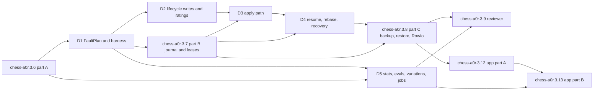

# chess-store completion: allocation of unowned operations, change-request content, and recommendations on the open store items

| Field | Value |
|---|---|
| Document | docs/engineering/store-completion-allocation.md |
| Author | System architect agent, Architect stance (Phase 3, baseline B5) |
| Date | 2026-11-09 |
| Answers | Finding chess-a0r.3.32 (store SDD 3.7.2 operations with no owner; step2-store-A-evidence.md F-A01, F-A03); decision (1) of Brian Prascher, 2026-11-09, relayed by the coordinator (bead chess-a0r.3.34): the change request is authorised to add owner tasks |
| Status | **Proposal. Nothing here is approved.** The PM creates the tasks and the change request from section 4 to 6. Section 9 holds recommendations on items Brian has **not** ruled (F-A04 to F-A08); they are not decided anywhere |
| Evidence tags | `[OBS]` read in this session, `[RAN]` executed, `[INF]` inferred, `[UNV]` unverified, `ESTIMATE` a number with no measurement behind it |
| Gate (GATE-016) | Allocation and task structure: no design content changes, so **G0**. The decisions recorded alongside in architecture Addendum K carry the tiers Brian gave them (G2/G3) |

## 1. Result in five lines

1. The list in F-A01 is **incomplete**. Eight more operations or design entities have no owner (rows 11, 12, 14, 15, 18, 21, 27 and 30 of section 2.2): the **reconcile applier**, the **apply backlog**, the **rebase orchestration and builder**, **`StartupRecovery`** (DD-ST-019), `lease_upsert/lease_delete`, the **`FaultPlan` placement** and **`RowIo`**. Several others (rows 16, 17, 19) are owned only by the words "journal and leases" and are now named.
2. Three sequencing errors exist in the current chain `A -> B -> C` (section 3): `FaultPlan` is in part C but part B's own tests need it; `apply_records` has to call `finalize_game`, `abort_game` and the `Voided` void, so it cannot be built before them; and `StatsService` (DD-APP-14) is named in neither app task.
3. Proposal: **five new tasks, D1 to D5**, 840 minutes `ESTIMATE` in all, plus +60 minutes on `.3.6` (rework from Brian's rulings) and +120 on the reviewer `.3.9`. The chain becomes `A -> D1 -> B -> D2 -> D3 -> D4 -> C`, with D5 off the critical path.
4. `.3.12` (app part A) really needs `finalize_game`, `abort_game`, `void_unreadable_game`, `reset_player`, `apply_records`, `sync_backlog`, `lease_*`, the journal and recovery. It does **not** need the job queue, evals, variations or (if `StatsService` moves to `.3.13`) the stats rows.
5. F-A03 (wiring `exclusive_guard`) is an acceptance line of `.3.7` (section 5.2).

## 2. Verification of the unowned list against the SDD

### 2.1 Method

I read SDD-chess-store 3.7.2 (every row), 3.11.3 to 3.11.10, section 4 (DD-ST-001 to 024) and section 6 (test IDs), and compared them with the part A evidence (sections 1, 2, 3, 9) and the beads text of `.3.6`, `.3.7`, `.3.8` `[OBS bd show 2026-11-09]`. An operation counts as **owned** only if the task's title or acceptance text names it or the SDD entity it implements. The acceptance texts are short, so "journal and leases" owns what those words name and nothing more.

### 2.2 Full mapping

"Done" means built in part A (evidence section 1). The owner column is the proposed owner; "B", "C" are the existing `.3.7`, `.3.8`; D1 to D5 are the new tasks of section 4.

| # | Operation or entity | SDD ref | In F-A01? | State today | Proposed owner |
|---|---|---|---|---|---|
| 1 | `register_player`, `insert_computers`, `roster_indexes`, `rename_player`, `archive_player`, `update_preferences`, reads, app settings | 3.7.2 Players | no | Done | A (`.3.6`) |
| 2 | `start_game`, `get_game`, `list_games`, `list_unfinished`, `game_moves`, `set_analysis_used` | 3.7.2 Games | no | Done | A |
| 3 | `rating_history` (read) and the initial rating rows | 3.7.2 Ratings | no | Done | A |
| 4 | `Store::open`, `DataDir`, `Migrator`, `Opener` (up to the upgrade), `StoreThread`, `ReadPool` | 3.9.1, DD-ST-001..007 | no | Done | A |
| 5 | **`finalize_game`** with `EloCalc`, rating rows, counters, `FinalizeOutcome`, the queued analysis job | 3.7.2, 3.11.4, DD-ST-009/010 | yes | Not built | **D2** |
| 6 | **`abort_game`** | 3.11.4 | yes | Not built | **D2** |
| 7 | **`void_unreadable_game`** | 3.11.4, D-67 | yes | Not built | **D2** |
| 8 | **`reset_player`** (voids, reset points, `UnlistedUnfinishedGames`) | 3.11.4 | yes | Not built | **D2** |
| 9 | **`check_rating_invariant`** | 3.7.2 Ratings | yes | Not built | **D2** |
| 10 | **`apply_records`** (all record kinds, `MOVE.ply = journal ply + 1`, the `Voided` effect, create-from-`Start`) | 3.7.2, 3.11.3, 3.11.4 | yes | Not built | **D3** |
| 11 | **Reconcile applier**: apply a reconcile plan (rows to write and delete, clocks, `journal_seq`) in one transaction | 3.11.3, DD-ST-018 | **no** | Not built | **D3** |
| 12 | **Apply backlog**: per-game ordered queue, retry timer 0.1 s doubling to 5 s, `busy_timeout` 100 ms for apply, `StoreBacklog` over 30 s | 3.12, DD-ST-002 | **no** | Seam only (`thread.rs` closures) | **D3** |
| 13 | **`sync_backlog(timeout)`** | 3.7.2 Barrier | yes | Not built | **D3** |
| 14 | **`MoveJournal::open_for_resume`**, rebase **orchestration** (DB step, file swap, crash windows), the "row with no journal" path, `.rebase` handling | 3.7.3, 3.11.3 step 2 and 3, 3.9.2 | **no** | Not built | **D4** |
| 15 | **`StartupRecovery`** (DD-ST-019): scan journals with no live lock, apply or finalize, order by `ended_at` (D-72), one bad journal never stops the others | 3.9.1, DD-ST-019 | **no** | Marker comments only | **D4** |
| 16 | Journal format, writer (D-82 poison rule, explicit seek after `set_len`), reader and scan, `probe`, `close_final` | 3.11.1, 3.11.2, 3.7.3, DD-ST-015..017 | no | Not built | B (`.3.7`), now named |
| 17 | Reconcile, pure function (`J`, `S`, plan), clock rule | 3.11.3, DD-ST-018 | no | Not built | B, now named |
| 18 | Rebase **builder** (pure: intact run + rows + `GAME` row -> bytes), the no-replace move helper (`hard_link` then `remove_file`, same-inode check) | 3.11.3, D-83, D-110 | **no** | Not built | B, now named |
| 19 | `register_process`, `process_heartbeat`, `deregister_process`, `list_live_processes`, stale-row removal, pid test | 3.7.2, 3.11.6, DD-ST-014 | no (title covers) | Not built | B, now named |
| 20 | **`lease_beat`** (`RowGone{status, voided_by, content_hash, ended_at}`) | 3.7.2 | yes | Not built | B (reads `GAME_LEASE` and `GAME`; no dependency on D2) |
| 21 | **`lease_upsert`, `lease_delete`** | 3.7.2 | **no** | Not built | B |
| 22 | **`exclusive_guard` wiring**, `OtherVersionRunning`, `Exclusive`, registry registration in the open path | 3.9.1, 3.11.5, F-A03 | yes (F-A03) | Hook accepts everything, marked `PENDING part B` | B (acceptance line) |
| 23 | **`stats_rows`, `head_to_head_rows`, `games_for_history`** | 3.7.2 Statistics, DD-ST-012 | yes | Not built | **D5** |
| 24 | **`upsert_move_eval`, `get_game_analysis`** | 3.7.2 Analysis, DD-ST-011 | yes | Not built | **D5** |
| 25 | **`save_variation`, `delete_variation`, `list_variations`** (`VariationAnchor`) | 3.7.2, UT-ST-037 | yes | Not built | **D5** |
| 26 | **Job queue**: `enqueue_job`, `enqueue_unevaluated_games`, `claim_job`, `job_heartbeat`, `complete_job`, `fail_job`, `enqueue_failed_once_per_start` | 3.11.7, DD-ST-013 | yes (partly) | Not built | **D5** |
| 27 | `FaultPlan`, `test-support` feature, the failpoint registry (names in section 4 of the SDD) and a kill-at-failpoint child-process harness | DD-ST-024 | no (in C's title) | Not built | **D1** (moved out of C) |
| 28 | `BackupManager` (24 h rule, keep 3, never touch `bak-v*`/`pre-import-*`), collection of `journal/done/` | 3.11.8, DD-ST-020 | no (C's title) | Verified-copy half done in A | C |
| 29 | `RestoreService` (copy, replay, finalize in order, slots last, `unrestored/`) | 3.11.10, DD-ST-021 | no (C's title) | Not built | C |
| 30 | **`RowIo`**: export snapshot, import apply, the five lookups, pre-import copy | 3.11.9, DD-ST-022 | no | Not named in C's acceptance; "archive support" in the title is the only hint | C, now named |
| 31 | `CreateFreshStore` API (F-A07, **not ruled**) | 3.9.1, CT-ST-016 | no | Not built | C, provisional on Brian's ruling (section 9.4) |
| 32 | `StoreError` variants of B, C, D (`Journal`, `Leased`, `Exclusive`, `OtherVersionRunning`, `UnlistedUnfinishedGames`, `VariationAnchor`, `ImportInvariant`, `NotFound` uses) and CT-ST-070 (every variant maps to a catalogue code) | 3.8, DD-ST-023 | no | Part A variants only | Each owner adds its variants; **C** owns CT-ST-070 as the last store task |
| 33 | Pre-upgrade backup replacement (F-A02, decision (2)) and D-71 any-error refusal (decision (3)) | 3.11.8, 3.9.1 | F-A02 yes | Built as "never replace" and as ENOTSUP/ENOTTY only | **A rework (`.3.6`)**, section 5.1 |

Rows 11, 12, 14, 15, 18, 21, 27 and 30 are the ones **F-A01 did not list** (row 22 is F-A03, listed separately). I found no other 3.7.2 row without an owner. Rows 5 to 9, 20 and 23 to 26 are the F-A01 list. `get_game_analysis` is in row 24 (the F-A01 list names `upsert_move_eval/get_game_analysis`).

### 2.3 Test allocation (SDD section 6)

| Owner | Tests |
|---|---|
| A rework (`.3.6`) | CT-ST-019 extended; **CT-ST-090 (new, F-A02)**; CT-ST-085 at the open boundary once D1 exists (the classification test already exists) |
| D1 | harness self-tests; the failpoint registry test (every name of the SDD list is reachable); a two-process helper used by B |
| B | UT-ST-010 to 014, 070 to 079, 081, 083, 087, 088, 090; CT-ST-001, 002, 004 (two-process half), 006, 013 (other-version half), 014, 015, 025 to 027; BM-ST-01; the rename-helper part of CT-ST-089 |
| D2 | UT-ST-035 (set-by-finalize half), 050 to 056, 086 (void half); CT-ST-007 for its commands, 028 |
| D3 | UT-ST-082, 085, 089; CT-ST-007 for `apply_records`, 008 |
| D4 | UT-ST-091; CT-ST-003, 009, 080 (rest), 084, 088, 089 (orchestration half); BM-ST-02 |
| D5 | UT-ST-037, 060 (the stats half; the games half is done); CT-ST-007 for its commands, 030 to 032; BM-ST-03 |
| C | CT-ST-016 (fresh-store half, if ruled), 040 to 045, 050 to 053, 060 to 064, 070, 081, 082, 083 (restore half), 086; the failure-mode campaign across all commands |

## 3. Findings in the current allocation

| ID | Severity | Finding | Consequence if unchanged | Proposed fix |
|---|---|---|---|---|
| **F-ALLOC-1** | **Major** | Part B's own tests (CT-ST-001 to 003, 087, 088, 089) kill the process or inject write errors at named failpoints, but `FaultPlan` is in part C, which depends on B | B cannot meet its acceptance ("stale lease takeover; two-process tests; stored format exactly as approved") on the failure paths, or it builds an ad hoc fault mechanism that C replaces | New task D1 (`FaultPlan` and harness) before B; C keeps the failure-mode campaign |
| **F-ALLOC-2** | **Major** | `apply_records` applies `GameEnd`, `Abort` and `Voided`, so it calls `finalize_game`, `abort_game` and the void function; `StartupRecovery` calls `apply_records`; the rebase step 2 is a store transaction. None can be built or tested before the lifecycle writes | Whoever builds B first would have to stub these | D2 (lifecycle writes) before D3 (apply) before D4 (recovery); B keeps what has no store write |
| **F-ALLOC-3** | Medium | `StatsService` (DD-APP-14) is named in neither `.3.12` ("Core, session actors, services, JournalCodec, EngineGateway") nor `.3.13` ("import/export, analysis, computer players, calibration entry") `[OBS bd]` | The stats rows (D5) may be built for nobody, or `.3.12` grows silently | PM decides; the architect proposes `.3.13`, because the service is thin (ALG-APP-13) and the app critical path stays short |
| **F-ALLOC-4** | Medium | `.3.8` (C) bundles `FaultPlan`, backup, restore, "archive support" in 300 minutes | `RowIo` has no named owner (row 30) and the estimate was made for a smaller scope | Move `FaultPlan` out (-90 minutes), name `RowIo` (+60), name CT-ST-070 and the campaign (+30): the estimate stays 300 `ESTIMATE` |
| **F-ALLOC-5** | Minor | `.3.9` (reviewer, 180 minutes) reviews a crate about 2.5 times the size that the estimate assumed, and does not depend on a task that builds the analysis rows | Reviewer sees an incomplete crate or runs out of time | Section 5.5 |
| **F-ALLOC-6** | Minor | The `pinned.rs` doc comment in `chess-engine` still says "PROPOSED and UNCONFIRMED" | A reader of the code is told the value is unapproved after Brian approved it | Software engineer edits the comment (G0, code comment); listed in section 7 |

## 4. Proposed new tasks (chess-store part D)

All: type task, parent `chess-a0r.3`, labels `agent:software-engineer`, `autonomy:run-to-gate`, `phase:step2-core`, `baseline:` the new baseline of the change request. Gate class of each: **G1** (inside `chess-store`, edges and §5.7 contracts as the SDD states them) unless a ruling in architecture Addendum K or an open item of section 9 touches it. The Reviewer pass stays in `.3.9` (fresh invocation); no author reviews its own work. Estimates use the convention behind `.3.6` and `.3.10`: **about 15 lines of code and tests per estimated minute** (`.3.6`: 360 minutes, `crates/chess-store` 5,613 lines of Rust at the time of the evidence note; `.3.10`: 420 minutes, `crates/chess-engine` 6,444 lines `[OBS wc -l 2026-11-09; the minutes are estimates, not measured effort]`), times a factor for novelty. The line counts for D1 to D5 are my guesses `[opinion]`; every figure is `ESTIMATE`, evidence level analogy, uncertainty about plus or minus 40 %.

### 4.1 D1: chess-store part D1, FaultPlan and crash-test harness

| Field | Value |
|---|---|
| Title | Implement chess-store part D1: `FaultPlan` (feature `test-support`), failpoint registry, kill-at-failpoint child-process harness |
| Scope | DD-ST-024. `fault.rs` behind `test-support`: named failpoints (the SDD list: `journal.before_write` to `restore.before_rename`, plus `backup.before_rename` (D-108), `journal.rebase.old_linked`, `journal.rebase.new_linked` (D-110)), actions (error, delay, kill the process), thread-safe, zero cost when the feature is off. Harness: a helper binary or test re-exec that runs a store scenario in a child, kills it at a failpoint, and lets the parent reopen the directory. Wire the failpoint calls into the existing part A code where the SDD names them (open probe for CT-ST-085, backup, migration). Cargo feature `test-support` added to the manifest |
| Depends on | `.3.6` |
| Acceptance | (1) Feature off: `FaultPlan` absent from the public surface and the call sites compile to nothing (a test or `cargo public-api`-style check; UT-ST-038 stays green). (2) Every failpoint name of the SDD section 4 list plus the three new names is reachable by a test. (3) Kill test: a child killed at a failpoint leaves a directory the parent can open; the harness reports the failpoint it died at. (4) CT-ST-085 passes through the real `Store::open`: `FaultPlan` injects `ENOTSUP`, `ENOTTY` and an arbitrary errno into the probe `sync_all`; each gives `DurabilityUnsupported{path, errno}`, no heartbeat row, no database, no journal, scratch file removed (D-109). (5) Coverage per strategy; `fmt`, `clippy -D warnings`, `ci/check.sh` stages that exist are green |
| Estimate | **120 minutes** `ESTIMATE`. Basis: about 900 lines (module 250, harness 200, tests 450) is 60 minutes at the convention, times 2 because a kill-and-reopen child process is new to this repository `[opinion]` |
| Agent | software-engineer |

### 4.2 D2: chess-store part D2, game lifecycle writes and ratings

| Field | Value |
|---|---|
| Title | Implement chess-store part D2: `finalize_game` (Elo and rating rows), `abort_game`, `void_unreadable_game`, `reset_player`, `check_rating_invariant` |
| Scope | DD-ST-009 (rest) and DD-ST-010 (write path), SDD 3.11.4. `FinalizeRequest`, `FinalizeOutcome`, `EloCalc` use through `chess-domain` (`rating_track`, `settle`; whole integers, half away from zero), rating rows and counters per track, `GAME` terminal columns including the three time totals and `content_hash`, slot and lease deletion, queued analysis job, idempotent `AlreadyFinal`; `abort_game`; `void_unreadable_game` (non-NULL hash, zero moves allowed); `reset_player` with `VoidSpec`, `UnlistedUnfinishedGames` roll back, the commit time written to `GAME.ended_at`; the void function shared by reset, unreadable and (later) `apply_records` (D-78 (5)); `check_rating_invariant`. The initial and reset rating rows follow the F-A04 ruling once Brian gives one (until then: `k = 0`, `game_id` NULL, as built in part A) |
| Depends on | `.3.6`, D1 (failpoints `finalize.*`, `reset.*`) |
| Acceptance | UT-ST-035 (hash set by finalize, abort, void, reset), UT-ST-050 to 056 (Strict and Training, K counters per track, self-play and custom start unrated, idempotent repeat, history sums to rating, rounding vectors), UT-ST-086 (void half), CT-ST-028 (reset voids suspended, same-process and other-process games, no rating change, extra game rolls back), CT-ST-007 for these commands (fault in each command leaves the content unchanged); the invariant check treats `game_id IS NULL` rows as points; two games against one computer Player in two orders give the in-order result; no integer id in any new public type (UT-ST-038 stays green); coverage at least 90 % lines on the finalize repo functions (strategy); mutation testing on finalize is an `ESTIMATE` target of the SDD and `cargo-mutants` is **not installed** `[OBS evidence 6]`: the engineer applies manual mutants as in part A and says so |
| Estimate | **180 minutes** `ESTIMATE`. Basis: about 1,800 lines (finalize 250, abort, void, reset 300, invariant and rating writes 200, tests 1,050) is 120 minutes at the convention, times 1.5 for the Elo vectors and the transactional edge cases |
| Agent | software-engineer |

### 4.3 D3: chess-store part D3, apply path

| Field | Value |
|---|---|
| Title | Implement chess-store part D3: `apply_records`, reconcile-plan applier, apply backlog, `sync_backlog` |
| Scope | SDD 3.7.2, 3.11.3 (rows and plan), 3.11.4 (`Voided` from a record, `GameEnd` then `Voided` rule D-87), 3.12 (backlog). `apply_records` for every record kind of 3.11.1 (`Move` writes `MOVE.ply = journal ply + 1`, D-92; `Takeback`; `Clock`; `Start` creates the `GAME` row when absent for restore; `GameEnd`, `Abort`, `Voided` call the D2 functions; the others change nothing); the applier of a `ReconcilePlan` in one transaction (rows to write and delete from a ply, clocks, `journal_seq`); the per-game ordered backlog with retry timer (0.1 s doubling to 5 s, 100 ms `busy_timeout` per attempt), `StoreBacklog` after 30 s, `sync_backlog(timeout)` |
| Depends on | D2, B (`.3.7`: `JournalRecord`, the pure reconcile function) |
| Acceptance | UT-ST-082 (finalize live equals finalize from `GameEnd` alone, all columns), UT-ST-085 (`apply_records` of `Voided`), UT-ST-089 (restore of a `Start`-only journal, `started_at` equals `wall_ms`), a case with journal `Move{ply: 0}` giving `MOVE.ply = 1` (the SDD 3.11.3 warning: a round-trip test cannot catch the base), idempotence of applying a plan twice, CT-ST-008 (DB locked by another process: play continues from the journal, backlog drains, `StoreBacklog`), CT-ST-007 for `apply_records`, `sync_backlog` returns after the backlog empties or `Busy` on timeout, the store thread is never blocked for 5 s by an apply (a timing test with an injected clock) |
| Estimate | **200 minutes** `ESTIMATE`. Basis: about 2,200 lines is 145 minutes at the convention, times 1.4 for the ordering and retry logic |
| Agent | software-engineer |

### 4.4 D4: chess-store part D4, resume, rebase and startup recovery

| Field | Value |
|---|---|
| Title | Implement chess-store part D4: `open_for_resume`, rebase orchestration (D-83, D-110), `StartupRecovery` |
| Scope | DD-ST-019, SDD 3.7.3 (`open_for_resume`), 3.9.1, 3.9.2 ("row with no journal" path, `.rebase` first), 3.11.3 steps 2 and 3 (DB transaction through D3, the no-replace move through the B helper, the crash windows (a) to (f)), D-66 damage rule at resume, a final or voided game moved aside and not rebased (RR-A-1 (b)), startup finalize order (D-72), a `Voided` the scan finds unapplied, one bad journal never stops the others, registration in the open path |
| Depends on | D3, B |
| Acceptance | UT-ST-091; CT-ST-003 (kill at each `journal.*` failpoint, restart, every acknowledged move present, clocks equal the last recorded; extended with the kill between `Move` and `GameEnd`), CT-ST-009 (kill between journal `GameEnd` and finalize commit: startup finalizes once), CT-ST-080 (kill between `start_game` and `MoveJournal::create`; a slot conflict leaves no journal), CT-ST-084 (several pending `GameEnd` journals in `ended_at` order, rating equals the in-order result), CT-ST-088 (kill at **six** rebase failpoints, exactly one `damaged/<uuid>.<k>.jnl`, no `.rebase`, no file under two names after the restart, a second restart changes nothing), CT-ST-089 (no-replace on both moves; both directories synced before the second move; a complete `.rebase` renamed into place by the no-journal path); BM-ST-02 (open, `quick_check` and scan on a seeded database; NFR-1 is budgeted in `chess-app`, this reports the store's share) |
| Estimate | **220 minutes** `ESTIMATE`. Basis: about 2,200 lines is 145 minutes at the convention, times 1.5 for the crash windows and kill tests |
| Agent | software-engineer |

### 4.5 D5: chess-store part D5, statistics rows, evals, variations, job queue

| Field | Value |
|---|---|
| Title | Implement chess-store part D5: `stats_rows`, `head_to_head_rows`, `games_for_history`, `upsert_move_eval`, `get_game_analysis`, variations, analysis job queue |
| Scope | DD-ST-011, 012, 013; SDD 3.7.2 (Statistics, Analysis, Jobs), 3.11.7. Rows filtered only by structural keys (Player, `started_at >= reset_at`, side, limit; no `self_play`, completed or custom-start predicate, D-44); evals from White's point of view; `get_game_analysis` with `evaluated` and `total`; `save_variation`, `delete_variation`, `list_variations`, `VariationAnchor` (decision 13); `enqueue_job`, `enqueue_unevaluated_games`, `claim_job` (10 s claim lease), `job_heartbeat`, `complete_job`, `fail_job` (compare-and-set on owner), `enqueue_failed_once_per_start`. Imported nested variations stay OPEN (OQ-ST-003): one line per row |
| Depends on | `.3.6`, D1 (CT-ST-007 uses `FaultPlan`). **No dependency on B, D2, D3 or D4** |
| Acceptance | UT-ST-037, UT-ST-060 (stats half), CT-ST-030 to 032 (claim, stale reclaim, lost-owner rejection, with an injected clock), CT-ST-007 for these commands, BM-ST-03 (10 000-game fixture; FF-5 store half), stats rows contain voided and custom-start games (the domain filters them), no SQL view exists |
| Estimate | **120 minutes** `ESTIMATE`. Basis: about 1,500 lines (source 350, tests 1,150) is 100 minutes at the convention, times 1.2 |
| Agent | software-engineer |

Total new: 120 + 180 + 200 + 220 + 120 = **840 minutes** `ESTIMATE` (range about 500 to 1,200).

## 5. Changes to existing tasks and dependencies

### 5.1 `.3.6` (part A, in progress): rework from Brian's rulings of 2026-11-09

Add as acceptance lines; **+60 minutes** `ESTIMATE` (about 600 lines of code and tests is 40 minutes, times 1.5):

1. **F-A02 / D-108.** The pre-upgrade copy is written to `chess.db.tmp-bak-v<N>`, verified, then `rename`d over `chess.db.bak-v<N>`; the directory is synced; a stale temp file is removed first; a failed attempt leaves the previous copy byte-identical (store SDD 3.11.8 dated note). Tests: CT-ST-019 extended, new CT-ST-090 (the kill-before-rename case uses D1 and is added when D1 lands).
2. **D-71 / D-109.** The open probe refuses on **any** error of `sync_all` on the scratch file, with the errno; errors creating or removing the scratch file stay `Unavailable`. The errno constants 25 and 45 and `classify_probe_error` go (F-A12). UT and CT-ST-085 updated.
3. F-A11 text: store SDD 3.8 note for the missing `sys.rs` (done in the SDD by Addendum K); the code has no `unsafe`.
4. `#![forbid(unsafe_code)]` stays in `lib.rs`; the workspace lint is chess-me6 (section 7).

### 5.2 `.3.7` (part B): scope named, F-A03 as an acceptance line

New text: "Journal records per arch 7.6 table; `content_hash` fields; lease 2 s, process 10 s, analysis 10 s heartbeats; stale lease takeover; two-process tests; stored format exactly as approved" **plus**:

- Named scope: format, writer (D-82, explicit seek after `set_len`), reader and scan, pure reconcile, rebase **builder**, the no-replace move helper (`hard_link` then `remove_file`, same-inode check, D-110), `probe`, `close_final`, process registry (`register_process`, `process_heartbeat`, `deregister_process`, `list_live_processes`), `lease_upsert`, `lease_delete`, `lease_beat`. **Not in B any more:** apply, backlog, `open_for_resume`, startup recovery (D3, D4).
- **F-A03 acceptance line:** the `exclusive_guard` argument of `Migrator::upgrade` is wired to the process registry; an upgrade with another live process returns `Exclusive{reason}` and a live process of another build version returns `OtherVersionRunning{version, kind}`; the `PENDING part B` marker in `open.rs` is gone; CT-ST-013 (other-version half), CT-ST-014 and CT-ST-015 pass with two real processes.
- Close-on-exec (SDD 3.11.6, CT-ST-006) is checked with a child process (F-A11, still `[UNV]`).
- Depends on: `.3.6`, **D1** (added).
- Estimate: **360 minutes unchanged** `ESTIMATE` (opinion): removing apply and recovery (not named in its acceptance) offsets naming the reader, the rebase builder and the registry wiring.

### 5.3 `.3.8` (part C)

New text adds: `RowIo` (export, `apply_import`, the five lookups, pre-import copy, import post-check `ImportInvariant`), `CreateFreshStore` (only after Brian rules F-A07), CT-ST-070, the failure-mode campaign over **all** store commands. `FaultPlan` is **removed** (now D1). Depends on: `.3.7` (kept) and **D4** (added; restore reuses recovery, apply and the void function). Estimate **300 minutes unchanged** `ESTIMATE`.

### 5.4 Dependency table

| Task | Today depends on | Proposed depends on |
|---|---|---|
| D1 | n/a | `.3.6` |
| D2 | n/a | `.3.6`, D1 |
| `.3.7` (B) | `.3.6` | `.3.6`, D1 |
| D3 | n/a | D2, `.3.7` |
| D4 | n/a | D3, `.3.7` |
| D5 | n/a | `.3.6`, D1 |
| `.3.8` (C) | `.3.7` | `.3.7`, D4 |
| `.3.9` (reviewer) | `.3.8` | `.3.8`, D5 |
| `.3.12` (app A) | `.3.8` and others | unchanged, plus D2, D3, D4 stated explicitly (already implied by `.3.8`) |
| `.3.13` (app B) | `.3.12` | `.3.12`, D5 |

Diagram question: which store task must finish before which. Legend: an arrow means "must complete before". Titles carry the task IDs of the plan; D1 to D5 are proposed.

### 5.5 `.3.9` (reviewer)

Add D5 as a dependency (the others reach it through `.3.8`). Raise the estimate from 180 to **300 minutes** `ESTIMATE` (the crate will be about 2.5 times the size the 180 assumed; basis opinion). The review covers part A, D1 to D5, B and C in one fresh invocation, as before; the failure-mode table must cover every failpoint of the SDD list. Option for the PM, not a recommendation to adopt: a mid-chain Reviewer pass after D4 (about 120 minutes) catches stored-format errors before C and the app build on them; it adds time and I would take it only if the PM wants early evidence.

### 5.6 Effect on `chess-app` part A (`.3.12`)

What `.3.12` needs first, from the app SDD (3.7 caller table at lines 953 to 958 and DD-APP-07 to 10) `[OBS]`:

| App component | Store operations it needs | Task |
|---|---|---|
| `Core::open` (normal path) | `Store::open`, `OpenReport`, process registry, startup recovery | A, B, D4 |
| `PlayerService` | players (done), `reset_player`, `void_unreadable_game`, `archive_player` | A, D2 |
| `GameSetupService` | `start_game`, `list_unfinished` | A |
| `SessionRegistry`, `GameSession` | journal, `lease_upsert`, `lease_beat`, `lease_delete`, `apply_records`, `finalize_game`, `abort_game`, `sync_backlog` | B, D2, D3 |
| `Core` recovery mode (`CreateFreshStore`, `RestoreBackup`, `maybe_auto_backup`) | `RestoreService`, `BackupManager`, fresh store | C |
| `StatsService` | `stats_rows`, `head_to_head_rows`, `games_for_history`, `rating_history` | D5 (see F-ALLOC-3) |
| `AnalysisWorker`, `AnalysisService` | jobs, evals, variations | D5 (app part B) |

So `.3.12` **should depend on D2, D3 and D4** (which `.3.8` implies) and **should not depend on D5** unless `StatsService` stays in `.3.12`. If the PM wants a shorter critical path, `.3.12` can start after D4 and keep only its recovery-mode slice waiting for C (saves about 300 minutes `ESTIMATE` if the slice is split off, and costs one more task boundary). The architect does not recommend splitting unless the schedule needs it.

### 5.7 Critical path

Today: A, B, C, app A (store part 360 + 360 + 300 = 1,020 minutes with A at full estimate). Proposed: A, D1, B, D2, D3, D4, C: 360 + 120 + 360 + 180 + 200 + 220 + 300 = 1,740 minutes, **720 more** `ESTIMATE`, all on the critical path because one engineer invocation runs one task at a time. If separate invocations can work in parallel worktrees, D2, B and D5 are independent after D1, and the path is D1 + max(B, D2) + D3 + D4 + C; the cost is merge conflicts in `error.rs`, `thread.rs`, `api.rs` and `Cargo.toml`, which I would manage by giving each task its own `repo/` file and merging in the order of the table.

## 6. The change request in one table (content for the PM)

| Item | Action | Gate |
|---|---|---|
| D1 to D5 | Create as in section 4 | G0 plan change; the work is G1 |
| `.3.6` | Add acceptance lines 1 to 4 of 5.1; +60 minutes | G0 |
| `.3.7` | Rewrite scope and acceptance as in 5.2; add D1 dependency | G0 |
| `.3.8` | Rewrite scope as in 5.3; replace the `FaultPlan` text; add D4 dependency | G0 |
| `.3.9` | Add D5; 180 to 300 minutes | G0 |
| `.3.12` | Add D2, D3, D4 as explicit dependencies (already implied) | G0 |
| `.3.13` | Add D5; decide where `StatsService` lives | G0 |
| `.3.35` | Stays as opened: revisit F-A02 before migration 0002 (SDD OQ-ST-006) | n/a |
| `.3.36` | Stays open: section 9 holds the recommendations | G3 for Brian |
| Total | New 840 minutes, rework 60, reviewer +120 = **1,020 minutes** `ESTIMATE` | |

## 7. Carry-over from decisions (2), (3) and (5) to owners

| Decision (Addendum K) | What must change in code or config | Owner |
|---|---|---|
| D-108 REPLACE | `migrate.rs` and `backup.rs` as in 5.1 | `.3.6` |
| D-109 D-71 any error | `open.rs` classification and tests | `.3.6` |
| D-110 no-replace move | the helper and the six failpoints | B (helper), D4 (orchestration), D1 (failpoint names) |
| D-111 `unsafe_code` forbid | root `Cargo.toml` `[workspace.lints.rust] unsafe_code = "forbid"` and `lints.workspace = true` in every crate (the store has it); the per-crate attributes may stay | chess-me6 (PM) |
| D-112 `PINNED_UCI_ELO_RANGE` | the doc comment in `crates/chess-engine/src/pinned.rs` still says PROPOSED and UNCONFIRMED; the value in the file is already `1320..=3190` `[OBS]`. G0 comment edit, outside my file list | software engineer; `.3.4` closable |
| D-113 F7 fallback C | the F7 spike task text and the SDD-ui CT-UI-12 wording (the SDD-ui owner; not edited by me) | PM and SDD-ui owner |
| D-114 `serde` for `desktop/src-tauri` | add `serde` (derive) to that manifest at the pin of §3.4.1; SDD text note done | desktop task |
| D-115 tag commit | the engine build step pins and verifies the checkout commit `edb0d9db6731067ec50ce619ff372b463bc4dd5d` if the source-build fallback is ever used | engine and packaging task |

## 8. Notes for the app SDD (not edited; no ruling changes it)

- F-A10: `roster_indexes()` returns every stored index of every seed; if `APP_SETTING.roster_seed` changes, old indexes inflate `first_k_after`. The domain function should take the seed into account or the store should filter by seed. Raise with the app and domain owners; observation only.
- The app SDD already has the catalogue code `PlayerHasUnfinishedGames{game_ids}` `[OBS SDD-chess-app.md:1033]`, which matters for F-A05 (section 9.2).

## 9. Recommendations on items Brian has not ruled (F-A04 to F-A08)

These are proposals. Brian decides (G3 for stored shapes, G2 for interface and catalogue). **None is entered as decided anywhere; the architecture records them only as OQ-34.** Bead `.3.36` carries them.

### 9.1 F-A04 and the initial and reset rating rows (stored shape, G3)

Today: `RATING_HISTORY.k` is `NOT NULL`; the initial row of each track is written with `k = 0` and `game_id` NULL; D-26 and the SDD say a reset point has `game_id` NULL and before = after = current, with no `k` stated.

| Option | What it means | Reversibility |
|---|---|---|
| **A (recommended)** | Keep `k = 0` for every row with `game_id IS NULL` (initial and reset points); document that `k` has no meaning there; the invariant check and `chess-domain` `rating_series` treat NULL `game_id` rows as points, not games | Cheap now (nothing released, ASM-6); after release a change needs a migration |
| B | Make `k` nullable (`NULL` = no game) | A DDL change before release, G3; the DDL, the drift guard and the ER block change |
| C | Store the K that would apply to the next game | Misleading in history and wrong after a reset (the K counter is untouched by a reset) |

Recommendation A. Reason: it needs no stored-format change, a point row is already distinguished by `game_id`, and `0` cannot be mistaken for a real K (40 or 32). Confidence **Medium-High**: the weak point is that a consumer reading `k` without looking at `game_id` could misread it, so the SDD must say so in one line and `chess-domain` must have a test. One check I could not make: whether `chess-domain` `rating_series` reads `k` `[UNV]`.

### 9.2 F-A05 and `StoreError::HasUnfinishedGames` (catalogue, G2)

Today the variant has no payload, and the app SDD wants `PlayerHasUnfinishedGames{game_ids}` (its own code).

| Option | What it means | Reversibility |
|---|---|---|
| **A (recommended)** | Keep the guard in the store and make the variant carry the ids: `HasUnfinishedGames{ids: Vec<GameId>}`, the same shape as `UnlistedUnfinishedGames{ids}`; add the row to SDD 3.8; the app maps it to `PlayerHasUnfinishedGames{game_ids}` | Two-way (one enum variant) |
| B | Drop the guard from the store; the app checks with `list_unfinished` first | Not atomic: another process can start a game between the check and the archive, so an archived Player could hold a slot (GAME-4 violated) |
| C | Return `InvariantViolated` | Wrong: it maps to `Internal{id}`, a bug report for a normal refusal |

Recommendation A, confidence **High**. It follows an existing precedent and keeps the atomic re-check that PLY-4 and the app SDD (ALG-APP-06) rely on.

### 9.3 F-A06 (three DTO and stored-value choices, G3)

| Part | Option A (recommended) | Option B | Reversibility |
|---|---|---|---|
| (a) initial preferences | `NewPlayer.preferences_json` passed in by the app (as built), like the "default preferences (passed in)" of `reset_player` | The store writes `'{}'` and the app calls `update_preferences`: two transactions, so a crash leaves a Player with an empty blob and PLY-2 ("all-or-nothing") is weakened | Two-way (a field) |
| (b) clock checkpoints of a timed game | `start_game` writes the base time for both sides (as built): a timed game always has a pair, which export and `get_game` return | NULL pair until the first `Move` or `Clock`: the pair CHECK allows it, but every reader needs a NULL case | Stored value, cheap before release |
| (c) `self_play`, `custom_start` | Derived in the store (`white == black`, `start_fen IS NOT NULL`), as built: an inconsistent pair cannot be sent, and the DDL CHECK already ties `custom_start` to `start_fen` | Explicit fields: two more ways to be wrong | Two-way |

Recommendation: A for all three parts, confidence **Medium-High** (a and c High, b Medium: the journal and the `Start` record already carry the clock spec, so the checkpoint matters only for `get_game` and export). The SDD needs the `NewPlayer` field list and the `NewGame` derivation sentence either way.

### 9.4 F-A07 and `CreateFreshStore` (interface, G2)

SDD 3.9.1 and CT-ST-016 say "start fresh" sets the traces aside in `missing-<date>/`; the app lists `CreateFreshStore` as a command (SDD-app lines 422, 798, 958, CT-APP-11), but no store method names it.

| Option | What it means | Reversibility |
|---|---|---|
| **A (recommended)** | An associated async function `Store::create_fresh(options) -> OpenedStore`: refuses when `chess.db` exists, moves `store.id`, the leftover `chess.db*` files, `journal/` and `backups/` into `missing-<date>/` (mode `0700`), then runs the first-launch path | Two-way (one function) |
| B | An option `StoreOptions::on_missing = StartFresh` read by `Store::open` | Same behaviour, but a destructive action hides behind a flag of the ordinary open |
| C | `chess-app` moves the files itself | Breaks "the store crate owns the data directory layout" (SDD 1.1) |

Recommendation A, confidence **Medium-High**. Open detail for Brian: whether `backups/` should be set aside too (my reading of 3.9.1 says yes, so nothing is silently deleted, but the user then cannot use `RestoreBackup` on them without moving them back). Owner if ruled: C (`.3.8`).

### 9.5 F-A08 and the `store_uuid` source (stored shape, minor)

Question you asked: is it already answered by `getrandom` 0.4.3 (DL2-4)? **No.** The admission row says `Used by: chess-app`, for `Core::open_default` and `new_game_uuid()` `[OBS architecture.md:522, D-101]`; `chess-store` has no edge to `getrandom`, and `uuid` has no `v4` feature (D-47 prefers the standard library).

| Option | What it means | Reversibility |
|---|---|---|
| **A (recommended)** | Keep the part A code: 16 bytes of `RandomState` through `uuid::Builder::from_random_bytes`; document that `store_uuid` only has to tell stores apart and is not a secret; a test that two stores differ | Two-way; the `store.id` field name does not change |
| B | Admit `getrandom` for `chess-store` as well (an amendment of the D-101 row, G2, one more edge) | Cheap, but a dependency to avoid a non-secret id |
| C | The app passes 16 random bytes in `StoreOptions`, like the injected wall clock | No new edge, but a seam for a value nobody needs to control, except in a test |

Recommendation A, confidence **Medium**: the only risk is that the `RandomState` guarantee is not documented (`[UNV]`, std source not read), and the failure mode is two stores with the same id, which the journal header check would then fail to tell apart. If Brian wants the guarantee, C is cheaper than B.

### 9.6 What I did not recommend

F-A09 (wording: `SchemaTooNew` writes nothing to `chess.db`, but a read-only open creates empty `-wal` and `-shm` files) is a text fix I made as a dated note in the store SDD. F-A12 and F-A13 need no ruling.

## 10. Not analyzed, unverified

- I did not read the code of `chess-domain` `rating_series` or `EloCalc` (F-A04 consequence, section 9.1) `[UNV]`.
- The line counts of D1 to D5 and every estimate are `ESTIMATE` (analogy to `.3.6` and `.3.10`; no measured effort exists, and the bead timestamps of `.3.10` do not give a reliable duration: `started_at` equals that of `.3.6`).
- Whether APFS `rename(2)` over an existing file through `std::fs::rename` behaves as POSIX says, and whether `std::fs::hard_link` across `journal/` and `journal/damaged/` works through Rust, were not run by me; the spike ran `hard_link` in one directory through Rust and the cross-directory link through the shell `ln` `[OBS spike-oq14 N2]`. The tests named in section 4 are what close this.
- The same-inode check by `MetadataExt::dev()` and `ino()` (D-110) is standard library surface that I recalled and did not compile `[UNV]`.
- Power-loss durability, network volumes and Intel Macs are not covered by any allocation here.
- Mermaid: one diagram in section 5.4; the validation result is in the delivery message.
