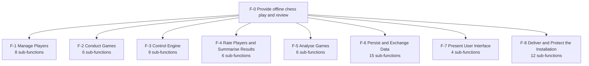
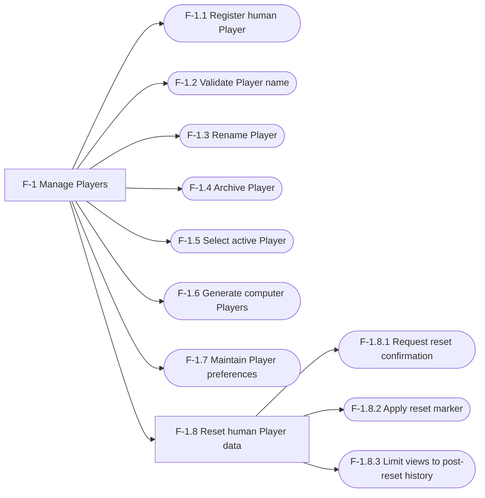
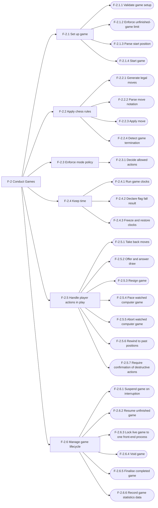
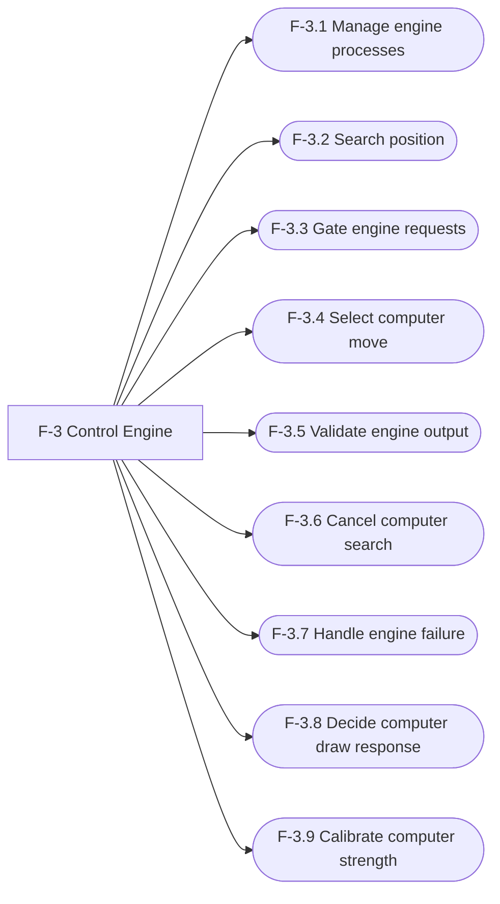
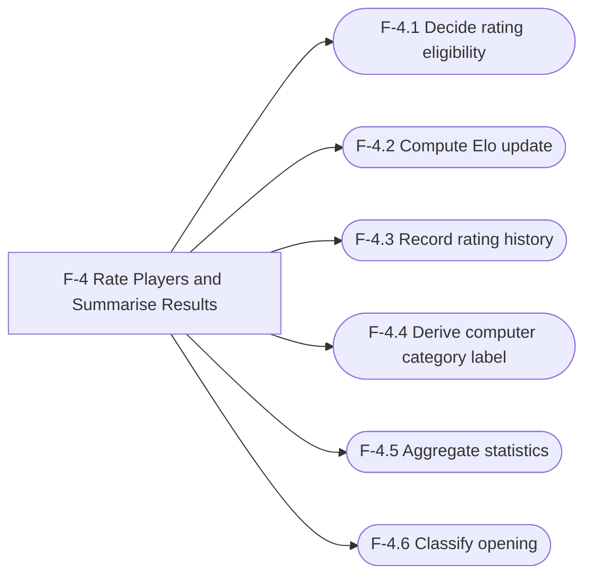
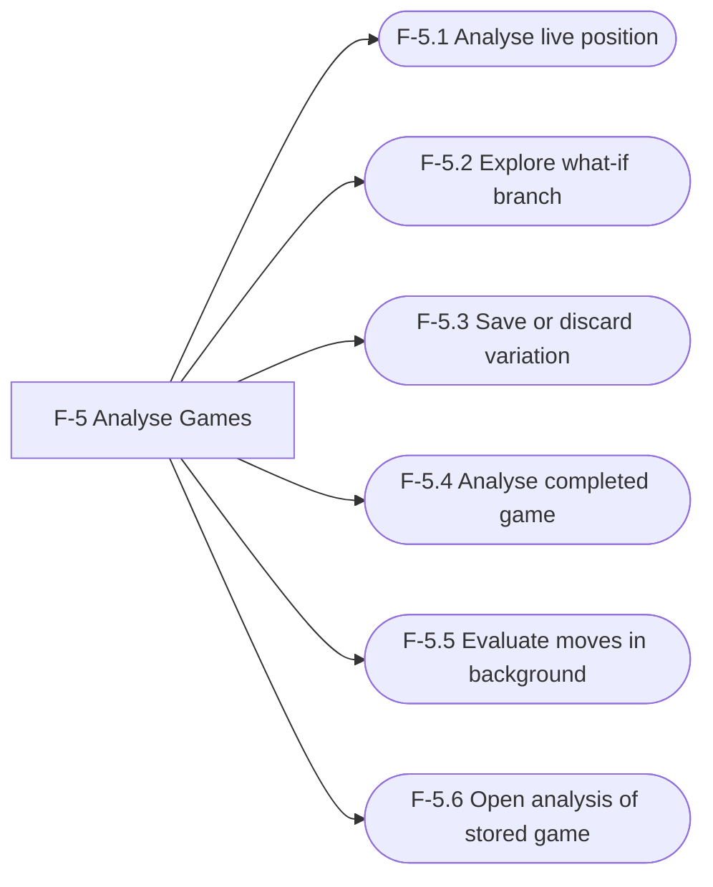
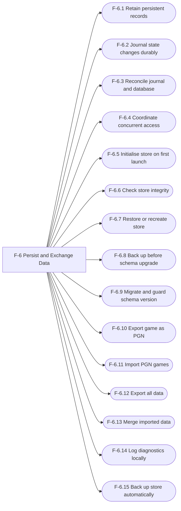
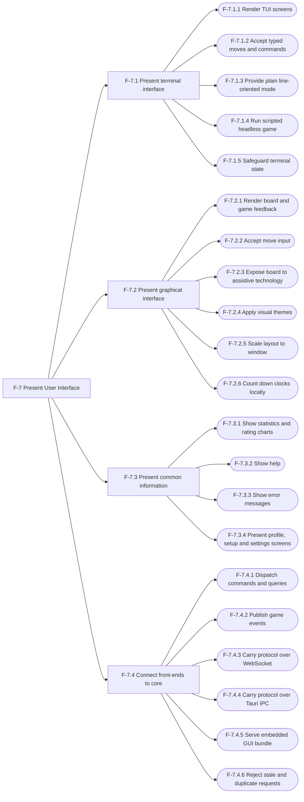
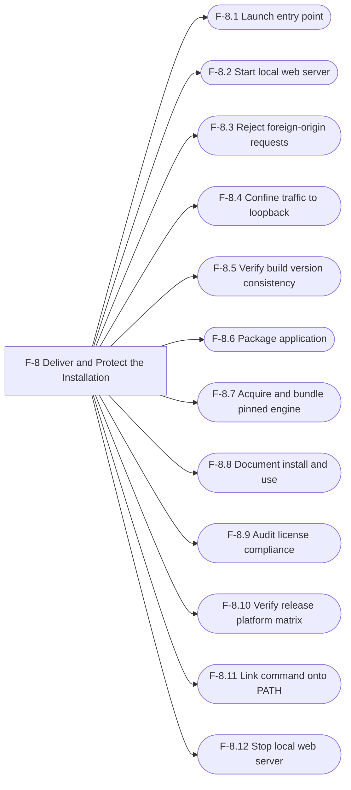

# Chess Application — Functional Decomposition

| Document | Version | Date | Status | Owner | Approver |
|---|---|---|---|---|---|
| docs/functional_decomp.md | **0.3 (draft)** | 2026-10-28 | **DRAFT. Not baselined.** Derived from requirements v1.0 Amendment 3, architecture v1.0 amendment 3 and use cases v0.3; changes no existing document | Systems engineer role (Claude), for Brian Prascher | Brian Prascher (user): approval **required**, not given |

**Summary.** 124 functions in a hierarchy of up to four levels counting the top function F-0: 8 first-level functions, 20 non-leaf functions in all (F-0 included), 104 leaf functions. Every function has a unique ID, a verb-noun name, a description, an allocated block and a trace. Allocation uses the **normative block names of architecture §2.2** (D-32), which divide the shared core into named parts and add the Tauri adapter and the build-and-release blocks of §2.1 (D-31). **No leaf function is without a block.** Version 0.2 added F-8.11 and F-8.12, updated the descriptions that requirements Amendment 2 (CR-4) changed, and closed the gaps FG-1 to FG-3 and FG-6 to FG-10 (§7). Version 0.3 (consistency pass, requirements Amendment 3 / CR-5) adds F-6.15 (automatic backup), re-allocates F-2.5.7 to match architecture §4.1, closes FG-14 and updates the counts.

**Diagrams:** Mermaid machine-validated with the architecture-governance validator (mermaid 12.x via `validate-mermaid.mjs`); see §9. The branch diagrams in §4 were regenerated from the §3 table on 2026-10-28, so IDs and names match it exactly.

---

## 1. Scope and inputs

**Purpose.** Describe *what the system does* as a solution-neutral function hierarchy, allocate each function to a block of the architecture's system context diagram, and trace functions to requirements and decisions. It does not redesign anything, and it does not add requirements.

**System of interest.** The offline, single-machine chess application for macOS (README): three front-ends (terminal UI, local web UI, Tauri desktop app) over one shared Rust core, with Stockfish as the engine.

| Input | Version baseline | Used for |
|---|---|---|
| [docs/requirements.md](requirements.md) | v1.0, **Amendment 3** (baselined 2026-10-26; amendments 2026-10-27 CR-1 to CR-3 and 2026-10-28 CR-4, CR-5). **82** requirement and risk IDs (PLAT-6, DAT-7, UI-12 and NFR-10 were new in Amendment 2; Amendment 3 adds none) | Function sources and requirement trace (§6.1) |
| [docs/architecture.md](architecture.md) | v1.0, **amendment 3** (2026-10-28). Decisions D-1 to D-37, risks R-1 to R-20 | **§2.2 allocation blocks (normative names)**, §2 run-time context, §2.1 build and release view; §4.1 core structure, §4.3 state machine, §4.4 policy table, §5 protocol and sequences, §10.1 allocation, §11 decisions |
| [docs/use_cases/README.md](use_cases/README.md) and UC-1 to UC-29 | v0.3 (2026-10-28) | Scenario threads (§7, FG-12) and function citations |
| [docs/handoff_se_to_architect.md](handoff_se_to_architect.md) | v0.2 (closed; superseded by architecture §10.4) | The function and gap updates (item H-23) applied in version 0.2 |
| [README.md](../README.md) | As of Amendment 3 (2026-10-28) | System scope and feature list |
| [RELEASE_NOTES.md](../RELEASE_NOTES.md) | Design baseline v1.0, as updated for Amendments 1 to 3 | Confirms what changed in the amendment (voided reset, Stockfish 19) |
| Git baseline | commit `7827fc3` ("Amend v1.0: voided reset, source checks closed, pin Stockfish 19") plus the uncommitted Amendment 2 documents | Version anchor |

**Read but not used as a function source:** [docs/test-strategy.md](test-strategy.md) and the two GUI board trade studies (they define verification and the D-4 choice, not functions); `.mermaid/puppeteer.json` (a local Mermaid CLI browser setting, no content). Existing documents are not modified by this model.

**Out of scope (from README and requirements Out of Scope):** network play, matchmaking, accounts with passwords, chess variants, opening-book trainers, native mobile apps, Windows and Linux, sound, FEN export, languages other than English.

---

## 2. Method and conventions

**Approaches used and reconciled** (se-functional-analysis §2): (1) top-down by requirement area and input/output transformation, from the requirements and the context diagram; (2) mode/state-driven, from the architecture §4.3 game state machine and §4.4 policy table, plus the §5.3 and §5.4 sequences as threads. There is no separate CONOPS or use-case document in the repository (FA-2). The thread walk is in §7 (FG-12).

**IDs.** The repository's requirement, decision, risk and gap IDs have the form `PREFIX-n` (PLAT-1, D-30, R-18, G-20), so functions use `F-n` with a dotted hierarchy (`F-2`, `F-2.6`, `F-2.6.4`). This follows the repository style and differs from the skill's `FN-nnnn`. The hierarchy number is part of the ID, so a re-parented function gets a new ID and the old one is marked Withdrawn in the log, never reused (FA-3). New IDs in this document: `FG-n` functional gaps, `FA-n` assumptions. Existing IDs (`G-n`, `ASM-n`, `OQ-n`, `Q-n`) keep their meaning from the source documents.

**Allocation blocks.** The valid targets are the **allocation names of architecture §2.2** (normative, D-32), used verbatim. They are: the external entities `User` and `Internet` (no function is allocated to them); the front-end and transport blocks `CLI front-end`, `axum HTTP + WebSocket`, `Browser tab`, `WKWebView` and `Tauri shell and IPC adapter`; the whole `chess-app core` and its named parts `chess-app core :: Protocol dispatcher`, `:: PlayerService`, `:: GameSetupService`, `:: SessionRegistry`, `:: GameSession`, `:: Policy`, `:: Game domain`, `:: chess-rules`, `:: EngineGateway`, `:: chess-engine`, `:: AnalysisService`, `:: AnalysisWorker`, `:: StatsService`, `:: ImportExportService`, `:: chess-store` and `:: Diagnostic log`; the data store `chess.db + journals`; the supporting block `stockfish` (one block; the three boxes in the run-time diagram are the same binary); the enabling-system blocks of §2.1 `packaging/`, `third_party/stockfish/`, `CI checks` and `Release checklist and install docs`; and, for process-level functions only, the process boundaries `Process: chess (one binary on PATH)`, `Process: chess serve (same binary, started by the user)` and `Process: Chess.app (Tauri desktop, ad-hoc signed local build)`. `User's Mac` is used only for F-0.

The GUI is one codebase shown as two blocks, so a GUI function is written `Browser tab; WKWebView`. A cell naming more than one front-end block means one behaviour realised once per front-end codebase (FG-4). A parent function lists the blocks of its children. Version 0.1 wrote the core part in parentheses as information; in 0.2 the core part is the allocation itself.

**Decomposition stop rule.** A function is a leaf when it can be allocated to one block and its behaviour is stated by one requirement or decision. Going deeper is detailed design, which belongs to the block owner. Function names are verb-noun and name no component. The one exception to the allocation rule is a function that is deliberately split across front-ends (FG-4).

---

## 3. Function table

Columns: ID · Name · Description · Allocated block · Trace (requirement and decision IDs; `arch` = architecture section). Non-leaf rows list the blocks of their children.

### F-0 Top function

| ID | Name | Description | Allocated block | Trace |
|---|---|---|---|---|
| **F-0** | **Provide offline chess play and review** | Top-level system function: let one person on one Mac play, rate, analyse and review chess games with human and computer Players, through a terminal UI, a local web UI or a desktop app, with no network use at run time. | User's Mac | README; PLAT-1, PLAT-3, NFR-4 |

### F-1 Manage Players

| ID | Name | Description | Allocated block | Trace |
|---|---|---|---|---|
| **F-1** | **Manage Players** | Create, identify, configure and reset human and computer Players. | chess-app core | PLY-2..PLY-7, UI-1 |
| F-1.1 | Register human Player | Create a human Player with a UUID, a name, a self-assessed category, default preferences and both starting Elo ratings set to the category baseline. | chess-app core :: PlayerService | PLY-2, PLY-6, ELO-1 |
| F-1.2 | Validate Player name | Trim the name, normalise it to NFC, and reject a name that is empty, longer than 128 user-perceived characters (extended grapheme clusters), contains a control character or a line or paragraph separator, or equals (case-sensitively) the name of any other Player, human or computer, active or archived. The message names the failed rule, and says "by an archived Player" when so. | chess-app core :: PlayerService | PLY-6, TBD-4, CR-4.1 |
| F-1.3 | Rename Player | Change a human Player's name under the F-1.2 rules; the history follows the UUID. Computer Players cannot be renamed. | chess-app core :: PlayerService | PLY-4 (human Player management), PLY-6 |
| F-1.4 | Archive Player | Hide a human Player from lists after confirmation. Refused while the Player has any unfinished game (the message names the games) and for the active Player of the front-end. The history is kept, the name stays taken, and there is no un-archive in v1. | chess-app core :: PlayerService | PLY-4 (human Player management), PLY-2, GAME-4, UI-12 |
| F-1.5 | Select active Player | At launch show the registered human Players and load the chosen one, or register a new one; the Player picked or registered at launch becomes the active Player, registering later does not change it, and the active Player can be switched whenever no game is open in the front-end. Choose the Players for each side of a game. | chess-app core :: PlayerService | PLY-2, PLY-3 |
| F-1.6 | Generate computer Players | Create 1 to 25 computer Players per request (default 5) in the chosen category from the seeded stream, with fixed personalities, starting ratings and deterministic identities; skip any name already used by any Player; persist the batch in one transaction and extend it on request. Computer Players can never be renamed, archived, deleted or reset. | chess-app core :: PlayerService | PLY-4, ENG-2, TBD-31, D-34 |
| F-1.7 | Maintain Player preferences | Store and apply per-Player settings (default opponent category, themes, colour, hints, flip, maximum think time). | chess-app core :: PlayerService | UI-1 |
| **F-1.8** | **Reset human Player data** | Reset a human Player's data after confirmation: clear the Player's own views, keep both Elo ratings, and void the Player's unfinished games (through F-2.6.4). | chess-app core | PLY-7, D-26, D-30 |
| F-1.8.1 | Request reset confirmation | Answer an unconfirmed reset with the list of unfinished games that the reset will void; accept only a confirmation that echoes that list. | chess-app core :: PlayerService | PLY-7, D-30 |
| F-1.8.2 | Apply reset marker | Set the reset point, restore default preferences, write a reset point on each rating track, and keep Elo ratings and rated-game counters. | chess-app core :: PlayerService | PLY-7, D-26 |
| F-1.8.3 | Limit views to post-reset history | Show the reset Player only games and rating points after the reset point, while opponents' history and statistics keep the old games. | chess-app core :: StatsService | PLY-7, D-26, D-30 |

### F-2 Conduct Games

| ID | Name | Description | Allocated block | Trace |
|---|---|---|---|---|
| **F-2** | **Conduct Games** | Set up, play, end, suspend, resume and finalise chess games under the mode policy. | chess-app core; CLI front-end; Browser tab; WKWebView | PLY-1, PLY-5, GAME-1..GAME-4, RULE-1..RULE-5, RULE-8 |
| **F-2.1** | **Set up game** | Turn a request into a valid, started game. | chess-app core | GAME-1 |
| F-2.1.1 | Validate game setup | Check matchup, mode, Players, colours, clock and start position against the policy and reject invalid combinations (for example Training for human-human). | chess-app core :: GameSetupService | GAME-1, PLY-1, PLY-3, PLY-5 |
| F-2.1.2 | Enforce unfinished-game limit | Reserve the unfinished-game slots of the slot-holding Players when a game starts; refuse a second unfinished game in the same mode and offer resume, resign or abort. | chess-app core :: GameSetupService | GAME-4, D-27 |
| F-2.1.3 | Parse start position | Accept a six-field FEN, reject a malformed or illegal one with a message naming the problem, and mark a game from a non-standard position unrated. | chess-app core :: chess-rules | RULE-8, IF-3 |
| F-2.1.4 | Start game | Create the game session with a client-supplied game UUID so that a repeated start returns the same game. | chess-app core :: SessionRegistry | GAME-1, PLY-1 |
| **F-2.2** | **Apply chess rules** | Enforce the FIDE rules for moves and termination. | chess-app core | RULE-1, NFR-3 |
| F-2.2.1 | Generate legal moves | Produce the legal moves of a position for highlighting, keyboard input and what-if lookups. | chess-app core :: chess-rules | RULE-1, D-3, D-11 |
| F-2.2.2 | Parse move notation | Read a typed move in lenient algebraic or coordinate form and resolve it against the legal moves. | chess-app core :: chess-rules | CLI-3, GUI-2, CLI-2 |
| F-2.2.3 | Apply move | Check a move against the legal moves and the expected ply, apply it, and reject an illegal or stale move without changing the game. | chess-app core :: GameSession | RULE-1, NFR-3, GAME-3 |
| F-2.2.4 | Detect game termination | Detect checkmate, stalemate, threefold repetition, the fifty-move rule and insufficient material, and record result and reason. | chess-app core :: Game domain | RULE-1, RULE-2 |
| **F-2.3** | **Enforce mode policy** | Decide what each mode, matchup and state allows. | chess-app core | PLY-5 |
| F-2.3.1 | Decide allowed actions | Evaluate mode, matchup, state and side to move into the list of allowed actions carried in every game snapshot. | chess-app core :: Policy | PLY-5, RULE-3, ANA-1, GAME-2, RULE-2 |
| **F-2.4** | **Keep time** | Run optional clocks. | chess-app core | RULE-4 |
| F-2.4.1 | Run game clocks | Count down the side to move in a timed Strict game, add any increment, and send clients the clock values for local countdown. | chess-app core :: Game domain | RULE-4, D-15 |
| F-2.4.2 | Declare flag fall result | End the game when a flag falls: a loss, or a draw if the opponent cannot checkmate by any legal sequence. | chess-app core :: GameSession | RULE-4 |
| F-2.4.3 | Freeze and restore clocks | Freeze both clocks on pause, while a draw offer is pending, and on suspend, and restore each to its last recorded value on resume or on a decline. | chess-app core :: GameSession | GAME-2, RULE-2, RULE-5, NFR-2, D-14 |
| **F-2.5** | **Handle player actions in play** | Carry out the actions a Player may take during a game. | chess-app core; CLI front-end; Browser tab; WKWebView | RULE-2, RULE-3, GAME-2, GAME-3 |
| F-2.5.1 | Take back moves | In a Training game, undo the human's last move and the computer's reply, repeatably, back to the human's first turn. During a computer search, cancel it and undo only the human's move. Taken-back moves leave the stored move list, the PGN, the per-move times and any evaluation, and the game stays rated on the Training scale. With nothing to undo, answer "Nothing to take back". | chess-app core :: GameSession | RULE-3, D-33 |
| F-2.5.2 | Offer and answer draw | Let a human offer a draw only on their own turn, never during a search and never while an offer is pending. All clocks stop while the offer is pending and restart with the same side on a decline. A human opponent answers with no time-out; a computer answers within its maximum think time, accepting only per F-3.8; the offer cannot be withdrawn, and an engine failure drops it. After a decline the same side may offer again only after another move. A computer never offers. | chess-app core :: GameSession | RULE-2, D-33 |
| F-2.5.3 | Resign game | End a game as a loss for the resigning human after confirmation (in human-human the side is chosen), including from the resume prompt. | chess-app core :: GameSession | RULE-2, GAME-4 |
| F-2.5.4 | Pace watched computer game | Pause, resume, step one move and set the move delay in a computer-computer game. | chess-app core :: GameSession | GAME-2 |
| F-2.5.5 | Abort watched computer game | End a computer-computer game with no result and no effect on Elo or statistics, after confirmation. | chess-app core :: GameSession | GAME-2, GAME-4 |
| F-2.5.6 | Rewind to past positions | Let a human step back to earlier positions of the game read-only and return to live; no move can be made while rewound. | CLI front-end; Browser tab; WKWebView | GAME-3 |
| F-2.5.7 | Require confirmation of destructive actions | Refuse resign, abort, archive, reset, apply-import and restore commands that are not marked confirmed, so that no front-end can skip the prompt; the TUI quit with Ctrl-C asks in its own dialog; cancel changes nothing. One shared check, called by each owning service (architecture §4.1: a cross-cutting duty of the core with no box of its own). | chess-app core | UI-12, RULE-2, GAME-2, PLY-4, PLY-7, DAT-2, DAT-5 |
| **F-2.6** | **Manage game lifecycle** | Suspend, resume, void and finalise games. | chess-app core | GAME-4, RULE-5, DAT-3 |
| F-2.6.1 | Suspend game on interruption | When the last front-end detaches or the app stops, freeze the clocks and keep the game resumable, with no effect on result, Elo or statistics. | chess-app core :: GameSession | RULE-5, GAME-4, NFR-2, D-14 |
| F-2.6.2 | Resume unfinished game | List every unfinished game in which the active Player plays either side, plus every unfinished computer-computer game; replay the journal, restore state and clocks, and continue. Resigning a hot-seat game from the offer asks which side resigns. | chess-app core :: SessionRegistry | RULE-5, GAME-1, GAME-4, DAT-4 |
| F-2.6.3 | Lock live game to one front-end process | Refuse to open a live game in a second process and name the process that holds it; release the lock when the holder exits. | chess-app core :: SessionRegistry | DAT-4, TBD-28, TBD-30 |
| F-2.6.4 | Void game | End an unfinished game with no result and no effect on any Elo, counter, W/L/D or rating history, release its slots, and stop any live session. Used by a reset of a human Player, and, with termination "voided: unreadable", when the user accepts the void of a game whose journal and store cannot be read. | chess-app core :: PlayerService | PLY-7, GAME-4, DAT-7, D-30, D-35 |
| F-2.6.5 | Finalise completed game | In one transaction record result, times and statistics, apply F-4 to both sides, and queue analysis. | chess-app core :: GameSession | RULE-2, DAT-3, ELO-1 |
| F-2.6.6 | Record game statistics data | Capture players, colours, result and reason, start and end times, time per Player, engine parameters used, mode, rating scale, analysis-used flag and opening for each game. | chess-app core :: GameSession | DAT-3 |

### F-3 Control Engine

| ID | Name | Description | Allocated block | Trace |
|---|---|---|---|---|
| **F-3** | **Control Engine** | Provide computer moves and evaluations through one policy-checked path to the engine. | chess-app core; stockfish; CI checks | ENG-1..ENG-5, IF-4, ANA-1 |
| F-3.1 | Manage engine processes | Locate the bundled engine next to the executable, start it lazily, health-check it, and kill and restart it on timeout. | chess-app core :: chess-engine | ENG-1, IF-4, NFR-1, D-18 |
| F-3.2 | Search position | Search a position under given limits and return best move, principal variation, score and depth over UCI. | stockfish | ENG-1, IF-4, D-9 |
| F-3.3 | Gate engine requests | Tag each engine request with its purpose and check it against the mode policy before it reaches the engine; deny live analysis in a Strict game; keep an audit log. | chess-app core :: EngineGateway | ANA-1, PLY-5 |
| F-3.4 | Select computer move | Choose a computer's move using its personality, a seeded error rate and a search limit that is the minimum of the personality, the active profile's maximum think time and the clock budget. | chess-app core :: chess-engine | ENG-2, ENG-3, PLY-4, UI-1 |
| F-3.5 | Validate engine output | Check every engine move for legality before it is applied; treat an illegal or unparsable move as an engine failure. | chess-app core :: EngineGateway | NFR-3 |
| F-3.6 | Cancel computer search | While a computer thinks in a human-computer game, on the command "movenow", the key F2 or the GUI "Move now" button, stop the search and play the best move found so far within 200 ms. Unavailable in any other state or matchup. | chess-app core :: GameSession | ENG-5, CLI-4, GUI-4, D-33 |
| F-3.7 | Handle engine failure | Detect crash, missing binary, handshake or move timeout; restart once; keep the game resumable; offer retry or leave; keep the clock of the side to move running. | chess-app core :: GameSession | ENG-4, ENG-1, D-15 |
| F-3.8 | Decide computer draw response | Evaluate the position for a computer asked to accept a draw and accept only if its evaluation is zero or worse; never show the result. | chess-app core :: EngineGateway | RULE-2 |
| F-3.9 | Calibrate computer strength | Development tooling run nightly: play matches between categories and reference settings on an isolated store and report measured Elo against the category baselines. | CI checks | ENG-2 verification, RISK-2, R-2, R-17 |

### F-4 Rate Players and Summarise Results

| ID | Name | Description | Allocated block | Trace |
|---|---|---|---|---|
| **F-4** | **Rate Players and Summarise Results** | Compute ratings and derived statistics from finished games. | chess-app core | ELO-1, ELO-2, UI-2, UI-5 |
| F-4.1 | Decide rating eligibility | Decide whether a finished game is rated and on which track (Training or Strict); self-play, custom start, imported, aborted and voided games are unrated. | chess-app core :: Game domain | ELO-2, RULE-7, RULE-8, D-28 |
| F-4.2 | Compute Elo update | Compute the new rating of both sides on the game's track, with K = 40 for the first 30 rated games on that track and 32 after, from current ratings. | chess-app core :: Game domain | ELO-1, D-28 |
| F-4.3 | Record rating history | Write one rating-history entry per side with track, time and game reference; keep reset points. | chess-app core :: chess-store | ELO-1, PLY-7 |
| F-4.4 | Derive computer category label | Set a computer Player's category label from its current Strict rating while its engine settings stay fixed. | chess-app core :: Game domain | ELO-1, PLY-4, Q79 |
| F-4.5 | Aggregate statistics | Compute W/L/D by colour, mode and opponent, average game length in moves and time, and Elo series for any Player, excluding self-play and games from a custom start position (those are listed in the history marked "custom start"). With no games, show zero counts, "—" for averages and "no games yet". | chess-app core :: StatsService | UI-2, UI-5, DAT-3 |
| F-4.6 | Classify opening | Match a game's move sequence against the bundled opening table. | chess-app core :: Game domain | DAT-3, D-20 |

### F-5 Analyse Games

| ID | Name | Description | Allocated block | Trace |
|---|---|---|---|---|
| **F-5** | **Analyse Games** | Provide engine-backed analysis of live and stored games. | chess-app core | ANA-1..ANA-4 |
| F-5.1 | Analyse live position | In a Training game, show the top N moves with evaluation, principal variation and depth for the current or an earlier position. | chess-app core :: AnalysisService | ANA-1 |
| F-5.2 | Explore what-if branch | Play hypothetical moves for both sides on a branch with step back, step forward and re-branch, updating the evaluation. | chess-app core :: AnalysisService | ANA-2, D-11 |
| F-5.3 | Save or discard variation | On leaving a what-if branch, discard it or save it as a PGN variation. | chess-app core :: AnalysisService | ANA-2 |
| F-5.4 | Analyse completed game | Offer a step-through of the whole game with evaluations, best alternatives and blunder, mistake and inaccuracy flags; never affects Elo. While the background evaluation is unfinished, show "evaluating…" in place of a missing value, raise no flag for it, and show "n of N plies evaluated". | chess-app core :: AnalysisService | ANA-3 |
| F-5.5 | Evaluate moves in background | After a game is finalised, evaluate each ply at low priority and store the results with the engine version, resuming from the last ply after an interruption; values appear in the analysis view as they complete ("evaluating…" until then). Also queues finished games imported without analysis results. | chess-app core :: AnalysisWorker | DAT-3, ANA-3, DAT-2 |
| F-5.6 | Open analysis of stored game | Open full-game analysis and what-if from the history list for any completed, resigned, aborted, voided or imported game. | chess-app core :: AnalysisService | ANA-4 |

### F-6 Persist and Exchange Data

| ID | Name | Description | Allocated block | Trace |
|---|---|---|---|---|
| **F-6** | **Persist and Exchange Data** | Keep data safe across runs and move it in and out. | chess-app core; chess.db + journals | DAT-1..DAT-7, NFR-2, RULE-5..RULE-7 |
| F-6.1 | Retain persistent records | Hold Players, preferences, games, ratings, statistics and per-game journals across runs in one shared location. | chess.db + journals | DAT-1, D-12 |
| F-6.2 | Journal state changes durably | Append every move, clock checkpoint and game end to the game's journal and flush it to disk before the change is acknowledged. | chess-app core :: chess-store | RULE-5, NFR-2, D-23 |
| F-6.3 | Reconcile journal and database | Apply journal records to the database, retry while it is busy, keep playing from the journal, and let the journal win on disagreement. When a journal is damaged, resume from the longest intact run of moves held by the journal or the store and report the number recovered; a torn last record is dropped silently. | chess-app core :: chess-store | NFR-2, DAT-7, D-23, D-35 |
| F-6.4 | Coordinate concurrent access | Let the CLI, web server and desktop processes share one store without corrupting it, using short transactions and a dedicated store thread. | chess-app core :: chess-store | DAT-1, D-2, D-13, R-3 |
| F-6.5 | Initialise store on first launch | Create the store, schema and computer roster on a clean machine without any network connection. | chess-app core :: chess-store | PLAT-3, DAT-1, PLY-4 |
| F-6.6 | Check store integrity | At start-up, check the store, and on failure tell the user and leave the damaged file unmodified. | chess-app core :: chess-store | DAT-5 |
| F-6.7 | Restore or recreate store | Offer to restore the most recent backup, start fresh, or import from a file when the store is damaged or missing. A restore replays every retained journal, including those of games that finished after the backup, finalises those games again in order of end time, and states the games and moves recovered. A game whose Player is missing from the restored copy cannot be finalised: its journal is kept in journal/unrestored/ and the message names it. | chess-app core :: chess-store | DAT-5, D-17, D-35 |
| F-6.8 | Back up before schema upgrade | Write a complete backup copy before migrating the store to a new schema version. If the copy cannot be written, do not migrate, leave the store unchanged, show the cause and offer retry or exit. | chess-app core :: chess-store | DAT-6, D-16, D-35 |
| F-6.9 | Migrate and guard schema version | Migrate the schema when the process is alone, and refuse to open a store written by a newer build. | chess-app core :: chess-store | PLAT-5, DAT-6, D-16, G-9 |
| F-6.10 | Export game as PGN | Write any stored game as PGN with the required tags, SAN movetext, result and the custom tags. An unfinished game is written with result "*", no Termination and no EndStatus tag, and does not change. | chess-app core :: ImportExportService | RULE-6, IF-1 |
| F-6.11 | Import PGN games | Import every valid game of a PGN file as review-only and report the index and line of each failure. Detect duplicates (identical tags and moves to a stored game or an earlier game in the file) and ask skip (default) or keep both, with apply to all; report counts imported, skipped and failed. | chess-app core :: ImportExportService | RULE-7, IF-2, DAT-2, D-34 |
| F-6.12 | Export all data | Write one ZIP archive with a manifest, a PGN of all games (archived Players' and unfinished games included), games.json with the stored per-game fields and the analysis results, and JSON for Players, ratings and settings. | chess-app core :: ImportExportService | DAT-2, IF-5, D-29, D-34 |
| F-6.13 | Merge imported data | Preview conflicts of a full-data archive, and after the user confirms apply the Replace or Keep-both choice for each in one exclusive transaction after a backup. Accept an archive without games.json, restore an unfinished game as unfinished unless a slot would be doubled, and never replace a game that is open in a front-end. | chess-app core :: ImportExportService | DAT-2, IF-5, D-17, D-34, UI-12 |
| F-6.14 | Log diagnostics locally | Write errors and significant events to a local log that holds identifiers and correlation ids but no Player names and no move lists, rotate it at 10 MB with 3 files kept, and never put internal detail in a user message. | chess-app core :: Diagnostic log | NFR-10, NFR-9, NFR-4 (local only) |
| F-6.15 | Back up store automatically | At start-up, when no other front-end process is running and the newest backup is older than 24 hours, write a complete backup copy, check that it opens, and keep the newest 3 automatic backups; never delete a pre-upgrade or pre-import copy; a failure is logged and never stops start-up. | chess-app core :: chess-store | DAT-5, DAT-6, TBD-33, D-35 |

### F-7 Present User Interface

| ID | Name | Description | Allocated block | Trace |
|---|---|---|---|---|
| **F-7** | **Present User Interface** | Let the user operate the application through the terminal or the graphical interface. | CLI front-end; Browser tab; WKWebView; chess-app core; axum HTTP + WebSocket; Tauri shell and IPC adapter | CLI-1..CLI-5, GUI-1..GUI-5, UI-2..UI-11 |
| **F-7.1** | **Present terminal interface** | Provide the TUI, the plain mode and the headless mode. | CLI front-end | CLI-1..CLI-5 |
| F-7.1.1 | Render TUI screens | Draw the board panel, players, clocks, move list, input line and screens in place at a minimum of 80x24, with coordinates, orientation and board styles. | CLI front-end | CLI-1, CLI-2, UI-3 |
| F-7.1.2 | Accept typed moves and commands | Read typed moves and the in-game commands (including "movenow" and "save", which prints the stored move count) from the input line, show errors in the status area and keep the text editable. | CLI front-end | CLI-3, CLI-4, ENG-5 |
| F-7.1.3 | Provide plain line-oriented mode | Run a line-oriented mode for screen readers, pipes and no-colour use. | CLI front-end | CLI-1, UI-4, D-19 |
| F-7.1.4 | Run scripted headless game | Run a computer-computer Strict game from setup flags without prompts, in the data directory chosen by --data-dir; store and rate it like any c–c game; write the finished game as PGN to standard output and return an exit status. A human Player named, or a computer with an unfinished c–c game, is a usage or setup error (exit 1, nothing on standard output). A signal leaves an unfinished game and a non-zero status. | CLI front-end | CLI-4, CLI-5, RISK-2, D-19, D-36 |
| F-7.1.5 | Safeguard terminal state | Restore the terminal on exit, crash and signals, and ask for a larger terminal when it is smaller than 80x24 and cannot be resized. | CLI front-end | CLI-1, R-6, R-16, ASM-4 |
| **F-7.2** | **Present graphical interface** | Provide the GUI shared by the browser and the desktop shell. | Browser tab; WKWebView | GUI-1..GUI-5 |
| F-7.2.1 | Render board and game feedback | Show the board with coordinates, last move, check, legal-move hints, captured pieces, move list, thinking indicator and result dialog. | Browser tab; WKWebView | GUI-3, GUI-4, UI-1 |
| F-7.2.2 | Accept move input | Take moves by mouse click and drag, keyboard cursor, typed notation and touch tap, committing at the defined points. | Browser tab; WKWebView | GUI-2, D-4 |
| F-7.2.3 | Expose board to assistive technology | Provide keyboard operation, labelled squares and pieces, announcements of moves, check, game end and rejected moves without moving focus, and a visible focus indicator. | Browser tab; WKWebView | UI-4, UI-6, UI-8, D-4 |
| F-7.2.4 | Apply visual themes | Provide at least 10 board themes, 5 piece sets and several colour themes that follow the system appearance, each meeting the contrast ratios. | Browser tab; WKWebView | UI-3, UI-7, UI-10 |
| F-7.2.5 | Scale layout to window | Fit the layout to any window size with a square, aligned board and no horizontal scroll. | Browser tab; WKWebView | GUI-5 |
| F-7.2.6 | Count down clocks locally | Show running clocks from the last clock values received without waiting for tick events. | Browser tab; WKWebView | RULE-4, arch 4.2 |
| **F-7.3** | **Present common information** | Show information every front-end must present, each realised once per front-end. | CLI front-end; Browser tab; WKWebView | UI-2, UI-5, UI-9, NFR-9, UI-11, PLY-2, GAME-1 |
| F-7.3.1 | Show statistics and rating charts | Show W/L/D, game history with replay, average length and Elo charts for any Player. | CLI front-end; Browser tab; WKWebView | UI-2, UI-5, D-21 |
| F-7.3.2 | Show help | Show on every screen the controls, commands and key bindings from content shipped with the app. | CLI front-end; Browser tab; WKWebView | UI-9 |
| F-7.3.3 | Show error messages | Show what failed and the next step for each error code, and let the game continue. | CLI front-end; Browser tab; WKWebView | NFR-9 |
| F-7.3.4 | Present profile, setup and settings screens | Show the profile chooser, registration, new-game setup, resume prompt, Player and settings screens. | CLI front-end; Browser tab; WKWebView | PLY-2, PLY-3, GAME-1, GAME-4, UI-1 |
| **F-7.4** | **Connect front-ends to core** | Carry commands and events between each front-end and the core. | chess-app core; axum HTTP + WebSocket; Tauri shell and IPC adapter | arch principle 4, GUI-1, PLAT-1 |
| F-7.4.1 | Dispatch commands and queries | Receive protocol commands and queries from any front-end, run them and return a result or an error code, off every UI thread. | chess-app core :: Protocol dispatcher | PLAT-1, NFR-8, NFR-9, D-7, D-13 |
| F-7.4.2 | Publish game events | Send each subscriber the full snapshot on subscribe and the game events after, resynchronise a lagging subscriber, and detect that the last subscriber left. | chess-app core :: Protocol dispatcher | D-14, NFR-8, arch 4.2 |
| F-7.4.3 | Carry protocol over WebSocket | Carry the protocol between a browser tab and the core on the loopback interface, with a version handshake. | axum HTTP + WebSocket | GUI-1, PLAT-4, PLAT-5 |
| F-7.4.4 | Carry protocol over Tauri IPC | Carry the same protocol between the desktop webview and the in-process core. | Tauri shell and IPC adapter | GUI-1, D-1, D-32 |
| F-7.4.5 | Serve embedded GUI bundle | Serve the built GUI assets from the local server with a content security policy. | axum HTTP + WebSocket | PLAT-4, GUI-1, PLAT-3 |
| F-7.4.6 | Reject stale and duplicate requests | Answer a command whose ply, game state or request id no longer fits with an error that changes nothing, so a retry after reconnect is safe. | chess-app core :: GameSession | GAME-3, NFR-9, arch 5.6 |

### F-8 Deliver and Protect the Installation

| ID | Name | Description | Allocated block | Trace |
|---|---|---|---|---|
| **F-8** | **Deliver and Protect the Installation** | Start the application, keep it local and consistent, and build, install and verify it. F-8.6 to F-8.10 and F-3.9 are life-cycle (enabling-system) functions of the build and release view (UC-29). | chess-app core; Process: chess (one binary on PATH); Process: chess serve (same binary, started by the user); Process: Chess.app (Tauri desktop, ad-hoc signed local build); axum HTTP + WebSocket; WKWebView; packaging/; third_party/stockfish/; Release checklist and install docs; CI checks; CLI front-end | PLAT-1..PLAT-6, NFR-1, NFR-4..NFR-7 |
| F-8.1 | Launch entry point | Start the CLI, the web server or the desktop app and reach a screen that accepts input within the startup budget. | Process: chess (one binary on PATH); Process: chess serve (same binary, started by the user); Process: Chess.app (Tauri desktop, ad-hoc signed local build) | PLAT-1, NFR-1 |
| F-8.2 | Start local web server | On the user's command, read the configuration (missing means defaults; unreadable, invalid or an out-of-range port stops with exit 1 naming file, line and reason), bind the loopback port chosen by flag, then config file, then default, print the URL, and open the browser unless told not to (if that fails, keep running and print the URL with a notice). Exit with a message if the port is busy. | axum HTTP + WebSocket | PLAT-4, D-8, D-24, D-36 |
| F-8.3 | Reject foreign-origin requests | Refuse every HTTP and WebSocket request whose Host or Origin is not the server's own loopback origin. | axum HTTP + WebSocket | NFR-7, D-22, R-5 |
| F-8.4 | Confine traffic to loopback | Make no non-loopback connection and no telemetry or update check; load nothing remote, enforced by binding and a content security policy. | axum HTTP + WebSocket; WKWebView | PLAT-3, NFR-4 |
| F-8.5 | Verify build version consistency | Stamp the store and handshake with the build version and refuse a mismatched store, server or tab with a message. | chess-app core :: chess-store | PLAT-5, D-16 |
| F-8.6 | Package application | Build the universal Chess.app containing the desktop app, the chess command and the engine, declare macOS 26 as its minimum system version, and ad-hoc sign the app and its executables. | packaging/ | PLAT-1, PLAT-2, PLAT-5, PLAT-6, D-18, D-25, D-31 |
| F-8.7 | Acquire and bundle pinned engine | Download the pinned Stockfish release at build time, verify its checksum and both architectures, and bundle it. | third_party/stockfish/ | IF-4, ENG-1, D-9, ASM-3, D-31 |
| F-8.8 | Document install and use | Provide install and run steps for each entry point. | Release checklist and install docs | NFR-5, PLAT-6, D-31 |
| F-8.9 | Audit license compliance | Check licenses of code dependencies and bundled assets, and record the engine's GPL version. | CI checks | NFR-6, D-10, R-4, D-31 |
| F-8.10 | Verify release platform matrix | At each release, list the current macOS releases and test the app on them, on Intel while supported. | Release checklist and install docs | PLAT-2, RISK-1, R-13, D-31 |
| F-8.11 | Link command onto PATH | Create or remove the chess link: "chess install-cli" links chess to the bundle's binary in /usr/local/bin if it exists and is writable, else ~/.local/bin; prints the path and the profile line when the folder is not on PATH; refuses to replace a file or link it did not create; "--remove" removes only its own link. Never touches the data directory. | CLI front-end | PLAT-6, D-18 |
| F-8.12 | Stop local web server | On SIGINT or SIGTERM stop accepting connections, notify connected pages ("server stopped"), suspend each open game as an interruption, and exit 0. | axum HTTP + WebSocket | PLAT-4, D-14, D-36 |

### 3.1 Allocation summary (leaf functions)

| Allocated block | Leaf functions |
|---|---|
| chess-app core :: GameSession | 14 |
| chess-app core :: PlayerService | 10 |
| chess-app core :: chess-store | 11 |
| Browser tab; WKWebView | 6 |
| CLI front-end | 6 |
| chess-app core :: Game domain | 6 |
| CLI front-end; Browser tab; WKWebView | 5 |
| axum HTTP + WebSocket | 5 |
| chess-app core :: AnalysisService | 5 |
| chess-app core :: ImportExportService | 4 |
| chess-app core :: EngineGateway | 3 |
| chess-app core :: Protocol dispatcher | 2 |
| chess-app core | 1 |
| chess-app core :: SessionRegistry | 3 |
| chess-app core :: chess-rules | 3 |
| CI checks | 2 |
| Release checklist and install docs | 2 |
| chess-app core :: GameSetupService | 2 |
| chess-app core :: StatsService | 2 |
| chess-app core :: chess-engine | 2 |
| Process: chess (one binary on PATH); Process: chess serve (same binary, started by the user); Process: Chess.app (Tauri desktop, ad-hoc signed local build) | 1 |
| Tauri shell and IPC adapter | 1 |
| axum HTTP + WebSocket; WKWebView | 1 |
| chess-app core :: AnalysisWorker | 1 |
| chess-app core :: Diagnostic log | 1 |
| chess-app core :: Policy | 1 |
| chess.db + journals | 1 |
| packaging/ | 1 |
| stockfish | 1 |
| third_party/stockfish/ | 1 |
| **Total** | **104** |

Allocation names are those of architecture §2.2 (normative, D-32). The core is now divided by service, so the former concentration in one `chess-app core` block (FG-3) is resolved: 70 leaves sit in named core parts, and one cross-cutting leaf (F-2.5.7) sits on the whole core. The shared-core instance is the same in all three processes, so these counts describe responsibility, not deployment.

---

## 4. System function tree

**Question each diagram answers:** which functions make up the system, and under which parent? IDs and names are those of §3. Rounded boxes are leaf functions. Allocation is not drawn here (see §3); it would put the same blocks on every branch. The diagrams are generated from the §3 table.

### 4.1 Top two levels (VW: function tree overview)

### 4.2 Branch F-1 Manage Players

### 4.3 Branch F-2 Conduct Games

### 4.4 Branch F-3 Control Engine

### 4.5 Branch F-4 Rate Players and Summarise Results

### 4.6 Branch F-5 Analyse Games

### 4.7 Branch F-6 Persist and Exchange Data

### 4.8 Branch F-7 Present User Interface

### 4.9 Branch F-8 Deliver and Protect the Installation

---

## 5. Notation note

The tree shows decomposition only. It is not a flow diagram: no time order and no item flow are implied between siblings. Functional flow (FFBD), item flow (EFFBD, N2) and timelines were not produced (see §8).

---

## 6. Traceability

### 6.1 Requirement to function

Every requirement and risk ID in requirements.md (82 after Amendment 2) appears once. "Constraint" rows are attributes or limits that apply to functions and have no function of their own.

| Requirement | Function(s) | Note |
|---|---|---|
| PLAT-1 | F-8.1, F-8.6, F-7.4.1 |  |
| PLAT-2 | F-8.6, F-8.10 | platform constraint; no behaviour of its own |
| PLAT-3 | F-8.4, F-6.5, F-7.4.5 |  |
| PLAT-4 | F-8.2, F-8.12, F-7.4.5, F-7.4.3 |  |
| PLAT-5 | F-8.5, F-6.9, F-8.6, F-7.4.3 |  |
| PLAT-6 | F-8.11, F-8.6, F-8.8 | new in Amendment 2 (CR-4.5) |
| PLY-1 | F-2.1.1 |  |
| PLY-2 | F-1.1, F-1.5, F-7.3.4, F-6.5 |  |
| PLY-3 | F-1.5, F-2.1.1 |  |
| PLY-4 | F-1.6, F-1.3, F-1.4, F-4.4 |  |
| PLY-5 | F-2.3.1, F-2.1.1, F-3.3 |  |
| PLY-6 | F-1.2, F-1.1, F-1.3 |  |
| PLY-7 | F-1.8, F-1.8.1, F-1.8.2, F-1.8.3, F-2.6.4, F-2.5.7 |  |
| GAME-1 | F-2.1.1, F-2.1.3, F-2.1.4, F-7.3.4 |  |
| GAME-2 | F-2.5.4, F-2.5.5, F-2.4.3 |  |
| GAME-3 | F-2.5.6, F-7.4.6, F-2.2.3 |  |
| GAME-4 | F-2.1.2, F-2.5.3, F-2.5.5, F-2.6.1, F-2.6.2, F-2.6.4 |  |
| RULE-1 | F-2.2.1, F-2.2.3, F-2.2.4 |  |
| RULE-2 | F-2.2.4, F-2.5.2, F-2.5.3, F-3.8, F-2.6.5 |  |
| RULE-3 | F-2.5.1 |  |
| RULE-4 | F-2.4.1, F-2.4.2, F-2.4.3, F-7.2.6 |  |
| RULE-5 | F-6.2, F-2.6.1, F-2.6.2, F-2.4.3 |  |
| RULE-6 | F-6.10 |  |
| RULE-7 | F-6.11, F-4.1 |  |
| RULE-8 | F-2.1.3, F-4.1 |  |
| ENG-1 | F-3.1, F-3.2, F-3.7, F-8.7 |  |
| ENG-2 | F-1.6, F-3.4, F-3.9 |  |
| ENG-3 | F-3.4 |  |
| ENG-4 | F-3.7 |  |
| ENG-5 | F-3.6, F-7.1.2 |  |
| DAT-1 | F-6.1, F-6.4, F-6.5 |  |
| DAT-2 | F-6.12, F-6.13, F-6.11 |  |
| DAT-3 | F-2.6.6, F-4.5, F-4.6, F-5.5 |  |
| DAT-4 | F-2.6.3 |  |
| DAT-5 | F-6.6, F-6.7, F-6.15 |  |
| DAT-6 | F-6.8, F-6.9, F-6.15 |  |
| DAT-7 | F-6.3, F-2.6.4, F-2.6.2 | new in Amendment 2 (CR-4.16) |
| ELO-1 | F-4.2, F-4.3, F-4.4 |  |
| ELO-2 | F-4.1 |  |
| UI-1 | F-1.7, F-3.4, F-7.3.4 |  |
| UI-2 | F-4.5, F-7.3.1 |  |
| UI-3 | F-7.1.1, F-7.2.4 |  |
| UI-4 | F-7.1.3, F-7.2.3 |  |
| UI-5 | F-4.5, F-7.3.1 |  |
| UI-6 | F-7.2.3 |  |
| UI-7 | F-7.2.4 |  |
| UI-8 | F-7.2.3 |  |
| UI-9 | F-7.3.2 |  |
| UI-10 | F-7.2.4 |  |
| UI-11 | (attribute of F-7.1, F-7.2, F-7.3) | attribute of presentation functions; no function of its own |
| UI-12 | F-2.5.7 | new in Amendment 2 (CR-4.18) |
| ANA-1 | F-3.3, F-5.1 |  |
| ANA-2 | F-5.2, F-5.3 |  |
| ANA-3 | F-5.4, F-5.5 |  |
| ANA-4 | F-5.6 |  |
| CLI-1 | F-7.1.1, F-7.1.3, F-7.1.5 |  |
| CLI-2 | F-7.1.1 |  |
| CLI-3 | F-2.2.2, F-7.1.2 |  |
| CLI-4 | F-7.1.2, F-7.1.4 |  |
| CLI-5 | F-7.1.4 |  |
| GUI-1 | F-7.2, F-7.4.3, F-7.4.4, F-7.4.5 |  |
| GUI-2 | F-7.2.2, F-2.2.2 |  |
| GUI-3 | F-7.2.1 |  |
| GUI-4 | F-7.2.1, F-3.6 |  |
| GUI-5 | F-7.2.5 |  |
| NFR-1 | (performance limit on F-8.1; lazy start in F-3.1) | performance constraint |
| NFR-2 | F-6.2, F-6.3, F-2.6.1, F-2.4.3 |  |
| NFR-3 | F-2.2.3, F-3.5 |  |
| NFR-4 | F-8.4 |  |
| NFR-5 | F-8.8 |  |
| NFR-6 | F-8.9 |  |
| NFR-7 | F-8.3 |  |
| NFR-8 | (performance limit on F-7.4.1, F-7.4.2, F-3.6, F-7.1.*, F-7.2.*) | performance constraint |
| NFR-9 | F-7.3.3, F-7.4.1 |  |
| NFR-10 | F-6.14 | new in Amendment 2 (CR-4.18) |
| IF-1 | F-6.10 |  |
| IF-2 | F-6.11 |  |
| IF-3 | F-2.1.3 |  |
| IF-4 | F-3.2, F-8.7, F-3.1 |  |
| IF-5 | F-6.12, F-6.13 |  |
| RISK-1 | F-8.10 |  |
| RISK-2 | F-3.9, F-7.1.4 | handled by test-store isolation (`--data-dir`); no run-time function of its own |

### 6.2 Decision to function

Decisions that are technology or constraint choices with no behaviour of their own are marked "constraint".

| Decision | Function(s) | Note |
|---|---|---|
| D-1 Desktop reaches core in-process over Tauri IPC | F-7.4.4 |  |
| D-2 Each entry point embeds the core | F-6.4, F-2.6.3 |  |
| D-3 shakmaty + pgn-reader | F-2.2.1, F-2.2.4, F-6.10, F-6.11 | technology; constrains realisation |
| D-4 chessground + accessible overlay | F-7.2.2, F-7.2.3 |  |
| D-5 React + TypeScript + Vite | (constraint on F-7.2) | technology |
| D-6 Full-screen TUI with plain and headless modes | F-7.1.1, F-7.1.3, F-7.1.4 |  |
| D-7 ts-rs generated types | F-7.4.1 | technology |
| D-8 `chess serve` started by the user | F-8.2 |  |
| D-9 Pinned Stockfish 19 (`sf_19`) | F-3.2, F-8.7 |  |
| D-10 GPL-3.0-or-later | F-8.9 | constraint |
| D-11 Legal-move lookups through the core | F-2.2.1, F-5.2 |  |
| D-12 SQLite, WAL, one shared file | F-6.1, F-6.4 | technology; one-way for data |
| D-13 tokio actors, store thread, engines as child processes | F-6.4, F-7.4.1 | constraint on all core functions |
| D-14 Suspend at once when no front-end is attached | F-2.6.1, F-7.4.2 |  |
| D-15 Clock keeps running during engine failure | F-3.7, F-2.4.1 |  |
| D-16 One version everywhere | F-8.5, F-6.8, F-6.9 | one-way for data |
| D-17 Merge import (amended 2026-10-28) | F-6.13, F-6.7, F-6.11 |  |
| D-18 Install layout and engine discovery (amended 2026-10-28) | F-3.1, F-8.6, F-8.11 |  |
| D-19 CLI run-mode selection (amended 2026-10-28) | F-7.1.3, F-7.1.4 |  |
| D-20 Bundled ECO table | F-4.6 |  |
| D-21 GUI Elo chart (DEFERRED, GUI only) | F-7.3.1 | deferred |
| D-22 No web authentication token | F-8.3 | constraint |
| D-23 Move journal, journal wins | F-6.2, F-6.3 |  |
| D-24 Port precedence and config file | F-8.2, F-8.12 |  |
| D-25 Universal build, Tahoe and later | F-8.6, F-8.10 |  |
| D-26 Reset semantics (revised 2026-10-27) | F-1.8, F-1.8.1, F-1.8.2, F-1.8.3 |  |
| D-27 Unfinished-game slots | F-2.1.2 |  |
| D-28 Two Elo tracks | F-4.1, F-4.2, F-4.3, F-4.4 | one-way for data |
| D-29 Export archive layout | F-6.12 |  |
| D-30 Void unfinished games on reset | F-1.8, F-2.6.4, F-6.10 |  |
| D-31 Enabling-system view and blocks | F-8.6, F-8.7, F-8.8, F-8.9, F-8.10, F-3.9 | life-cycle functions (FG-10) |
| D-32 Allocation names and the Tauri adapter | F-7.4.4 | constraint on allocation; no behaviour of its own |
| D-33 In-play action rules | F-2.5.1, F-2.5.2, F-2.4.3, F-3.6, F-2.6.2 |  |
| D-34 Import, archive and identity rules | F-6.11, F-6.12, F-6.13, F-1.6 |  |
| D-35 Damaged-data handling and automatic backups | F-6.3, F-6.7, F-6.8, F-6.15, F-2.6.4 | automatic backup is F-6.15 (FG-14, closed) |
| D-36 CLI grammar and server lifecycle | F-7.1.2, F-7.1.4, F-8.2, F-8.12, F-6.10, F-6.11, F-6.12, F-6.13 |  |
| D-37 CLI Elo chart | F-7.3.1 |  |

### 6.3 Functions whose need is only indirect

Requirements Amendment 2 (CR-4.18) settled the ten functions of version 0.1. Five are now stated by a requirement, covered by one, or kept as derived design functions.

| Function | Status | Source |
|---|---|---|
| F-2.5.7 Require confirmation of destructive actions | Now a stated requirement: UI-12 | CR-4.18 |
| F-6.14 Log diagnostics locally | Now a stated requirement: NFR-10 | CR-4.18 |
| F-6.9 Migrate and guard schema version | Covered by PLAT-5 and DAT-6 | CR-4.18 |
| F-6.3 Reconcile journal and database | Covered by NFR-2 and DAT-4 (and DAT-7 for damaged journals) | CR-4.18 |
| F-6.4 Coordinate concurrent access | Covered by NFR-2 and DAT-4 | CR-4.18 |

Five functions remain **accepted as derived design functions** that need no requirement of their own (CR-4.18):

| Function | Source in architecture |
|---|---|
| F-2.1.4 Start game | §5.6 idempotent `StartGame` with a client-supplied game UUID |
| F-3.9 Calibrate computer strength | §4.6, §10.2 (dev tooling); ENG-2 verification only |
| F-7.2.6 Count down clocks locally | §4.2 (clients count down; no tick events) |
| F-7.4.2 Publish game events | §4.2, §5.1; D-14 |
| F-7.4.6 Reject stale and duplicate requests | §5.6; `StalePosition` (GAME-3 states only the read-only rule) |

---

## 7. Gaps, assumptions and open issues

### 7.1 Counts

- Functions with no requirement in their trace: **0**. Functions whose need is only indirect (accepted as derived design functions): **5** (§6.3), down from 10.
- Requirements with no function of their own: **6** (UI-11, NFR-1, NFR-8, PLAT-2 for behaviour, RISK-1 and RISK-2 for run-time behaviour). They are attributes, limits or risks that apply to functions (§6.1). No requirement is without any trace.
- Leaf functions without an allocated block: **0** (was 5, plus one partial gap, F-7.4.4). Leaf functions: **104** (101, plus F-8.11 and F-8.12 in version 0.2, plus F-6.15 in version 0.3).
- Leaf functions allocated to more than one block: **7** (F-2.5.6, F-7.3.1 to F-7.3.4, F-8.1, F-8.4). See FG-4.

### 7.2 Gaps and allocation problems

Status as of version 0.2 (2026-10-28). The original finding is kept in the second column, shortened; the closing decision is in the last column.

| ID | Type | Finding | Affects | Status (version 0.2) |
|---|---|---|---|---|
| FG-1 | Allocation gap | No block in the run-time context diagram for the build, packaging, release and documentation environment (F-8.6 to F-8.10). | F-8.6..F-8.10 | **Closed.** Architecture §2.1 (D-31) adds the build and release view with the Release engineer and four blocks. F-8.6 is on `packaging/`, F-8.7 on `third_party/stockfish/`, F-8.8 and F-8.10 on `Release checklist and install docs`, F-8.9 on `CI checks`. No "GAP" flag remains. |
| FG-2 | Allocation gap (partial) | The desktop transport was an edge label, and the engine was drawn three times with two labels. | F-7.4.4, F-8.1 | **Closed.** Architecture §2 now draws `Tauri shell and IPC adapter` as a block (D-32), F-7.4.4 is allocated to it, and the three engine boxes are labelled as one block, `stockfish` (§2.2). F-8.1 stays on the three process boundaries (FG-4). |
| FG-3 | Allocation granularity | `chess-app core` was one block and took about two thirds of the leaves. | About two thirds of leaf functions | **Closed.** Architecture §2.2 names the core parts; allocation cells now use them (§3.1: the largest part, `chess-app core :: GameSession`, has 14 leaves). |
| FG-4 | Allocation rule relaxed | Seven leaves name more than one block (F-2.5.6, F-7.3.1 to F-7.3.4, F-8.1, F-8.4). | F-2.5.6, F-7.3.1..F-7.3.4, F-8.1, F-8.4 | **Accepted, unchanged.** The same behaviour is realised once per front-end codebase, or one launch per process. Per-front-end sub-functions only if verification needs separate IDs (detailed design). |
| FG-5 | Note | No function is allocated to `User` or `Internet`; both are outside the boundary. | — | None. `Release engineer` and the other enabling-system actors are likewise outside the boundary (architecture §2.1). |
| FG-6 | Requirements without a function | UI-11 is an attribute; NFR-1 and NFR-8 are limits; PLAT-2 and RISK-1 are release-time; RISK-2 is test-store isolation. | UI-11, NFR-1, NFR-8, PLAT-2, RISK-1, RISK-2 | **Closed** by CR-4.19: no performance budget is allocated to functions at the requirements level. PLAT-2 and RISK-1 now have release-time functions on real blocks (F-8.6, F-8.10). The architecture §4.8 values remain design values. |
| FG-7 | Functions without a stated requirement | Ten functions were derived from architecture decisions only. | see §6.3 | **Closed** by CR-4.18: UI-12 (F-2.5.7) and NFR-10 (F-6.14) added; F-6.9, F-6.3, F-6.4 covered by PLAT-5, DAT-6, NFR-2, DAT-4; five accepted as derived design functions (§6.3). |
| FG-8 | Possible missing life-cycle functions | (a) update, (b) removal, (c) an archived Player's unfinished game. | F-8.6, F-1.4, F-2.1.2 | **Closed.** (a) update = replace the bundle (PLAT-6 (c)); (b) uninstall defined (PLAT-6 (d)); (c) an archived Player never has an unfinished game (PLY-4). F-8.11 (link command onto PATH) added. |
| FG-9 | Document inconsistency | Architecture §5.5 said case-insensitive among active Players; PLY-6 and TBD-4 differed on the length unit. | F-1.2 | **Closed** by CR-4.1 and architecture §5.5 (corrected). The length unit is the extended grapheme cluster. F-1.2 is updated. |
| FG-10 | Scope question | F-3.9 and F-8.6 to F-8.10 are build and release functions, not run-time behaviour. | F-3.9, F-8.6..F-8.10 | **Closed** by CR-4.17: kept in the model as **life-cycle (enabling-system) functions**, grouped as a labelled sub-view (architecture §2.1) and cited by UC-29. |
| FG-11 | Level-1 span | F-0 has 8 children (guideline 3 to 7). Further, F-6 has 15 and F-8 has 12 direct children. | F-1..F-8, F-6, F-8 | **Kept and accepted.** Merging would mix distinct allocation (engine, data, presentation, delivery). The handoff said F-8's span stays "5 to 7"; it does not: F-8 had 10 children before F-8.11 and F-8.12, and has 12. Regrouping would re-parent IDs (FA-3) and add no allocation information, so the span is accepted and reported. **Accepted by the systems engineer in the version 0.3 pass** (a wide level-2 span is tolerable here because the children are leaves with distinct blocks; no re-parenting). |
| FG-12 | Thread walk result | Every state and transition of architecture §4.3 and the §5.3 and §5.4 sequences maps to a function. | — | **Re-walked for version 0.2.** New transitions: takeback during a search (F-2.5.1 with F-3.6 to cancel), `DrawOffered` with all clocks stopped (F-2.5.2, F-2.4.3), a decline restarting the clocks (F-2.4.3), the engine failure dropping an offer (F-2.5.2 with F-3.7), and void as "voided: unreadable" (F-2.6.2, F-2.6.4, F-6.3). Each maps to a function. The use-case threads are walked in FA-2. |
| FG-13 | Allocation choice (new) | The handoff allocates F-8.11 (link command onto PATH) to `Process: chess (one binary on PATH)`. | F-8.11 | **Decided:** allocated to `CLI front-end`, because `install-cli` is a subcommand of the `chess` binary (`chess-cli`), and process boundaries are for process-level functions only (§2). The architect reports this to the systems engineer. |
| FG-14 | Function without a home (new) | The automatic backup cadence that architecture D-35 adds (backup when the newest is older than 24 h) is a behaviour no function names. F-6.8 covers only the pre-upgrade backup. | F-6.15 | **Closed** (version 0.3, requirements Amendment 3 / CR-5.1). The systems engineer accepted the architect's proposal and stated the cadence in DAT-5 (TBD-33). A new leaf **F-6.15 Back up store automatically** carries it, on `chess-app core :: chess-store`; F-6.8 stays the pre-upgrade backup. Cited by UC-2 and UC-26. |

### 7.3 Assumptions

| ID | Statement | Validation |
|---|---|---|
| FA-1 | The baselines in §1 (requirements v1.0 Amendment 3, architecture v1.0 amendment 3, use cases v0.3) are current and no later change request exists. §3, §4 and §6 were re-checked against Amendment 2 and regenerated on 2026-10-28. | Systems engineer: re-check at the next amendment; regenerate §3 and §6. |
| FA-2 | **Superseded (the assumption of version 0.1 was false).** A use-case set now exists (docs/use_cases, UC-1 to UC-29, v0.3). Scenario threads are walked from it: every leaf function (104) is cited by at least one use case, and every function ID cited by a use case exists here (generated check, §9). F-8.11 is cited by UC-1, F-8.12 by UC-4 and F-6.15 by UC-2 and UC-26. | Systems engineer: keep the use-case function citations in step with this table. |
| FA-3 | The repository ID style (`PREFIX-n`) is preferred over the skill's `FN-nnnn`. A re-parented function gets a new ID and the old ID is withdrawn, never reused. | User: confirm, or switch to permanent IDs with a separate hierarchy number. |
| FA-4 | Only the allocation names of architecture §2.2 are valid allocation targets (the run-time diagram §2 plus the build and release view §2.1). Process boundaries and the `User's Mac` boundary are accepted for process-level and top-level functions only. | Architect: confirmed by D-31 and D-32. |
| FA-5 | **Changed.** Core parts are no longer parenthetical: the allocation cell uses the normative names of architecture §2.2. | Architect: confirmed by D-32. |
| FA-6 | The "Trace" column lists IDs where the source text supports the function. Where the source is a user answer without a requirement ID (Q41, Q79), the Q number is shown. | Systems engineer: spot-check. |

---

## 8. Not analysed

Functional flow block diagrams, EFFBD item flows, the functional N2 chart, timeline analysis, the mode/state by function matrix, performance budgets per function, and functional failure analysis were **not** produced; the request was for the hierarchy, allocation and traceability. Items crossing block boundaries (candidate interfaces) were not extracted, because the architecture already defines them in §5.7. The test strategy was not traced to functions. Review by an independent reviewer stance has not been done, so this draft carries no review verdict. Human approval is required and has not been given. Version 0.2 also did not re-extract the use-case scenario threads as FFBDs; it checked citations only (§9).

## 9. Validation

- Generated checks (script, run again for version 0.3 on 2026-10-28, including a one-to-one diff of the 82 requirement and risk IDs against §6.1 and against the use-case traces): function IDs unique; every non-top function has an existing parent; every function appears once in exactly one branch diagram, with the table's name; every leaf function appears in §6.1; every function ID cited in §6.1 exists.
- Mermaid: validated with `validate-mermaid.mjs` from the architecture-governance skill on 2026-10-28 (re-run for version 0.3): 9 of 9 blocks parsed OK; 39 of 39 across all documents in the repository.
- Use-case check (version 0.3): every one of the 104 leaf functions is cited by at least one use case, and every function ID cited by a use case exists in §3.
- Not independently reviewed (see §8).

## Change log

| Version | Date | Change |
|---|---|---|
| 0.1 | 2026-10-27 | First draft: 101 leaf functions, 5 unallocated (FG-1). |
| 0.2 | 2026-10-28 | Handoff H-23 applied. New leaves F-8.11 (Link command onto PATH) and F-8.12 (Stop local web server): 103 leaves, 123 functions. Descriptions changed for F-1.2 to F-1.6, F-2.4.3, F-2.5.1, F-2.5.2, F-2.5.7, F-2.6.2, F-2.6.4, F-3.6, F-4.5, F-5.4, F-5.5, F-6.3, F-6.7, F-6.8, F-6.10 to F-6.14, F-7.1.2, F-7.1.4, F-8.2, F-8.6, F-3.9. F-6.11 now detects duplicates and asks skip or keep both. Allocation re-done on the architecture §2.2 names (D-32); F-8.6 to F-8.10 and F-3.9 on the §2.1 build and release blocks (D-31); F-7.4.4 on `Tauri shell and IPC adapter`. Traces: PLAT-6 (F-8.6, F-8.11), DAT-7 (F-6.3, F-2.6.4), UI-12 (F-2.5.7), NFR-10 (F-6.14), D-31 to D-37. Matrix and counts updated (82 requirement and risk IDs). §4 diagrams regenerated. FG-1 to FG-3 and FG-6 to FG-10 closed; FG-4, FG-5 unchanged; FG-11 reported; FG-12 re-walked; FG-13 and FG-14 added. FA-1 re-checked, FA-2 superseded, FA-4 and FA-5 updated. |
| 0.3 | 2026-10-28 | Consistency pass (requirements Amendment 3, CR-5). New leaf F-6.15 Back up store automatically (DAT-5, DAT-6, TBD-33, D-35): 104 leaves, 124 functions, F-6 has 15 children. F-2.5.7 re-allocated from `Protocol dispatcher` to `chess-app core` to match architecture §4.1. F-6.7 notes the unrestored-journal limit. FG-14 closed; FG-11 accepted; D-35 note fixed (it cited FG-13 instead of FG-14). §3.1, §4.1, §4.7, §6, §7 counts and baselines updated. |
