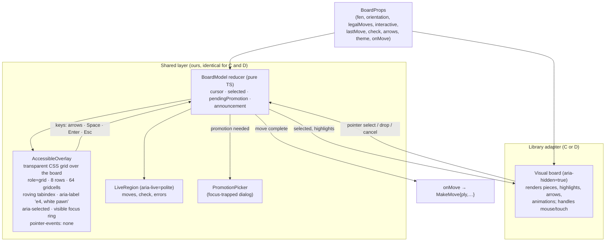
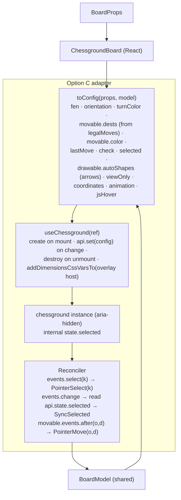
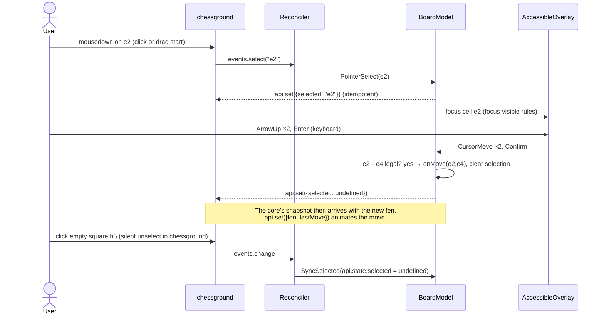
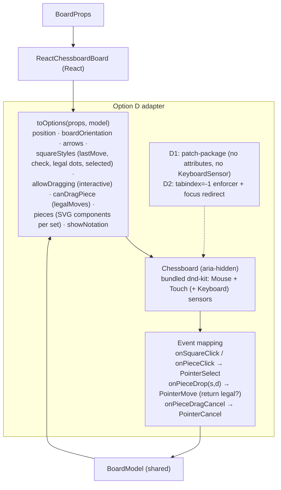

# Trade Study — GUI Board Component (Decision D-4) — Refined: chessground vs. react-chessboard

**Status:** DECIDED 2026-10-25. The user accepted the recommendation: **Option C (chessground + our keyboard and accessibility layer)**, gated by the 2-day spike in §9, with D1 as the fallback. Recorded as D-4 in [architecture.md](architecture.md) §11.
**Scope:** Options **C** and **D** from the [first-pass study](trade-study-gui-board.md). On 2026-10-25 the user decided that v1 will not build its own board (first-pass Option A). Option B (chessground with no keyboard or accessibility layer) fails the requirements gate.
**Anchors:** [requirements.md](requirements.md) (GUI-1..4, UI-3, UI-4, GAME-3, ANA-2, PLAT-3, NFR-6) and [architecture.md](architecture.md) (D-1 Tauri IPC, D-5 React + TypeScript + Vite, D-10 GPL-3.0-or-later, D-11 legal moves from the core).

| Option | Short name | What it is |
|---|---|---|
| **C** | chessground + layer | `@lichess-org/chessground` 10.x for rendering, pointer input, and animation, plus our shared keyboard and accessibility layer |
| **D** | react-chessboard + layer | `react-chessboard` 5.x for rendering, pointer input, and animation, plus the same shared layer. Two variants: **D1** patches out its built-in keyboard drag; **D2** works around it at run time without a patch |

---

## 1. Summary

| Option | Gate | Weighted score (/100) | Rank |
|---|---|---|---|
| **C — chessground + layer** | ✅ | **88.8** | **1** |
| D1 — react-chessboard + layer, patched | ✅ | 87.4 | 2 |
| D2 — react-chessboard + layer, run-time workaround | ✅ | 78.2 | 3 |

**Recommendation: Option C (chessground + our keyboard and accessibility layer)**, confirmed by a 2-day spike on its one real weakness (selection reconciliation), with **D1 as the fallback** behind the same `Board` interface (§9).

**Why.** C and D1 are close: 1.4 points apart, within the uncertainty of the scoring. The decision therefore rests on the kind of risk each one carries:
- **C's main weakness is ours to control.** chessground keeps its own selection state, which our reducer must reconcile (§6.3). That is bounded, unit- and E2E-testable code inside our repository.
- **D1's main weaknesses are external.** We would carry a patch against a single-maintainer library whose drag engine (`@dnd-kit/core` 6.x) is likely to change as dnd-kit moves to its rewrite.
- **The reason for using a library at all is battle-tested pointer interaction**, now that we're not building our own board. chessground is the strongest there: it is used by Lichess for every game.

D1 wins on React fit and on owning the selection outright. If an upstream change lands that makes react-chessboard's sensors configurable (no patch needed), D1 rises to about 92 and should be reconsidered (§8).

**Refinements since the first pass** (they apply to both options):
1. **Overlay grid instead of a hidden mirror grid.** The accessibility grid becomes a transparent overlay aligned exactly over the visual board, instead of a visually hidden copy. Focus rings and the VoiceOver cursor then appear on the real squares. This removes the first pass's "focus on an invisible element" concern and the need to draw a keyboard cursor through the library (§5).
2. **Controlled selection for chessground.** chessground accepts `selected` as a config value and fires `events.select`, so our reducer can drive its selection instead of mirroring it. This narrows C's two-states problem to reconciliation at a few known points (§6.3).
3. **D split into D1 and D2.** The first pass assumed D would be patched; the no-patch run-time workaround is now costed separately.

---

## 2. Requirements in play

Unchanged from the [first pass §2](trade-study-gui-board.md#2-requirements-that-drive-the-decision). The ones that separate C from D are:
- **GUI-2a:** click, drag, and touch quality.
- **GUI-2b and the mixed-input verification:** one selection state shared across mouse, keyboard, and typed input.
- **UI-4:** screen-reader labels and visible focus, checked by axe and a VoiceOver walk-through.
- **UI-3:** themes and piece sets.
- **GAME-3:** read-only board while rewound.

---

## 3. Method

### 3.1 Gate

Unchanged: an option must be able to meet every AGREED requirement. C, D1, and D2 all pass once the shared layer (§5) is included.

### 3.2 Refined criteria and weights

The first-pass criteria were designed to separate a custom board from libraries. Here both options share the same keyboard and accessibility layer, so the criteria are refined to measure **how well each library hosts that layer**, plus where the libraries genuinely differ. Scores are 1–5 in **half-point steps**; contribution = `weight × score / 5`.

| # | Criterion | Weight | What is measured |
|---|---|---|---|
| R1 | **Focus and keyboard hosting** (GUI-2b) | 12 | Can our overlay own all keyboard focus without the library competing for it (tab stops, key handlers)? |
| R2 | **Selection-state ownership** (mixed-input verification) | 12 | Can our reducer be the single source of selection truth, and how much reconciliation is needed? |
| R3 | **Screen-reader cleanliness** (UI-4) | 14 | Can the visual board be hidden from assistive technology cleanly (axe-clean), leaving only our overlay? |
| R4 | **Pointer interaction quality** (GUI-2a) | 14 | Drag, click-to-move, touch, snap-back, Safari/WKWebView behaviour; maturity in production |
| R5 | **Built-in visual feedback** (GUI-4) | 6 | Last move, check, legal destinations, move animation, arrows (ANA) out of the box |
| R6 | **React integration** (D-5, architecture principle 1) | 10 | Declarative, controlled, React 19; size and complexity of our wrapper |
| R7 | **Theming and piece sets** (UI-3) | 6 | Effort to deliver ≥ 10 board themes and ≥ 5 piece sets including high contrast |
| R8 | **Testability** | 8 | Playwright drag and click tests, stable selectors, axe, screenshots |
| R9 | **Maintenance and dependency health** | 8 | Maintainer depth, release cadence, upcoming churn, patches we must carry |
| R10 | **Effort and schedule risk** | 6 | Days to AGREED scope, including the shared layer |
| R11 | **Licensing** (D-10, NFR-6) | 2 | Compatibility with GPL-3.0-or-later |
| R12 | **Bundle size** (NFR-1) | 2 | Gzipped JavaScript; startup impact for a locally served app |
| | **Total** | **100** | |

Accessibility and keyboard hosting (R1–R3) carry 38; pointer quality carries 14 because it is now the main thing the library is for.

---

## 4. Research findings (new and refined)

All findings are from the published package source: `@lichess-org/chessground` 10.5.0 and `react-chessboard` 5.12.1 (which bundles `@dnd-kit/core` 6.3.1). Registry and repository data are as of 2026-10-25. Sources in §11.

### 4.1 chessground 10.5.0

| Topic | Finding | Impact |
|---|---|---|
| Focus and keyboard | No `tabindex`, no ARIA attributes, no key handlers anywhere in the source. Input listeners are `mousedown`, `touchstart`, and `contextmenu`. | The visual board can be `aria-hidden="true"` with **no axe violations**, and it never competes with our overlay for focus or keys. |
| Selection API | `Config.selected?: Key` sets the selection. `api.selectSquare(key \| null)` changes it programmatically. `events.select(key)` fires whenever a square is selected, **including at drag start** (`drag.ts` calls `board.selectSquare`). **Unselecting fires no event** (`board.unselect` has no callback). | Our reducer can push selection into chessground. Silent unselects (click elsewhere, drag end, move completion) must be detected from `events.change` / `movable.events.after` by reading `api.state.selected`. These are the reconciliation points. |
| Click-to-move control | `selectable.enabled: false` disables click-click moves (drag only). | Not needed: we keep chessground's click-to-move and reconcile. |
| Custom square classes | `highlight.custom: Map<Key, string>` adds CSS classes to chosen squares. | Selection, cursor, and hint styling can be pushed declaratively if needed. The overlay makes a library-drawn cursor unnecessary anyway. |
| Highlights and feedback | Built-in `last-move`, `check`, `move-dest` (legal destination dots), `selected` classes; animation on any position change via `api.set({fen})`; SVG arrows and circles via `drawable.autoShapes` with brushes. | Strong GUI-4 and analysis support out of the box. |
| Sizing hook | `addDimensionsCssVarsTo: HTMLElement` publishes `---cg-width` / `---cg-height` CSS variables. | The overlay can size itself to the exact board box with pure CSS. |
| Coordinates | `coordinates`, `coordinatesOnSquares`, `ranksPosition`. | GUI-3 covered. |
| Read-only | `viewOnly: true` binds no input events (GAME-3 rewound board, c–c games). | Clean read-only mode. |
| Safari | `jsHover` option: "enable JS-driven hover state handling to workaround Safari drag issue". | Known Safari drag quirk with a built-in workaround. Must be tested in WKWebView. |
| Trusted events | Ignores untrusted events unless `trustAllEvents: true`. | Playwright's real input is trusted; synthetic `dispatchEvent` tests won't work (use Playwright mouse/touch APIs). |
| Size | About 12 KB gzipped (`chessground.min.js`), zero dependencies. | Negligible. |
| Health | v10.5.0 released 2026-10-20, frequent releases, maintained by the Lichess organisation (~1.4k stars, 28 open issues). GPL-3.0-or-later. | Strong maintainer depth. Frequent releases mean pinning plus a small wrapper. |
| React | Community wrappers are stale (React ≤ 18, 2022). | We write our own wrapper (~100 lines: create on mount, `api.set` on prop changes, `destroy` on unmount). |

### 4.2 react-chessboard 5.12.1

| Topic | Finding | Impact |
|---|---|---|
| Focus and keyboard | Each piece is wrapped in a dnd-kit draggable that spreads the default `attributes` and `listeners`. dnd-kit's defaults set `tabIndex: 0` and `role: "button"` **even when dragging is disabled** (`aria-disabled` is set, but the element stays focusable). The sensor list is fixed: right-click-cancel pointer, `KeyboardSensor`, `TouchSensor`, `MouseSensor`. `KeyboardSensor` activates on `keydown` of a **focused** piece; each arrow press then moves it 25 px. | As shipped: up to 32 extra tab stops, even on read-only boards, plus a competing Space/arrow handler. Our overlay must keep focus away from pieces: **D1** patches the attributes and sensor out; **D2** forces `tabindex="-1"` on pieces at run time and redirects any focus that lands on the board to the overlay. |
| Screen reader | Pieces expose `role="button"`, `aria-roledescription="draggable"`, `aria-describedby` (dnd-kit instructions), and dnd-kit's default live-region announcements ("Picked up draggable item e2."). Squares are plain `div`s. | **D1:** the board can be `aria-hidden="true"` cleanly once pieces aren't focusable. **D2:** `aria-hidden` plus `tabindex="-1"` passes axe (`aria-hidden-focus` allows non-tabbable content), but it depends on run-time DOM changes to library-owned elements surviving React re-renders. |
| Selection | No click-to-move state of its own. `onSquareClick` / `onPieceClick` report clicks (with touch-tap emulation on squares); `onPieceDrop(src, dst) → boolean` reports drops (`false` rejects); `onPieceDragCancel` reports cancels. Drag state is transient and internal to dnd-kit. | **Our reducer owns selection completely**: no reconciliation. |
| Highlights and feedback | `squareStyles` (per-square CSS objects) for last move, check, legal dots (e.g., radial-gradient), and selection; `arrows` prop plus user-drawn arrows; position-change animation (`showAnimations`, `animationDurationInMs`). **No snap-back animation** after a rejected drop (roadmap item). | Good, but we compose the highlight styles ourselves, and snap-back must be added or accepted as instant. |
| API | One controlled component: `<Chessboard options={{ position, boardOrientation, squareStyles, arrows, allowDragging, canDragPiece, dragActivationDistance, pieces, showNotation, … }}/>`. React 19 peer dependency. | Excellent React fit: board = f(props). |
| Theming | Board via `lightSquareStyle` / `darkSquareStyle` / `boardStyle` objects. Pieces via a `pieces` map of render functions (SVG components). | Piece sets must be wrapped as React components or `` renderers; board themes are style objects. Fine, slightly more code than CSS classes. |
| Test hooks | Squares carry `id="{boardId}-square-e4"` and `data-square`/`data-row`/`data-column`; pieces carry `data-piece`. | Easy, stable drag and click targets in Playwright. |
| Size | About 39 KB gzipped (unminified ESM build, including bundled dnd-kit); smaller once minified by Vite. | Small; irrelevant for a locally served app. |
| Health | v5.12.1 released 2026-08-16; about 30k weekly downloads; 551 stars, 2 open issues; essentially one maintainer. Bundles `@dnd-kit/core` 6.3.1, whose last release was December 2024 while dnd-kit's maintainers build `@dnd-kit/react` (0.5.1, pre-1.0). MIT. | Thinner maintainer depth, and likely future churn if react-chessboard migrates to the dnd-kit rewrite. D1's patch must be re-applied on every upgrade. |

### 4.3 Findings that apply equally

- **License:** GPL-3.0-or-later (C) and MIT (D) both fit D-10. The project is GPL anyway because of Stockfish.
- **Promotion picker:** neither library has one; we build one focusable picker for both.
- **Piece sets:** the same license-audited sets (first pass §4.5) work with both: CSS backgrounds for C, React components for D.
- **WKWebView:** both use standard mouse and touch events supported by WebKit. C has a known Safari drag quirk with a built-in flag (`jsHover`); D has no documented Safari issue. Both need the desktop smoke test (architecture R-1).

---

## 5. Shared architecture (both options)

Both options use the same `Board` contract (first pass §5.0) and the same in-house layer. Only the **library adapter** differs.

**How the overlay works.**
- **Placement.** The overlay is an absolutely positioned CSS grid exactly covering the board's squares. For C it is sized from chessground's `---cg-width`/`---cg-height` variables; for D it fills the board wrapper. Orientation reverses the cell order.
- **Pointer pass-through.** `pointer-events: none` sends the mouse and touch to the library underneath, so the library's drag and click handling is untouched.
- **Focus.** Keyboard focus lives only in the overlay, with one tab stop and arrow keys moving between cells. The focus ring is drawn by the focused cell itself, so it sits on the real square: visible focus for sighted keyboard users, and the VoiceOver cursor lands where the square is.
- **Hiding the visual board.** It is `aria-hidden="true"`, so assistive technology sees only the labelled overlay grid and the live region.
- **Focus after mouse input.** After a pointer selection, focus moves to the matching overlay cell (shown only under `:focus-visible` rules). Selecting with the mouse and confirming with Enter therefore works.
- **Mixed input.** All selection decisions go through `BoardModel`. Pointer input reaches it through the adapter; keyboard input through the overlay.

**Shared-layer effort (either option):** reducer, overlay, live region, promotion picker, and their unit/axe tests: about **4–5 days**.

---

## 6. Option C: chessground + layer

### 6.1 Approach

Wrap `@lichess-org/chessground` 10.x in our own React component. `BoardProps` and `BoardModel` state are mapped to a chessground `Config` and applied with `api.set` on every change. The visual board is `aria-hidden`. chessground's click-to-move and drag stay enabled: its `events.select`, `movable.events.after`, and `events.change` feed the reducer. The reducer's selection is pushed back with `selected`.

### 6.2 Architecture

### 6.3 Selection reconciliation (C's key design problem)

chessground mutates its own selection on clicks and drags. Our reducer must stay the source of truth, and the two must agree after every event:

Reconciliation points: `events.select` (select, including drag start), `events.change` (catches silent unselects), `movable.events.after` (pointer move completed: dispatch, let the core confirm, revert via `fen` if rejected), drag cancel (seen as `events.change` with no move), Esc (reducer → `selectSquare(null)`), `interactive` → `viewOnly` toggling while rewound, and promotion (pawn shown on the last rank until the picker resolves). This is the bulk of C's extra work and its main bug risk. It is bounded to one module and testable with unit tests (reducer) plus Playwright (real chessground).

### 6.4 Effort (rough, one developer)

| Work item | Days |
|---|---|
| Shared layer (§5) | 4–5 |
| React wrapper, config mapping, `viewOnly`, coordinates, arrows | 1–2 |
| Reconciler + edge cases (silent unselect, drag cancel, rejected move revert, promotion) | 1.5–2 |
| Themes: board CSS ×10, piece-set CSS ×5 | 1 |
| Tests: Playwright mouse/drag/touch/keyboard/mixed, axe, screenshots, WKWebView smoke | 1.5–3 |
| **Total** | **9–13** |

### 6.5 Risks

| Risk | Likelihood / impact | Mitigation |
|---|---|---|
| Selection desync in an unanticipated sequence | Medium / medium | Reconciler is the single integration point; property-style Playwright sequences mixing clicks, drags, keys, Esc; spike first (§9) |
| chessground upgrade changes event timing or `state` shape | Low–medium / medium | Pin the version; reads of `api.state` limited to `selected`; wrapper tests run on every upgrade |
| Safari/WKWebView drag quirk | Medium / low | `jsHover` flag; desktop smoke test |
| Overlay misalignment on resize or with coordinates | Low / medium | Size from `---cg-*` variables; screenshot tests at several sizes and both orientations |

---

## 7. Option D: react-chessboard + layer

### 7.1 Approach

Use `<Chessboard options={…}/>` as a fully controlled component.
- **Into the board:** `position`, `boardOrientation`, `arrows`, and `squareStyles` (built from `BoardModel` + props: last move, check, legal dots, selection) are passed in.
- **Out of the board:** clicks arrive through `onSquareClick`/`onPieceClick`; drops through `onPieceDrop` (return `false` to reject); cancels through `onPieceDragCancel`.
- **Read-only:** `allowDragging: false` while rewound.
- **Accessibility:** the visual board is `aria-hidden`.

The built-in keyboard drag must be neutralised:
- **D1 (patch):** use `patch-package` to stop spreading dnd-kit `attributes` on pieces and to drop `KeyboardSensor` from the fixed sensor list. Also open an upstream PR adding a `sensors` (or `disableKeyboardDrag`) option.
- **D2 (run-time workaround):** after every render, set `tabindex="-1"` on piece elements (a layout effect plus a `MutationObserver`), and redirect any `focusin` inside the visual board to the overlay. `KeyboardSensor` then never receives a key event, because pieces never keep focus.

### 7.2 Architecture

### 7.3 Selection

There's nothing to reconcile. react-chessboard holds no selection; every click and drop is an event into `BoardModel`, and every highlight is an output through `squareStyles`. Mixed input is as simple as in a custom board. The only internal state is the in-flight drag, which always ends in `onPieceDrop` or `onPieceDragCancel`.

### 7.4 Effort (rough, one developer)

| Work item | D1 days | D2 days |
|---|---|---|
| Shared layer (§5) | 4–5 | 4–5 |
| Options mapping, `squareStyles` highlights incl. legal dots, arrows, read-only | 1–2 | 1–2 |
| Neutralise keyboard drag: patch + patch tests + upstream PR (D1) / enforcer + focus redirect + tests (D2) | 1 | 1 |
| Snap-back animation for rejected drops (or accept instant) | 0.5–1 | 0.5–1 |
| Themes: board style objects ×10, piece-set components ×5 | 1–1.5 | 1–1.5 |
| Tests: Playwright mouse/drag/touch/keyboard/mixed, axe, screenshots, WKWebView smoke | 1.5–3 | 1.5–3 |
| **Total** | **10–13** | **10–13** |

### 7.5 Risks

| Risk | Likelihood / impact | Mitigation |
|---|---|---|
| Patch fails to apply after an upgrade (D1) | Medium / medium | Pin version; patch tests in CI; upstream PR |
| Run-time `tabindex` enforcement races a re-render, briefly exposing tab stops (D2) | Medium / medium | `MutationObserver` plus layout effect; axe and tab-order E2E tests |
| Single maintainer; library migrates to `@dnd-kit/react` with breaking changes | Medium / medium | Pin; the `Board` contract isolates the blast radius; C is the fallback |
| No snap-back animation | High / low | Implement it in the adapter or accept an instant return |
| Drag feel below chessground's on trackpad or touch | Low–medium / medium | Covered by the spike comparison if the fallback is triggered |

---

## 8. Scoring

### 8.1 Scores

| # | Criterion | Wt | C | D1 | D2 | Rationale |
|---|---|---|---|---|---|---|
| R1 | Focus and keyboard hosting | 12 | **5** | 4.5 | 3 | C: nothing focusable, no key handlers. D1: clean after the patch, which is a maintained diff. D2: run-time enforcement against the library's own attributes. |
| R2 | Selection-state ownership | 12 | 3.5 | **5** | **5** | C: controlled via `selected` + `events.select`, but silent unselects need reconciliation. D: the library has no selection. |
| R3 | Screen-reader cleanliness | 14 | **5** | 4.5 | 3.5 | C: `aria-hidden` board is axe-clean as is. D1: clean once patched. D2: axe-clean only while the `tabindex` enforcement holds. |
| R4 | Pointer interaction quality | 14 | **5** | 4 | 4 | C: Lichess-proven drag, click, touch, snap-back; known Safari quirk has a flag. D: solid dnd-kit drag and touch-tap emulation; no snap-back animation. |
| R5 | Built-in visual feedback | 6 | **5** | 4 | 4 | C: last-move/check/legal-dot classes, animations, arrows built in. D: animations and arrows; highlights composed by us via `squareStyles`. |
| R6 | React integration | 10 | 3 | **5** | 4 | C: imperative instance behind our ~100-line wrapper. D1: native controlled React 19 component. D2: as D1, but with run-time DOM edits to library-owned nodes. |
| R7 | Theming and piece sets | 6 | **5** | 4 | 4 | C: CSS classes and piece CSS, the same mechanism Lichess uses for dozens of themes. D: style objects and SVG components; slightly more code per set. |
| R8 | Testability | 8 | 4 | **5** | 4.5 | D: `data-square`/`id` hooks for drag targets. C: drag targets via computed square positions; semantic tests run against the overlay in both. D2: extra tab-order tests. |
| R9 | Maintenance and dependency health | 8 | **4.5** | 3 | 3 | C: Lichess organisation, active, zero dependencies. D: single maintainer, frozen dnd-kit 6.x line with a rewrite pending; D1 also carries a patch, D2 depends on internal DOM structure. |
| R10 | Effort and schedule risk | 6 | 4 | 4 | 4 | All about 9–13 days; risk types differ but are scored in R2, R9. |
| R11 | Licensing | 2 | 5 | 5 | 5 | GPL-3.0-or-later vs. MIT; both fit D-10. |
| R12 | Bundle size | 2 | **5** | 4 | 4 | ~12 KB vs. ~39 KB gzipped (unminified); both negligible locally. |

### 8.2 Weighted totals

| Option | R1 | R2 | R3 | R4 | R5 | R6 | R7 | R8 | R9 | R10 | R11 | R12 | **Total** |
|---|---|---|---|---|---|---|---|---|---|---|---|---|---|
| **C** | 12.0 | 8.4 | 14.0 | 14.0 | 6.0 | 6.0 | 6.0 | 6.4 | 7.2 | 4.8 | 2.0 | 2.0 | **88.8** |
| D1 | 10.8 | 12.0 | 12.6 | 11.2 | 4.8 | 10.0 | 4.8 | 8.0 | 4.8 | 4.8 | 2.0 | 1.6 | 87.4 |
| D2 | 7.2 | 12.0 | 9.8 | 11.2 | 4.8 | 8.0 | 4.8 | 7.2 | 4.8 | 4.8 | 2.0 | 1.6 | 78.2 |

### 8.3 Sensitivity analysis

Totals are normalised to 100 when weights change.

| Scenario | C | D1 | D2 | Leader |
|---|---|---|---|---|
| Baseline | **88.8** | 87.4 | 78.2 | C (+1.4) |
| React integration (R6) weight doubled | 86.2 | **88.5** | 78.4 | D1 |
| Pointer quality (R4) weight halved | 88.0 | 88.0 | 78.1 | tie |
| Maintenance (R9) weight halved | **88.8** | 88.5 | 79.0 | C (+0.3) |
| Selection ownership (R2) weight doubled | 86.8 | **88.8** | 80.5 | D1 |
| R6 ×2, R4 ×½, R9 ×½ together | 85.1 | **90.3** | 79.0 | D1 |
| C scored pessimistically (R2 = 3, R10 = 3.5) | 87.0 | **87.4** | 78.2 | D1 (+0.4) |
| D1 optimistic: upstream `sensors` option accepted, so no patch (R1 = 5, R3 = 5, R4 = 4.5, R9 = 3.5) | 88.8 | **92.2** | 78.2 | D1 |

**Reading the sensitivity.** C and D1 are effectively tied. The leader flips whenever React integration or selection ownership is weighted more heavily, or pointer maturity and maintainer depth less heavily. D2 is clearly last in every scenario: a run-time workaround against a library's own attributes costs more than it saves. The weights therefore don't settle the choice. The tie-breakers in §9 do.

---

## 9. Recommendation

**Adopt Option C (chessground + our keyboard and accessibility layer) for v1, subject to a 2-day spike. Keep D1 as the fallback. Reject D2.**

**Tie-breakers, in order:**
1. **What the library is for.** Having decided not to build our own board, the main value bought from a library is mature pointer interaction and visual polish (R4, R5). chessground is the strongest here, proven on Lichess at very large scale.
2. **Who owns the risk.** C's weakness, selection reconciliation, is code we own, confined to one module, and testable. D1's weaknesses — a patch to carry, a single maintainer, and an upcoming drag-engine migration — sit outside our control.
3. **Accessibility cleanliness without modification.** chessground is inert to focus and assistive technology as shipped, so the overlay approach works against an unmodified library. D needs a patch or run-time DOM edits for the same result.

**Spike (2 days, at the start of GUI work), built against the `Board` contract with the real shared layer:**
- Implement the C adapter and Reconciler.
- **Exit criteria:**
  1. A scripted Playwright suite of mixed sequences — click→Enter, Space→click, drag start→Esc, click→click elsewhere→keyboard, rejected move revert, promotion via mouse and via keyboard — keeps `BoardModel.selected` and `api.state.selected` equal after every step.
  2. axe is clean with the overlay and an `aria-hidden` board.
  3. Overlay alignment holds in both orientations and at three sizes (screenshot tests).
  4. Drag works in Chrome, Safari, Firefox, and the Tauri WKWebView (with `jsHover` if needed).
- **If exit criterion 1 can't be met reliably,** switch the adapter to **D1**. The shared layer (reducer, overlay, live region, promotion picker) carries over unchanged; only the adapter is replaced, at about 3–4 days.

**Regardless of outcome:**
- Open an upstream issue or PR on react-chessboard proposing a configurable sensor list. If it lands before GUI work begins, re-score D1 (optimistic case: 92.2) before starting the spike.
- Pin the chosen library version and add its license to the third-party notices (NFR-6), along with the audited piece sets (first pass §4.5).

**If accepted, update architecture.md:** mark D-4 AGREED (chessground + shared keyboard/accessibility layer, D1 fallback), describe the overlay and reconciler in §6.2, add the spike to §13, and add a decision-log entry.

---

## 10. Comparison at a glance

| | C — chessground + layer | D1 — react-chessboard + layer (patched) | D2 — react-chessboard + layer (workaround) |
|---|---|---|---|
| Library modified? | No | Yes (patch) | No (run-time DOM edits) |
| Library focusable / exposed to assistive tech? | No / no | No / no (after patch) | Forced off at run time |
| Selection sources of truth | 1 owner + reconciliation | 1 | 1 |
| Pointer maturity | Lichess-proven | dnd-kit, good | dnd-kit, good |
| Snap-back animation | Built in | Add or accept instant | Add or accept instant |
| API style | Imperative behind our wrapper | Declarative, controlled | Declarative, plus DOM edits |
| Themes | CSS classes | Style objects + SVG components | Style objects + SVG components |
| Maintainer | Lichess organisation | Single maintainer | Single maintainer |
| Bundle (gzip) | ~12 KB | ~39 KB (unminified) | ~39 KB (unminified) |
| License | GPL-3.0-or-later | MIT | MIT |
| Rough effort | 9–13 days | 10–13 days | 10–13 days |
| Score | **88.8** | 87.4 | 78.2 |

---

## 11. Sources

Accessed 2026-10-25.

- `@lichess-org/chessground` 10.5.0: npm registry metadata and published package source (`src/config.ts`, `src/api.ts`, `src/board.ts`, `src/drag.ts`, `src/events.ts`, `dist/chessground.min.js`) — https://registry.npmjs.org/@lichess-org/chessground
- chessground repository — https://github.com/lichess-org/chessground
- `react-chessboard` 5.12.1: npm registry metadata and published `dist` (`ChessboardProvider.d.ts`, `types.d.ts`, `index.esm.js`: sensor setup, `Draggable`, square rendering, bundled dnd-kit `useDraggable` attributes and `KeyboardSensor`) — https://registry.npmjs.org/react-chessboard
- react-chessboard repository and README (features, roadmap) — https://github.com/Clariity/react-chessboard
- dnd-kit repository and documentation — https://github.com/clauderic/dnd-kit, https://docs.dndkit.com
- `@dnd-kit/core` and `@dnd-kit/react` registry metadata — https://registry.npmjs.org/@dnd-kit/core, https://registry.npmjs.org/@dnd-kit/react
- axe rule `aria-hidden-focus` (non-tabbable content inside `aria-hidden` passes) — https://dequeuniversity.com/rules/axe/4.10/aria-hidden-focus
- WAI-ARIA Authoring Practices: Grid pattern — https://www.w3.org/WAI/ARIA/apg/patterns/grid/
- Lichess blind mode guide — https://lichess.org/page/blind-mode-guide
- npm download counts — https://api.npmjs.org/downloads/point/last-week/
- First-pass study (requirements table, piece-set license audit, shared contract) — [trade-study-gui-board.md](trade-study-gui-board.md)
