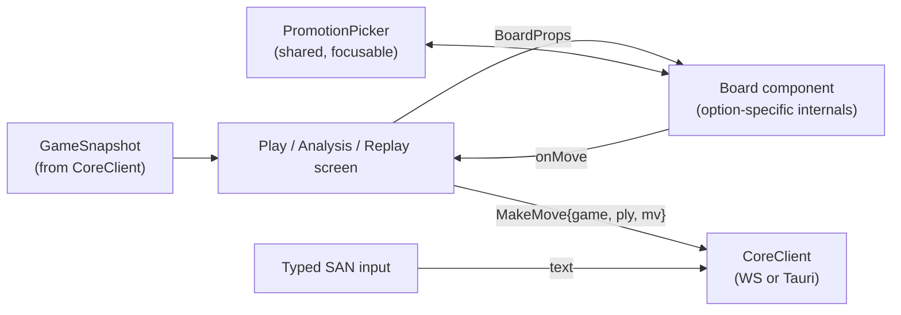
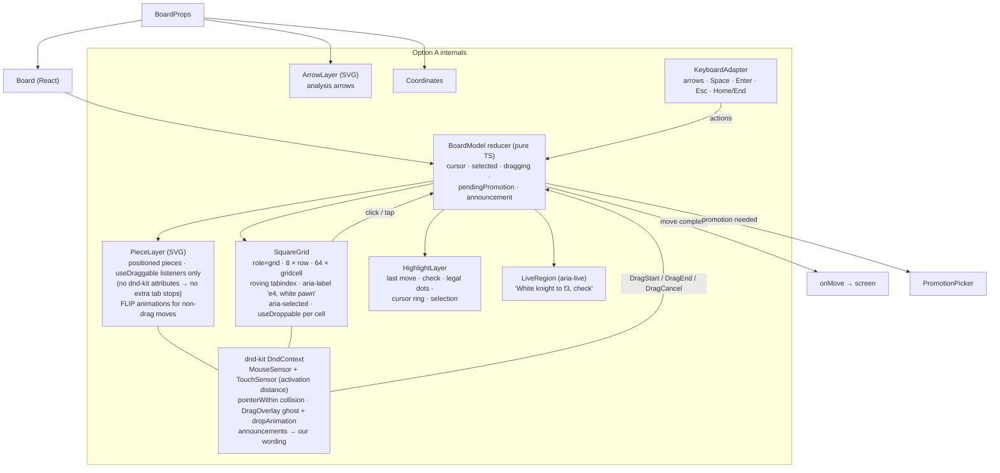
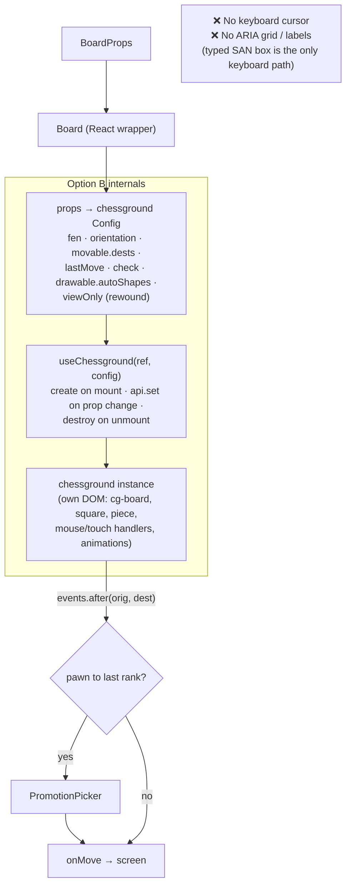
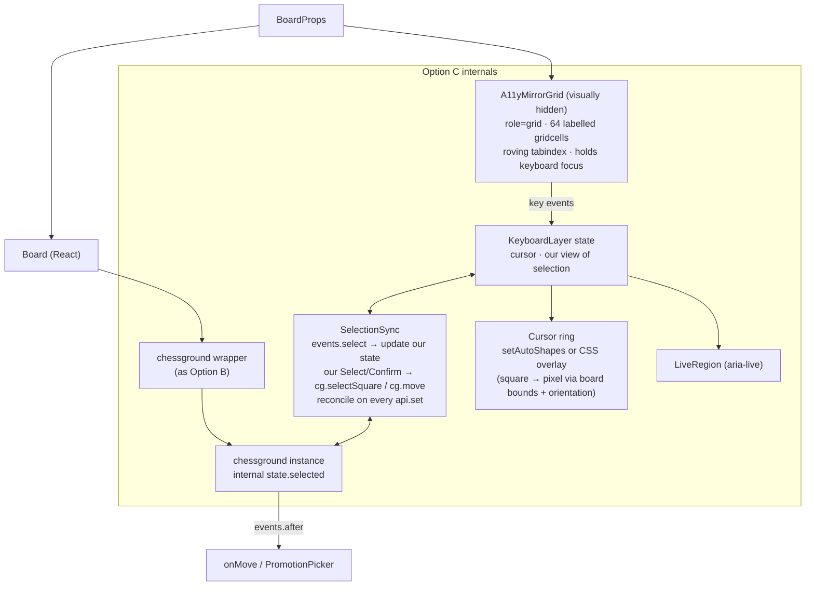
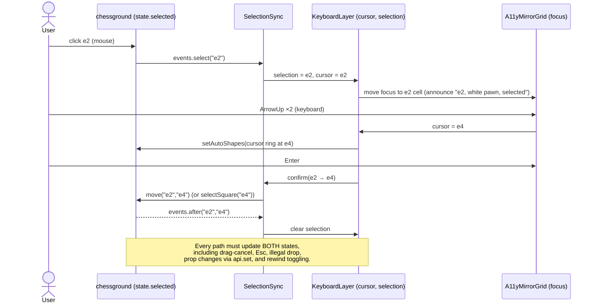
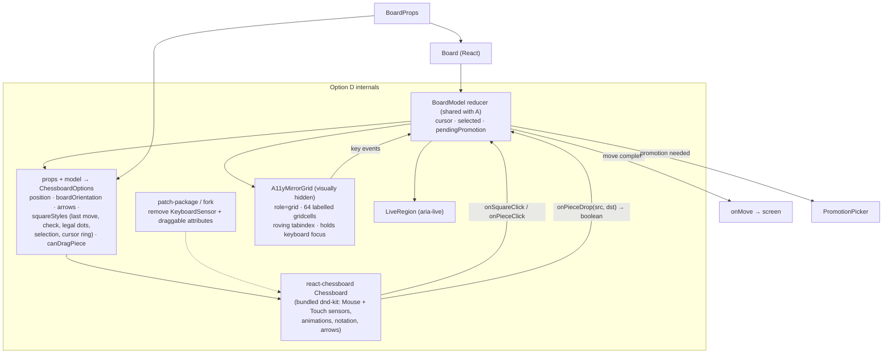

# Trade Study — GUI Board Component (Decision D-4) — First Pass

> **First pass, kept for the record (2026-10-25).** After this study, the user decided that v1 will **not** build its own board, so Option A is out of scope for v1. A refined study between Options C and D is in [trade-study-gui-board-refined.md](trade-study-gui-board-refined.md), and it supersedes this document's recommendation. **Outcome:** Option C (chessground + our keyboard and accessibility layer) was chosen (D-4, 2026-10-25). The content below is unchanged.

**Status:** COMPLETE (first pass, superseded). Revision 2, 2026-10-25.
**Changes in revision 2:** added **Option D (react-chessboard)**; Option A now uses **dnd-kit** for drag-and-drop; research, architecture, effort, scores, and sensitivity analysis updated.
**Decision:** D-4 in [architecture.md §11](architecture.md). This study replaces the short comparison in §11.1 as the basis for the decision.
**Anchors:** [requirements.md](requirements.md) (GUI-1..4, UI-3, UI-4, GAME-3, ANA-2, PLAT-3, NFR-6) and [architecture.md](architecture.md) (D-1 Tauri IPC, D-5 React + TypeScript + Vite, D-10 GPL-3.0-or-later, D-11 legal moves from the core).

---

## 1. Summary

| Option | Description | Gate (meets all AGREED reqs?) | Weighted score (/100) |
|---|---|---|---|
| **A** | Our own React + SVG board, with **dnd-kit** for drag-and-drop | ✅ Pass | **91.0** |
| **B** | `chessground` used directly | ❌ Fail (no keyboard model, no screen-reader support) | 56.4 |
| **C** | `chessground` for visuals and pointer input, plus our own keyboard and accessibility layer | ✅ Pass | 68.2 |
| **D** | `react-chessboard` for visuals and pointer input, plus our own keyboard and accessibility layer (and a patch to its built-in keyboard drag) | ✅ Pass (as is: ❌) | 72.4 |

**Recommendation: Option A (own React + SVG board with dnd-kit).** Start with a time-boxed drag-and-drop spike, and keep Option C as the fallback behind the same `Board` interface (§8).

A wins because the deciding requirements are keyboard operation, mixing mouse and keyboard within one move, and screen-reader support. All three are AGREED, and all three have automated tests. A meets them natively with one selection state and one board DOM. dnd-kit now covers most of A's former weak spot (pointer and touch drag). D is the strongest of the library-based options: it is declarative React, and selection can stay in our own state. But it needs a hidden accessibility mirror and a patch to switch off its built-in keyboard drag. C meets the requirements but keeps two selection states in sync. B can't meet them without becoming C. A stays first in every sensitivity case tried (§6.3).

---

## 2. Requirements that drive the decision

| Req | What the board must do | Notes |
|---|---|---|
| GUI-1 | One codebase for web and desktop (WKWebView in Tauri) | All options are web tech; all run in Chromium, WebKit, Firefox |
| GUI-2a | Mouse click-to-move and drag-and-drop; touch tap-to-move on web | |
| GUI-2b | Keyboard: arrows move a cursor, Space selects, arrows choose a destination, Enter confirms, Esc cancels, keyboard promotion picker, feedback when a piece has no legal moves | Verified by E2E |
| GUI-2 (verification) | **Mixed input mid-move**: e.g., select with the mouse, confirm with Enter, with sensible behaviour | Implies **one shared selection state** across input methods |
| GUI-2c | Typed algebraic notation next to the board | Lives outside the board in every option |
| GUI-3 | A–H / 1–8 coordinates, toggleable; correct in both orientations | |
| GUI-4 | Highlight last move, check, legal destinations; engine-thinking indicator | |
| UI-3 | ≥ 10 board themes, ≥ 5 piece sets including high-contrast; screenshot tests | |
| UI-4 | Keyboard-operable; screen-reader labels for squares, pieces, moves; sufficient contrast; axe audit; VoiceOver walk-through | Verified by axe + manual |
| GAME-3 | Read-only board while rewound | |
| ANA-2/3 | Analysis board for what-if branches; best-move display | Arrows are useful but not required |
| PLAT-3 | Fully offline: no CDN, everything bundled | |
| NFR-6 | License compliance for code and assets | Applies to piece-set artwork too |

---

## 3. Scoring method

### 3.1 Gate

An option must be able to meet **every AGREED requirement** as specified, without becoming a different option. An option that fails the gate is still scored, for transparency, but can't be recommended. Options C and D are defined *with* the additions needed to pass the gate, and those additions are costed in their scores.

### 3.2 Criteria and weights

Each criterion is scored **1–5** (1 = poor or not met, 3 = acceptable with notable work or risk, 5 = excellent). The weighted contribution is `weight × score / 5`, so a perfect option scores 100.

| # | Criterion | Weight | Why this weight |
|---|---|---|---|
| C1 | **Keyboard model** (GUI-2b) | 15 | AGREED requirement with explicit E2E tests; a primary input method |
| C2 | **Mixed input / single selection state** (GUI-2 verification) | 10 | AGREED verification; the main source of subtle bugs if state is split |
| C3 | **Screen-reader accessibility** (UI-4) | 15 | AGREED requirement; axe in CI and a VoiceOver walk-through |
| C4 | **Pointer interaction quality**: drag, click, touch, animation (GUI-2a) | 12 | Most visible part of the feel; drag is "proposed but accepted" in GUI-2 |
| C5 | **Architectural fit**: React, declarative rendering from `GameSnapshot`, one source of truth | 10 | Matches principles 1 and 4 in architecture.md; affects every screen that shows a board |
| C6 | **Testability**: Playwright, axe, screenshot diffs, unit tests | 10 | test-strategy principle 3 (one scenario, three front-ends) and visual regression |
| C7 | **Implementation effort and schedule risk** | 10 | Solo-project reality; effort to reach the AGREED feature set, not to a demo |
| C8 | **Maintainability and dependency risk** | 8 | Long-term cost of owning code, tracking external libraries, or carrying patches |
| C9 | **Theming and board features** (UI-3, GUI-3/4, arrows for analysis) | 5 | Needed, but mostly CSS/asset work in every option |
| C10 | **Licensing and offline compliance** (D-10, PLAT-3, NFR-6) | 5 | Must hold; all options are expected to pass |
| | **Total** | **100** | |

Accessibility and keyboard criteria (C1–C3) total 40. That reflects their status as AGREED, tested requirements, not a preference. §6.3 tests whether the result depends on this weighting.

---

## 4. Research findings

Research done 2026-10-25, from project pages, npm registry metadata, and the **published package source** of chessground 10.5.0 and react-chessboard 5.12.1. Sources in §10.

### 4.1 chessground (Options B and C)

| Finding | Detail |
|---|---|
| Identity | Lichess's board UI library, now published as **`@lichess-org/chessground`** (the old `chessground` package stopped at 9.2.1, May 2025). |
| Activity | **v10.5.0 published 2026-10-20**; frequent releases (10.4.1 on 2026-09-29, 10.4.2 on 2026-10-03). ~1.4k GitHub stars, 28 open issues. About 4.9k weekly npm downloads for the new package name, plus 7.1k for the legacy one. |
| License | **GPL-3.0-or-later**: compatible with D-10. |
| Size / deps | About 10 KB gzipped, **zero runtime dependencies**, about 3,400 lines of TypeScript. |
| Features | Drag-and-drop and click-to-move with touch support, premoves, animations, last-move/check highlights, move-destination dots, arrows/circles (SVG), coordinates, orientation, FEN in/out, CSS theming, 3D pieces. No chess logic (legal destinations come from the app via `movable.dests`, which our snapshot already has, D-11). |
| Rendering | Imperative, framework-agnostic. `Chessground(element, config)` builds its own DOM out of custom elements (`cg-wrap`, `cg-board`, `square`, `piece`, `coords`) plus SVG layers for shapes. Updates go through `api.set(config)`. Internal state is readable via `api.state` ("write at your own risks"). |
| Programmatic API | `selectSquare(key, force?)` ("click a square programmatically"), `move(orig, dest)`, `cancelMove()`, `setAutoShapes(shapes)`, `getKeyAtDomPos(pos)`, `toggleOrientation()`, `stop()`, `destroy()`. |
| **Keyboard support** | **None.** The 10.5.0 source has no `keydown`/`keyup` handlers and no `tabindex`. Input listeners are `mousedown`, `touchstart`, and `contextmenu` only. |
| **Screen-reader support** | **None.** There are no ARIA roles or labels in the source. Squares and pieces are unlabelled custom elements. |
| How Lichess handles this | Keyboard move entry is a separate text box (typed SAN). Screen-reader users get a separate text-based **blind mode** ("Your move" edit field, commands to query pieces by type, rank, or file), not an accessible graphical board. |
| Promotion | Not provided. The app must show a piece picker. |
| React integration | Community wrappers are stale. `@react-chess/chessground` 1.3.4 was published 2022-09-20; it pins chessground 8.3.5, supports React ≤ 18, and gets about 129 weekly downloads. **We would write our own wrapper** for React 19 (current: 19.3.1). |

### 4.2 react-chessboard (Option D)

| Finding | Detail |
|---|---|
| Identity / activity | **`react-chessboard` v5.12.1, published 2026-08-16.** About 30k weekly npm downloads, 551 GitHub stars, 2 open issues. Essentially a single-maintainer project. |
| License / deps | **MIT.** Depends on `@dnd-kit/core` ^6.3.1 and `@dnd-kit/modifiers` ^9.0.0 (bundled into its build output). Peer dependency: **React 19**. |
| API style | **Declarative and controlled**: one `<Chessboard options={…}/>` component. `position` (FEN or object), `boardOrientation`, `squareStyles` (per-square CSS, which is how highlights are drawn), `arrows`, `showNotation`, `showAnimations` / `animationDurationInMs`, `allowDragging`, `dragActivationDistance`, `canDragPiece`, a custom `pieces` render object (SVG components), and a `squareRenderer` for custom square content. |
| Events | `onPieceDrop({piece, sourceSquare, targetSquare}) → boolean` (return `false` to reject and snap back), `onSquareClick`, `onPieceClick`, `onPieceDrag`, `onPieceDragCancel`, mouse over/out/down/up, right-click, `onArrowsChange`. |
| Click-to-move | **Not built in as a behaviour.** The app implements it with `onSquareClick`/`onPieceClick` plus its own selection state, drawn through `squareStyles`. For us that is an advantage: selection stays in our state. |
| Drag implementation | dnd-kit `DndContext` with **hard-coded sensors**: a right-click-cancel pointer sensor, **`KeyboardSensor`**, `TouchSensor`, and `MouseSensor`. There is no option to change the sensor list. Pieces are `useDraggable` with dnd-kit's default `attributes` spread onto them; squares are `useDroppable`. |
| **Keyboard support (as is)** | dnd-kit's generic keyboard drag, not GUI-2b's model. Every piece is its own tab stop (`tabIndex=0`, `role="button"`, `aria-roledescription="draggable"`), so there are up to 32 tab stops, and empty squares can't be focused. Space picks a piece up, and each arrow press moves it **25 px** (dnd-kit's default coordinate step, not one square). The bundle passes no custom coordinate getter. |
| **Screen-reader support (as is)** | dnd-kit's default live-region announcements ("Picked up draggable item e2.") and drag instructions. Squares are plain `div`s with no grid role or labels. They carry `id` and `data-square`/`data-row`/`data-column` attributes, which help tests, not screen readers. The README lists "Accessible" as a feature, while its roadmap still has "review and enhance sensor implementations and accessibility". |
| Animation | Piece-movement animation on position change (configurable duration), including promotion-aware position diffs. Animating a piece back after a failed drop is a roadmap item, not yet a feature. |
| Promotion | No picker; only animation handling of promotion. The app supplies the picker. |
| Consequence for D | To pass the gate, D needs (1) our keyboard and accessibility layer and (2) its built-in `KeyboardSensor` and draggable `attributes` removed. Otherwise the pieces' tab stops and Space handling compete with our grid. Because the sensors can't be configured, that means a small **patch** (e.g., `patch-package`), a **fork** (MIT allows it), or an upstream PR adding a `sensors` option. Hiding the board with `aria-hidden` doesn't work (focusable children violate axe `aria-hidden-focus`), and `inert` would also block mouse input. |

### 4.3 dnd-kit (part of Option A; also inside Option D)

| Finding | Detail |
|---|---|
| Packages | **`@dnd-kit/core` 6.3.1** (published 2024-12-05; about 18.6M weekly downloads; peer React ≥ 16.8, works with React 19). **`@dnd-kit/react` 0.5.1** (published 2026-10-15) is the maintainers' newer rewrite, still pre-1.0. Repository very active (pushed 2026-10-22, ~17.8k stars). MIT. |
| Model | `DndContext` + `useDraggable` / `useDroppable` hooks; **sensors** (`PointerSensor`, `MouseSensor`, `TouchSensor`, `KeyboardSensor`) chosen by the app; activation constraints (distance or delay), which separate a click from a drag; pluggable collision detection (`pointerWithin`, `rectIntersection`, …); `DragOverlay` for a ghost that follows the pointer, with a configurable `dropAnimation`. |
| Accessibility hooks | The `accessibility` prop on `DndContext` sets custom `announcements` and `screenReaderInstructions`. Draggables return separate `attributes` (role, tabIndex, ARIA) and `listeners`. **An app can attach listeners without the attributes**, so pieces don't become extra tab stops. |
| Fit with GUI-2b | dnd-kit's keyboard model (focus a draggable, Space to pick up, arrows to move, Space to drop) differs from GUI-2b's cursor/select/confirm model. **For A, use dnd-kit only for pointer and touch dragging**, and handle the keyboard with our own grid reducer (no `KeyboardSensor`). |
| Version choice for A | `@dnd-kit/core` 6.3.1: stable, the same line react-chessboard ships, and widely deployed. Re-evaluate `@dnd-kit/react` when it reaches 1.0. The board keeps dnd-kit behind a small `PointerDrag` adapter, so swapping versions — or falling back to plain Pointer Events — stays local. |

### 4.4 Our own board (Option A, non-drag parts)

| Finding | Detail |
|---|---|
| Accessibility pattern | WAI-ARIA APG **grid** pattern: container `role="grid"` with a label, `row` children, and `gridcell` cells. Arrow keys move focus one cell at a time, with no wrap. Home/End and Ctrl+Home/End jump. Exactly one element in the tab sequence (roving tabindex or `aria-activedescendant`). `aria-selected` marks selection. This maps directly onto GUI-2b. |
| Animation | Non-drag moves (engine replies, takeback, rewind steps) animate with CSS transforms on positioned pieces (FLIP technique); drag drops use dnd-kit's `DragOverlay` drop animation. React state stays the single source of truth. |
| Browser support | Pointer and touch events used by dnd-kit, plus CSS transforms, work in Chromium, Firefox, Safari, and WKWebView. |

### 4.5 Shared findings (all options)

| Finding | Detail |
|---|---|
| Piece-set licenses | Lichess's piece sets carry mixed licenses. **GPL-compatible**: cburnett, merida, mono (GPLv2+); mpchess (GPLv3+); chessnut (Apache-2.0); fantasy, spatial, celtic, staunton (MIT); rhosgfx (CC0); kiwen-suwi, firi, totoy, papercut (CC BY 4.0); shapes (CC BY-SA 4.0). **Not usable** (non-commercial or unclear): horsey, california, maestro, cardinal, tatiana, staunty, alpha, leipzig, and others. More than 5 usable sets exist, including mono for high contrast. **Each set is license-audited regardless of option.** |
| Board themes | Board colours are CSS (two square colours or an image). 10 themes are a CSS-variables exercise in every option. |
| Promotion picker | Needed in every option. No library provides one, and the keyboard requirement needs a focusable one anyway. |
| Typed SAN input | Sits next to the board in every option and goes to the core for parsing. |
| Offline | All options are bundled npm code and local assets; nothing fetched at run time. |
| WKWebView | No option has a desktop-specific risk. |

---

## 5. Options in detail

### 5.0 Common contract: the `Board` component interface

Whichever option is chosen, the rest of the UI talks to the board through one React component interface. That keeps the decision reversible (§8).

```ts
interface BoardProps {
  fen: string;                         // position to show (live, rewound, or analysis branch)
  orientation: 'white' | 'black';
  legalMoves: Map<Square, Square[]>;   // from GameSnapshot (D-11); empty when not interactive
  interactive: boolean;                // false while rewound (GAME-3), on computer turns, c–c games
  lastMove?: [Square, Square];
  check?: Square;
  arrows?: Arrow[];                    // analysis best moves (ANA-1/2/3)
  showCoordinates: boolean;            // GUI-3
  showLegalHints: boolean;             // UI-1
  theme: { board: BoardThemeId; pieces: PieceSetId };   // UI-3
  onMove(move: { from: Square; to: Square; promotion?: Role }): void;   // → MakeMove{ply,…}
  onIllegalAttempt?(reason: string): void;
}
```

The board never decides legality; it only offers the destinations in `legalMoves`. The core still validates every `MakeMove` (and its `ply`), as in architecture.md §4.2.



**Parts reusable across options:** the selection/keyboard reducer (`BoardModel`), the ARIA grid, the live region, and the promotion picker. A builds them as the board itself; C and D build them as layers over a library. That reuse is what makes the fallback in §8 cheap.

### 5.1 Option A: our own React + SVG board, with dnd-kit for drag

**Approach.** The board is a React component tree rendered directly from `BoardProps` plus a small local state machine. Squares are focusable cells in an ARIA grid; pieces are SVG images positioned over the squares. **dnd-kit handles pointer and touch dragging**: activation distance to tell a click from a drag, collision detection, the ghost piece via `DragOverlay`, and the drop animation. Our reducer handles everything else. All inputs dispatch actions into one reducer: clicks and taps (from the grid cells), drags (dnd-kit `onDragStart`/`onDragEnd`/`onDragCancel`), and keys. A selection made with the mouse can therefore be confirmed with Enter, and vice versa.

**Architecture.**



**Key design points.**
- **One reducer, many inputs.** `BoardModel` is a pure TypeScript reducer, `(state, action) → state`, with actions such as `SquareClick(sq)`, `DragStart(sq)`, `DragEnd(sq | null)`, `CursorMove(dir)`, `Select`, `Confirm`, `Cancel`. It is unit-tested exhaustively without a DOM, including every mixed-input sequence.
- **dnd-kit kept in its lane.** It owns only the transient mechanics of a drag. No `KeyboardSensor`; draggable `attributes` are not spread, so the grid cells stay the only focus targets; dnd-kit's announcements are replaced with our move wording (or suppressed in favour of our live region) to avoid double announcements. Illegal drops return to the origin via `DragOverlay`'s drop animation.
- **Declarative rendering.** Rewind, replay, and analysis boards are the same component with different props.
- **Animation.** Non-drag moves animate by transform (FLIP); disabled under `prefers-reduced-motion`.
- **Estimated size.** About 1,000–1,500 lines of TypeScript/TSX plus CSS, excluding theme assets. Adds `@dnd-kit/core` (and optionally `@dnd-kit/modifiers`) as dependencies.

**Effort (rough, one developer).**

| Work item | Days |
|---|---|
| Board contract, reducer, grid rendering, coordinates, highlights | 2–3 |
| Keyboard adapter + ARIA grid + live region + promotion picker | 2–3 |
| dnd-kit integration: sensors and activation, droppable cells, `DragOverlay` ghost, drop/snap-back animation, touch | 2–3 |
| FLIP animations for non-drag moves, reduced motion | 1–2 |
| Arrows for analysis | 1 |
| Tests: reducer unit tests, Playwright (mouse, drag, keyboard, mixed, touch), axe, screenshots | 2–3 |
| **Total** | **10–15** |

**Risks.**
- Drag feel still needs tuning (activation distance, ghost offset, drag off the board). *Mitigation:* spike first (§8); dnd-kit is used only for pointer and touch dragging, behind a `PointerDrag` adapter.
- dnd-kit's main line is in transition (6.x stable, `@dnd-kit/react` 0.x rewrite). *Mitigation:* pin 6.3.1; re-evaluate at `@dnd-kit/react` 1.0; the adapter limits the blast radius.
- Animation edge cases (castling moves two pieces; en passant removes a piece off the destination square). *Mitigation:* key pieces by identity across positions; unit-test the diff.

### 5.2 Option B: chessground used directly

**Approach.** Wrap `@lichess-org/chessground` 10.x in a small React component (our own wrapper, since the community ones are stale). Pass legal destinations through `movable.dests`, receive moves through `events.after`, and show our own promotion picker when a pawn reaches the last rank. Keyboard play would rely solely on the typed-SAN box, as on Lichess.

**Architecture.**



**Key design points.**
- **State duplication.** chessground keeps its own copy of position and selection. Our wrapper must push every prop change through `api.set` and avoid echo loops.
- **Very fast to a polished-looking board.** Drag, animation, touch, premove, and arrows are production-grade from day one.
- **Fails the gate.** GUI-2b and UI-4 can't be met. Adding them turns B into Option C.

**Effort (rough).** Wrapper and config mapping 1–2 days; promotion picker 1 day; themes/assets 1 day; tests 1–2 days. **Total: 4–6 days** — but the result doesn't meet AGREED requirements.

**Risks.** Requirements non-compliance (fatal); wrapper maintenance across chessground releases.

### 5.3 Option C: chessground + our keyboard and accessibility layer

**Approach.** Keep Option B's wrapper for visuals and pointer input, and add two layers of our own:
1. A **keyboard layer** that tracks a cursor square. It draws the cursor ring over chessground (with `setAutoShapes` or a positioned CSS overlay), and on Space/Enter it drives chessground through `selectSquare()` / `move()`.
2. An **accessibility mirror**: a visually hidden ARIA grid with labelled cells, kept in sync with the position. Keyboard focus lives in this grid, so screen readers announce cells while sighted keyboard users watch the cursor ring on the visual board.

**Architecture.**



**Mixed-input flow, showing the two sources of truth:**



**Key design points.**
- Meets the gate: keyboard model, mixed input, and screen-reader labels are all achievable.
- **Two sources of truth.** chessground's internal selection and our keyboard-layer selection must agree after every event. This is the main ongoing cost and bug risk.
- **Two DOMs.** Focus is on an invisible mirror grid while the visible cursor is drawn elsewhere, which needs care for UI-4's "visible focus".
- Couples to chessground internals (`state.selected`, documented as "write at your own risks") across its frequent releases.

**Effort (rough).**

| Work item | Days |
|---|---|
| chessground wrapper + config mapping + promotion picker (as B) | 2–3 |
| Keyboard layer + cursor ring + coordinate mapping (both orientations, resize) | 2–3 |
| SelectionSync + reconciliation edge cases | 2–3 |
| A11y mirror grid + live region + focus-visibility design | 2 |
| Tests: Playwright (mouse, keyboard, mixed, touch), axe, screenshots, sync edge cases | 2–3 |
| **Total** | **10–14** |

**Risks.** Selection desync bugs (high likelihood, medium impact); breakage on chessground upgrades (medium); focus visibility for sighted keyboard users (medium).

### 5.4 Option D: react-chessboard + our keyboard and accessibility layer

**Approach.** Use `react-chessboard` 5.x as the visual board and drag engine. Because it is **controlled and declarative**, our existing `BoardModel` reducer can own selection and cursor state outright:
- Clicks come in through `onSquareClick`/`onPieceClick`.
- Drags come in through `onPieceDrop` (return `false` to reject).
- Highlights — last move, check, legal dots, the selected square, and the keyboard cursor ring — all go out through `squareStyles`.
- `position` and `arrows` come straight from `BoardProps`.

Two additions are needed to pass the gate:
1. A **visually hidden ARIA mirror grid** (as in C) for keyboard focus and screen-reader labels. react-chessboard's square DOM can't carry grid/row roles; `squareRenderer` controls only a square's contents, not its container or ancestors.
2. **Removal of the built-in `KeyboardSensor` and draggable `attributes`**, through a patch or fork, because the sensor list can't be configured. Without it, up to 32 piece tab stops and dnd-kit's 25 px keyboard drag compete with our grid.

**Architecture.**



**Key design points.**
- **One selection state.** Unlike C, there is no hidden library selection to reconcile, because react-chessboard has no click-to-move state of its own. The only internal state is the transient drag, which reports back through `onPieceDrop`/`onPieceDragCancel`. Mixed input works like A's.
- **Cursor ring without pixel maths.** The keyboard cursor is just another entry in `squareStyles`, so there's no coordinate mapping across orientations or resizes.
- **Two DOMs remain.** As in C, focus sits on the hidden mirror grid while the visible board shows the cursor ring, which needs care for UI-4's "visible focus".
- **Carrying a patch.** Every react-chessboard upgrade means re-applying and re-testing the patch until an upstream `sensors` option exists. An upstream PR is a reasonable contribution, but its acceptance is outside our control.
- **Gaps to fill.** Snap-back animation after a rejected drop is still on the library's roadmap, and there's no promotion picker.

**Effort (rough).**

| Work item | Days |
|---|---|
| Options mapping from `BoardProps` + reducer + click-to-move + `squareStyles` highlights | 1–2 |
| Promotion picker | 1 |
| Patch/fork to remove keyboard sensor and draggable attributes; patch tests | 1 |
| Keyboard layer (cursor via `squareStyles`) + A11y mirror grid + live region + focus-visibility design | 3–4 |
| Snap-back / drag polish gaps | 1 |
| Tests: Playwright (mouse, drag, keyboard, mixed, touch), axe, screenshots | 2–3 |
| **Total** | **9–12** |

**Risks.** The patch breaks on upgrade (medium likelihood, medium impact); dependency on a single-maintainer library (medium); focus visibility with a hidden mirror grid (medium); axe or VoiceOver friction from a visual board that is present but silent to assistive technology (low–medium).

---

## 6. Scoring

### 6.1 Scores

| # | Criterion | Wt | A | B | C | D | Rationale |
|---|---|---|---|---|---|---|---|
| C1 | Keyboard model | 15 | **5** | 1 | 4 | 3 | A: built to spec as an ARIA grid; dnd-kit isn't used for the keyboard. B: none (verified in source). C: achievable, driving chessground indirectly. D: achievable via the mirror grid, but only after patching out the built-in dnd-kit keyboard drag (which conflicts as shipped). |
| C2 | Mixed input / single state | 10 | **5** | 1 | 3 | 4 | A: one reducer. B: impossible. C: two selection states kept in sync by hand. D: one selection state (the library has none), with transient drag state reported through callbacks. |
| C3 | Screen-reader accessibility | 15 | **5** | 1 | 3 | 3 | A: the visible board *is* the accessible grid. B: unlabelled. C and D: hidden mirror grid; workable, but focus sits on an invisible element. |
| C4 | Pointer quality (drag/click/touch/animation) | 12 | 4 | **5** | **5** | 4 | B/C: battle-tested on Lichess. A: dnd-kit provides robust drag and touch mechanics; the feel is tuned by us. D: dnd-kit plus built-in animations, but no snap-back animation yet. |
| C5 | Architectural fit | 10 | **5** | 2 | 2 | 4 | A: pure function of props, React-native hooks. D: declarative, controlled, React 19, but fixed internals. B/C: imperative instance with its own state, and our own wrapper. |
| C6 | Testability | 10 | **5** | 3 | 3 | 4 | A: semantic selectors, clean axe, reducer unit tests. D: `data-square` hooks and a shared reducer, but two DOMs. B/C: no roles, two DOMs and sync edge cases (C). |
| C7 | Effort and schedule risk | 10 | 3 | **5** | 3 | 3 | A: ~10–15 days. B: ~4–6 but non-compliant. C: ~10–14. D: ~9–12, plus patch risk. |
| C8 | Maintainability and dependency risk | 8 | 4 | 4 | 2 | 3 | A: our code plus a very widely used dnd-kit, isolated behind an adapter. B: active, zero-dependency library. C: coupled to chessground internals. D: single-maintainer library plus a patch to carry. |
| C9 | Theming and features | 5 | 4 | **5** | **5** | **5** | All theme via CSS/assets. B/C/D have arrows built in; A builds arrows (≈1 day). |
| C10 | Licensing and offline | 5 | 5 | 5 | 5 | 5 | chessground GPL-3.0-or-later; react-chessboard and dnd-kit MIT; all bundled. Piece-set audit needed in all options. |

### 6.2 Weighted totals

| Option | C1 | C2 | C3 | C4 | C5 | C6 | C7 | C8 | C9 | C10 | Gate | **Total** | Rank |
|---|---|---|---|---|---|---|---|---|---|---|---|---|---|
| **A — own React + SVG + dnd-kit** | 15.0 | 10.0 | 15.0 | 9.6 | 10.0 | 10.0 | 6.0 | 6.4 | 4.0 | 5.0 | ✅ | **91.0** | **1** |
| D — react-chessboard + layer | 9.0 | 8.0 | 9.0 | 9.6 | 8.0 | 8.0 | 6.0 | 4.8 | 5.0 | 5.0 | ✅ | 72.4 | 2 |
| C — chessground + layer | 12.0 | 6.0 | 9.0 | 12.0 | 4.0 | 6.0 | 6.0 | 3.2 | 5.0 | 5.0 | ✅ | 68.2 | 3 |
| B — chessground directly | 3.0 | 2.0 | 3.0 | 12.0 | 4.0 | 6.0 | 10.0 | 6.4 | 5.0 | 5.0 | ❌ | 56.4 | — |

**Change from revision 1:** adding dnd-kit raised A from 86.6 to 91.0 (pointer quality 3 → 4, effort 2 → 3). D enters second, ahead of C, mainly because it keeps one selection state and is declarative React.

### 6.3 Sensitivity analysis

Totals are normalised to 100 when weights change.

| Scenario | A | B | C | D | Winner among gate-passing options |
|---|---|---|---|---|---|
| Baseline weights | 91.0 | 56.4 | 68.2 | 72.4 | A |
| Pointer quality (C4) and effort (C7) weights **doubled** | 87.4 | 64.3 | 70.7 | 72.1 | A |
| Accessibility weights (C1–C3) **halved** | 88.8 | 65.5 | 68.4 | 74.2 | A |
| Both of the above together | 84.9 | 72.9 | 71.3 | 73.5 | A |
| A scored pessimistically (C4 = 3, C7 = 2, as in revision 1 without dnd-kit) | 86.6 | 56.4 | 68.2 | 72.4 | A |
| D scored optimistically (upstream accepts a `sensors` option, so no patch; C1 = 4, C3 = 4) | 91.0 | 56.4 | 68.2 | 78.4 | A |

A stays first in every scenario, by at least 11 points over the next gate-passing option. D stays ahead of C in every scenario, though the gap narrows to 1.4 points when pointer quality and effort are doubled (72.1 vs. 70.7), because that weighting favours C's battle-tested pointer handling.

---

## 7. Comparison at a glance

| | A | B | C | D |
|---|---|---|---|---|
| Meets GUI-2b keyboard | ✅ | ❌ | ✅ | ✅ (after patch) |
| Meets mixed-input verification | ✅ (one state) | ❌ | ✅ (two states kept in sync) | ✅ (one state) |
| Meets UI-4 screen reader | ✅ (native grid) | ❌ | ✅ (hidden mirror) | ✅ (hidden mirror) |
| Drag engine | dnd-kit (pointer + touch only) | chessground | chessground | dnd-kit (bundled) |
| Drag/animation polish on day one | ⚠️ tune drag; build FLIP animations | ✅ | ✅ | ✅ (no snap-back animation yet) |
| API style | Declarative (ours) | Imperative | Imperative | Declarative |
| Sources of truth for selection | 1 | 1 (chessground) | 2 | 1 |
| Board DOMs | 1 | 1 | 2 | 2 |
| Patches to third-party code | none | none | none | yes (keyboard sensor) |
| Runtime dependencies | `@dnd-kit/core` | chessground | chessground | react-chessboard (bundles dnd-kit) |
| License | ours + MIT | GPL-3.0+ | GPL-3.0+ | MIT |
| Rough effort to AGREED scope | 10–15 days | n/a (can't reach scope) | 10–14 days | 9–12 days |
| Weighted score | **91.0** | 56.4 | 68.2 | 72.4 |

---

## 8. Recommendation

**Adopt Option A: our own React + SVG board, using `@dnd-kit/core` 6.3.1 for pointer and touch dragging only.**

Conditions and risk controls:
1. **Contract first.** Implement the `BoardProps` interface (§5.0) as the only way screens use the board, so the choice stays reversible.
2. **dnd-kit behind an adapter.** Wrap dnd-kit in a `PointerDrag` adapter that emits `DragStart`/`DragEnd`/`DragCancel` to the reducer. Use no `KeyboardSensor` and don't spread draggable `attributes`. Replace its announcements with our own wording (or suppress them).
3. **Time-boxed pointer spike (2 days) at the start of GUI work.** Build click-to-move, dnd-kit drag with `DragOverlay` and snap-back, and touch tap-to-move against the contract. **Exit criteria:** smooth drag on a MacBook trackpad in Chrome, Safari, Firefox, and the Tauri WKWebView; correct snap-back; Playwright drag tests green; axe clean (no extra tab stops).
4. **Fallback.** If the spike fails *because of dnd-kit itself*, first replace the adapter's internals with plain Pointer Events (about 200–300 lines; nothing else changes). If drag feel is still unsatisfactory, switch the board internals to **Option C**, whose pointer handling is the most battle-tested. The reducer, ARIA grid, live region, and promotion picker carry over as C's layers. Option D isn't a remedy for poor drag feel, since it uses the same dnd-kit engine. It stays second overall, and is the right choice only if we later decide to stop owning board rendering.
5. **Asset audit.** Choose ≥ 5 piece sets from the GPL-compatible list in §4.5 (e.g., cburnett, merida, mono for high contrast, chessnut, one MIT or CC BY set) and record their licenses in the third-party notices (NFR-6).
6. **Accessibility tests from day one.** axe in the Playwright suite and reducer unit tests for every mixed-input sequence.

If accepted, update architecture.md: mark D-4 AGREED (Option A with dnd-kit), add `@dnd-kit/core` to the GUI section, point §11.1 to this study, and add a decision-log entry.

---

## 9. Considered but not scored

- **`@dnd-kit/react` 0.5.x** (the maintainers' rewrite) as A's drag engine. Promising and actively developed, but pre-1.0. Re-evaluate at 1.0; the `PointerDrag` adapter makes the switch local.
- **Plain Pointer Events** as A's drag engine (revision 1's approach). Kept as A's first fallback (§8, item 4) rather than as a separate option.
- **dnd-kit's `KeyboardSensor`** for A's keyboard input. Rejected: its pick-up/move/drop model and pixel-step movement don't match GUI-2b's cursor/select/confirm model.

---

## 10. Sources

Accessed 2026-10-25.

- chessground repository and README — https://github.com/lichess-org/chessground
- chessground API (`src/api.ts`) — https://raw.githubusercontent.com/lichess-org/chessground/master/src/api.ts
- `@lichess-org/chessground` 10.5.0 (npm registry metadata; published source inspected for keyboard/ARIA handling) — https://registry.npmjs.org/@lichess-org/chessground
- Legacy `chessground` package (last 9.2.1) — https://registry.npmjs.org/chessground
- `@react-chess/chessground` wrapper (1.3.4, 2022) — https://github.com/react-chess/chessground
- `react-chessboard` repository and README — https://github.com/Clariity/react-chessboard
- `react-chessboard` 5.12.1 (npm registry metadata; published `dist` inspected: `ChessboardOptions` types, sensor setup, draggable attributes, keyboard step) — https://registry.npmjs.org/react-chessboard
- dnd-kit repository — https://github.com/clauderic/dnd-kit
- dnd-kit documentation (sensors, accessibility, DragOverlay) — https://docs.dndkit.com
- `@dnd-kit/core`, `@dnd-kit/react`, `@dnd-kit/modifiers` (npm registry metadata) — https://registry.npmjs.org/@dnd-kit/core, https://registry.npmjs.org/@dnd-kit/react, https://registry.npmjs.org/@dnd-kit/modifiers
- Lichess blind mode guide — https://lichess.org/page/blind-mode-guide
- Lichess asset licenses (`COPYING.md`) — https://github.com/lichess-org/lila/blob/master/COPYING.md
- WAI-ARIA Authoring Practices: Grid pattern — https://www.w3.org/WAI/ARIA/apg/patterns/grid/
- npm download counts — https://api.npmjs.org/downloads/point/last-week/
