# Chess Application — Use Cases

| Document | Version | Date | Status | Owner | Approver |
|---|---|---|---|---|---|
| docs/use_cases/README.md | **0.3 (draft)** | 2026-10-28 | **DRAFT. Not baselined.** Derived from requirements v1.0 Amendment 3 (CR-5), architecture v1.0 amendment 3 and functional_decomp v0.3 | Systems engineer role (Claude), for Brian Prascher | Brian Prascher (user): approval **required**, not given |

**Summary.** 29 use cases (UC-1 to UC-29) describe how the Chess application is used: install, start and select a profile, set up and play games (against the computer, hot-seat, or watching two computers), resume and end games, review and analyse games, manage Players, change settings, and move data in and out. UC-29 is the one use case of a second scope, the build and release enabling system. 27 are at user-goal level and 2 are subfunctions. Each use case is in its own file in this folder, written with Cockburn's fully dressed template and traced to requirement IDs and to function IDs of [functional_decomp.md](../functional_decomp.md) v0.3. Five carry an activity diagram (UC-5, UC-6, UC-9, UC-20, UC-25). **This is a draft for review: not baselined and approval is not given.**

**Version 0.2 (2026-10-28).** The user delegated the closing of all open issues to the systems engineer. All 22 issues (UG-1 to UG-22) are now **closed** (section 8) by decisions recorded as requirements Amendment 2 (CR-4), and assumptions A-4 and A-5 are closed (section 9). The use cases were updated to match. The requirements gained PLAT-6, DAT-7, UI-12 and NFR-10 and many amendments. The architect applied the resulting changes to the architecture (amendment 2) and the functional decomposition (v0.2) as listed in [docs/handoff_se_to_architect.md](../handoff_se_to_architect.md), which is now closed; see architecture section 10.4 for the disposition.

**Version 0.3 (2026-10-28).** Consistency pass across all documents (requirements Amendment 3, CR-5). The baseline references of every use case were updated (architecture amendment 3, functional_decomp v0.3) and the version aligned. New leaf function F-6.15 (automatic backup) is cited by UC-2 (extension 2g) and UC-26; UC-26 gains the restore limit (extension 5a); UC-27 gains exit code 4 and the signal extension. 104 leaf functions, all cited.

**Result in one line:** every requirement and risk ID (82 of 82) is cited by at least one use case, every use case cites requirements, every leaf function is cited by a use case, and no open issue remains in this document set. The decisions are the systems engineer's, not the user's, and are open to the user's correction (requirements Decision Log, 2026-10-28).

---

## 1. Scope and inputs

**System under discussion (SuD).** The offline, single-machine chess application for macOS: CLI front-end, GUI (browser tab and desktop WKWebView), the shared `chess-app` core and the data store `chess.db + journals`, as drawn in the architecture context diagram (§2). The use cases are black box: they say what the User and the system exchange, not how the blocks do it. **Second scope:** UC-29 describes the build and release **enabling system** (build scripts, CI checks, release checklist and install documentation), because NFR-6, RISK-1 and parts of PLAT-2 and IF-4 are verified at release, not by a User of the running application. It has its own actor and boundary in the use case diagram.

| Input | Version | Used for |
|---|---|---|
| [README.md](../../README.md), [RELEASE_NOTES.md](../../RELEASE_NOTES.md) | As of 2026-10-27 | Scope, features, amendment history |
| [docs/requirements.md](../requirements.md) | v1.0, Amendment 3 (CR-1 to CR-5) | Behaviour, rules, verification, traces |
| [docs/architecture.md](../architecture.md) | v1.0, amendment 3; decisions D-1 to D-37 | Context diagram actors and blocks (§2), state machine (§4.3), policy table (§4.4), screens (§6.1), data and import rules (§7) |
| [docs/functional_decomp.md](../functional_decomp.md) | **0.3 draft** | Function IDs for the trace; its gap list (FG-n) |
| Decision records | Architecture §11 (D-1 to D-37, decision log §11.2) and requirements Decision Log | Rationale for rules cited in the use cases (D-14, D-15, D-17, D-26, D-27, D-30, D-35, D-36) |
| [docs/test-strategy.md](../test-strategy.md), the two GUI board trade studies | Read | Not a source of use cases |

## 2. Conventions

- **IDs.** The repository uses `PREFIX-n` (PLAT-1, F-2.6, D-30). Use cases are `UC-n`, never reused or renumbered. Open issues here are `UG-n`; assumptions are `A-n`. Step and extension numbers are those of the Cockburn template (`3a`, `3a1`); they are permanent within a version.
- **File names.** `UC-n_short_name.md` in this folder. Numbers are not zero-padded, so a plain directory listing does not sort by number; this README is the index.
- **Level.** User goal (sea level) or Subfunction. No summary-level use case was written.
- **Priority.** Every agreed requirement is Must (requirements Q56). A ranking of use cases, and their frequency, are TBD (no usage data exists).
- **Traces.** "Requirements" lists the requirements a use case realises or constrains; rules that live in a requirement are linked, not restated. "Functions" lists leaf (and some parent) function IDs from functional_decomp v0.3.
- **Wording.** Intent, not mechanics: "User asks to rewind" rather than a key name. Key names appear only under Technology and Data Variations, where the requirements fix them.
- **Diagrams.** Mermaid only. Mermaid has no UML use case or activity diagram, so both are drawn as `flowchart` with UML conventions. All Mermaid in this folder was machine-validated (section 10).

## 3. Actors

The context diagram (architecture §2) has two external entities, `User` and `Internet`, and the blocks inside the Mac. Use cases use these names exactly.

| Actor / block (name in §2) | Role in the use cases |
|---|---|
| `User` | **Primary actor of UC-1 to UC-28.** The architecture has one User (one person per Mac account, ASM-1). The use cases name the role the User plays: human Player (most), installer or operator (UC-1, UC-4, UC-27), watcher (UC-8), two Players sharing one screen (UC-7). Roles are not separate actors (UG-20, closed: assumptions A-1 and A-2 confirmed). |
| `stockfish` | **Supporting actor** (system actor) of UC-6, 8, 11, 14, 15, 27. Drawn inside the Mac in §2 as a bundled child process, but it is a third-party executable behind the UCI protocol, so it is treated as an actor of the SuD (assumption A-1). Computer Players are *Players* of the SuD (data and strategy), not actors. |
| `Release engineer` | **Primary actor of UC-29 only**, the enabling-system scope (build and release). The project owner in the build role, the same person as the User (ASM-1). Not shown in the architecture run-time context diagram (§2); drawn in the build and release view (architecture §2.1, D-31). Supporting actors of UC-29: the Stockfish release source (build time only) and the build and CI environment. |
| `Internet` | **Not an actor.** The system makes no run-time connection (PLAT-3, NFR-4). It appears only in special requirements. |
| `CLI front-end`, `Browser tab`, `WKWebView`, `axum HTTP + WebSocket`, `chess-app core`, `chess.db + journals` | Blocks inside the SuD. They are not actors. They appear only as channels (the front-end the User uses) and in the function trace. |

## 4. Use case summary

Requirement and function lists are those in each use case file ("Traceability"). Function IDs are from functional_decomp v0.3.

| ID | Name | Primary actor | Level | Requirements | Functions |
|---|---|---|---|---|---|
| [UC-1](UC-1_install_chess.md) | Install Chess | User (installer and operator) | User goal | PLAT-1, PLAT-2, PLAT-5, NFR-5, PLAT-3, PLAT-6 | F-8.1, F-8.5, F-8.6, F-8.8, F-8.11 |
| [UC-2](UC-2_start_chess_and_select_profile.md) | Start Chess and Select Profile | User (human Player) | User goal | PLAT-1, PLAT-3, PLAT-5, PLY-2, PLY-4, DAT-1, DAT-5, DAT-6, NFR-1, NFR-9, CLI-1, UI-4, UI-11, PLAT-2 | F-8.1, F-8.5, F-6.5, F-6.6, F-6.8, F-6.15, F-6.9, F-1.5, F-6.1, F-6.4, F-7.1.3, F-7.1.5, F-7.3.3, F-7.3.4, F-7.4.3, F-7.4.4, F-7.4.5 |
| [UC-3](UC-3_register_human_player.md) | Register Human Player | User (human Player) | User goal | PLY-2, PLY-6, ELO-1, UI-1, NFR-9, DAT-1, DAT-7 | F-1.1, F-1.2, F-7.3.3, F-7.3.4 |
| [UC-4](UC-4_start_local_web_server.md) | Start Local Web Server | User (operator of the web front-end) | User goal | PLAT-1, PLAT-4, PLAT-3, PLAT-5, NFR-4, NFR-7, NFR-1, NFR-9 | F-8.2, F-8.3, F-8.4, F-7.4.3, F-7.4.5, F-8.1, F-8.12 |
| [UC-5](UC-5_set_up_new_game.md) | Set Up New Game | User (human Player) | Subfunction | GAME-1, GAME-4, PLY-1, PLY-3, PLY-4, PLY-5, RULE-4, RULE-8, IF-3, UI-1, ELO-2, NFR-9 | F-1.5, F-2.1, F-2.1.1, F-2.1.2, F-2.1.3, F-2.1.4, F-2.3.1, F-7.3.4 |
| [UC-6](UC-6_play_game_against_computer.md) | Play Game Against Computer | User (human Player) | User goal | PLY-1, PLY-4, PLY-5, PLY-7, GAME-1, GAME-3, GAME-4, RULE-1, RULE-2, RULE-3, RULE-4, RULE-5, RULE-8, ENG-1, ENG-2, ENG-3, ENG-4, ENG-5, DAT-1, DAT-3, DAT-4, ELO-1, ELO-2, UI-1, UI-3, UI-4, UI-6, UI-7, UI-8, UI-11, CLI-1, CLI-2, CLI-3, CLI-4, GUI-1, GUI-2, GUI-3, GUI-4, GUI-5, NFR-2, NFR-3, NFR-4, NFR-8, NFR-9, IF-4, UI-2 | F-2.2.1, F-2.2.2, F-2.2.3, F-2.2.4, F-2.3.1, F-2.4.1, F-2.4.2, F-2.4.3, F-2.6.1, F-2.6.4, F-2.6.5, F-2.6.6, F-3.1, F-3.2, F-3.3, F-3.4, F-3.5, F-3.6, F-3.7, F-4.1, F-4.2, F-4.3, F-4.4, F-4.6, F-5.5, F-6.2, F-6.3, F-7.1.1, F-7.1.2, F-7.1.3, F-7.2.1, F-7.2.2, F-7.2.3, F-7.2.5, F-7.2.6, F-7.4.1, F-7.4.2, F-7.4.6 |
| [UC-7](UC-7_play_hot_seat_game.md) | Play Hot-Seat Game | User (two human Players who share one screen) | User goal | PLY-1, PLY-3, PLY-5, GAME-1, GAME-3, GAME-4, RULE-1, RULE-2, RULE-4, RULE-5, DAT-3, ELO-1, ELO-2, UI-2, NFR-2, NFR-9 | F-2.2.3, F-2.2.4, F-2.3.1, F-2.4.1, F-2.4.2, F-2.4.3, F-2.5.2, F-2.5.3, F-2.5.6, F-2.6.1, F-2.6.5, F-2.6.6, F-4.1, F-4.2, F-6.2, F-7.2.2 |
| [UC-8](UC-8_watch_computer_game.md) | Watch Computer Game | User (a watcher (not a Player in the game)) | User goal | PLY-1, GAME-1, GAME-2, GAME-4, RULE-4, ELO-2, ENG-3, ENG-4, ANA-3, ANA-4, UI-1, CLI-4, NFR-3, ENG-5, UI-12 | F-2.5.4, F-2.5.5, F-2.4.1, F-2.4.3, F-2.2.3, F-2.6.1, F-2.6.5, F-3.4, F-3.7, F-4.1, F-4.2 |
| [UC-9](UC-9_resume_unfinished_game.md) | Resume Unfinished Game | User (human Player) | User goal | RULE-5, GAME-4, DAT-4, NFR-2, RULE-2, GAME-2, PLY-7, DAT-7, GAME-1, NFR-9, NFR-10 | F-2.6.1, F-2.6.2, F-2.6.3, F-2.4.3, F-6.2, F-6.3, F-2.5.3, F-2.5.5, F-7.3.4 |
| [UC-10](UC-10_resign_game.md) | Resign Game | User (human Player) | User goal | RULE-2, GAME-4, PLY-5, ELO-1, ELO-2, DAT-3, ANA-4, CLI-4, GAME-1, UI-2, UI-12 | F-2.5.3, F-2.5.7, F-2.6.5, F-4.1, F-4.2, F-4.3, F-7.1.2 |
| [UC-11](UC-11_offer_draw.md) | Offer Draw | User (human Player) | User goal | RULE-2, PLY-5, ENG-4 | F-2.5.2, F-3.8, F-3.3, F-2.6.5 |
| [UC-12](UC-12_take_back_moves.md) | Take Back Moves | User (human Player) | User goal | RULE-3, PLY-5, CLI-4 | F-2.5.1, F-2.3.1, F-3.6 |
| [UC-13](UC-13_rewind_to_view_past_moves.md) | Rewind to View Past Moves | User (human Player) | User goal | GAME-3, GAME-2, CLI-4, NFR-9 | F-2.5.6, F-2.2.3, F-7.4.2, F-7.4.6 |
| [UC-14](UC-14_analyse_position_during_training_game.md) | Analyse Position During Training Game | User (human Player) | User goal | ANA-1, ANA-2, PLY-5, ELO-2, ENG-4, NFR-8, CLI-4 | F-5.1, F-5.2, F-5.3, F-3.2, F-3.3, F-3.7 |
| [UC-15](UC-15_review_and_analyse_stored_game.md) | Review and Analyse Stored Game | User (human Player) | User goal | ANA-2, ANA-3, ANA-4, RULE-7, RULE-8, IF-3, DAT-3, PLY-7, ENG-4, NFR-8, UI-2 | F-5.2, F-5.3, F-5.4, F-5.5, F-5.6, F-3.2, F-3.7, F-2.1.3 |
| [UC-16](UC-16_view_statistics_and_ratings.md) | View Statistics and Ratings | User (human Player) | User goal | UI-2, UI-5, PLY-4, PLY-7, DAT-3, ELO-1, UI-4 | F-4.5, F-4.4, F-7.3.1, F-1.8.3 |
| [UC-17](UC-17_rename_human_player.md) | Rename Human Player | User (human Player) | User goal | PLY-4, PLY-6, NFR-9 | F-1.3, F-1.2, F-7.3.4 |
| [UC-18](UC-18_archive_human_player.md) | Archive Human Player | User (human Player) | User goal | PLY-4, PLY-6, PLY-2, UI-5, UI-12, GAME-4 | F-1.4, F-2.5.7 |
| [UC-19](UC-19_generate_more_computer_players.md) | Generate More Computer Players | User (human Player) | User goal | PLY-4, ENG-2, ELO-1, PLY-6 | F-1.6, F-4.4 |
| [UC-20](UC-20_reset_human_player_data.md) | Reset Human Player Data | User (human Player) | User goal | PLY-7, PLY-4, GAME-4, RULE-5, DAT-4, ELO-1, ELO-2, UI-2, UI-5, ANA-4, UI-1, IF-1, UI-12 | F-1.8, F-1.8.1, F-1.8.2, F-1.8.3, F-2.6.4, F-2.5.7, F-4.3 |
| [UC-21](UC-21_configure_settings.md) | Configure Settings | User (human Player) | User goal | UI-1, UI-3, UI-7, UI-8, UI-10, UI-11, GUI-3, NFR-9 | F-1.7, F-7.2.4, F-7.1.1, F-7.3.4 |
| [UC-22](UC-22_export_game_as_pgn.md) | Export Game as PGN | User (human Player) | User goal | RULE-6, IF-1, NFR-9, ANA-2 | F-6.10 |
| [UC-23](UC-23_import_pgn_games.md) | Import PGN Games | User (human Player) | User goal | RULE-7, IF-2, ELO-2, ANA-4, NFR-9 | F-6.11, F-4.1 |
| [UC-24](UC-24_export_all_data.md) | Export All Data | User (human Player) | User goal | DAT-2, IF-5, IF-1, NFR-9 | F-6.12 |
| [UC-25](UC-25_import_full_data_archive.md) | Import Full-Data Archive | User (human Player) | User goal | DAT-2, IF-5, DAT-1, PLY-6, NFR-9, UI-12 | F-6.13, F-6.9, F-6.4 |
| [UC-26](UC-26_recover_from_damaged_data_store.md) | Recover from Damaged Data Store | User (human Player) | User goal | DAT-5, DAT-6, NFR-2, NFR-9, UI-12, NFR-10 | F-6.6, F-6.7, F-6.3, F-6.14, F-6.15 |
| [UC-27](UC-27_run_scripted_headless_game.md) | Run Scripted Headless Game | User (a script author or operator of the CLI) | User goal | CLI-4, CLI-5, PLAT-1, PLY-2, GAME-1, ENG-4, RISK-2, NFR-1 | F-7.1.4, F-2.1.1, F-3.7 |
| [UC-28](UC-28_get_in_app_help.md) | Get In-App Help | User (human Player) | Subfunction | UI-9, PLAT-3, CLI-1, CLI-4, UI-4 | F-7.3.2 |
| [UC-29](UC-29_build_and_release_chess.md) | Build and Release Chess | Release engineer (the project owner in the build role) | User goal | NFR-6, RISK-1, PLAT-2, IF-4, ENG-1, ENG-2, NFR-5, PLAT-1, PLAT-5, PLAT-6, RISK-2, RULE-1 | F-8.6, F-8.7, F-8.8, F-8.9, F-8.10, F-3.9 |

## 5. Use case diagram

```mermaid
flowchart LR
  U([User])
  SF([Stockfish engine<br/>system actor])
  RE([Release engineer])
  subgraph SuD["Chess application (SuD)"]
    direction TB
    subgraph G1["Install and start"]
      UC1((UC-1<br/>Install Chess))
      UC2((UC-2<br/>Start Chess and<br/>Select Profile))
      UC3((UC-3<br/>Register Human<br/>Player))
      UC4((UC-4<br/>Start Local<br/>Web Server))
      UC26((UC-26<br/>Recover from Damaged<br/>Data Store))
      UC28((UC-28<br/>Get In-App Help))
    end
    subgraph G2["Play"]
      UC5((UC-5<br/>Set Up New Game))
      UC6((UC-6<br/>Play Game Against<br/>Computer))
      UC7((UC-7<br/>Play Hot-Seat<br/>Game))
      UC8((UC-8<br/>Watch Computer<br/>Game))
      UC9((UC-9<br/>Resume Unfinished<br/>Game))
      UC10((UC-10<br/>Resign Game))
      UC11((UC-11<br/>Offer Draw))
      UC12((UC-12<br/>Take Back Moves))
      UC13((UC-13<br/>Rewind to View<br/>Past Moves))
      UC14((UC-14<br/>Analyse Position During<br/>Training Game))
      UC27((UC-27<br/>Run Scripted<br/>Headless Game))
    end
    subgraph G3["Review"]
      UC15((UC-15<br/>Review and Analyse<br/>Stored Game))
      UC16((UC-16<br/>View Statistics<br/>and Ratings))
    end
    subgraph G4["Players and settings"]
      UC17((UC-17<br/>Rename Human<br/>Player))
      UC18((UC-18<br/>Archive Human<br/>Player))
      UC19((UC-19<br/>Generate More<br/>Computer Players))
      UC20((UC-20<br/>Reset Human<br/>Player Data))
      UC21((UC-21<br/>Configure Settings))
    end
    subgraph G5["Data exchange"]
      UC22((UC-22<br/>Export Game<br/>as PGN))
      UC23((UC-23<br/>Import PGN<br/>Games))
      UC24((UC-24<br/>Export All Data))
      UC25((UC-25<br/>Import Full-Data<br/>Archive))
    end
  end
  subgraph ES["Build and release enabling system"]
    UC29((UC-29<br/>Build and Release<br/>Chess))
  end
  U --- UC1
  U --- UC2
  U --- UC3
  U --- UC4
  U --- UC6
  U --- UC7
  U --- UC8
  U --- UC9
  U --- UC10
  U --- UC11
  U --- UC12
  U --- UC13
  U --- UC14
  U --- UC15
  U --- UC16
  U --- UC17
  U --- UC18
  U --- UC19
  U --- UC20
  U --- UC21
  U --- UC22
  U --- UC23
  U --- UC24
  U --- UC25
  U --- UC26
  U --- UC27
  U --- UC28
  UC6 --- SF
  UC8 --- SF
  UC11 --- SF
  UC14 --- SF
  UC15 --- SF
  UC27 --- SF
  RE --- UC29
  UC6 -. "<<include>>" .-> UC5
  UC7 -. "<<include>>" .-> UC5
  UC8 -. "<<include>>" .-> UC5
  UC3 -. "<<extend>>" .-> UC2
  UC26 -. "<<extend>>" .-> UC2
  UC10 -. "<<extend>>" .-> UC6
  UC10 -. "<<extend>>" .-> UC7
  UC10 -. "<<extend>>" .-> UC9
  UC11 -. "<<extend>>" .-> UC6
  UC11 -. "<<extend>>" .-> UC7
  UC12 -. "<<extend>>" .-> UC6
  UC13 -. "<<extend>>" .-> UC6
  UC13 -. "<<extend>>" .-> UC7
  UC14 -. "<<extend>>" .-> UC6
```

Mermaid has no native UML use case diagram. This is a `flowchart` with UML conventions: the system boundary is the subgraph, actors are outside it, ovals are use cases, solid lines are associations, dotted arrows are `<<include>>` (base to included) and `<<extend>>` (extending to base). The inner boxes only group use cases and are not UML packages. UC-29 is drawn in its own boundary, the build and release enabling system. Use cases that are offered after a game ends (UC-15), resume a game (UC-9) or are followed by another use case are listed in section 6 and are not drawn, to keep the diagram readable.

## 6. Relationships between use cases

| Relation | From | To | Note |
|---|---|---|---|
| `<<include>>` | UC-6, UC-7, UC-8 | UC-5 | Every interactive game starts through setup. UC-27 (scripted) applies the same rules without prompts and does not include UC-5. |
| `<<extend>>` | UC-3 | UC-2 | Register a new Player at launch (also callable later on its own). |
| `<<extend>>` | UC-26 | UC-2 | Store fails its integrity check at start-up. |
| `<<extend>>` | UC-10 | UC-6, UC-7, UC-9 | Resign (from play, or from the resume prompt). |
| `<<extend>>` | UC-11 | UC-6, UC-7 | Draw offer (human–human and human–computer only). |
| `<<extend>>` | UC-12 | UC-6 | Takeback (Training only). |
| `<<extend>>` | UC-13 | UC-6, UC-7 | Rewind (human Players only). |
| `<<extend>>` | UC-14 | UC-6 | Live analysis (Training only). |
| Follows (not drawn) | UC-2 | all others | Needs an active Player. UC-4 precedes UC-2 for the web entry point. |
| Offers (not drawn) | UC-6, UC-7, UC-8, UC-10, UC-11 | UC-15 | Analysis is offered after every game (ANA-3). UC-16 and UC-23 also lead to UC-15. |
| Resumes into (not drawn) | UC-9 | UC-6, UC-7, UC-8 | Play continues as in the original game; UC-5 extension 6a leads to UC-9. |
| Voids (not drawn) | UC-20 | UC-6, UC-7, UC-9 | A reset voids unfinished games (PLY-7, CR-1). |
| Inverse | UC-24 / UC-25 | | Export all data and import it back. UC-26 may import from a file (UC-25). |
| Produces (not drawn) | UC-29 | UC-1 | The release build is what UC-1 installs. UC-29 is in a different scope. |

## 7. Traceability and coverage

### 7.1 Requirement to use case

A requirement is "covered" when at least one use case cites it, either as behaviour it realises or as a special requirement or variation it constrains. Constraints (PLAT-2, ENG-1, IF-4, NFR-1 to NFR-9 and others) are covered in that weaker sense: they have no use case of their own and are listed under "Special Requirements" or "Technology and Data Variations".

| Requirement | Use cases |
|---|---|
| PLAT-1 | UC-1, UC-2, UC-4, UC-27, UC-29 |
| PLAT-2 | UC-1, UC-2, UC-29 |
| PLAT-3 | UC-1, UC-2, UC-4, UC-28 |
| PLAT-4 | UC-4 |
| PLAT-5 | UC-1, UC-2, UC-4, UC-29 |
| PLAT-6 | UC-1, UC-29 |
| PLY-1 | UC-5, UC-6, UC-7, UC-8 |
| PLY-2 | UC-2, UC-3, UC-18, UC-27 |
| PLY-3 | UC-5, UC-7 |
| PLY-4 | UC-2, UC-5, UC-6, UC-16, UC-17, UC-18, UC-19, UC-20 |
| PLY-5 | UC-5, UC-6, UC-7, UC-10, UC-11, UC-12, UC-14 |
| PLY-6 | UC-3, UC-17, UC-18, UC-19, UC-25 |
| PLY-7 | UC-6, UC-9, UC-15, UC-16, UC-20 |
| GAME-1 | UC-5, UC-6, UC-7, UC-8, UC-9, UC-10, UC-27 |
| GAME-2 | UC-8, UC-9, UC-13 |
| GAME-3 | UC-6, UC-7, UC-13 |
| GAME-4 | UC-5, UC-6, UC-7, UC-8, UC-9, UC-10, UC-18, UC-20 |
| RULE-1 | UC-6, UC-7, UC-29 |
| RULE-2 | UC-6, UC-7, UC-9, UC-10, UC-11 |
| RULE-3 | UC-6, UC-12 |
| RULE-4 | UC-5, UC-6, UC-7, UC-8 |
| RULE-5 | UC-6, UC-7, UC-9, UC-20 |
| RULE-6 | UC-22 |
| RULE-7 | UC-15, UC-23 |
| RULE-8 | UC-5, UC-6, UC-15 |
| ENG-1 | UC-6, UC-29 |
| ENG-2 | UC-6, UC-19, UC-29 |
| ENG-3 | UC-6, UC-8 |
| ENG-4 | UC-6, UC-8, UC-11, UC-14, UC-15, UC-27 |
| ENG-5 | UC-6, UC-8 |
| DAT-1 | UC-2, UC-3, UC-6, UC-25 |
| DAT-2 | UC-24, UC-25 |
| DAT-3 | UC-6, UC-7, UC-10, UC-15, UC-16 |
| DAT-4 | UC-6, UC-9, UC-20 |
| DAT-5 | UC-2, UC-26 |
| DAT-6 | UC-2, UC-26 |
| DAT-7 | UC-3, UC-9 |
| ELO-1 | UC-3, UC-6, UC-7, UC-10, UC-16, UC-19, UC-20 |
| ELO-2 | UC-5, UC-6, UC-7, UC-8, UC-10, UC-14, UC-20, UC-23 |
| UI-1 | UC-3, UC-5, UC-6, UC-8, UC-20, UC-21 |
| UI-2 | UC-6, UC-7, UC-10, UC-15, UC-16, UC-20 |
| UI-3 | UC-6, UC-21 |
| UI-4 | UC-2, UC-6, UC-16, UC-28 |
| UI-5 | UC-16, UC-18, UC-20 |
| UI-6 | UC-6 |
| UI-7 | UC-6, UC-21 |
| UI-8 | UC-6, UC-21 |
| UI-9 | UC-28 |
| UI-10 | UC-21 |
| UI-11 | UC-2, UC-6, UC-21 |
| UI-12 | UC-8, UC-10, UC-18, UC-20, UC-25, UC-26 |
| ANA-1 | UC-14 |
| ANA-2 | UC-14, UC-15, UC-22 |
| ANA-3 | UC-8, UC-15 |
| ANA-4 | UC-8, UC-10, UC-15, UC-20, UC-23 |
| CLI-1 | UC-2, UC-6, UC-28 |
| CLI-2 | UC-6 |
| CLI-3 | UC-6 |
| CLI-4 | UC-6, UC-8, UC-10, UC-12, UC-13, UC-14, UC-27, UC-28 |
| CLI-5 | UC-27 |
| GUI-1 | UC-6 |
| GUI-2 | UC-6 |
| GUI-3 | UC-6, UC-21 |
| GUI-4 | UC-6 |
| GUI-5 | UC-6 |
| IF-1 | UC-20, UC-22, UC-24 |
| IF-2 | UC-23 |
| IF-3 | UC-5, UC-15 |
| IF-4 | UC-6, UC-29 |
| IF-5 | UC-24, UC-25 |
| NFR-1 | UC-2, UC-4, UC-27 |
| NFR-2 | UC-6, UC-7, UC-9, UC-26 |
| NFR-3 | UC-6, UC-8 |
| NFR-4 | UC-4, UC-6 |
| NFR-5 | UC-1, UC-29 |
| NFR-6 | UC-29 |
| NFR-7 | UC-4 |
| NFR-8 | UC-6, UC-14, UC-15 |
| NFR-9 | UC-2, UC-3, UC-4, UC-5, UC-6, UC-7, UC-9, UC-13, UC-17, UC-21, UC-22, UC-23, UC-24, UC-25, UC-26 |
| NFR-10 | UC-9, UC-26 |
| RISK-1 | UC-29 |
| RISK-2 | UC-27, UC-29 |

**Counts.** 82 requirement and risk IDs in requirements.md (v1.0 Amendment 3; Amendment 3 adds none). Covered: 82. **No use case: 0.** NFR-6 and RISK-1 are now covered by UC-29 (build and release, the enabling-system scope), which closes UG-1. All 29 use cases cite at least one requirement (no use case without a requirement). Requirements covered only as a constraint, not as primary behaviour: PLAT-2, PLAT-3, UI-11, ENG-1, IF-4, NFR-1, NFR-2, NFR-3, NFR-4, NFR-7, NFR-8, NFR-9, NFR-10, RISK-2.

### 7.2 Function to use case

Of the 104 leaf functions of functional_decomp v0.3, all 104 are cited by at least one use case. The five that were not cited in v0.1 (F-3.9, F-8.7, F-8.9, F-8.10 and F-6.14, UG-2) are cited by UC-29 (F-3.9, F-8.7, F-8.9, F-8.10; F-8.6 and F-8.8 also) and UC-26 (F-6.14). Three functions were added after v0.1: **F-8.11** (link the `chess` command onto `PATH`, `chess install-cli` and `--remove`; cited by UC-1), **F-8.12** (stop the local web server on Ctrl-C or SIGTERM; cited by UC-4) and **F-6.15** (automatic backup; cited by UC-2 and UC-26). F-8.11 is allocated to `CLI front-end`. All other function IDs cited by the use cases were checked to exist in functional_decomp section 3 (script check, section 10).

## 8. Issues and their resolution

All 22 issues of v0.1 are **closed** as of v0.2 (2026-10-28). The user delegated their resolution to the systems engineer, who decided each one by judgement and recorded it in requirements Amendment 2 (CR-4; Decision Log 2026-10-28). The decisions are therefore *interpretations for the user to correct*, not user answers. "Architect action" lists the work left for the architect (H-nn items in [docs/handoff_se_to_architect.md](../handoff_se_to_architect.md)); it does not keep an issue open at the requirements level.

| ID | Type | Resolution (decided 2026-10-28) | Recorded in | Architect action |
|---|---|---|---|---|
| UG-1 | Coverage | NFR-6 and RISK-1 are verified by the release procedure. New UC-29 (build and release) describes it. | UC-29; NFR-6, RISK-1, PLAT-2 notes (CR-4.17) | H-18 |
| UG-2 | Coverage | The enabling-system functions (F-3.9, F-8.6 to F-8.10) are kept in the functional model as flagged life-cycle functions, and UC-29 cites them. F-6.14 (diagnostic log) is cited by UC-26 and is now NFR-10. | UC-29, UC-26; NFR-10 | H-18, H-23 |
| UG-3 | Missing control | "Move now" is the command `movenow`, key F2 in the TUI and GUI, and a "Move now" button in the GUI thinking indicator. Only while a computer thinks in a human–computer game; the c–c watcher uses Pause. | ENG-5, CLI-4, GUI-4; UC-6 5a1, UC-8 | H-05 |
| UG-4 | Install life cycle | New PLAT-6: local build; `chess install-cli` links `chess` into `/usr/local/bin` or `~/.local/bin`; update replaces the bundle; uninstall removes the link and bundle and keeps the data; macOS 26 declared as minimum; blocked-app step is documentation. | PLAT-6, PLAT-1, NFR-5; UC-1 | H-19 |
| UG-5 | Takeback details | Earliest position is the human's first turn (after the computer's first move when the human has Black); during a search only one move is undone; taken-back moves leave the record; nothing to undo gives "Nothing to take back". | RULE-3; UC-12 | H-06 |
| UG-6 | Draw-offer rules | Offer on own turn only; pending offer blocks moves and stops all clocks; a computer answers within its think-time maximum; after a decline the offerer must move before offering again. | RULE-2; UC-11, UC-7 | H-07 |
| UG-7 | Resume and prompt scope | Resume list = unfinished games the active Player plays on either side, plus all unfinished c–c games; resign from the offer in a hot-seat game asks which side. | GAME-1; UC-5, UC-9, UC-10 | H-08 |
| UG-8 | Active Player | Registering at launch makes the new Player active; registering later does not; the user can switch when no game is open. | PLY-2; UC-2, UC-3 | H-09 |
| UG-9 | Player management | Computer Players cannot be renamed; a human with an unfinished game cannot be archived; the active Player cannot archive itself; no un-archive in v1. | PLY-4, GAME-4, Out of Scope; UC-17, UC-18 | H-10 |
| UG-10 | Generating computers | One request creates 1 to 25 Players (default 5); the name generator skips used names, so there is no collision prompt. | PLY-4, TBD-31; UC-19 | H-11 |
| UG-11 | Export of unfinished games | Exported with Result `*`, no Termination and no EndStatus; stays unfinished; re-import gives a review-only game. | IF-1, RULE-6; UC-22 | H-04 |
| UG-12 | Archive content | New `games.json` in the archive holds analysis results and the stored fields PGN does not carry; variations stay PGN variations. | DAT-2, IF-5; UC-24, UC-25 | H-02 |
| UG-13 | Headless runs | Scripted runs are computer–computer only, Strict, stored, rated and counted like any c–c game; `--data-dir` (or `CHESS_DATA_DIR`) isolates them. | CLI-4, CLI-5, RISK-2; UC-27, UC-8 | H-12 |
| UG-14 | `save` command | `save` prints "Game saved" with the stored move count; it changes nothing. | CLI-4; UC-6 | H-12 |
| UG-15 | Web server edges | Invalid `config.toml` stops `chess serve` with exit 1 and a message; a browser that fails to open leaves the server running; Ctrl-C or SIGTERM stops it with exit 0 and suspends open games. | PLAT-4; UC-4 | H-13 |
| UG-16 | Display of missing data | Empty statistics show 0 and "—" with the baseline Elo point; unfinished evaluations show "evaluating…" with a count; the CLI draws Elo charts in character cells with a table. | UI-2, ANA-3; UC-15, UC-16 | H-14 |
| UG-17 | Failure handling | A failed pre-upgrade backup stops the upgrade (retry or exit); store-changing actions are all-or-nothing; an unreadable journal resumes from the longest intact run, or the game can be voided "voided: unreadable". New DAT-7. | DAT-6, DAT-7; UC-2, UC-3, UC-9 | H-15 |
| UG-18 | W/L/D for unrated games | Custom-start games are excluded from W/L/D and aggregates, like self-play, and listed marked "custom start". | UI-2; UC-6, UC-7, UC-10, UC-16 | H-17 |
| UG-19 | Inconsistency | Names are unique case-sensitively against every Player, counted in grapheme clusters, trimmed, compared after NFC, control characters rejected. Architecture §5.5 is wrong. | PLY-6; UC-3, UC-17 | H-01 |
| UG-20 | Actor model | Kept: one `User` with roles, `stockfish` as a supporting actor, and a Release engineer for UC-29 only. | README §3 | H-18 |
| UG-21 | Restore and journals | After a restore, every retained journal is replayed over it (the journal wins), and games that finished after the backup are finalised again in end-time order. | DAT-5; UC-26, UC-25 | H-16 |
| UG-22 | Inconsistency | A duplicate PGN game raises the DAT-2 prompt with "skip" (default) and "keep both"; "replace" is not offered. Functional model F-6.11 is aligned by the architect. | IF-2, DAT-2; UC-23 | H-03 |

## 9. Assumptions

| ID | Statement | Status |
|---|---|---|
| A-1 | `stockfish` is a supporting (system) actor even though the context diagram draws it inside the Mac. | **Confirmed 2026-10-28** (UG-20). No architecture change needed. |
| A-2 | One external actor `User` with roles is enough. The architecture states one person per Mac account (ASM-1). | **Confirmed 2026-10-28.** The Release engineer of UC-29 is the same person in another role. |
| A-3 | Use cases state what the requirements and architecture say. Where they are silent the step or condition is marked TBD and an issue is raised; no behaviour was invented. | Retained. In v0.2 no step is marked TBD for a missing behaviour; the gaps were closed by requirement amendments (CR-4). |
| A-4 | Registering a Player at launch makes that Player the active Player (UC-2 ext 3a/4a). | **Closed 2026-10-28:** now a requirement (PLY-2, UG-8). |
| A-5 | Scripted headless games have no human side (UC-27). | **Closed 2026-10-28:** now a requirement (CLI-4, UG-13). |
| A-6 | Frequency, use case priority, and delivery date are not set; every use case is Must because every requirement is Must. | Open. The user can set them; no decision was taken. |

## 10. Validation

- **Mermaid.** All Mermaid blocks in this folder were validated with `validate-mermaid.mjs` of the architecture-governance skill (mermaid with jsdom), re-run 2026-10-28 (v0.3): 6 of 6 blocks parsed OK (the use case diagram in section 5 and the activity diagrams of UC-5, UC-6, UC-9, UC-20 and UC-25).
- **Generated checks.** Every requirement ID and function ID cited in the use cases exists in requirements.md and functional_decomp §3. Coverage tables in section 7 are computed from the use case files' trace lists.
- **Diagram-text conformance.** Each use case with an activity diagram has a conformance table at the end of its file (UC-5, UC-6, UC-9, UC-20, UC-25).
- **Mermaid (v0.2).** The use case diagram (section 5) and the UC-9 activity diagram were changed and re-validated; the result is in the first bullet above.
- **Not done.** No independent review of this draft; Cockburn review checklist was applied by the author only (Engineer stance). Verification cases per use case (MSS plus each extension as a test scenario) are not written; the requirements already carry verification and test-strategy.md describes the approach.

**Change log**

| Version | Date | Change |
|---|---|---|
| 0.1 | 2026-10-27 | First draft: 28 use cases, summary, diagram, coverage and open issues. |
| 0.2 | 2026-10-28 | Issues UG-1 to UG-22 resolved by the systems engineer under the user's delegation (requirements Amendment 2, CR-4); assumptions A-4 and A-5 closed, A-1 and A-2 confirmed. UC-29 (build and release, enabling system) added. Use cases UC-1 to UC-12, UC-15 to UC-20, UC-22 to UC-27 updated. Trace tables, coverage (section 7), diagram (section 5) and sections 8 and 9 regenerated. Handoff to the architect written. |
| 0.3 | 2026-10-28 | Consistency pass (requirements Amendment 3, CR-5). Baseline references of the README and all 29 use cases updated (architecture amendment 3, functional_decomp v0.3). F-6.15 added to UC-2 and UC-26 (summary table, section 7.2). Stale statements removed (architecture and functional decomposition "not edited", counts 103 to 104). Diagram and coverage tables unchanged and re-checked by script. |
