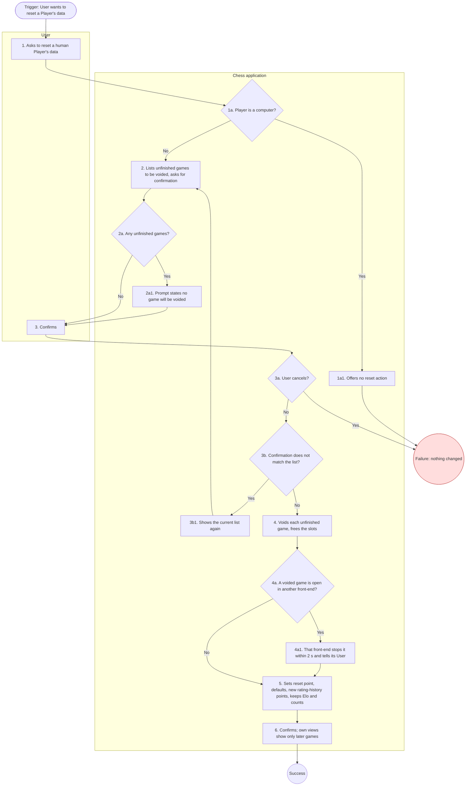

# UC-20: Reset Human Player Data

| Document | Version | Date | Status | Owner | Approver |
|---|---|---|---|---|---|
| docs/use_cases/UC-20_reset_human_player_data.md | **0.3 (draft)** | 2026-10-28 | **DRAFT. Not baselined.** Derived from requirements v1.0 Amendment 3 (CR-5), architecture v1.0 amendment 3 and functional_decomp v0.3 | Systems engineer role (Claude), for Brian Prascher | Brian Prascher (user): approval **required**, not given |

**Goal in Context:** The User wants a human Player to start afresh, as seen in that Player's own views, without losing the Player's Elo ratings.

**Scope:** Chess application (the system under discussion, SuD): CLI front-end, GUI (browser tab and desktop webview), `chess-app` core and the data store, as named in the architecture context diagram. Black box.

**Level:** User goal

**Primary Actor:** User, acting as a human Player

**Supporting Actors:** None.

**Stakeholders and Interests:**
- Reset Player: a clean history, statistics and preferences, with the earned ratings kept (PLY-7).
- Opponents, human and computer: games against the reset Player stay in their history and statistics, unchanged; a game voided by the reset changes none of their ratings, counts or statistics (PLY-7, CR-1).
- User: a confirmation naming what will be voided prevents accidents.

**Preconditions:** The Player is a human Player. Computer Players cannot be reset (PLY-4, PLY-7).

**Minimal Guarantees:** If cancelled or failed, nothing changes: ratings, games, preferences and unfinished games are as before.

**Success Guarantees:** Every unfinished game of the Player is voided (no result, no rating or statistic effect, termination reason "voided by reset", slots freed for all its human Players). The reset point is set, preferences are defaults, a new rating-history point is written on each scale at the kept value. Both Elo ratings and rated-game counts (hence K) are unchanged. The Player's own views show only games after the reset. Opponents' history and statistics are unchanged.

**Trigger:** The User chooses to reset a human Player's data.

**Main Success Scenario:**

1. User asks to reset a human Player's data.
2. System lists the Player's unfinished games, stating that each will be voided, and asks for confirmation.
3. User confirms.
4. System voids each unfinished game, and frees its slots.
5. System sets the reset point, restores default preferences, writes a new rating-history point on each scale at its current value, and keeps both ratings and rated-game counts.
6. System confirms the reset; from now the Player's own views show only games played after it.

**Extensions:**

- **1a.** The selected Player is a computer Player:
  - 1a1. No reset action exists (PLY-7). Use case fails.
- **2a.** The Player has no unfinished game:
  - 2a1. The prompt does not mention voiding. Use case resumes at step 3.
- **3a.** User cancels:
  - 3a1. Nothing changes; unfinished games stay unfinished and resumable (PLY-7). Use case fails (no change).
- **3b.** The confirmation does not match the list of unfinished games (a game started or ended since the prompt):
  - 3b1. System shows the current list and asks again (F-1.8.1, D-30). Use case resumes at step 2.
- **4a.** A game being voided is open in another front-end process (DAT-4):
  - 4a1. That front-end stops the game within 2 s (EST, TBD-30) and tells its User the game was voided by a reset. A move completed in that window stays stored and the game stays voided (D-30). Use case resumes at step 5.
- **4b.** The game is a self-play human–human game of the reset Player:
  - 4b1. The voided game is hidden entirely, because both sides are the reset Player (PLY-7). Use case resumes at step 5.

**Technology and Data Variations:**
- A voided human–human or human–computer game stays in the opponent's history marked "voided by reset", can be analysed (ANA-4), and is exported with `Result "*"`, `Termination "abandoned"`, `EndStatus "voided"` (IF-1).
- A voided game is not a resignation: no loss is recorded (RULE-2, PLY-7).

**Special Requirements** (rules that live in the requirements, linked here, not restated):
- Confirmation is enforced by the core so no front-end can skip it (F-2.5.7).

**Related Information:**

| Item | Value |
|---|---|
| Priority | Must (every agreed requirement is Must, requirements Q56). Use case ranking: TBD |
| Frequency | TBD (no usage data exists) |
| Performance target | None of its own. System-wide limits NFR-1 and NFR-8 apply. |
| Channels to actors | CLI TUI or plain mode, browser tab, or desktop window. |
| Includes (`<<include>>`) | None |
| Extends (`<<extend>>`) | None |
| Extended by / included by | Voids games of UC-6 and UC-7 (extension *b). |
| Open issues | None new. Reset is allowed with unfinished games by user decision CR-1, 2026-10-27. (register: [README.md](README.md) section 8) |

**Traceability:**

| Kind | IDs |
|---|---|
| Requirements | PLY-7, PLY-4, GAME-4, RULE-5, DAT-4, ELO-1, ELO-2, UI-2, UI-5, ANA-4, UI-1, IF-1, UI-12 |
| Functions (functional_decomp v0.3) | F-1.8, F-1.8.1, F-1.8.2, F-1.8.3, F-2.6.4, F-2.5.7, F-4.3 |
| Architecture | See requirements allocation, architecture 10.1. |

## Activity diagram

Mermaid has no UML activity diagram type, so this is a `flowchart` that follows the step and extension numbers of this use case (se-use-cases 4.2). It is regenerated from the text; if the text changes, change both.

**Diagram-text conformance:**

| Use case element | Diagram node | Match |
|---|---|---|
| Step 1 | S1 | Yes |
| Step 2 | S2 | Yes |
| Step 3 | S3 | Yes |
| Step 4 | S4 | Yes |
| Step 5 | S5 | Yes |
| Step 6 | S6 | Yes |
| Ext 1a / 1a1 | D1a / S1a1 | Yes |
| Ext 2a / 2a1 | D2a / S2a1 | Yes |
| Ext 3a | D3a to FAIL | Yes |
| Ext 3b / 3b1 | D3b / S3b1 | Yes |
| Ext 4a / 4a1 | D4a / S4a1 | Yes |

## Change log

| Version | Date | Change |
|---|---|---|
| 0.1 | 2026-10-27 | First draft. |
| 0.2 | 2026-10-28 | CR-4: UI-12 added to the trace (confirmation of destructive actions). |
| 0.3 | 2026-10-28 | Consistency pass (requirements Amendment 3, CR-5): baseline references updated to architecture amendment 3 and functional_decomp v0.3; version aligned across the set. |
