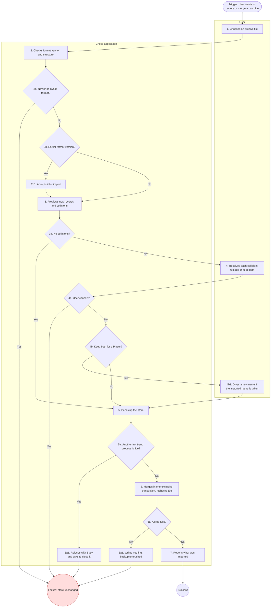

# UC-25: Import Full-Data Archive

| Document | Version | Date | Status | Owner | Approver |
|---|---|---|---|---|---|
| docs/use_cases/UC-25_import_full_data_archive.md | **1.0** | 2026-10-28 | **Baselined v1.0, 2026-10-28** (approved by the user). Derived from requirements v1.0 Amendment 3 (CR-5), architecture v1.0 amendment 3 and functional_decomp v1.0 | Systems engineer role (Claude), for Brian Prascher | Brian Prascher (user): **approved 2026-10-28** |

**Goal in Context:** The User wants to bring the contents of an export archive back into the store, merged with what is there, so that data can be restored or moved to another Mac.

**Scope:** Chess application (the system under discussion, SuD): CLI front-end, GUI (browser tab and desktop webview), `chess-app` core and the data store, as named in the architecture context diagram. Black box.

**Level:** User goal

**Primary Actor:** User, acting as a human Player

**Supporting Actors:** None.

**Stakeholders and Interests:**
- User: nothing is lost or silently overwritten; a failed import changes nothing.
- Existing Players: collisions are decided by the User, not by the program (DAT-2).
- Project owner: a version-N store is never corrupted by a newer archive (IF-5).

**Preconditions:** An archive made by UC-24 exists. No other front-end process is running (the import is exclusive, architecture 7.4).

**Minimal Guarantees:** The store is unchanged on cancel or on any failure. A backup copy exists before any write (D-17).

**Success Guarantees:** Non-colliding records are added. Each collision is replaced or kept as a distinct record, as the User chose. Each Player's Elo invariant was rechecked.

**Trigger:** The User chooses to import a full-data archive (`chess import data <file.zip>` in the CLI).

**Main Success Scenario:**

1. User chooses an archive file.
2. System checks the archive's format version and structure.
3. System previews the import: records to add and records that collide with an existing Player UUID, game id, or Player name.
4. User resolves each collision: replace the existing record or keep both, optionally applying a choice to all remaining collisions.
5. System takes a backup copy of the store.
6. System merges the archive in one exclusive transaction and rechecks each Player's Elo.
7. System reports what was imported.

**Extensions:**

- **2a.** The archive has a newer format version, or is not a valid archive:
  - 2a1. System rejects it with a message (IF-5, NFR-9). Use case fails; the store is unchanged.
- **2b.** The archive has an earlier format version:
  - 2b1. System accepts it (IF-5). Use case resumes at step 3.
- **3a.** There are no collisions:
  - 3a1. Step 4 is skipped. Use case resumes at step 5.
- **4a.** User cancels:
  - 4a1. The store is unchanged (DAT-2). Use case fails.
- **4b.** The User keeps both for a Player:
  - 4b1. The imported Player gets a new UUID and a suffixed name; if that name is taken the User gives a new one (DAT-2, PLY-6, D-17). Use case resumes at step 4.
- **5a.** Another front-end process is live:
  - 5a1. System refuses with `Busy` and asks the User to close it (architecture 7.4). Pending journals are replayed first. Use case fails.
- **6a.** A step fails:
  - 6a1. Nothing is written and the backup is untouched (D-17). Use case fails.

**Technology and Data Variations:**
- Archive layout: `manifest.json`, `games.pgn`, `games.json`, `players.json`, `ratings.json`, `settings.json` (D-29 as amended by IF-5). An archive without `games.json` is accepted; its games get no analysis results.
- Unfinished games in the archive are restored as unfinished. If that would give a Player a second unfinished game in a mode, or a computer a second unfinished computer–computer game, the game is imported as a review-only game with no result, and the preview in step 3 says so. A stored game that is open in a front-end is never replaced by import (DAT-2).
- The prompt offers "apply to all remaining collisions" (DAT-2).

**Related Information:**

| Item | Value |
|---|---|
| Priority | Must (every agreed requirement is Must, requirements Q56). Use case ranking: TBD |
| Frequency | TBD (no usage data exists) |
| Performance target | None of its own. System-wide limits NFR-1 and NFR-8 apply. |
| Channels to actors | CLI TUI or plain mode, browser tab, or desktop window. |
| Includes (`<<include>>`) | None |
| Extends (`<<extend>>`) | None |
| Extended by / included by | Inverse of UC-24. Also used by UC-26 (import from a file). |
| Open issues | None. UG-12 and UG-21 closed 2026-10-28 (CR-4). (register: [README.md](README.md) section 8) |

**Traceability:**

| Kind | IDs |
|---|---|
| Requirements | DAT-2, IF-5, DAT-1, PLY-6, NFR-9, UI-12 |
| Functions (functional_decomp v1.0) | F-6.13, F-6.9, F-6.4 |
| Architecture | See requirements allocation, architecture 10.1. |

## Activity diagram

Mermaid has no UML activity diagram type, so this is a `flowchart` that follows the step and extension numbers of this use case (se-use-cases 4.2). It is regenerated from the text; if the text changes, change both.

**Diagram-text conformance:**

| Use case element | Diagram node | Match |
|---|---|---|
| Step 1 | S1 | Yes |
| Step 2 | S2 | Yes |
| Step 3 | S3 | Yes |
| Step 4 | S4 | Yes |
| Step 5 | S5 | Yes |
| Step 6 | S6 | Yes |
| Step 7 | S7 | Yes |
| Ext 2a | D2a to FAIL | Yes |
| Ext 2b / 2b1 | D2b / S2b1 | Yes |
| Ext 3a | D3a, edge to S5 | Yes |
| Ext 4a | D4a to FAIL | Yes |
| Ext 4b / 4b1 | D4b / S4b1 | Yes |
| Ext 5a / 5a1 | D5a / S5a1 | Yes |
| Ext 6a / 6a1 | D6a / S6a1 | Yes |

## Change log

| Version | Date | Change |
|---|---|---|
| 0.1 | 2026-10-27 | First draft. |
| 0.2 | 2026-10-28 | CR-4: archive layout with `games.json` (IF-5, UG-12 closed); unfinished-game conflicts decided (DAT-2); journals after restore answered in UC-26 (UG-21 closed). |
| 0.3 | 2026-10-28 | Consistency pass (requirements Amendment 3, CR-5): baseline references updated to architecture amendment 3 and functional_decomp v0.3; version aligned across the set. |
| 1.0 | 2026-10-28 | Baselined: approved by the user. Content unchanged from 0.3; references to functional_decomp updated to v1.0. |
