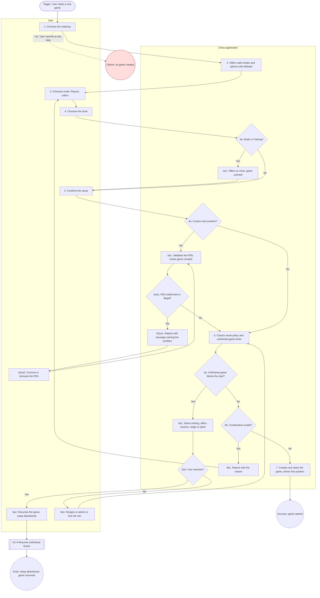

# UC-5: Set Up New Game

| Document | Version | Date | Status | Owner | Approver |
|---|---|---|---|---|---|
| docs/use_cases/UC-5_set_up_new_game.md | **0.3 (draft)** | 2026-10-28 | **DRAFT. Not baselined.** Derived from requirements v1.0 Amendment 3 (CR-5), architecture v1.0 amendment 3 and functional_decomp v0.3 | Systems engineer role (Claude), for Brian Prascher | Brian Prascher (user): approval **required**, not given |

**Goal in Context:** The User wants to choose who plays, in which mode and with which clock and start position, so that a valid game starts.

**Scope:** Chess application (the system under discussion, SuD): CLI front-end, GUI (browser tab and desktop webview), `chess-app` core and the data store, as named in the architecture context diagram. Black box.

**Level:** Subfunction

**Primary Actor:** User, acting as a human Player

**Supporting Actors:** None.

**Stakeholders and Interests:**
- User: only valid choices are offered; defaults save effort.
- Players named in the game: their unfinished-game limits and ratings are respected (GAME-4, ELO-2).
- Project owner: the mode policy is applied in one place (architecture 4.4).

**Preconditions:** An active Player exists (UC-2). The matchup choices are human–human, human–computer, computer–computer.

**Minimal Guarantees:** No game is created. No Player's unfinished-game slot is taken, and no rating or statistic changes.

**Success Guarantees:** A game exists in the chosen mode with its Players, colours, clock and start position fixed; the mode cannot change later (PLY-5); each slot-holding Player's slot is reserved (GAME-4).

**Trigger:** The User chooses to start a new game, or is sent here by UC-6, UC-7 or UC-8.

**Main Success Scenario:**

1. User chooses the matchup.
2. System offers only the modes and options valid for that matchup, with the Player's defaults pre-selected (default mode Strict).
3. User chooses the mode, the Player for each side, and the colour assignment (White, Black or random).
4. System offers the clock choices valid for the mode and User chooses a preset, a custom base time and increment, or untimed.
5. User confirms the setup.
6. System checks the setup against the mode policy and the unfinished-game limits.
7. System creates and starts the game and shows the first position.

**Extensions:**

- **4a.** The mode is Training:
  - 4a1. System offers no clock and sets the game untimed (RULE-4, PLY-5). Use case resumes at step 5.
- **5a.** User supplies a start position as FEN:
  - 5a1. System validates the six-field FEN (IF-3) and marks the game unrated (RULE-8).
  - *Then:* Use case resumes at step 6.
- **5a1a.** The FEN is malformed or describes an illegal position (wrong number of kings, pawn on the first or last rank, side not to move in check):
  - 5a1a1. System rejects it with a message naming the problem (IF-3, NFR-9).
  - 5a1a2. User corrects or removes the FEN. Use case resumes at step 5a1.
- **6a.** A chosen human Player already has an unfinished game in this mode, or a chosen computer Player has an unfinished computer–computer game (computer–computer setup only):
  - 6a1. System starts nothing and offers to resume that game, to resign it (a human's game) or to abort it (a computer–computer game) (GAME-1, GAME-4).
  - 6a2. User resumes the game; setup is abandoned and the game continues as UC-9. Use case ends.
  - 6a3. User resigns (UC-10; in a hot-seat game the System asks which side resigns, then for confirmation) or aborts (UC-8 extension 3b) the blocking game, which frees the slot.
  - *Then:* Use case resumes at step 6.
- **6b.** The combination is invalid, for example Training for human–human, or a clock in Training:
  - 6b1. System rejects it with the reason. Normally such choices are not selectable (GAME-1, PLY-5); this guards scripted and stale requests.
  - *Then:* Use case resumes at step 3.
- **\*a.** User cancels at any step:
  - \*a1. No game is created. Use case ends.

**Technology and Data Variations:**
- Human–computer: the computer Player is chosen from the roster, and the default opponent category from settings is pre-selected (UI-1). A computer can always be chosen, whatever its unfinished human–computer games (GAME-4).
- Human–human (hot-seat): two registered human Players share one screen; the same Player may fill both sides, which is self-play and unrated (PLY-1, PLY-3, ELO-2). Always Strict.
- Computer–computer: the User must choose it explicitly, then chooses two computer Players (the same one twice is allowed, unrated); always Strict (PLY-1).
- Clock presets: untimed, 1+0, 3+2, 5+0, 10+5, 15+10, 30+0, or custom (RULE-4). Strict only.
- Colour pre-selected from the Player's settings (UI-1, GAME-1).
- The offer in extension 6a lists every unfinished game in which the active Player plays on either side, including the second side of a hot-seat game, and every unfinished computer–computer game (GAME-1).
- A repeated start request carrying the same client-supplied game id returns the same game and creates no duplicate (F-2.1.4, architecture 5.6).

**Special Requirements** (rules that live in the requirements, linked here, not restated):
- Invalid combinations are unselectable in all three front-ends (GAME-1).
- The CLI scripted form of setup is UC-27, which applies the same checks without prompts.

**Related Information:**

| Item | Value |
|---|---|
| Priority | Must (every agreed requirement is Must, requirements Q56). Use case ranking: TBD |
| Frequency | TBD (no usage data exists) |
| Performance target | None of its own. System-wide limits NFR-1 and NFR-8 apply. |
| Channels to actors | CLI TUI or plain mode, browser tab, or desktop window. |
| Includes (`<<include>>`) | None |
| Extends (`<<extend>>`) | None |
| Extended by / included by | Included by UC-6, UC-7, UC-8. |
| Open issues | None. UG-7 closed 2026-10-28 (CR-4). (register: [README.md](README.md) section 8) |

**Traceability:**

| Kind | IDs |
|---|---|
| Requirements | GAME-1, GAME-4, PLY-1, PLY-3, PLY-4, PLY-5, RULE-4, RULE-8, IF-3, UI-1, ELO-2, NFR-9 |
| Functions (functional_decomp v0.3) | F-1.5, F-2.1, F-2.1.1, F-2.1.2, F-2.1.3, F-2.1.4, F-2.3.1, F-7.3.4 |
| Architecture | See requirements allocation, architecture 10.1. |

## Activity diagram

Mermaid has no UML activity diagram type, so this is a `flowchart` that follows the step and extension numbers of this use case (se-use-cases 4.2). It is regenerated from the text; if the text changes, change both.

**Diagram-text conformance:**

| Use case element | Diagram node | Match |
|---|---|---|
| Step 1 | S1 | Yes |
| Step 2 | S2 | Yes |
| Step 3 | S3 | Yes |
| Step 4 | S4b | Yes |
| Step 5 | S5 | Yes |
| Step 6 | S6 | Yes |
| Step 7 | S7 | Yes |
| Ext 4a / 4a1 | D4 / S4a1 | Yes |
| Ext 5a / 5a1 | D5a / S5a1 | Yes |
| Ext 5a1a / 5a1a1, 5a1a2 | D5a1 / S5a1a1 / S5a1a2 | Yes |
| Ext 6a / 6a1, 6a2, 6a3 | D6a / S6a1 / D6a2, S6a2, UC9 / S6a3 | Yes |
| Ext 6b / 6b1 | D6b / S6b1 | Yes |
| Ext *a / *a1 | dotted edge S1 to CAN | Yes |

## Change log

| Version | Date | Change |
|---|---|---|
| 0.1 | 2026-10-27 | First draft. |
| 0.2 | 2026-10-28 | CR-4: resume list scope and hot-seat resign from the offer decided (GAME-1, UG-7 closed). |
| 0.3 | 2026-10-28 | Consistency pass (requirements Amendment 3, CR-5): baseline references updated to architecture amendment 3 and functional_decomp v0.3; version aligned across the set. |
