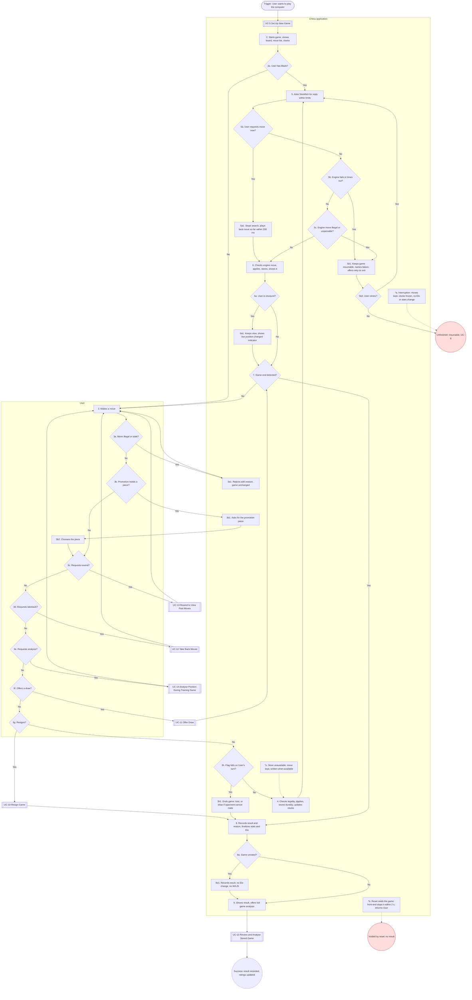

# UC-6: Play Game Against Computer

| Document | Version | Date | Status | Owner | Approver |
|---|---|---|---|---|---|
| docs/use_cases/UC-6_play_game_against_computer.md | **0.3 (draft)** | 2026-10-28 | **DRAFT. Not baselined.** Derived from requirements v1.0 Amendment 3 (CR-5), architecture v1.0 amendment 3 and functional_decomp v0.3 | Systems engineer role (Claude), for Brian Prascher | Brian Prascher (user): approval **required**, not given |

**Goal in Context:** The User wants to play a complete game of chess against a computer Player, in Training or Strict mode, so that they enjoy a fair game under FIDE rules and their rating reflects the result.

**Scope:** Chess application (the system under discussion, SuD): CLI front-end, GUI (browser tab and desktop webview), `chess-app` core and the data store, as named in the architecture context diagram. Black box.

**Level:** User goal

**Primary Actor:** User, acting as a human Player

**Supporting Actors:** Stockfish engine (block `stockfish`, bundled and pinned; driven over UCI)

**Stakeholders and Interests:**
- User (human Player): legal, correctly adjudicated play; no completed move ever lost; a rating that changes only when it should.
- Computer Player: its rating and statistics change only after rated games; its engine settings never change (PLY-4, ENG-2).
- Other human Players: a computer can be chosen by several humans at the same time (GAME-4).
- Screen-reader and keyboard-only users: the whole game is operable and announced (UI-4, UI-6, UI-8).
- Project owner: engine moves are always legal, the app never enters an illegal state (NFR-3), nothing leaves the Mac (NFR-4).

**Preconditions:** An active human Player exists (UC-2). The Player has no unfinished game in the chosen mode, or has resolved it (UC-5 extension 6a). The engine is bundled with the app (IF-4).

**Minimal Guarantees:** Every completed move is stored. An interruption leaves the game unfinished and resumable with each clock at its last recorded value, with no change to any rating or statistic (RULE-5, GAME-4, NFR-2). A failed finalisation does not leave a half-applied result (F-2.6.5 is one transaction).

**Success Guarantees:** The game ended by a rule, a clock or an agreed draw, or by resignation. Result and termination reason are stored. Statistics are updated. If the game is rated (standard start, not self-play), both Players' Elo changed on the mode's scale (Training or Strict), K = 40 for the first 30 rated games on that scale and 32 after (ELO-1, ELO-2). Training and Strict ratings never mix. The User has been offered full-game analysis.

**Trigger:** The User chooses to start a human–computer game.

**Main Success Scenario:**

1. User sets up a human–computer game (includes UC-5).
2. System starts the game and shows the board from the User's side, the move list and, in a timed game, the clocks.
3. User makes a move.
4. System checks the move for legality, applies it, stores it durably, and updates the clocks.
5. System asks Stockfish for the computer's reply within the computer's think-time and clock limits, and receives it.
6. System checks the engine's move for legality, applies it, stores it, and shows it.
7. User and System repeat steps 3 to 6 until the System detects the end of the game (checkmate, stalemate, threefold repetition, fifty-move rule, insufficient material, flag fall, agreed draw or resignation).
8. System records the result and termination reason and finalises the game in one transaction: statistics and, when the game is rated, Elo for both Players on the mode's scale.
9. System shows the result and offers full-game analysis (UC-15).

**Extensions:**

- **2a.** The User plays Black:
  - 2a1. The computer moves first: System resumes at step 5.
- **3a.** The move is illegal or stale (wrong turn, into check, pinned piece, castling through check, outdated ply):
  - 3a1. System rejects it with a reason and leaves the game unchanged (RULE-1, NFR-9, F-2.2.3).
  - 3a2. User tries again. Use case resumes at step 3.
- **3b.** The move is a pawn promotion:
  - 3b1. System asks which piece (RULE-1).
  - 3b2. User chooses the piece. Use case resumes at step 4.
- **3c.** User asks to rewind to view past moves:
  - 3c1. Rewind as UC-13. Use case resumes at step 3.
- **3d.** User asks for a takeback (Training only):
  - 3d1. Takeback as UC-12. Use case resumes at step 3.
- **3e.** User asks for analysis (Training only, own turn):
  - 3e1. Analysis as UC-14. Use case resumes at step 3.
- **3f.** User offers a draw:
  - 3f1. Offer as UC-11. The use case then continues at step 7: an accepted draw is detected there as the end of the game, and a declined offer sends the use case back to step 3.
- **3g.** User resigns:
  - 3g1. Resign as UC-10. Use case continues at step 8 with a loss for the User.
- **3h.** The User's flag falls:
  - 3h1. System ends the game as a loss for the User, or a draw if the computer cannot checkmate by any legal sequence (RULE-4).
  - *Then:* Use case continues at step 8.
- **5a.** User asks the computer to move now:
  - 5a1. User gives the "move now" command: `movenow` or F2 in the TUI, the "Move now" button or F2 in the GUI (ENG-5, CLI-4, GUI-4). System stops the search and plays the best move found so far within 200 ms (EST). Use case resumes at step 6.
- **5b.** The engine crashes, cannot start, does not answer a readiness check within 5 s (EST), or does not return a move within 2 s (EST) after the move's time limit:
  - 5b1. System keeps the game resumable with every move preserved, shows a message naming the failure and offering retry or exit (ENG-4, NFR-9). The side to move keeps its clock running (D-15).
  - 5b2. If the User retries, the System restarts the engine and resumes at step 5.
  - 5b3. If the User exits, the game stays unfinished (UC-9). Use case ends.
- **5c.** The engine returns an illegal or unparsable move:
  - 5c1. System treats it as an engine failure and continues as 5b (NFR-3, F-3.5).
- **6a.** The User is rewound when the computer's move arrives:
  - 6a1. System leaves the view where it is and shows a "live position has changed" indicator (GAME-3). Use case resumes at step 7.
- **8a.** The game is unrated (custom start position):
  - 8a1. System stores the result but changes no rating and counts the game in no W/L/D total or aggregate; the game is listed in history marked "custom start" (ELO-2, RULE-8, UI-2). Use case resumes at step 9.
- **\*a.** An interruption occurs (crash, process kill, power loss, closed app or tab, quit):
  - \*a1. System keeps every completed move, freezes each clock at its last recorded value, and leaves the game unfinished, with no effect on any rating or statistic (RULE-5, GAME-4, NFR-2). The User resumes with UC-9. Use case ends.
- **\*b.** A reset of this Player's data voids the game while it is open (UC-20):
  - \*b1. The front-end stops the game within 2 s (EST) and tells the User it was voided by a reset (PLY-7). Moves completed in that window stay stored. Use case ends; no result.
- **\*c.** The data store is unavailable when a move completes:
  - \*c1. System keeps the move and writes it when the store is available (NFR-2). Play continues.

**Technology and Data Variations:**
- Front-end: CLI TUI (typed SAN or coordinate moves in the input line; commands `resign`, `draw`, `undo`, `movenow`, `analyze`, `back`, `forward`, `live`, `save`, `quit`) or plain line-oriented mode; GUI in browser or desktop (mouse click and drag, keyboard cursor with arrows/Space/Enter, typed algebraic notation, touch tap-tap) (CLI-3, CLI-4, GUI-2).
- Every input method of a front-end is usable at all times; there is no input-method setting (UI-1).
- Mode: Training (human–computer only, untimed, takeback and own-turn analysis, Training Elo) or Strict (default; clocks, no analysis during play, Strict Elo) (PLY-5).
- Computer Player category: Beginner to Grand Master; engine parameters fixed per Player; think time is the minimum of the Player's limit, the profile's maximum think time and the clock budget (ENG-2, ENG-3, UI-1).
- Assistive technology: GUI announces moves, check, game end and rejected moves to a screen reader without moving focus (UI-6); CLI plain mode (UI-4).

**Special Requirements** (rules that live in the requirements, linked here, not restated):
- RULE-1 FIDE rules (with the deliberate automatic draws at threefold repetition and fifty-move, and the dead-position limit).
- ENG-3 think time at most the configured maximum, default at most 3 s at the top category (EST).
- NFR-2 no completed move lost; NFR-3 engine moves legal; NFR-8 visible feedback within 100 ms (EST) while the engine searches; NFR-9 error messages.
- UI-7 contrast, UI-8 focus, GUI-5 scalable layout, CLI-1 80x24, UI-11 English.

**Related Information:**

| Item | Value |
|---|---|
| Priority | Must (every agreed requirement is Must, requirements Q56). Use case ranking: TBD |
| Frequency | TBD (no usage data exists) |
| Performance target | ENG-3, NFR-8 (see special requirements). |
| Channels to actors | CLI TUI or plain mode, browser tab, or desktop window. |
| Includes (`<<include>>`) | UC-5 |
| Extends (`<<extend>>`) | None |
| Extended by / included by | Extended by UC-10, UC-11, UC-12, UC-13, UC-14. Leads to UC-15. Resumed by UC-9. |
| Open issues | None. UG-3, UG-5, UG-6, UG-14 and UG-18 closed 2026-10-28 (CR-4). (register: [README.md](README.md) section 8) |

**Traceability:**

| Kind | IDs |
|---|---|
| Requirements | PLY-1, PLY-4, PLY-5, PLY-7, GAME-1, GAME-3, GAME-4, RULE-1, RULE-2, RULE-3, RULE-4, RULE-5, RULE-8, ENG-1, ENG-2, ENG-3, ENG-4, ENG-5, DAT-1, DAT-3, DAT-4, ELO-1, ELO-2, UI-1, UI-3, UI-4, UI-6, UI-7, UI-8, UI-11, CLI-1, CLI-2, CLI-3, CLI-4, GUI-1, GUI-2, GUI-3, GUI-4, GUI-5, NFR-2, NFR-3, NFR-4, NFR-8, NFR-9, IF-4, UI-2 |
| Functions (functional_decomp v0.3) | F-2.2.1, F-2.2.2, F-2.2.3, F-2.2.4, F-2.3.1, F-2.4.1, F-2.4.2, F-2.4.3, F-2.6.1, F-2.6.4, F-2.6.5, F-2.6.6, F-3.1, F-3.2, F-3.3, F-3.4, F-3.5, F-3.6, F-3.7, F-4.1, F-4.2, F-4.3, F-4.4, F-4.6, F-5.5, F-6.2, F-6.3, F-7.1.1, F-7.1.2, F-7.1.3, F-7.2.1, F-7.2.2, F-7.2.3, F-7.2.5, F-7.2.6, F-7.4.1, F-7.4.2, F-7.4.6 |
| Architecture | architecture 4.3 (state machine), 4.4 (policy table), 5.3 (human move then computer reply), 5.4 (game end, rating, analysis) |

## Activity diagram

Mermaid has no UML activity diagram type, so this is a `flowchart` that follows the step and extension numbers of this use case (se-use-cases 4.2). It is regenerated from the text; if the text changes, change both.

**Diagram-text conformance:**

| Use case element | Diagram node | Match |
|---|---|---|
| Step 1 (include UC-5) | S1 | Yes |
| Step 2 | S2 | Yes |
| Step 3 | S3 | Yes |
| Step 4 | S4 | Yes |
| Step 5 | S5 | Yes |
| Step 6 | S6 | Yes |
| Step 7 | S7 (diamond: repeat 3-6 or continue) | Yes |
| Step 8 | S8 | Yes |
| Step 9 | S9, UC15 | Yes |
| Ext 2a / 2a1 | D2a / edge to S5 | Yes |
| Ext 3a / 3a1 | D3a / S3a1 | Yes |
| Ext 3b / 3b1, 3b2 | D3b / S3b1 / S3b2 | Yes |
| Ext 3c | D3c / UC13 | Yes |
| Ext 3d | D3d / UC12 | Yes |
| Ext 3e | D3e / UC14 | Yes |
| Ext 3f | D3f / UC11 | Yes |
| Ext 3g | D3g / UC10 | Yes |
| Ext 3h / 3h1 | D3h / S3h1 | Yes |
| Ext 5a / 5a1 | D5a / S5a1 | Yes |
| Ext 5b / 5b1, 5b2 | D5b / S5b1 / D5b2 / UNF | Yes |
| Ext 5c | D5c, edge to S5b1 | Yes |
| Ext 6a / 6a1 | D6a / S6a1 | Yes |
| Ext 8a / 8a1 | D8a / S8a1 | Yes |
| Ext *a, *b, *c | NA, NB, NC with dotted edges | Yes |

## Change log

| Version | Date | Change |
|---|---|---|
| 0.1 | 2026-10-27 | First draft. |
| 0.2 | 2026-10-28 | CR-4: move-now controls (ENG-5, UG-3), draw and takeback pointers, custom-start games out of W/L/D (UI-2, UG-18), `save` (UG-14); issues UG-3, 5, 6, 14, 18 closed. |
| 0.3 | 2026-10-28 | Consistency pass (requirements Amendment 3, CR-5): baseline references updated to architecture amendment 3 and functional_decomp v0.3; version aligned across the set. |
