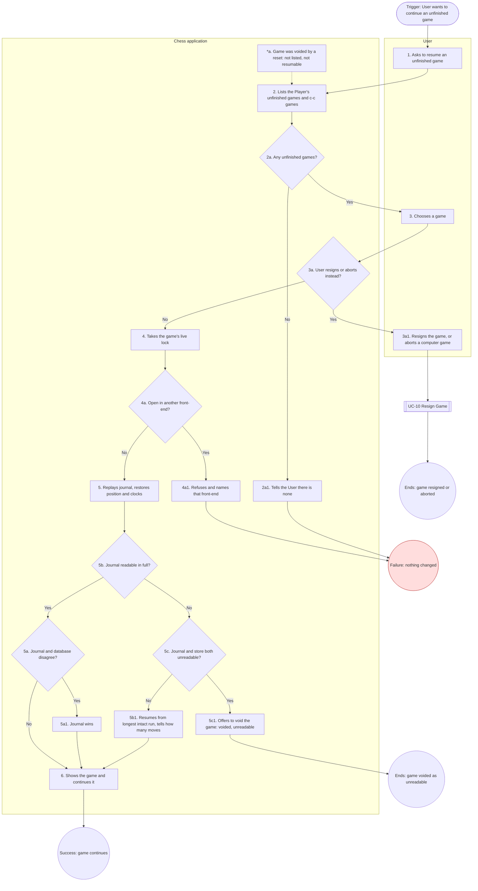

# UC-9: Resume Unfinished Game

| Document | Version | Date | Status | Owner | Approver |
|---|---|---|---|---|---|
| docs/use_cases/UC-9_resume_unfinished_game.md | **0.3 (draft)** | 2026-10-28 | **DRAFT. Not baselined.** Derived from requirements v1.0 Amendment 3 (CR-5), architecture v1.0 amendment 3 and functional_decomp v0.3 | Systems engineer role (Claude), for Brian Prascher | Brian Prascher (user): approval **required**, not given |

**Goal in Context:** The User wants to continue a game that was interrupted, exactly where it stopped, so that no moves or time are lost.

**Scope:** Chess application (the system under discussion, SuD): CLI front-end, GUI (browser tab and desktop webview), `chess-app` core and the data store, as named in the architecture context diagram. Black box.

**Level:** User goal

**Primary Actor:** User, acting as a human Player

**Supporting Actors:** None.

**Stakeholders and Interests:**
- User: every completed move is there, each clock at its last recorded value (RULE-5).
- Opponent (human or computer): the game is neither lost nor changed by the interruption (GAME-4).
- Project owner: two front-ends never make moves in the same game (DAT-4).

**Preconditions:** The active Player has at least one unfinished game (suspended by an interruption, or left through `quit` or an engine-failure exit).

**Minimal Guarantees:** Stored moves and clocks are unchanged. No rating or statistic changes.

**Success Guarantees:** The game is open in this front-end only, with every completed move and each clock at its last recorded value, and play continues as UC-6, UC-7 or UC-8 from the point of interruption.

**Trigger:** The User chooses "Resume game" from the home menu, or is offered resume by setup (UC-5 6a).

**Main Success Scenario:**

1. User asks to resume an unfinished game.
2. System lists the unfinished games in which the Player plays on either side, and every unfinished computer–computer game (GAME-1).
3. User chooses a game.
4. System takes the game's live lock, so that only this front-end process has it open.
5. System replays the move journal, restores the position, and sets each clock to its last recorded value.
6. System shows the game and continues it.

**Extensions:**

- **2a.** There are no unfinished games:
  - 2a1. System tells the User. Use case fails with nothing changed.
- **3a.** The User resigns the game, or aborts a computer–computer game, instead of resuming:
  - 3a1. User resigns (UC-10, in a hot-seat game the System asks which side, then for confirmation) or aborts (UC-8 extension 3b), with confirmation. The game ends and the slot is freed. Use case ends.
- **4a.** The game is open in another front-end process:
  - 4a1. System refuses and names the front-end that has it open (DAT-4, NFR-9).
  - 4a2. If the owning process has stopped, the game is resumable at once (TBD-28 = 0 s). Use case fails.
- **5a.** The journal and the database disagree:
  - 5a1. The journal wins (NFR-2, D-23). Use case resumes at step 6.
- **5b.** The journal cannot be read:
  - 5b1. System resumes from the longest intact run of moves that the journal or the store holds, and tells the User how many moves were recovered (DAT-7, NFR-9). A torn last record is not an error: it was never acknowledged. Use case resumes at step 6.
- **5c.** Neither the journal nor the store holds a readable game:
  - 5c1. System offers to void the game: no result, reason "voided: unreadable", no change to any Elo or statistic, and the slot is freed (DAT-7). Use case ends.
- **\*a.** A game was voided by a reset of one of its human Players:
  - \*a1. It is no longer unfinished: it is not listed and cannot be resumed (PLY-7, RULE-5).

**Technology and Data Variations:**
- Clocks are paused while the app is closed; resume continues from the last recorded value, recorded at every completed move and at least once per second while a clock runs (EST) (RULE-5).
- Closing a browser tab suspends the game's clock and state even while `chess serve` runs (RULE-5, D-14).
- The listing and the resumed game work the same in CLI, web and desktop, subject to the one-front-end rule (DAT-4).

**Special Requirements** (rules that live in the requirements, linked here, not restated):
- NFR-2: no completed move lost after any interruption; DAT-4: one front-end per live game.

**Related Information:**

| Item | Value |
|---|---|
| Priority | Must (every agreed requirement is Must, requirements Q56). Use case ranking: TBD |
| Frequency | TBD (no usage data exists) |
| Performance target | None of its own. System-wide limits NFR-1 and NFR-8 apply. |
| Channels to actors | CLI TUI or plain mode, browser tab, or desktop window. |
| Includes (`<<include>>`) | None |
| Extends (`<<extend>>`) | None |
| Extended by / included by | Extended by UC-10 (resign from the resume prompt). Entered from UC-5 (6a). Continues as UC-6, UC-7 or UC-8. |
| Open issues | None. UG-7 and UG-17 closed 2026-10-28 (CR-4). (register: [README.md](README.md) section 8) |

**Traceability:**

| Kind | IDs |
|---|---|
| Requirements | RULE-5, GAME-4, DAT-4, NFR-2, RULE-2, GAME-2, PLY-7, DAT-7, GAME-1, NFR-9, NFR-10 |
| Functions (functional_decomp v0.3) | F-2.6.1, F-2.6.2, F-2.6.3, F-2.4.3, F-6.2, F-6.3, F-2.5.3, F-2.5.5, F-7.3.4 |
| Architecture | See requirements allocation, architecture 10.1. |

## Activity diagram

Mermaid has no UML activity diagram type, so this is a `flowchart` that follows the step and extension numbers of this use case (se-use-cases 4.2). It is regenerated from the text; if the text changes, change both.

**Diagram-text conformance:**

| Use case element | Diagram node | Match |
|---|---|---|
| Step 1 | S1 | Yes |
| Step 2 | S2 | Yes |
| Step 3 | S3 | Yes |
| Step 4 | S4 | Yes |
| Step 5 | S5 | Yes |
| Step 6 | S6 | Yes |
| Ext 2a / 2a1 | D2a / S2a1 | Yes |
| Ext 3a / 3a1 | D3a / S3a1 / UC10 | Yes |
| Ext 4a / 4a1 | D4a / S4a1 | Yes |
| Ext 5a / 5a1 | D5a / S5a1 | Yes |
| Ext 5b / 5b1 | D5b / S5b1 | Yes |
| Ext 5c / 5c1 | D5c / S5c1 / END2 | Yes |
| Ext *a | NA dotted edge | Yes |

## Change log

| Version | Date | Change |
|---|---|---|
| 0.1 | 2026-10-27 | First draft. |
| 0.2 | 2026-10-28 | CR-4: resume list scope (GAME-1, UG-7), unreadable journal (DAT-7, UG-17); diagram and conformance table extended with extensions 5b and 5c. |
| 0.3 | 2026-10-28 | Consistency pass (requirements Amendment 3, CR-5): baseline references updated to architecture amendment 3 and functional_decomp v0.3; version aligned across the set. |
